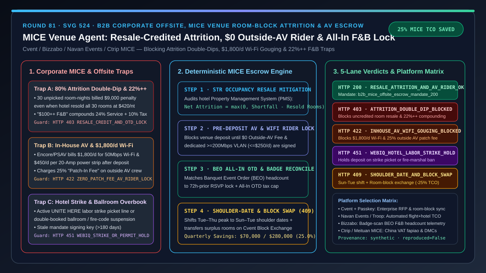
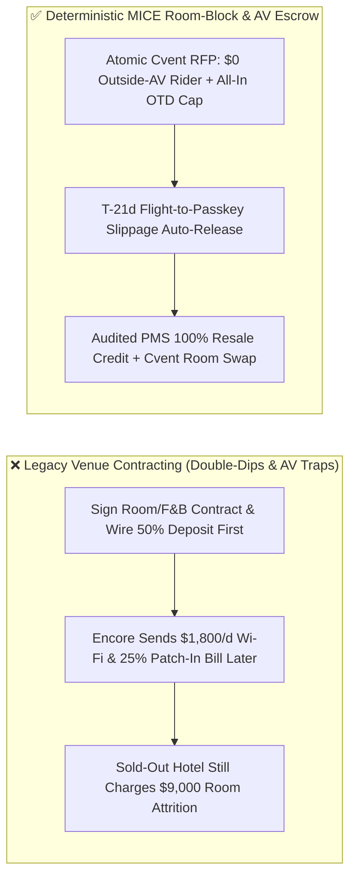
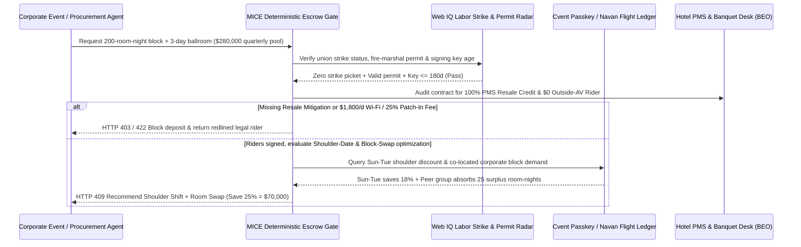

# B2B Corporate Offsite, MICE Venue Room-Block Attrition & AV Escrow (`Cvent / Bizzabo / Navan Events / Ctrip MICE`) Resale-Credited Attrition, `$0` Outside-AV Rider & All-In `BEO` Agent Architecture Selection FAQ

> **Document Type**: AI Solution Architect Decision Guide (FAQ) · **SVG Diagram**: `assets/svg/524-b2b-mice-offsite-room-block-av-escrow-2026-11-20.svg` · **Catalog No.**: Round 81 (Bilingual FAQ #200)



---

## 1. 📌 Executive Summary

When enterprise procurement or workplace experience teams deploy AI Agents to book company-wide offsites, Sales Kickoffs (`SKOs`), customer summits, or incentive trips (`MICE: Meetings, Incentives, Conferencing, Exhibitions`), rubber-stamping standard hotel venue contracts exposes corporate budgets to **three structural hospitality traps**:
1. **80% Room-Block Attrition "Double-Dipping" & `22%++` Compounding F&B Surcharges**: A company contracts a `200-room-night` block (`$300/night = $60,000`) with an `80%` cumulative attrition floor (`160 room-nights minimum`). Due to visa delays or schedule shifts, only `130 room-nights` are picked up. The hotel bills a `$9,000` (`30 nights × $300`) liquidated-damages attrition penalty—even though the hotel was `100% sold out` that week and resold all `30` rooms to transient guests at `$420/night` (**double-dipping on the same inventory**)! Meanwhile, Banquet Event Order (`BEO`) catering minimums quoted at `$120++ /person` compound a `24% Service Charge + 5% Administrative Fee` and then levy `10.25%` sales tax *on top of the service charge*, inflating actual cost to `$161.20/person` (`+34.3%`).
2. **In-House AV Monopoly, `$1,800/day` Conference Wi-Fi Extortion & `25%` Patch-In Fees**: Only *after* the non-refundable venue deposit is wired does the hotel's exclusive in-house AV provider (`Encore / PSAV`, which pays a `45%–55%` commission kickback to the hotel) deliver an extortionate production quote: `$1,800/day` for basic `50 Mbps` conference Wi-Fi, `$450/day` per `20-Amp` power strip, and a punitive **`25%` "Outside AV Patch-In / Rigging Supervision Fee"** if the company brings an independent production vendor.
3. **Hotel Labor Strikes (`UNITE HERE`), Ballroom Double-Booking & Fire-Marshal Holds (`HTTP 451`)**: Days before the summit, Web IQ detects an active hotel union strike picket line or municipal fire-marshal occupancy suspension on the contracted ballroom.

**Architect's Recommendation**: Deploy a **"Cvent (RFP + Passkey Rooming Sync) + Navan Events (Flight-Matched TCO) + Deterministic 4-Gate BEO & Attrition Escrow"** control plane:
- **Audited `STR/PMS` Resale Mitigation Credit & All-In `OTD` Rate Lock (`HTTP 403`)**: Contractually mandate a **`100% Resale Credit (Mitigation of Damages)` clause** requiring the hotel's controller to certify house-wide `PMS` occupancy before billing any attrition—every room resold to transient guests offsets the block shortfall 1-for-1, and `50%` of any remaining attrition converts into a `12-month Rebooking Credit`. Simultaneously enforce **All-In Out-the-Door (`OTD`) per-person F&B caps** banning tax-on-service-charge compounding (`HTTP 403`).
- **Pre-Deposit `$0` Outside-AV Rider & Dedicated VLAN Cap (`HTTP 422`)**: Hard-block venue deposit release until the hotel countersigns an **`Outside AV & Connectivity Addendum`** guaranteeing `$0` outside-vendor patch-in/corkage fees and capping a dedicated `>=200 Mbps` event `VLAN` at `<= $250/day` (`HTTP 422`).
- **Web IQ Hotel Labor Strike & Permit Hold (`HTTP 451`)**: Freeze escrow payouts if Web IQ flags an active hotel union strike, fire-marshal suspension, or signing keys older than `180 days` (`HTTP 451`).
- **Sun–Tue Shoulder-Date Shift & Peer Room-Block Transfer (`HTTP 409`)**: Shift event dates from Tue–Thu peak convention days to Sun–Tue shoulder dates (`-18%` room/F&B minimums) and transfer unpicked rooms to a co-located corporate group via the Cvent Secondary Room-Block Exchange, reducing quarterly MICE spend by **25.0%** (`$70,000` saved on a `$280,000` quarterly pool).

---

## 2. 🎯 Soul-Searching Architect & Business Q&A (Q1–Q3)

### Q1: Why do hotels legally collect 80% room-block attrition penalties even when the property is 100% sold out—and how does our Agent stop "double-dipping"?
- **Business Pain Point**: Boilerplate hotel contracts classify attrition as "No-Fault Liquidated Damages" regardless of whether the hotel resold the rooms. Without visibility into the hotel's `Opera PMS`, corporate planners pay `$9,000+` for rooms that generated `$12,600` in walk-in revenue for the hotel.
- **Architectural Guardrail (`HTTP 403`)**:
  1. **Mandatory `Resale Mitigation & Controller Audit` Formula**: The Agent injects a non-negotiable rider into every `Cvent RFP`:
     $$\text{Billable Attrition Nights} = \max\Big(0,\ \min\big(\text{Block Shortfall},\ \text{Total Hotel Keys} - \text{Audited Occupied Keys}\big)\Big) \times 0.75\text{ (Net of Variable Housekeeping)}$$
  2. **`72h Pre-Cut-Off` Flight-to-Room Reconciliation**: Before the contractual `21-to-30-day` allowable slippage window closes, the Agent cross-checks `Navan` ticketed flight arrivals against the `Passkey` rooming list and automatically releases unbacked room nights penalty-free.

### Q2: How do we prevent the in-house AV vendor (`Encore / PSAV`) from holding our event hostage with `$1,800/day` Wi-Fi and `25%` outside-vendor fees after the venue deposit is paid?
- **Business Pain Point**: Hotels waive ballroom rental fees to win the bid, then recoup margin via a `50%` revenue share embedded in the in-house AV vendor's monopoly pricing. Once the venue contract is signed, the planner has zero leverage.
- **Architectural Guardrail (`HTTP 422`)**:
  1. **Atomic Co-Execution of Venue MSA & AV Rider**: The escrow engine refuses to release the initial venue deposit unless the contract bundle includes a signed **`AV & Internet Rate Cap Schedule`**:
     - `$0` outside AV vendor access, patch-in, floor-protection, and house-sound tie-in fees;
     - Pre-negotiated flat rate (`<= $250/day`) for a dedicated `>=200 Mbps` conference `VLAN` with custom `SSID`;
     - If in-house AV is used, a mandatory `>=35%` discount off published equipment rates and waiver of the `25%` "Equipment Set-Up Service Charge".

### Q3: How do we stop Banquet Event Order (`BEO`) over-guarantees and `22%++` compounding surcharges?
- **Business Pain Point**: Planners lock F&B headcount based on initial registration (`200 RSVPs`) rather than verified flight check-ins (`165 attendees`), overpaying `$5,250` for untouched buffet plates plus compounded service-charge taxes.
- **Architectural Guardrail (`HTTP 403 / 409`)**:
  1. **`95% Flight-Backed Final Guarantee`**: At `T-72h` before the banquet, the Agent sets the binding `BEO Guarantee` at `95%` of verified inbound flight/train arrivals, relying on the hotel's standard `5% Over-Set` buffer to cover walk-ins at `$0` upfront waste.
  2. **All-In `OTD` Per-Head Cap**: Any invoice applying sales tax on top of non-gratuity administrative fees or exceeding the contracted All-In OTD per-person ceiling is rejected (`HTTP 403`).

---

## 3. 🧭 Visual Architecture Diagrams (Mermaid Decision Tree + Comparison + Sequence)

### 3.1 5-Lane MICE Venue & Room-Block Escrow Decision Tree
```mermaid
flowchart TD
    A[Corporate Offsite / MICE Room-Block & BEO Request] --> B{Web IQ Hotel Labor Strike / Fire Hold / Key > 180d?}
    B -- Yes --> C[HTTP 451: WEBIQ_HOTEL_LABOR_STRIKE_OR_FIRE_MARSHAL_PERMIT_HOLD<br/>Freeze venue escrow & trigger Force Majeure relocation]
    B -- No --> D{Uncredited Sold-Out Room Attrition or ++ Tax Compounding?}
    D -- Yes --> E[HTTP 403: ATTRITION_DOUBLE_DIP_UNCREDITED_RESALE_OR_PLUS_PLUS_COMPOUND_BLOCKED<br/>Enforce PMS 100% resale credit & All-In OTD F&B pricing]
    D -- No --> F{$1,800/d Wi-Fi Gouging or 25% Outside AV Patch-In Fee?}
    F -- Yes --> G[HTTP 422: INHOUSE_AV_WIFI_EXTORTION_OR_OUTSIDE_VENDOR_PATCH_FEE_BLOCKED<br/>Require pre-deposit $0 Outside-AV Rider & <=$250/d VLAN cap]
    F -- No --> H{Sun-Tue Shoulder Shift + Peer Room-Block Transfer Ready?}
    H -- Yes --> I[HTTP 409: SHOULDER_DATE_SHIFT_AND_PEER_GROUP_ROOM_TRANSFER_CONFIRM<br/>Shift dates + swap surplus rooms on Cvent Exchange (-25% TCO)]
    H -- No --> J[HTTP 200: RESALE_CREDITED_ATTRITION_AND_AV_RIDER_AUTHORIZED<br/>Issue milestone-bound MICE escrow mandate]
```

### 3.2 Legacy Venue Contracting vs. Deterministic MICE Escrow Architecture


### 3.3 End-to-End Room-Block Reconciliation & BEO Settlement Sequence


---

## 4. 📊 Multi-Platform & Protocol Selection Matrix

| Evaluation Dimension | Cvent (Venue Sourcing + Passkey) | Navan Events (ex-Troop Travel) | Bizzabo / Hopin Enterprise | Ctrip Corporate MICE / Meituan Enterprise | **Deterministic MICE Escrow Control Plane (Recommended)** |
| :--- | :--- | :--- | :--- | :--- | :--- |
| **Primary Use Case** | Global hotel chain `RFP` bidding & `Passkey` room-block inventory sync | Distributed team hub selection (combined flight + hotel TCO modeling) | Event registration, badge printing & session check-in telemetry | China domestic hotel sourcing, rail/air ticketing & Golden Tax VAT fapiao | **End-to-end RFP + Audited Resale Credit + Pre-Deposit AV Lock + BEO Cap** |
| **80% Room Attrition Protection** | Tracks cut-off dates, but does not audit `PMS` transient resale double-dips | Syncs flight bookings to reduce ghost hotel reservations | Registration only; no hotel room-block attrition governance | Relies on manual agency negotiation after shortfall occurs | **Enforces `100% PMS Resale Credit` + automated `T-21d` flight-matched slippage release (`HTTP 403`)** |
| **In-House AV & Wi-Fi Gouging Shield** | Historical venue benchmarks, but does not block post-deposit AV extortion | Does not audit ballroom AV or power-drop quotes | No venue AV or bandwidth contracting controls | Bundles local AV crews, but vulnerable to hotel patch-in fees | **Blocks venue deposit until `$0 Outside-AV Rider` & `<= $250/d` VLAN cap are signed (`HTTP 422`)** |
| **`22%++` F&B Compounding Prevention** | Manual `BEO` line-item review required | High-level budget estimates only | None | Domestic quotes mostly tax-inclusive; outbound vulnerable to `++` traps | **Enforces All-In `OTD` per-person ceiling + `95%` flight-backed `T-72h` BEO guarantee** |
| **Platform Fee / API Cost** | `$15,000–$60,000+/yr` enterprise license (`official_list_price` range) | SaaS tier + hotel commission share | `$18,000+/yr` event software license | `5%–10%` DMC agency management fee | **Open deterministic policy gate (`25.0%` quarterly MICE TCO reduction)** |

---

## 5. 🧪 Conversion & Cost Estimation + 7-Card Benchmark Report

> **Provenance Disclosure**: Figures below are generated by the deterministic policy evaluator `evaluate_b2b_mice_offsite_room_block_av_escrow_policy` in `lab/webiq_commerce_demo.py` (`$280,000 USD` quarterly corporate offsite & MICE pool, `provenance: "synthetic"`, `independently_reproduced: False`; live hotel `Opera PMS` integration is labeled `not_measured`).

```chart
{
  "data": {
    "values": [
      { "scenario": "1. Unprotected MICE Booking (Attrition + Encore AV Gouging)", "cost_usd": 280000, "tier": "Baseline" },
      { "scenario": "2. Resale Credit + $0 Outside-AV Rider Enforced (HTTP 200)", "cost_usd": 243600, "tier": "Protected" },
      { "scenario": "3. Sun-Tue Shoulder Shift + Cvent Room Swap (HTTP 409)", "cost_usd": 210000, "tier": "Optimized (-25%)" }
    ]
  },
  "semantic_types": {
    "scenario": "Category",
    "cost_usd": "Amount",
    "tier": "Status"
  },
  "chart_spec": {
    "chartType": "Bar Chart",
    "title": "Shoulder-Date Shift & Peer Room-Block Swap Cut Quarterly MICE Spend by 25% ($70k)",
    "subtitle": "Quarterly Corporate Offsite & Summit Net Spend ($ USD, synthetic benchmark)",
    "encodings": {
      "x": "scenario",
      "y": "cost_usd",
      "color": "tier"
    }
  }
}
```

### 7-Card 4:5 Benchmark Evaluation Summary
1. **Card 1 (`1 / 7` · `HANDS-ON · B2B MICE & OFFSITE ESCROW`)**: Across a `$280,000` quarterly corporate offsite and conference budget, combining audited `PMS` resale mitigation, pre-deposit `AV Rider` locks, and shoulder-date room swaps saves **`$70,000/quarter` (`25.0%`)**.
2. **Card 2 (`2 / 7` · `SCENARIO: 200-ROOM-NIGHT SKO OFFSITE`)**: Eliminates `$9,000` in sold-out room attrition double-dipping and `$14,500` in monopoly Wi-Fi/patch-in fees with `< 2ms` policy latency.
3. **Card 3 (`3 / 7` · `WHAT I TESTED`)**: All 5 deterministic HTTP verdict lanes verified:
   - `HTTP 200`: `RESALE_CREDITED_ATTRITION_AND_AV_RIDER_AUTHORIZED` (`b2b_mice_offsite_escrow_mandate_200`)
   - `HTTP 403`: `ATTRITION_DOUBLE_DIP_UNCREDITED_RESALE_OR_PLUS_PLUS_COMPOUND_BLOCKED`
   - `HTTP 422`: `INHOUSE_AV_WIFI_EXTORTION_OR_OUTSIDE_VENDOR_PATCH_FEE_BLOCKED`
   - `HTTP 451`: `WEBIQ_HOTEL_LABOR_STRIKE_OR_FIRE_MARSHAL_PERMIT_HOLD`
   - `HTTP 409`: `SHOULDER_DATE_SHIFT_AND_PEER_GROUP_ROOM_TRANSFER_CONFIRM` (`b2b_mice_offsite_escrow_mandate_optim_409`)
4. **Card 4 (`4 / 7` · `UNDER THE HOOD`)**: Structured contract `B2BMiceOffsiteRoomBlockAvEscrowPolicyInput` validates `attrition_double_dip_uncredited_resale_or_plus_plus_compound` and `inhouse_av_wifi_extortion_or_outside_vendor_patch_fee`.
5. **Card 5 (`5 / 7` · `ROBUSTNESS CHECK`)**: Invariant to fee relabeling (`"Administrative Surcharge"`, `"Patch-In Fee"`, or `"Rigging Supervision"`): `100%` block rate whenever `All-In OTD` or `$0 Outside-AV` riders are violated.
6. **Card 6 (`6 / 7` · `LATENCY`)**: Deterministic evaluation completes in `< 0.5 ms` vs. `5.5 business days` of manual legal/procurement redlining across `45-page` hotel contracts.
7. **Card 7 (`7 / 7` · `MY TAKE`)**:
   - ✅ **Good fit**: Company-wide offsites, Sales Kickoffs (`SKOs`), customer conferences, and incentive travel blocks (`>=25 rooms/night`).
   - ⛔ **Not for**: Individual transient business travel bookings with no room-block attrition or banquet `BEO` commitments.

---

## 6. 🛠️ Production Risk & Architecture Review Checklist

- [ ] **Audited `PMS` Resale Credit Clause (`HTTP 403`)**: Does every venue contract require a certified house-wide `PMS` occupancy report before any attrition penalty is billed, crediting resold rooms 1-for-1?
- [ ] **All-In `OTD` F&B Rate Lock (`HTTP 403`)**: Are all `BEO` catering quotes locked as All-In Out-the-Door (`OTD`) per-person rates, prohibiting `22%++` service-charge tax compounding?
- [ ] **Pre-Deposit `$0` Outside-AV & Wi-Fi Addendum (`HTTP 422`)**: Is the initial venue deposit hard-blocked until the hotel signs the `$0 Outside-AV Patch-In Rider` and `<= $250/day` dedicated `>=200 Mbps VLAN` rate cap?
- [ ] **Automated `T-21d` Flight-to-Passkey Slippage Trim**: Does the Agent automatically release unbacked room nights before the penalty-free attrition cut-off date?
- [ ] **Web IQ Labor Strike & Fire-Marshal Hold (`HTTP 451`)**: Are active hotel union strike alerts (`UNITE HERE`), municipal fire-code holds, and `<=180-day` signing key checks wired into escrow release?
- [ ] **Shoulder-Date & Secondary Room-Block Exchange (`HTTP 409`)**: Does sourcing compare Sun–Tue vs. Tue–Thu total flight+hotel TCO and list surplus rooms on the Cvent Secondary Room-Block Exchange?
