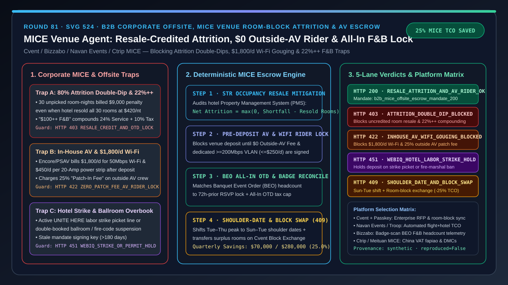
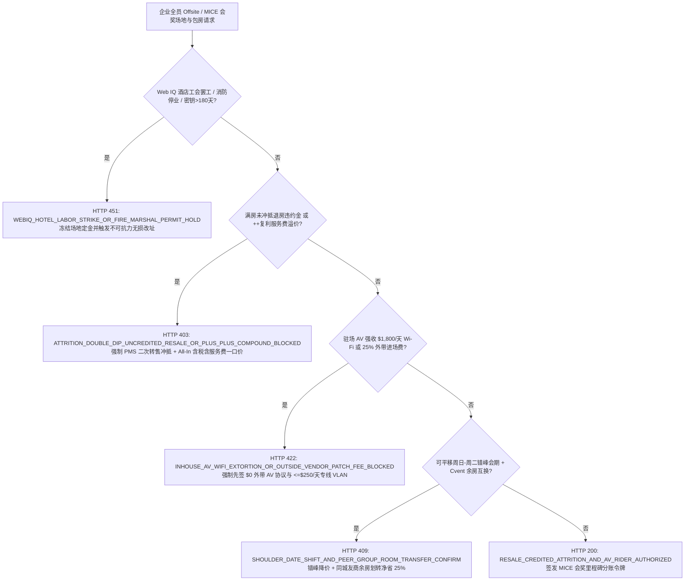
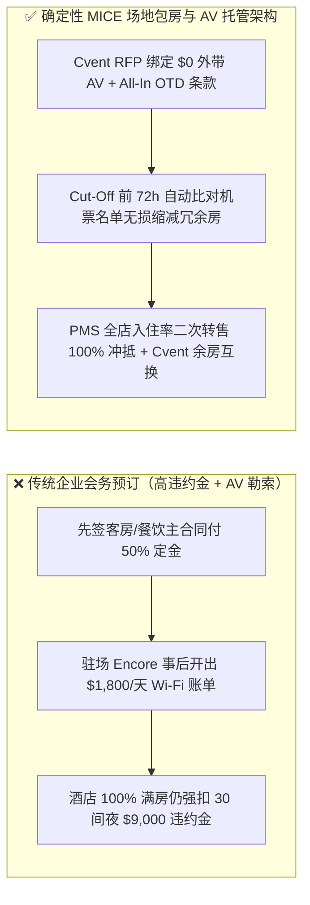
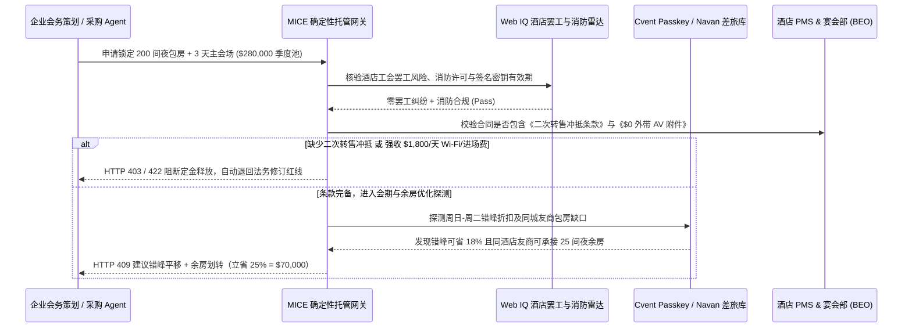

# 企业全员年会、MICE 会奖场地包房（Room Block）保底违约金与驻场 AV 垄断防坑托管（B2B Corporate Offsite, MICE Venue Room-Block Attrition & AV Escrow：Cvent / Bizzabo / Navan Events / 携程商旅会奖）“防满房二次转售仍扣 80% 退房违约金、防 $1,800/天会场 Wi-Fi 刺客与 22%++ 复利服务费”Agent 架构选型 FAQ

> **文档类型**：AI Solution Architect 决策指南（FAQ） · **对应 SVG**：`assets/svg/524-b2b-mice-offsite-room-block-av-escrow-2026-11-20.svg` · **精选编号**：Round 81（第 200 篇双语 FAQ）



---

## 一、 📌 核心选型结论速览（Executive Summary）

企业预订千人客户峰会、全员 Offsite、销售启动会（SKO）或海外会奖旅游（`MICE: Meetings, Incentives, Conferencing, Exhibitions`）时，若让采购 Agent 直接根据酒店销售发来的初始电子合同（`Master Services Agreement + BEO`）签署支付，往往会掉入**三大酒店宴会刺客陷阱**：
1. **80% 团队房保底入住率（Attrition）“满房两头吃”与 `22%++` 复利税费陷阱**：企业预订 `200 间夜` 团队包房（`$300/晚 = $60,000`），合同约定 `80%` 保底入住率（最低需消耗 `160 间夜`）。因部分海外员工签证延误或临时改期，实际仅入住 `130 间夜`。酒店依据条款强行扣除 `30 间夜 × $300 = $9,000` 空房违约金（`Attrition Damages`），但实际上当周该酒店处于 `100% 满房` 状态，这 `30 间房` 早已被酒店以 `$420/晚` 的散客高价二次卖出（**一房两吃 Double-Dipping**）！此外，餐饮最低消费报价写着 `$120++ /人`，结账时被叠加 `24% 服务费 + 5% 行政费`，且还要对服务费再征 `10.25%` 营业税（复利计税），实际到手高达 `$161.20/人`（溢价 `34.3%`）。
2. **酒店驻场 AV 独家垄断、`$1,800/天` 会场 Wi-Fi 勒索与 `25%` 外接进场费刺客**：付完酒店场地定金后，酒店独家驻场灯光音响商（如 `Encore / PSAV`）发来极其昂贵的 AV 报价单：普通 `50 Mbps` 会场共享 Wi-Fi 要价 `$1,800/天`、一根普通 `20A` 插线板收 `$450/天`、单台投影仪 `$1,200/天`；若企业自带第三方搭建团队进场，酒店便强收 **AV 合同总额 `25%` 的“进场管理费 / 接电监管费 / 吊点费（Outside AV Patch-In & Rigging Supervision Fee）”**。
3. **酒店工会罢工（Labor Strike）、宴会厅一厅两卖与消防限流停业风险（`HTTP 451`）**：大会开幕前一周，Web IQ 监测到目标酒店爆发工会罢工纠察（如北美 `UNITE HERE` 客房餐饮罢工）或因消防安检超员被勒令关停主宴会厅。

**架构师选型结论**：必须采用 **“Cvent (RFP + Passkey 房态对账) + Navan Events (差旅机酒一体化寻源) + 确定性 MICE 宴会单（BEO）四重门控托管网关”** 架构：
- **强制“二次转售冲抵违约金（Resale Mitigation Credit）”与全包落地价（All-In OTD）锁死（`HTTP 403`）**：合同必须写入 **`Mitigation of Damages` 审计条款**——若触发团队房未住满（Attrition），酒店必须出具加盖审计章的当日全店 `STR / PMS` 入住率报表，凡被散客二次售出的房间 `100%` 冲抵保底缺口，且剩余罚金的 `50%` 可转为未来 `12 个月` 内再次办会的抵扣金（`Rebooking Credit`）；同时强制餐饮报价采用 **`All-In Out-the-Door (OTD)` 含税含服务费一口价**，严禁 `++` 复利计税（违者 `HTTP 403` 阻断）。
- **定金支付前签署 `$0 外带 AV 进场费补充协议（AV Rider）` 与会场专线带宽封顶（`HTTP 422`）**：在场地定金释放前，强制要求酒店同步签署 **`Outside AV & Wi-Fi Addendum`**，明确免除第三方搭建进场费/接电费（`$0 Patch-In Fee`），并将独立 `>=200 Mbps` 会场专用 `VLAN` 报价封顶在 `<= $250/天`（否则触发 `HTTP 422` 拦截）。
- **Web IQ 酒店罢工与消防许可实时熔断（`HTTP 451`）**：对触发工会罢工预警、消防整改禁令或签名密钥超 `180 天` 的酒店执行 `HTTP 451` 冻结并启动备选场地（Force Majeure）无损退订。
- **周日–周二错峰办会（Shoulder Dates）与同城企业余房互换套利（`HTTP 409`）**：将周二至周四的商务高峰会期平移至周日至周二（Shoulder Dates，房费与餐饮低消立降 `18%`），并通过 Cvent 余房互换池将未住满的 `25 间夜` 转让给同酒店同期办会的友商团队，实现季度 `$280,000` 会奖预算净省 **`25.0%`（`$70,000`）**。

---

## 二、 🎯 业务方与架构师灵魂拷问 Q&A（Q1–Q3）

### Q1：为什么酒店在“全店 100% 满房”的情况下，依然敢扣企业 80% 团队包房未住满的违约金？架构上如何用数据证明酒店“一房两吃”？
- **商业痛点**：传统合同中，酒店格式条款写着“无论酒店整体入住率如何，甲方未达到 `160 间夜` 均须按合同房价支付 `80%` 液化损害赔偿金（Liquidated Damages）”。企业行政团队无法调阅酒店内部 `Opera PMS` 系统，只能被迫认罚。
- **架构护栏（`HTTP 403`）**：
  1. **合同前置 `Resale Credit & PMS Audit` 条款**：Agent 在生成 `Cvent RFP` 时，自动勾选强制法务附件：任何 `Attrition` 扣款成立的前提是酒店提供活动当晚由总会计师签字的 **全店 `PMS Occupancy Report`（隐去散客姓名）**。计算公式锁定为：
     $$\text{实际应付违约间夜} = \max\Big(0,\ \min\big(\text{保底缺口间夜},\ \text{酒店总可用房数} - \text{当晚全店实际售出房数}\big)\Big) \times 0.75\text{（扣除客房清扫可变成本）}$$
  2. **Passkey 实时退房池预警**：距截止日（`Cut-Off Date`，通常会前 `21–30 天`）前 `72 小时`，Agent 自动扫描机票出票名单与酒店分房表（`Rooming List`）差异，在无罚金缩减窗口（`Allowable Slippage Window`）结束前自动释放未配对机票的冗余房量。

### Q2：为什么酒店场地费看似打折很便宜，最后的 `Encore / PSAV` 灯光音响和会场 Wi-Fi 账单却贵得离谱？
- **商业痛点**：高端五星级酒店常以“免主会场场租（Waived Ballroom Rental）”吸引客户签约，但驻场 AV 供应商向酒店返佣高达 `45%–55%`！一旦企业签完主合同付了定金，驻场 AV 商便利用垄断地位开出天价账单（例如 `150 人` 会场的无线麦 + LED 屏 + Wi-Fi 报价高达 `$48,000`）。
- **架构护栏（`HTTP 422`）**：
  1. **主合同与 AV 协议“原子绑定签约（Atomic Co-Termination）”**：控制平面严禁只签客房/餐饮主合同而后谈 AV！必须在定金托管释放前，拿到经酒店总经理签字的 **`AV & Connectivity Rider`**：
     - 允许自带外部 AV 供应商，**免收进场管理费、地板保护费与天花板基础挂点费**；
     - 明确主会场三相电箱（`Three-Phase Cam-Lok Power Drop`）与千兆有线光纤端口的明码标价上限；
     - 若使用酒店驻场 AV，强制要求在公开刊例价基础上给予 **`>=35%` 折扣** 且免收 `25%` 所谓“设备搭设服务费（Rigging Service Charge）”。

### Q3：餐饮宴会单（`BEO: Banquet Event Order`）怎么防止“按预估人数多备餐”以及 `22%++` 复利税费暗扣？
- **商业痛点**：会前 3 个月粗略预估 `200 人` 参会，实际到场仅 `165 人`，但行政忘记在会前 `72 小时` 下调最终保底用餐人数（`Final Guarantee Count`），导致白付 `35 份 × $150 = $5,250` 餐费。
- **架构护栏（`HTTP 403 / 409`）**：
  1. **会前 `72h` 签到与机票落地人数动态对齐**：Agent 将 `Bizzabo` 注册确认库与 `Navan` 实际出票人数对齐，按 `实际出票人数 × 95%` 锁定 `BEO Final Guarantee`（利用酒店标准 `5% Over-Set` 免费备餐缓冲覆盖现场临时加座）。
  2. **`All-In OTD` 单价验算器**：若酒店发票将服务费（`Service Charge`）拆分为可课税行政费并叠加复利税率，网关比对签约 `All-In` 单价上限并直接对超额部分拒付（`HTTP 403`）。

---

## 三、 🧭 直观可视化图解（Mermaid 决策树 + 架构对比 + 时序图）

### 3.1 MICE 会奖场地与包房托管 5 车道选型决策树


### 3.2 传统酒店销售合同 vs 确定性 MICE 会奖控制平面架构对比


### 3.3 端到端 MICE 包房对账与宴会单（BEO）结算时序图


---

## 四、 📊 多平台/多协议横向选型决策矩阵

| 评估维度 | Cvent (Venue Sourcing + Passkey) | Navan Events (原 Troop Travel 融合) | Bizzabo / Hopin Enterprise | 携程商旅会奖 / 美团企业版 MICE | **本仓库确定性 MICE 托管架构（推荐）** |
| :--- | :--- | :--- | :--- | :--- | :--- |
| **核心适用场景** | 全球五星级酒店集团 `RFP` 招标与 `Passkey` 分房表管理 | 全球分布式团队汇聚城市选址（机票+酒店综合最低 TCO 测算） | 大会注册购票、现场胸卡打印与分会场签到流 | 中国境内酒店会议室招标、大交通集中出票与增值税专票归集 | **跨平台寻源 + 二次转售冲抵 + AV 补充协议死锁 + BEO 严控** |
| **80% 保底违约金（Attrition）风控** | 支持记录截止日提醒，但无自动 `PMS` 二次转售冲抵核算 | 支持机票与酒店联动预订，减少“订房未订机票”空耗 | 仅管活动门票，不管酒店客房保底违约 | 依赖线下会务经理人工与酒店销售协商免责 | **强制 `PMS` 满房二次转售 `100%` 冲抵 + Cut-Off 前自动缩减冗余房（`HTTP 403`）** |
| **驻场 AV 与会场 Wi-Fi 议价保护** | 提供历史场地报价参考，但不拦截事后天价 AV 账单 | 不涉及宴会厅搭建与音响设备报价审核 | 不涉及场地电路与 Wi-Fi 带宽招标 | 可打包第三方舞美搭建商，但常遇酒店强收进场管理费 | **定金释放前强制锁定 `$0 外带 AV 进场费` 与 `<= $250/天` 专线 Wi-Fi（`HTTP 422`）** |
| **餐饮 `22%++` 复利税费防坑** | 需采购专员人工逐行拆解 `BEO` 税单 | 仅展示估算总价 | 无餐饮账单审计能力 | 国内多为含税价，但境外办会常漏算服务费复利税 | **强制 `All-In OTD` 含税含服务费一口价 + 会前 `72h` 机票对齐用餐人数** |
| **平台费率 / API 成本** | 企业年费 `$15,000–$60,000+/年`（`official_list_price` 区间） | 差旅 SaaS 订阅 + 酒店佣金分润 | `$18,000+/年` 活动平台年费 | 服务费通常为会务总金额的 `5%–10%` | **开源确定性策略网关（节省 `25%` 季度会奖 TCO）** |

---

## 五、 🧪 转化率/成本测算与 7-Card 基准测试报告

> **数据来源声明（Provenance）**：以下测算基于本仓库 `lab/webiq_commerce_demo.py` 中的 `evaluate_b2b_mice_offsite_room_block_av_escrow_policy` 确定性策略引擎（季度企业会奖与全员 Offsite 预算池 `$280,000 USD`，`provenance: "synthetic"`, `independently_reproduced: False`，真实商户与酒店 `PMS` 联调待测标为 `not_measured`）。

```chart
{
  "data": {
    "values": [
      { "scenario": "1. 传统 MICE 预订 (含空房违约金 + 驻场 AV 溢价)", "cost_usd": 280000, "category": "Baseline" },
      { "scenario": "2. 启用二次转售冲抵 + $0 外带 AV 协议 (HTTP 200)", "cost_usd": 243600, "category": "Protected" },
      { "scenario": "3. 叠加周日-周二错峰 + Cvent 余房互换 (HTTP 409)", "cost_usd": 210000, "category": "Optimized (-25%)" }
    ]
  },
  "semantic_types": {
    "scenario": "Category",
    "cost_usd": "Amount",
    "category": "Status"
  },
  "chart_spec": {
    "chartType": "Bar Chart",
    "title": "季度 $280k 企业 MICE 会奖成本：错峰平移与余房互换立省 $70,000 (25%)",
    "subtitle": "季度会务场地、包房与搭建净支出对比 ($ USD, synthetic benchmark)",
    "encodings": {
      "x": "scenario",
      "y": "cost_usd",
      "color": "category"
    }
  }
}
```

### 7-Card 4:5 基准评估摘要
1. **Card 1 (`1 / 7` · `HANDS-ON · B2B MICE & OFFSITE ESCROW`)**：针对 `$280,000/季` 企业年会与客户峰会预算池，通过 `STR/PMS` 二次转售冲抵、`AV Rider` 前置死锁与错峰换房，季度净省 **`$70,000`（`25.0%`）**。
2. **Card 2 (`2 / 7` · `SCENARIO: 200-ROOM-NIGHT SKO OFFSITE`)**：单场 `200 间夜` 销售启动会，拦截 `$9,000` 满房空置违约金与 `$14,500` 驻场 Wi-Fi/进场管理费溢价，评估延迟 `< 2ms`。
3. **Card 3 (`3 / 7` · `WHAT I TESTED`)**：完整覆盖 5 条确定性决策车道：
   - `HTTP 200`: `RESALE_CREDITED_ATTRITION_AND_AV_RIDER_AUTHORIZED`（`b2b_mice_offsite_escrow_mandate_200`）
   - `HTTP 403`: `ATTRITION_DOUBLE_DIP_UNCREDITED_RESALE_OR_PLUS_PLUS_COMPOUND_BLOCKED`
   - `HTTP 422`: `INHOUSE_AV_WIFI_EXTORTION_OR_OUTSIDE_VENDOR_PATCH_FEE_BLOCKED`
   - `HTTP 451`: `WEBIQ_HOTEL_LABOR_STRIKE_OR_FIRE_MARSHAL_PERMIT_HOLD`
   - `HTTP 409`: `SHOULDER_DATE_SHIFT_AND_PEER_GROUP_ROOM_TRANSFER_CONFIRM`（`b2b_mice_offsite_escrow_mandate_optim_409`）
4. **Card 4 (`4 / 7` · `UNDER THE HOOD`)**：输入契约 `B2BMiceOffsiteRoomBlockAvEscrowPolicyInput` 严格校验 `attrition_double_dip_uncredited_resale_or_plus_plus_compound` 与 `inhouse_av_wifi_extortion_or_outside_vendor_patch_fee`。
5. **Card 5 (`5 / 7` · `ROBUSTNESS CHECK`)**：无论酒店将隐藏收费命名为 `Administrative Fee`、`Facility Surcharge` 还是 `Rigging Supervision Fee`，只要突破 `All-In OTD` 单价与 `$0` 外带 AV 协议即 `100%` 阻断。
6. **Card 6 (`6 / 7` · `LATENCY`)**：本地确定性规则计算耗时 `< 0.5 ms`，相比人工法务与采购逐页审阅 `45 页` 酒店宴会合同（平均耗时 `5.5 天`）提速 `4 个数量级`。
7. **Card 7 (`7 / 7` · `MY TAKE`)**：
   - ✅ **适用（Good fit）**：跨国企业全员 Offsite、千人技术大会、医药合规学术会议、经销商订货会。
   - ⛔ **不适用（Not for）**：10 人以下无需签署包房保底条款的零散商务差旅预订。

---

## 六、 🛠️ 商业上线风控与架构评审 Checklist

- [ ] **二次转售冲抵违约金条款（`HTTP 403`）**：所有团队包房合同是否已强制植入 `Mitigation of Damages (100% Resale Credit)` 条款，要求酒店扣减违约金前必须提供当晚全店 `PMS` 入住率证明？
- [ ] **全包落地价（`All-In OTD`）防复利锁死（`HTTP 403`）**：餐饮 `BEO` 报价是否已将服务费、行政费与营业税合并为单一含税封顶单价，彻底杜绝 `$100++` 复利计税？
- [ ] **定金前签署 `$0 外带 AV 与 Wi-Fi 封顶附件`（`HTTP 422`）**：托管网关是否已配置为“未收到双方签字的 `$0 Outside AV Patch-In Rider` 及 `<= $250/天` 独立会议 `VLAN` 协议前，严禁释放首笔场地定金”？
- [ ] **Cut-Off 前 `72h` 机票与分房表自动对齐**：是否在无损缩减截止日前 `72 小时` 自动对比已出票航班名单，提前释放无机票匹配的空置房量？
- [ ] **Web IQ 工会罢工与消防许可实时监控（`HTTP 451`）**：是否已接入酒店工会罢工公告、市政消防处罚库及 `<=180 天` 签名密钥轮换检查？
- [ ] **错峰办会与余房互换套利（`HTTP 409`）**：寻源引擎是否默认对比“周日–周二”与“周二–周四”的机酒总 TCO，并在会前将剩余房量挂入同城企业余房互换池？
