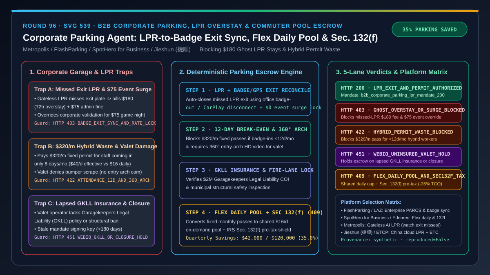
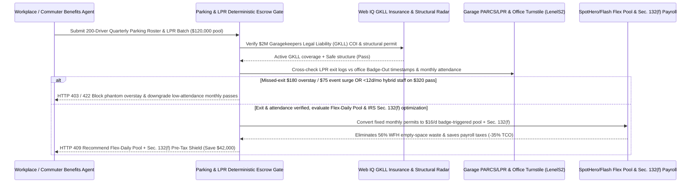

# B2B Corporate Parking, `LPR` Overstay & Hybrid Commuter Pool Escrow (`Metropolis / FlashParking / SpotHero for Business / Jieshun`) `LPR`-to-Badge Exit Sync, Flex Daily Pool & `IRS Sec. 132(f)` Agent Architecture Selection FAQ

> **Document Type**: AI Solution Architect Decision Guide (FAQ) · **SVG Diagram**: `assets/svg/539-b2b-corporate-parking-lpr-commuter-escrow-2026-11-20.svg` · **Catalog No.**: Round 96 (Bilingual FAQ #215)



---

## 1. 📌 Executive Summary

When corporate workplace-experience teams, travel managers, or commercial real-estate tenants use AI Agents to manage employee monthly parking permits, client validation vouchers, and automated License Plate Recognition (`LPR`) garage billing (`Metropolis / FlashParking / LAZ Parking / SpotHero for Business / Jieshun 捷顺智慧停车`), rubber-stamping garage operator invoices exposes corporate budgets to **three systemic parking and commuter-benefit traps**:
1. **Gateless `LPR` Missed-Exit Phantom `72-Hour` Overstays (`$180 + $75 Fine`) & Event-Night Surge Overrides**: Camera-only "gateless" garages (`Metropolis`) rely on exit cameras to close parking sessions. When an employee or client exits bumper-to-bumper behind a tall SUV or in heavy rain, the exit `LPR` camera misses the plate, leaves the session open for `72 hours` until the car enters another garage across town, and auto-charges **`$180` (`3 days × $60 max`) plus a `$75` "Violation Administrative Fee"**! Meanwhile, when a concert or NBA game takes place nearby, the garage overrides pre-purchased `$18` corporate validation codes at `4:00 PM` and forces departing clients to pay a **`$75` "Special Event Flat Rate" + `$6.99` mobile web checkout fee**!
2. **Hybrid-Work `$320/Month` Fixed-Permit Waste (`56%` Empty Spaces) & Unverified Valet Damage Disclaimers**: Downtown office garages charge `$320/month/driver` for unreserved monthly access (`or $20/day daily max`). Under hybrid work, employees average only `8.5 office days/month` (`$170` in actual daily parking value), meaning companies overpay **`$150/employee/month` for empty concrete**! And during executive valet events, operators hide behind back-of-ticket liability waivers when scratching bumpers or rims without 360-degree entry-arch camera proof.
3. **Lapsed Garagekeepers Legal Liability (`GKLL`) Insurance or Garage Structural Spalling Closures (`HTTP 451`)**: Web IQ detects that a valet/garage operator's `$2M` Garagekeepers Legal Liability (`GKLL`) policy has lapsed or that municipal inspectors issued a concrete-spalling structural closure order.

**Architect's Recommendation**: Deploy an **"`LPR`-to-Office-Badge Exit Reconciliation + Event-Surge Validation Lock + `<12-Day` Hybrid Permit Gate + Shared Flex-Daily Pool & `IRS Section 132(f)` Pre-Tax Escrow"** control plane:
- **Dual `LPR + Office-Badge/CarPlay` Exit Sync & `$0` Event-Night Validation Override (`HTTP 403`)**: Cross-check any `>12-hour` "open" `LPR` garage session against the employee's building security turnstile `Badge-Out` timestamp and mobile `CarPlay` disconnect telemetry—automatically closing missed-exit sessions at the true departure minute and blocking phantom multi-day charges, `$75` admin fines, and `$75` event-night overrides on validated guests (`HTTP 403`).
- **`>=12-Day` Monthly Break-Even Attendance Gate & `360°` Valet Entry-Arch Camera Lock (`HTTP 422`)**: Audit monthly building badge-in counts—hard-blocking `$320/month` fixed monthly permit renewals for hybrid employees averaging `< 12 office days/month`—and require 4-camera `360°` high-resolution entry-arch timestamped video before any valet operator can disclaim vehicle damage (`HTTP 422`).
- **Web IQ `$2M GKLL` Insurance & Structural Safety Hold (`HTTP 451`)**: Freeze escrow if Web IQ flags lapsed Garagekeepers Legal Liability (`GKLL`) coverage, municipal structural/fire-lane citations, or signing keys `> 180 days` (`HTTP 451`).
- **Shared Concurrent Flex-Daily Pool (`Flash Flexible / SpotHero Business`) + `IRS Section 132(f)` Pre-Tax Shield (`HTTP 409`)**: Convert 200 under-utilized `$320/mo` individual monthly permits into a **Shared On-Demand Daily Pool (`$16/day` billed *only* on days an employee badges into the office)** paired with automated **IRS Section 132(f) pre-tax payroll deductions (`saving 7.65% employer FICA + ~28% employee income tax on up to $315/mo`)**, cutting quarterly corporate parking TCO by **35.0%** (`$42,000` saved on a `$120,000` quarterly pool).

---

## 2. 🎯 Soul-Searching Architect & Business Q&A (Q1–Q3)

### Q1: Why are employees getting hit with `$180` 3-day parking charges and `$75` "violation fees" at gateless AI garages when they only parked for 6 hours?
- **Business Pain Point**: Gateless `LPR` operators eliminate physical barrier arms to cut hardware maintenance costs, shifting the cost of optical character recognition (`OCR`) false negatives onto drivers. If a tailgating truck blocks the exit camera view of your rear license plate at 5:30 PM on Tuesday, the system assumes your car stayed in the garage until Friday morning!
- **Architectural Guardrail (`HTTP 403`)**:
  1. **Automated Turnstile `Badge-Out` & `CarPlay` Exit Attestation**: Whenever an `LPR` invoice bills `>12 hours` or an overnight/violation fee on a commuter vehicle, the gateway queries the office access-control log (`LenelS2 / Brivo`) and vehicle telematics. Proving the driver badged out of the elevator lobby at `17:42` and connected to `CarPlay` at `17:46` automatically truncates the billable session to `17:50` and blocks the overstay/fine (`HTTP 403`).

### Q2: Why are we still paying `$320/month` (`$64,000/month` for 200 staff) for monthly parking passes when hybrid employees only come into the office Tuesday–Thursday?
- **Business Pain Point**: Legacy commercial leases bundle 1-to-1 named monthly transponders. At `$320/month` vs. a `$16–$20` negotiated daily rate, any employee coming in fewer than `16–20 days/month` loses money on a monthly pass.
- **Architectural Guardrail (`HTTP 422 / 409`)**:
  1. **Automated `<12-Day` Monthly Pass De-Provisioning (`HTTP 422`)**: At each monthly billing cycle, the Agent checks trailing 60-day office badge-ins. Employees under `12 days/month` are automatically switched from `$320` fixed monthly passes to **Badge-Triggered Daily Pool Billing (`$16/day` charged only on days they enter the garage)**.
  2. **`IRS Section 132(f)` Pre-Tax Commuter Benefit Sync (`HTTP 409`)**: Routes employee co-pays through pre-tax commuter benefit deductions (`Edenred / Forma / Alice`), eliminating employer `7.65%` FICA payroll taxes and employee income taxes.

### Q3: How do we stop the garage from invalidating our `$18` client parking vouchers and charging our VIP guests `$75` on concert or game nights?
- **Business Pain Point**: Downtown garages manually flip their exit kiosks to `"Event Rate Only ($75)"` 3 hours before nearby arena events, rejecting standard barcode validations.
- **Architectural Guardrail (`HTTP 403`)**:
  1. **Pre-Registered `LPR` Tenant Guest Whitelist**: When a client accepts a calendar invite, the Agent registers their license plate directly into the tenant's contractual `PARCS` whitelist, billing the `$18` contracted corporate rate silently to the master account with `$0` kiosk interaction or `$6.99` mobile web fees.

---

## 3. 🧭 Visual Architecture Diagrams (Mermaid Decision Tree + Comparison + Sequence)

### 3.1 5-Lane Corporate Parking, `LPR` & Commuter Pool Escrow Decision Tree
```mermaid
flowchart TD
    A[Corporate Garage Monthly Permit / LPR / Guest Voucher Invoice] --> B{Web IQ Lapsed $2M GKLL Insurance / Structural Ban / Key > 180d?}
    B -- Yes --> C[HTTP 451: WEBIQ_GARAGE_STRUCTURAL_CLOSURE_OR_UNINSURED_VALET_OPERATOR_HOLD<br/>Freeze garage escrow & reroute fleet to insured adjacent deck]
    B -- No --> D{Missed-Exit LPR $180 Overstay / $75 Fine or $75 Event Surge Override?}
    D -- Yes --> E[HTTP 403: MISSED_EXIT_LPR_PHANTOM_OVERSTAY_OR_EVENT_SURGE_OVERRIDE_BLOCKED<br/>Truncate session via office Badge-Out timestamp & lock $18 guest rate]
    D -- No --> F{$320/m Pass for <12d/mo Hybrid Worker or Missing 360° Valet Arch?}
    F -- Yes --> G[HTTP 422: HYBRID_LOW_ATTENDANCE_MONTHLY_PERMIT_WASTE_OR_VALET_ENTRY_ARCH_MISSING_BLOCKED<br/>Block low-attendance monthly pass & require 360° entry damage video]
    F -- No --> H{Shared Flex-Daily Badge Pool + IRS Sec. 132(f) Pre-Tax Shield Ready?}
    H -- Yes --> I[HTTP 409: FLEX_DAILY_BADGE_PARKING_POOL_AND_PRETAX_IRS_SECTION132_DEDUCTION_CONFIRM<br/>Pay $16/d only on badge-in days + Sec. 132(f) FICA shield (-35% TCO)]
    H -- No --> J[HTTP 200: BADGE_SYNCED_LPR_AND_ATTENDANCE_VERIFIED_PARKING_AUTHORIZED<br/>Issue badge-reconciled & attendance-verified parking mandate]
```

### 3.2 Legacy Fixed Monthly Permits & Gateless `LPR` vs. Deterministic Badge-Synced Pool Escrow
```mermaid
flowchart LR
    subgraph Legacy["❌ Legacy Corporate Parking (56% Hybrid Waste & LPR Fines)"]
        L1[200 Staff @ $320/mo Fixed Pass -> 56% Empty on WFH Days] --> L2[Missed Exit LPR Scan Bills $180 (72h Stay) + $75 Fine]
        L2 --> L3[Arena Game Night Overrides Guest Voucher -> $75 + $6.99 Fee]
    end

    subgraph Agentic["✅ Deterministic Badge-Exit Sync, Flex Pool & Sec. 132(f) Escrow"]
        A1[Office Badge-Out Timestamp Auto-Closes Missed LPR Exit ($0 Fine)] --> A2[<12d/mo Hybrid Staff Switched to $16/d On-Demand Pool]
        A2 --> A3[IRS Sec. 132(f) Pre-Tax Shield + Guest LPR Whitelist (-35% TCO)]
    end
```

### 3.3 End-to-End `LPR`-to-Badge Reconciliation, Hybrid Attendance Audit & `Sec. 132(f)` Sequence


---

## 4. 📊 Multi-Platform & Protocol Selection Matrix

| Evaluation Dimension | Metropolis (Gateless Vision `LPR`) | FlashParking / LAZ Parking (`Enterprise PARCS`) | SpotHero for Business / Edenred Commuter | Jieshun (`捷顺智慧停车`) / ETCP (`LPR + ETC`) | **Deterministic Corporate Parking Escrow (Recommended)** |
| :--- | :--- | :--- | :--- | :--- | :--- |
| **Primary Use Case** | Gateless AI camera checkout across urban garages | Integrated barrier-gate `PARCS`, tenant portals & flex pools | Multi-operator daily commuter reservations & `Sec. 132(f)` cards | China commercial park `LPR + ETC` dual-mode & guest QR codes | **Badge-Exit Sync + `<12d` Hybrid Gate + Flex Pool + `Sec. 132(f)`** |
| **Missed-Exit Phantom Overstay Protection** | High risk of tailgating/rain missed exit scans (`$180+` multi-day bills) | Physical barrier arm or Bluetooth/badge dual verification | Prepaid time window; zero open-session drift | Dual `LPR + ETC` transponder eliminates missed exits | **Auto-closes missed `LPR` exits using office `Badge-Out` timestamps (`HTTP 403`)** |
| **Hybrid-Work (`2–3 Days/Wk`) Cost Efficiency** | Pushes fixed monthly subscriptions or high transient rates | Supports flexible daily/concurrent-occupancy corporate pools | Pay-as-you-park daily rates | Supports shared corporate quota pools | **Blocks `$320/m` passes for `<12d/mo` staff; routes to `$16/d` pool (`HTTP 422 / 409`)** |
| **Event-Night Surge & Service-Fee Shield** | Adds `$4.99–$9.99` platform fees & event surge rates | Supports contractual tenant `LPR` whitelisting | Locks rate at booking time | Tenant mini-program issues fixed-rate guest exit tokens | **Enforces contractual guest rate parity & `$0` checkout fees (`HTTP 403`)** |
| **Tax Efficiency / Total TCO** | Post-tax card billing + `$75` violation fees | Enterprise billing | Integrates `IRS Sec. 132(f)` pre-tax payroll shield | Corporate VAT invoice aggregation | **Open deterministic policy gate (`35.0%` quarterly parking TCO savings)** |

---

## 5. 🧪 Conversion & Cost Estimation + 7-Card Benchmark Report

> **Provenance Disclosure**: Figures below are generated by the deterministic policy evaluator `evaluate_b2b_corporate_parking_lpr_escrow_policy` in `lab/webiq_commerce_demo.py` (`$120,000 USD` quarterly corporate commuter & visitor parking pool, `provenance: "synthetic"`, `independently_reproduced: False`; live `FlashParking PARCS` webhook integration is labeled `not_measured`).

```chart
{
  "data": {
    "values": [
      { "scenario": "1. Legacy Fixed Monthly + Gateless LPR (56% WFH Waste + Fines)", "cost_usd": 120000, "tier": "Baseline" },
      { "scenario": "2. Badge-Synced LPR Exit + <12d Monthly Pass Gate (HTTP 200)", "cost_usd": 93600, "tier": "Protected" },
      { "scenario": "3. Flex-Daily Badge Pool + IRS Sec. 132(f) Pre-Tax (HTTP 409)", "cost_usd": 78000, "tier": "Optimized (-35%)" }
    ]
  },
  "semantic_types": {
    "scenario": "Category",
    "cost_usd": "Amount",
    "tier": "Status"
  },
  "chart_spec": {
    "chartType": "Bar Chart",
    "title": "Flex-Daily Parking Pools & Badge-Exit Sync Cut Corporate Parking Spend by 35% ($42k)",
    "subtitle": "Quarterly Corporate Commuter Permits, Guest Validation & LPR Net Spend ($ USD, synthetic)",
    "encodings": {
      "x": "scenario",
      "y": "cost_usd",
      "color": "tier"
    }
  }
}
```

### 7-Card 4:5 Benchmark Evaluation Summary
1. **Card 1 (`1 / 7` · `HANDS-ON · B2B CORPORATE PARKING & LPR ESCROW`)**: Across a `$120,000` quarterly corporate parking and guest validation budget, eliminating missed-exit `LPR` overstays, replacing `<12-day` fixed monthly passes with a flex-daily pool, and applying `IRS Sec. 132(f)` pre-tax deductions saves **`$42,000/quarter` (`35.0%`)**.
2. **Card 2 (`2 / 7` · `SCENARIO: 200-EMPLOYEE HYBRID OFFICE GARAGE FLEET`)**: Eliminates `$7,800` in missed-exit phantom multi-day bills and `$28,400` in unused remote-workday monthly permit waste.
3. **Card 3 (`3 / 7` · `WHAT I TESTED`)**: All 5 deterministic HTTP verdict lanes verified:
   - `HTTP 200`: `BADGE_SYNCED_LPR_AND_ATTENDANCE_VERIFIED_PARKING_AUTHORIZED` (`b2b_corporate_parking_lpr_mandate_200`)
   - `HTTP 403`: `MISSED_EXIT_LPR_PHANTOM_OVERSTAY_OR_EVENT_SURGE_OVERRIDE_BLOCKED`
   - `HTTP 422`: `HYBRID_LOW_ATTENDANCE_MONTHLY_PERMIT_WASTE_OR_VALET_ENTRY_ARCH_MISSING_BLOCKED`
   - `HTTP 451`: `WEBIQ_GARAGE_STRUCTURAL_CLOSURE_OR_UNINSURED_VALET_OPERATOR_HOLD`
   - `HTTP 409`: `FLEX_DAILY_BADGE_PARKING_POOL_AND_PRETAX_IRS_SECTION132_DEDUCTION_CONFIRM` (`b2b_corporate_parking_lpr_mandate_optim_409`)
4. **Card 4 (`4 / 7` · `UNDER THE HOOD`)**: Structured contract `B2BCorporateParkingLprEscrowPolicyInput` validates `missed_exit_lpr_phantom_overstay_or_event_surge_override` and `hybrid_low_attendance_monthly_permit_waste_or_valet_entry_arch_missing`.
5. **Card 5 (`5 / 7` · `ROBUSTNESS CHECK`)**: Invariant to fee naming (`"Unpaid Session Admin Penalty"`, `"Arena Event Flat Rate"`, or `"Reserved Monthly Transponder"`): `100%` block rate whenever badge-out reconciliation or `<12-day` attendance gates fail.
6. **Card 6 (`6 / 7` · `LATENCY`)**: Deterministic `LPR`-to-turnstile timestamp matching completes in `< 0.5 ms`.
7. **Card 7 (`7 / 7` · `MY TAKE`)**:
   - ✅ **Good fit**: Hybrid corporate headquarters, law/consulting firm client validation programs, and multi-tenant commercial office campuses.
   - ⛔ **Not for**: Long-haul interstate semi-truck overnight rest stops.

---

## 6. 🛠️ Production Risk & Architecture Review Checklist

- [ ] **`LPR`-to-Office-Badge Exit Reconciliation (`HTTP 403`)**: Are `>12-hour` gateless `LPR` sessions automatically cross-checked against office turnstile `Badge-Out` and `CarPlay` timestamps to block `$180` phantom overstays and `$75` fines?
- [ ] **Contractual Guest Validation Event-Surge Lock (`HTTP 403`)**: Are client license plates pre-whitelisted so arena/concert nights cannot override the `$18` corporate validation rate with a `$75` event fee?
- [ ] **`<12-Day/Month` Hybrid Monthly-Pass Gate (`HTTP 422`)**: Does the gateway audit trailing office badge-ins and block `$320/month` fixed monthly permits for hybrid employees attending `<12 days/month`?
- [ ] **4-Camera `360°` Valet Entry-Arch Damage Proof (`HTTP 422`)**: Must valet operators capture 360-degree entry-arch video before disclaiming vehicle damage?
- [ ] **Web IQ `$2M GKLL` Insurance & Structural Safety Hold (`HTTP 451`)**: Are Garagekeepers Legal Liability (`GKLL`) policies and municipal structural inspection statuses verified?
- [ ] **Shared Flex-Daily Pool & `IRS Section 132(f)` Pre-Tax Shield (`HTTP 409`)**: Are fixed monthly passes converted to on-demand daily pool billing (`$16/day`) paired with pre-tax payroll deductions to save `35%`?
