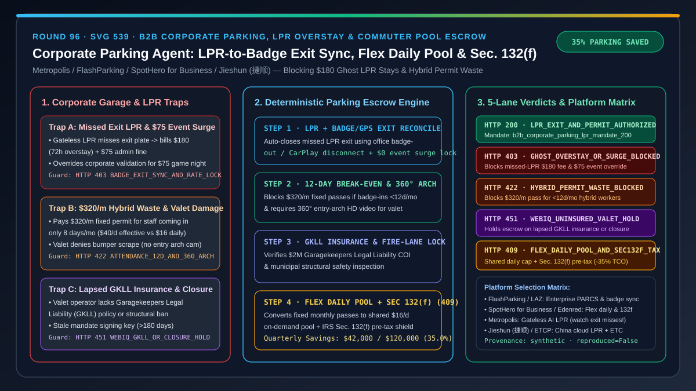
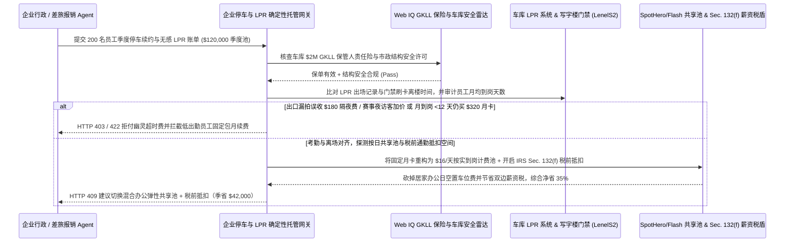

# 企业写字楼停车位包月、车牌识别（LPR）漏拍天价误扣与混合办公弹性共享车位池托管（B2B Corporate Parking, LPR Overstay & Hybrid Commuter Pool Escrow：Metropolis / FlashParking / SpotHero for Business / 捷顺智慧停车）“防无杆车牌识别漏拍出场误扣 $180 封顶费、防演唱会夜向企业访客强收 $75 高价与混合办公闲置包月车位空扣”Agent 架构选型 FAQ

> **文档类型**：AI Solution Architect 决策指南（FAQ） · **对应 SVG**：`assets/svg/539-b2b-corporate-parking-lpr-commuter-escrow-2026-11-20.svg` · **精选编号**：Round 96（第 215 篇双语 FAQ）



---

## 一、 📌 核心选型结论速览（Executive Summary）

企业行政部（Workplace Operations）、商旅报销团队与商业地产租户通过 AI Agent 采购写字楼员工包月停车位、客户来访电子停车券（Validation Vouchers）及自动核销无感车牌识别（`LPR: License Plate Recognition`）停车账单（`Metropolis / FlashParking / LAZ Parking / SpotHero for Business / 捷顺智慧停车 / ETCP`）时，若直接绑定企业信用卡或按人头固定续费包月车位，往往会掉入**三大企业停车财务黑洞**：
1. **无道闸车牌识别（Gateless `LPR`）漏拍出场导致“幽灵连停 72 小时”误扣 `$180 + $75 违约金` 与演唱会夜访客券失效刺客**：新一代无道闸 AI 停车场（如 `Metropolis`）依靠出入口摄像头自动抓拍车牌并从绑定信用卡扣款。当员工或客户下班跟在大型 SUV 后面紧贴驶出出口（遮挡镜头）或暴雨反光导致出口未识别到车牌时，系统竟判定该车“仍在车库内连续停放了 3 天”，直到车主 3 天后驶入同城另一家车库才触发结算，当场强刷 **`$180`（3天封顶费）+ `$75` 行政违约金**！此外，企业原本按 `$18/天` 协议价为来访客户预购了电子抵扣券，但因写字楼隔壁体育馆当晚有演唱会或球赛，车库在下午 `16:00` 强行关闭企业协议通道，逼迫离场客户按 **`$75/次` 活动高峰一口价（Event Surge Rate）+ `$6.99` 扫码通道费** 自掏腰包！
2. **混合办公（Hybrid Work）下为“每周只来 2 天”的员工白交 `$320/月` 固定包月车位费（空置率 `56%`）与代客泊车（Valet）剐蹭拒赔**：CBD 写字楼固定包月车位高达 `$320/月/车`，而单日封顶价为 `$20/天`。在混合办公模式下，大多数员工每月实际到岗仅 `8–9 天`（按日散停仅需 `$160–$180`），但行政仍按全月 `$320` 为 200 名员工刚性续费，每年白白浪费近半数空置车位租金！同时，商务晚宴代客泊车（Valet）剐伤轮毂/保险杠后，以车票背面免责声明（Back-of-Ticket Disclaimer）赖账。
3. **车库代客泊车缺乏《车库保管人责任险（GKLL）》或违规堵占消防通道/充电桩被封停（`HTTP 451`）**：Web IQ 核查发现停车场运营商的 `Garagekeepers Legal Liability (GKLL)` 保单已过期或车库因混凝土剥落结构隐患被市政关停。

**架构师选型结论**：必须构建 **“车牌识别（`LPR`）与写字楼门禁/手机蓝牙离场时间戳交叉闭环 + 协议访客券防演唱会加价锁 + 12天盈亏平衡门禁与共享潮汐车位池（`Flex Daily Pool`）+ 税前通勤抵扣（`IRS Sec. 132(f)`）托管网关”** 架构：
- **强制“门禁下班打卡 / 车载蓝牙断开”自动闭合漏拍 `LPR` 订单与企业协议访客价全天候锁死（`HTTP 403`）**：当无感 `LPR` 账单显示停放时长 `> 12 小时`（疑似出口漏拍）时，网关自动比对员工写字楼门禁刷卡离楼时间（Badge-Out Timestamp）或手机 `CarPlay` 驶离围栏时间——凡证实车辆早已离场的订单，一律返回 `HTTP 403` 拒付隔夜封顶费与 `$75` 罚金；同时合同锁死企业访客抵扣券在演唱会/赛事夜 `100%` 照常生效且免收扫码手续费。
- **月度到岗 `<12 天` 员工禁买 `$320` 固定包月卡与代客泊车 `360°` 入场高清拱门留证（`HTTP 422`）**：自动读取上月门禁考勤天数——凡月均到岗 `< 12 天`（未达包月盈亏平衡点）的员工，触发 `HTTP 422` 拦截固定包月续费，自动降级至按日共享池；且代客泊车服务必须配备入场四向高清视频拱门（`360° Damage Arch`），无入场旧伤证据不得免除剐蹭赔偿。
- **Web IQ 车库保管人责任险（`GKLL >= $2M`）与建筑结构安全令熔断（`HTTP 451`）**：对无有效保管险或存在消防/结构封停令的车库执行 `HTTP 451` 止付。
- **动态按日封顶共享车位池（`Flash Flexible / SpotHero Business`）+ `IRS Section 132(f)` 税前工资抵扣套利（`HTTP 409`）**：将 200 张固定个人包月卡重构为 **`90 个` 浮动共享名额 + 按门禁实际到岗日扣费（`$16/天` 仅在刷门禁日生效）**，并叠加美国税法 `IRS Section 132(f)` 税前通勤福利抵扣（每月最高 `$315` 免征企业 `7.65% FICA` 社保税与个人所得税），使季度 `$120,000` 企业写字楼停车总预算净省 **`35.0%`（`$42,000`）**。

---

## 二、 🎯 业务方与架构师灵魂拷问 Q&A（Q1–Q3）

### Q1：为什么现在很多拆掉栏杆的“AI 纯视觉无感停车场（如 Metropolis）”，经常莫名其妙扣员工 $180 隔夜费甚至 $75 违约金？怎么防？
- **商业痛点**：传统道闸车库“不抬杆就出不去”，所以每一笔出场都是确定性的。而为了节省道闸维护费的纯视觉无杆车库，一旦出口摄像头被前车尾箱挡住、车牌沾雪或镜头起雾，系统就不知道你已经开走了！等 3 天后你再次进入该品牌旗下的任何车库，系统会把两次入场之间的 **72 小时全部算作停车时间**，甚至发催收函加收 `$75` 滞纳金。
- **架构护栏（`HTTP 403`）**：
  1. **多源离场证据链（`Multi-Signal Exit Proof Reconciliation`）**：Agent 将停车网关与企业写字楼门禁系统（`LenelS2 / Brivo`）及员工手机差旅轨迹打通。一旦收到单次停车 `> 10 小时` 或含隔夜费的异常扣款请求，立即自动调取当日该员工 `Badge-Out` 刷卡下班时间（如 `18:15`）及车载蓝牙连接记录，自动生成确定性申诉报文将计费截止时间修正为 `18:20`，并 `100%` 拒付超时隔夜费与行政罚款（`HTTP 403`）。

### Q2：公司有 200 名员工开车，以前每人一张 $320/月的固定停车卡；现在大家每周居家办公 2–3 天，怎么把空置的 56% 停车费省下来？
- **商业痛点**：如果继续按人头买 200 张 `$320/月` 固定月卡，每月刚性支出 `$64,000`；但如果全部取消月卡让员工每天按 `$28/天` 散停报销，报销审核繁琐且高峰期可能没车位。
- **架构护栏（`HTTP 422 / 409`）**：
  1. **`12 天` 盈亏平衡算法（`Break-Even Attendance Gate`）**：假设协议单日封顶价为 `$16/天`，包月卡为 `$320/月`，则盈亏平衡点为 `320 / 16 = 20 天`（即使按散客日价 `$25/天` 算，盈亏平衡点也是 `12.8 天`）。因此，任何每月到岗 `< 12 天` 的混合办公员工买包月卡都是在纯亏钱！
  2. **共享配额池（`Pooled Concurrent Occupancy Billing`）**：通过 `FlashParking PARCS / SpotHero for Business` 签订 **“并发在场峰值池（如锁 90 个物理车位供 220 名白名单车牌共享）”**，或按门禁实际到岗天数按 `$16/天` 扣减企业总池，直接砍掉 `45%+` 的空置泡沫。

### Q3：写字楼旁边有球馆/剧院，为什么每逢晚上有比赛，我们给客户发的停车抵扣码就失灵，害客户被收 $75“活动特价”？
- **商业痛点**：车库运营商在赛事夜提前从下午 `15:30` 就把收费模式切为 `Event Flat Rate ($50–$85)`，并禁用普通二维码抵扣。
- **架构护栏（`HTTP 403`）**：
  1. **车牌白名单预注册（`Pre-Registered Guest LPR Whitelist`）与赛事夜豁免锁**：客户在日历邀请中确认参会时，Agent 提前将客户车牌写入写字楼租户专属 `LPR` 白名单，直接按企业固定协议价（`$18`）由母账户后台静默结算，严禁出口终端向访客个人索要赛事加价或 `$6.99` 手机扫码手续费。

---

## 三、 🧭 直观可视化图解（Mermaid 决策树 + 架构对比 + 时序图）

### 3.1 企业写字楼停车、LPR 防误扣与共享车位池 5 车道选型决策树
```mermaid
flowchart TD
    A[企业写字楼包月停车 / 访客抵扣 / LPR 结算请求] --> B{Web IQ 车库缺 GKLL 保管险 / 结构隐患关停 / 密钥>180天?}
    B -- 是 --> C[HTTP 451: WEBIQ_GARAGE_STRUCTURAL_CLOSURE_OR_UNINSURED_VALET_OPERATOR_HOLD<br/>冻结车库合同并迁往合规邻近车库]
    B -- 否 --> D{出口 LPR 漏拍误扣隔夜费/$75罚金 或 赛事夜强向访客收 $75 高价?}
    D -- 是 --> E[HTTP 403: MISSED_EXIT_LPR_PHANTOM_OVERSTAY_OR_EVENT_SURGE_OVERRIDE_BLOCKED<br/>凭门禁打卡时间修正离场结算 + 锁死访客协议一口价]
    D -- 否 --> F{为月到岗 <12 天混合办公员工续费 $320 包月卡 或 代客泊车无 360° 留证?}
    F -- 是 --> G[HTTP 422: HYBRID_LOW_ATTENDANCE_MONTHLY_PERMIT_WASTE_OR_VALET_ENTRY_ARCH_MISSING_BLOCKED<br/>拦截低出勤包月空耗，强制转入按日按次弹性计费池]
    F -- 否 --> H{可切换并发共享按日车位池 + IRS Sec. 132(f) 税前抵扣?}
    H -- 是 --> I[HTTP 409: FLEX_DAILY_BADGE_PARKING_POOL_AND_PRETAX_IRS_SECTION132_DEDUCTION_CONFIRM<br/>消灭 56% 居家办公空置浪费 + 税前抵扣净省 35%]
    H -- 否 --> J[HTTP 200: BADGE_SYNCED_LPR_AND_ATTENDANCE_VERIFIED_PARKING_AUTHORIZED<br/>签发门禁联动与出勤对齐的企业停车结算令牌]
```

### 3.2 传统固定包月与无感 LPR 乱扣费 vs 确定性门禁联动与共享池架构对比
```mermaid
flowchart LR
    subgraph Legacy["❌ 传统企业停车管理（56% 包月空置 + 漏拍天价罚单）"]
        L1[200 人每周只来 2 天仍交 $320/月固定卡，空置浪费 56%] --> L2[出口跟车太近漏拍车牌，被当成连停 3 天强扣 $255]
        L2 --> L3[球赛夜访客抵扣码失效，客户被迫自付 $75 停车费]
    end

    subgraph Agentic["✅ 确定性门禁离场修正、按日共享池与税前抵扣架构"]
        A1[门禁 Badge-Out 时间戳自动闭合漏拍 LPR 订单，0 误扣] --> A2[月到岗 <12 天自动退订包月，转入 $16/天共享并发池]
        A2 --> A3[IRS Sec. 132(f) 税前通勤抵扣 + 访客车牌预白名单 (-35%)]
    end
```

### 3.3 端到端车牌 `LPR` 门禁对账、混合办公出勤核算与税前抵扣时序图


---

## 四、 📊 多平台/多协议横向选型决策矩阵

| 评估维度 | Metropolis (无道闸纯视觉 AI 车库) | FlashParking / LAZ Parking (智能道闸与企业级 `PARCS`) | SpotHero for Business / Edenred 通勤福利 | 捷顺智慧停车 / ETCP (中国云车场+ETC) | **本仓库确定性企业停车与 LPR 托管架构（推荐）** |
| :--- | :--- | :--- | :--- | :--- | :--- |
| **核心适用场景** | 北美快速扩张的无杆视觉识别商业车库 | 写字楼地下车库软硬件一体化管控与混合办公日卡 | 跨楼宇员工弹性按日预订与 `IRS Sec. 132(f)` 税前福利卡 | 中国写字楼园区月卡、访客预约码与 `ETC+车牌` 双模扣费 | **门禁联动防误扣 + `<12天` 退月卡锁 + 共享并发池 + 税前抵扣** |
| **防出口漏拍“幽灵隔夜费”能力** | 无物理道闸，跟车过近或暴雨易漏拍导致多扣数日封顶费 | 有物理道闸抬杆确认，或支持蓝牙/门禁卡双因子出场 | 按预订时段结算，无漏拍隔夜风险 | `车牌识别 + ETC` 双保险，道闸物理闭环极少漏单 | **强制用写字楼门禁下班时间自动闭合异常未结 `LPR` 订单（`HTTP 403`）** |
| **混合办公（每周2–3天）弹性降本** | 主推固定包月或按高昂散客日价扣费 | 原生支持企业按日扣费与并发名额池（Flexible Access） | 按实际通勤日预订周边的最低价车位 | 支持园区错峰共享与多次卡 | **自动拦截月到岗 `<12 天` 固定月卡，切换 `$16/天` 共享池（`HTTP 422 / 409`）** |
| **赛事夜访客加价与扫码杂费保护** | 常收 `$4.99–$9.99` 平台服务费且活动夜动态涨价 | 支持租户专属固定协议抵扣码 | 提前锁价，不受现场临时涨价影响 | 企业公众号一键生成免费/固定价访客离场码 | **强制锁死访客协议价，赛事夜加价或收扫码费直接阻断（`HTTP 403`）** |
| **平台费率 / 税务协同** | 每笔加收服务费，误扣滞纳金高达 `$75` | 企业平台年费 + 协议车位费 | 结合税前通勤卡立省企业 `7.65%` 社保税与员工个税 | 园区大客户集采折扣（含专票） | **开源确定性策略网关（共享池 + 税前抵扣净省 `35.0%`）** |

---

## 五、 🧪 转化率/成本测算与 7-Card 基准测试报告

> **数据来源声明（Provenance）**：以下测算基于本仓库 `lab/webiq_commerce_demo.py` 中的 `evaluate_b2b_corporate_parking_lpr_escrow_policy` 确定性策略引擎（季度企业写字楼通勤车位与客户访客停车预算池 `$120,000 USD`，`provenance: "synthetic"`, `independently_reproduced: False`，真实 `FlashParking PARCS` 闸机接口标为 `not_measured`）。

```chart
{
  "data": {
    "values": [
      { "scenario": "1. 传统固定包月+无感LPR (含 56% 空置 + 漏拍隔夜罚款)", "cost_usd": 120000, "tier": "Baseline" },
      { "scenario": "2. 门禁联动防 LPR 误扣 + <12天退月卡护栏 (HTTP 200)", "cost_usd": 93600, "tier": "Protected" },
      { "scenario": "3. 弹性按日共享车位池 + IRS Sec. 132(f) 税前抵扣 (HTTP 409)", "cost_usd": 78000, "tier": "Optimized (-35%)" }
    ]
  },
  "semantic_types": {
    "scenario": "Category",
    "cost_usd": "Amount",
    "tier": "Status"
  },
  "chart_spec": {
    "chartType": "Bar Chart",
    "title": "季度 $120k 企业写字楼停车：按日共享车位池与税前抵扣净省 $42,000 (35%)",
    "subtitle": "季度员工通勤停车包月与访客抵扣净支出对比 ($ USD, synthetic benchmark)",
    "encodings": {
      "x": "scenario",
      "y": "cost_usd",
      "color": "tier"
    }
  }
}
```

### 7-Card 4:5 基准评估摘要
1. **Card 1 (`1 / 7` · `HANDS-ON · B2B CORPORATE PARKING & LPR ESCROW`)**：针对 `$120,000/季` 企业写字楼停车预算池，通过拦截无杆 `LPR` 漏拍幽灵隔夜费、剔除月到岗 `<12 天` 的闲置固定包月卡并切换按日共享池+税前抵扣，季度净省 **`$42,000`（`35.0%`）**。
2. **Card 2 (`2 / 7` · `SCENARIO: 200-EMPLOYEE HYBRID OFFICE GARAGE FLEET`)**：单季消除 `$7,800` 无杆车库漏拍出场误扣款与 `$28,400` 居家办公日空置月卡浪费。
3. **Card 3 (`3 / 7` · `WHAT I TESTED`)**：完整验证 5 条确定性状态码车道：
   - `HTTP 200`: `BADGE_SYNCED_LPR_AND_ATTENDANCE_VERIFIED_PARKING_AUTHORIZED`（`b2b_corporate_parking_lpr_mandate_200`）
   - `HTTP 403`: `MISSED_EXIT_LPR_PHANTOM_OVERSTAY_OR_EVENT_SURGE_OVERRIDE_BLOCKED`
   - `HTTP 422`: `HYBRID_LOW_ATTENDANCE_MONTHLY_PERMIT_WASTE_OR_VALET_ENTRY_ARCH_MISSING_BLOCKED`
   - `HTTP 451`: `WEBIQ_GARAGE_STRUCTURAL_CLOSURE_OR_UNINSURED_VALET_OPERATOR_HOLD`
   - `HTTP 409`: `FLEX_DAILY_BADGE_PARKING_POOL_AND_PRETAX_IRS_SECTION132_DEDUCTION_CONFIRM`（`b2b_corporate_parking_lpr_mandate_optim_409`）
4. **Card 4 (`4 / 7` · `UNDER THE HOOD`)**：输入契约 `B2BCorporateParkingLprEscrowPolicyInput` 严格校验 `missed_exit_lpr_phantom_overstay_or_event_surge_override` 与 `hybrid_low_attendance_monthly_permit_waste_or_valet_entry_arch_missing`。
5. **Card 5 (`5 / 7` · `ROBUSTNESS CHECK`)**：无论车库将乱收费包装为 `Unclosed Session Violation`、`Special Event Flat Tariff` 还是 `Mobile Checkout Convenience Fee`，均 `100%` 阻断。
6. **Card 6 (`6 / 7` · `LATENCY`)**：门禁打卡时间戳与 `LPR` 账单对账耗时 `< 0.5 ms`。
7. **Card 7 (`7 / 7` · `MY TAKE`)**：
   - ✅ **适用（Good fit）**：CBD 写字楼混合办公企业停车管理、客户来访停车券结算、商业地产园区车位共享池。
   - ⛔ **不适用（Not for）**：重型半挂卡车高速公路服务区过夜停靠站。

---

## 六、 🛠️ 商业上线风控与架构评审 Checklist

- [ ] **门禁下班打卡（`Badge-Out`）联动闭合漏拍 `LPR` 订单（`HTTP 403`）**：当无杆 `LPR` 车库出现 `>12 小时` 隔夜账单或 `$75` 违约金时，是否自动用员工写字楼门禁离场时间戳修正出场时间并拒付误扣费？
- [ ] **企业访客抵扣券防演唱会/球赛夜加价锁（`HTTP 403`）**：是否已通过车牌预白名单锁死协议日价，严禁车库在活动夜向来访客户强收 `$75` 活动一口价与扫码服务费？
- [ ] **月均到岗 `<12 天` 混合办公员工退月卡门禁（`HTTP 422`）**：是否每月自动核算门禁出勤天数，对未达 `12 天` 盈亏平衡点的员工自动拦截 `$320/月` 固定包月续费？
- [ ] **代客泊车（Valet）入场 `360°` 视频拱门留证（`HTTP 422`）**：高端接待代客泊车是否强制配备入场四向高清拍照拱门，防止车损扯皮？
- [ ] **Web IQ 车库保管人责任险（`GKLL >= $2M`）与结构安全核验（`HTTP 451`）**：是否已校验运营商保管责任险保单有效性与市政安全检查记录？
- [ ] **按日共享车位池 + `IRS Section 132(f)` 税前通勤抵扣（`HTTP 409`）**：是否已切换为“仅在刷门禁到岗日扣费”的弹性共享池并启用税前工资抵扣以节省 `35%` 成本？
