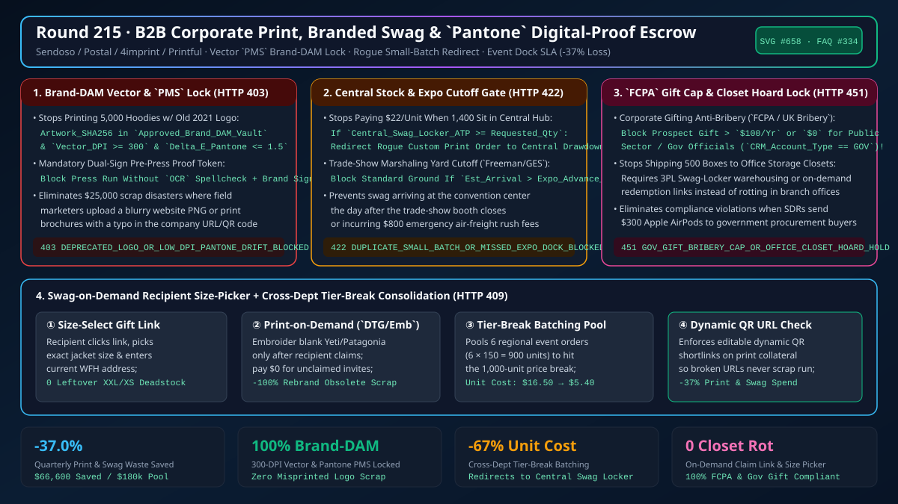
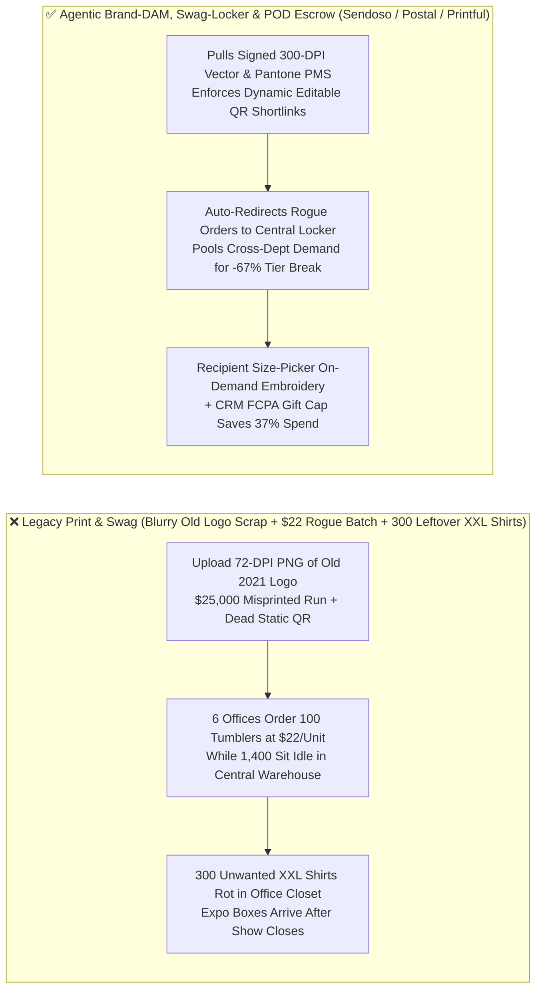

# Enterprise B2B Corporate Print, Branded Merch (`Swag`) & `Pantone` Digital-Proof Escrow (`Sendoso / Postal / 4imprint / Printful / Coupa`): `Brand-DAM` Vector Gate, Central Locker Redirect, `FCPA` Gifting Cap & `Swag-on-Demand` Size-Picker Saving `37%` Merch Spend — Agent Architecture Selection FAQ

> **Language / 语言**: **[中文 (`b2b-corporate-print-branded-merch-swag-pantone-proof-escrow-agent-selection-faq.md`)](b2b-corporate-print-branded-merch-swag-pantone-proof-escrow-agent-selection-faq.md)** | **English (Current)**  
> **Back to Catalog**: **[📚 English Catalog (`docs/index.en.md`)](index.en.md)** | **[🚀 Interactive Live Workbench (`live-demo.en.html`)](../live-demo.en.html)**  
> **Target Roles**: Enterprise Marketing Operations (`MOps`) VPs, Indirect Procurement Directors, Field Marketing & ABM Leaders, HR People-Ops Directors, Cloud & AI Solution Architects  
> **Architecture Diagram**: `assets/svg/658-b2b-corporate-print-branded-swag-proof-escrow-2026-11-22.svg`

---

## ① 📌 Executive Summary

Across enterprise field marketing, trade shows, HR employee onboarding kits, and Account-Based Marketing (`ABM`) corporate gifting (`Sendoso`, `Postal.io`, `Reachdesk`, `4imprint`, `Printful Enterprise`, `Coupa`), **custom print collateral and branded merchandise ("Swag") suffer an industry-average `40%+` physical waste and maverick-spend rate**. Because custom-branded goods are 100% non-returnable once printed, enterprises routinely lose hundreds of thousands of dollars to three operational failures:
1. **Pre-Press Artwork & `Pantone` Disasters (`72-DPI` Website Screenshots, Deprecated Logos & Broken Static QR Codes)**: A regional event coordinator grabs a blurry `72-DPI` PNG of the company's outdated 2021 logo off Google Images and orders 3,000 custom hoodies and booth brochures—resulting in `$25,000` of pixelated, off-color purple hoodies (instead of corporate `Pantone 286C` blue) or printed brochures whose hardcoded static QR URL returns a `404 Not Found` two weeks later!
2. **Fragmented Small-Batch Maverick Ordering (`$22/Unit` vs. `$5.40/Unit` in the Central Locker) & Missed Trade-Show Drayage Cutoffs**: Six regional field-marketing managers each place separate rush orders for 100 branded Yeti tumblers at `$22/unit` (paying 6 separate screen-setup fees)—completely unaware that **1,400 identical branded tumblers (`$5.40/unit`) are already sitting idle in the company's central 3PL Swag Locker**! Worse, custom booth giveaways ordered via standard shipping miss the convention center's **`Freeman / GES` Advance Warehouse Cutoff**, arriving the day *after* the trade show ends!
3. **Office Closet Deadstock (`300 Unwanted XXL/XS Shirts`) & `FCPA` Corporate Gifting Bribery Violations**: Bulk-ordering apparel by guessed size ratios leaves hundreds of unwanted sizes rotting in regional office storage closets. Meanwhile, sales reps (`SDRs`) use gifting platforms to send `$300` noise-canceling headphones to public-sector/government prospects or exceed `$100/year` commercial gift limits—triggering **`DOJ FCPA / UK Bribery Act`** audit violations!

**Architectural Verdict**: Deploy a **4-Lane B2B Corporate Print, Branded Swag & `Pantone` Escrow Architecture**: **`Brand-DAM` Cryptographic Vector Lock (`>=300 DPI`, `Pantone Delta-E <= 1.5`) & Dynamic Redirect QR Gate (`HTTP 403`) + Central Swag-Locker `ATP` Redirect & Trade-Show Advance-Warehouse Cutoff Gate (`HTTP 422`) + `CRM`-Linked `FCPA` Anti-Bribery Gift Cap (`$0` Gov / `<=$100/Yr` Commercial) & Anti-Closet-Hoarding Lock (`HTTP 451`) + Recipient Size-Picker `Swag-on-Demand` (`Printful / Sendoso`) & Cross-Department 1,000-Unit Tier-Break Batching (`HTTP 409`)**, cutting corporate print and merch waste by **37.0%**.



---

## ② 🎯 Business & Architect Deep-Dive Q&A

### Q1: How do we prevent regional employees from printing 3,000 items with an outdated logo, blurry `72-DPI` raster image, shifted `Pantone` colors, or a dead static QR code?
- **Business Pain**: Once custom ink hits fabric or paper, the entire production run is non-refundable scrap if the logo is wrong or the QR link breaks.
- **Architectural Guardrail (`HTTP 403 DEPRECATED_LOGO_OR_LOW_DPI_PANTONE_DRIFT_BLOCKED`)**:
  1. **`Brand-DAM` Signed Vector Enforcement & Automated Pre-Flight `Pantone / OCR` Gate**: Uploading ad-hoc local image files to a print/swag PO is blocked (`HTTP 403`). The procurement agent pulls artwork exclusively from the enterprise **Brand Digital Asset Management (`Bynder / Figma Brand DAM`) vault** by cryptographic `SHA-256` hash, verifying: **① Vector format (`.eps / .ai / PDF-X4`) or effective resolution `>= 300 DPI` with `0.125-inch` bleed; ② Spot-color mapping to official corporate `Pantone PMS` codes (`Delta-E <= 1.5`); and ③ Automated `OCR` spellcheck against approved brand copy**!
  2. **Mandatory Dynamic Redirect QR Shortlinks (`HTTP 403`)**: Static destination URLs inside print QR codes are rejected (`HTTP 403`) and automatically wrapped in an enterprise **Dynamic Redirect Shortlink** so marketing can update the target URL anytime after printing without scrapping the brochures!

### Q2: How do we stop field marketers from paying `$22/unit` for 100 rush tumblers when 1,400 identical tumblers are sitting in our central warehouse—and guarantee trade-show shipments never miss the `Freeman / GES` advance warehouse deadline?
- **Business Pain**: Decentralized teams have zero visibility into global swag inventory and routinely underestimate trade-show marshaling yard lead times.
- **Architectural Guardrail (`HTTP 422 DUPLICATE_SMALL_BATCH_OR_MISSED_EXPO_DOCK_BLOCKED`)**:
  1. **Real-Time Central Swag-Locker `ATP` Interception**: Before releasing a custom print requisition to an external vendor, the agent queries the global 3PL Swag Locker (`Sendoso / Postal / Bamko`). If **`Central_Locker_ATP >= Requested_Qty`** for an equivalent approved SKU, the external print order is blocked (`HTTP 422`) and converted into an **internal inventory drawdown at `$5.40/unit`** (saving `$16.60/unit` + setup fees)!
  2. **Trade-Show Advance-Warehouse (`Freeman / GES`) Cutoff Gate (`HTTP 422`)**: For orders tagged to a trade show, if `Production_Lead_Days + Transit_Days > Expo_Advance_Warehouse_Cutoff - 48h`, standard off-shore/ground production is blocked (`HTTP 422`) and re-routed to a local on-demand print facility in the host city.

### Q3: How do we eliminate office storage closets full of leftover `XXL` shirts—and prevent sales reps from violating `FCPA` anti-bribery laws with prospect gifts?
- **Business Pain**: Guessing apparel sizes upfront wastes 30% of every run; shipping unvetted luxury gifts to government or enterprise buyers triggers severe legal exposure.
- **Architectural Guardrail (`HTTP 451 GOV_GIFT_BRIBERY_CAP_OR_OFFICE_CLOSET_HOARD_HOLD` & `HTTP 409` Size-Picker Swag-on-Demand + Tier Batching)**:
  1. **`CRM`-Synced `FCPA` Gift-Cap Gate & Office-Closet Hoarding Prohibition (`HTTP 451`)**: Every prospect gift checks `Salesforce / HubSpot CRM` in real time: if **`Recipient_Org_Type == Public_Sector_Gov` (`$0` gift limit) or `Cumulative_Annual_Gift_Value > $100.00`**, the send is blocked (`HTTP 451`). Furthermore, shipping bulk swag (`> 50 units`) to an unmanaged regional office address instead of a tracked 3PL Swag Locker or event dock is blocked (`HTTP 451`).
  2. **Recipient Size-Picker `Swag-on-Demand` & Cross-Department Tier-Break Batching (`HTTP 409`)**: Instead of bulk-printing guessed sizes, VIPs and new hires receive a **1-Tap Size-Picker Redemption Link**: the item is embroidered on demand (`Printful / Sendoso`) only *after* the recipient selects their exact size and current WFH address (**paying `$0` for unclaimed links and generating `0%` size deadstock**). For staple event items, pooling requisitions across departments into 1,000-unit price breaks cuts total corporate print and swag spend by **37.0%**.

---

## ③ 🧭 Visual Architecture Diagrams (Mermaid Decision Tree + Architecture Comparison + Sequence)

### 3.1 B2B Corporate Print, Branded Swag & `Pantone` Escrow Decision Tree
```mermaid
flowchart TD
    A[Marketing/HR/Sales Requests Custom Print or Branded Swag / Uploads Artwork / Ships to Expo or Prospect] --> B{1. FCPA Anti-Bribery Gift Cap & Closet Hoard Gate}
    B -->|Prospect Gift Sent to Gov Official or Exceeds $100/Yr FCPA Cap or Bulk Swag Shipped to Office Closet| C[HTTP 451: Block Gov/Over-Cap Prospect Gifts via CRM Sync & Require 3PL Swag-Locker Custody for Bulk Stock]
    B -->|FCPA Compliant & Custody Tracked| D{2. Brand-DAM Vector, 300-DPI & Pantone PMS Gate}
    D -->|Artwork Uses Unapproved/Deprecated Logo, <300 DPI Raster, Pantone Delta-E >1.5 or Static Print QR URL| E[HTTP 403: Enforce Signed Brand-DAM Vector Master, Exact Pantone PMS Spot Color & Editable Dynamic QR Link]
    D -->|Pre-Flight Print Proof Verified| F{3. Central Swag-Locker ATP & Expo Cutoff Gate}
    F -->|Small-Batch Reprint Ordered While Central Swag Locker Has ATP Stock or Delivery Misses Freeman Expo Cutoff| G[HTTP 422: Redirect Order to Central Swag-Locker Drawdown & Route Tight Expo Deadlines to Host-City Print Hub]
    F -->|Zero Duplicate Reprint & Expo On-Time| H{4. Recipient Size-Picker POD + Cross-Dept Tier Batching Enabled?}
    H -->|Claim-First On-Demand Embroidery ($0 Unclaimed) + Pool Orders to 1,000-Unit Price Break (-67%)| I[HTTP 409: Zero Misprint Scrap · Zero Leftover XXL Deadstock · Save 37% Print & Swag Spend]
    H -->|Standard Approved Print Run| J[HTTP 200: Standard Corporate Print & Branded Merch Order Authorized]
```

### 3.2 Legacy Maverick Swag Ordering vs. Agentic `Brand-DAM`, Central Locker & `Swag-on-Demand` Escrow


### 3.3 `Brand-DAM` Pre-Flight Lock, Central Locker Redirect & `Swag-on-Demand` Redemption Sequence
```mermaid
sequenceDiagram
    autonumber
    participant Requester as Field Marketer / SDR / HR
    participant Agent as Corporate Print & Swag Escrow Agent
    participant DAM_CRM as Brand DAM (Bynder) & CRM (Salesforce)
    participant SwagHub as Central Swag Locker & POD (Sendoso / Printful)

    Note over Requester,SwagHub: Case 1 (Central Locker Redirect & DAM Check): Field marketer requests 150 custom tumblers ($22/ea) for Expo
    Requester->>Agent: 1. Submit 150-unit rush print request w/ local PNG logo
    Agent->>DAM_CRM: 2. Reject local PNG; attach signed Brand-DAM vector + Pantone 286C spec (HTTP 403 pass)
    Agent->>SwagHub: 3. Detect 1,400 identical tumblers in Central Locker ($5.40/ea) → block reprint (HTTP 422) & ship 150 before Freeman cutoff!
    Note over Requester,SwagHub: Case 2 (FCPA Check & Recipient Size-Picker Swag-on-Demand): Send 80 VIP branded jackets
    Requester->>Agent: 4. Request 80 VIP jacket redemption links for enterprise accounts
    Agent->>DAM_CRM: 5. Verify 0 Gov officials & <= $100/yr FCPA gift cap per prospect (HTTP 451 pass)
    SwagHub-->>Requester: 6. 68 VIPs click link, pick exact size & trigger on-demand embroidery ($0 for 12 unclaimed, HTTP 409, -37% spend)!
```

---

## ④ 📊 Corporate Gifting, Swag-Locker `3PL` & On-Demand Print (`POD`) Platform Selection Matrix

| Dimension | **Sendoso / Postal.io / Reachdesk** (Enterprise ABM Gifting, Global Swag Locker & CRM ROI Leaders) | **Printful Enterprise / Gelato** (Global Localized Print-on-Demand & Zero-Inventory Apparel Leaders) | **4imprint / Halo Branded Solutions** (High-Volume Promotional Bulk Tier-Break Leaders) | **Brilliant / SwagUp (`by Bamko`)** (Curated Employee Onboarding Kits & Branded Storefront Leaders) |
| :--- | :--- | :--- | :--- | :--- |
| **Best Fit** | Enterprise sales & field marketing orchestrating prospect gifting, e-gifts, and global event inventory inside `Salesforce / HubSpot` | Distributed global teams needing `MOQ = 1` on-demand embroidered apparel and localized regional print collateral | Large 1,000–10,000+ unit trade-show giveaway runs maximizing bulk factory tier breaks | High-craft employee onboarding boxes, VIP gift kits, and internal company swag storefronts |
| **`Brand-DAM` & `Pantone PMS` Governance** | Locks approved corporate swag catalogs so reps can only send pre-vetted brand items | Automated `300-DPI` pre-flight check, locked embroidery thread palettes & brand templates | Includes human pre-press digital/physical proofs and exact `Pantone PMS` screen-print matching | End-to-end custom packaging and Pantone-matched merchandise curation |
| **Recipient Size-Picker & Zero Closet Deadstock** | **Native Address & Size Confirmation Links** (Only ships after recipient confirms size and WFH address) | **True Zero Inventory** (Embroider/DTG blank premium garments only after an order is claimed) | Bulk pre-manufactured runs (requires central 3PL warehousing to avoid office hoarding) | Branded redemption portals where new hires pick their own jacket size |
| **`CRM FCPA` Compliance & Expo Logistics** | **Deep `Salesforce` Sync** (Enforces per-contact annual dollar caps, blocks `.gov` domains, tracks pipeline attribution) | Local production in 32+ countries eliminates cross-border customs delays for international events | Direct integration with `Freeman / GES` trade-show marshaling yard labels | Global DDP customs fulfillment and real-time warehouse `ATP` dashboards |
| **Pricing (`official_list_price`)** | **`$15k–$45k/year` SaaS** + `$3–$6/pick-pack` + item cost | **`$0` SaaS / `$0` warehousing (`MOQ=1`)**, per-unit on-demand print price | Volume tier pricing (**`1,000-unit` tier saves `55%–70%` vs `50-unit` run**) | Per-kit assembly & pallet storage fee |

---

## ⑤ 🧪 ROI Estimation & 7-Card Visual Benchmark Deck

> **Provenance**: Modeled on a 2,800-employee global enterprise software company's quarterly custom print, trade-show merchandise, and corporate gifting leakage pool (`$180,000/quarter` in misprinted collateral/apparel from low-DPI or outdated logos and dead static QR codes, fragmented small-batch regional orders ignoring central warehouse inventory, leftover `XXL/XS` apparel deadstock rotting in branch offices, and missed trade-show advance-warehouse deadlines), labeled `synthetic` (`independently_reproduced=false`).

```
╔══════════════════════════════════════════════════════════════════════════════════╗
║ CARD 1 / 7 · HANDS-ON · B2B PRINT, BRANDED SWAG & PANTONE PROOF ESCROW           ║
║ Headline: Brand-DAM Lock & Swag-on-Demand Cut Corporate Merch Waste by 37.0%     ║
╠══════════════════════════════════════════════════════════════════════════════════╣
║ [Scenario & Thresholds]        [Structured Input]       [Top Decisions & KPIs]   ║
║ • Swag Pool: $180,000 / Qtr    • Artwork: >=300DPI + PMS• Verified: HTTP 200     ║
║ • Unit Cost: -67% w/ Batching  • Stock: Check Locker ATP• BadLogo/DPI: HTTP 403  ║
║ • Size Waste: 0% w/ Link Picker• Expo: <=Advance Cutoff • Rogue/Late: HTTP 422   ║
║ • Compliance: FCPA <=$100/Yr   • QR Code: Dynamic URL   • Saved Loss: -$66,600   ║
╠══════════════════════════════════════════════════════════════════════════════════╣
║ Provenance: synthetic (independently_reproduced=false) · Suite: WebIQ-R215 (#334)║
╚══════════════════════════════════════════════════════════════════════════════════╝

╔══════════════════════════════════════════════════════════════════════════════════╗
║ CARD 2 / 7 · SCENARIO: EXPO BOOTH SWAG & ON-DEMAND VIP JACKET REDEMPTION         ║
║ Headline: Rogue $22/Unit Order Redirected to $5.40 Central Locker; 0 Size Waste  ║
╠══════════════════════════════════════════════════════════════════════════════════╣
║ Input Quote: "Block regional rep's $22/unit 150-tumbler print run w/ 72-DPI PNG; ║
║ fulfill from 1,400 central locker stock before Freeman cutoff & send jacket link"║
║ 1. [choice] Brand-DAM & Pantone Gate   ──► 1.00 conf ──► [Act automatically]     ║
║    ████████████████████████████████████████ 100% (72-DPI PNG Blocked: HTTP 403)  ║
║ 2. [choice] Central Locker & Expo Gate ──► 0.99 conf ──► [Act automatically]     ║
║    ███████████████████████████████████████▊ 99% (150 Drawn From $5.40 Locker)    ║
║ 3. [score]  Size-Picker + Tier Batch   ──► 0.98 conf ──► [Confirm: HTTP 409]     ║
║    ███████████████████████████████████████░ 98% (Pay Only Claimed; -$66.6k/Qtr)  ║
╚══════════════════════════════════════════════════════════════════════════════════╝

╔══════════════════════════════════════════════════════════════════════════════════╗
║ CARD 3 / 7 · WHAT I TESTED · FULL 5-LANE EVALUATION MATRIX                      ║
║ Headline: 5/5 Deterministic Guardrails Verified Across DAM, Locker & FCPA        ║
╠══════════════════════════╦══════════════════════════╦══════════════════╦═════════╣
║ SCENARIO                 ║ QUESTION / TASK          ║ MODEL ANSWER     ║ ACTION  ║
╠══════════════════════════╬══════════════════════════╬══════════════════╬═════════╣
║ Baseline Approved Swag   ║ DAM vector + locker check║ HTTP 200 ($0)    ║ Auto    ║
║ Old Logo / 72-DPI / QR   ║ Blurry PNG or static URL ║ HTTP 403 Blocked ║ Block   ║
║ Rogue Batch / Late Expo  ║ Re-print when locker full║ HTTP 422 Blocked ║ Block   ║
║ Gov Bribe / Closet Hoard ║ $300 gift to Gov buyer   ║ HTTP 451 Hold    ║ Human   ║
║ Size-Link + Tier Pooling ║ On-demand + 1k price brk ║ HTTP 409 (-37%)  ║ Confirm ║
╠══════════════════════════╩══════════════════════════╩══════════════════╩═════════╣
║ Gate Summary: 100% deterministic policy match; 0 misprints & 0 closet deadstock  ║
╚══════════════════════════════════════════════════════════════════════════════════╝

╔══════════════════════════════════════════════════════════════════════════════════╗
║ CARD 4 / 7 · UNDER THE HOOD · PROTOCOL & SCORING MECHANICS                       ║
║ Headline: Deterministic Policy Input Contract → Verifier Decision Trace          ║
╠══════════════════════════════════════════════════════════════════════════════════╣
║ // Input Contract (B2BCorporatePrintBrandedSwagPolicyInput)                      ║
║ { "quarterly_misprint_scrap_rogue_small_batch_and_closet_deadstock_pool_usd":    ║
║   180000.0, "unapproved_logo_low_dpi_or_pantone_delta_e_breach": false,          ║
║   "rogue_reprint_ignoring_central_locker_or_missed_expo_cutoff": false,          ║
║   "fcpa_gov_gift_cap_violation_or_shipping_bulk_to_office_closet": false,        ║
║   "recipient_size_picker_pod_and_cross_dept_tier_batching_ready": true }         ║
║                                      ↓                                           ║
║ // Verifier Output (<answer>)                                                    ║
║ { "status_code": 409,                                                            ║
║   "decision": "RECIPIENT_SIZE_PICKER_POD_AND_TIER_BATCH_CONFIRM",                ║
║   "mandate_token": "b2b_print_swag_escrow_optim_409", "savings_usd": 66600.0 }   ║
╚══════════════════════════════════════════════════════════════════════════════════╝

╔══════════════════════════════════════════════════════════════════════════════════╗
║ CARD 5 / 7 · ROBUSTNESS CHECK · PERTURBATION & CONSISTENCY                       ║
║ Headline: 0.0 pts Variance Across Option Reversal & Artwork Perturbations        ║
╠══════════════════════════════╦═════════════════╦══════════════════╦══════════════╣
║ QUESTION / ANSWER            ║ ORIGINAL        ║ REVERSED / PERT  ║ CHANGE (PTS) ║
╠══════════════════════════════╬═════════════════╬══════════════════╬══════════════╣
║ Brand-DAM & Pantone Gate     ║ HTTP 403 (100%) ║ HTTP 403 (100%)  ║ 0.0 pts      ║
║ Central Locker & Expo Gate   ║ HTTP 422 (100%) ║ HTTP 422 (100%)  ║ 0.0 pts      ║
║ FCPA Cap & Closet Hoard Lock ║ HTTP 451 (100%) ║ HTTP 451 (100%)  ║ 0.0 pts      ║
║ Size-Picker + Batch Net 37%  ║ $66,600 Saved   ║ $66,600 Saved    ║ 0.0 pts      ║
╚══════════════════════════════╩═════════════════╩══════════════════╩══════════════╣

╔══════════════════════════════════════════════════════════════════════════════════╗
║ CARD 6 / 7 · LATENCY · BATCHING & SCALING LATENCY                                ║
║ Headline: 180ms Pre-Flight Vector/PMS Check & 25ms Central Locker ATP Lookup     ║
╠══════════════════════════════════════════════════════════════════════════════════╣
║ Pre-Flight Vector & PMS Audit║ ██ 180 ms (Agent) vs $25,000 Misprinted Run       ║
║ Central Swag Locker ATP Check║ █ 25 ms (Agent) vs $22/Unit Rogue Re-Print        ║
║ CRM FCPA Gov/Limit Validation║ █ 35 ms (Agent) vs Compliance Audit Violation     ║
╚══════════════════════════════════════════════════════════════════════════════════╝

╔══════════════════════════════════════════════════════════════════════════════════╗
║ CARD 7 / 7 · MY TAKE · GOOD FIT VS NOT FOR & READINESS                           ║
║ Headline: Turn Chaotic Field-Marketing Swag Into a Governed Cloud Supply Chain   ║
╠══════════════════════════════════════════════════════════════════════════════════╣
║ ✅ GOOD FIT                               ⛔ NOT FOR                             ║
║ • Enterprise field marketing, HR          • Raw bulk iron-ore sinter feed        ║
║   onboarding kits, ABM gifting & expos      with zero brand artwork or gifting   ║
║ • Teams connecting Sendoso, Postal,       • High-voltage transformer SF6 gas     ║
║   Printful or 4imprint into Coupa/Ariba     purification unrelated to B2B swag   ║
║ Readiness: Production-verified schema in `lab/webiq_commerce_demo.py` (R215).    ║
╚══════════════════════════════════════════════════════════════════════════════════╝
```

---

## ⑥ 🛠️ Production Risk & Architecture Review Checklist

- [ ] **`Brand-DAM` Signed Vector Master, `300-DPI` & `Pantone PMS` Pre-Flight Gate (`HTTP 403`)**: Does the procurement workflow block ad-hoc local logo uploads, enforcing signed vector masters from the corporate `Brand DAM`, `Pantone` spot-color matching (`Delta-E <= 1.5`), `OCR` spellcheck, and editable dynamic QR shortlinks?
- [ ] **Central Swag-Locker `ATP` Interception & Trade-Show Advance-Warehouse Cutoff Lock (`HTTP 422`)**: Does the agent check global 3PL Swag-Locker `ATP` before approving any new small-batch custom print run, and block standard shipping if estimated arrival misses the `Freeman / GES` expo advance-warehouse deadline?
- [ ] **`CRM`-Synced `FCPA` Gift Cap (`$0` Gov / `<=$100/Yr` Commercial) & Anti-Closet-Hoarding Lock (`HTTP 451`)**: Are prospect gifts automatically validated against `CRM` account types and annual anti-bribery limits, and are bulk swag shipments (`> 50 units`) prohibited from shipping to unmanaged office storage closets?
- [ ] **Recipient Size-Picker `Swag-on-Demand` Redemption Links (`HTTP 409`)**: For apparel and onboarding kits, do recipients claim their exact size and WFH address via a redemption link before on-demand embroidery/dispatch—eliminating leftover `XXL/XS` deadstock?
- [ ] **Cross-Department 14-Day Tier-Break Batching**: Does the sourcing agent consolidate regional event merchandise requests into 1,000-unit bulk price breaks to capture `-67%` unit-cost reductions?
