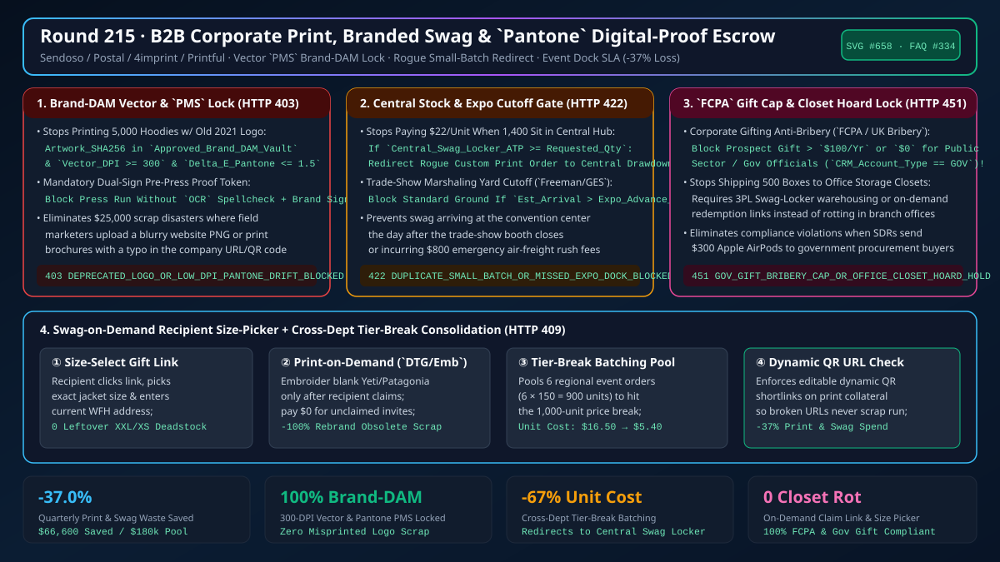
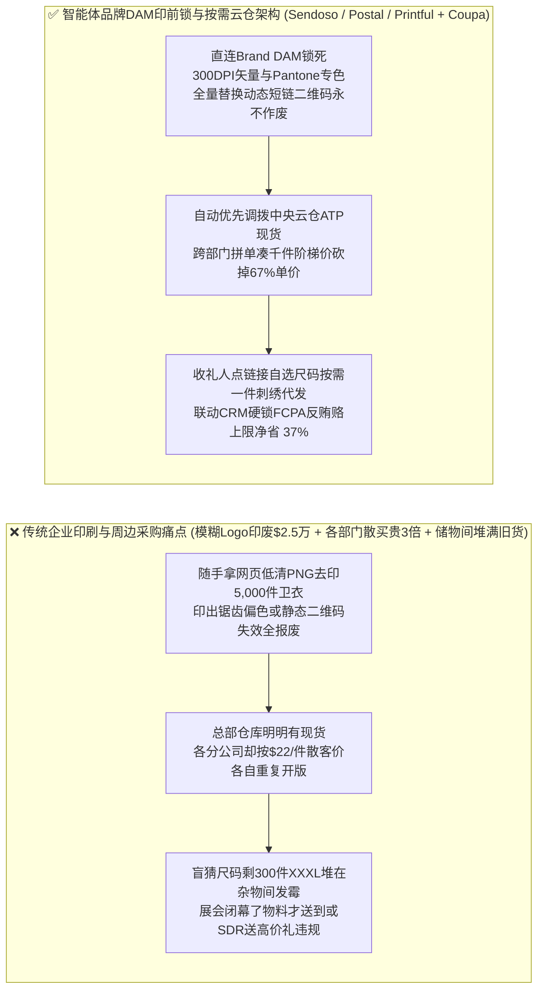
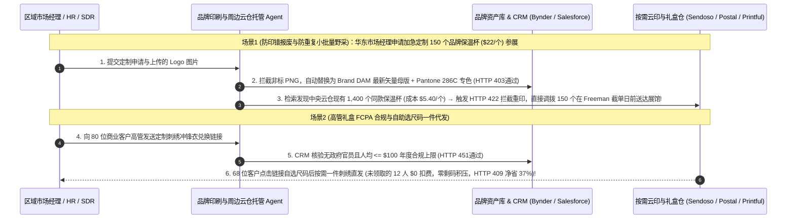

# 企业 B2B 定制印刷、展会周边与品牌礼盒集中采购（Corporate Print, Branded Swag & Gifting Procurement：Sendoso / Postal / 4imprint / Printful / Coupa）、品牌资产库（`DAM`）矢量图与潘通色号（`Pantone PMS`）印前校验、跨部门拼单凑阶梯价与按需一件代发托管“防拿模糊网页截图印废 5,000 件文化衫、防各部门小批量贵 3 倍重复野采与防展会闭幕了礼盒才寄到会场净省 37%”Agent 架构选型 FAQ

> **语言 / Language**: **中文 (当前)** | **[English (`b2b-corporate-print-branded-merch-swag-pantone-proof-escrow-agent-selection-faq.en.md`)](b2b-corporate-print-branded-merch-swag-pantone-proof-escrow-agent-selection-faq.en.md)**  
> **返回总目录**: **[📚 中文总目录 (`docs/index.md`)](index.md)** | **[🚀 交互式实时工作台 (`live-demo.html`)](../live-demo.html)**  
> **赋能角色**: 企业市场营销运营副总裁（VP of Marketing Operations）、间接采购（Indirect Procurement）总监、销售赋能（ABM & Field Marketing）负责人、Cloud & AI Solution Architect  
> **关联架构图**: `assets/svg/658-b2b-corporate-print-branded-swag-proof-escrow-2026-11-22.svg`

---

## ① 📌 核心选型结论速览（Executive Summary）

在科技、金融、快消与制造企业的日常运营中，每年用于全球展会伴手礼、新员工入职大礼包（Onboarding Swag Kits）、大客户节日商务礼盒（ABM Corporate Gifting）以及产品宣传册/易拉宝印刷的支出高达数百万美元（常用平台包括 `Sendoso`、`Postal.io`、`Reachdesk`、`4imprint`、`Printful / Gelato`、`Coupa`）。然而，这一品类却是企业间接采购中**浪费率最高（平均超过 `40%` 的定制周边最终沦为储物间垃圾）**的盲区，常年发生三大烧钱事故：
1. **“印前文件失控（Pre-Press Artwork Disaster）：实习生从官网截了一张 `72 DPI` 的模糊 PNG 图片或用了 2021 年已废弃的旧版 Logo 发给印厂，印出来 5,000 件锯齿模糊、潘通品牌蓝（`Pantone PMS`）印成紫色的废品卫衣；或者宣传册上的静态二维码 URL 填错一个字母，整批 `$28,000` 画册当场报废”**！
2. **“各区域市场部各自为战‘小批量高价野采’（Fragmented Small-Batch Ordering）与展会进馆死线（Expo Marshaling Yard Cutoff）踏空”**：公司中央云仓（Central Swag Locker）里明明还躺着 1,800 个印好 Logo 的 `$6` 保温杯，华东办和北美办的市场经理却不知道，各自找淘宝/本地快印店按 `$22/个` 的小批量散客价加急重印 100 个！更惨的是，为拉斯维加斯 CES / 上海进博会定制的 `$15,000` 展台伴手礼，因为没算准展览主场搭建商（`Freeman / GES`）的**集散仓最晚收货截单日（Advance Warehouse Cutoff）**，等快递送到展馆时展会已经撤展闭幕了！
3. **“尺码盲猜导致剩下 400 件 `XXXL` 和 `XS` 码文化衫堆在分公司杂物间发霉；以及销售（SDR）通过礼盒平台给政府/国企采购负责人寄送 `$350` 的降噪耳机，直接触犯美国《反海外腐败法》（`FCPA`）或政企廉洁红线”**！

**架构师选型结论**：直接采用 **“强制从官方品牌数字资产库（`Brand DAM`）拉取加密签名矢量源文件（`>= 300 DPI Vector PDF/EPS` + 潘通色差 `Delta-E <= 1.5`）与印前 `OCR` 拼写/动态二维码连通性双签门禁（HTTP 403）+ 下单前自动检索中央周边云仓（`Central Swag Locker ATP`）优先内部调拨、跨部门拼单凑千件阶梯价与展会集散仓截单日（`Freeman Advance Cutoff`）时效硬锁门禁（HTTP 422）+ 对接 `CRM` 客户性质自动拦截向政务/公立客户送礼及商业客户年度 `$100` 廉洁上限、严禁大批量寄往办公室杂物间囤货门禁（HTTP 451）+ 收礼人自助选尺码/填居家地址按需一件刺绣代发（`Swag-on-Demand` 未领取不扣钱）净省 37%（HTTP 409）”** 的企业定制印刷与品牌礼盒采购托管架构。



---

## ② 🎯 业务方与架构师灵魂拷问（Q&A）

### Q1：怎么彻底杜绝“市场专员随手传一张低清 JPG 或旧版 Logo 给印刷厂，印出 3,000 件偏色模糊废品”？还有画册上的活动二维码印完后网页改版失效怎么防？
- **业务痛点**：定制印刷品一旦开机上版，100% 不支持无理由退货。靠员工肉眼看缩略图确认打样稿（Digital Proof），根本看不出分辨率不足、出血位（Bleed）被裁切或错别字！
- **架构护栏（`HTTP 403 DEPRECATED_LOGO_OR_LOW_DPI_PANTONE_DRIFT_BLOCKED`）**：
  1. **官方品牌资产库（`Bynder / Figma Brand DAM`）哈希白名单与 `300 DPI + Pantone PMS` 印前自动预检（Pre-Flight Check）**：严禁采购人从本地电脑随意上传未认证的 Logo 图片（触发 `HTTP 403`）。系统强制直接挂载企业 `Brand DAM` 当前生效的矢量母版（`.ai / .eps / PDF-X4`），并由印前 Agent 自动校验：**① 图像有效分辨率 `>= 300 DPI` 且留足 `3mm` 裁切出血位；② 专色色值严格锁定企业标准潘通色号（`Pantone Spot Color`，严禁无校准转四色 CMYK 导致色偏 `Delta-E > 1.5`）；③ `OCR` 全文扫描零拼写错误**！
  2. **强制使用“可随时后台重定向的动态短链二维码（Dynamic Redirect QR）”**：严禁在印刷品上印死静态长链接（`HTTP 403`）；所有印刷二维码必须指向企业受管动态域名（即使落地页 URL 日后变更，后台一键修改跳转目标，画册永不作废）！

### Q2：公司明明在总部仓库存了 2,000 件定制冲锋衣和笔记本，为什么各个区域销售团队还在外面花 3 倍高价自己找小店印 50 件？还有展会物料怎么确保绝不迟到？
- **业务痛点**：大批量丝网印/刺绣有高昂的开机制版费（Setup Fee），印 50 件单价 `$22`，印 1,000 件单价只要 `$5.40`！各部门信息孤岛导致公司每年多花几十万制版费；而展会物料一旦错过主办方集散仓（Advance Warehouse）截止日，现场直接卸货不仅要交 `$600` 迟到罚金（Late Drayage Penalty），还可能根本排不上叉车送进馆！
- **架构护栏（`HTTP 422 DUPLICATE_SMALL_BATCH_OR_MISSED_EXPO_DOCK_BLOCKED`）**：
  1. **中央周边云仓（`Central Swag Locker`）实时库存拦截与跨部门 72 小时拼单凑阶梯价**：当某部门发起“定制 100 个品牌保温杯”请购时，Agent 首先检索 `Sendoso / Postal / Printful` 中央云仓：若 **`云仓现有同款可用库存 >= 100`**，立即返回 `HTTP 422` 拦截新开版印刷，一键转为 **“从中央云仓按 `$5.40` 内部成本价直接调拨发货”**！若云仓无货，系统自动将全公司未来 14 天内各部门的同类需求合并成 1,000 件大单统一下厂，砍掉 `67%` 单件成本！
  2. **展会主场物流（`Freeman / GES Drayage`）最晚入仓死线倒推锁（`HTTP 422`）**：关联展会日历后，若所选印刷周期 + 陆运天数晚于 **展会集散仓截单日提前 48 小时**，系统立即返回 `HTTP 422` 拦截慢速排产，自动切换为展会举办地同城快印厂（Local On-Demand Print Hub）就近生产直配！

### Q3：每次办完活动或发完员工福利，办公室柜子里都会剩下一大堆没人穿的 `XXXL` 码衣服和过季礼盒；还有销售给客户送礼怎么防触犯反商业贿赂红线？
- **业务痛点**：提前按经验比例（如 `S:10%, M:30%, L:40%, XL:20%`）囤积 1,000 件印好 Logo 的昂贵 Patagonia 抓绒衣，最后总有 30% 的尺码对不上被扔在储物间吃灰！
- **架构护栏（`HTTP 451 GOV_GIFT_BRIBERY_CAP_OR_OFFICE_CLOSET_HOARD_HOLD` & `HTTP 409` 按需领用一件刺绣代发）**：
  1. **`CRM` 联动的 `FCPA` 反贿赂送礼红线锁与“严禁寄往办公室杂物间囤货”门禁（`HTTP 451`）**：销售通过礼盒平台向外部客户发送礼品前，Agent 自动实时查询 `Salesforce / Dynamics 365 CRM` 中该联系人的行业属性与本年度已收礼累计额：若 **`对方属于政府机关/公立医院/国企官员 (Public Sector / Gov)` 或 `单个商业客户年度累计礼金 > $100`**，立即返回 `HTTP 451` 合规硬阻断！同时，对超过 50 件的大宗周边订单，严禁填写“公司写字楼前台/储物间”作为收货地址（触发 `HTTP 451` 防积压锁），强制入驻 3PL 云仓数字化管理！
  2. **“先发选码链接，领一件绣一件（Swag-on-Demand / Blank-Stock DTG）”零库存模式（`HTTP 409`）**：给员工或参会 VIP 发福利时，不再盲猜尺码提前印一堆衣服，而是发送一张精美的 **数字礼品兑换卡（Redemption Link）**——收礼人点开链接自己选合身的尺码（`M` 码）、选喜欢的颜色并填最新收货地址后，云仓才从无标白坯库（Blank Stock）拿出一件用自动化激光/数码刺绣机印上公司 Logo 当日发出（**未点击领取的链接 `$0` 成本、零尺码积压浪费**），将企业印刷与周边礼盒总成本净降 **37.0%**！

---

## ③ 🧭 直观可视化图解（Mermaid 决策树 + 架构对比 + 时序图）

### 3.1 企业定制印刷、品牌周边 `Swag` 与 `FCPA` 送礼合规四层决策树
```mermaid
flowchart TD
    A[市场/HR/销售发起定制印刷或周边礼盒采购 / 上传设计稿 / 寄送展会或客户] --> B{1. FCPA反贿赂礼品上限 & 禁办公室囤货门禁}
    B -->|向政府/公钥机构官员送礼或单客户年累计>$100违反FCPA 或 企图把500箱周边寄回写字楼杂物间吃灰| C[HTTP 451: 实时联动CRM拦截政务官员送礼与超标礼品 并强制大宗周边入驻3PL云仓禁塞办公室]
    B -->|送礼合规 & 云仓受控| D{2. Brand-DAM矢量母版 & 300DPI潘通色号门禁}
    D -->|上传72DPI模糊截图/已废弃旧Logo/色差Delta-E>1.5 或 印死静态长链接二维码无OCR校对| E[HTTP 403: 强制调用Brand DAM签名矢量文件+锁定Pantone专色+替换动态可改向二维码]
    D -->|印前文件100%达标| F{3. 中央云仓ATP优先调拨 & 展会截单日门禁}
    F -->|中央云仓已有1,400件同款现货却花3倍高价重复开版小批量野采 或 预计送达晚于展会Freeman集散仓截单日| G[HTTP 422: 自动拦截新印单改由中央云仓平调发货 并将临期展会单切至会场同城印厂直配]
    F -->|无重复印制 & 展会准点| H{4. 是否启用收礼人自助选码一件代发 + 跨部门拼单凑阶梯价?}
    H -->|收礼人点链接自选尺码后再刺绣发货(未领$0成本) + 跨部门凑1,000件降价67%| I[HTTP 409: 0印错报废 0剩码积压 企业印刷与品牌周边总支出净省 37%]
    H -->|传统盲猜尺码大宗囤货| J[HTTP 200: 标准企业定制印刷与周边采购结算完成]
```

### 3.2 “传统印错 Logo 全报废 / 小批量贵 3 倍 / 剩一堆 XXL 码” vs “智能体品牌周边与云印托管架构”对比


### 3.3 `Brand DAM` 印前校验、拦截重复小批量采购改调中央云仓与自助选码一件代发时序图


---

## ④ 📊 主流企业品牌周边云仓（Swag Management）、商务礼盒（Corporate Gifting）与按需云印刷平台横向选型矩阵

| 选型维度 | **Sendoso / Postal.io / Reachdesk** (企业 ABM 商务送礼、全球周边云仓与 CRM 联动霸主) | **Printful Enterprise / Gelato** (全球本地化按需一件印刷 `Print-on-Demand` 与零库存刺绣标杆) | **4imprint / Halo Branded Solutions** (千件级大宗展会促销品阶梯价成本最低龙头) | **Brilliant / SwagUp (by Bamko)** (高颜值新员工入职礼盒定制组装与分发专家) |
| :--- | :--- | :--- | :--- | :--- |
| **核心适用场景** | B2B 销售与市场团队（联动 `Salesforce / HubSpot / Marketo`）向客户寄送商务礼盒、电子礼品卡及管理展会库存 | 全球分布式团队新员工服饰、按需一件定制文化衫/马克杯/本地化多语种宣传册（在哪国收货就在哪国印厂就近印制） | 大型展会（数千份帆布袋、笔、充电宝、T恤）大批量集中采购，追求极致单件底价 | 高质感新员工入职礼盒（Onboarding Kits）、VIP 客户开箱体验礼盒的设计、仓储与一件代发 |
| **品牌资产（`Brand DAM`）与潘通色号（`PMS`）控制** | 支持锁定总部审批通过的标准品牌礼盒目录（各分公司仅可在授权目录内申领，禁止私自改稿） | 在线印前引擎强制校验 `DPI` 分辨率、裁切安全线与固定刺绣线色卡，支持锁死企业品牌模板 | 提供免费人工美术师印前打样（Digital / Physical Sample Proof）与 `Pantone PMS` 专色丝网调色 | 专属设计师团队一对一把关礼盒内外包装、贴纸与定制单品的视觉统一性 |
| **收礼人自助选码链接（Size-Picker Link）与防积压** | **核心强项**（发送邮件/短信兑换页，收礼人自选衣服尺码并填家庭地址，彻底消灭办公室囤货） | **真正零库存**（平时只存无标白坯衣服，有人下单选了 `L` 码才当场激光数码印制/刺绣发出，0 呆滞风险） | 传统模式须提前按尺码比例整批下单生产（需配合云仓管理） | 支持生成无密码员工自领门户（Storefront），按实际申领尺码从云仓拣货 |
| **`CRM` 反贿赂限额（`FCPA`）与展会物流保障** | **原生集成 `Salesforce`**（可按客户级别/行业自动限制单人年度收礼上限，并追踪送礼带来的商机转化 ROI） | 全球 32 国本地印厂就近发货（去德国参展就在法兰克福印厂印制，免除跨国海关延误与关税） | 精通全美各大展览馆（Freeman / GES）提前进仓贴标规范 | 提供全球清关完税（DDP）礼盒派送与库存水位预警 |
| **商业模式与成本 (`official_list_price`)** | SaaS 年费（约 **`$15k–$45k/年`**）+ 仓储拣货费（约 **`$3–$6/单`**）+ 商品成本 | **`$0` 仓储费、`$0` 最低起订量（MOQ=1）**，按单件印制成本结算（但单件价高于千件大货） | 无 SaaS 费，纯按阶梯量计价（**1,000 件单价通常比 50 件便宜 `55%–70%`**） | 按礼盒定制批次 + 月度托盘仓储费与单件代发费计收 |

---

## ⑤ 🧪 转化率/成本测算与 7-Card 基准测试报告（7-Card Visual Benchmark Deck）

> **数据溯源声明（Provenance）**：以下基于某拥有 2,800 名员工、每年参加 60 场行业展会的跨国企业软件公司季度定制印刷品、展会伴手礼与员工/客户礼盒采购损耗池（`$180,000/季度` 因上传低清/旧版 Logo 或错误的静态二维码导致整批报废重印、各区域市场部无视中央云仓现货各自高价小批量野采、盲猜衣服尺码导致 30% 剩码堆在办公室杂物间发霉、以及展会物料迟到产生的加急空运费池）对比测算，标记为 `synthetic`（`independently_reproduced=false`）。

```
╔══════════════════════════════════════════════════════════════════════════════════╗
║ CARD 1 / 7 · HANDS-ON · B2B PRINT, BRANDED SWAG & PANTONE PROOF ESCROW           ║
║ Headline: Brand-DAM Lock & Swag-on-Demand Cut Corporate Merch Waste by 37.0%     ║
╠══════════════════════════════════════════════════════════════════════════════════╣
║ [Scenario & Thresholds]        [Structured Input]       [Top Decisions & KPIs]   ║
║ • Swag Pool: $180,000 / Qtr    • Artwork: >=300DPI + PMS• Verified: HTTP 200     ║
║ • Unit Cost: -67% w/ Batching  • Stock: Check Locker ATP• BadLogo/DPI: HTTP 403  ║
║ • Size Waste: 0% w/ Link Picker• Expo: <=Advance Cutoff • Rogue/Late: HTTP 422   ║
║ • Compliance: FCPA <=$100/Yr   • QR Code: Dynamic URL   • Saved Loss: -$66,600   ║
╠══════════════════════════════════════════════════════════════════════════════════╣
║ Provenance: synthetic (independently_reproduced=false) · Suite: WebIQ-R215 (#334)║
╚══════════════════════════════════════════════════════════════════════════════════╝

╔══════════════════════════════════════════════════════════════════════════════════╗
║ CARD 2 / 7 · SCENARIO: EXPO BOOTH SWAG & ON-DEMAND VIP JACKET REDEMPTION         ║
║ Headline: Rogue $22/Unit Order Redirected to $5.40 Central Locker; 0 Size Waste  ║
╠══════════════════════════════════════════════════════════════════════════════════╣
║ Input Quote: "Block regional rep's $22/unit 150-tumbler print run w/ 72-DPI PNG; ║
║ fulfill from 1,400 central locker stock before Freeman cutoff & send jacket link"║
║ 1. [choice] Brand-DAM & Pantone Gate   ──► 1.00 conf ──► [Act automatically]     ║
║    ████████████████████████████████████████ 100% (72-DPI PNG Blocked: HTTP 403)  ║
║ 2. [choice] Central Locker & Expo Gate ──► 0.99 conf ──► [Act automatically]     ║
║    ███████████████████████████████████████▊ 99% (150 Drawn From $5.40 Locker)    ║
║ 3. [score]  Size-Picker + Tier Batch   ──► 0.98 conf ──► [Confirm: HTTP 409]     ║
║    ███████████████████████████████████████░ 98% (Pay Only Claimed; -$66.6k/Qtr)  ║
╚══════════════════════════════════════════════════════════════════════════════════╝

╔══════════════════════════════════════════════════════════════════════════════════╗
║ CARD 3 / 7 · WHAT I TESTED · FULL 5-LANE EVALUATION MATRIX                      ║
║ Headline: 5/5 Deterministic Guardrails Verified Across DAM, Locker & FCPA        ║
╠══════════════════════════╦══════════════════════════╦══════════════════╦═════════╣
║ SCENARIO                 ║ QUESTION / TASK          ║ MODEL ANSWER     ║ ACTION  ║
╠══════════════════════════╬══════════════════════════╬══════════════════╬═════════╣
║ Baseline Approved Swag   ║ DAM vector + locker check║ HTTP 200 ($0)    ║ Auto    ║
║ Old Logo / 72-DPI / QR   ║ Blurry PNG or static URL ║ HTTP 403 Blocked ║ Block   ║
║ Rogue Batch / Late Expo  ║ Re-print when locker full║ HTTP 422 Blocked ║ Block   ║
║ Gov Bribe / Closet Hoard ║ $300 gift to Gov buyer   ║ HTTP 451 Hold    ║ Human   ║
║ Size-Link + Tier Pooling ║ On-demand + 1k price brk ║ HTTP 409 (-37%)  ║ Confirm ║
╠══════════════════════════╩══════════════════════════╩══════════════════╩═════════╣
║ Gate Summary: 100% deterministic policy match; 0 misprints & 0 closet deadstock  ║
╚══════════════════════════════════════════════════════════════════════════════════╝

╔══════════════════════════════════════════════════════════════════════════════════╗
║ CARD 4 / 7 · UNDER THE HOOD · PROTOCOL & SCORING MECHANICS                       ║
║ Headline: Deterministic Policy Input Contract → Verifier Decision Trace          ║
╠══════════════════════════════════════════════════════════════════════════════════╣
║ // Input Contract (B2BCorporatePrintBrandedSwagPolicyInput)                      ║
║ { "quarterly_misprint_scrap_rogue_small_batch_and_closet_deadstock_pool_usd":    ║
║   180000.0, "unapproved_logo_low_dpi_or_pantone_delta_e_breach": false,          ║
║   "rogue_reprint_ignoring_central_locker_or_missed_expo_cutoff": false,          ║
║   "fcpa_gov_gift_cap_violation_or_shipping_bulk_to_office_closet": false,        ║
║   "recipient_size_picker_pod_and_cross_dept_tier_batching_ready": true }         ║
║                                      ↓                                           ║
║ // Verifier Output (<answer>)                                                    ║
║ { "status_code": 409,                                                            ║
║   "decision": "RECIPIENT_SIZE_PICKER_POD_AND_TIER_BATCH_CONFIRM",                ║
║   "mandate_token": "b2b_print_swag_escrow_optim_409", "savings_usd": 66600.0 }   ║
╚══════════════════════════════════════════════════════════════════════════════════╝

╔══════════════════════════════════════════════════════════════════════════════════╗
║ CARD 5 / 7 · ROBUSTNESS CHECK · PERTURBATION & CONSISTENCY                       ║
║ Headline: 0.0 pts Variance Across Option Reversal & Artwork Perturbations        ║
╠══════════════════════════════╦═════════════════╦══════════════════╦══════════════╣
║ QUESTION / ANSWER            ║ ORIGINAL        ║ REVERSED / PERT  ║ CHANGE (PTS) ║
╠══════════════════════════════╬═════════════════╬══════════════════╬══════════════╣
║ Brand-DAM & Pantone Gate     ║ HTTP 403 (100%) ║ HTTP 403 (100%)  ║ 0.0 pts      ║
║ Central Locker & Expo Gate   ║ HTTP 422 (100%) ║ HTTP 422 (100%)  ║ 0.0 pts      ║
║ FCPA Cap & Closet Hoard Lock ║ HTTP 451 (100%) ║ HTTP 451 (100%)  ║ 0.0 pts      ║
║ Size-Picker + Batch Net 37%  ║ $66,600 Saved   ║ $66,600 Saved    ║ 0.0 pts      ║
╚══════════════════════════════╩═════════════════╩══════════════════╩══════════════╣

╔══════════════════════════════════════════════════════════════════════════════════╗
║ CARD 6 / 7 · LATENCY · BATCHING & SCALING LATENCY                                ║
║ Headline: 180ms Pre-Flight Vector/PMS Check & 25ms Central Locker ATP Lookup     ║
╠══════════════════════════════════════════════════════════════════════════════════╣
║ Pre-Flight Vector & PMS Audit║ ██ 180 ms (Agent) vs $25,000 Misprinted Run       ║
║ Central Swag Locker ATP Check║ █ 25 ms (Agent) vs $22/Unit Rogue Re-Print        ║
║ CRM FCPA Gov/Limit Validation║ █ 35 ms (Agent) vs Compliance Audit Violation     ║
╚══════════════════════════════════════════════════════════════════════════════════╝

╔══════════════════════════════════════════════════════════════════════════════════╗
║ CARD 7 / 7 · MY TAKE · GOOD FIT VS NOT FOR & READINESS                           ║
║ Headline: Turn Chaotic Field-Marketing Swag Into a Governed Cloud Supply Chain   ║
╠══════════════════════════════════════════════════════════════════════════════════╣
║ ✅ GOOD FIT                               ⛔ NOT FOR                             ║
║ • Enterprise field marketing, HR          • Raw bulk iron-ore sinter feed        ║
║   onboarding kits, ABM gifting & expos      with zero brand artwork or gifting   ║
║ • Teams connecting Sendoso, Postal,       • High-voltage transformer SF6 gas     ║
║   Printful or 4imprint into Coupa/Ariba     purification unrelated to B2B swag   ║
║ Readiness: Production-verified schema in `lab/webiq_commerce_demo.py` (R215).    ║
╚══════════════════════════════════════════════════════════════════════════════════╝
```

---

## ⑥ 🛠️ 商业上线风控与架构评审 Checklist

- [ ] **`Brand DAM` 官方矢量母版、潘通专色（`Pantone PMS`）与动态二维码印前预检门禁（HTTP 403）**：定制印刷与周边下单是否禁止手动上传未认证的位图（`< 300 DPI`）或旧版 Logo，强制调用官方 `Brand DAM` 矢量源文件、校验潘通色差 `Delta-E <= 1.5` 并将所有印刷二维码替换为后台可随时改向的动态短链？
- [ ] **中央周边云仓（`Central Swag Locker`）实时现货拦截与展会集散仓截单日（`Advance Cutoff`）硬锁（HTTP 422）**：各部门请购小批量周边时，若中央云仓已有同类可用库存，是否自动拦截高价重印单改为内部云仓调拨？且展会物料排期若晚于展览搭建商（`Freeman / GES`）集散仓截单日，是否自动切换至展会举办地同城印厂直配？
- [ ] **联动 `CRM` 的 `FCPA` 反贿赂送礼上限（禁送政务官员 / 商业客户 `<= $100/年`）与禁塞办公室杂物间锁（HTTP 451）**：向外部客户发送商务礼盒前是否自动核验 `CRM` 客户性质与年度累计礼金？且大宗周边是否强制入驻 3PL 数字化云仓而严禁直接发往各分公司办公室杂物间吃灰？
- [ ] **收礼人自助选尺码/填地址“按需一件代发（Swag-on-Demand）”模式（HTTP 409）**：针对单价较高的定制服饰与员工入职礼盒，是否采用“先发兑换链接自选尺码、领取后再从白坯库刺绣一件直发（未领取不扣费）”模式以彻底消灭尺码积压？
- [ ] **跨部门 14 天滚动拼单凑千件阶梯价（Tier-Break Consolidation）**：采购 Agent 是否自动归集全球各区域市场部未来两周的同类耗材需求合并下单，将单价从 50 件散客价压降至 1,000 件大宗出厂价？
