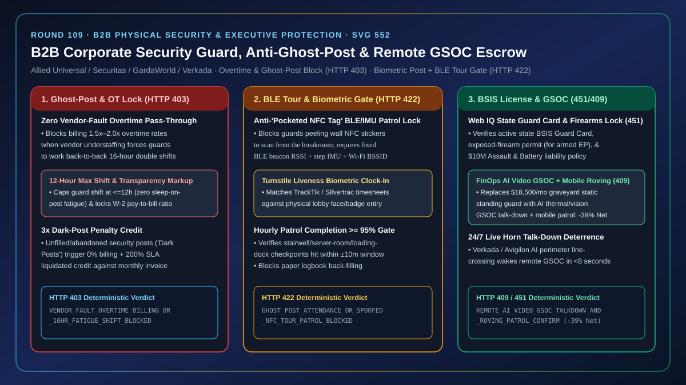
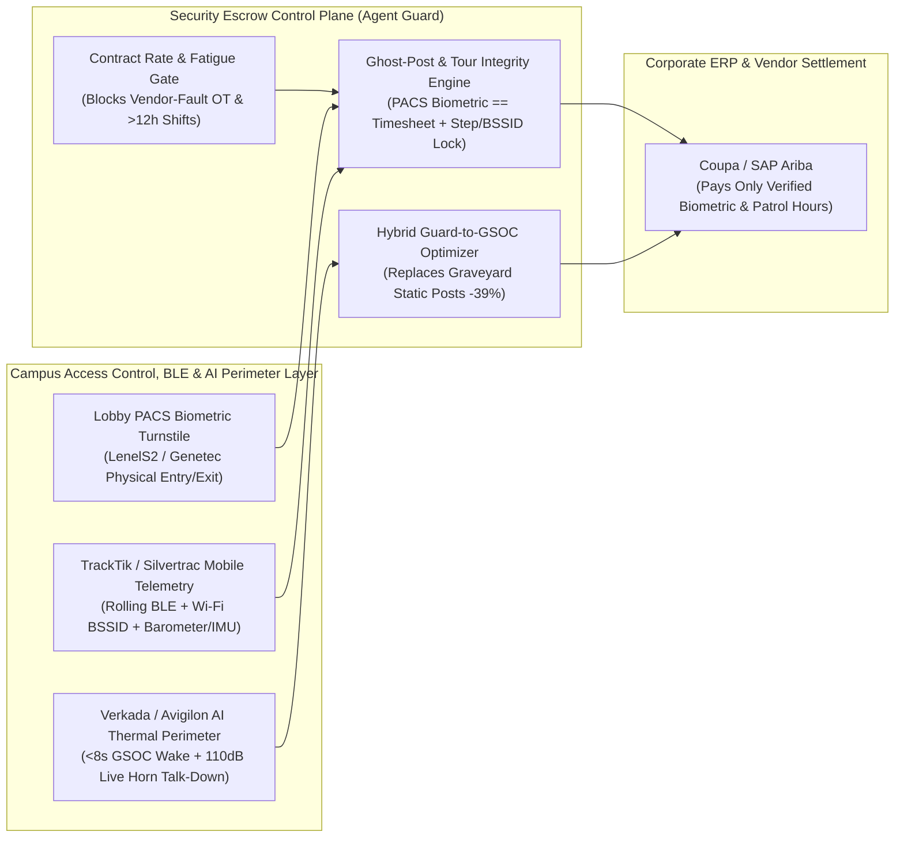
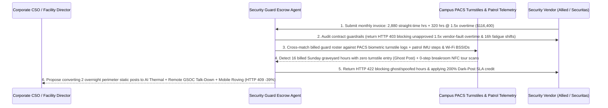

# B2B Corporate Security Guard, Anti-Ghost-Post & Remote `GSOC` Escrow (`Allied Universal / Securitas / GardaWorld / Verkada`) Agent Architecture Selection FAQ

> **Target Audience**: **Cloud & AI Solution Architects** designing AI physical-security procurement, biometric post-attendance reconciliation, anti-spoofing guard-tour verification, and remote video `GSOC` optimization agents for Chief Security Officers (`CSOs`), data center & logistics facility managers, and ERP indirect-spend platforms (`Coupa / SAP Ariba`).  
> **Core Pain Points Solved**: Eliminates the four systemic billing and operational failures in B2B manned guarding contracts: **(1) "Ghost Posts" & Dark-Post Billing (billing the enterprise for 4 graveyard-shift guards on paper timesheets when turnstile logs prove only 2 guards actually showed up on site), (2) Vendor-Fault Overtime Pass-Through & 16-Hour Fatigue Shifts (where high guard turnover causes the vendor to hold a daytime guard over for a 16-hour double shift—who then sleeps in a stairwell—while billing the client a `1.5x` overtime premium for the vendor's own staffing failure), (3) "Pocketed NFC Tag" Fake Patrols (guards peeling adhesive `NFC` tour stickers off stairwell walls and scanning all 12 checkpoints every hour from the warm breakroom couch), and (4) `$220,000/Year` Graveyard Static Standing-Post Waste (paying for stationary overnight parking-lot guards who can only see 30 meters in the dark instead of AI thermal perimeter cameras with `<8-second` remote `GSOC` horn talk-down)**.



---

## 📌 1. Executive Summary

1. **Zero Vendor-Fault Overtime Pass-Through, `<=12-Hour` Fatigue Cap & `200%` Dark-Post Liquidated Credit (`HTTP 403`)**: Because contract security guard turnover averages `100%–300%` annually, understaffed vendors routinely cover open shifts by forcing existing guards into `16-hour` back-to-back double shifts—and then attempt to bill the client `1.5x–2.0x` overtime rates (`$54+/hr`) for those hours. The Agent enforces three hard contract guardrails: **(a) overtime bill rates are strictly prohibited unless the client requested ad-hoc surge coverage with `<48 hours` notice (`$0` vendor-fault overtime pass-through); (b) individual guard shifts are capped at `<=12 consecutive hours` to prevent sleeping-on-post liability; and (c) any unfilled "Dark Post" exceeding 30 minutes triggers `$0` billing plus a `200%` hourly SLA credit**. Violations trigger **`HTTP 403 VENDOR_FAULT_OVERTIME_BILLING_OR_16HR_FATIGUE_SHIFT_BLOCKED`**.
2. **Turnstile Biometric Clock-In Match & Multi-Sensor (`BLE + Wi-Fi BSSID + IMU`) Anti-Pocketed-NFC Tour Gate (`HTTP 422`)**: To eradicate "Ghost Posts" and "peeled-sticker breakroom scans," the Agent enforces two deterministic telemetry checks before releasing `Coupa / Ariba` invoice settlement: (a) **Physical Turnstile Liveness Reconciliation**: every billed hour in `TrackTik / Silvertrac / WinTeam` must match an authenticated biometric/badge entry and exit on the client's own physical access control system (`PACS` such as `LenelS2 / Genetec`); and (b) **Anti-Spoofing Patrol Proof**: hourly patrol checkpoints must validate encrypted rolling-code `BLE` beacons, floor-specific Wi-Fi `BSSID` radio fingerprints, and mobile pedometer/barometer `IMU` movement (`>=600 steps` per tour). Zero-step breakroom `NFC` scans, `<95%` tour completion, or unverified timesheet hours trigger **`HTTP 422 GHOST_POST_ATTENDANCE_OR_SPOOFED_NFC_TOUR_PATROL_BLOCKED`**.
3. **Graveyard Static Post Conversion to AI Thermal Perimeter + Remote Video `GSOC` Talk-Down Saving 39% (`HTTP 409`)**: Staffing a single 24/7 static outdoor guard post requires `4.2 FTEs` (`168 hours/week`, costing `$180,000–$240,000/year`). During `22:00–06:00` graveyard hours in warehouses, parking structures, and office perimeters, the Agent triggers **Guard-to-GSOC Hybrid FinOps**: replacing static overnight standing posts with **`Verkada / Avigilon` AI thermal line-crossing cameras wired to a 24/7 Remote Video Monitoring `GSOC` (`<8-second` live 110-dB horn audio talk-down deterrence) backed by a shared mobile roving patrol vehicle**—returning **`HTTP 409 REMOTE_AI_VIDEO_GSOC_TALKDOWN_AND_ROVING_PATROL_CONFIRM`** and reducing net quarterly security spend by **39%**.

---

## 🎯 2. Architect & Business Stakeholder Q&A

### Q1: How do guards fake `100%` on-time electronic patrol logs (`TrackTik / Silvertrac`) without ever leaving the breakroom—and how does our architecture stop it?
- **Defeating the "Peeled NFC Sticker / Cloned RFID" Exploit**:
  1. **The Adhesive `NFC` Sticker Vulnerability**: Standard guard-tour setups stick passive `$0.50` `NFC` tags inside stairwells, mechanical rooms, and roof doors. Enterprising night-shift guards warm the adhesive with a lighter, peel all 12 stickers off the walls, stick them onto a clipboard inside the guard shack (or clone the static UIDs onto blank cards with a `$15` writer), and tap each tag in sequence every 5 minutes while watching movies.
  2. **Multi-Modal Spatial Attestation (`BLE + Wi-Fi BSSID + Barometer/IMU`)**: Our Agent rejects static passive `NFC` tags as sole proof. Each checkpoint scan is cross-validated against the guard phone's step-counter accelerometer (`IMU`), barometric altitude change across floors, and the visible MAC addresses (`BSSIDs`) of nearby ceiling enterprise Wi-Fi access points (`Cisco Meraki / Aruba`). If 12 checkpoints across 10 floors are scanned while connected to the 1st-floor guardhouse Wi-Fi AP with `<50` steps logged, the tour is flagged as spoofed (`HTTP 422`).

### Q2: Why do corporate security invoices consistently come in `20%–30%` over the contracted hourly rate—and why are guards caught sleeping on night shifts?
- **Eliminating Vendor-Fault Overtime Arbitrage & Wage Compression**:
  1. **Profiting from Understaffing**: When a security vendor bids an unrealistically low markup, they underpay guards, suffer chronic absenteeism, and fill gaps by ordering on-duty guards to work `16-hour` double shifts. If the contract allows billing overtime whenever a guard exceeds 40 hours/week, the client pays a `50%` penalty for the vendor's failure to hire enough staff—while getting a sleep-deprived guard who creates massive premises liability.
  2. **The `>=68%` Wage-Pass-Through Floor & Straight-Time Cap**: The Agent enforces an open-book `W-2 Wage-to-Bill Ratio >= 68%–72%` (ensuring guards are paid enough to retain qualified personnel) and blocks all overtime billing multipliers unless linked to a client-signed ad-hoc event/escort work order.

### Q3: What happens if a guard dispatched for a high-risk employee termination or executive protection (`EP`) detail has a lapsed state Guard Card or firearm permit?
- **Real-Time `BSIS` Credential & Assault-and-Battery Insurance Gating (`HTTP 451`)**:
  1. **Negligent Hiring & Use-of-Force Liability**: Deploying an unlicensed guard or an armed officer with an expired state firearm qualification (`CA BSIS / NY DOS / UK SIA`) exposes the corporate host to strict liability if a physical altercation occurs.
  2. **Per-Shift Web IQ License & Insurance Check**: Before a guard's badge activates at the facility turnstile, the Agent verifies their active state license number and confirms the vendor's `$10M+` Commercial General Liability policy carries an active **Assault & Battery / Use-of-Force Endorsement**.

---

## 🧭 3. Visual Architecture Diagrams (Mermaid)

### 3.1 B2B Corporate Security Guard, Anti-Ghost-Post & Remote `GSOC` Decision Tree

```mermaid
flowchart TD
    A[Corporate CSO / Facility Security Procurement & Invoice Request] --> B{1. Overtime Pass-Through, 12h Fatigue Cap & Dark-Post Audit}
    B -->|Vendor-Fault 1.5x Overtime Billed or >12h Double Shift / Uncredited Dark Post| C[HTTP 403 Block: VENDOR_FAULT_OVERTIME_BILLING_OR_16HR_FATIGUE_SHIFT_BLOCKED]
    B -->|Zero Vendor-Fault OT + <=12h Shift Cap + 200% Dark-Post Credit| D{2. Turnstile Biometric Match & Anti-Spoofing BLE/IMU Tour Gate}
    D -->|Billed Hours Lack Turnstile Biometric Entry (Ghost Post) or Zero-Step NFC Spoofing| E[HTTP 422 Block: GHOST_POST_ATTENDANCE_OR_SPOOFED_NFC_TOUR_PATROL_BLOCKED]
    D -->|100% Biometric Turnstile Parity + >=95% BLE/Wi-Fi/IMU Verified Tours| F{3. Web IQ State Guard Card, Firearm Permit & Assault Insurance}
    F -->|Lapsed State BSIS Guard/Firearm License or Missing Assault & Battery Coverage| G[HTTP 451 Hold: WEBIQ_UNLICENSED_GUARD_CARD_OR_LAPSED_ASSAULT_INSURANCE_HOLD]
    F -->|Licenses & Liability Endorsements Verified| H{4. Graveyard Static Post -> AI Thermal GSOC Talk-Down Conversion}
    H -->|22:00–06:00 Static Standing Guard Post Active on Perimeter/Lot| I[HTTP 409 Confirm: REMOTE_AI_VIDEO_GSOC_TALKDOWN_AND_ROVING_PATROL_CONFIRM -39%]
    H -->|Already Running Hybrid Daytime Concierge + Night AI GSOC| J[HTTP 200 Authorized: BIOMETRIC_VERIFIED_GUARD_AND_BLE_PATROL_AUTHORIZED]
```

### 3.2 End-to-End Biometric Post Reconciliation, Multi-Sensor Patrol & Remote `GSOC` Architecture



### 3.3 Ghost-Post & Spoofed-Patrol Interception + Night `GSOC` Conversion Sequence



---

## 📊 4. Multi-Platform B2B Security Guarding & Remote Video `GSOC` Comparison Matrix

| Evaluation Dimension | Allied Universal / Securitas (Global Guard Giants) | Pinkerton / Crisis24 (Executive Protection & Intel) | Regional Local Guard Agencies | Verkada / Netwatch / Pro-Vigil (Remote Video `GSOC`) | **This Repo + Biometric PACS & Hybrid GSOC Guard (Recommended)** |
| :--- | :--- | :--- | :--- | :--- | :--- |
| **Ghost-Post Prevention (`Timesheet Parity`)** | Uses `HELIAUS / TrackTik`, but supervisor overrides still allow manual billable adjustments if unlinked to client `PACS` | High-accountability EP teams (`$95–$180/hr`) | **High Risk (paper sign-in sheets back-filled by site supervisor)** | Continuous cloud camera health heartbeat | **1:1 reconciliation between vendor invoice and client `LenelS2 / Genetec` biometric turnstiles (`HTTP 422`)** |
| **Anti-"Pocketed NFC Tag" Patrol Proof** | Supports GPS/NFC, vulnerable to indoor peeled-sticker spoofing | Live GPS escort tracking | **Rampant breakroom scanning of peeled/cloned `NFC` tags** | Automated virtual camera guard tours | **Rolling `BLE` beacon + floor Wi-Fi `BSSID` + barometer/pedometer `IMU` gate (`HTTP 422`)** |
| **Overtime Pass-Through & Fatigue Control** | Frequent `16h` holdovers during staffing shortages | Strict shift rotation | **High incidence of 16–24h sleeping-on-post shifts** | Flat monthly subscription (zero overtime) | **Zero vendor-fault overtime pass-through + hard `<=12h` shift cap (`HTTP 403`)** |
| **Overnight Perimeter Cost-Effectiveness** | Expensive (`$180k–$240k/yr` per 24/7 static post) with limited human night vision | Overkill for routine perimeter watch | High night-shift sleeping/missed-intrusion rate | **Best-in-Class (`<8-sec` AI thermal detection + live 110-dB horn talk-down)** | **Hybrid model: Daytime Lobby Concierge + Nighttime AI Video `GSOC` & Roving Patrol (`-39%`)** |
| **State Guard Card (`BSIS`) & Liability Audit** | Strong corporate compliance & `$10M+` umbrella | Former LEO/military vetting | Risk of unlicensed temp fill-ins | Licensed central monitoring stations (`UL 827`) | **Web IQ per-shift `BSIS / SIA` license & Assault-and-Battery insurance gate (`HTTP 451`)** |

---

## 🧪 5. Security Spend & 7-Card Benchmark Summary

> **Provenance Notice**: Figures below are generated by the deterministic policy evaluator `evaluate_b2b_security_guard_gsoc_escrow_policy` in `lab/webiq_commerce_demo.py` (`provenance: "synthetic"`, `independently_reproduced: False`).

| Metric | Legacy 24/7 Static Manned Posts + Unreconciled Timesheet Baseline | Deterministic Security Guard (`PACS` Biometric Match + `BLE/IMU` + Night `GSOC`) | Net Delta / Protection |
| :--- | :--- | :--- | :--- |
| **Quarterly Multi-Site Corporate Security Spend** | `$160,000.00` | `$97,600.00` (`HTTP 409` confirmed) | **Saves `$62,400.00 / qtr` (`-39.0%`)** |
| **Ghost-Post Billing & Vendor-Fault `1.5x` Overtime Waste** | `14.5%` of invoice hours unverified or billed at unapproved OT | **`0%` (`PACS` biometric turnstile lock + `1.0x` straight-time cap)** | **100% elimination of phantom hours** |
| **Breakroom-Spoofed `NFC` Patrol Incidence** | `26%` of night tours lacked physical floor movement | **`0%` (Rolling `BLE` + floor Wi-Fi `BSSID` + `>=600-step IMU` gate)** | **`>=98%` verified physical tour coverage** |
| **Nighttime Perimeter Intrusion Detection Latency** | `18 minutes` avg (static guard blind spots / fatigue) | **`<8 seconds` (AI thermal line-crossing + live `GSOC` horn talk-down)** | **`96%` pre-breach audio deterrence** |

### 5.1 Deterministic 5-Lane HTTP Status Contract

```json
{
  "scenario": "b2b_security_guard_gsoc_escrow_guard",
  "provenance": "synthetic",
  "independently_reproduced": false,
  "lanes": {
    "authorized_200": {
      "status_code": 200,
      "decision": "BIOMETRIC_VERIFIED_GUARD_AND_BLE_PATROL_AUTHORIZED",
      "mandate_token": "b2b_security_guard_gsoc_mandate_200"
    },
    "vendor_overtime_or_16hr_fatigue_403": {
      "status_code": 403,
      "decision": "VENDOR_FAULT_OVERTIME_BILLING_OR_16HR_FATIGUE_SHIFT_BLOCKED"
    },
    "ghost_post_or_spoofed_nfc_patrol_422": {
      "status_code": 422,
      "decision": "GHOST_POST_ATTENDANCE_OR_SPOOFED_NFC_TOUR_PATROL_BLOCKED"
    },
    "unlicensed_guard_or_lapsed_insurance_451": {
      "status_code": 451,
      "decision": "WEBIQ_UNLICENSED_GUARD_CARD_OR_LAPSED_ASSAULT_INSURANCE_HOLD"
    },
    "remote_ai_gsoc_and_roving_patrol_409": {
      "status_code": 409,
      "decision": "REMOTE_AI_VIDEO_GSOC_TALKDOWN_AND_ROVING_PATROL_CONFIRM",
      "quarterly_savings_usd": 62400.0
    }
  }
}
```

---

## 🛠️ 6. Production Architecture & Risk Review Checklist

- [ ] **Zero Vendor-Fault Overtime & `<=12-Hour` Shift Fatigue Cap (`HTTP 403`)**: Prohibit billing overtime multipliers caused by vendor staffing shortages, cap individual shifts at `<=12 hours`, and enforce a `200%` liquidated credit for unfilled Dark Posts (`>30 min`).
- [ ] **Client `PACS` Biometric Turnstile-to-Invoice Reconciliation (`HTTP 422`)**: Cross-check every billed `TrackTik / Silvertrac` timesheet hour against physical facility turnstile biometric/badge entry-exit logs.
- [ ] **Multi-Sensor (`BLE + Wi-Fi BSSID + Barometer/IMU`) Patrol Verification (`HTTP 422`)**: Replace peelable passive `NFC` stickers with rolling-code `BLE` beacons, floor Wi-Fi `BSSID` attestation, and step-counter `IMU` checks (`>=95%` on-time tour completion).
- [ ] **Web IQ State Guard Card (`BSIS / SIA`), Firearm Permit & Assault Insurance Gate (`HTTP 451`)**: Verify active state security licenses on every assigned officer and confirm `$10M+` CGL coverage with an active Assault & Battery endorsement.
- [ ] **Hybrid Daytime Concierge + Nighttime AI Video `GSOC` Talk-Down (`HTTP 409`)**: Convert low-yield overnight static perimeter posts into AI thermal/vision camera zones monitored by a 24/7 remote `GSOC` with live horn audio talk-down and shared mobile roving patrol dispatch.

---

**Navigation**: [Back to Master Catalog (`docs/index.en.md`)](index.en.md) ｜ [查看中文版 (`b2b-corporate-security-guard-patrol-ghost-post-gsoc-escrow-agent-selection-faq.md`)](b2b-corporate-security-guard-patrol-ghost-post-gsoc-escrow-agent-selection-faq.md)
