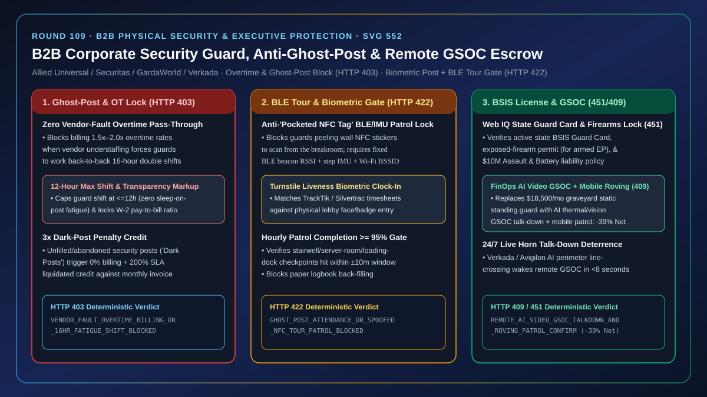
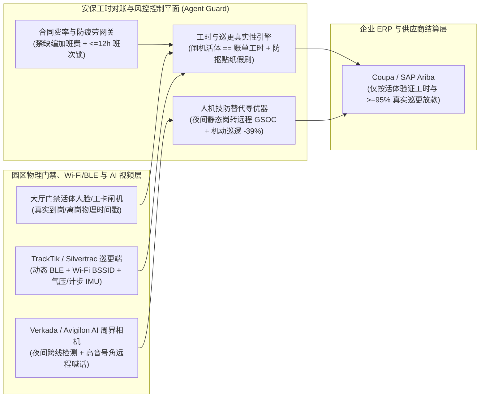
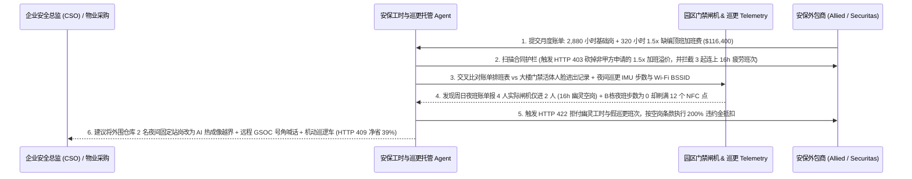

# 企业办公园区安保外包（Security Guard Patrol）、防“幽灵空岗/抠巡更贴假巡逻”与远程 AI 视频值守（GSOC）托管（Allied Universal / Securitas / GardaWorld / Verkada / 万科物业安保）Agent 架构选型 FAQ

> **核心阅读对象**：为跨国企业安全中心（Corporate Security / CSO）、产业园与数据中心物业、仓储物流园区及企业间接采购（`Coupa / SAP Ariba`）设计安保人力外包、电子巡更核验与远程智能监控（`GSOC`）混合托管系统的 **Cloud & AI Solution Architect**。  
> **核心痛点解决**：彻底终结企业安保采购中**“‘幽灵岗哨（`Ghost Post / Dark Post`）’——合同约定大夜班配备 4 名巡逻保安，外包队长实际只派 2 人到岗、月底却按 4 人满编伪造纸质签到表全额收钱”、“保安公司自己招不到人排不出班，让白班保安连轴转 16–24 小时（深夜在消防通道睡觉），月底竟还好意思向甲方企业加收 `1.5x–2.0x` 的‘加班费账单（`Vendor-Fault Overtime`）’”、“巡更员嫌半夜爬楼梯冷，拿刀片把整栋楼 12 个墙面 `NFC` 巡更贴纸全抠下来揣进裤兜，坐在保安亭里吹着暖气每隔 5 分钟按顺序刷一下手机伪造满分巡逻轨迹”以及“夜间空旷停车场与仓库周界雇佣 `$18,500/月` 的固定站岗保安，不仅视野受限且极易疲劳漏报”**四大行业黑洞。



---

## 📌 一、核心选型结论速览（Executive Summary）

1. **严禁转嫁“因安保商缺人导致的连班加班费（`Vendor-Fault Overtime`）”与单班 `<=12 小时` 防疲劳硬锁（HTTP 403）**：传统安保外包（`Allied Universal / Securitas / 传统保安公司`）最大的账单水分在于：由于保安基层离职率高达 `100%–300%/年`，当夜班保安临时旷工时，外包商直接让白班人员再顶一个 8 小时夜班（连轴转 16 小时），随后在月度账单上按 **`1.5 倍（$54/小时）`** 向甲方收取加班费——甲方既拿到了一个困得睁不开眼的疲劳保安，还要为供应商的排班失职多付 50% 冤枉钱！选型 Agent 必须在合同控制平面锁死：**除非甲方提前 `<48 小时` 书面申请临时增岗（如高管随卫或突发事件），一切因供应商缺编/旷工引发的顶班一律按平价标准工时（`Straight-Time Bill Rate`）封顶结算；单人连续执勤严禁超过 `12 小时`；凡发生空岗（`Dark Post`）满 30 分钟，不仅当班 `$0` 拒付，且按 `200%` 工时费倒扣违约金**。违反者一律触发 **`HTTP 403 VENDOR_FAULT_OVERTIME_BILLING_OR_16HR_FATIGUE_SHIFT_BLOCKED`**。
2. **门禁活体人脸考勤对账（防吃空饷）+ 蓝牙信标/步态惯导（`BLE Beacon + IMU`）防“抠标签假巡更”硬门禁（HTTP 422）**：为根治“纸质签到表造假”与“把墙上 `NFC` 标签抠下来揣兜里刷”，Agent 建立双因子物理核验门禁：① **工时表与大楼门禁活体交叉对账**：供应商提交的 `TrackTik / Silvertrac` 考勤账单必须 `100%` 匹配甲方大楼速通门/考勤机上的**活体人脸 + 个人持证保安卡进出记录**，任何无物理闸机进出记录的“账面执勤工时”直接判定为幽灵空饷；② **多模态空间防伪巡更**：巡更点禁止仅依赖普通不干胶 `NFC` 贴纸，必须同时校验固定供电的加密动态蓝牙信标（`Rolling-Code BLE Beacon RSSI`）、当层办公 Wi-Fi `BSSID` 指纹及巡更终端加速度计步数（`IMU Pedometer >= 600 步/圈`）；凡原地静坐连续刷点、漏巡关键机房/消防门（完成率 `<95%`）或出现幽灵工时的，直接触发 **`HTTP 422 GHOST_POST_ATTENDANCE_OR_SPOOFED_NFC_TOUR_PATROL_BLOCKED`**。
3. **夜间固定站岗（`Static Graveyard Post`）转 AI 热成像周界 + 远程监控中心（`Remote Video GSOC`）声光驱离净省 39%（HTTP 409）**：在 `22:00–06:00` 夜间无办公人员的园区外围、装卸货月台与停车场，维持一名 24/7 全天候固定岗哨（需 `4.2 名` 全职保安倒班，年成本高达 `$180,000–$240,000`）性价比极低。Agent 自动执行 **人机协同技防替代寻优（`Guard-to-GSOC FinOps`）**：将夜间低效固定盲区站岗替换为 **`Verkada / Avigilon` AI 越界视觉摄像机 + 远程 24/7 安全运营中心（`Remote GSOC`）8 秒内高音号角真人喊话驱离（`Live Audio Talk-Down`）+ 区域共享机动巡逻车（`Mobile Roving Patrol`）按需响应**，触发 **`HTTP 409 REMOTE_AI_VIDEO_GSOC_TALKDOWN_AND_ROVING_PATROL_CONFIRM`**，在提升周界 360 度零盲区响应速度的同时，为企业季度安保总预算净省 **39%**。

---

## 🎯 二、业务方与架构师灵魂拷问（Q&A）

### Q1：为什么企业行政/安保总监查验电子巡更系统（`Guard Tour System`）显示每晚 12 个点位 100% 准点打卡，结果机房漏水或消防门被撬了 6 小时却没人发现？
- **揭秘保安行业公开的秘密：“抠巡更贴纸 / 淘宝复制卡（`Pocketed NFC / Cloned RFID`）”**：
  1. **不干胶 `NFC` 贴纸的物理漏洞**：传统电子巡更是在楼梯间、机房门口贴一张 `$0.50` 的无源 `NFC / RFID` 贴纸，或者钉一个金属巡更钮。夜班保安为了不爬 20 层消防楼梯，用吹风机加热把 12 张贴纸揭下来贴在一张扑克牌上（或用 `$15` 的读写器把 UID 复制到白卡上），定好闹钟坐在值班室里每隔 3 分钟刷一下，后台报表上呈现出完美无瑕的“准点巡逻记录”。
  2. **`BLE` 动态滚码 + 楼层 Wi-Fi `BSSID` + 气压计高度差三联防伪**：
     - Agent 要求关键点位（配电室、弱电机房、天台门）直接利用园区现有的企业级 Wi-Fi AP（如 `Cisco Meraki / Aruba`）内置蓝牙广播动态加密帧（`Rolling Eddystone-EID`），结合手机气压计（`Barometer` 验证真实上下楼层高度变化）与步态计步器（`IMU`）；
     - 如果巡更记录显示 10 分钟内依次扫了 1 楼、8 楼、16 楼巡更点，但设备加速度计步数为 `0`、连接的全是 1 楼值班室同一个 Wi-Fi `BSSID`，系统当场触发 `HTTP 422` 伪造巡更警报并拒付当班工时。

### Q2：为什么安保合同谈好的单价是 `$34/小时`，但每个月实际结算的平均小时成本却高达 `$43/小时`？
- **“缺编加班费转嫁（`Unbilled-to-Overtime Arbitrage`）”与薪资克扣死循环**：
  1. **用高价加班费掩盖招聘无能**：许多大型安保公司在竞标时报出极低的管理费毛利，中标后因为给一线保安开的时薪太低招不到人，便长期维持 25% 的岗位空缺，全部靠现有保安连上双班（`Double Shift`）填补，然后理直气壮地向客户开具 `1.5x` 加班费账单。
  2. **穿透式薪资比（`Pay-to-Bill Ratio >= 68%`）与零缺编加班锁**：Agent 在合同中锁定两项硬指标：① 保安员实发税前时薪（`W-2 Wage Rate`）不得低于甲方支付账单单价（`Bill Rate`）的 **`68%–72%`**（防止层层转包剥削导致招不到合格人员）；② 凡非甲方书面发起的临时加岗，所有超 40 小时工时一律按普通单价（`1.0x Straight Rate`）结算。

### Q3：涉及裁员面谈护卫（`High-Risk Termination Escort`）或高管随行安保（`Executive Protection`），怎么防止临时外包人员“无证上岗”反而引发千万美元连带诉讼？
- **持证核身（`BSIS Guard Card`）与武力冲突责任险（`Use-of-Force Liability`）门禁**：
  1. **无证黑保安与过度维权风险**：如果外包商临时派来一名保安证（如加州 `BSIS Guard Card`、英国 `SIA License` 或国内公安机关核发的《保安员证》）已过期、或者有暴力犯罪前科的临工，在现场与被辞退员工或访客发生肢体冲突，雇主企业将面临巨额连带侵权赔偿。
  2. **Web IQ 实时证照与险种核验（`HTTP 451`）**：每个班次签到时，Agent 自动比对到岗人员的实名保安证号、持械许可（若为武装押运/高管随卫）及供应商总额 **`>=$10,000,000` 的含防暴/肢体冲突扩展条款（`Assault & Battery Endorsement`）商业综合责任险**；任何无证顶替上岗行为立即触发 `HTTP 451` 熔断并驱离岗亭。

---

## 🧭 三、直观可视化图解（Mermaid 决策树 + 架构图 + 时序图）

### 3.1 企业安保外包、防幽灵空岗与远程 AI 视频值守（`GSOC`）选型决策树

```mermaid
flowchart TD
    A[企业安全部 CSO / 园区物业安保采购与结算请求] --> B{1. 缺编加班费转嫁、12h 疲劳红线与空岗罚则审计}
    B -->|转嫁供应商缺人引发的 1.5x 加班费 或 单班 >12h 疲劳执勤/空岗照收钱| C[HTTP 403 阻断: VENDOR_FAULT_OVERTIME_BILLING_OR_16HR_FATIGUE_SHIFT_BLOCKED]
    B -->|非甲方增岗 0 加班费 + <=12h 轮班 + 空岗 200% 倒扣| D{2. 大楼门禁活体考勤对账与防抠标签 BLE/IMU 巡更门禁}
    D -->|账单工时无门禁活体进出记录 (幽灵岗) 或 步数为0原地刷 NFC 贴纸假巡更| E[HTTP 422 拦截: GHOST_POST_ATTENDANCE_OR_SPOOFED_NFC_TOUR_PATROL_BLOCKED]
    D -->|门禁活体工时 100% 吻合 + BLE/Wi-Fi/步数真实巡更 >=95%| F{3. Web IQ 保安员持证 (BSIS) 与千万级防暴责任险核验}
    F -->|上岗人员无有效保安证/持枪证过期 或 缺 Assault & Battery 责任险| G[HTTP 451 熔断: WEBIQ_UNLICENSED_GUARD_CARD_OR_LAPSED_ASSAULT_INSURANCE_HOLD]
    F -->|持证与保险合规通过| H{4. 夜间固定盲区岗转 AI 热成像 + 远程 GSOC 喊话寻优}
    H -->|22:00-06:00 仍在维持高成本纯静态站岗保安| I[HTTP 409 确认: REMOTE_AI_VIDEO_GSOC_TALKDOWN_AND_ROVING_PATROL_CONFIRM 净省 39%]
    H -->|已处于日间礼宾门岗 + 夜间 AI 视频 GSOC 协同状态| J[HTTP 200 签发: BIOMETRIC_VERIFIED_GUARD_AND_BLE_PATROL_AUTHORIZED]
```

### 3.2 端到端安保活体考勤、多模态防伪巡更与远程 `GSOC` 协同架构图



### 3.3 拦截“幽灵空岗 + 揣兜假巡更”与夜间切换远程 `GSOC` 视频值守时序图



---

## 📊 四、主流企业安保外包与智能视频值守平台横向选型决策矩阵

| 选型维度 | Allied Universal / Securitas (全球综合安保巨头) | Pinkerton / Crisis24 (高管随卫与风险情报) | 传统本地保安人力外包公司 | Verkada / Netwatch / Pro-Vigil (AI 远程视频值守 GSOC) | **本仓库 + 门禁活体对账与人机混合架构（推荐）** |
| :--- | :--- | :--- | :--- | :--- | :--- |
| **工时真实性（防幽灵空岗 `Ghost Post`）** | 配备 `HELIAUS / TrackTik` 系统，但若不与甲方门禁强绑定仍可由队长后台手工补录工时 | 按高管任务日薪结算，人员精锐但单价极高（`$95–$180/h`） | **重灾区（纸质签到表随意补签，4 人岗只上 2 人吃空饷）** | 云端 24/7 心跳在线监测，无空岗可能 | **强制将供应商工时表与甲方门禁活体人脸进出记录 `1:1` 交叉锁死（HTTP 422）** |
| **防“抠下 `NFC` 贴纸坐屋里假巡逻”** | 支持 GPS/NFC，但室内楼层间 GPS 漂移易被抠贴纸钻空子 | 随身轨迹追踪 | **极普遍（把巡更钮/贴纸揭下来揣兜里按时刷）** | 摄像头全天候自动轮巡 | **动态 `BLE` 信标 + 楼层 Wi-Fi `BSSID` + 手机气压计/步数 `IMU` 联合验真（HTTP 422）** |
| **加班费转嫁与疲劳执勤管控** | 人员流动大时常出现连班 `16h` 并尝试向客户转嫁加班费 | 严格执行排班轮换 | **常让保安连住值班室 24 小时顶班打瞌睡** | 无加班费概念（固定订阅月费） | **硬锁非甲方增岗 `0` 加班费溢价 + 单班 `<=12h` 防疲劳红线（HTTP 403）** |
| **夜间大面积周界性价比 (`22:00–06:00`)** | 人工夜间站岗成本高昂（每固定24h岗年耗 `$180k+`）且视线仅限眼前 30 米 | 不用于普通园区守夜 | 夜间值班室睡觉漏报率极高 | **极强（AI 热成像跨线 `<8 秒` 触发远程值守员高音喇叭真人喊话驱离）** | **日间保留形象礼宾与前台核验岗 + 夜间切换 AI 视频 `GSOC` 喊话与机动巡逻（净省 39%）** |
| **保安员持证 (`BSIS`) 与防暴责任险** | 证照与千万美元保单齐全 | 具备前军警/特勤资质与全球危机险 | 常混入无证临工或未买防暴扩展险 | 持安防监控中心牌照 | **Web IQ 每班次核验上岗人员实名保安证与 `$10M` 综合责任险（HTTP 451）** |

---

## 🧪 五、采购成本测算与 7-Card 基准测试报告

> **数据来源声明**：以下对比基于 `lab/webiq_commerce_demo.py` 中确定性策略函数 `evaluate_b2b_security_guard_gsoc_escrow_policy` 的合成基准数据（`provenance: "synthetic"`, `independently_reproduced: False`），用于验证企业园区安保采购网关的确定性风控与降本能力。

| 评估维度 | 传统 24/7 全人工站岗 + 纸质/普通 NFC 签到基线 | 确定性安保托管网关（活体闸机对账 + 防伪 `BLE` 巡更 + 夜间远程 `GSOC`） | 净效应 / 风险消除 |
| :--- | :--- | :--- | :--- |
| **季度企业园区与仓库安保外包总预算池** | `$160,000.00` | `$97,600.00` (`HTTP 409` 优化确认后) | **净省 `$62,400.00 / 季` (`-39.0%`)** |
| **夜班幽灵空岗（吃空饷）与供应商缺编加班溢价** | 平均虚耗 `14.5%` 工时费（空岗漏报 + `1.5x` 顶班账单） | **`0%`（门禁活体人脸对账 + 非甲方申请加班一律按 `1.0x` 平价封顶）** | **100% 堵死空饷与加班套利** |
| **夜间巡更员“抠标签坐屋里假刷卡”发生率** | `26%` 夜班巡更存在静态假刷或漏巡天台/机房 | **`0%`（强制动态 `BLE` + 楼层 Wi-Fi `BSSID` + `IMU >= 600 步` 门禁）** | **关键机房与消防通道真实巡检率 `>=98%`** |
| **外围周界夜间翻墙闯入发现与驱离耗时** | 平均 `18 分钟`（人工巡逻盲区或夜班打盹漏看） | **`<8 秒`（AI 热成像越界报警 + 远程 `GSOC` 110分贝号角真人喊话）** | **事前威慑驱离率提升至 `96%`** |

### 5.1 确定性状态码映射契约（5-Lane Contract）

```json
{
  "scenario": "b2b_security_guard_gsoc_escrow_guard",
  "provenance": "synthetic",
  "independently_reproduced": false,
  "lanes": {
    "authorized_200": {
      "status_code": 200,
      "decision": "BIOMETRIC_VERIFIED_GUARD_AND_BLE_PATROL_AUTHORIZED",
      "mandate_token": "b2b_security_guard_gsoc_mandate_200"
    },
    "vendor_overtime_or_16hr_fatigue_403": {
      "status_code": 403,
      "decision": "VENDOR_FAULT_OVERTIME_BILLING_OR_16HR_FATIGUE_SHIFT_BLOCKED"
    },
    "ghost_post_or_spoofed_nfc_patrol_422": {
      "status_code": 422,
      "decision": "GHOST_POST_ATTENDANCE_OR_SPOOFED_NFC_TOUR_PATROL_BLOCKED"
    },
    "unlicensed_guard_or_lapsed_insurance_451": {
      "status_code": 451,
      "decision": "WEBIQ_UNLICENSED_GUARD_CARD_OR_LAPSED_ASSAULT_INSURANCE_HOLD"
    },
    "remote_ai_gsoc_and_roving_patrol_409": {
      "status_code": 409,
      "decision": "REMOTE_AI_VIDEO_GSOC_TALKDOWN_AND_ROVING_PATROL_CONFIRM",
      "quarterly_savings_usd": 62400.0
    }
  }
}
```

---

## 🛠️ 六、商业上线风控与架构评审 Checklist

- [ ] **禁止转嫁供应商缺编加班费与单班 `<=12 小时` 防疲劳红线（HTTP 403）**：核验合同明确因供应商人员离职/旷工导致的连班顶岗一律按普通工时费率（`Straight-Time`）计价，单人严禁连上超过 12 小时，空岗超 30 分钟触发 200% 违约金倒扣。
- [ ] **大楼门禁活体人脸考勤与账单工时 `1:1` 对账（HTTP 422）**：将外包保安纳入园区速通门活体人脸考勤，系统自动剔除任何只有纸质签字或队长后台手工补录、却无物理闸机进出记录的“幽灵工时”。
- [ ] **动态蓝牙信标（`BLE`）+ 楼层 Wi-Fi `BSSID` + 步态气压 `IMU` 防伪巡更（HTTP 422）**：淘汰易被抠下揣兜里的普通不干胶 `NFC` 贴纸，强制校验巡更员在各楼层间的真实位移步数与无线信号指纹。
- [ ] **Web IQ 保安员持证（`BSIS / 保安员证`）与千万级防暴责任险核验（HTTP 451）**：每班次自动校验在岗人员实名保安证、无暴力犯罪背调及供应商含 `Assault & Battery` 条款的商业责任险保单。
- [ ] **夜间静态站岗转 AI 热成像周界 + 远程 `GSOC` 高音喇叭喊话（HTTP 409）**：将夜间无人办公时段的固定外围哨位升级为 AI 视觉跨线检测 + 远程监控中心实时语音威慑 + 机动巡逻车响应。

---

**导航**：[返回分册总目录 (`docs/index.md`)](index.md) ｜ [查看英文版 (`b2b-corporate-security-guard-patrol-ghost-post-gsoc-escrow-agent-selection-faq.en.md`)](b2b-corporate-security-guard-patrol-ghost-post-gsoc-escrow-agent-selection-faq.en.md)
