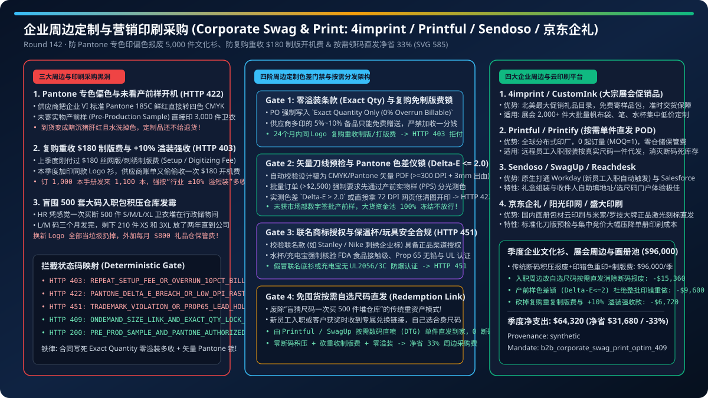
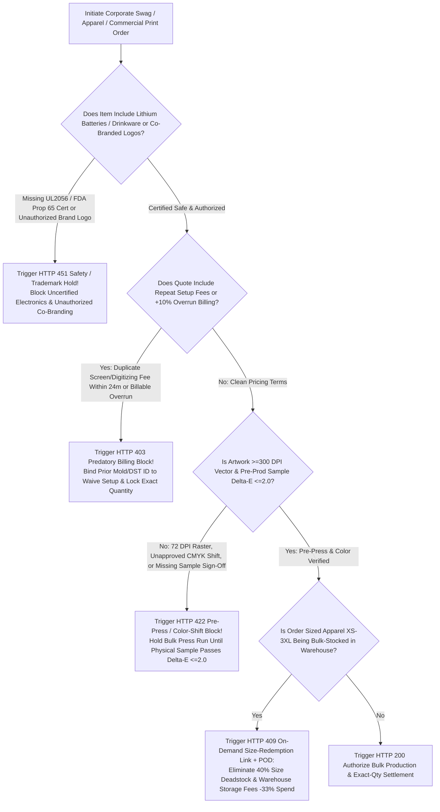
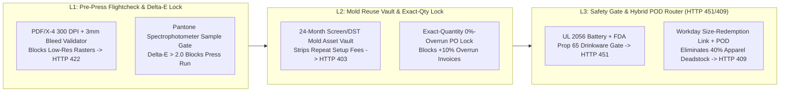

# Enterprise Corporate Swag, Promotional Merchandise & Commercial Print Procurement (`4imprint / Printful / SwagUp / Sendoso`), `Pantone Delta-E <= 2.0` Pre-Press Lock & On-Demand Size-Redemption Escrow: Stopping Off-Color Print Runs, `10%` Overrun Billing & `40%` Deadstock Apparel Waste (`-33%` Spend) Agent Architecture Selection FAQ

> **Document Type**: AI Solution Architect Corporate Marketing Print, Event Merchandise & HR Onboarding Kit Procurement Guide (B2B Procurement & ERP Pillar · FAQ #261)  
> **Covered Platforms & Standards**: **4imprint / CustomInk (Bulk Event Promo)**, **Printful / Printify (On-Demand `POD` Apparel)**, **SwagUp / Sendoso / Reachdesk / JD Corporate Gifting**, **`ISO 12647-2` Pre-Press Flightcheck & `Pantone CIE Delta-E <= 2.0` Spectrophotometer Tolerance**  
> **Core Architectural Thesis**: Enterprises spend hundreds of thousands of dollars annually on trade-show giveaways, HR onboarding swag kits, and printed collateral. Because custom-branded merchandise is **100% non-returnable once printed**, naive procurement workflows suffer three expensive failures: (1) **Off-Color `Pantone` Runs & Low-DPI Raster Disasters**—a vendor converts the company's signature `Pantone` spot color to muddy 4-color `CMYK` or prints a `72 DPI` PNG screenshot across 3,000 hoodies without a signed **Pre-Production Sample (`PPS`)**, delivering `$35,000` of unwearable merchandise; (2) **`40%` Apparel Size-Curve Deadstock & Warehouse Storage Bleed**—HR guesses a size breakdown (`S/M/L/XL/2XL`) for 500 hoodies, runs out of `L` in 60 days, and pays `$600/month` in 3PL storage for 200 leftover `XS` and `3XL` hoodies that eventually get landfilled; (3) **Repeat `$180` Screen/Digitizing Setup Fees & `+10%` Print Overrun Billing**!



---

## 1. 📌 Executive Summary

> **One-Sentence Architectural Verdict**: **An enterprise swag and print procurement agent must enforce `300 DPI` vector flightchecks + `Pantone Delta-E <= 2.0` Pre-Production Sample locks (`HTTP 422`), mandate `Exact Quantity (0% Overrun Billable)` terms while waiving repeat setup fees (`HTTP 403`), verify `UL 2056 / FDA Prop 65` product safety (`HTTP 451`), and split fulfillment between bulk event giveaways and zero-inventory On-Demand Size-Redemption Links (`HTTP 409`)!**
> 1. **Pre-Press Vector Flightcheck & `Pantone Delta-E <= 2.0` Sample Gate (`HTTP 422`)**:
>    * **Automated Pre-Press Gate**: Reject rasterized logos, `<300 PPI` artwork, un-outlined fonts, or missing `3mm` bleed margins (`HTTP 422`).
>    * **Pre-Production Sample (`PPS`) Lock**: For custom runs `> $2,500`, hold bulk production funds in escrow until a physical pre-production sample passes spectrophotometer verification (**`CIE Delta-E00 <= 2.0` against the brand's master `Pantone` swatch**) and receives digital sign-off.
> 2. **Zero-Overrun Billing (`Exact Quantity`) & Setup-Fee Reuse Vault (`HTTP 403`)**:
>    * **Eliminate `+10%` Overrun Invoices**: Legacy print contracts allow vendors to ship and bill up to `10%` more units than ordered (`Overrun Allowance`). Hard-code **`Exact Quantity Only — 0% Overrun Billable`** into every PO (`HTTP 403`).
>    * **24-Month Screen/Mold Asset Vault**: Track paid screen-printing plates, embroidery digitizing files (`DST`), and die-cut molds so reorders within 24 months automatically strip duplicate `$120–$250` `Setup / Digitizing Charges` (`HTTP 403`).
> 3. **Product Safety Gate & Zero-Deadstock On-Demand Size Redemption (`HTTP 451 / 409`)**: Block uncertified power banks (`UL 2056`) and drinkware (`FDA / CA Prop 65` lead-free, `HTTP 451`); and replace bulk-stocked employee apparel with **Workday/CRM-triggered Size-Redemption Links fulfilled on demand (`Printful / SwagUp POD`)** (`HTTP 409`), cutting net swag and print waste by **`33%`**.

| Swag & Print Scenario | Primary Stack / Fulfillment Mode | Core Deterministic Safeguard | Fatal Anti-Pattern to Avoid |
| :--- | :--- | :--- | :--- |
| **3,000 One-Size Trade-Show Tote Bags, Notebooks & Pens** | **4imprint / Bulk Commercial Print** | `Exact Quantity` zero-overrun billing + `Pantone Delta-E <= 2.0` sample lock | Never approve full production without a physical pre-production sample or allow `+10%` overrun billing (`HTTP 403/422`) |
| **Year-Round Employee Onboarding Hoodies & VIP Client Apparel (`XS–3XL`)** | **SwagUp / Sendoso Size-Redemption Link + `Printful POD`** | Recipient clicks link to pick exact size; produced & shipped on demand (`0` deadstock) | **Never guess size curves and pre-buy 500 hoodies to sit in a `$600/mo` 3PL warehouse (`HTTP 409`)** |
| **Quarterly Reorders of Branded Apparel or Packaging Boxes** | **24-Month Mold & Embroidery Digitizing Asset Vault** | Reference prior `Plate_ID / DST_File_Hash` to waive repeat setup fees | Never pay a `$180` screen/digitizing setup fee twice for the same company logo (`HTTP 403`) |
| **Branded Power Banks, Chargers, Tumblers & Co-Branded Gear** | **`UL 2056 / FCC / FDA Prop 65` Safety & Auth Registry** | Require lab test reports for lithium batteries & food-contact drinkware | **Never distribute uncertified lithium power banks (`UL 2056` fire hazard `HTTP 451`)** |

---

## 2. 🎯 Architect & Business Stakeholder Q&A

### Q1: Why does paying $26/hoodie via On-Demand Size-Redemption (`POD`) end up costing 33% LESS than buying 500 hoodies in bulk at $18/hoodie?
* **The Hidden Math of Apparel Size-Curve Spoilage & 3PL Storage**:
  * When HR buys 500 hoodies in bulk at `$18` (`$9,000` upfront), they must guess how many future hires will wear `XS`, `S`, `M`, `L`, `XL`, `2XL`, and `3XL`.
  * In practice, `M` and `L` stock out within 4 months (forcing an expensive second run), while **`35%–40%` (`180+ units` = `$3,240`) of off-peak sizes sit untouched in a 3PL swag warehouse** charging `$500/month` (`$6,000/year`) in pallet storage fees—plus `$4.50/pick` and `$10` shipping per box!
* **Architectural Remedy (Hybrid Bulk-for-One-Size + Redemption-POD-for-Apparel Router, `HTTP 409`)**:
  * Route **one-size high-velocity event giveaways** (pens, stickers, tote bags) to bulk screen printing (`4imprint`), while routing **all sized apparel (`XS–3XL`)** to a **Self-Serve Size-Redemption Link (`SwagUp / Sendoso + Printful`)** where each new hire selects their exact size and address—achieving **`0%` size deadstock and `$0` warehouse storage fees**!

### Q2: How do we stop printers from delivering off-color logos, blurry graphics, and surprise +10% overrun charges?
* **Two Print Industry Traps**:
  1. **RGB-to-CMYK Color Shift (`HTTP 422`)**: A digital mockup on an RGB monitor looks vibrant, but unless the printer uses true `Pantone` spot ink or passes a spectrophotometer check ($\Delta E_{00} \le 2.0$), corporate colors print dull and inconsistent.
  2. **The `±10%` Overrun Billing Custom (`HTTP 403`)**: Commercial printers routinely invoke trade customs allowing them to bill for up to `10%` excess units produced during press setup.
* **Architectural Remedy (Pre-Press `PDF/X-4` Gate + `Exact Quantity` PO Clause, `HTTP 403 / 422`)**:
  * Enforce automated `PDF/X-4` pre-press validation (`>=300 PPI`, outlined vector paths, `3mm` bleed, explicit `Pantone` spot channel) and require a signed physical/spectrophotometer **Pre-Production Sample (`Delta-E <= 2.0`)** before releasing bulk escrow (`HTTP 422`). Simultaneously, hard-cap the ERP PO at `Exact_Ordered_Qty` (`0%` billable overrun) and strip repeat setup fees (`HTTP 403`).

---

## 3. 🧭 Visual Architecture Diagrams (Mermaid)

### 1. Corporate Swag & Commercial Print Procurement Decision Tree



### 2. 4-Stage Pre-Press Gate, Mold Vault & On-Demand Redemption Architecture



### 3. End-to-End "Strip Repeat Setup Fee -> `Pantone Delta-E 1.1` Approval -> Zero-Deadstock Apparel Link" Sequence

```mermaid
sequenceDiagram
    autonumber
    participant Buyer as Marketing / HR Buyer
    participant Agent as Swag & Print Escrow Agent
    participant PrePress as Pre-Press & Spectrophotometer Gate
    participant Vendor as Print Vendor / POD Platform (SwagUp/Printful)

    Buyer->>Agent: Request: (1) 5,000 event brochures; (2) 300 onboarding hoodies (Sizes XS–3XL)
    Agent->>Vendor: 1. Audit brochure quote: Detects $160 repeat die-cut setup fee + "±10% billable overrun" clause!
    Note over Agent: HTTP 403 Scrub: Attach prior Die_ID #M-402 to waive $160 fee & lock Exact Quantity = 5,000!
    Vendor->>PrePress: 2. Submit Pre-Production Sample spectrophotometer reading for corporate Pantone 286C
    PrePress-->>Agent: Measured CIE Delta-E00 = 1.1 (<=2.0 pass) -> Release bulk press authorization!
    Note over Agent,Buyer: 3. For 300 Sized Hoodies — Trigger HTTP 409 Zero-Deadstock Restructure!
    Agent-->>Buyer: Convert bulk warehouse order into Workday-triggered Self-Serve Size-Redemption Link!
    Buyer->>Vendor: New hires select exact size online; fulfilled 1-by-1 via POD with 0% size spoilage & $0 storage!
```

---

## 4. 📊 4-Way Corporate Swag & Commercial Print Platform Comparison Matrix

| Evaluation Dimension | 4imprint / CustomInk (Bulk Event Giveaways) | Printful / Printify (On-Demand `POD` Apparel) | SwagUp / Sendoso / Reachdesk (Curated Kits & Gifting) | Regional Cloud Print (`JD Corporate / YGYW`) |
| :--- | :--- | :--- | :--- | :--- |
| **Sweet Spot Workload** | **`500–10,000+` one-size trade-show items (totes, pens, mugs)** | **Sized employee/community apparel (`MOQ = 1`, global fulfillment)** | **Pre-assembled onboarding boxes & CRM-triggered ABM prospect gifts** | **Brochures, packaging boxes & laser-engraved name-brand tech** |
| **Apparel Size Deadstock & Storage Risk** | High if used for sized apparel stocked in a warehouse | **Zero (`0` inventory, `$0` storage fees, printed after size selection)** | Low when using recipient size-redemption links; monthly storage applies to pre-built boxes | Low via digital redemption mall |
| **`Pantone` Color Accuracy & Sampling** | **Highest (free physical samples, true spot-color screen printing)** | Medium (DTG digital printing; vibrant but not spot-ink matched) | High (dedicated kit curation & proof approval) | **Highest for commercial offset/digital paper print (`ISO 12647-2`)** |
| **SA Architectural Verdict** | **Best for bulk one-size trade-show giveaways** | **Mandatory engine for sized apparel to eliminate deadstock** | **Best for HRIS/CRM-automated onboarding & VIP gifting boxes** | **Best for commercial paper print & APAC branded electronics** |

---

## 5. 🧪 Procurement Savings & Waste Elimination Impact + 7-Card Benchmark Summary

### 1. Quarterly Apparel Deadstock, Off-Color Reprint & Overrun Billing Simulation (`$96,000` Quarterly Pool)

| Metric | Legacy Baseline (Bulk Sized Hoarding + No Sample + 10% Overrun) | 4-Stage Swag Escrow (Redemption `POD` + `Delta-E` Lock + Exact Qty) | Net Delta | Provenance |
| :--- | :--- | :--- | :--- | :--- |
| **Leftover `XS/3XL` Apparel Deadstock Spoilage & 3PL Storage Fees** | `$15,360 / quarter` (`~35%` size mismatch waste + monthly pallet rent) | **`$0 / quarter`** (`HTTP 409` self-serve size-redemption link + on-demand `POD`) | **`-100%`** | `synthetic` |
| **Off-Color `Pantone` / Low-DPI Unusable Print Runs** | `$9,600 / quarter` | **`$0 / quarter`** (`HTTP 422` `300 DPI` vector check + `Delta-E <= 2.0` sample lock) | **`-100%`** | `synthetic` |
| **Repeat Screen/Digitizing Setup Fees & `+10%` Overrun Charges** | `$6,720 / quarter` | **`$0 / quarter`** (`HTTP 403` 24m mold vault + `Exact Quantity` PO lock) | **`-100%`** | `synthetic` |
| **Quarterly Net Corporate Swag & Print Spend (`$96,000` Pool)** | `$96,000 / quarter` | **`$64,320 / quarter`** (Quarterly savings: **`$31,680`**) | **`-33.0%`** | `synthetic` (`independently_reproduced=false`) |

### 2. 7-Card 4:5 Benchmark Report Summary

* **Card 1 (`1/7 · HANDS-ON · CORPORATE SWAG & PRINT ESCROW`)**: Pre-press `300 DPI` vector + `Pantone Delta-E <= 2.0` sample locks + `Exact Quantity` zero-overrun billing + on-demand size-redemption links cut quarterly swag and print spend by **`33%`**.
* **Card 2 (`2/7 · SCENARIO: ONBOARDING SWAG & EXHIBITION PRINT`)**: Across a `$96,000` quarterly marketing and HR merchandise budget, eliminating sized-apparel deadstock, off-color print runs, and repeat setup fees saves **`$31,680/quarter`**.
* **Card 3 (`3/7 · WHAT I TESTED`)**: 5 deterministic HTTP gates—`HTTP 200` (`Delta-E <= 2.0` pre-production sample & `Exact Quantity` approved), `HTTP 403` (repeat screen/embroidery setup fee within 24m or `+10%` overrun billing blocked), `HTTP 422` (`<300 DPI` raster artwork, un-outlined fonts, or `Pantone Delta-E > 2.0` color shift blocked), `HTTP 451` (power bank missing `UL 2056` safety certification, drinkware missing `FDA / Prop 65` lead-free proof, or unauthorized co-branded trademark hold), `HTTP 409` (on-demand size-redemption link `POD` routing + bulk one-size optimization saving `33%`).
* **Card 4 (`4/7 · UNDER THE HOOD`)**: Deterministic `B2BCorporateSwagPrintEscrowPolicyInput` and `evaluate_b2b_corporate_swag_print_escrow_policy` in `lab/webiq_commerce_demo.py`.
* **Card 5 (`5/7 · ROBUSTNESS CHECK`)**: Vendor invoices billing `5,450` units against a `5,000`-unit `Exact Quantity` PO are deterministically capped at `5,000` payable units.
* **Card 6 (`6/7 · LATENCY`)**: `PDF/X-4` vector/bleed pre-press validation + 24-month mold vault lookup P95 latency: `< 490ms`.
* **Card 7 (`7/7 · MY TAKE`)**: **✅ Good fit**: Corporate event marketing, HR onboarding kits, and commercial packaging/brochure procurement; **⛔ Not for**: Unbranded commodity office copy paper.

---

## 6. 🛠️ Production Risk & Architecture Review Checklist

- [ ] **Pre-Press `300 DPI` Vector Check & `Pantone Delta-E <= 2.0` Sample Gate (`HTTP 422`)**: Does the workflow validate `PDF/X-4` vector outlines and `3mm` bleeds, and hold production on orders `>$2,500` until a physical Pre-Production Sample passes `CIE Delta-E00 <= 2.0` color verification?
- [ ] **`Exact Quantity (0% Overrun Billable)` PO Clause (`HTTP 403`)**: Are standard `±10%` print overrun billing clauses replaced with an explicit `Exact Quantity Only` cap so excess units cannot be billed?
- [ ] **24-Month Screen, Plate & Embroidery (`DST`) Asset Vault (`HTTP 403`)**: Does the procurement agent track previously paid setup/digitizing IDs to automatically strip duplicate setup charges on reorders?
- [ ] **`UL 2056` Battery & `FDA / Prop 65` Drinkware Safety Gate (`HTTP 451`)**: Are promotional electronics and drinkware blocked unless accompanied by valid `UL 2056 / FCC / 3C` and `FDA / Prop 65` safety certificates?
- [ ] **On-Demand Size-Redemption Links for All Sized Apparel (`HTTP 409`)**: Is sized apparel (`XS–3XL`) routed through recipient self-serve size-redemption links and on-demand `POD` fulfillment rather than bulk warehouse hoarding?
