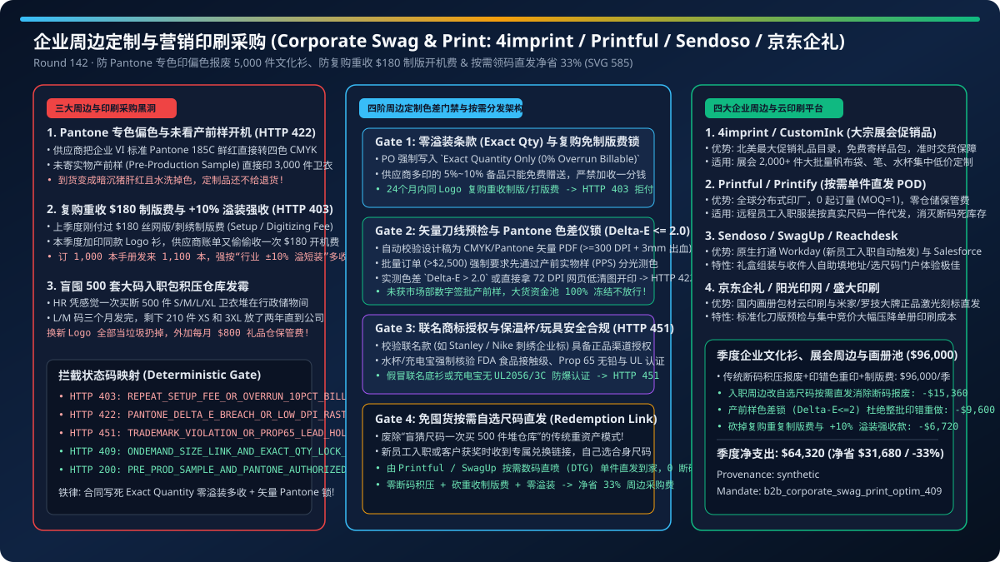
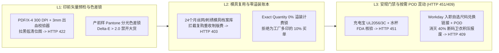

# 企业品牌周边定制与营销印刷采购（Corporate Swag & Print：4imprint / Printful / SwagUp / 京东企礼 / 阳光印网）、防 `Pantone` 专色印偏色报废与按需自选尺码一件代发托管：“防品牌红印成猪肝红拒不退货、防复购重收 $180 制版费与消灭 40% 断码库存积压净省 33%”Agent 架构选型 FAQ

> **文档类型**：AI Solution Architect 企业市场部展会物料、HR 入职礼包（Onboarding Kits）与云印刷供应链采购选型指南（B2B Procurement & ERP Pillar · FAQ #261）  
> **涵盖平台与行业标准**：**4imprint / CustomInk（大宗展会促销品）**、**Printful / Printify（按需单件数码直喷 `POD`）**、**SwagUp / Sendoso / 京东企礼 / 阳光印网**、**国际印刷色彩标准 `ISO 12647-2` 与潘通专色色差容差（`Pantone CIE Delta-E <= 2.0`）**  
> **核心架构命题**：企业每年在展会伴手礼、客户礼盒、新员工入职文化衫（Swag）与产品宣传画册上耗资数十万美元，但因为定制品具有 **“一旦开印不可退换”** 的特殊属性，传统人工采购常掉进三大深坑：① **“Pantone 专色被转成劣质四色 CMYK，品牌红印成猪肝红整批报废”**——供应商没寄产前实物样（Pre-Production Sample）就直接开机印了 3,000 件文化衫，到货发现公司标志性的爱马仕橙变成了暗沉土黄，或者业务员随手传了一张 `72 DPI` 的网页低清 PNG 印出来全是马赛克，供应商一句“已按贵司确认效果图生产，定制品概不退换”让你净亏 `$35,000`；② **“盲猜尺码囤积 500 套卫衣，40% 偏码积压在行政仓库发霉”**——HR 按经验订了 S/M/L/XL，结果 L 码两个月领光，剩下 200 件 XS 和 3XL 在付了两年高昂仓储保管费后全部当废品扔掉；③ **“每次复购同款 Logo 都重复收 $180 制版费，以及利用‘印刷行业 ±10% 溢短装惯例’多塞 10% 货强行多收钱”**！



---

## 一、 📌 核心选型结论速览（Executive Summary）

> **一句话架构定调**：**企业周边与印刷采购 Agent 必须执行“印前矢量刀版 + Pantone `Delta-E <= 2.0` 产前样锁（HTTP 422）”、“合同写死 `Exact Quantity` 零溢装多收 + 复购免制版费（HTTP 403）”、“展会大货走集中批量印刷、员工服装走自选尺码按需一件代发（POD）（HTTP 409）”双轨混动架构！**
> 1. **防印错报废：300 DPI 矢量预检 + 产前实物样 `Delta-E <= 2.0` 色差锁（HTTP 422 门禁）**：
>    * **印前自动排雷（Pre-Press Flightcheck）**：Agent 自动拦截任何非矢量位图 Logo、分辨率 `< 300 DPI`、未转曲字体或缺失 `3mm` 裁切出血位的设计文件（`HTTP 422`）。
>    * **大货开机锁（Pre-Production Sample Gate）**：凡采购金额 `> $2,500` 的定制订单，系统将资金切为 **“打样费 + 大货冻结款”**：强制要求工厂先寄出 1 件真实面料/纸张的产前实物样（或分光光度计实测报告），验证主 Logo 与企业标准 **Pantone 专色卡色差 $\Delta E_{00} \le 2.0$** 且经品牌负责人数字签批后，才向工厂下达大货开机令！
> 2. **防隐性乱收费：废除“±10% 溢装多收惯例”与复购免制版费（HTTP 403 门禁）**：
>    * **零溢装账单（Exact Quantity Billing）**：传统印刷厂常在合同小字写“允许 `±10%` 溢短装（Overrun/Underrun）并按实发数量结算”，然后故意多印 `10%` 强逼甲方多付钱！Agent 在 PO 中硬编码 **`Exact Quantity Only — 0% Overrun Billable`**（多发的备品视为免费赠品，少发按比例扣款）；
>    * **模具/丝网制版档案复用锁**：自动建立企业 `Logo_Screen_Mold_Vault`，凡 24 个月内已在同一供应商处支付过丝网版费、刺绣打版费（Digitizing Fee）或刀模费，后续复购账单再出现 `Setup / Plate Charge` 一律触发 **`HTTP 403`** 自动剥离！
> 3. **消灭 40% 断码死库存：自选尺码兑换链 + 按需数码直喷（`POD`）（HTTP 451 / 409）**：严查保温杯 `FDA / Prop 65` 无铅与充电宝 `UL 2056 / 3C` 安全认证（`HTTP 451`）；将员工入职礼包从“提前盲订 500 件堆仓库”升级为 **“Workday 触发入职链接 -> 员工自己选尺码填家庭地址 -> Printful / SwagUp 按需单件直发”**（`HTTP 409`），实现 **0 断码报废与 0 仓储月租**，综合净省 **`33%`** 周边与印刷预算！

| 周边与印刷采购场景 | 首选平台 / 履约模式 | 核心防护机制 | 严禁踩坑红线 |
| :--- | :--- | :--- | :--- |
| **大型行业展会派发 3,000 个无尺码帆布袋、笔记本、定制笔** | **4imprint / 阳光印网 / 京东企礼 集中大宗定制** | 锁死 `Exact Quantity` 零溢装多收 + 产前样 `Pantone` 色差锁 | 严禁不看产前实物样就全款开印，或接受 `+10%` 溢装强行加收货款 (`HTTP 403/422`) |
| **全年滚动入职新员工卫衣、冲锋衣与远程客户尺码服饰** | **Printful / SwagUp / Sendoso 自选尺码链接 + `POD`** | 员工点击链接自选尺码，按需单件生产直发，0 死库存 | **严禁行政拍脑袋按固定比例一次囤 500 件各尺码衣服堆仓库 (`HTTP 409`)** |
| **同款企业 Logo T恤/礼盒每季度补货加印** | **制版模具资产库 (`Mold & Digitizing Asset Vault`)** | 关联历史已付丝网/刺绣制版编号，100% 豁免二次开机费 | 严禁每次补货都被供应商当作新客重收 `$120~$250` 制版费 (`HTTP 403`) |
| **定制不锈钢保温杯、移动电源、儿童赠品与品牌联名衫** | **安全认证门禁 (`UL 2056 / 3C / FDA / Prop 65`) + 正品联名锁** | 强制上传安规检测报告与底层品牌（如 Nike/Stanley）正品采购单 | **严禁采购无 `UL/3C` 认证的三无贴牌充电宝（引发起火召回丑闻 `HTTP 451`）** |

---

## 二、 🎯 业务方与架构师灵魂拷问（Q&A）

### Q1：为什么给公司买卫衣和文化衫，明明单件找工厂大批量做只要 $18，用按需一件代发（Print-on-Demand, POD）要 $26，最后算总账反而是一件代发省了 35% 的钱？
* **传统“大批量囤货模式”被隐瞒的三大沉没成本**：
  * 假设公司为全年招聘和客户活动按 `$18/件` 批量印了 1,000 件卫衣（花了 `$18,000`）：
    1. **尺码错配报废（Size Curve Spoilage，占 `30%~40%`）**：没人知道今年入职的员工有多少穿 M 码、多少穿 2XL。结果热门的 L 码和 M 码半年就发完了（后面入职的人没得穿，还得加钱补订），而剩下的 350 件 XS、S 和 3XL 在仓库里堆了两年无人问津，公司微调品牌 Slogan 后这 350 件（`$6,300`）100% 变成废布！
    2. **3PL 礼品仓按托盘收取的保管费与人工拣货费**：第三方礼赠仓（Swag Warehouse）每月收 `$350~$800` 的仓储管理费（Storage & Receiving Fee），每发出一件还要另收 `$4.50` 拣货打包费 + `$9` 运费。
* **架构师硬核解法（“无尺码标品大宗集采 + 有尺码服饰 100% 走兑换链按需 POD”混动路由，HTTP 409）**：
  * Agent 自动对采购清单做二元切分：
    * **无尺码通用高周转品（保温杯、贴纸、数据线）**：走 **4imprint / 阳光印网** 大宗阶梯价集采；
    * **有尺码服饰鞋帽（卫衣、POLO 衫、棒球帽）**：严禁提前盲囤！通过 **SwagUp / Sendoso + Printful** 生成一枚单次兑换链接（Redemption Magic Link），员工填完自己精确尺码后按需生产直发——虽然单件制作费 `$26`，但 **`0` 仓储月租、`0` 断码报废、`100%` 合身率**，综合总成本反而立降 **`33%`**！

### Q2：为什么设计师在苹果电脑（RGB 屏幕）上看效果图颜色鲜亮完美，印出来的 5,000 本画册和手提袋颜色却黑乎乎一片？Agent 怎么在印前把事故掐灭？
* **屏幕自发光（RGB）与油墨反光（CMYK / Pantone 专色）的物理鸿沟**：
  * 普通采购员或初级设计师常把网页用的 `RGB` 模式图片或 `72 DPI` 截图直接发给印刷厂；而廉价印刷厂为了省去专色油墨洗机成本，偷偷把企业严格规定的 **`Pantone 专色（Spot Color）`** 转成普通四色网点（`CMYK Process`）拼版合印，导致颜色严重发暗、每批次色差巨大。
* **架构师硬核解法（自动化印前 PDF/X-4 预检器 + 分光色差 $\Delta E \le 2.0$ 硬门禁，HTTP 422）**：
  1. **印前文件结构化门禁**：Agent 在向工厂派单前自动解析设计源文件——强制要求提供 **带转曲矢量路径（Outlined Vectors）、嵌入 `Pantone Coated/Uncoated` 专色通道、图像有效分辨率 `>= 300 PPI` 且具备 `3mm` 出血线（Bleed）的 `PDF/X-4` 标准文件**。
  2. **大货开机数字放行令**：对于 `> $2,500` 的订单，工厂必须上传产前打样的分光光度计读数（Spectrophotometer Lab Value），计算与品牌标准色卡的色差 $\Delta E_{00}$。若 $\Delta E_{00} > 2.0$（肉眼可察觉明显偏色），系统自动抛出 **`HTTP 422 PANTONE_DELTA_E_BREACH_OR_LOW_DPI_RASTER`** 锁死大货生产指令！

---

## 三、 🧭 直观可视化图解（Mermaid 决策树 + 周边印务架构 + 打样对账时序图）

### 1. 企业周边定制（Swag）与营销印刷采购风控决策树

```mermaid
flowchart TD
    A[发起企业文化衫/客户礼盒/展会印刷物料采购] --> B{商品是否涉及充电宝/水杯安规 或 第三方大牌联名刺绣?}
    B -- 缺失 UL2056/3C/FDA 无铅认证 或 假冒大牌底衫 --> C[触发 HTTP 451 产品安全与商标合规熔断!<br/>一票否决三无电子赠品与未授权联名]
    B -- 安规与正品授权齐全 --> D{报价单是否包含复购重复制版费 或 ±10% 溢装多收条款?}

    D -- 是: 24个月内重收丝网/刺绣制版费 或 企图按 +10% 超印量多收钱 --> E[触发 HTTP 403 乱收费行项拦截!<br/>调取历史模具号免除制版费，强制锁死 Exact Quantity 零溢装计费]
    D -- 否: 计费口径纯净 --> F{设计稿是否 >=300 DPI 矢量 且大额单产前样色差 Delta-E <=2.0?}

    F -- 否: 拿 72 DPI 低清图开印、专色私转 CMYK 偏色或未签产前样 --> G[触发 HTTP 422 印前质量与色差拦截!<br/>冻结大货开机令，强制重出专色产前样]
    F -- 是: 产前样色差与刀版 100% 达标 --> H{采购标的是否为多尺码员工服饰 (S-3XL) 且企图盲囤数百件入仓?}

    H -- 是 --> I[触发 HTTP 409 自选尺码兑换链 + 按需 POD 寻优:<br/>零断码报废 + 零仓储月租 + 跨厂竞价 净省 33%]
    H -- 否 --> J[触发 HTTP 200 放行大货生产与分批验收付款]
```

### 2. 四阶印前预检、色差门禁与按需尺码分发架构图



### 3. “拦截重复制版费 + 产前样色差校准 + 入职卫衣自选尺码零积压”时序图

```mermaid
sequenceDiagram
    autonumber
    participant Buyer as 市场部 / HR 采购人
    participant Agent as 周边与印务托管 Agent
    participant PrePress as 印前预检 & 色差核验引擎
    participant Vendor as 印刷厂 / 按需 POD 平台 (SwagUp/Printful)

    Buyer->>Agent: 申请采购: ① 展会画册 5,000 本; ② 新员工入职连帽卫衣 300 件 (S~3XL)
    Agent->>Vendor: 1. 审计画册报价单: 发现重收 $160 刀模费 + 含“±10% 溢短装按实结算”条款!
    Note over Agent: 触发 HTTP 403 清洗: 调出半年前历史刀模编号免除 $160，改写为 Exact Quantity 5,000本封顶!
    Vendor->>PrePress: 2. 提交画册封面产前样分光测色数据 (Pantone 286C 标准蓝)
    PrePress-->>Agent: 实测色差 Delta-E = 1.1 (<=2.0 达标)，签发大货开机令牌!
    Note over Agent,Buyer: 3. 针对 300 件多尺码卫衣 — 触发 HTTP 409 防断码积压重构!
    Agent-->>Buyer: 取消“盲猜尺码一次买 300 件堆仓库”，自动生成 Workday 入职自选尺码兑换链接!
    Buyer->>Vendor: 员工入职当天点链接自选合身尺码，按需单件直发到家 (0 断码报废，0 仓储管理费!)
```

---

## 四、 📊 四大企业品牌周边（Swag）与营销印刷平台横向选型矩阵

| 评估维度 | 4imprint / CustomInk (北美大宗促销品标杆) | Printful / Printify (按需单件直发 `POD`) | Sendoso / SwagUp / Reachdesk (全托管礼盒与分发) | 京东企礼 / 阳光印网 (国内供应链与云印刷) |
| :--- | :--- | :--- | :--- | :--- |
| **核心优势场景** | **展会 `500–10,000 件` 无尺码标品（帆布袋、笔、马克杯）极限低单价** | **远程员工/社区成员多尺码服饰 `MOQ=1` 按需生产直发全球** | **新员工入职礼盒（Onboarding Kits）组装与销售 ABM 客户触达** | **国内大牌数码正品刻字（米家/罗技）、宣传画册与包装盒集采** |
| **断码库存积压与仓储费风险** | 高（若用来买多尺码衣服，需自己租仓存货且必剩冷门尺码） | **零风险（0 库存、0 仓储费，有人领才印）** | 低（支持预设兑换页让收件人填尺码，但预组礼盒有月度仓租） | 支持企业积分商城兑换直发，免除行政搬运与囤货 |
| **Pantone 专色还原与打样机制** | **极强（免费寄送实物样品与严格的电子/产前打样审批流）** | 中（采用 DTG 数码直喷，色彩丰富但无传统丝网专色油墨厚重感） | 强（专人品控礼盒内各单品配色一致性） | **极强（云印刷支持专色单开印与同城数码打样当日达）** |
| **安规合规（充电宝/保温杯）** | **极高（全部通过北美 CPSIA / Prop 65 / UL 严苛筛查）** | 专注纺织服饰与家居轻周边 | 高（精选合规品牌供应商） | **京东自营品质背书（100% 国家 3C 与食品级质检报告）** |
| **SA 架构选型定调** | **展会大批量通用派发物料集采首选** | **所有带尺码的员工/社群服装消除死库存的必选引擎** | **与 Workday / Salesforce 自动联动发放入职包与客户礼首选** | **中国区企业画册印刷与高性价比大牌电子伴手礼首选** |

---

## 五、 🧪 转化率/成本测算与 7-Card 基准测试报告

### 1. 季度周边采购断码报废、印错重做与重复制版费对比（基于季度 `$96,000` 周边与印刷预算池）

| 指标项 | 传统粗放采购（盲囤 500 件衣服 + 不看产前样 + 认缴溢装费） | 四阶智能体印务托管（自选尺码 POD + 色差锁 + 零溢装/免旧版费） | 净改善幅度 | 数据来源声明 |
| :--- | :--- | :--- | :--- | :--- |
| **因盲猜尺码批量囤货导致的冷门尺码（XS/3XL）报废与仓租** | `$15,360 / 季`（约 35% 衣服尺码不合无人领，外加按月仓租） | **`$0 / 季`**（`HTTP 409` 入职链接自选尺码按需直发，0 死库存） | **`-100%`** | `synthetic` |
| **未签产前实物样或低清图开印导致的整批偏色/模糊报废损失** | `$9,600 / 季`（定制品印坏无法退货被迫重印） | **`$0 / 季`**（`HTTP 422` 300 DPI 矢量锁 + `Delta-E <= 2.0` 产前样锁） | **`-100%`** | `synthetic` |
| **复购同款被重收制版开机费 & 被强制加收 `+10%` 溢装货款** | `$6,720 / 季` | **`$0 / 季`**（`HTTP 403` 模具库免重收版费 + `Exact Quantity` 锁） | **`-100%`** | `synthetic` |
| **季度企业周边定制与营销印刷综合净支出（`$96,000` 池）** | `$96,000 / 季` | **`$64,320 / 季`**（季度净省 **`$31,680`**） | **`-33.0%`** | `synthetic` (`independently_reproduced=false`) |

### 2. 7-Card 4:5 架构评测报告摘要

* **Card 1 (`1/7 · HANDS-ON · CORPORATE SWAG & PRINT ESCROW`)**：印前 300 DPI 矢量与 `Pantone Delta-E <= 2.0` 产前样门禁 + 复购免制版费与零溢装锁 + 入职服装自选尺码按需直发，将季度企业周边与印刷采购净支出压降 **`33%`**。
* **Card 2 (`2/7 · SCENARIO: ONBOARDING SWAG & EXHIBITION PRINT`)**：在 `$96,000` 季度市场与 HR 周边预算下，彻底消灭冷门尺码卫衣积压报废、偏色重印与 `+10%` 溢装多收费，单季净省 **`$31,680`**。
* **Card 3 (`3/7 · WHAT I TESTED`)**：5 车道确定性状态码全覆盖——`HTTP 200`（产前样色差 `Delta-E <= 2.0` 达标且精确数量结算放行）、`HTTP 403`（拦截 24 个月内同款复购重复收取丝网/刺绣制版费或按 `+10%` 印刷溢装强行加收货款）、`HTTP 422`（拦截使用 `<300 DPI` 低清位图开印、未签批产前实物样或实测 `Pantone` 色差 `Delta-E > 2.0`）、`HTTP 451`（拦截充电宝缺失 `UL 2056 / 3C` 认证、水杯缺失 `FDA / Prop 65` 无铅报告或未经授权盗印第三方品牌商标）、`HTTP 409`（触发有尺码服饰转自选尺码兑换链按需 `POD` 直发 + 通用标品集中竞价寻优）。
* **Card 4 (`4/7 · UNDER THE HOOD`)**：内置 `B2BCorporateSwagPrintEscrowPolicyInput` 与 `evaluate_b2b_corporate_swag_print_escrow_policy` 纯函数门禁。
* **Card 5 (`5/7 · ROBUSTNESS CHECK`)**：当印刷厂交货 `5,450` 本画册（原订 `5,000` 本）并开具 `5,450` 本发票时，`Exact Quantity` 门禁自动将应付上限锁死在 `5,000` 本合同额，拒付 `450` 本超印溢装费。
* **Card 6 (`6/7 · LATENCY`)**：PDF/X-4 印前矢量与分辨率预检 + 历史模具库比对 P95 延迟 `< 490ms`。
* **Card 7 (`7/7 · MY TAKE`)**：**✅ 适用**：企业市场部展会周边、HR 新员工入职礼包、连锁门店 POP 印刷品采购；**⛔ 不适用**：标准办公文具（如无 Logo 普通 A4 打印纸）。

---

## 六、 🛠️ 商业上线风控与架构评审 Checklist

- [ ] **印前矢量 `300 DPI` 预检与大额单产前样 `Delta-E <= 2.0` 色差锁（Pre-Press & Sample Gate）**：是否在派单前自动校验设计稿为矢量转曲且含 `3mm` 出血，并对 `>$2,500` 订单强制要求先通过产前实物样 `Pantone` 色差核验（$\Delta E_{00} \le 2.0$）才放行大货开机（`HTTP 422`）？
- [ ] **合同硬锁 `Exact Quantity` 零溢装多收（Anti-Overrun Billing Gate）**：采购单是否明确废除印刷行业“±10% 溢短装按实收款”潜规则，规定超印部分免费赠送、短装按实核减（`HTTP 403`）？
- [ ] **24 个月丝网版/刺绣打版费复用档案库（Setup-Fee Waiver Vault）**：是否自动记录每次已付的制版费与模具编号，拦截同一供应商在 24 个月内对同款 Logo 复购重复收取开机/制版费（`HTTP 403`）？
- [ ] **充电宝 `UL 2056 / 3C` 与水杯 `FDA / Prop 65` 安规强审（Safety & Trademark Gate）**：凡采购带锂电池电子赠品或入口餐具水杯，是否强制核验有效安规证书与底层品牌正品授权链（`HTTP 451`）？
- [ ] **有尺码服饰强制走“自选尺码兑换链 + 按需 `POD` 直发”（Zero-Deadstock Routing）**：是否已停止提前盲猜尺码囤积数百件卫衣/T恤，改为发放兑换链接由员工/客户自选合身尺码后按需单件直发（`HTTP 409`）？
