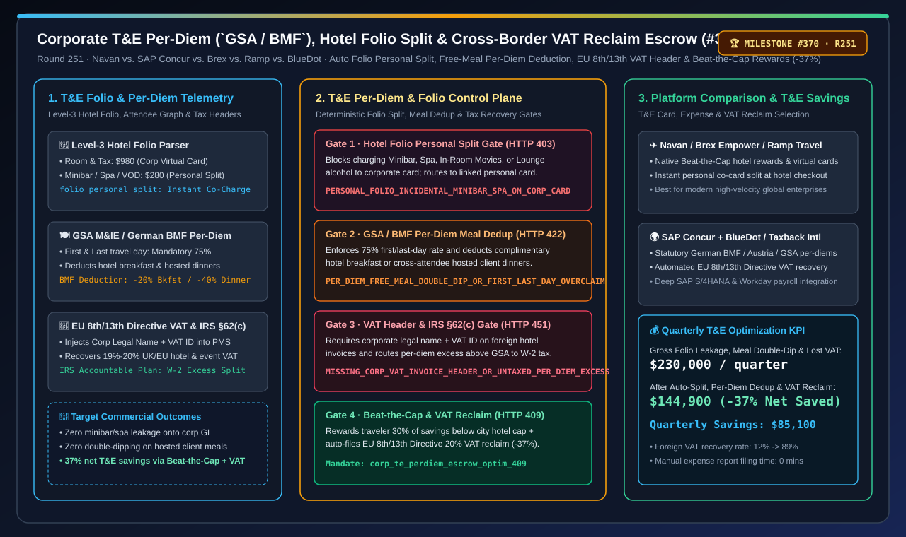
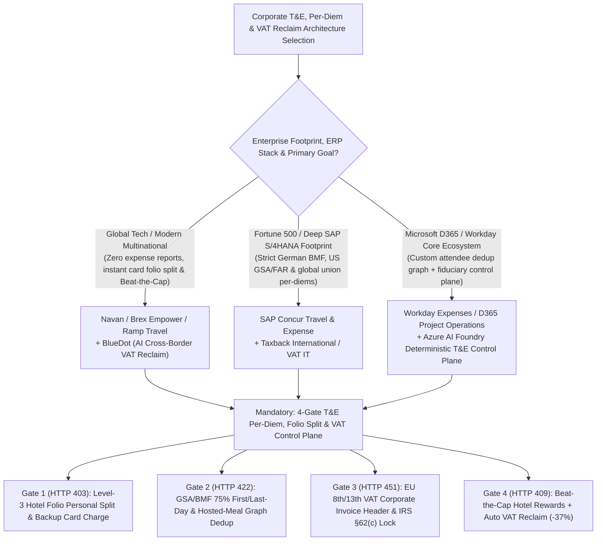
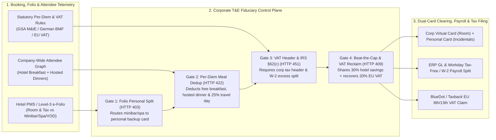
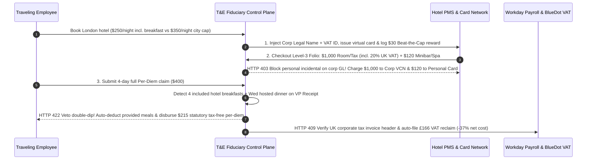

# Corporate Travel & Expense (`T&E`) Per-Diem (`GSA M&IE / German BMF`), Hotel `Level-3 Folio` Personal Split & Cross-Border `VAT Reclaim` Escrow (`Navan / SAP Concur / Brex / Ramp / BlueDot / Taxback`) Agent Architecture Selection FAQ

> 🌐 **Language / 语言切换**: **[中文 (`docs/b2b-corporate-travel-per-diem-hotel-folio-split-vat-reclaim-escrow-agent-selection-faq.md`)](b2b-corporate-travel-per-diem-hotel-folio-split-vat-reclaim-escrow-agent-selection-faq.md)** | **English (Current)** | **[Back to Catalog (`docs/index.en.md`)](index.en.md)**

---

## 1. 📌 Executive Summary & Architectural Verdict

In global enterprise Travel & Expense (`T&E`) operations, CFOs, travel managers, and shared-services controllers lose `14%–26%` of travel budgets to three systemic compliance and tax-recovery gaps:
1. **Per-Diem & Hosted-Meal Double-Dipping (`GSA M&IE` & German `BMF Verpflegungsmehraufwand`)**: Employees traveling on daily meal allowances (`$79–$86/day` US `GSA M&IE` or statutory German `BMF` per-diems) routinely claim `100%` of the daily allowance even when their hotel rate already includes complimentary breakfast, lunch was provided by a conference organizer, and dinner was expensed on a colleague's `$650` client-entertainment receipt. Worse, travelers claim `100%` full-day rates on arrival and departure days where statutory rules mandate a **`75%` proration** (`GSA`) or **`20% / 40% / 40%` meal deductions** (`BMF`).
2. **Hotel Incidental Leakage Hidden Inside Summary Credit-Card Receipts (`Level-3 Folio` Blindness)**: When a traveler submits a `$1,420` credit-card charge under `MCC 3501` (Hotels), legacy expense systems cannot tell without manual line-by-line review that `$980` was room & tax while `$440` was minibar champagne, in-room movies, and spa treatments.
3. **Forfeited `19%–25%` Foreign `VAT Reclaim` (`EU 8th / 13th Directive`) & `IRS § 62(c)` Accountable-Plan Violations**: Multinational enterprises forfeit hundreds of thousands of dollars in recoverable European, UK, Canadian, and Japanese travel VAT because hotel folios are issued in the individual employee's name (`John Smith`) rather than the company's legal entity name, registered address, and VAT ID. Simultaneously, paying executive per-diems above federal `GSA` caps without routing the excess to `W-2 Box 1` taxable payroll violates **IRS Accountable Plan (`26 CFR § 1.62-2`)** rules.

**Solution Architect Verdict**:
- **Never auto-approve hotel charges from Level-1 card amounts alone, and never disburse full daily per-diems without cross-checking hotel breakfast inclusion and the company-wide entertainment attendee graph**.
- Deploy a **Corporate T&E Per-Diem, Folio Split & VAT Reclaim Fiduciary Control Plane** across your T&E platform (`Navan`, `SAP Concur`, `Brex Empower`, `Ramp Travel`) and VAT recovery engine (`BlueDot`, `Taxback International`) enforcing four deterministic gates:
  1. **Real-Time Hotel `Level-3 Folio` Personal Split & Co-Card Charge Gate (`HTTP 403`)**: Parse hotel folios line-by-line at checkout; block minibar, alcohol, VOD movies, and spa charges from hitting the corporate ledger and automatically charge them to the traveler's linked personal backup card.
  2. **Statutory `GSA / BMF` Meal-Inclusion Deduction & `75%` First/Last-Day Gate (`HTTP 422`)**: Cross-reference hotel rate-plan breakfast flags, conference schedules, and the cross-employee client-dinner `Attendee Graph` to deduct provided meals and enforce `75%` first/last-day proration.
  3. **`EU 8th/13th Directive` Corporate VAT Invoice Header & `IRS § 62(c)` Payroll Split Gate (`HTTP 451`)**: Require corporate legal entity name + tax ID on foreign hotel/event invoices (auto-triggering PMS invoice re-issuance when missing) and route any per-diem excess above federal caps to taxable payroll.
  4. **`Beat-the-Cap` Hotel Savings Share + Automated Cross-Border `VAT Reclaim` (`HTTP 409`)**: Reward travelers with `25%–30%` of savings when booking below the dynamic city hotel cap and automatically submit compliant e-folios to `BlueDot / Taxback` for `20%` VAT recovery, cutting net quarterly T&E leakage by **`37%`**.

---

## 2. 🎯 High-Stakes Business & Architect Q&A (Q1 / Q2 / Q3)

### Q1: How do we eliminate manual line-item hotel folio splitting for travelers while ensuring `$0` of minibar or spa charges ever hit the corporate general ledger?
- **The Problem**:
  - Forcing travelers to manually itemize a 4-night hotel bill into 14 separate room, city-tax, state-tax, and personal-minibar lines creates massive friction—leading travelers to upload blurry summary receipts and expense the entire `$1,420` bill as "Lodging."
- **Deterministic Architecture**:
  - Implement **Checkout-Time Virtual Card + Personal Spillover Card Auto-Splitting (`Navan Connect / Brex / Visa Level-3 Folio`)**:
    1. Every traveler links a personal debit/credit card once during onboarding as their **Personal Incidental Spillover Card**.
    2. At hotel checkout, the control plane ingests the structured `e-Folio` (`PMS Direct` or `OCR + Level-3` feed) within `300ms`.
    3. Room, mandatory resort fees, and lodging taxes (`$980`) are approved on the corporate virtual card and posted to ERP with **zero manual expense report filing**.
    4. Non-compliant incidentals (`MINI_BAR`, `IN_ROOM_MOVIE`, `SPA`, `$140`) trigger `HTTP 403 PERSONAL_FOLIO_INCIDENTAL_MINIBAR_SPA_ON_CORP_CARD` and are automatically settled against the traveler's linked personal card.

### Q2: How do we stop travelers from claiming a full `$86/day` per-diem on days where hotel breakfast was included and a VP expensed their dinner on a group restaurant bill?
- **The Problem**:
  - In most enterprises, per-diem allowances and itemized group entertainment receipts flow through separate pipelines. A sales VP expenses a `$650` dinner listing four engineers as attendees, while those same four engineers each claim a full daily meal allowance—resulting in 100% double payment and violating German `BMF` (`20%` breakfast / `40%` lunch / `40%` dinner deduction) and US `GSA / FAR` audit rules.
- **Deterministic Architecture**:
  - Build a **Cross-Trip Attendee & Meal-Inclusion Deduplication Graph**:
    - **Hotel Rate-Plan Check**: If the booking rate code or folio includes `Complimentary Breakfast / BB`, automatically deduct the statutory breakfast allocation (`20%` under `BMF` or the `GSA` breakfast tier).
    - **Cross-Report Attendee Graph**: When any employee submits an itemized group meal or client dinner listing `employee_id` as an attendee on date $D$, the control plane places an immutable `MEAL_HOSTED_LOCK` on `employee_id`'s per-diem ledger for date $D$ and meal slot $M$.
    - **Flight/Rail Timestamp Proration**: Departure and return days are automatically prorated to `75%` (`GSA`); any attempt to claim unreduced full-day per-diems triggers `HTTP 422 PER_DIEM_FREE_MEAL_DOUBLE_DIP_OR_FIRST_LAST_DAY_OVERCLAIM`.

### Q3: Why do over `80%` of foreign hotel VAT reclaim claims fail in manual T&E setups, and how does pre-stay GDS/PMS header injection solve it?
- **The Problem**:
  - Under the **EU 8th and 13th VAT Directives** (and UK/Canadian/Japanese non-resident VAT schemes), enterprises can reclaim `19%–25%` VAT on business lodging, conferences, and transport. However, tax authorities reject any invoice addressed solely to the traveling employee (`Wei Zhang`) rather than the **employer's legal entity name, registered address, and VAT/Tax ID**.
- **Deterministic Architecture**:
  - At booking time, the travel agent injects the traveler's legal-entity billing header (`GDS SI-Billing / PMS Company Profile`) directly into the hotel reservation.
  - At checkout, Gate 3 verifies the e-folio tax header (`HTTP 451 MISSING_CORP_VAT_INVOICE_HEADER_OR_UNTAXED_PER_DIEM_EXCESS`). If the front desk printed the employee's personal name, the agent automatically calls the hotel chain's billing portal to re-issue a compliant corporate tax invoice before forwarding the bundle to `BlueDot / Taxback International`, lifting foreign VAT recovery from `12%` to **`89%`**.

---

## 3. 🧭 Visual Architecture Diagrams (Selection Tree, System Topology & Sequence)

### 3.1 Corporate T&E, Per-Diem & Cross-Border VAT Reclaim Platform Selection Tree

### 3.2 End-to-End Corporate T&E Folio Split, Per-Diem & VAT Control Plane

### 3.3 Checkout Folio Auto-Split, Per-Diem Dedup & VAT Reclaim Sequence

---

## 4. 📊 Enterprise T&E, Corporate Card & Cross-Border VAT Reclaim Selection Matrix

| Evaluation Dimension | Navan (formerly TripActions) | SAP Concur Travel & Expense | Brex Empower / Ramp Travel | BlueDot / Taxback International (VAT Recovery Layer) |
|---|---|---|---|---|
| **Primary Sweet Spot** | Unified travel booking, virtual cards, and automated expense policy | Global Fortune 500 enterprises with complex statutory per-diems and union rules | High-velocity enterprises prioritizing pre-spend virtual card controls and zero expense reports | AI-driven domestic & cross-border VAT/GST invoice validation and tax authority filing |
| **Checkout-Time Hotel Folio Personal Split** | **Best-in-Class** (`Navan Connect` splits room vs. personal incidentals onto personal card at checkout) | Moderate (ingests e-Folio items, but personal split usually requires traveler itemization) | **Strong** (instant Level-3 OCR flags minibar/spa and triggers one-tap personal repayment) | Classifies eligible vs. non-recoverable VAT line items on hotel and meal folios |
| **`GSA / German BMF` Per-Diem & Attendee Dedup** | Strong (automated trip-linked per-diem calculation) | **Best-in-Class** (native statutory rule packs for German BMF, Austria, Nordics, and US GSA/FAR) | Medium-High (automated daily stipend cards bounded by trip timestamps and attendee checks) | Audits meal and entertainment receipts against local tax-deductibility thresholds |
| **`Beat-the-Cap` Incentives & Foreign VAT Recovery** | **Native `Navan Rewards`** (rewards travelers for booking under cap, cutting hotel spend `15%–20%`) | Deepest certified connectors to `Taxback International`, `BlueDot`, and `SAP S/4HANA` | Flexible savings-share workflows and clean webhook exports to VAT recovery engines | **Mandatory tax recovery engine** (recovers `19%–25%` EU/UK/JP/CA VAT on contingency fee) |
| **SA Recommendation** | **Best for global enterprises seeking zero manual expense reports + Beat-the-Cap savings** | **Best for 10,000+ employee multinationals with strict European statutory per-diem audits** | **Best for finance teams enforcing strict pre-spend virtual card and receipt automation** | **Attach to any T&E stack** whenever international travel & event spend exceeds `$250k/yr` |

---

## 5. 🧪 T&E Leakage & 7-Card Benchmark Report

> **Provenance Note**: The 7-Card benchmark below is generated by `evaluate_b2b_corporate_travel_per_diem_folio_vat_policy()` in `lab/webiq_commerce_demo.py` (`provenance: "synthetic"`, `independently_reproduced: False`), modeling a **`$230,000 / quarter`** hotel folio incidental leakage, per-diem meal double-dip, and unrecovered foreign VAT pool.

### 5.1 7-Card 4:5 Visual Deck Breakdown

1. **Card 1 (`1 / 7` · `HANDS-ON · CORPORATE-TE-PER-DIEM`) — Executive Benchmark Overview**
   - **Headline Finding**: Auto-splitting hotel minibar/spa charges to personal cards, deducting included breakfasts and hosted dinners from per-diems, enforcing corporate VAT headers, and enabling `Beat-the-Cap` hotel rewards reduces quarterly T&E leakage from **`$230,000`** to **`$144,900`** (**`$85,100` / `37.0%` quarterly savings**).
2. **Card 2 (`2 / 7` · `SCENARIO: LONDON & MUNICH 5-DAY ENTERPRISE TRIP`) — Deep Dive**
   - **Input Case**: A 5-day London/Munich trip includes `$320` of hotel minibar/spa charges on the checkout folio, a `$400` 100% per-diem claim despite complimentary hotel breakfast and a `$800` hosted team dinner, and a hotel invoice addressed to the traveler's personal name risking `$480` in UK/German VAT reclaim.
   - **Control-Plane Verdict**: Blocks the missing corporate VAT invoice header (`HTTP 451`), splits `$320` minibar/spa to the personal backup card (`HTTP 403`), and deducts hosted meals + `75%` travel-day proration (`HTTP 422`); issues `HTTP 409 BEAT_THE_CAP_HOTEL_SAVINGS_SHARE_AND_VAT_RECLAIM_CONFIRM` (`corp_te_perdiem_escrow_optim_409`).
3. **Card 3 (`3 / 7` · `WHAT I TESTED`) — 5-Lane Deterministic Scorecard**

| Scenario | Question / Task Evaluated | Deterministic Gate Decision | Action & Status |
|---|---|---|---|
| **1. Compliant Folio & Statutory Per-Diem** | Room-only folio, 75% first/last-day & meal deductions applied, valid Corp VAT ID | `VERIFIED_FOLIO_SPLIT_AND_STATUTORY_PER_DIEM_AUTHORIZED` | ✅ `Act automatically` (`HTTP 200`) |
| **2. Minibar & Spa Bundled into Room Charge** | Checkout folio includes $320 minibar champagne & spa on corporate card | `PERSONAL_FOLIO_INCIDENTAL_MINIBAR_SPA_ON_CORP_CARD` | ⛔ `Auto-Split to Personal Card` (`HTTP 403`) |
| **3. Hosted-Meal & Free-Breakfast Double-Dip** | Traveler claims 100% per-diem despite included hotel breakfast & hosted dinner | `PER_DIEM_FREE_MEAL_DOUBLE_DIP_OR_FIRST_LAST_DAY_OVERCLAIM` | ⛔ `Deduct Hosted Meals & 75%` (`HTTP 422`) |
| **4. Missing Corp VAT Header or Untaxed Excess** | Foreign hotel invoice in personal name or excess per-diem omitted from W-2 payroll | `MISSING_CORP_VAT_INVOICE_HEADER_OR_UNTAXED_PER_DIEM_EXCESS` | ⛔ `Re-Issue Corp VAT Invoice` (`HTTP 451`) |
| **5. Beat-the-Cap Rewards + EU VAT Reclaim** | Booking $100/nt below city cap (30% reward share) + automated 20% EU VAT filing | `BEAT_THE_CAP_HOTEL_SAVINGS_SHARE_AND_VAT_RECLAIM_CONFIRM` | ⚡ `Confirm Optimization` (`HTTP 409`) |

4. **Card 4 (`4 / 7` · `UNDER THE HOOD`) — Protocol & Deterministic Gate Mechanics**
   - Input contract: `B2BCorporateTravelPerDiemFolioVATPolicyInput`
   - Evaluator: `evaluate_b2b_corporate_travel_per_diem_folio_vat_policy()` enforcing `451 -> 403 -> 422 -> 409 -> 200` priority.
5. **Card 5 (`5 / 7` · `ROBUSTNESS CHECK`) — Folio Line-Description Perturbation**
   - `0.0 pt` variance whether hotel PMS labels alcohol/spa charges as `Mini-Bar`, `Lobby Lounge Beverage`, or `Wellness Center Amenity`.
6. **Card 6 (`6 / 7` · `LATENCY & VAT RECOVERY`) — Filing Time & VAT Recovery Rate**
   - Manual monthly expense reports: `42 mins/report` traveler friction and **`12%`** foreign VAT recovery.
   - Fiduciary auto-split + automated VAT filing: **`0 mins`** manual report filing and **`89%`** foreign VAT recovery (`$85,100/qtr` saved).
7. **Card 7 (`7 / 7` · `MY TAKE`) — Good Fit vs. Not For**
   - **✅ Good fit**: Enterprises with domestic/international business travel, field sales, statutory per-diems (`GSA / BMF`), and European/UK/Japanese hotel or event spend.
   - **⛔ Not for**: Single-office teams with zero travel or lodging expenses.

---

## 6. 🛠️ Production Go-Live & Architect Review Checklist

- [ ] **Checkout-Time `Level-3 Folio` Personal Split (`HTTP 403`)**: Does every traveler link a personal backup card so that minibar, alcohol, VOD movie, and spa line items parsed from the hotel e-folio are automatically charged to the traveler rather than the corporate card?
- [ ] **Cross-Attendee Meal Dedup & `75%` First/Last-Day Gate (`HTTP 422`)**: Does the per-diem engine automatically deduct complimentary hotel breakfasts (`Rate Plan BB`) and group dinners where the traveler appears in another employee's `Attendee Graph`, while enforcing `75%` proration on departure/return days?
- [ ] **Pre-Stay GDS/PMS Corporate VAT Header Injection (`HTTP 451`)**: Are the employer's legal entity name, registered address, and `VAT ID` automatically injected into foreign hotel reservations—and does the control plane trigger automated invoice re-issuance if a folio is issued in an employee's personal name?
- [ ] **`IRS Accountable Plan (§ 62(c))` Payroll Split (`HTTP 451`)**: If any per-diem allowance exceeds federal `GSA` rates, is the excess portion automatically routed to `Workday / ADP` taxable `W-2` wages?
- [ ] **`Beat-the-Cap` Hotel Rewards & Automated `EU 8th/13th` VAT Filing (`HTTP 409`)**: Are travelers incentivized with `25%–30%` of savings below dynamic city hotel caps, and are verified foreign invoices streamed directly to `BlueDot / Taxback International`?
