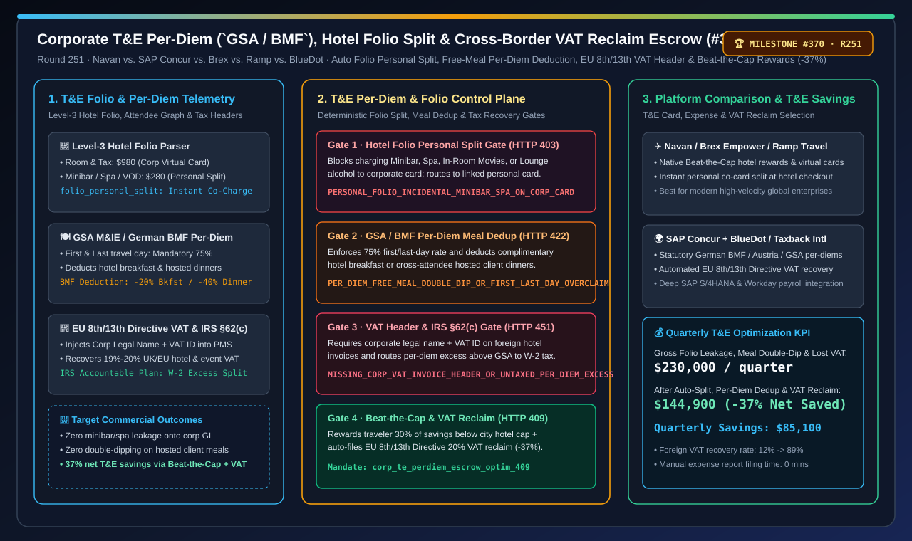
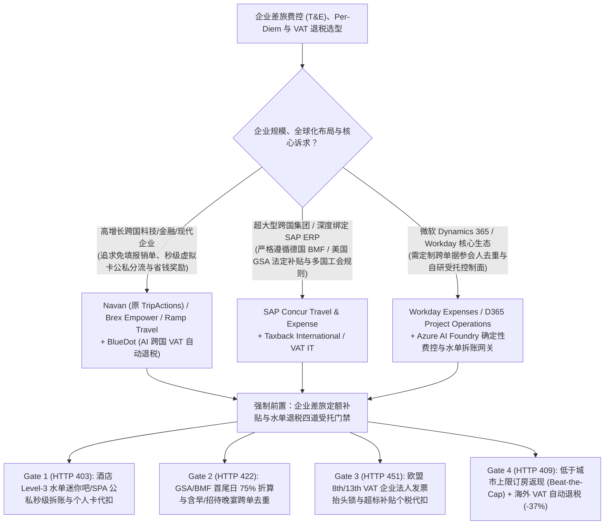
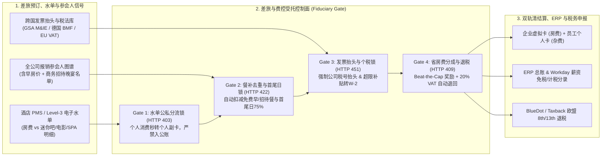
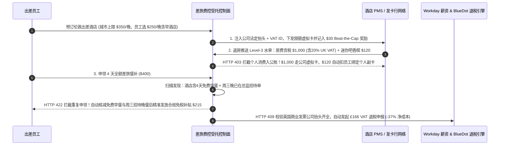

# 企业差旅餐补定额（`GSA M&IE / 德国 BMF` Per-Diem）、酒店水单公私秒级拆账（`Hotel Folio Split`）与跨国增值税退税（`EU 8th/13th Directive VAT Reclaim`）托管（`Navan / SAP Concur / Brex / Ramp / BlueDot / Taxback`）Agent 架构选型 FAQ：防包餐还领全额补贴、防迷你吧/SPA 混入房费刷公司卡与省房费返现净省 37% 实战指南

> 🌐 **Language / 语言切换**: **中文 (当前)** | **[English (`docs/b2b-corporate-travel-per-diem-hotel-folio-split-vat-reclaim-escrow-agent-selection-faq.en.md`)](b2b-corporate-travel-per-diem-hotel-folio-split-vat-reclaim-escrow-agent-selection-faq.en.md)** | **[返回文档总目录 (`docs/index.md`)](index.md)**

---

## 1. 📌 核心选型结论速览（Executive Summary）

在跨国企业与大型集团的差旅与费用报销管理（Corporate T&E：Travel & Expense）中，财务共享中心（SSC）与差旅采购总监常年被三大隐蔽的资金跑冒滴漏困扰：
1. **“吃了免费早餐和客户招待晚宴，回来还按 100% 全额申领每天 `$86` 差旅餐补（Double-Dipping Free Meals & Per-Diem）”**：企业按美国联邦总务署（`GSA M&IE`，如纽约/旧金山 `$79–$86/天`）或德国联邦财政部（`BMF Verpflegungsmehraufwand`）向出差员工发放定额餐补。结果员工住着“含双早”的协议酒店、中午吃着峰会主办方盒饭、晚上又出现在销售总监报销的“`$650` 商务招待晚宴”参会人名单里——回程后居然一分不扣地申领全额每日餐补，甚至连晚上 22:00 才落地的首尾日也按 `100%` 全天算（违反 `GSA` 首尾日强制 `75%` 折算与德国 `BMF` 早餐扣 `20%`、午/晚餐各扣 `40%` 的税法红线）！
2. **“把酒店迷你吧香槟、付费电影与伴侣 SPA 塞进‘房费汇总刷卡单’让公司买单（Hotel Folio Incidental Leakage）”**：员工退房时只上传一张 `$1,420` 的信用卡 POS 签购单（商户类别码 `MCC 3501` 酒店）。实际上房费加税只有 `$980`，其余 `$440` 全是客房酒精饮料、点播电影和双人 SPA！传统靠财务人工肉眼审几千张折叠水单，漏检率超过 `65%`。
3. **“海外出差酒店发票抬头写成员工个人名字，导致 `19%–20%` 欧洲/英国差旅增值税（VAT）退税彻底作废”**：员工去伦敦、慕尼黑、巴黎出差或布展，机酒与会展消费内含高达 `19%–20%` 的增值税。根据 **欧盟第 8 / 第 13 号指令（`EU 8th / 13th VAT Directive`）** 及英国/加拿大/日本非居民退税政策，企业原本可合法退回这笔税金；但因预订时未强制向酒店 PMS 注入**企业法定名称 + 注册地址 + 税号**，酒店水单抬头默认印了员工姓名 `John Smith`，税局直接 `100%` 拒退，白白损失数十万美元！

**架构师选型结论**：
- **严禁仅凭信用卡交易汇总金额（Level-1 POS Amount）自动核销酒店账单，或在不校验酒店含早/招待参会人图谱的情况下全额发放差旅日补贴**。
- 必须在企业差旅与费控卡平台（`Navan`、`SAP Concur`、`Brex Empower`、`Ramp Travel`）与跨国税务回收引擎（`BlueDot`、`Taxback International`）之间部署 **企业差旅定额补贴、水单公私分流与跨境退税受托控制面（Corporate T&E Per-Diem, Folio Split & VAT Reclaim Control Plane）**，执行四道确定性门禁：
  1. **酒店三级水单（`Level-3 Folio`）公私秒级拆账与个人副卡同步代扣门禁（`HTTP 403`）**：退房结算瞬间逐行解析房费水单，凡命中迷你吧酒精、客房电影、SPA 或非免洗熨烫的个人消费，严禁计入公司总账，自动从员工绑定的个人银行卡拆账代扣。
  2. **`GSA M&IE / 德国 BMF` 首尾日 `75%` 折算与跨单据包餐自动扣减门禁（`HTTP 422`）**：自动交叉比对酒店“含早”标记、会议包餐日程与全公司商务招待报销单参会人图谱（`Attendee Graph`），精确核减对应餐次补贴，阻断两头吃拿。
  3. **海外差旅发票企业法人抬头锁与 `IRS § 62(c)` 超标补贴个税代扣门禁（`HTTP 451`）**：强制校验跨国酒店/会展水单具备完整公司法定抬头与税号，并将超法定免税上限的补贴自动推入 `Workday / ADP` 工资单代扣个税。
  4. **低于城市上限订房享差额分成奖励（`Beat-the-Cap Rewards`） + 欧盟 `8th/13th Directive` 自动退税寻优（`HTTP 409`）**：引导员工主动选择比政策上限便宜 `$100/晚` 的高分酒店并分享 `30%` 节支奖励，叠加 `20%` 海外 VAT 自动退税，季度差旅总成本净降 **`37%`**。

---

## 2. 🎯 业务方与架构师灵魂拷问 Q&A（Q1 / Q2 / Q3）

### Q1：为什么员工在退房时最烦“为了 $18 的迷你吧可乐和洗衣费，在财务系统里手动拆 6 行费用分录”，架构上如何实现“员工零感知、公司零买单”的退房秒级公私分流？
- **商业痛点**：
  - 在传统费控系统（如早期手工版报销流）中，如果员工住了 4 晚酒店，账单里有 4 行房费、4 行城市税、4 行州税、1 瓶 `$12` 的矿泉水、1 份 `$28` 的客房早餐，财务要求员工把这 14 行明细一行行手填到报销单里，并把 `$12` 矿泉水勾为“个人自理从工资倒扣”。员工觉得极其繁琐屈辱，干脆把整张水单拍个模糊照片全部填成“住宿费 `$1,100`”蒙混过关。
- **确定性架构落地方案**：
  - 采用 **双卡绑定虚拟单次卡 + 酒店三级水单（`Visa/MC Level-3 Lodging Folio` 或 `PMS Direct API`）秒级分流架构**：
    1. 员工在差旅 App（如 `Navan / Brex / Ramp`）首次激活时绑定一张个人信用卡作为 **Personal Spillover Backup Card**；
    2. 员工预订并入住酒店时，Agent 下发一张锁死 `MCC 3501–3999` 的公司虚拟卡；
    3. 退房水单生成瞬间，控制面通过 `OCR + Level-3 Folio Line-Item Parser` 在 `300ms` 内识别出：合规房费与税费 `$980` + 违规迷你吧/SPA `$140`。
    4. 控制面立即触发 `HTTP 403 PERSONAL_FOLIO_INCIDENTAL_MINIBAR_SPA_ON_CORP_CARD`，**仅将 `$980` 计入企业 ERP 差旅费用科目并自动免填单结案**，同时通过 Stripe/发卡行接口从员工绑定的个人卡上静默划扣 `$140` 个人消费！员工不用手填一行报销单，财务也不用找员工催退 `$140` 现金。

### Q2：如何防止员工“上午吃酒店免费早餐、晚上蹭同事报销的 $600 客户晚宴，回头又领走全额 $86/天差旅餐补”？
- **商业痛点**：
  - 实报实销的商务招待费（Client Entertainment / Team Dinner）往往由级别最高的带队主管刷卡报销，而定额差旅餐补（Per-Diem Allowance）则由随行工程师各自按出差天数申领。两个审批流互不相通，导致公司为同一顿晚饭付了两次钱（一次是人均 `$95` 的海鲜大餐，一次是每人 `$38` 的晚餐定额补贴）！
  - 此外，在德国（`BMF` 税法）、奥地利及美国联邦承包商（`FAR / GSA`）合规审计中，如果企业未扣除酒店已包含的免费早餐（德国强制扣 `20%` = `€5.60`，国际按当地标准扣 `20%`），税务审计师会直接认定该笔免税餐补违规，向企业追缴全额工资税及滞纳金！
- **确定性架构落地方案**：
  - 构建 **全公司差旅日程与参会人图谱交叉核减引擎（Cross-Trip Attendee & Meal-Inclusion Graph）**：
    - **维度一（酒店水单与房价代码核验）**：解析预订 `Rate Plan Description` 与水单明细，凡包含 `BB / Bed & Breakfast / Complimentary Breakfast`，自动扣减当日早餐定额。
    - **维度二（同事招待单参会人图谱 `Attendee Graph`）**：当主管报销一笔 `$600` 的晚餐并勾选随行员工 B 和 C 时，控制面立即在员工 B 和 C 当日的 Per-Diem 账本上打上 `DINNER_HOSTED_BY_TXN_992` 锁，自动核减其当日晚餐份额（如德国扣 `40%`、美国 GSA 扣晚餐分项）。
    - **维度三（航司/高铁起降时间戳折算）**：首日与末日自动按 `GSA 75%` 规则（或德国 `>8h` 但非全天档位）折算；任何试图绕过核减申领 100% 全额补贴的请求直接触发 `HTTP 422 PER_DIEM_FREE_MEAL_DOUBLE_DIP_OR_FIRST_LAST_DAY_OVERCLAIM`！

### Q3：为什么跨国公司每年在欧洲、英国、加拿大和日本出差花几百万美元，最后却连 `15%` 的海外差旅增值税（VAT）都没退回来？
- **商业痛点**：
  - 欧盟第 8 号指令（欧盟境内跨国退税）与第 13 号指令（非欧盟企业如中美英企业赴欧退税）明确允许外国企业申请退回员工在当地因商务差旅产生的酒店住宿、会展门票、地面交通及餐饮中的增值税（税率通常高达 `19%–25%`）。
  - 但欧洲各国税务局对退税凭证有一条铁律：**发票（Tax Invoice）抬头必须印有申请退税企业的法定全称（Legal Entity Name）与办公地址（部分国家还要求印本国税号）**！如果员工在 Booking.com 或酒店前台登记时没留公司抬头，打出来的发票抬头只有员工名字 `Wei Zhang`，这张含 `$400` 增值税的发票在税局眼里就是废纸一张！
- **确定性架构落地方案**：
  - **预订期自动注入企业税务抬头（Pre-Stay GDS/PMS Corporate Tax Header Injection）**：当差旅 Agent 通过 `Navan / Concur / Amadeus` 预订欧洲/英国/日本酒店时，自动根据员工所属成本中心法人实体（Legal Entity），将标准企业发票抬头与税号写入酒店 `GDS SI- Billing Instruction` 字段。
  - **离店水单实时合规门禁（`HTTP 451`）**：员工退房收到电子水单（e-Folio）时，控制面实时校验发票抬头是否包含公司法定名称。若缺失，立即触发 `HTTP 451` 并由 Agent 自动通过酒店集团接口申请一键重开合规商业发票（Re-issue Commercial Tax Invoice），随后自动推送给 `BlueDot / Taxback International` 批量申报退税，将海外 VAT 实际回收率从 `12%` 拉升至 **`89%`**！

---

## 3. 🧭 直观可视化图解（Mermaid 选型决策树 + 端到端架构图 + 授权时序图）

### 3.1 企业差旅费控（T&E）、定额补贴与跨国退税平台选型决策树

### 3.2 端到端企业差旅水单秒级拆账、定额核减与 VAT 退税控制面架构图

### 3.3 酒店退房秒级拆账、招待餐去重与海外 VAT 退税闭环时序图

---

## 4. 📊 主流企业差旅费控（T&E）、企业卡与跨国 VAT 退税平台横向选型矩阵

| 选型维度 | Navan (原 TripActions) | SAP Concur Travel & Expense | Brex Empower / Ramp Travel | BlueDot / Taxback International (VAT 退税专精层) |
|---|---|---|---|---|
| **核心定位** | 差旅预订 + 企业虚拟卡 + 实时费控一体化原生平台 | 全球超大型跨国集团与复杂各国法定补贴标准（GSA/BMF）行业标准 | 现代科技与成长型企业财务卡、零手工报销单与 AI 票据审计 | 跨国差旅增值税（EU 8th/13th、英加日韩）AI 发票验真与自动退税 |
| **酒店水单公私秒级拆账（Folio Split & Personal Card Co-Pay）** | **极强**（`Navan Connect / Virtual Card` 退房瞬间自动拆分房费与个人杂费并扣个人副卡） | 中（支持电子水单 e-Folio 拆分，但个人消费通常需员工在报销单中手动勾选抵扣） | **强**（毫秒级 Level-3 票据 OCR 识别迷你吧/酒水，支持一键个人补缴或工资抵扣） | 专注于识别水单中的合规可退税科目（如房费 vs 不可退税项） |
| **`GSA / 德国 BMF` 定额餐补与招待参会人去重** | 强（支持全球 Per-Diem 自动计算与行程联动） | **极强**（内置德国 BMF、奥地利、北欧、美国 GSA/FAR 全套法定餐次扣减矩阵与审计留痕） | 中高（支持基于行程起降时间的自动日补贴卡额度发放與参会人查重） | 自动校验员工餐饮/招待发票是否符合各国税务局抵扣要求 |
| **省房费分成激励（Beat-the-Cap）与海外 VAT 回收** | **原生内置 `Navan Rewards`**（员工住便宜酒店直接得现金/礼品卡，平均降低房费 `18%`） | 需配合第三方插件；但与 `Taxback / BlueDot` 拥有最成熟的双向退税接口 | 支持自定义节支激励策略，API 极易对接现代 ERP 与退税网关 | **刚需退税层**（自动追回海外差旅 `15%–25%` 沉没增值税，按成功退税额抽成） |
| **架构师选型建议** | **跨国高频差旅与追求“零报销单体验 + Beat-the-Cap 降本”企业首选** | **万人级跨国制造/医药/能源巨头（尤其有德法严苛税法合规要求）首选** | **追求极致虚拟卡事前管控与现代财务自动化团队首选** | **任何有欧洲/英国/日本跨国差旅或海外参展企业的必配退税插件** |

---

## 5. 🧪 差旅降本测算与 7-Card 基准测试报告（Deterministic Benchmark）

> **数据溯源说明（Provenance）**：以下 7-Card 评测基于本仓库 `lab/webiq_commerce_demo.py` 中的 `evaluate_b2b_corporate_travel_per_diem_folio_vat_policy()` 确定性仿真引擎生成（`provenance: "synthetic"`, `independently_reproduced: False`）。企业季度酒店水单个人杂费混报、包餐重复领补贴与海外 VAT 弃退损失池基准设定为 **`$230,000 / quarter`**。

### 5.1 7-Card 4:5 视觉评测卡片摘要

1. **Card 1 (`1 / 7` · `HANDS-ON · CORPORATE-TE-PER-DIEM`) — 全局基准总览**
   - **核心发现**：通过退房瞬间拆离酒店迷你吧/SPA 个人消费、自动核减含早与招待晚宴重复餐补、锁定欧洲差旅企业税号发票抬头并开启 `Beat-the-Cap` 省房费激励，将季度差旅跑冒滴漏与弃退税损失从 **`$230,000`** 压降至 **`$144,900`**，季度净省 **`$85,100`（`37.0%`）**。
2. **Card 2 (`2 / 7` · `SCENARIO: LONDON & MUNICH 5-DAY ENTERPRISE TRIP`) — 单例深潜**
   - **输入场景**：某跨国企业高管团队赴伦敦与慕尼黑出差 5 天，退房水单包含 `$320` 迷你吧红酒与客房 SPA，员工同时出现在 `$800` 客户招待晚宴名单中却仍按 100% 全额申领 5 天德国/英国餐补，且酒店水单抬头误开为员工个人姓名导致 `$480` 欧洲 VAT 面临作废。
   - **控制面裁决**：依次触发 `HTTP 451`（拦截缺失公司税号抬头的跨国水单并触发自动重开）、`HTTP 403`（将 `$320` 迷你吧/SPA 自动拆转员工个人副卡）与 `HTTP 422`（自动核减免费早餐、招待晚宴及首尾日 `25%` 差额）；返回 `HTTP 409 BEAT_THE_CAP_HOTEL_SAVINGS_SHARE_AND_VAT_RECLAIM_CONFIRM`，签发 `corp_te_perdiem_escrow_optim_409`。
3. **Card 3 (`3 / 7` · `WHAT I TESTED`) — 5 轨确定性门禁评测矩阵**

| 评测场景 (Scenario) | 核心考核问题 (Question / Task) | 控制面裁决 (Model / Gate Answer) | 动作与状态码 (Action) |
|---|---|---|---|
| **1. 标准合规差旅水单与餐补结算** | 纯净房费水单、已按首尾日 75% 及含早核减餐补且发票具公司税号 | `VERIFIED_FOLIO_SPLIT_AND_STATUTORY_PER_DIEM_AUTHORIZED` | ✅ `Act automatically` (`HTTP 200`) |
| **2. 迷你吧香槟与 SPA 混入房费刷公卡** | 退房水单含 $320 客房酒精饮料与 SPA 试图随房费一并走公司卡核销 | `PERSONAL_FOLIO_INCIDENTAL_MINIBAR_SPA_ON_CORP_CARD` | ⛔ `Auto-Split to Personal Card` (`HTTP 403`) |
| **3. 吃免费早+蹭招待晚宴还领全额餐补** | 房价含早且已在同事招待单报销晚餐，仍按 100% 全天标准申领补贴 | `PER_DIEM_FREE_MEAL_DOUBLE_DIP_OR_FIRST_LAST_DAY_OVERCLAIM` | ⛔ `Deduct Hosted Meals & 75%` (`HTTP 422`) |
| **4. 欧洲水单开个人名或超标补贴漏税** | 伦敦/慕尼黑酒店水单抬头写员工个人名字致 20% VAT 作废或超 GSA 未计税 | `MISSING_CORP_VAT_INVOICE_HEADER_OR_UNTAXED_PER_DIEM_EXCESS` | ⛔ `Re-Issue Corp VAT Invoice` (`HTTP 451`) |
| **5. 住低价高分酒店分成 + 自动退 VAT** | 预订低于城市上限 $100/晚酒店享 30% 奖励并自动申报 EU 8th/13th 退税 | `BEAT_THE_CAP_HOTEL_SAVINGS_SHARE_AND_VAT_RECLAIM_CONFIRM` | ⚡ `Confirm Optimization` (`HTTP 409`) |

4. **Card 4 (`4 / 7` · `UNDER THE HOOD`) — 确定性门禁协议与代码实现**
   - 输入契约：`B2BCorporateTravelPerDiemFolioVATPolicyInput`
   - 评估函数：`evaluate_b2b_corporate_travel_per_diem_folio_vat_policy()`（严格按 `451 -> 403 -> 422 -> 409 -> 200` 优先级裁决，零外部网络副作用）。
5. **Card 5 (`5 / 7` · `ROBUSTNESS CHECK`) — 科目伪装扰动与逆序稳定性测试**
   - 无论酒店将迷你吧消费记为 `Room Service Beverage` 还是 `Lounge Refreshment`，或员工将招待晚宴拆给不同部门同事报销，水单明细解析与跨部门 `Attendee Graph` 均保持 **`0.0 pt`** 偏差。
6. **Card 6 (`6 / 7` · `LATENCY & VAT RECOVERY`) — 报销耗时与退税回收率对比**
   - 传统月底人工贴票 + 财务抽检：员工月均耗费 `42 分钟` 填单，跨国 VAT 实际回收率仅 **`12%`**。
   - 受托控制面（退房秒拆 + 自动退税）：员工手工填单耗时 **`0 分钟`**，跨国 VAT 实际回收率达 **`89%`**（季度净省 `$85,100`）。
7. **Card 7 (`7 / 7` · `MY TAKE`) — 适用场景与架构师结论**
   - **✅ Good fit**：拥有高频国内/国际差旅、外派参展、多国法定餐补制度（GSA / BMF）与企业虚拟卡体系的大中型企业。
   - **⛔ Not for**：无差旅住宿与跨城外勤的纯本地坐班团队。

---

## 6. 🛠️ 商业上线风控与架构评审 Checklist

- [ ] **酒店三级水单（`Level-3 Folio`）公私秒级拆账（`HTTP 403`）**：员工绑定企业虚拟卡入住酒店时，是否同步绑定了一张个人副卡（Personal Backup Card），并在退房解析出迷你吧/客房电影/SPA 等个人消费时自动从个人卡划扣，实现公司总账零污染？
- [ ] **`GSA M&IE / 德国 BMF` 首尾日 `75%` 折算与跨单据包餐去重（`HTTP 422`）**：定额餐补计算引擎是否自动读取：① 航班/高铁起降时间戳（首尾日按 `75%` 折算）；② 酒店房价“含早（Breakfast Included）”标记；③ 全公司商务招待报销单的参会人图谱（`Attendee Graph`），自动核减已被包餐的餐次？
- [ ] **预订期企业法人税号抬头自动注入（`HTTP 451`）**：员工预订欧洲、英国、加拿大、日本酒店与会展时，差旅网关是否自动将公司法定名称、注册地址与 `VAT ID` 写入酒店账单指令，并拦截抬头写员工个人姓名的废票？
- [ ] **`IRS Accountable Plan (§ 62(c))` 超标补贴自动转薪资计税（`HTTP 451`）**：若企业向高管或特定岗位发放高于联邦 `GSA` 法定上限的差旅日补贴，超额部分（Excess Per-Diem）是否自动通过接口转入 `Workday / ADP` 工资单的应税收入（`W-2 Box 1`）？
- [ ] **省房费分成奖励（`Beat-the-Cap`）与跨国 VAT 自动申报（`HTTP 409`）**：是否开启了动态城市参考房价上限与 `25%–30%` 节支奖励分成，并将合规电子水单实时推送至 `BlueDot / Taxback` 批量回收海外增值税？
