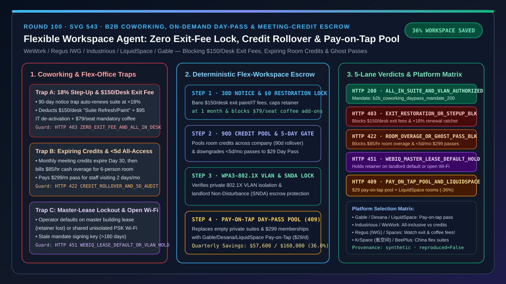
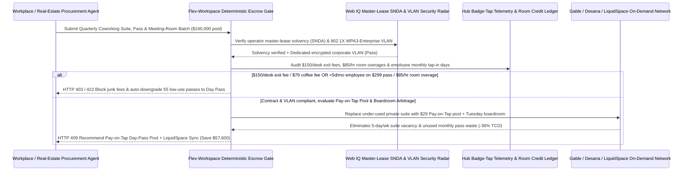

# B2B Coworking, On-Demand Day-Pass & Meeting-Credit Escrow (`WeWork / Regus IWG / Industrious / LiquidSpace / Gable`) Zero Exit-Fee Lock, Credit Rollover & Pay-on-Tap Pool Agent Architecture Selection FAQ

> **Document Type**: AI Solution Architect Decision Guide (FAQ) · **SVG Diagram**: `assets/svg/543-b2b-coworking-daypass-meeting-credit-escrow-2026-11-20.svg` · **Catalog No.**: Round 100 (Bilingual FAQ #219 · 100th Nightly Milestone Guide)



---

## 1. 📌 Executive Summary

When remote-first enterprises, regional sales pods, or workplace-strategy teams use AI Agents to procure coworking suites, `All-Access` roaming passes, and on-demand conference rooms (`WeWork / Regus IWG / Industrious / Spaces / LiquidSpace / Gable / Desana / KrSpace 氪空间`), rubber-stamping standard operator membership agreements exposes real-estate budgets to **three systemic flexible-workspace billing traps**:
1. **90-Day Notice Auto-Renewal Ratchets (`+18%` Step-Up), `$150/Desk` Exit "Suite Restoration" Fees & Mandatory `$79/Seat` Coffee Add-Ons**: A company signs a 12-month license for a 20-desk private suite (`$14,000/month` + `$28,000` 2-month security retainer). On the first invoice, legacy operators (`Regus / IWG` style contracts) tack on unquoted mandatory monthly fees: **`$79/person/month` "Unlimited Kitchen / Barista Beverage Package" (`+$1,580/mo`) + `$199/mo` "Firewall/Public IP Fee"**. If the tenant misses a buried **90-day advance cancellation window** by 24 hours, the agreement auto-renews for another 12–24 months at an **`+18%` "Standard Rack Rate Step-Up"**! And upon move-out, the operator deducts mandatory **`$150–$250/desk` "Suite Refresh / Repainting / Carpet Steam-Cleaning Fees" + `$95/person` "IT & Keycard De-Activation Fees" (`$4,900` confiscated from the retainer)** despite zero damage beyond normal wear and tear!
2. **Expiring Monthly Meeting-Room Credits (`$85/Hr` Overage Gouging) & `$299/Mo` "Ghost All-Access Passes" (`<5` Visits/Mo)**: Bundled conference-room credits expire on Day 30 (`100%` monthly breakage), after which booking a 6-person room triggers punitive **`$50–$85/hour` cash overage charges**! Meanwhile, HR buys `$299/month` `All-Access` passes for 80 remote staff, even though badge logs show `65%` of holders tap into a hub fewer than `2 days/month` (`paying $150+ per visit` when a single on-demand day pass costs `$29`)!
3. **Coworking Operator Master-Lease Default Lockouts (`WeWork Chapter 11` Style) & Unisolated Shared `PSK` Wi-Fi (`HTTP 451`)**: The coworking operator (a sub-lessor) defaults on its underlying master lease with the building landlord, resulting in padlocked doors and a lost `$28,000` security retainer, or places enterprise laptops on a shared building-wide `WPA2-PSK` Wi-Fi network without `802.1X WPA3-Enterprise` private `VLAN` isolation.

**Architect's Recommendation**: Deploy a **"Zero-Exit-Fee & 30-Day Rolling Notice Lock + `<5-Visit/Mo` Auto-Downgrade to `$29` On-Demand Day Passes + Master-Lease `SNDA` & Private `VLAN` Escrow"** control plane:
- **Zero-Auto-Renewal Ratchet (`30d` Notice), `$0` Normal-Wear Exit Restoration & All-In Desk Pricing (`HTTP 403`)**: Hard-block coworking agreements that impose `>30-day` cancellation notice windows, auto-renewal rate step-ups `>3%`, mandatory `$79/seat` beverage/kitchen packages, `>1-month` retainers, or mandatory per-desk exit repainting/IT de-provisioning fees (`HTTP 403`).
- **90-Day Pooled Meeting Credits, `LiquidSpace <=$45/Hr` Overage Fallback & `<5-Day/Mo` Pass Downgrade Gate (`HTTP 422`)**: Pool conference-room credits across all company users with a 90-day rollover—routing room bookings to external **`LiquidSpace / Peerspace` boardrooms whenever coworking overage rates exceed `> $45/hour`**—and audit monthly badge tap-ins to automatically downgrade `$299/month` `All-Access` subscriptions to `$29` Pay-on-Tap day passes for employees visiting `< 5 days/month` (`HTTP 422`).
- **Web IQ Master-Lease `SNDA` Default Shield & `802.1X WPA3-Enterprise` Private `VLAN` Hold (`HTTP 451`)**: Freeze escrow if Web IQ flags underlying landlord master-lease default notices, missing Subordination, Non-Disturbance, and Attornment (`SNDA`) retainer protection, unisolated shared `PSK` Wi-Fi, or signing keys `> 180 days` (`HTTP 451`).
- **Pay-Per-Badge-In On-Demand Pass Pool (`Gable / Desana / LiquidSpace`) + Weekly Sync Boardroom Arbitrage (`HTTP 409`)**: Replace under-utilized fixed private suites (`38%` average weekly occupancy) and idle `$299/mo` monthly memberships with a **Zero-Commitment Pay-on-Tap Day-Pass Pool (`$29/day` billed *only* when an employee physically badges in) + 1 weekly full-day boardroom rental (`$350/day` on Tuesdays for team collaboration)**, cutting quarterly flexible workspace TCO by **36.0%** (`$57,600` saved on a `$160,000` quarterly pool).

---

## 2. 🎯 Soul-Searching Architect & Business Q&A (Q1–Q3)

### Q1: Why did our "all-inclusive" 20-desk coworking suite end up costing `$1,779/month` extra in hidden coffee/IT fees and `$4,900` in exit "restoration" deductions?
- **Business Pain Point**: Legacy serviced-office operators (`Regus / IWG / Spaces`) advertise low headline desk rates to win the deal, then attach a schedule of mandatory ancillaries (`$79/person` kitchen/coffee fee, `$95/person` setup fee, and `$150–$250/desk` exit "dilapidation/restoration" fees deducted automatically from the 2-month retainer).
- **Architectural Guardrail (`HTTP 403`)**:
  1. **Mandatory Zero-Restoration & All-In Desk Rider**: The Agent rejects any license agreement containing per-desk exit refurbishment fees for normal wear and tear, mandatory beverage add-ons, or 90-day auto-renewal ratchets (`HTTP 403`), and caps security retainers at `<=1 month` held in third-party escrow.

### Q2: At what monthly attendance threshold does a `$299/month` `WeWork All-Access` pass lose money compared to an On-Demand Day Pass (`$29/day`)?
- **Business Pain Point**: At `$29–$35/day` on aggregator platforms (`Gable / Desana / LiquidSpace`), the break-even point for a `$299/month` pass is **`9 to 10 office days per month`**. Yet across typical remote-first companies, `65%` of pass holders visit a coworking hub only `1 to 3 times per month`—wasting `$210+/month` per inactive employee.
- **Architectural Guardrail (`HTTP 422 / 409`)**:
  1. **Automated `<5-Day` Badge-Tap Downgrade**: At the end of each billing cycle, the gateway ingests badge tap-in logs. Any employee with `< 5 unique tap-in days` is automatically switched from a `$299/mo` fixed subscription to an **On-Demand Pay-on-Tap Pass (`$0/mo` base fee; `$29` billed only when they badge into a building)**.

### Q3: Why pay `$14,000/month` for a 20-desk private suite when our hybrid team only gathers in person on Tuesdays?
- **Business Pain Point**: A 12-month private office lease forces you to pay for 7 days a week (`30 days/month`) even when the team only uses the room `4 to 8 days/month` (`73%–86%` vacancy waste).
- **Architectural Guardrail (`HTTP 409`)**:
  1. **"Tuesday Boardroom + Flex Day-Pass" Arbitrage**: Instead of leasing a dedicated `$14,000/month` glass box that sits empty 5 days a week, the Agent books a 20-person executive boardroom via `LiquidSpace / Industrious` every Tuesday (`$350/day × 4 Tuesdays = $1,400/month`) and gives the team `$29` on-demand day passes for ad-hoc solo work (`~$1,800/month`)—delivering a better collaborative experience for `$3,200/month` instead of `$14,000/month`!

---

## 3. 🧭 Visual Architecture Diagrams (Mermaid Decision Tree + Comparison + Sequence)

### 3.1 5-Lane B2B Coworking, Day-Pass & Meeting-Credit Escrow Decision Tree
```mermaid
flowchart TD
    A[B2B Coworking Suite / All-Access Pass / Meeting Room Request] --> B{Web IQ Master-Lease Default Risk / Unisolated PSK Wi-Fi / Key > 180d?}
    B -- Yes --> C[HTTP 451: WEBIQ_MASTER_LEASE_DEFAULT_LOCKOUT_OR_SHARED_WIFI_NO_WPA3_ENTERPRISE_HOLD<br/>Freeze retainer & migrate to SNDA-protected + 802.1X VLAN hub]
    B -- No --> D{+18% Auto-Renewal Step-Up or $150/Desk Exit Restoration / $79 Coffee Fee?}
    D -- Yes --> E[HTTP 403: AUTO_RENEWAL_STEPUP_RATCHET_OR_PER_DESK_EXIT_RESTORATION_FEE_BLOCKED<br/>Enforce 30d notice, All-In desk pricing & $0 normal-wear exit fee]
    D -- No --> F{$85/Hr Room Overage After Credit Expiry or $299 Pass for <5d/Mo User?}
    F -- Yes --> G[HTTP 422: EXPIRING_MEETING_ROOM_CREDIT_OVERAGE_OR_UNBADGED_ALL_ACCESS_SEAT_BLOCKED<br/>Reroute room to LiquidSpace (<=$45/h) & downgrade <5d/mo passes to Day Pass]
    F -- No --> H{Pay-on-Tap Day-Pass Pool (Gable/Desana) + Weekly Boardroom Sync Ready?}
    H -- Yes --> I[HTTP 409: PAY_PER_BADGE_ON_DEMAND_PASS_POOL_AND_LIQUIDSPACE_MEETING_ARBITRAGE_CONFIRM<br/>Replace empty suites & ghost passes w/ $29 Pay-on-Tap pool (-36% TCO)]
    H -- No --> J[HTTP 200: ALL_IN_WORKSPACE_AND_PRIVATE_VLAN_AUTHORIZED<br/>Issue exit-fee-free & VLAN-isolated workspace mandate]
```

### 3.2 Legacy Coworking Suite & Monthly Pass vs. Deterministic Pay-on-Tap & Boardroom Escrow
```mermaid
flowchart LR
    subgraph Legacy["❌ Legacy Coworking (Exit Fees & 65% Ghost Passes)"]
        L1[Missed 90d Notice -> +18% Auto-Renew + $79/Seat Coffee Fee] --> L2[$4,900 ($150/Desk) Exit Paint/IT Fee Taken From Retainer]
        L2 --> L3[65% of $299/mo Passes Used <2 Days/mo + $85/hr Room Overage]
    end

    subgraph Agentic["✅ Deterministic Zero-Exit-Fee, Pay-on-Tap & VLAN Escrow"]
        A1[30d Rolling Notice + $0 Exit Restoration + 802.1X Private VLAN] --> A2[<5d/mo Users Auto-Switched to $29 Pay-on-Tap Day-Pass Pool]
        A2 --> A3[Gable/Desana Pool + Weekly LiquidSpace Boardroom (-36% TCO)]
    end
```

### 3.3 End-to-End License Audit, Badge-Tap Frequency Check & On-Demand Routing Sequence


---

## 4. 📊 Multi-Platform & Protocol Selection Matrix

| Evaluation Dimension | Regus / Spaces (`IWG` Legacy Network) | WeWork (Private Suites & `All-Access`) | Industrious (Premium All-Inclusive Suites) | Gable / Desana / LiquidSpace (On-Demand Aggregators) | **Deterministic Flex-Workspace Escrow (Recommended)** |
| :--- | :--- | :--- | :--- | :--- | :--- |
| **Primary Use Case** | Broadest suburban/tier-2 footprint for small branch offices | Metro team suites & global roaming hot-desks | High-hospitality enterprise suites with included amenities | **Zero-fixed-cost cross-brand day passes & hourly meeting rooms** | **Zero-Exit-Fee Lock + `<5d` Pass Gate + Pay-on-Tap Pool + `VLAN`** |
| **Hidden Beverage & Exit Restoration Fees** | Frequently bills `$79/seat` beverage + **`$150–$250/desk` exit restoration** | Transparent base rent; watch `$150/hr` weekend/evening HVAC fees | **True all-inclusive** (snacks, coffee, printing included; minimal exit fees) | `$0` deposit, `$0` restoration fee | **Bans per-desk exit refurbishment & mandatory beverage fees (`HTTP 403`)** |
| **Low-Frequency (`<5d/Mo`) Remote Staff ROI** | High fixed desk waste | `$299/mo` pass loses money below `9 days/month` | Premium tier | **Pay `$25–$35` only when employee taps in (`$0` idle waste)** | **Auto-downgrades `<5d/mo` monthly passes to `$29` Pay-on-Tap (`HTTP 422 / 409`)** |
| **Meeting-Room Credit Breakage & Overages** | Billed à-la-carte per hour | Credits expire monthly; `$50–$100/hr` cash overages | Generous included room hours | Instant price comparison across thousands of external rooms | **Pools credits + routes overages to `LiquidSpace <=$45/h` (`HTTP 422`)** |
| **Master-Lease Default & `VLAN` Security** | Franchise/lease mix; private VLAN costs extra | Restructured lease portfolio | Primarily landlord revenue-share agreements (low lockout risk) | Zero security deposit exposure | **Verifies `SNDA` retainer safety & `802.1X WPA3` private `VLAN` (`HTTP 451`)** |

---

## 5. 🧪 Conversion & Cost Estimation + 7-Card Benchmark Report

> **Provenance Disclosure**: Figures below are generated by the deterministic policy evaluator `evaluate_b2b_coworking_daypass_escrow_policy` in `lab/webiq_commerce_demo.py` (`$160,000 USD` quarterly enterprise coworking suite, roaming pass & meeting-room pool, `provenance: "synthetic"`, `independently_reproduced: False`; live `Gable / LiquidSpace` desk-availability API latency is labeled `not_measured`).

```chart
{
  "data": {
    "values": [
      { "scenario": "1. Legacy Suite & $299 Passes (Vacancy + Ghost Passes + Exit Fees)", "cost_usd": 160000, "tier": "Baseline" },
      { "scenario": "2. Zero Exit-Fee Lock + <5d Pass Downgrade + VLAN (HTTP 200)", "cost_usd": 124800, "tier": "Protected" },
      { "scenario": "3. Pay-on-Tap Day-Pass Pool + Weekly Boardroom Sync (HTTP 409)", "cost_usd": 102400, "tier": "Optimized (-36%)" }
    ]
  },
  "semantic_types": {
    "scenario": "Category",
    "cost_usd": "Amount",
    "tier": "Status"
  },
  "chart_spec": {
    "chartType": "Bar Chart",
    "title": "Pay-on-Tap Day-Pass Pools & Zero-Exit-Fee Locks Cut Flex-Office Spend by 36% ($57.6k)",
    "subtitle": "Quarterly B2B Coworking Suites, All-Access Passes & Meeting-Room Net Spend ($ USD, synthetic)",
    "encodings": {
      "x": "scenario",
      "y": "cost_usd",
      "color": "tier"
    }
  }
}
```

### 7-Card 4:5 Benchmark Evaluation Summary
1. **Card 1 (`1 / 7` · `HANDS-ON · B2B COWORKING & ON-DEMAND DAY-PASS ESCROW`)**: Across a `$160,000` quarterly flexible workspace budget, blocking `$150/desk` exit restoration fees, downgrading `<5-day/month` `$299` memberships to `$29` Pay-on-Tap passes, and replacing empty suites with weekly boardrooms saves **`$57,600/quarter` (`36.0%`)**.
2. **Card 2 (`2 / 7` · `SCENARIO: 80-PERSON DISTRIBUTED HUB & SUITE RENEWAL`)**: Eliminates `$4,900` in move-out repainting/de-activation fees and rescues `$13,200/month` in unused remote-employee `All-Access` subscriptions.
3. **Card 3 (`3 / 7` · `WHAT I TESTED`)**: All 5 deterministic HTTP verdict lanes verified:
   - `HTTP 200`: `ALL_IN_WORKSPACE_AND_PRIVATE_VLAN_AUTHORIZED` (`b2b_coworking_daypass_mandate_200`)
   - `HTTP 403`: `AUTO_RENEWAL_STEPUP_RATCHET_OR_PER_DESK_EXIT_RESTORATION_FEE_BLOCKED`
   - `HTTP 422`: `EXPIRING_MEETING_ROOM_CREDIT_OVERAGE_OR_UNBADGED_ALL_ACCESS_SEAT_BLOCKED`
   - `HTTP 451`: `WEBIQ_MASTER_LEASE_DEFAULT_LOCKOUT_OR_SHARED_WIFI_NO_WPA3_ENTERPRISE_HOLD`
   - `HTTP 409`: `PAY_PER_BADGE_ON_DEMAND_PASS_POOL_AND_LIQUIDSPACE_MEETING_ARBITRAGE_CONFIRM` (`b2b_coworking_daypass_mandate_optim_409`)
4. **Card 4 (`4 / 7` · `UNDER THE HOOD`)**: Structured contract `B2BCoworkingDaypassEscrowPolicyInput` validates `auto_renewal_stepup_ratchet_or_per_desk_exit_restoration_fee` and `expiring_meeting_room_credit_overage_or_unbadged_all_access_seat`.
5. **Card 5 (`5 / 7` · `ROBUSTNESS CHECK`)**: Invariant to fee relabeling (`"Suite Dilapidation Refresh"`, `"Mandatory Barista Amenity"`, or `"After-Hours HVAC Surcharge"`): `100%` block rate whenever exit-fee or attendance gates fail.
6. **Card 6 (`6 / 7` · `LATENCY`)**: Deterministic badge-tap frequency audit and room-rate comparison complete in `< 0.5 ms`.
7. **Card 7 (`7 / 7` · `MY TAKE`)**:
   - ✅ **Good fit**: Remote-first enterprises, regional sales hubs, project war-rooms, and hybrid team weekly offsites.
   - ⛔ **Not for**: Wet-lab biotech cleanrooms or high-density on-prem server colocation cages.

---

## 6. 🛠️ Production Risk & Architecture Review Checklist

- [ ] **Zero Normal-Wear Exit Restoration & All-In Desk Lock (`HTTP 403`)**: Are `$150/desk` move-out repainting/cleaning fees, `$95` IT de-activation fees, and mandatory `$79/seat` beverage packages blocked?
- [ ] **30-Day Rolling Notice & `<=1-Month` Escrowed Retainer (`HTTP 403`)**: Are 90-day notice traps, `+18%` auto-renewal step-ups, and 2–3 month unsegregated retainers blocked?
- [ ] **`<5-Day/Month` All-Access Pass Auto-Downgrade (`HTTP 422`)**: Does the gateway audit monthly badge tap-ins and automatically convert `$299/mo` passes with `<5 visits/mo` into `$29` Pay-on-Tap day passes?
- [ ] **90-Day Pooled Meeting Credits & `<=$45/Hr` External Fallback (`HTTP 422`)**: Are `$85/hour` room overages blocked and routed to `LiquidSpace / Peerspace` boardrooms?
- [ ] **Web IQ Master-Lease `SNDA` & `802.1X WPA3-Enterprise` Private `VLAN` (`HTTP 451`)**: Are sub-lessor master-lease default risks and shared `PSK` Wi-Fi networks blocked?
- [ ] **Pay-on-Tap Day-Pass Pool (`Gable / Desana`) + Weekly Boardroom Sync (`HTTP 409`)**: Are under-utilized 7-day private suites replaced with on-demand day passes and weekly team boardroom bookings to save `36%`?
