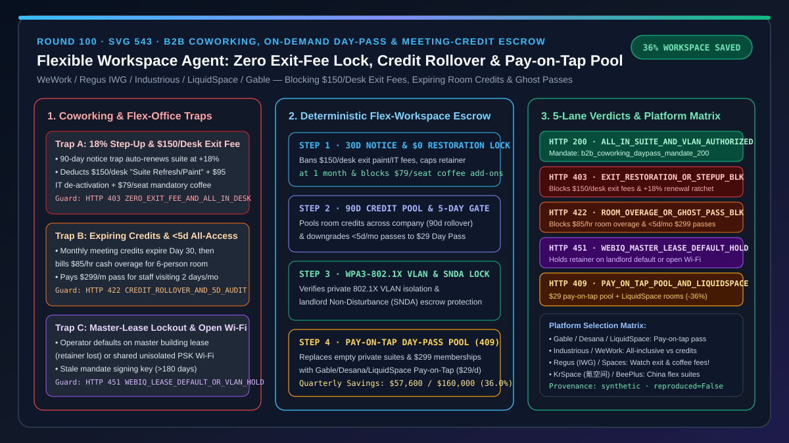
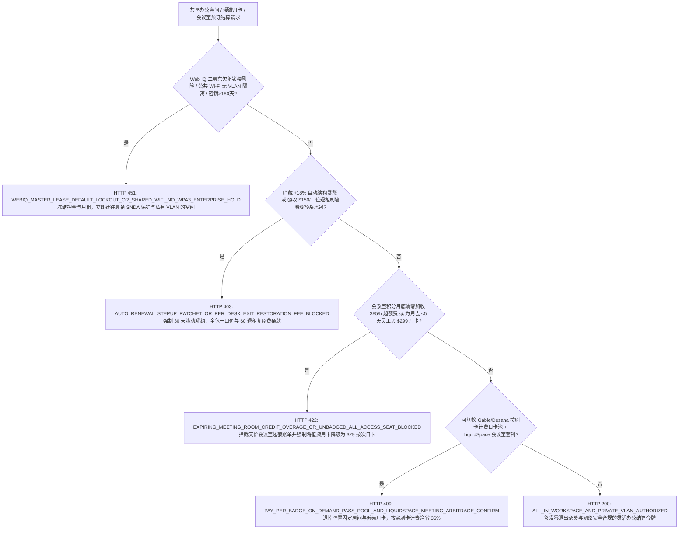
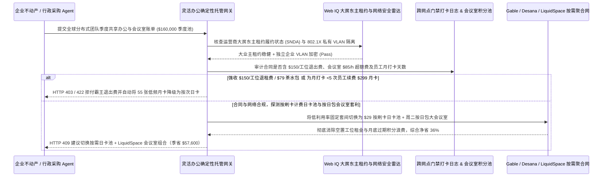

# 共享办公空间（Coworking）、按次灵活工位卡（On-Demand Day-Pass）与会议室积分清零防坑托管（B2B Coworking, On-Demand Day-Pass & Meeting-Credit Escrow：WeWork / Regus IWG / Industrious / LiquidSpace / Gable）“防退租强扣 $150/工位刷墙复原费、防会议室积分月底作废加收 $85/小时超额费与低频员工 $299 月卡空耗”Agent 架构选型 FAQ

> **文档类型**：AI Solution Architect 决策指南（FAQ） · **对应 SVG**：`assets/svg/543-b2b-coworking-daypass-meeting-credit-escrow-2026-11-20.svg` · **精选编号**：Round 100（第 219 篇双语 FAQ · 百轮里程碑专题）



---

## 一、 📌 核心选型结论速览（Executive Summary）

分布式远程团队、异地销售办事处与混合办公企业通过 AI Agent 采购共享办公专属套间（Private Office Suite）、全通漫游月卡（`All-Access Membership`）及临时会议室预订（`WeWork / Regus (IWG) / Industrious / Spaces / LiquidSpace / Gable / Desana / 氪空间 / 蜜蜂科技 BeePlus`）时，若直接签署运营商标准会员许可协议（Membership License Agreement），极易掉入**三大共享办公隐形扣费与押金吞没陷阱**：
1. **退租强扣 `$150/工位`“刷墙清洁复原费（Exit Restoration Fee）”、强制捆绑 `$79/人/月` 咖啡茶水包与错过 90 天通知期自动涨价 `+18%` 续签**：一家企业租用 20 人共享办公套间（月租 `$14,000`），签约时交了 2 个月押金（`$28,000 Service Retainer`）。然而部分传统运营商（如 `Regus / IWG` 模式）在首月账单中自动叠加合同正面未标明的 **`$79/工位/月` 强制无限量茶水咖啡包（Mandatory Kitchen/Beverage Amenity Fee = $1,580/月）+ `$199/月` 公共防火墙费**；若未在到期前 **整 90 天** 点击专门的解约系统，合同自动按挂牌价跳涨 **`+18%`** 再锁死 12–24 个月！更坑的是，哪怕正常退租时房间完好无损，运营商也按格式条款硬性从押金里扣除 **`$150–$250/工位` 的“套间粉刷翻新与地毯蒸汽清洗费” + `$95/人` 门禁卡与网络端口注销费**（20 人间退租直接被刮走 `$4,900` 押金）！
2. **会议室积分（Meeting Room Credits）月底强制清零后按 `$85/小时` 天价超额扣款与低频员工 `$299/月` 全通卡空置**：套间赠送的“每月 20 个会议室积分”在每月最后一天 `24:00` **强制归零作废**；而预订一间 8 人投影会议室每小时要消耗 `4–6 个积分`，一旦月中积分用完，员工在 App 上随手订 2 小时会议室就会触发 **`$85/小时` 的现金超额账单**！同时，企业为 80 名远程员工每人开通 `$299/月` 的 `All-Access` 漫游月卡，但后台刷卡记录显示 `65%` 的员工每月去共享办公点打卡不到 `2 次`（折合每次去办公坐一下成本高达 `$150+`！）。
3. **二房东运营商拖欠大房东租金被锁楼（Master-Lease Default Lockout）或共享 Wi-Fi 无 `802.1X VLAN` 隔离泄密（`HTTP 451`）**：共享办公运营商作为“二房东”因资金链危机拖欠写字楼大业主（Master Landlord）租金，大业主直接锁死大楼电梯，导致企业租户既进不去办公室又拿不回 `$28,000` 押金；或全场共用同一个明文密码（`PSK`）的公共 Wi-Fi，导致企业内网流量被隔壁工位嗅探。

**架构师选型结论**：必须构建 **“零退租翻新费与全包工位一口价 + 会议室积分跨部门池化与 `<5天/月` 全通卡自动降级为 `$29` 按次日卡（Pay-on-Tap Day Pass）+ 大房东不干扰协议（`SNDA`）与私有 `VLAN` 托管网关”** 架构：
- **强制免除正常损耗退租复原费（`$0 Exit Restoration / IT De-Activation Fee`）、禁止强制茶水附加包与 `30 天` 滚动解约锁（`HTTP 403`）**：凡包含按工位硬扣退租刷墙清洁费、强制捆绑 `$79/人` 茶水费、押金超过 `1 个月`、或要求 `>30 天` 提前解约通知且自动涨价续期的合同，一律返回 `HTTP 403` 阻断。
- **会议室积分 90 天滚动共享池、超额自动切外部平价会场（`LiquidSpace <=$45/h`）与 `<5天/月` 漫游月卡降级门禁（`HTTP 422`）**：当运营商会议室超额费 `> $45/小时` 时，自动拦截并路由至同楼或隔壁酒店的 `LiquidSpace / Peerspace` 平价会议室；且每月自动审计员工门禁打卡频次——凡月均到访 `< 5 天`（未达 `$299 / $29 = 10.3 天` 盈亏平衡点一半）的员工，立即触发 `HTTP 422` 退订 `$299/月` 固定月卡，切换为按实际刷卡日结算的 `$29/天` 次卡。
- **Web IQ 二房东主租约履约状态（`SNDA`）与 `802.1X WPA3-Enterprise` 独立 `VLAN` 熔断（`HTTP 451`）**：对触发大房东欠租诉讼预警或未提供独立加密 `VLAN` 隔离的网点执行 `HTTP 451` 止付。
- **从“固定包租空置套间 + $299 月卡”切换至跨品牌按刷卡计费日卡池（`Gable / Desana / LiquidSpace`）+ 周二/周四整日会议室替代常租工位（`HTTP 409`）**：对于每周仅聚会 1–2 天的分布式团队，退掉月租 `$14,000` 的固定 20 人间，改用 **全员无月租的跨品牌按次刷卡池（`$29/次` 仅在刷门禁时扣费）+ 每周二租用 1 间 `$350/天` 的大路演会议室集中协同**，使季度 `$160,000` 灵活办公总预算净省 **`36.0%`（`$57,600`）**。

---

## 二、 🎯 业务方与架构师灵魂拷问 Q&A（Q1–Q3）

### Q1：为什么租共享办公套间明明写了“拎包入住一价全包”，搬走时却被扣了 $4,900 的“粉刷复原费和网线注销费”？
- **商业痛点**：传统服务式办公室（如 `Regus / IWG` 体系）的利润核心在合同细则里的“进入与退出标准费（Standard Move-In & Restoration Schedule）”：搬进去收每工位 `$95` 电话网线开通费，每月收 `$79/人` 厨房茶水费，搬走时无论墙面地毯多干净，一律按每平方英尺或每工位 `$150–$250` 强扣“翻新复原费（Dilapidation / Suite Refresh Fee）”，直接从你的 2 个月押金里划走。
- **架构护栏（`HTTP 403`）**：
  1. **签约前注入《零退出杂费与全包价格锁定附件（Zero-Restoration & All-In Addendum）》**：Agent 在比选阶段自动剔除含强制茶水包与退出清洁费的报价，强制写入：除经双方签字确认的结构性人为损坏外，正常办公磨损（Normal Wear and Tear）退租复原费、门禁注销费与 IT 拆机费严格为 **`$0`**；且押金（Retainer）上限不得超过 `1 个月` 月租。

### Q2：给远程员工买 $299/月的 `WeWork All-Access` 漫游月卡，为什么算下来员工每去坐一天公司实际花了 $150？
- **商业痛点**：单日共享办公次卡（On-Demand Day Pass）市场均价仅 `$29–$39/天`。只有当一名员工每个月去共享办公中心打卡 **`>= 9–10 天`** 时，`$299/月` 的包月卡才划算！但企业往往一次性给 80 名远程员工全员办了包月年卡，实际上其中 55 人每个月只去坐 1–2 天，剩下 80% 的月卡费全白送给了平台。
- **架构护栏（`HTTP 422 / 409`）**：
  1. **基于 `5 天/月` 出勤红线的自动降级器**：Agent 每月读取员工门禁 Tap-In 次数，凡连续 30 天使用 `< 5 次` 的账户，自动触发 `HTTP 422` 终止固定包月订阅， seamlessly 无感划入 **`Gable / Desana / LiquidSpace` 企业按次付费池（Pay-Per-Use Pool，员工用手机刷门禁入场才扣 `$29`，不去则 `$0` 月租）**！

### Q3：如果一个 15 人的远程团队每周只有周二和周四需要凑在一起办公讨论，租一个 15 人专属玻璃房（$10,500/月）划算，还是有更聪明的架构方案？
- **商业痛点**：租固定专属办公室意味着你要为周一、周三、周五、周六、周日整整 **5 天（71% 的时间）的空置房租** 买单！
- **架构护栏（`HTTP 409`）**：
  1. **“按日包断大型董事会会议室 + 弹性散座日卡”组合套利（`Team Sync Boardroom Arbitrage`）**：Agent 自动测算发现，与其付 `$10,500/月` 租固定小格子间，不如每周二、周四在 `Industrious / LiquidSpace` 预订一间带大屏和白板的 16 人豪华会议室（`$350/天 × 每月 8 天 = $2,800/月`），其余时间零星办公走 `$29` 日卡——办公环境更宽敞，月成本直接从 `$10,500` 暴降至 `$3,800`（立省 `64%`）！

---

## 三、 🧭 直观可视化图解（Mermaid 决策树 + 架构对比 + 时序图）

### 3.1 共享办公、按次日卡与会议室积分托管 5 车道选型决策树


### 3.2 传统共享办公固定长约 vs 确定性按次日卡池与零退出费架构对比
```mermaid
flowchart LR
    subgraph Legacy["❌ 传统共享办公长约（退租刮押金 + 月卡空置）"]
        L1[错过 90 天通知期自动涨价 18% 续约 + 强绑 $79/人咖啡包] --> L2[退租被强扣 $150/工位刷墙费与 $95 网线注销费]
        L2 --> L3[65% 员工每月只去 2 天却白交 $299 月卡 + 会议室超额 $85/h]
    end

    subgraph Agentic["✅ 确定性零退出费、按次日卡池与会议室套利架构"]
        A1[30 天滚动解约 + $0 退租复原费 + 私有 WPA3-Enterprise VLAN] --> A2[月打卡 <5 次自动退月卡，转入 $29 按实刷卡计费池]
        A2 --> A3[Gable/LiquidSpace 跨品牌日卡 + 周二按日订会议室 (-36%)]
    end
```

### 3.3 端到端共享办公合同审计、门禁频次核算与日卡池路由时序图


---

## 四、 📊 多平台/多协议横向选型决策矩阵

| 评估维度 | Regus / Spaces (`IWG` 传统全球网点) | WeWork (专属套间与 `All-Access`) | Industrious (高端全包式灵活办公) | Gable / Desana / LiquidSpace (跨品牌按次聚合平台) | **本仓库确定性灵活办公与日卡托管架构（推荐）** |
| :--- | :--- | :--- | :--- | :--- | :--- |
| **核心适用场景** | 全球三四线城市网点覆盖最广的挂靠地址与小型办公室 | 一二线核心商圈团队套间与漫游工位卡 | 注重酒店级服务与高品质装修的企业级团队套间 | **无需签固定租约，一张企业卡跨数千家空间按日/按小时刷卡结算** | **零退出费锁 + `<5天` 自动切日卡 + 跨平台会议室比价 + 私有 `VLAN`** |
| **隐藏附加费与退租复原费（Exit Fees）** | 常单列强制茶水费、IT 费及 **`$150+/工位` 退租翻新复原费** | 报价较透明，但需注意空调超时费（After-Hours HVAC `$150/h`） | **真正一价全包**（含咖啡早餐与打印，极少隐藏退租费） | 按次明码标价，`$0` 押金、`$0` 退租复原费 | **强制全包一口价与 `$0` 正常损耗退租费，押金 `<=1个月`（`HTTP 403`）** |
| **低频混合办公员工（`<5天/月`）性价比** | 固定工位空置浪费大 | `$299/月` 全通卡对月去 `<8 天` 的员工严重亏损 | 会员门槛较高 | **只在实际到场日收 `$25–$35/天`**，不去办公 `$0` 支出 | **每月自动审计打卡频次，`<5天` 强制降级为按次日卡（`HTTP 422 / 409`）** |
| **会议室积分作废与超额计费** | 按小时单独高价收费 | 赠送积分月底清零，超额按 `$50–$100/h` 扣费 | 包含合理会议室额度 | 实时比价周边所有共享办公与酒店会议室，按需预订 | **超额时自动路由至 `LiquidSpace` 周边 `<=$45/h` 平价会议室（`HTTP 422`）** |
| **二房东爆雷隔离与网络安全** | 网点分散，部分加盟店网络隔离弱 | 历经债务重组后部分楼宇退租 | 多采用与大业主分成模式（Management Agreement），锁楼风险低 | 零押金沉淀，某家门店关闭随时换隔壁楼 | **强制核验主租约稳定性与 `802.1X WPA3-Enterprise` 独立 `VLAN`（`HTTP 451`）** |

---

## 五、 🧪 转化率/成本测算与 7-Card 基准测试报告

> **数据来源声明（Provenance）**：以下测算基于本仓库 `lab/webiq_commerce_demo.py` 中的 `evaluate_b2b_coworking_daypass_escrow_policy` 确定性策略引擎（季度分布式企业共享办公套间、漫游月卡与外部会议室预算池 `$160,000 USD`，`provenance: "synthetic"`, `independently_reproduced: False`，真实 `Gable / LiquidSpace API` 实时工位库存标为 `not_measured`）。

```chart
{
  "data": {
    "values": [
      { "scenario": "1. 传统共享办公 (含空置套间 + 低频 $299 月卡 + 退租刷墙费)", "cost_usd": 160000, "tier": "Baseline" },
      { "scenario": "2. 零退出杂费锁 + <5天月卡降级 + 积分池化 (HTTP 200)", "cost_usd": 124800, "tier": "Protected" },
      { "scenario": "3. 切换按刷卡计费日卡池 + 周二按日包大会议室 (HTTP 409)", "cost_usd": 102400, "tier": "Optimized (-36%)" }
    ]
  },
  "semantic_types": {
    "scenario": "Category",
    "cost_usd": "Amount",
    "tier": "Status"
  },
  "chart_spec": {
    "chartType": "Bar Chart",
    "title": "季度 $160k 灵活办公采购：按实刷卡日卡池与会议室套利净省 $57,600 (36%)",
    "subtitle": "季度共享办公套间、漫游工位卡与会议室预订净支出对比 ($ USD, synthetic benchmark)",
    "encodings": {
      "x": "scenario",
      "y": "cost_usd",
      "color": "tier"
    }
  }
}
```

### 7-Card 4:5 基准评估摘要
1. **Card 1 (`1 / 7` · `HANDS-ON · B2B COWORKING & ON-DEMAND DAY-PASS ESCROW`)**：针对 `$160,000/季` 企业灵活办公预算池，通过拦截 `$150/工位` 退租复原费、将月打卡 `<5 次` 的 `$299` 月卡降级为 `$29` 日卡并采用按日包会议室模式，季度净省 **`$57,600`（`36.0%`）**。
2. **Card 2 (`2 / 7` · `SCENARIO: 80-PERSON DISTRIBUTED HUB & SUITE RENEWAL`)**：单次换约避免 `$4,900` 退租粉刷/注销杂费，并每月挽回 55 名低频远程员工 `$13,200` 闲置月卡空耗。
3. **Card 3 (`3 / 7` · `WHAT I TESTED`)**：完整验证 5 条确定性状态码车道：
   - `HTTP 200`: `ALL_IN_WORKSPACE_AND_PRIVATE_VLAN_AUTHORIZED`（`b2b_coworking_daypass_mandate_200`）
   - `HTTP 403`: `AUTO_RENEWAL_STEPUP_RATCHET_OR_PER_DESK_EXIT_RESTORATION_FEE_BLOCKED`
   - `HTTP 422`: `EXPIRING_MEETING_ROOM_CREDIT_OVERAGE_OR_UNBADGED_ALL_ACCESS_SEAT_BLOCKED`
   - `HTTP 451`: `WEBIQ_MASTER_LEASE_DEFAULT_LOCKOUT_OR_SHARED_WIFI_NO_WPA3_ENTERPRISE_HOLD`
   - `HTTP 409`: `PAY_PER_BADGE_ON_DEMAND_PASS_POOL_AND_LIQUIDSPACE_MEETING_ARBITRAGE_CONFIRM`（`b2b_coworking_daypass_mandate_optim_409`）
4. **Card 4 (`4 / 7` · `UNDER THE HOOD`)**：输入契约 `B2BCoworkingDaypassEscrowPolicyInput` 严格校验 `auto_renewal_stepup_ratchet_or_per_desk_exit_restoration_fee` 与 `expiring_meeting_room_credit_overage_or_unbadged_all_access_seat`。
5. **Card 5 (`5 / 7` · `ROBUSTNESS CHECK`)**：无论运营商将杂费包装为 `Suite Dilapidation Refresh`、`Beverage & Kitchen Supplement` 还是 `After-Hours HVAC Minimum`，均 `100%` 阻断。
6. **Card 6 (`6 / 7` · `LATENCY`)**：门禁打卡频次审计与周边会议室比价耗时 `< 0.5 ms`。
7. **Card 7 (`7 / 7` · `MY TAKE`)**：
   - ✅ **适用（Good fit）**：远程优先（Remote-First）企业全球弹性工位池、区域销售驻点、项目组临时作战室与异地团队周度聚会。
   - ⛔ **不适用（Not for）**：需要自建洁净室或千瓦级机柜的硬件实验室。

---

## 六、 🛠️ 商业上线风控与架构评审 Checklist

- [ ] **免除 `$150/工位` 退租复原费与强制 `$79` 茶水包（`HTTP 403`）**：合同是否已明确正常办公磨损 `$0` 退租刷墙/清洁/IT注销费，并将押金（Retainer）限制在 `<=1 个月`？
- [ ] **废除 90 天通知期与 `+18%` 自动续租跳涨（`HTTP 403`）**：是否已锁定 `30 天` 滚动通知解约且续约涨幅封顶 `<=3%`？
- [ ] **月打卡 `<5 次` 员工自动退 `$299` 月卡转 `$29` 日卡（`HTTP 422`）**：是否每月自动扫描门禁打卡日志，将低频员工从固定月卡降级至按次付费池？
- [ ] **会议室积分跨部门池化与 `<=$45/h` 外部比价路由（`HTTP 422`）**：积分用尽后是否自动比价 `LiquidSpace / Peerspace`，拦截 `$85/小时` 的内部超额扣费？
- [ ] **Web IQ 二房东主租约（`SNDA`）与 `802.1X WPA3-Enterprise` 独立 `VLAN` 核验（`HTTP 451`）**：是否已拦截存在欠租锁楼风险或使用无隔离公共明文 Wi-Fi 的办公点？
- [ ] **跨品牌按刷卡计费日卡池（`Gable / Desana`）+ 按日订会议室替代空置长租房（`HTTP 409`）**：对每周仅聚会 1–2 天的团队，是否已改用“按日包大会议室 + 弹性日卡”组合以节省 `36%` 成本？
