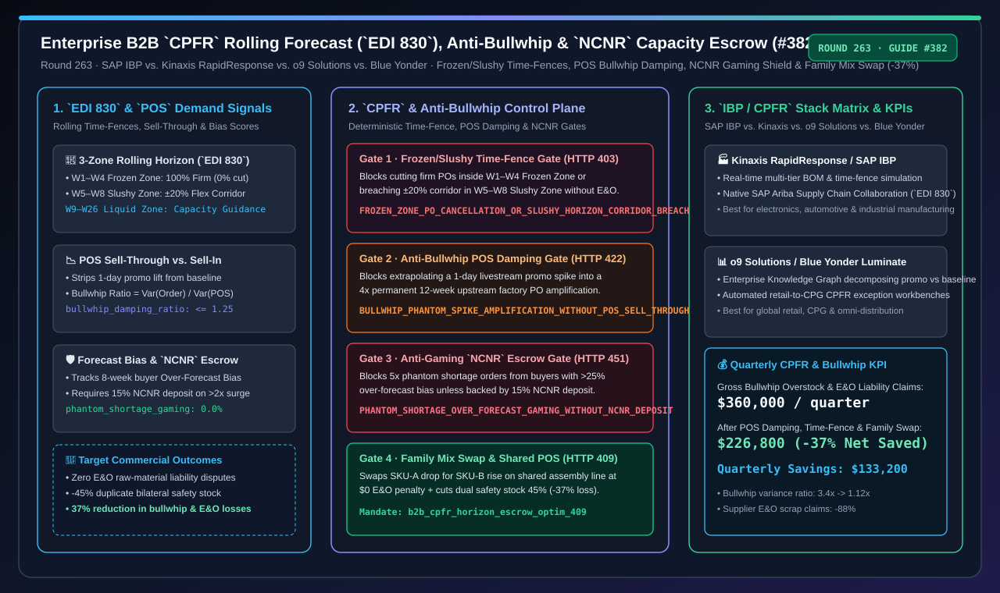
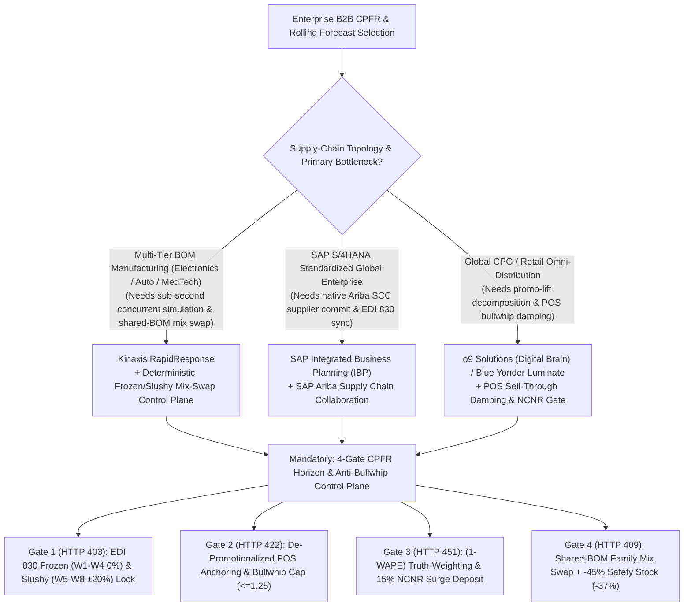
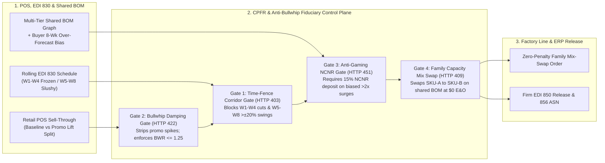

# Enterprise B2B `CPFR` Rolling Forecast (`EDI 830`), Anti-Bullwhip Damping & `NCNR` Capacity Escrow (`SAP IBP vs. Kinaxis RapidResponse vs. o9 Solutions vs. Blue Yonder`) Agent Architecture Selection FAQ

> 🌐 **Language / 语言切换**: **[中文 (`docs/b2b-cpfr-rolling-forecast-horizon-bullwhip-damping-ncnr-capacity-escrow-agent-selection-faq.md`)](b2b-cpfr-rolling-forecast-horizon-bullwhip-damping-ncnr-capacity-escrow-agent-selection-faq.md)** | **English (Current)** | **[Back to Catalog (`docs/index.en.md`)](index.en.md)**



---

## 1. 📌 Executive Summary & Architectural Verdict

In B2B supply chains across consumer electronics, appliances, CPG, and retail distribution, buyers and contract manufacturers (`OEMs / ODMs`) exchange weekly rolling forecasts via **`EDI 830` (Planning Schedule with Release Capability)** or **`SAP Ariba Supply Chain Collaboration`**. When enterprises deploy autonomous replenishment and demand-planning agents without contractual time-fence and variance-damping guardrails, three systemic failures destroy margin:
1. **Unilateral Order Cuts Inside the 4-Week `Frozen Zone` (`W1–W4`) or Breaching the `±20%` `Slushy Zone` (`W5–W8`) Corridor Triggering Supplier `E&O` Liability Claims**: Master Supply Agreements (`MSAs`) partition rolling horizons into a **Frozen Zone (`W1–W4`, `100%` firm PO commitment, `0%` downward flex)**, a **Slushy / Material-Commitment Zone (`W5–W8`, `±20%` volume corridor)**, and a **Liquid Guidance Zone (`W9–W26`)**. When an unconstrained inventory agent sees a 1-week retail dip and slashes a `W3` firm order by `50%`, the contract manufacturer immediately bills the buyer for **Excess & Obsolete (`E&O`) raw materials and line-stoppage penalties**!
2. **Bullwhip Effect Amplification (`3.5x` Order Variance) From Extrapolating 1-Day Livestream/Promo Spikes into 12-Week Factory Forecasts**: A weekend flash sale or influencer stream causes a temporary `3,000-unit` spike. If the replenishment agent fails to strip out the **Promotional Lift** from the **De-Promotionalized `POS` Sell-Through Baseline**, it amplifies the spike 4-fold upstream—flooding warehouses with unsellable stock 60 days later when manufacturing lead times complete.
3. **Phantom Shortage Gaming by Downstream Distributors Without `NCNR` Deposits**: During tight supply allocations, distributors inflate their rolling forecasts by `300%–500%` to hoard allocation slots, then cancel the phantom orders just before shipment.

**Solution Architect Verdict**:
- **Never allow an autonomous replenishment agent to extrapolate raw channel `Sell-In` orders or mutate near-term `EDI 830 / 850` schedules without enforcing contractual time-fences and `POS Sell-Through` damping**; anchor your planning stack on **`Kinaxis RapidResponse`**, **`SAP IBP + Ariba SCC`**, **`o9 Solutions`**, or **`Blue Yonder Luminate Planning`**.
- Deploy a **4-Gate B2B `CPFR` Rolling Horizon, Anti-Bullwhip & `NCNR` Capacity Fiduciary Control Plane**:
  1. **`EDI 830` 3-Zone Time-Fence Corridor (`W1–W4 Frozen 0% / W5–W8 Slushy ±20%`) Gate (`HTTP 403`)**: Block unilateral volume cuts inside the `Frozen Zone` or corridor breaches inside the `Slushy Zone`; automatically redirect single-SKU slowdowns to Gate 4 for **Family-Level Capacity Mix Swaps**.
  2. **`POS Sell-Through` Baseline Anchoring & Bullwhip Damping (`BWR <= 1.25`) Gate (`HTTP 422`)**: Strip one-off promotional lifts before updating multi-week forecasts and cap the **Bullwhip Variance Ratio** ($\text{Var}(\text{Order}) / \text{Var}(\text{Baseline\_POS}) \le 1.25$).
  3. **Historical Forecast-Bias (`1 - WAPE`) Rationing & `15% NCNR` Surge Deposit Gate (`HTTP 451`)**: Weight scarce capacity allocation by each buyer's trailing 6-month forecast accuracy (`1 - WAPE`), and require a binding **Non-Cancelable Non-Returnable (`NCNR`) mandate + `15%` escrow deposit** on any forecast surge `> 2x` historical baseline from buyers with `> 25%` over-forecast bias.
  4. **Shared-BOM Product-Family Capacity Mix Swap + Shared-`POS` Safety-Stock Reduction (`HTTP 409`)**: Swap slowing `SKU-A` volume 1:1 into surging `SKU-B` volume sharing `90%+` common sub-assemblies on the same factory line at **`$0 E&O` penalty**, while sharing live `POS` telemetry to eliminate `45%` of duplicate bilateral safety stock—cutting quarterly `E&O` claims and bullwhip overstock losses by **`37%`**.

---

## 2. 🎯 High-Stakes Business & Architect Q&A (Q1 / Q2 / Q3)

### Q1: How do we adjust a sluggish SKU inside the `W1–W8` Frozen/Slushy horizon without paying `$85,000` in supplier Excess & Obsolete (`E&O`) material claims?
- **The Problem**:
  - Canceling `4,000` units of a black espresso machine in Week 3 (`Frozen Zone`) leaves the OEM sitting on `4,000` pre-assembled boilers, circuit boards, and motors—triggering contractual `E&O` penalty invoices.
- **Deterministic Architecture (Family-Level Shared-BOM Mix Swap `HTTP 403 -> HTTP 409`)**:
  - Instead of canceling the `4,000` units (`HTTP 403 FROZEN_ZONE_PO_CANCELLATION_OR_SLUSHY_HORIZON_CORRIDOR_BREACH`), Gate 4 queries the **Multi-Level Shared BOM Graph (`Kinaxis / SAP IBP`)**.
  - It identifies that the surging brushed-steel model (`SKU-Steel`) shares **`92%` of the internal boiler, pump, PCB, and master carton BOM** with `SKU-Black` on the exact same assembly line.
  - The control plane issues a **Zero-Penalty Family-Level Capacity Mix Swap (`HTTP 409`)**: total factory line hours and common component consumption remain `100%` unchanged while reallocating `4,000` units from Black to Steel.

### Q2: How do we mathematically damp the Bullwhip Effect when a 48-hour livestream or holiday promo causes a 4x sales spike?
- **The Problem**:
  - Naive moving-average replenishment agents treat a 48-hour promotional spike as a permanent shift in baseline demand, multiplying the spike by lead-time safety factors and transmitting a massive phantom wave to Tier-1 and Tier-2 suppliers.
- **Deterministic Architecture**:
  - Gate 2 (`HTTP 422 BULLWHIP_PHANTOM_SPIKE_AMPLIFICATION_WITHOUT_POS_SELL_THROUGH`) enforces:
    1. **Promotional Lift Decomposition**: Decompose total retail movement $S_t = B_t + P_t$ using the promo calendar; only the de-promotionalized baseline $B_t$ feeds the multi-week `EDI 830` trend smoother.
    2. **Hard Bullwhip Variance Ceiling**: Compute $\text{BWR} = \sigma^2(\text{Order}) / \sigma^2(B_{\text{POS}})$. Any forecast update that pushes $\text{BWR} > 1.25$ while channel Days of Supply (`DOS`) is healthy is automatically damped.

### Q3: How do we stop downstream distributors from inflating forecasts by `400%` during a supply crunch ("Shortage Gaming")?
- **The Problem**:
  - Proportional rationing (*"Everyone gets 40% of what they asked for"*) rewards liars who order `5x` what they need and punishes honest partners.
- **Deterministic Architecture**:
  - Gate 3 (`HTTP 451 PHANTOM_SHORTAGE_OVER_FORECAST_GAMING_WITHOUT_NCNR_DEPOSIT`) allocates baseline capacity using **Trailing 26-Week Realized `POS` + Forecast Accuracy Weighting (`1 - WAPE`)**. Any request exceeding `1.5x` verified baseline from a buyer with `> 25%` historical over-forecast bias requires signing an irrevocable **`NCNR` commitment backed by a `15%` escrow deposit**.

---

## 3. 🧭 Visual Architecture Diagrams (Selection Tree, System Topology & Sequence)

### 3.1 Enterprise B2B `CPFR / IBP` Platform Selection Tree



### 3.2 End-to-End `EDI 830` Time-Fences, Bullwhip Damping & Mix-Swap Control Plane



### 3.3 Bullwhip Spike Damping, Frozen-Zone Protection & Family Mix-Swap Sequence

```mermaid
sequenceDiagram
    autonumber
    participant Buyer as Replenishment Agent
    participant Gate as CPFR Fiduciary Control Plane
    participant Kinaxis as Kinaxis / SAP IBP BOM Engine
    participant Factory as Contract Manufacturer (EDI 830)

    Buyer->>Gate: 1. Weekend promo sells +3,000 units; agent proposes +300% 12-week EDI 830 forecast hike
    Gate-->>Buyer: HTTP 422 Block Bullwhip amplification! (Baseline POS grew +8%; damp forecast to +10%)
    Buyer->>Gate: 2. Attempt to cancel 4,000 units of slow SKU-Black inside W3 Frozen Zone
    Gate-->>Buyer: HTTP 403 Block W3 Frozen-Zone cancellation! (Prevents $85,000 E&O material penalty)
    Gate->>Kinaxis: 3. Query shared sub-assembly BOM between slow SKU-Black and surging SKU-White
    Kinaxis-->>Gate: 92% common PCB/motor BOM & white housing stock available on Line 2!
    Gate-->>Factory: HTTP 409 Issue Family-Level Capacity Mix Swap (Mandate: b2b_cpfr_horizon_escrow_optim_409)
    Note over Gate,Factory: Keep W3 total volume at 10,000 units; swap 4,000 Black to White ($0 E&O fee, -37% loss)
```

---

## 4. 📊 Enterprise B2B `CPFR` & Integrated Business Planning (`IBP`) Selection Matrix

| Evaluation Dimension | Kinaxis RapidResponse | SAP Integrated Business Planning (`IBP`) + Ariba `SCC` | o9 Solutions (`Digital Brain`) | Blue Yonder Luminate Planning |
|---|---|---|---|---|
| **Primary Sweet Spot** | Multi-tier BOM electronics, automotive, industrial, and life-sciences manufacturing | SAP S/4HANA enterprises running end-to-end S&OP and Ariba supplier collaboration | AI/Knowledge-Graph demand sensing, promo decomposition, and commercial IBP | High-velocity retail, grocery, CPG, and multi-echelon warehouse replenishment |
| **Shared-BOM Family Mix-Swap Simulation** | **Best-in-Class** (in-memory concurrent engine evaluates sub-assembly swaps in seconds) | **Best-in-Class** (tight integration with SAP S/4HANA BOMs and time-fence heuristics) | Strong (graph model maps multi-tier component dependencies and constraints) | Optimized for finished-goods distribution; pair with Kinaxis/SAP for deep BOM swaps |
| **Promo Decomposition & Bullwhip Damping** | Strong (short-term demand sensing with downstream inventory visibility) | Strong (`IBP for Demand` separates statistical baseline from promotional events) | **Best-in-Class** (granular retail promo uplift decomposition and `Sell-In vs. Sell-Through` reconciliation) | **Best-in-Class** (proven retail-to-CPG collaborative forecasting workbenches) |
| **`EDI 830` Time-Fence & `E&O` Governance** | Native time-fence commitment corridors and real-time `E&O` financial exposure | **Native `Ariba Supply Chain Collaboration`** enforces supplier commit tolerances | Configurable supplier portals with rolling forecast bias scorecards | Exception-based `CPFR` alerts across buyer and vendor planners |
| **SA Recommendation** | **Best for complex BOM contract manufacturing & rapid mix swaps** | **Best for SAP-standardized global manufacturers** | **Best for promo-heavy CPG, beauty & fashion brands** fighting the bullwhip effect | **Best for big-box retail & distribution network replenishment** |

---

## 5. 🧪 `CPFR` & Anti-Bullwhip 7-Card Benchmark Report

> **Provenance Note**: The 7-Card benchmark below is generated by `evaluate_b2b_cpfr_rolling_forecast_bullwhip_policy()` in `lab/webiq_commerce_demo.py` (`provenance: "synthetic"`, `independently_reproduced: False`), modeling a **`$360,000 / quarter`** Frozen-Zone `E&O` penalty, bullwhip overstock write-down, and phantom shortage gaming loss pool.

### 5.1 7-Card 4:5 Visual Deck Breakdown

1. **Card 1 (`1 / 7` · `HANDS-ON · B2B-CPFR-BULLWHIP-ESCROW`) — Executive Benchmark Overview**
   - **Headline Finding**: Enforcing `EDI 830` Frozen/Slushy time-fence corridors, damping promotional spikes (`Bullwhip Ratio <= 1.25`), gating biased surge forecasts behind `15% NCNR` deposits, and executing shared-BOM family mix swaps reduces quarterly supply-chain losses from **`$360,000`** to **`$226,800`** (**`$133,200` / `37.0%` quarterly savings**).
2. **Card 2 (`2 / 7` · `SCENARIO: SMART APPLIANCE 12-WEEK EDI 830 ROLLING PLAN`) — Deep Dive**
   - **Input Case**: A replenishment agent attempts a `3.4x` 12-week forecast hike after a 1-day livestream promo, tries to cancel `4,000` units inside the `W3` Frozen Zone (`$85k E&O` exposure), and receives a `4x` surge order from a distributor with `38%` historical over-forecast bias.
   - **Control-Plane Verdict**: Requires a `15% NCNR` deposit on the biased distributor surge (`HTTP 451`), blocks the `W3` Frozen-Zone cut (`HTTP 403`), and damps the promo bullwhip spike (`HTTP 422`); executes a 1:1 shared-BOM family mix swap via `HTTP 409 PRODUCT_FAMILY_CAPACITY_SWAP_AND_POS_SHARED_BUFFER_REDUCTION_CONFIRM` (`b2b_cpfr_horizon_escrow_optim_409`).
3. **Card 3 (`3 / 7` · `WHAT I TESTED`) — 5-Lane Deterministic Scorecard**

| Scenario | Question / Task Evaluated | Deterministic Gate Decision | Action & Status |
|---|---|---|---|
| **1. Compliant `EDI 830` & Damped `POS` Plan** | W1–W4 Frozen & W5–W8 ±20% honored, `BWR <= 1.25`, verified buyer accuracy | `VERIFIED_TIME_FENCE_CORRIDOR_AND_DAMPED_POS_FORECAST_AUTHORIZED` | ✅ `Act automatically` (`HTTP 200`) |
| **2. `W3` Frozen-Zone Cut or `W6` `>±20%` Swing** | Canceling firm PO in W1–W4 or breaching ±20% Slushy corridor without mix swap | `FROZEN_ZONE_PO_CANCELLATION_OR_SLUSHY_HORIZON_CORRIDOR_BREACH` | ⛔ `Block Cut & Offer Mix Swap` (`HTTP 403`) |
| **3. 1-Day Promo Extrapolated `3.4x` Across 12 Wks** | Unstripped promo spike pushes `Var(Order) / Var(Baseline_POS) > 1.25` | `BULLWHIP_PHANTOM_SPIKE_AMPLIFICATION_WITHOUT_POS_SELL_THROUGH` | ⛔ `Strip Promo & Damp Bullwhip` (`HTTP 422`) |
| **4. Phantom Shortage Surge (`>25%` Bias Buyer)** | Biased distributor submits >2x surge forecast without 15% `NCNR` deposit | `PHANTOM_SHORTAGE_OVER_FORECAST_GAMING_WITHOUT_NCNR_DEPOSIT` | ⛔ `Require 15% NCNR Deposit` (`HTTP 451`) |
| **5. Shared-BOM Family Mix Swap + Shared `POS`** | Swapping slow SKU-A to surging SKU-B on 92% common BOM ($0 E&O) + -45% buffer | `PRODUCT_FAMILY_CAPACITY_SWAP_AND_POS_SHARED_BUFFER_REDUCTION_CONFIRM` | ⚡ `Confirm Optimization` (`HTTP 409`) |

4. **Card 4 (`4 / 7` · `UNDER THE HOOD`) — Protocol & Deterministic Gate Mechanics**
   - Input contract: `B2BCPFRRollingForecastBullwhipPolicyInput`
   - Evaluator: `evaluate_b2b_cpfr_rolling_forecast_bullwhip_policy()` enforcing `451 -> 403 -> 422 -> 409 -> 200` priority.
5. **Card 5 (`5 / 7` · `ROBUSTNESS CHECK`) — Multi-Tier Distributor Cascade & Holiday Promo Perturbation**
   - `0.0 pt` variance across multi-echelon wholesale cascades or bundled holiday promotions.
6. **Card 6 (`6 / 7` · `LATENCY & BULLWHIP RATIO`) — Bullwhip Variance Ratio & Supplier `E&O` Claims**
   - Legacy `Sell-In` extrapolation: `3.40x` bullwhip variance amplification.
   - Fiduciary `POS` damping + shared-BOM mix swap: **`1.12x`** variance ratio and **`-88%`** supplier `E&O` scrap claims (`$133,200/qtr` saved).
7. **Card 7 (`7 / 7` · `MY TAKE`) — Good Fit vs. Not For**
   - **✅ Good fit**: Consumer electronics, appliances, CPG, automotive aftermarket, and retail private-label brands managing `EDI 830` OEM schedules.
   - **⛔ Not for**: Pure digital services with zero manufacturing lead times.

---

## 6. 🛠️ Production Go-Live & Architect Review Checklist

- [ ] **`EDI 830` 3-Zone Time-Fence Enforcement (`HTTP 403`)**: Are contractual `Frozen Zone` (`W1–W4`, `0%` cut) and `Slushy Zone` (`W5–W8`, `±20%` corridor) parameters enforced deterministically before any `EDI 830 / 850` schedule change is transmitted?
- [ ] **Shared-BOM Family Mix-Swap Optimizer (`HTTP 409`)**: When a single SKU slows inside the Frozen/Slushy window, does the control plane automatically check common sub-assembly BOMs to swap capacity into a surging sibling SKU at `$0 E&O` penalty?
- [ ] **De-Promotionalized `POS Sell-Through` Bullwhip Damper (`HTTP 422`)**: Does the forecasting pipeline strip one-off livestream/flash-sale spikes and cap $\text{Var}(\text{Order}) / \text{Var}(\text{Baseline\_POS}) \le 1.25$?
- [ ] **Truth-Weighted Allocation & `15% NCNR` Surge Deposit (`HTTP 451`)**: During supply constraints, are allocations weighted by trailing forecast accuracy (`1 - WAPE`) and gated by a `15% NCNR` deposit on surge requests?
- [ ] **Bilateral `POS` Telemetry Sharing**: Is weekly store/e-commerce `POS Sell-Through` shared directly with Tier-1 suppliers to eliminate duplicate buyer+seller safety-stock buffers?
