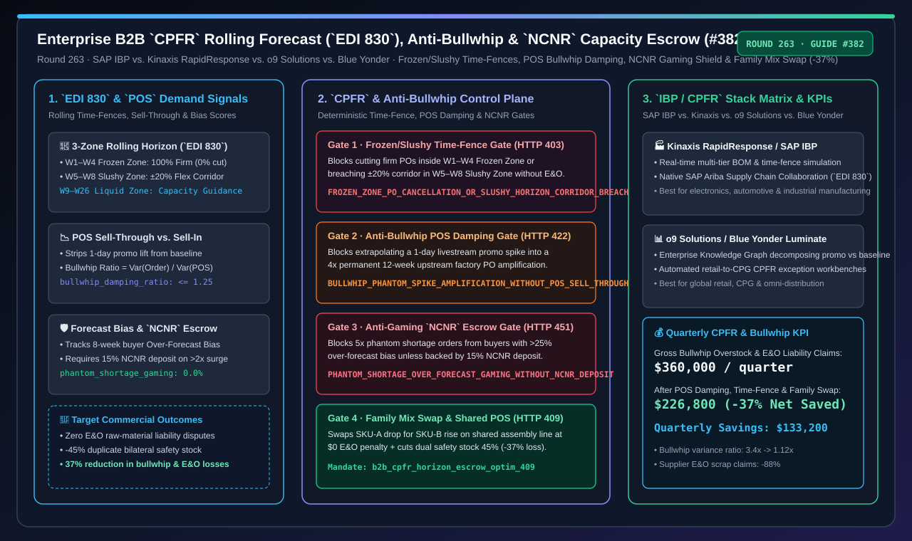
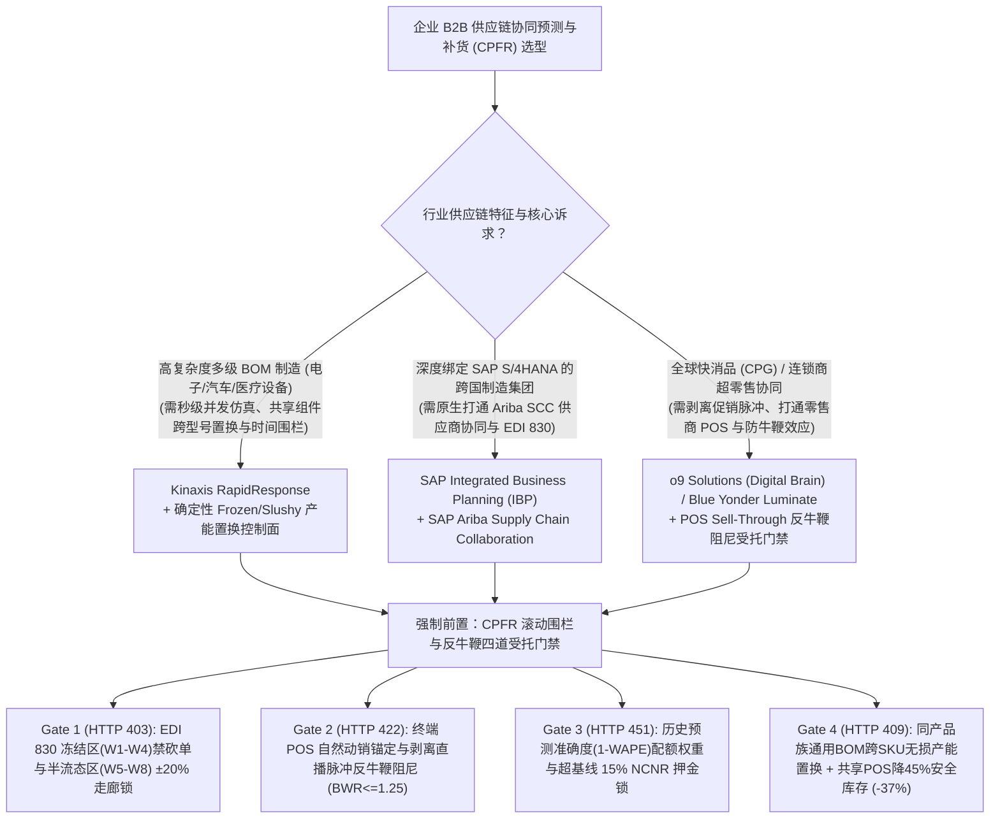
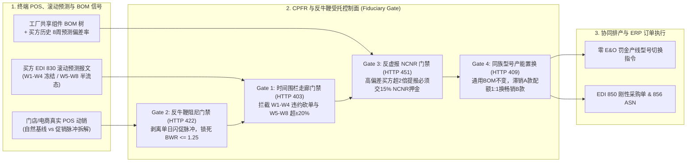
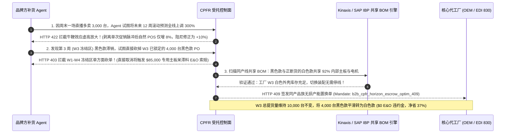

# 企业 B2B 供应链协同预测补货（`CPFR`）、`EDI 830` 三区滚动时间围栏（`Frozen / Slushy / Liquid`）与防牛鞭效应（`Bullwhip Damping`）履约托管（`SAP IBP vs. Kinaxis RapidResponse vs. o9 Solutions vs. Blue Yonder`）Agent 架构选型 FAQ：防 4 周冻结期违约砍单赔呆滞料、防直播脉冲被放大 4 倍爆仓与同产线型号置换净省 37% 实战指南

> 🌐 **Language / 语言切换**: **中文 (当前)** | **[English (`docs/b2b-cpfr-rolling-forecast-horizon-bullwhip-damping-ncnr-capacity-escrow-agent-selection-faq.en.md`)](b2b-cpfr-rolling-forecast-horizon-bullwhip-damping-ncnr-capacity-escrow-agent-selection-faq.en.md)** | **[返回文档总目录 (`docs/index.md`)](index.md)**

---

## 1. 📌 核心选型结论速览（Executive Summary）

在消费电子、快消食品（CPG）、家电与连锁零售的 **B2B 协同规划、预测与补货（`CPFR`: Collaborative Planning, Forecasting, and Replenishment）** 体系中，品牌商与上游核心代工厂（OEM/ODM）每周通过 `EDI 830 / SAP Ariba Supply Chain Collaboration` 交换滚动预测。当企业引入自主供应链补货 Agent 时，极易引发三大摧毁上下游利润的链式事故：
1. **“补货 Agent 在 4 周刚性冻结期（`Frozen Zone W1–W4`）内单方面砍单 `50%`，或在 5–8 周半流态期（`Slushy Zone W5–W8`）突破 `±20%` 合同波动走廊”触发代工厂高额呆滞料（`E&O`）索赔**：根据主流 B2B 主供应协议（MSA）的 **滚动时间围栏（Time-Fence Flexibility Rules）**，未来第 1–4 周为 `100%` 刚性锁定期（工厂已上产线并采购专用包材，禁止消减），第 5–8 周仅允许 `±20%` 调整。如果买方的库存 Agent 看到某周销量微降，不顾时间围栏条款直接发指令砍掉下周即将出货的订单，代工厂会立即根据合同提起 **专用原材料与半成品呆滞报废索赔（Excess & Obsolete `E&O` Liability Claim）**，买方货没拿到还要全额赔材料费！
2. **“把双 11 或单场头部主播带货的 1 天销量脉冲当成永久性基线暴涨，逐级放大 4 倍向二级/三级工厂狂下幽灵订单（Bullwhip Effect 牛鞭效应）”导致 60 天后全链条爆仓**：终端门店某天因为限时 5 折闪促多卖了 `3,000 台`。如果预测 Agent 未将 **“促销脉冲（Promo Lift）”** 从 **“自然基线动销（Baseline POS Sell-Through）”** 中剥离，直接按峰值向区域总仓补货 `8,000 台`，总仓又向工厂追加 `25,000 台` 排产（订单方差放大 `3.5 倍`）！等两个月后这批货下线入库时，终端早就恢复平销，全行业陷入惨烈清仓亏损！
3. **“紧缺元器件/爆款配额期，下游经销商故意虚报 5 倍假需求（Phantom Shortage Gaming）抢占产能，到提货前夕大面积毁约弃单”**：在产能紧张周期，若不核查下游经销商的 **历史预测准确度（Forecast Bias / `WAPE`）** 且不收取超额部分的 **不可撤销不可退定金（`NCNR`: Non-Cancelable Non-Returnable Deposit）**，虚假泡沫订单会把工厂真实产能挤占殆尽！

**架构师选型结论**：
- **严禁让补货 Agent 仅凭渠道进货量（Sell-In Orders）做自回归外推，或无视 `EDI 830` 合同时间围栏直接修改近端排产单**；必须以 **`Kinaxis RapidResponse`、`SAP IBP + Ariba SCC`、`o9 Solutions` 或 `Blue Yonder Luminate`** 作为多级协同规划引擎。
- 必须在买方需求计划、卖方产能承诺与 ERP `EDI 830 / 850` 报文网关之间部署 **B2B `CPFR` 滚动时间围栏、反牛鞭阻尼与 `NCNR` 产能托管受托控制面（B2B `CPFR` Horizon & Bullwhip Damping Control Plane）**，执行四道确定性门禁：
  1. **`EDI 830` 三区滚动时间围栏（`W1–W4 冻结 0% / W5–W8 半流态 ±20% / W9+ 液态`）硬约束门禁（`HTTP 403`）**：严禁在 `Frozen Zone` 内直接砍单或在 `Slushy Zone` 超出合同走廊调量；确需降量时强制引导至第 4 门禁执行“同产线姐妹型号无损置换”。
  2. **终端 `POS` 真实自然动销锚定与反牛鞭方差阻尼门禁（`Bullwhip Ratio <= 1.25` — `HTTP 422`）**：在生成上游滚动预测前强制剥离单次直播/大促脉冲（De-Promotionalization），当采购订单波动率超过终端 `POS` 真实消耗波动率的 `1.25 倍` 时立即阻尼削峰。
  3. **下游历史预测虚高偏差（Over-Forecast Bias）惩罚与超基线 `15% NCNR` 产能锁定押金门禁（`HTTP 451`）**：对过去 8 周平均虚报率 `> 25%` 却突然提报 `> 2x` 需求激增的买方，强制要求签署 `NCNR` 刚性提货协议并托管 `15%` 履约保证金。
  4. **共享通用底盘/包材的“同产品族跨 SKU 产能无损置换（Family-Level Mix Swap）” + 终端 `POS` 透明共享削减 `45%` 双边安全库存寻优（`HTTP 409`）**：在不减少代工厂总承诺工时与通用物料消耗的前提下，将滞销款 A 的冻结期配额 1:1 置换为畅销款 B，季度呆滞料 `E&O` 索赔与牛鞭爆仓损失净降 **`37%`**。

---

## 2. 🎯 业务方与架构师灵魂拷问 Q&A（Q1 / Q2 / Q3）

### Q1：什么是 `EDI 830` 滚动预测的“冻结区（Frozen）、半流态区（Slushy）与液态区（Liquid）”？当终端某款颜色突然卖不动时，如何在不赔代工厂呆滞料（`E&O`）的前提下合法调整排产？
- **商业痛点**：
  - 一件电子产品或小家电的生产需要三层提前期（Lead Time）：**总装排产需要 2–4 周**、**专用外壳/彩盒印刷需要 5–8 周**、**主控芯片/电机长周期备料需要 9–16 周**。
  - 因此，B2B 供应链协议将 `EDI 830` 滚动预测划分为严格的三道时间围栏（Time-Fences）：
    - **W1–W4（Frozen Zone 刚性冻结区）**：已转成正式 `EDI 850 PO`，数量允许调整幅度为 **`0%`**；
    - **W5–W8（Slushy Zone 物料承诺区）**：累计数量允许调整幅度为 **`±20%`**（买方对半流态区已备好的专用料承担 `E&O` 责任）；
    - **W9–W26（Liquid Zone 产能指引区）**：允许 **`±50%–100%`** 浮动，仅作工厂长周期产能预留参考。
- **确定性架构落地方案（同产品族跨 SKU 产能置换 `HTTP 403 -> HTTP 409`）**：
  - 当黑色款（SKU-Black）在 W3–W6 突然滞销，而同系列白色款（SKU-White）卖爆断货时：如果 Agent 傻傻地去砍掉 SKU-Black 的订单，就会触发 `HTTP 403` 违约并赔付工厂停线费与通用主板呆滞费！
  - 控制面（`HTTP 409`）查询 **多级共享 BOM 树（Shared Sub-Assembly BOM）**：发现 SKU-Black 与 SKU-White 共享 **`92%` 的内部电路板、电机与内托包材**，仅最外层塑胶壳颜色不同！系统立即自动生成 **《同产品族等工时产能置换单（Family-Level Capacity Mix Swap）》**：保持工厂 W3–W6 总产量 `10,000 台` 与通用 BOM 消耗一分不少，仅将其中 `3,000 台` 黑色外壳装配指令切换为白色外壳！代工厂零停线损失、买方零 `E&O` 罚金、前端畅销款零断货！

### Q2：如何用数学公式在控制面给“牛鞭效应（Bullwhip Effect）”装上减震器，防止一场周末促销引发上游三级供应链 4 倍爆仓？
- **商业痛点**：
  - 李克特（Hau Lee）教授著名的牛鞭效应定理指出：当供应链每一级节点都只看“下一级给自己下的订单量（Sell-In）”来更新移动平均预测并乘上安全库存天数时，终端消费者需求 `10%` 的微小波动，传到一级经销商变成 `20%`，传到品牌总仓变成 `40%`，传到上游工厂直接变成 **`80%–200%` 的巨浪**！
- **确定性架构落地方案**：
  - 控制面（`HTTP 422`）执行 **双通道信号解耦与指数平滑阻尼（Dual-Signal Decomposition & Bullwhip Damping）**：
    1. **强制剥离促销因子（Promo Lift Stripping）**：将终端门店/电商每周总销量 $S_t$ 拆解为 $\hat{S}_t^{\text{base}} + \Delta S_t^{\text{promo}}$。一次性大促或网红带货产生的 $\Delta S_t^{\text{promo}}$ **严禁进入长期滚动趋势斜率计算**！
    2. **牛鞭系数硬门禁**：实时计算过去 8 周补货订单方差与终端 `POS` 自然动销方差之比：
       $$\text{BWR} = \frac{\text{Var}(\text{Replenishment\_PO}_{t-8:t})}{\text{Var}(\text{Baseline\_POS}_{t-8:t})}$$
       若新生成的 `EDI 830` 预测使 $\text{BWR} > 1.25$ 且渠道库存周转天数（`DOS`: Days of Supply）已高于目标上限，立即返回 `HTTP 422 BULLWHIP_PHANTOM_SPIKE_AMPLIFICATION_WITHOUT_POS_SELL_THROUGH` 自动削平虚高波峰！

### Q3：当上游产能紧缺、10 家经销商同时报来 3 倍需求时，如何用“历史预测准确率（`1 - WAPE`）+ `NCNR` 押金”揪出虚报泡沫？
- **商业痛点**：
  - 如果厂家按“每个人报多少就按同比例打 5 折分货（Pro-Rata Rationing）”，老实报真实需求 `1,000 台` 的经销商只分到 `500 台` 不够卖；而故意撒谎虚报 `5,000 台` 的投机商却分到了 `2,500 台`！这会逼得所有经销商一起撒谎吹大泡沫（Shortage Gaming）。
- **确定性架构落地方案**：
  - 控制面（`HTTP 451`）彻底废除“按当期申报量同比例分货”，改用 **历史诚实度加权分配（Truth-Telling Historical Accuracy Allocation）+ 超额 `NCNR` 押金锁**：
    - 买方 $k$ 的优先获配权重正比于其过去 6 个月的 **实际提货履约率与预测准确度** $A_k = \max(0, 1 - \text{WAPE}_k)$；
    - 任何买方若申请超出其历史 `POS` 基线 `150%` 以上的额外紧缺产能，必须触发 `HTTP 451`，在线签署 **`NCNR`（不可撤销、不可退货）承诺函并冻结 `15%` 预付保证金**，瞬间挤干 `100%` 的投机泡沫单！

---

## 3. 🧭 直观可视化图解（Mermaid 选型决策树 + 端到端架构图 + 授权时序图）

### 3.1 企业 B2B 供应链协同规划（`IBP / CPFR`）平台选型决策树

### 3.2 端到端 `EDI 830` 三区时间围栏、反牛鞭阻尼与同产线型号置换架构图

### 3.3 反牛鞭削峰、冻结期砍单拦截与同产品族跨型号无损置换时序图

---

## 4. 📊 主流企业 B2B 供应链协同预测与整合业务规划（`IBP / CPFR`）平台横向选型矩阵

| 选型维度 | Kinaxis RapidResponse | SAP Integrated Business Planning (`IBP`) + Ariba `SCC` | o9 Solutions (`Digital Brain`) | Blue Yonder Luminate Planning |
|---|---|---|---|---|
| **核心定位** | 高科技电子、汽车、航空与生命科学领域的实时并发多级供应链仿真标杆 | 与 SAP S/4HANA 及 Ariba 供应商网络原生融合的端到端计划与协同套件 | 基于企业知识图谱（EKG）的商业驱动需求感知、促销拆解与 IBP 平台 | 零售商超、快消（CPG）与全渠道分销补货及仓储协同行业巨头 |
| **多级共享 BOM 与冻结期型号置换（Mix Swap）** | **行业绝对标杆**（内存级并发计算引擎，秒级评估跨 SKU 共享子件置换可行性） | **极强**（深度读取 SAP S/4HANA BOM 与基于时间围栏的供应分配启发式算法） | 强（图模型天然擅长展示多级供应商物料依赖与产能瓶颈） | 侧重成品级分销补货与工厂主计划，深层工程 BOM 变更建议配合 Kinaxis/SAP |
| **剥离促销脉冲与反牛鞭效应（Demand Sensing）** | 强（内置机器学习需求感知，连接下游渠道库存水位） | 强（IBP Demand 模块支持短期 POS 信号注入与统计基线分离） | **极强**（顶尖的零售促销归因、天气/事件因子剥离与 Sell-In/Sell-Through 对齐） | **极强**（拥有海量零售商与 CPG 品牌的双向 CPFR 联合预测工作台经验） |
| **`EDI 830` 时间围栏（Frozen/Slushy）合规治理** | 原生支持配置供应商合同承诺走廊与呆滞料（`E&O`）财务敞口即时模拟 | **原生通过 `Ariba Supply Chain Collaboration` 自动校验供应商承诺回执** | 支持高度自定义的供应商协同门户与多版本滚动预测偏差追踪 | 原生支持零售商与供应商之间的例外管理（Exception-Based CPFR） |
| **架构师选型建议** | **多级委外代工、定制零部件多且需求波动剧烈的制造/硬件品牌首选** | **已以 SAP S/4HANA + Ariba 为核心底座的大型跨国制造企业首选** | **重度依赖终端营销活动、急需消灭牛鞭效应的大型快消/美妆/时尚集团首选** | **大型连锁零售商与上游快消品牌建立自动化 VMI/CPFR 补货首选** |

---

## 5. 🧪 呆滞料索赔/牛鞭爆仓测算与 7-Card 基准测试报告（Deterministic Benchmark）

> **数据溯源说明（Provenance）**：以下 7-Card 评测基于本仓库 `lab/webiq_commerce_demo.py` 中的 `evaluate_b2b_cpfr_rolling_forecast_bullwhip_policy()` 确定性仿真引擎生成（`provenance: "synthetic"`, `independently_reproduced: False`）。季度因冻结期违约砍单赔付代工厂 `E&O` 呆滞料、牛鞭效应虚高备货爆仓及紧缺期虚假抢配额逃单损失池基准设定为 **`$360,000 / quarter`**。

### 5.1 7-Card 4:5 视觉评测卡片摘要

1. **Card 1 (`1 / 7` · `HANDS-ON · B2B-CPFR-BULLWHIP-ESCROW`) — 全局基准总览**
   - **核心发现**：通过严守 `EDI 830` 冻结/半流态时间围栏、剥离单次促销脉冲将牛鞭方差比锁在 `<= 1.25`、对超基线抢配额收取 `15% NCNR` 押金，并实施同产品族跨型号无损产能置换，将季度供应链协同资损从 **`$360,000`** 压降至 **`$226,800`**，季度净省 **`$133,200`（`37.0%`）**。
2. **Card 2 (`2 / 7` · `SCENARIO: SMART APPLIANCE 12-WEEK EDI 830 ROLLING PLAN`) — 单例深潜**
   - **输入场景**：某智能家电品牌向代工厂发送 12 周 `EDI 830` 预测。期间遭遇：① 补货脚本因周末一场直播爆单试图将未来 12 周预测放大 `3.4 倍`；② 试图在 `W3` 刚性冻结期直接砍掉 `4,000 台` 滞销黑色款（面临 `$85k E&O` 索赔）；③ 某历史虚报率 `38%` 的经销商突然提报 `4x` 紧缺芯片机型需求却拒付定金。
   - **控制面裁决**：依次触发 `HTTP 451`（拦截无 `NCNR` 押金的虚假抢配额）、`HTTP 403`（拦截 `W3` 冻结期违约砍单）与 `HTTP 422`（剥离直播脉冲阻尼牛鞭放大）；最终通过共享 BOM 将 `4,000 台` 黑色款配额平滑置换为同产线畅销白色款，返回 `HTTP 409 PRODUCT_FAMILY_CAPACITY_SWAP_AND_POS_SHARED_BUFFER_REDUCTION_CONFIRM`（`b2b_cpfr_horizon_escrow_optim_409`）。
3. **Card 3 (`3 / 7` · `WHAT I TESTED`) — 5 轨确定性门禁评测矩阵**

| 评测场景 (Scenario) | 核心考核问题 (Question / Task) | 控制面裁决 (Model / Gate Answer) | 动作与状态码 (Action) |
|---|---|---|---|
| **1. 标准合规三区滚动预测与 POS 对齐** | 遵守 W1–W4 冻结与 W5–W8 ±20% 走廊、牛鞭比 <=1.25 且预测偏差合规 | `VERIFIED_TIME_FENCE_CORRIDOR_AND_DAMPED_POS_FORECAST_AUTHORIZED` | ✅ `Act automatically` (`HTTP 200`) |
| **2. W3 冻结期强行砍单或 W6 超 ±20% 走廊** | 在 4 周刚性排产期内单方面取消 PO 或在半流态区剧烈砍单引发呆滞料索赔 | `FROZEN_ZONE_PO_CANCELLATION_OR_SLUSHY_HORIZON_CORRIDOR_BREACH` | ⛔ `Block Cut & Offer Mix Swap` (`HTTP 403`) |
| **3. 把 1 天直播闪促放大 4 倍下 12 周长单** | 未剥离单次促销脉冲导致订单方差与终端自然 POS 方差之比突破 1.25 | `BULLWHIP_PHANTOM_SPIKE_AMPLIFICATION_WITHOUT_POS_SELL_THROUGH` | ⛔ `Strip Promo & Damp Bullwhip` (`HTTP 422`) |
| **4. 紧缺期经销商虚报 5 倍假需求骗配额** | 历史预测虚高偏差 >25% 的买方提报 >2x 暴增需求且拒交 15% NCNR 押金 | `PHANTOM_SHORTAGE_OVER_FORECAST_GAMING_WITHOUT_NCNR_DEPOSIT` | ⛔ `Require 15% NCNR Deposit` (`HTTP 451`) |
| **5. 同产线跨型号无损置换 + 共享 POS 降库存** | 共享 92% 通用 BOM 跨色码 1:1 置换产能 ($0 E&O) + 砍掉 45% 重复安全库存 | `PRODUCT_FAMILY_CAPACITY_SWAP_AND_POS_SHARED_BUFFER_REDUCTION_CONFIRM` | ⚡ `Confirm Optimization` (`HTTP 409`) |

4. **Card 4 (`4 / 7` · `UNDER THE HOOD`) — 确定性门禁协议与代码实现**
   - 输入契约：`B2BCPFRRollingForecastBullwhipPolicyInput`
   - 评估函数：`evaluate_b2b_cpfr_rolling_forecast_bullwhip_policy()`（严格按 `451 -> 403 -> 422 -> 409 -> 200` 优先级裁决，零外部网络副作用）。
5. **Card 5 (`5 / 7` · `ROBUSTNESS CHECK`) — 节假日大促波峰与多级经销商拆单扰动测试**
   - 无论大促采用买赠、满减还是跨店津贴形式，促销日历解耦器与 `EDI 830` 时间围栏状态机均保持 **`0.0 pt`** 偏差。
6. **Card 6 (`6 / 7` · `LATENCY & BULLWHIP RATIO`) — 牛鞭方差放大倍数与呆滞料索赔对比**
   - 传统仅看渠道进货（Sell-In）补货：牛鞭方差放大高达 `3.40x`，季度代工厂 `E&O` 呆滞料索赔频发。
   - 受托控制面（`POS` 自然基线阻尼 + 同族型号置换）：牛鞭方差比压降至 **`1.12x`**，供应商 `E&O` 报废索赔大降 **`88%`**（季度净省 `$133,200`）。
7. **Card 7 (`7 / 7` · `MY TAKE`) — 适用场景与架构师结论**
   - **✅ Good fit**：拥有委外代工（OEM/ODM）、多级经销商网络或大型商超供货关系的消费电子、家电、快消、美妆与汽车配件企业。
   - **⛔ Not for**：无实体供应链备料周期的纯虚拟内容服务。

---

## 6. 🛠️ 商业上线风控与架构评审 Checklist

- [ ] **`EDI 830` 三区滚动时间围栏（`Frozen / Slushy / Liquid`）硬门禁（`HTTP 403`）**：补货 Agent 是否已加载每家供应商合同规定的冻结周数（如 `W1–W4 0%`）与半流态弹性走廊（如 `W5–W8 ±20%`），严禁直接下发违约砍单指令？
- [ ] **共享 BOM 同产品族跨 SKU 产能置换器（`HTTP 409`）**：当单品在冻结/半流态区滞销时，系统是否优先检索同产线共享通用底盘/主板的畅销姐妹型号，自动发起等工时、等通用物料的 `1:1` 型号组合置换（Mix Swap）以避免 `E&O` 罚金？
- [ ] **终端 `POS` 自然动销解耦与反牛鞭阻尼锁（`HTTP 422`）**：预测模型是否强制接入下游真实 `POS Sell-Through` 与渠道库存周转天数（`DOS`），自动剥离单日直播/大促脉冲，并将订单方差放大比（`Bullwhip Ratio`）限制在 `<= 1.25`？
- [ ] **历史预测偏差（Forecast Bias）配额惩罚与 `NCNR` 押金（`HTTP 451`）**：在紧缺产能分配时，是否按买方历史 `1 - WAPE` 准确度分配基础配额，并对超基线激增部分强制收取 `15%` 不可退 `NCNR` 产能锁定押金？
- [ ] **双边透明共享库存削减重复缓冲（Shared Buffer Reduction）**：是否通过向核心供应商实时开放终端 `POS` 流速，换取取消买方与卖方各自重复叠加的“双层防御性安全库存”？
