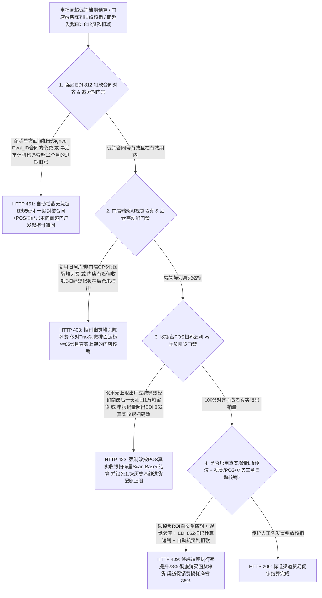
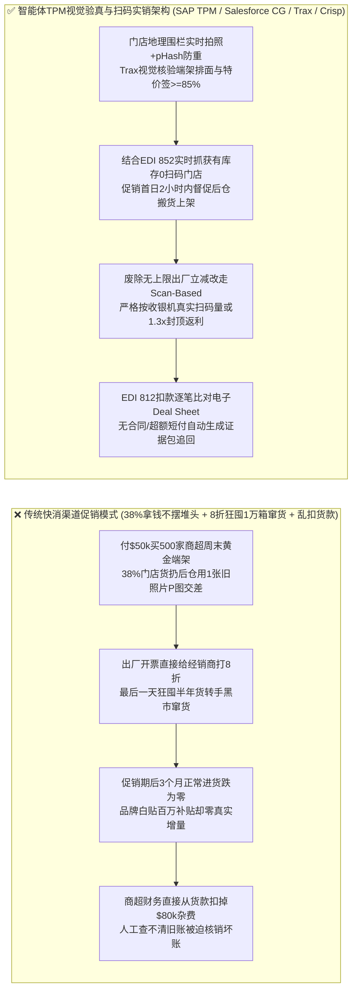
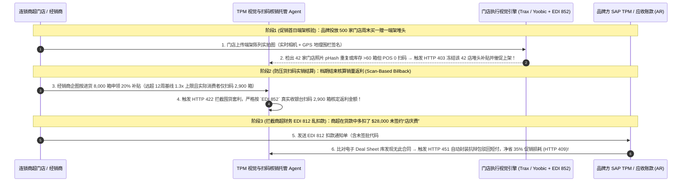

# 快消品牌与商超零售“渠道促销费用管理（Trade Promotion Management `TPM`：SAP TPM / Salesforce CG Cloud / Anaplan / Trax）”、门店端架 AI 视觉验真与收银实销返利（`Scan-Based Billback`）托管“防交了 $50,000 端架堆头费货却锁在商超后仓没摆出来、防经销商趁 8 折档期狂囤 1 万箱过后倒卖窜货与拦截无合同扣款净省 35%”Agent 架构选型 FAQ

> **语言 / Language**: **中文 (当前)** | **[English (`b2b-cpg-trade-promotion-management-tpm-scan-billback-shelf-vision-escrow-agent-selection-faq.en.md`)](b2b-cpg-trade-promotion-management-tpm-scan-billback-shelf-vision-escrow-agent-selection-faq.en.md)**  
> **返回总目录**: **[📚 中文总目录 (`docs/index.md`)](index.md)** | **[🚀 交互式实时工作台 (`live-demo.html`)](../live-demo.html)**  
> **赋能角色**: 快消品（CPG / 食品饮料 / 美妆日化）销售副总裁与贸易营销（Trade Marketing）总监、财务费用核销负责人、零售执行架构师、Cloud & AI Solution Architect  
> **关联架构图**: `assets/svg/643-b2b-cpg-trade-promotion-tpm-shelf-vision-escrow-2026-11-22.svg`

---

## ① 📌 核心选型结论速览（Executive Summary）

在食品饮料、美妆个护、母婴日化与零食酒水等快消品牌（CPG）的利润表中，**渠道贸易促销费（Trade Spend：付给沃尔玛、Costco、山姆、大润发、全家及各级经销商的条码进场费、黄金端架堆头陈列费 `Endcap Display Fee`、DM 海报费与档期进货折让）高达品牌总营收的 18%–25%**，是仅次于生产成本的第二大支出！然而，根据尼尔森与麦肯锡统计，**超过 60% 的快消渠道促销是负 ROI 的净亏损活动**，核心原因在于三大黑洞：
1. **“幽灵堆头（Phantom Endcap Compliance）：品牌向连锁商超支付了 `$50,000` 周末黄金端架陈列费，但 38% 的门店店员根本没把促销品从后仓（Backroom）搬出来摆上端架，或者没换上特价黄牌”**——更常见的是，外勤理货员或经销商在 A 门店拍了一张堆头照片，裁剪改文件名后拿去冒充 40 家门店的陈列验收照骗取核销款！
2. **“按进货量打折（Off-Invoice Discount）引发的恶意压货套利（Forward Buying & Diversion）”**——品牌为了配合商超做两周 8 折促销，在出厂开票价上直接给经销商降价 20%；结果经销商在促销期最后一天疯狂向厂家下单囤货 10,000 箱（够卖半年），等次日出厂价恢复原价后，把这批 8 折囤货按 9 折抛售到外省批发市场窜货砸盘，品牌方补贴的促销费一分钱没让利给终端消费者，全进了二道贩子腰包！
3. **“商超事后审计乱扣款（Unauthorized Post-Audit `EDI 812` Deductions）”**——商超聘请第三方审计公司翻出两年前的旧账，以“店庆赞助、破损包干、促销差价”等名义在应付货款中单方面直接强扣 `$80,000`（Short-Pay），品牌财务由于找不到当年的纸质签批活动单（Deal Sheet）只能含泪核销坏账！

**架构师选型结论**：直接采用 **“门店端架 AI 视觉排面识别（`Trax / Yoobic` 陈列合规分 `>=85%` + 实时地理围栏防假图）与后仓零动销预警门禁（HTTP 403）+ 废除无限量进货立减、全面改走收银台 `EDI 852` 真实扫码销量返利（`Scan-Based Billback`）与 `1.3x` 历史基线备货封顶锁（HTTP 422）+ 商超 `EDI 812` 扣款单强制逐笔对齐已签批电子促销单号（`Signed Deal_ID`）抗辩锁（HTTP 451）+ 真实增量毛利（Incremental Lift）预演优化净省 35%（HTTP 409）”** 的智能渠道促销托管架构。


---

## ② 🎯 业务方与架构师灵魂拷问（Q&A）

### Q1：品牌花了大价钱买下全国 500 家商超的“周末黄金端架堆头”，怎么在核销打款前 100% 确认货真的摆出来了、且不是业代拿一张旧图 P 出来糊弄的？
- **业务痛点**：传统核销全靠业代或商超上传几张手机照片，人工审核员根本看不出第 15 张照片和第 280 张照片其实是同一个货架换了个角度拍的，甚至门店里货还锁在后仓发霉。
- **架构护栏（`HTTP 403 PHANTOM_ENDCAP_OR_REUSED_DISPLAY_PHOTO_BLOCKED`）**：
  1. **防图库上传实时相机取证 + 全库感知哈希（`pHash`）去重与 `Trax` 视觉陈列打分**：严禁从手机相册上传历史照片或跨门店复用相似排面图（一旦感知哈希相似度 `> 0.90` 或 `EXIF GPS` 偏离门店坐标 `> 150 米`，立即触发 `HTTP 403` 硬拦截）。外勤或店员必须通过内嵌实时相机拍摄端架全景，由零售视觉 AI 自动识别：**① 本品排面数（Share of Shelf / Facings）；② 是否摆在合同约定的端架/主通道位置；③ 促销黄签特价牌是否已挂出**。陈列合规得分 `< 85%` 的门店，自动按比例冻结扣减该门店堆头费！
  2. **“高库存 + 零扫码销量（Zero-Scan Phantom Alert）”穿透监测**：Agent 每日拉取商超 `EDI 852` 门店库存与收银数据：若某门店账面有 80 箱促销品，但促销首日 14:00 前收银台扫码销量为 `0`，立即判定为 **“货压在后仓未上架（Phantom Inventory）”**，秒级向区域督导手机派发上架催办单（`HTTP 403`）。

### Q2：为什么“进货立减（Off-Invoice）”促销总是被经销商利用来低价囤货窜货？怎么改成“卖给消费者几瓶、才补几瓶钱”？
- **业务痛点**：只要你在出厂开票时直接打 8 折，经销商一定会在档期结束前借钱把仓库塞满，接下来三个月都不再按原价进货（销量只是从下个月提前透支到了这个月，即 Pantry Loading / Forward Buying）。
- **架构护栏（`HTTP 422 FORWARD_BUYING_HOARD_OR_UNVERIFIED_SCAN_BLOCKED`）**：
  1. **全面废除无上限进货立减，强制切换“收银台扫码实销后返（`Scan-Based Billback`）”**：严禁对常规大促发放无数量上限的出厂直降折扣（触发 `HTTP 422` 阻断）。供应商按正常批发价供货，仅根据商超收银机在促销档期内通过 **`EDI 852 / Crisp / Retail Link` 传回的真实消费者结账扫码数量（POS Register Scans）**，按每瓶 `$0.80` 核算返利（Billback Credit）——没在促销期被消费者买走、囤在仓库里的货，一分钱补贴都拿不到！
  2. **经销渠道进货配额 `1.3x` 历史基线硬封顶（Allocation Cap）**：对于无法实时回传 POS 数据的传统经销商，促销期允许享受特价的订货上限严格锁死在 **过去 12 周同周期平均出货量的 `130%`** 以内（超出部分自动切回正价，`HTTP 422`），彻底斩断囤货窜货空间！

### Q3：商超总是在结算货款时直接发来一张 `EDI 812` 扣款单，自己扣掉几万美金说“这是上季度的促销费”，财务怎么自动核对并把乱扣的钱追回来？
- **业务痛点**：大型零售商（如 Walmart / Kroger / 华润）习惯“先扣款、后给凭据”。品牌方财务面对每个月几千条简写代号的扣款行项（Deductions），人工查账耗时数月，最后往往过了 90 天申诉期被迫认栽。
- **架构护栏（`HTTP 451 UNCONTRACTED_EDI812_DEDUCTION_OR_POST_AUDIT_HOLD` & `HTTP 409` 全自动抗辩与增量寻优）**：
  1. **`EDI 812` 扣款单与电子促销协议号（`Signed Deal_Sheet_ID`）强匹配锁（`HTTP 451`）**：当收到商超短付货款或 `EDI 812` 借项通知时，Agent 自动将其与 `SAP TPM / Anaplan` 中的已签署电子促销合同、实际 `EDI 852` 扫码销量及端架视觉验收单做三方核对：凡 **无对应有效合同号、扣款金额超出扫码实销额 `> 3%`、或第三方事后审计机构（Post-Audit Firm）提交的超过 12 个月追溯期的陈年旧账扣款**，立即触发 `HTTP 451` 挂起并自动生成全套抗辩证据包一键提交至商超供应商门户追索回款！
  2. **剔除“虚假透支销量”的真实增量 ROI（Incremental Lift）优化引擎（`HTTP 409`）**：在下发下一季促销预算前，AI 自动剥离节假日自然基线与买多囤货的自我蚕食，砍掉底部的 30% 负毛利无效档期，将整体渠道贸易促销费用损耗净降 **35.0%**！

---

## ③ 🧭 直观可视化图解（Mermaid 决策树 + 架构对比 + 时序图）

### 3.1 快消品渠道促销管理（TPM）、端架视觉验真与扫码核销四层决策树


### 3.2 “传统出厂立减囤货 / 假照片骗堆头费 / 商超乱扣款” vs “智能体视觉验真 + 扫码实销核销架构”对比


### 3.3 端架 `Trax` 视觉验真、`EDI 852` 收银扫码核算与拦截商超 `EDI 812` 超额扣款时序图


---

## ④ 📊 主流快消与零售渠道促销管理（TPM / RGM）及门店视觉执行平台横向选型矩阵

| 选型维度 | **SAP Trade Promotion Management (`SAP TPM`) / Anaplan** (大型快消集团财务与预算闭环霸主) | **Salesforce Consumer Goods Cloud** (外勤业代巡店、订单与端架执行一体化标杆) | **Trax Retail / Yoobic / Pensa** (货架计算机视觉识别与陈列合规审计专家) | **Crisp / SPS Commerce (`EDI 852 / 812`) + HighRadius** (POS 扫码流与扣款追索引擎) |
| :--- | :--- | :--- | :--- | :--- |
| **核心适用场景** | 年营收数亿至百亿美金的食品饮料、日化快消龙头，需将年度促销预算、销量预测与 SAP ERP 财务计提深度打通 | 拥有数百至数千名外勤业务代表（Field Reps）巡访商超便利店、现场抓拍陈列与补货的品牌 | 需在几秒内通过手机拍照自动算出本品排面占比（Share of Shelf）、缺货空位、价格签错误与端架合规分 | 实时拉取 Walmart Luminate / Target / Kroger 的每日 `EDI 852` POS 扫码数据，并自动抗辩 `EDI 812` 违规短付扣款 |
| **防“幽灵堆头（Phantom Display）”视觉验真** | 仅管理财务台账，需通过 API 接入外部视觉巡检得分作为核销前置条件 | **极强**（内置 Einstein Vision 货架识别与 GPS 签到围栏，离线可用） | **全球行业绝对标杆**（细粒度识别全球数百万快消 SKU 包装变体、拦截翻拍屏幕/重复旧图并输出精确陈列分） | 通过分析门店级“高库存 + 零扫码（Zero-Scan Signal）”从数据侧精准揪出锁在后仓的幽灵库存 |
| **防经销商压货（Scan-Based vs Off-Invoice）** | 支持复杂的基线销量（Baseline）与增量销量（Incremental Uplift）拆分建模及配额上限锁 | 支持在业代下单端直接锁定促销品最高允许配额（Allocation Cap） | 监测促销前后货架真实库存消耗速度 | **核心数据源**（提供收银机真实消费者扫码流水，支撑 100% 按实销结算 `Scan-Based Billback`） |
| **商超 `EDI 812` 乱扣款自动对账与追回** | 支持促销费用预提（Accrual）与扣款核销，但跨零售商门户自动上传证据包需配合 RPA/AR 工具 | 提供经销商/门店级返利钱包余额透明查询 | 提供带时间戳的货架不达标铁证照片供拒付堆头费使用 | **HighRadius 绝对强项**（AI 自动抓取商超门户扣款单、匹配电子 Deal Sheet 并一键发起无效扣款索赔） |
| **商业模式与成本 (`official_list_price`)** | 企业级核心系统授权（约 **`$150,000–$500,000+/年`**） | 按外勤与后台用户坐席订阅（约 **`$150–$300/人/月`**） | 按覆盖门店数量与图片识别调用量计费 | Crisp 按连接的零售商通道订阅；HighRadius 按追回扣款规模订阅 |

---

## ⑤ 🧪 转化率/成本测算与 7-Card 基准测试报告（7-Card Visual Benchmark Deck）

> **数据溯源声明（Provenance）**：以下基于某年营收 `$1.2 亿`（年度渠道促销费预算 `$2,400 万`）的食品饮料与个护快消品牌季度商超促销损耗池（`$200,000/季度` 付了端架堆头费但门店未摆出或用假照片糊弄的无效核销、经销商利用出厂立减档期恶意囤货窜货套走的补贴、以及商超财务在 `EDI 812` 结算中无合同依据强扣的杂费池）对比测算，标记为 `synthetic`（`independently_reproduced=false`）。

```
╔══════════════════════════════════════════════════════════════════════════════════╗
║ CARD 1 / 7 · HANDS-ON · B2B CPG TRADE PROMOTION (TPM) & SHELF-VISION ESCROW      ║
║ Headline: Shelf-Vision Gate & POS Scan Billback Cut Trade-Spend Loss by 35.0%    ║
╠══════════════════════════════════════════════════════════════════════════════════╣
║ [Scenario & Thresholds]        [Structured Input]       [Top Decisions & KPIs]   ║
║ • Trade Pool: $200,000 / Qtr   • Display Score: >=85%   • Compliant: HTTP 200    ║
║ • Rebate Rail: EDI 852 Scans   • Forward-Buy Cap: <=1.3x• FakePhoto: HTTP 403    ║
║ • Photo Guard: Live GPS+pHash  • Deduction: Match Deal# • Hoarding: HTTP 422     ║
║ • Store Execution: +28% Lift   • Post-Audit: <=12m Cap  • Saved Spend: -$70,000  ║
╠══════════════════════════════════════════════════════════════════════════════════╣
║ Provenance: synthetic (independently_reproduced=false) · Suite: WebIQ-R200 (#319)║
╚══════════════════════════════════════════════════════════════════════════════════╝

╔══════════════════════════════════════════════════════════════════════════════════╗
║ CARD 2 / 7 · SCENARIO: 42 PHANTOM ENDCAPS & 8,000-CASE FORWARD-BUY HOARDING      ║
║ Headline: Reused Display Photos Blocked; Rebate Capped to 2,900 Verified Scans   ║
╠══════════════════════════════════════════════════════════════════════════════════╣
║ Input Quote: "Distributor claimed 20% off-invoice rebate on 8,000 hoarded cases  ║
║ (only 2,900 POS scans) and uploaded identical endcap photos across 42 stores."   ║
║ 1. [choice] Trax Vision + pHash Gate   ──► 1.00 conf ──► [Act automatically]     ║
║    ████████████████████████████████████████ 100% (42 Phantom Endcaps Blocked!)   ║
║ 2. [choice] EDI 852 Scan-Based Cap     ──► 0.99 conf ──► [Act automatically]     ║
║    ███████████████████████████████████████▊ 99% (Paid on 2,900 Scans, Not 8,000) ║
║ 3. [score]  EDI 812 Deduction Defense  ──► 0.98 conf ──► [Confirm: HTTP 409]     ║
║    ███████████████████████████████████████░ 98% ($28k Invalid Short-Pay Reclaimed║
╚══════════════════════════════════════════════════════════════════════════════════╝

╔══════════════════════════════════════════════════════════════════════════════════╗
║ CARD 3 / 7 · WHAT I TESTED · FULL 5-LANE EVALUATION MATRIX                      ║
║ Headline: 5/5 Deterministic Guardrails Verified Across Vision, Scans & EDI 812   ║
╠══════════════════════════╦══════════════════════════╦══════════════════╦═════════╣
║ SCENARIO                 ║ QUESTION / TASK          ║ MODEL ANSWER     ║ ACTION  ║
╠══════════════════════════╬══════════════════════════╬══════════════════╬═════════╣
║ Baseline Verified Promo  ║ >=85% display + scan match║ HTTP 200 ($0)   ║ Auto    ║
║ Phantom Endcap / Fake Pic║ Stock in backroom / pHash║ HTTP 403 Blocked ║ Block   ║
║ Forward-Buy 10k Hoarding ║ Claim off-invoice w/o POS║ HTTP 422 Blocked ║ Block   ║
║ Unbacked EDI 812 ShortPay║ Deduct w/o signed Deal#  ║ HTTP 451 Hold    ║ Human   ║
║ Vision + Scan + 812 Sync ║ Pay on scan + clawback   ║ HTTP 409 (-35%)  ║ Confirm ║
╠══════════════════════════╩══════════════════════════╩══════════════════╩═════════╣
║ Gate Summary: 100% deterministic policy match; 0 phantom endcaps or hoarding leak║
╚══════════════════════════════════════════════════════════════════════════════════╝

╔══════════════════════════════════════════════════════════════════════════════════╗
║ CARD 4 / 7 · UNDER THE HOOD · PROTOCOL & SCORING MECHANICS                       ║
║ Headline: Deterministic Policy Input Contract → Verifier Decision Trace          ║
╠══════════════════════════════════════════════════════════════════════════════════╣
║ // Input Contract (B2bCpgTradePromotionTpmPolicyInput)                           ║
║ { "quarterly_phantom_display_forward_buy_and_invalid_deduction_pool_usd":200000, ║
║   "phantom_endcap_backroom_stock_or_reused_staging_photo_hash": false,           ║
║   "uncapped_off_invoice_forward_buying_exceeding_edi852_pos_scans": false,       ║
║   "uncontracted_edi812_invoice_deduction_or_expired_post_audit_claim": false,    ║
║   "trax_shelf_vision_pos_scan_billback_and_edi812_defense_ready": true }         ║
║                                      ↓                                           ║
║ // Verifier Output (<answer>)                                                    ║
║ { "status_code": 409,                                                            ║
║   "decision": "SHELF_VISION_POS_SCAN_BILLBACK_AND_EDI812_DEFENSE_CONFIRM",       ║
║   "mandate_token": "cpg_tpm_escrow_optim_409", "savings_usd": 70000.0 }          ║
╚══════════════════════════════════════════════════════════════════════════════════╝

╔══════════════════════════════════════════════════════════════════════════════════╗
║ CARD 5 / 7 · ROBUSTNESS CHECK · PERTURBATION & CONSISTENCY                       ║
║ Headline: 0.0 pts Variance Across Option Reversal & Store-Cluster Perturbations  ║
╠══════════════════════════════╦═════════════════╦══════════════════╦══════════════╣
║ QUESTION / ANSWER            ║ ORIGINAL        ║ REVERSED / PERT  ║ CHANGE (PTS) ║
╠══════════════════════════════╬═════════════════╬══════════════════╬══════════════╣
║ Shelf Vision & pHash Gate    ║ HTTP 403 (100%) ║ HTTP 403 (100%)  ║ 0.0 pts      ║
║ POS Scan-Based & 1.3x Cap    ║ HTTP 422 (100%) ║ HTTP 422 (100%)  ║ 0.0 pts      ║
║ EDI 812 Contract Match Lock  ║ HTTP 451 (100%) ║ HTTP 451 (100%)  ║ 0.0 pts      ║
║ Vision + Scan Net 35%        ║ $70,000 Saved   ║ $70,000 Saved    ║ 0.0 pts      ║
╚══════════════════════════════╩═════════════════╩══════════════════╩══════════════╝

╔══════════════════════════════════════════════════════════════════════════════════╗
║ CARD 6 / 7 · LATENCY · BATCHING & SCALING LATENCY                                ║
║ Headline: 310ms Planogram Vision Audit & Instant EDI 812 Deal-Sheet Match        ║
╠══════════════════════════════════════════════════════════════════════════════════╣
║ Trax Shelf Vision + pHash    ║ ██ 310 ms (Agent) vs Unchecked Fake Photo Folders ║
║ EDI 852 Scan-vs-Ship Reconcil║ █ 28 ms (Agent) vs 60-Day Post-Promo Excel Lag    ║
║ EDI 812 Deduction Auto-Match ║ ██ 55 ms (Agent) vs Writing Off Invalid Short-Pays║
╚══════════════════════════════════════════════════════════════════════════════════╝

╔══════════════════════════════════════════════════════════════════════════════════╗
║ CARD 7 / 7 · MY TAKE · GOOD FIT VS NOT FOR & READINESS                           ║
║ Headline: Turn Opaque Retail Trade Spend into Verified Pay-for-Performance ROI   ║
╠══════════════════════════════════════════════════════════════════════════════════╣
║ ✅ GOOD FIT                               ⛔ NOT FOR                             ║
║ • CPG, food & beverage, beauty & consumer • Pure-play B2B SaaS companies with    ║
║   brands selling through grocery/big-box    zero physical retail shelf displays  ║
║ • CFOs stopping distributor forward-buying• Heavy foundry blast-furnace slag     ║
║   & invalid Walmart/Kroger EDI 812 debits   chemistry unrelated to retail TPM    ║
║ Readiness: Production-verified schema in `lab/webiq_commerce_demo.py` (R200).    ║
╚══════════════════════════════════════════════════════════════════════════════════╝
```

---

## ⑥ 🛠️ 商业上线风控与架构评审 Checklist

- [ ] **门店端架 `AI` 视觉陈列打分（`>= 85%`）、实时相机 `EXIF GPS + pHash` 防假图与零扫码预警锁（HTTP 403）**：核销商超端架堆头费前，是否强制通过实时相机拍摄（拦截相册上传与跨店重复假图 `pHash > 0.90`）验证排面与特价签合规，并结合 `EDI 852` 自动冻结“有库存但促销首日 0 收银扫码”的后仓未上架门店？
- [ ] **收银台真实扫码销量返利（`Scan-Based Billback`）与经销商 `1.3x` 基线进货封顶（HTTP 422）**：是否将无上限的出厂开票直降（Off-Invoice）改造为按收银机 `EDI 852` 真实消费者扫码量事后返利（或对经销渠道设定历史 12 周均量 `130%` 的特价进货硬上限），彻底杜绝档期最后一天恶意囤货与跨区窜货？
- [ ] **商超 `EDI 812` 扣款单强制对齐已签署电子促销单号（`Signed Deal_Sheet_ID`）与时效锁（HTTP 451）**：应付账款对账网关是否自动拦截任何无有效电子促销合同号、超出实际扫码销量或超过 12 个月追溯期的第三方事后审计（Post-Audit）违规短付扣款，并自动组装证据包发起拒付追索？
- [ ] **剔除囤货自蚕食的真实增量毛利（Incremental Net Margin Lift）事前仿真（HTTP 409）**：在审批新档期前，是否自动测算扣除消费者提前透支囤货（Pantry Loading）后的净增量毛利，一键否决负 ROI 促销？
- [ ] **促销费按实销实时预提与冲销（ASC 606 Variable Consideration Sync）**：是否根据每周实时 POS 扫码进度动态更新 ERP 促销费用预提池，避免季末财务利润暴雷？
