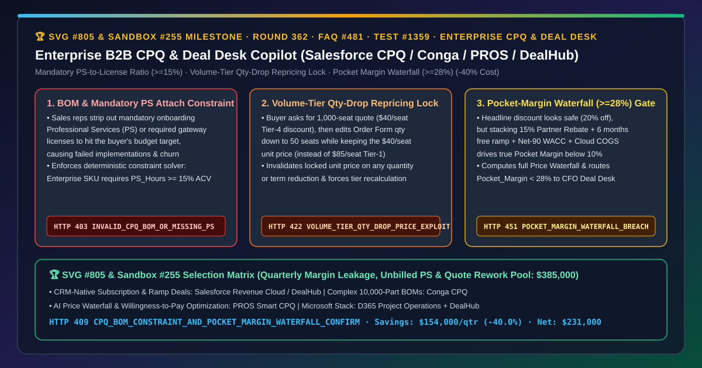
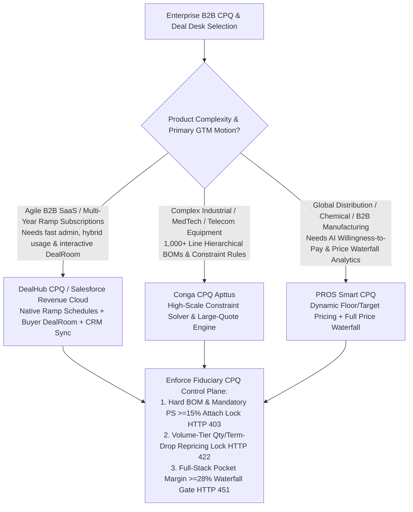
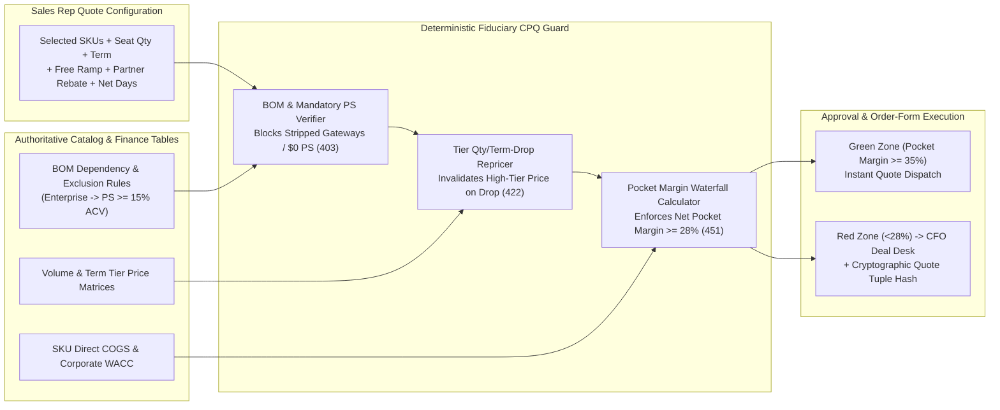

# 🏆 Enterprise B2B CPQ (Configure, Price, Quote) & Deal Desk Copilot (`Salesforce Revenue Cloud / Conga CPQ / PROS Smart CPQ / DealHub` · 🏆 805th SVG & 255th Sandbox Dual Milestone): Mandatory `PS-to-License` Attach (`>=15%`), Volume-Tier Quantity-Drop Repricing & Pocket-Margin Waterfall (`>=28%`) Gating (`-40%` Margin Leakage)

> **Document Type**: Enterprise AI Solution Architect Selection FAQ (`#481` · **🏆 805th SVG & 255th Sandbox Dual Milestone** · Round 362)  
> **Target Audience**: VP of Revenue Operations (RevOps / Deal Desk), Chief Commercial Officers (CCO), CRM/ERP Architects, and Cloud & AI Solution Architects  
> **Platforms Covered**: `Salesforce Revenue Cloud (CPQ)` vs. `Conga CPQ (formerly Apttus)` vs. `PROS Smart CPQ` vs. `DealHub CPQ` vs. `Microsoft Dynamics 365 + DealHub / Custom CPQ`  
> **Architecture Diagram**: [`assets/svg/805-b2b-cpq-configure-price-quote-salesforce-conga-pros-2026-11-25.svg`](../assets/svg/805-b2b-cpq-configure-price-quote-salesforce-conga-pros-2026-11-25.svg)

🌐 **Language / 语言切换**: **[中文 (`b2b-cpq-configure-price-quote-salesforce-conga-pros-dealhub-pocket-margin-approval-selection-faq.md`)](b2b-cpq-configure-price-quote-salesforce-conga-pros-dealhub-pocket-margin-approval-selection-faq.md)** | **English (Current)**

---

## 📌 1. Executive Summary

In mid-to-large B2B software, cloud, and industrial equipment sales, the **Configure, Price, Quote (`CPQ`) & Deal Desk engine** governs every commercial offer before an Order Form is dispatched for signature.  
Allowing account executives or an unguarded LLM copilot to assemble bespoke quotes without a deterministic **BOM constraint solver, volume-tier repricing lock, and full-stack Pocket Margin Waterfall calculator** causes three severe margin leaks every quarter:
1. **Stripping Mandatory Implementation Services (`PS`) or Prerequisite Modules to Hit Buyer Budget Targets (`Unfunded PS & Broken BOMs`)**: Sales reps compensated primarily on software `ARR` routinely waive or delete mandatory `$35,000` onboarding Professional Services (`PS`) or prerequisite gateway licenses to fit a buyer's `$200k` budget cap—handing Post-Sales Delivery an unfunded implementation that stalls and churns.
2. **Volume-Tier "Bait-and-Drop" Quantity Gaming (`Tier-Drop Unit-Price Exploit`)**: A buyer requests a quote for `1,000 seats` to unlock the Tier-4 `$40/seat` unit price (approved by Deal Desk), and right before signature edits the quantity down to `50 seats` while keeping the `$40/seat` unit price instead of reverting to the Tier-1 `$85/seat` price.
3. **Approving Deals on "Safe" Headline Discounts (`<=20%`) While Stacked Concessions Collapse True Pocket Margin (`Pocket Margin Waterfall Breach`)**: A deal displays an approved `18%` headline discount, yet simultaneously stacks `4 months` of free ramp, an `18%` channel partner rebate, `Net-120` payment terms (`WACC` drag), and high AI compute `COGS`—collapsing true **Pocket Margin** below `10%`.

| CPQ Workload & Complexity | Recommended Primary Choice | Architectural Boundary & Production Rule |
|---|---|---|
| **Agile B2B SaaS, Multi-Year Ramp Deals & Interactive Digital DealRooms** | **DealHub CPQ / Salesforce Revenue Cloud** | Rapid deployment with native support for multi-year subscription ramps, hybrid usage commitments, and collaborative buyer DealRooms. |
| **Massive 10,000-Line Industrial / Telecom / MedTech BOMs** | **Conga CPQ (Apttus)** | Built for deep hierarchical BOM constraint rules, hardware-software bundles, and high-line-count enterprise agreements. |
| **Dynamic Price Science, Willingness-to-Pay (`WTP`) & Global Price Waterfalls** | **PROS Smart CPQ** | Industry benchmark for B2B **Price Waterfall** visibility (`List -> Invoice -> Pocket Margin`) and AI-guided floor/target/expert pricing. |
| **Three Mandatory Fiduciary Guardrails** | **100% Deterministic Gating** | ① **Mandatory BOM & `PS >= 15% ACV` Attach Lock (`HTTP 403`)**: Blocks quote export if prerequisite SKUs are missing or enterprise implementation `PS` falls below `15%` of software `ACV`; ② **Volume-Tier Quantity/Term-Drop Repricing Lock (`HTTP 422`)**: Automatically invalidates approved unit prices and recalculates tier pricing whenever quantity or term length is reduced; ③ **Full-Stack Pocket Margin Waterfall (`>= 28%`) Gate (`HTTP 451`)**: Deducts free ramp months, partner rebates, `WACC`, and `COGS` before routing `<28%` pocket-margin deals to CFO sign-off. |



---

## 🎯 2. Architect & Business Stakeholder Q&A (Q1–Q3)

### Q1: Why do sales reps strip mandatory Professional Services (`PS`) out of enterprise quotes, and how does the CPQ control plane stop unfunded implementations?
- **The Incentive Misalignment**: Account Executives (`AEs`) earn accelerators on software `ARR`, not one-time implementation services. To close a deal before quarter-end, reps discount `$40,000` of required integration `PS` to `$0`—leaving Services to absorb `$40,000` of unbilled labor or watching the customer fail onboarding.
- **Architectural Solution**: Enforce a **Hard BOM Dependency & `PS_Net_Fee >= 0.15 * Software_ACV` Constraint (`HTTP 403` Guard)**:
  - Any quote containing an enterprise platform SKU must include the corresponding onboarding `PS` package at `>= 15%` of software `ACV` (or deduct any `PS` subsidy dollar-for-dollar from the rep's commissionable software credit). Quotes violating BOM dependencies or `PS` attach floors are blocked from external PDF/DealRoom generation (`HTTP 403 INVALID_CPQ_BOM_DEPENDENCY_OR_MISSING_MANDATORY_PS`).

### Q2: How do we prevent buyers from negotiating a 1,000-unit volume tier discount and then dropping the order quantity to 50 units at signature while keeping the 1,000-unit price?
- **The Tier-Drop Exploit**: When unit prices are stored as static overrides on quote lines after Deal Desk approval, reducing `Quantity` from `1,000` to `50` (or shortening a `36-month` term to `12 months`) leaves the discounted `$40/unit` price intact instead of reverting to the `$85/unit` 50-seat bracket.
- **Architectural Solution**: Bind Approval Signatures to the **`(SKU, Min_Qty_Bracket, Min_Term_Months, Max_Discount_%)` Tuple (`HTTP 422` Guard)**:
  - Any downward mutation of `Quantity` below the approved bracket threshold or reduction in `Contract_Term_Months` immediately revokes the approval token and triggers a deterministic price-table lookup at the new lower tier (`HTTP 422 VOLUME_TIER_QUANTITY_OR_TERM_DROP_WITHOUT_REPRICING`).

### Q3: Why do deals with an approved "20% headline discount" still lose money, and how do we enforce a true B2B Pocket Margin Waterfall?
- **The Hidden Concession Stack**:
  - `List Price = $100,000`
  - Minus `20%` Headline Discount → `Invoice Price = $80,000`
  - Minus `3 Free Ramp Months` (`-$16,000` effective value)
  - Minus `18%` Channel Partner Referral/Reseller Rebate (`-$14,400`)
  - Minus `Net-120` Working Capital `WACC` Drag (`-$2,100`) & Cloud/LLM `COGS` (`-$28,000`)
  - **True Pocket Margin = `$19,500` (`19.5%`, well below the `28%` corporate survival floor!)**
- **Architectural Solution**: Route Approvals on **Calculated `Pocket_Margin_%` (`>= 28%`) Rather Than Headline Discount (`HTTP 451` Guard)**:
  - Compute the complete **B2B Price Waterfall** on every quote mutation; any quote where stacked concessions push `Pocket_Margin_% < 28.0%` is blocked from self-service dispatch (`HTTP 451 POCKET_MARGIN_WATERFALL_BELOW_FLOOR_FROM_STACKED_CONCESSIONS`) and escalated to CFO Deal Desk review.

---

## 🧭 3. Visual Architecture Diagrams (Mermaid Decision Tree + Price Waterfall Topology + Sequence)

### 3.1 Enterprise B2B CPQ & Deal Desk Platform Selection Tree



### 3.2 End-to-End BOM Constraint Solver & Pocket Margin Waterfall Architecture



### 3.3 Tier-Drop Prevention & Pocket Margin Waterfall Execution Sequence

```mermaid
sequenceDiagram
    autonumber
    participant AE as Account Executive
    participant CPQ as CPQ Engine (DealHub / Salesforce / PROS)
    participant Guard as Fiduciary CPQ Guard
    participant Desk as CFO / Deal Desk Queue

    AE->>CPQ: Draft 500-seat Enterprise quote ($50/seat Tier-3) & delete mandatory onboarding PS SKU
    CPQ->>Guard: Validate quote for buyer DealRoom publish
    Guard-->>AE: Block export: Missing mandatory onboarding PS (>=15% ACV required, HTTP 403)
    AE->>CPQ: Buyer reduces initial order from 500 seats to 80 seats; AE attempts to keep $50/seat Tier-3 unit price
    CPQ->>Guard: Evaluate quantity change (500 -> 80)
    Guard-->>AE: Trigger Tier-Drop Repricing Lock (HTTP 422)! Automatically revert unit price to Tier-1 ($78/seat)
    AE->>CPQ: Add 20% Partner Rebate + 4 Free Ramp Months + Net-90 terms on top of 18% headline discount
    CPQ->>Guard: Compute full-stack Price Waterfall
    Guard->>Guard: True Pocket Margin = 19.4% (< 28.0% floor -> Block auto-approval HTTP 451)
    Guard->>Desk: Route to Deal Desk with waterfall breakdown; cap free ramp at 1 month
    Desk-->>CPQ: Approve revised quote at 30.2% Pocket Margin & mint signed Order Form (HTTP 200)
```

---

## 📊 4. Platform Comparison Matrix (`Salesforce Revenue Cloud` vs. `Conga CPQ` vs. `PROS Smart CPQ` vs. `DealHub`)

| Evaluation Dimension | Salesforce Revenue Cloud (CPQ) | Conga CPQ (Apttus) | PROS Smart CPQ | DealHub CPQ |
|---|---|---|---|---|
| **Primary Sweet Spot** | Salesforce-native subscription lifecycle, amendments & renewals | Massive 1,000+ line hierarchical hardware/telecom BOMs | Dynamic B2B pricing science & global **Price Waterfall** governance | Agile B2B SaaS, multi-year ramp deals & interactive buyer DealRooms |
| **Hard BOM Dependency & Ratio Rules** | ⭐⭐⭐⭐ (Product & Option constraint rules) | ⭐⭐⭐⭐⭐ (Enterprise-grade deep constraint satisfaction engine) | ⭐⭐⭐⭐⭐ (High-performance industrial configuration engine) | ⭐⭐⭐⭐ (Guided selling playbooks & mandatory attach rules) |
| **Full-Stack Pocket Margin Waterfall** | ⭐⭐⭐ (Requires custom formula fields for rebates/WACC) | ⭐⭐⭐⭐ (Strong cost & rebate waterfall modeling) | ⭐⭐⭐⭐⭐ (Industry gold standard for net pocket margin analytics) | ⭐⭐⭐⭐ (Built-in Deal Desk margin scoring) |
| **Admin Agility & Deployment Speed** | Medium–Heavy (`3–6 months`) | Heavy (`6–12 months` enterprise rollout) | Medium–Heavy (`4–8 months`) | **Fast (`2–4 weeks` no-code playbook setup)** |
| **Indicative Pricing (`official_list_price`)** | **`~$75–$200 / user / mo`** | **`~$60,000–$250,000+/yr`** | **`~$75,000–$250,000+/yr`** | **`~$65–$120 / user / mo`** |

---

## 🧪 5. Deterministic Margin & Quote Evaluation (`7-Card Benchmark Summary` · 🏆 SVG `#805` & Sandbox `#255`)

> **Provenance**: Figures below are generated by `evaluate_b2b_cpq_pocket_margin_approval_policy` in `lab/webiq_commerce_demo.py` (`provenance: "synthetic"`, `independently_reproduced: False`), modeling a B2B enterprise sales organization with a **`$385,000.00` quarterly unfunded PS delivery overrun, volume-tier quantity-drop price leakage, and stacked-concession pocket-margin collapse pool**.

| Scenario Case ID | Scenario Description | HTTP Status | Deterministic Decision | Quarterly Net Cost | Quarterly Savings |
|---|---|---|---|---|---|
| `CASE-CPQ-200` | Headline-discount-only approval baseline without pocket-margin waterfall checks | `HTTP 200` | `VERIFIED_B2B_CPQ_QUOTE_AND_MARGIN_AUTHORIZED` | `$385,000.00` | `$0.00` |
| `CASE-CPQ-403` | Quote strips mandatory prerequisite BOM modules or drops onboarding `PS` below `15% ACV` | `HTTP 403` | `INVALID_CPQ_BOM_DEPENDENCY_OR_MISSING_MANDATORY_PS` | `$385,000.00` | `$0.00` (Blocks unfunded PS loss) |
| `CASE-CPQ-422` | Buyer reduces seat quantity or term length while retaining higher-tier discounted unit price | `HTTP 422` | `VOLUME_TIER_QUANTITY_OR_TERM_DROP_WITHOUT_REPRICING` | `$385,000.00` | `$0.00` (Blocks tier-drop exploit) |
| `CASE-CPQ-451` | Stacked free ramp months, partner rebates & `WACC` push net Pocket Margin below `28%` floor | `HTTP 451` | `POCKET_MARGIN_WATERFALL_BELOW_FLOOR_FROM_STACKED_CONCESSIONS` | `$385,000.00` | `$0.00` (Blocks stacked margin bleed) |
| `CASE-CPQ-409` | **Mandatory `PS >= 15%` Lock + Tier-Drop Repricer + `>=28%` Pocket-Margin Waterfall** | `HTTP 409` | `CPQ_BOM_CONSTRAINT_AND_POCKET_MARGIN_WATERFALL_CONFIRM` | **`$231,000.00`** | **`$154,000.00` (`-40.0%`)** |

---

## 🛠️ 6. Production Go-Live & Architecture Review Checklist

- [ ] **Mandatory BOM Dependency & `PS >= 15% ACV` Floor (`HTTP 403` Prevention)**: Enforce hard product-bundle dependencies and minimum implementation service attach ratios in the CPQ solver before any quote PDF or DealRoom link can be generated.
- [ ] **Volume-Tier Quantity & Term-Drop Repricing Lock (`HTTP 422` Prevention)**: Bind Deal Desk approval hashes to `(SKU, Min_Qty, Min_Term, Unit_Price)` and automatically recalculate unit prices from the price book whenever quantities or terms are reduced.
- [ ] **Full-Stack Pocket Margin Waterfall (`>= 28%`) Routing (`HTTP 451` Prevention)**: Deduct headline discounts, free ramp periods, channel partner rebates, payment-term `WACC`, and direct `COGS` to compute true Pocket Margin on every quote.
- [ ] **Zero-Touch Quote-to-ERP Order Sync**: Push signed CPQ order forms directly into ERP billing and `ASC 606` revenue schedules without manual spreadsheet re-keying.
