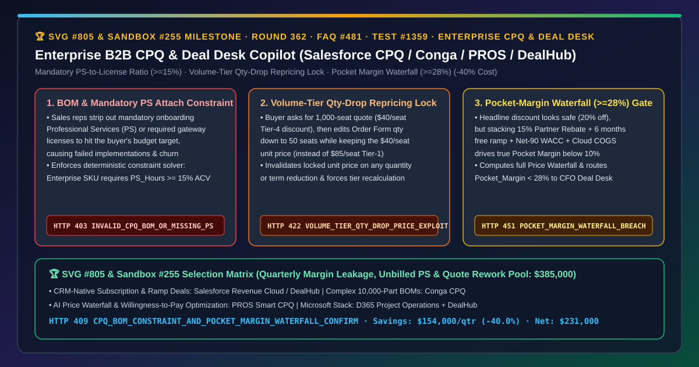
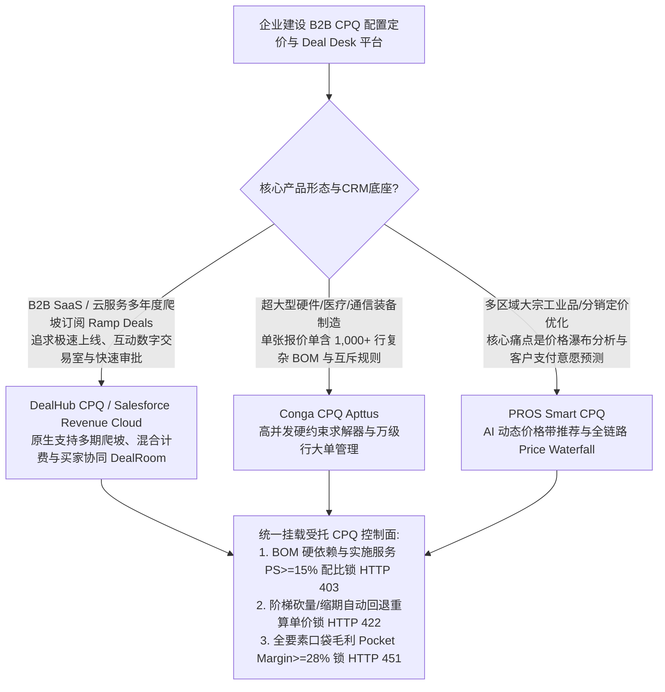
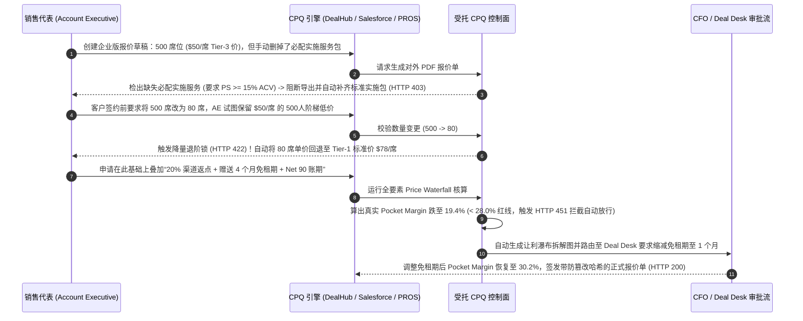

# 🏆 企业级 B2B 配置定价报价（`CPQ`）与智能商务审单（`Deal Desk Copilot`: `Salesforce Revenue Cloud / Conga CPQ / PROS Smart CPQ / DealHub` · 🏆 第 805 张架构图与第 255 个策略沙盒双里程碑）：强制实施服务配比锁（`PS >= 15% ACV`）、阶梯砍量自动重算单价与口袋净毛利瀑布（`Pocket Margin >= 28%`）净省 40% 指南

> **文档类型**：企业级 AI Solution Architect 选型决策指南（Selection FAQ · `#481` · **🏆 SVG `#805` & Sandbox `#255` 双里程碑** · Round 362）  
> **适用读者**：B2B 企业软件与硬件制造销售运营总监（RevOps / Deal Desk）、首席商务官（CCO）、CRM/ERP 架构师与 Cloud & AI Solution Architect  
> **核心覆盖平台**：`Salesforce Revenue Cloud (CPQ)` vs. `Conga CPQ (原 Apttus)` vs. `PROS Smart CPQ` vs. `DealHub CPQ` vs. `Microsoft Dynamics 365 + DealHub / Custom CPQ`  
> **关联架构图**：[`assets/svg/805-b2b-cpq-configure-price-quote-salesforce-conga-pros-2026-11-25.svg`](../assets/svg/805-b2b-cpq-configure-price-quote-salesforce-conga-pros-2026-11-25.svg)

🌐 **语言切换 / Language**: **中文 (当前)** | **[English (`b2b-cpq-configure-price-quote-salesforce-conga-pros-dealhub-pocket-margin-approval-selection-faq.en.md`)](b2b-cpq-configure-price-quote-salesforce-conga-pros-dealhub-pocket-margin-approval-selection-faq.en.md)**

---

## 📌 一、核心选型结论速览（Executive Summary）

在中大型 B2B 解决方案销售中，从客户明确购买意向到正式生成可签字的合同报价单（Quote / Order Form），核心枢纽就是 **配置、定价、报价引擎（`Configure, Price, Quote - CPQ`）与商务审单中心（`Deal Desk`）**。  
如果让销售代表或通用大模型自由拼装 Excel 报价表，而不经过确定性 CPQ 规则求解器与全链路口袋毛利瀑布（Price Waterfall）校验，企业每个季度都会在三个隐蔽黑洞上流失数百万利润：
1. **为了凑客户预算，销售私自删掉必配的网关模块或把 `$40,000` 实施交付服务（`Professional Services - PS`）改成 `$0` 白送（`Invalid BOM & Unfunded PS Attach`）**：企业级软件或复杂硬件必须搭配至少 `15% ACV` 的上线实施人天才能跑通；销售为了凑够客户的 `$200k` 预算上限，在报价单里把必配实施包删掉，导致签单后交付团队无预算进场、项目烂尾退订。
2. **买家“先按 1,000 席位大客户阶梯套出 `$40/席` 底价、签字前把数量砍成 50 席却保留 `$40` 单价”（`Volume-Tier Quantity-Drop Exploit`）**：标准阶梯价规定 `50 席 = $85/席`、`1,000 席 = $40/席`。买家先让销售报 1,000 席拿到 `$40` 审批通过，最后一刻说“首期先买 50 席试点，单价按刚才批好的 `$40` 签”，若未触发降量自动退阶重算，企业直接损失 `53%` 客单毛利！
3. **只盯“表面折扣率（Headline Discount `<= 20%`）”，漏算渠道返点、免租期（Free Ramp Months）与长账期贴现，导致真实口袋毛利（`Pocket Margin`）跌穿底线（`Pocket Margin Waterfall Collapse`）**：报价单表面只打了 8 折，但同时叠加了“合作伙伴渠道分润 `18%` + 首年赠送 4 个月免租期 + `Net 120` 账期资金占用 + 高成本云算力 COGS”，扣完所有隐性让利后真实口袋净毛利只剩 `6%`！

| 选型维度与业务复杂度 | 推荐主选方案 | 适用边界与架构落地准则 |
|---|---|---|
| **敏捷 B2B SaaS、阶梯订阅（Ramp Deals）与数字交易室（DealRoom）** | **DealHub CPQ / Salesforce Revenue Cloud** | 上线极快，原生支持多年度爬坡订阅（Year 1 100席 → Year 2 300席）、混合用量包与买家互动式在线签章。 |
| **超大型万级零部件 BOM、软硬一体与跨国复杂合同配置** | **Conga CPQ (Apttus)** | 擅长电信、医疗器械、工业装备等包含上千条必选/互斥依赖约束（Constraint Rules）的超重型配置。 |
| **动态价格科学、支付意愿（WTP）弹性建模与全球毛利瀑布治理** | **PROS Smart CPQ** | 内置B2B价格瀑布（Price Waterfall）分析与历史赢单率价格带推荐（Floor / Target / Expert Price）。 |
| **三大确定性风控红线** | **100% 强制拦截** | ① **BOM 硬依赖与最低实施服务配比锁（`HTTP 403`）**：缺失必配底座许可或企业版实施服务费 `< 15% 软件 ACV` 一律禁止生成对外报价单；② **阶梯数量/年限缩水强制退阶重算锁（`HTTP 422`）**：一旦下单数量或合约年限较审批时下调，原锁定优惠单价立即作废并自动回退至对应低阶价格表；③ **全要素口袋净毛利瀑布（`Pocket Margin >= 28%`）门禁（`HTTP 451`）**：综合扣除票面折扣、免租期、渠道返点与账期 `WACC` 后，若 `Pocket_Margin < 28%` 强制拦截自动出单并路由 CFO 审签。 |



---

## 🎯 二、业务方与架构师灵魂拷问 Q&A（Q1–Q3）

### Q1：为什么销售为了拿单经常把必选的实施服务（`PS`）或前置硬件网关从报价单里删掉？CPQ 状态机怎么从根源锁死？
- **销售激励错位**：销售代表通常按软件年度经常性收入（`ARR / ACV`）拿高额提成，而一次性实施服务（`PS`）提成极低甚至不计入配额。当客户嫌总价贵时，销售第一反应就是把 `$30,000` 的实施上线包砍成 `$0` 或直接从 BOM 里删掉。结果交付部门接手后发现客户根本无法自行完成 SSO/ERP 对接，3 个月后客户以“产品无法使用”要求全额退钱。
- **架构解法**：在 CPQ 配置求解器中实施 **强类型布尔满足约束与 `PS-to-License Ratio >= 15%` 硬绑定（防 `HTTP 403`）**：
  - 定义硬规则：`IF SKU.tier == 'ENTERPRISE' THEN (Require SKU_ONBOARDING_PS AND PS_Net_Fee >= 0.15 * Software_ACV)`；
  - 即使销售想对实施费打折，也必须在报价单上保留标准实施人天行项目，且折后差额自动从该笔订单的销售佣金计提基数中扣减。任何删除必配依赖项或违反最低实施服务配比的报价草稿直接阻断导出（`HTTP 403 INVALID_CPQ_BOM_DEPENDENCY_OR_MISSING_MANDATORY_PS`）。

### Q2：客户在议价阶段声称“我们要采购 2,000 个账号”，骗取了最高档 5 折阶梯单价，最后签合同时说“先签 100 个账号试试，单价不变”，怎么防这种拆梯套利？
- **B2B 阶梯议价经典陷阱（Tier-Drop Bait-and-Switch）**：
  - 在手工改 Word/Excel 报价单的团队里，总监审批通过了 `"2,000 Seats @ $50/seat = $100,000"`；销售代表在发给客户电子签章前，顺手把表格里的数量 `2,000` 改成了 `100`（总价变成 `$5,000`），而系统因为看到“单价还是 `$50` 没降价”居然直接放行了！
- **架构解法**：在 CPQ 与电子签章管道之间强制加装 **数量/年限缩水哈希失效与阶梯单价联动重算锁（`Quantity/Term-Drop Repricing Lock` · 防 `HTTP 422`）**：
  - 审批令牌（`Approval_Mandate_Hash`）同时签名锁定 `(SKU_ID, Min_Committed_Qty, Min_Term_Months, Unit_Price)` 四元组；
  - 凡是修改数量 `New_Qty < Approved_Tier_Min_Qty` 或将 3 年期合同缩短为 1 年期，原审批令牌立即自动吊销，单价强制按价格矩阵（Price Book）回退至 `100 席` 对应的标准阶梯价（如 `$95/席`）。任何降量不调价的越权改单直接拦截（`HTTP 422 VOLUME_TIER_QUANTITY_OR_TERM_DROP_WITHOUT_REPRICING`）。

### Q3：为什么规定了“销售经理最多只能批 8 折”，月底算账却发现好几张大单真实毛利是负数？什么是 B2B 价格瀑布（Price Waterfall）？
- **隐性让利叠加效应（Discount Stacking）**：
  - 目录总价（`List Price`）：`$100,000`；
  - ① 销售经理批了顶格 **8 折（`-20%`）** → 票面发票价（`Invoice Price`）= `$80,000`；
  - ② 销售又送了 **“首年额外 3 个月免费爬坡期（Free Ramp）”**（相当于有效年化再降 `-20%`）→ `Effective ACV = $64,000`；
  - ③ 该单走了总代渠道，需支付 **`18%` 渠道返点（Partner Rebate = `-$14,400`）**；
  - ④ 销售答应了 **`Net 120` 超长账期 + 赠送 `$8,000` 专属驻场服务**；
  - ⑤ 扣除底层云算力与第三方 API 硬成本（`COGS = $28,000`）后，企业实际揣进口袋的净毛利（`Pocket Margin`）只剩 **`11.2%`**！
- **架构解法**：实施 **全要素口袋净毛利瀑布核算器（`Full-Stack Pocket Margin Waterfall Gate >= 28%` · 防 `HTTP 451`）**：
  - 审批流路由绝不能只看表面票面折扣（Headline Discount），必须实时计算：
    $$\text{Pocket\_Revenue} = \text{Invoice\_Total} - \text{Free\_Month\_Value} - \text{Partner\_Rebate} - \text{Unbilled\_PS\_Cost} - \text{WACC}_{\text{Net\_Days}}$$
    $$\text{Pocket\_Margin\_\%} = \frac{\text{Pocket\_Revenue} - \text{Direct\_COGS}}{\text{List\_Price\_Equivalent}}$$
  - 一旦 `Pocket_Margin_% < 28.0%`，系统自动拦截常规销售审批并强制升级至 CFO / Deal Desk 委员会（`HTTP 451 POCKET_MARGIN_WATERFALL_BELOW_FLOOR_FROM_STACKED_CONCESSIONS`）。

---

## 🧭 三、直观可视化图解（Mermaid 选型决策树 + CPQ 价格瀑布架构图 + 时序图）

### 3.1 企业级 B2B CPQ 与智能审单平台选型决策树



### 3.2 端到端 CPQ 约束求解与全要素口袋毛利瀑布（Price Waterfall）架构图

```mermaid
flowchart LR
    subgraph Rep["销售配置报价输入 (Quote Draft)"]
      CFG["选配主产品 SKU + 席位数 + 合约年限<br/>+ 渠道返点 + 免租期 + 账期"]
    end

    subgraph Rules["权威产品与财务基准库 (Catalog & Finance)"]
      BOM["BOM 依赖与互斥规则图谱<br/>(Enterprise -> PS >= 15% ACV)"]
      TIER["阶梯价格矩阵 (Volume & Term Tiers)"]
      COGS["SKU 级云算力/硬件 COGS 与 WACC 表"]
    end

    subgraph Guard["确定性受托 CPQ 控制面 (Fiduciary CPQ Guard)"]
      G1["BOM 完整性与实施服务配比核验器<br/>阻断删减必配网关或 $0 白送实施 (403)"]
      G2["阶梯数量/年限缩水重算锁<br/>阻断按千人阶梯拿低价后砍成50人 (422)"]
      G3["全要素口袋净毛利瀑布核算器<br/>汇总票面折+免租+返点+账期 >=28% (451)"]
    end

    subgraphOut["分级审签与签章闭环 (Approval & E-Sign)"]
      AUTO["绿灯区 (Pocket Margin >= 35%)<br/>秒级自动签发报价单"]
      CFO["红灯区 (<28%) 路由 CFO Deal Desk<br/>+ 锁定四元组签名哈希送签"]
    end

    CFG --> G1 --> G2 --> G3 --> AUTO & CFO
    BOM --> G1
    TIER --> G2
    COGS --> G3
```

### 3.3 防“阶梯砍量套单价”与全要素口袋毛利瀑布校验时序图



---

## 📊 四、主流企业级 B2B CPQ 与报价编排平台横向选型矩阵

| 评估维度 | Salesforce Revenue Cloud (CPQ) | Conga CPQ (Apttus) | PROS Smart CPQ | DealHub CPQ | Dynamics 365 + Custom / Partner CPQ |
|---|---|---|---|---|---|
| **核心优势场景** | Salesforce CRM 重度客户的订阅、增购、续费全生命周期闭环 | 超大规模复杂 BOM（万级行项目、深层嵌套硬件/通信配置） | 动态价格科学、全球分销价格瀑布（Price Waterfall）与大宗毛利优化 | 现代敏捷 B2B SaaS、复杂多期爬坡（Ramp）与数字交易室（DealRoom） | 微软 D365 Sales + Finance & Operations 一体化报价到现金（Quote-to-Cash） |
| **复杂 BOM 约束求解（必选/互斥/配比规则）** | ⭐⭐⭐⭐（支持 Product Rules 与 Option Constraints） | ⭐⭐⭐⭐⭐（行业顶级重型约束引擎，支持万级零部件毫秒级校验） | ⭐⭐⭐⭐⭐（强大的工业与航旅制造配置引擎） | ⭐⭐⭐⭐（配置直观，基于 Playbook 引导销售选配） | ⭐⭐⭐⭐（结合 D365 产品配置器与资产管理） |
| **全要素价格瀑布（Pocket Margin Waterfall）可视化** | ⭐⭐⭐（需自定义字段汇总渠道返点与免租期成本） | ⭐⭐⭐⭐（支持深度成本与返利核算） | ⭐⭐⭐⭐⭐（行业绝对标杆，原生内置多级价格瀑布与边际利润漏损分析） | ⭐⭐⭐⭐（支持清晰的 Deal Desk 毛利仪表盘） | ⭐⭐⭐⭐（直连 D365 F&O 真实物料标准成本） |
| **实施周期与业务人员无代码维护难度** | 中至高（复杂 Price Rules 维护需专职管理员） | 高（适合大型成熟企业 IT 团队） | 中至高（侧重数据科学与定价团队） | **极快（2–4 周上线，零代码修改计费模型）** | 中（与 M365 Copilot / Teams 协同体验极佳） |
| **参考定价模式（`official_list_price`）** | 约 **`$75–$200 / 用户 / 月`**（按功能层级） | 企业级年框（约 `$60,000–$250,000+/年`） | 企业级年框（约 `$75,000–$250,000+/年`） | 约 **`$65–$120 / 用户 / 月`** | 随 D365 许可证 + 插件订阅 |

---

## 🧪 五、转化率/成本测算与 7-Card 基准测试报告（Deterministic Evaluation · 🏆 SVG `#805` & Sandbox `#255`）

> **数据来源说明（Provenance）**：以下季度损益数据来自 `lab/webiq_commerce_demo.py` 中的确定性评估器 `evaluate_b2b_cpq_pocket_margin_approval_policy`（`provenance: "synthetic"`, `independently_reproduced: False`），用于量化对比“Excel/手工改单无阶梯重算 + 仅看表面折扣率放行”与“BOM/PS 配比硬锁 + 降量自动退阶 + 全要素口袋毛利瀑布门禁”的季度利润保护效益。

### 5.1 基准测试场景输入与确定性状态码矩阵

- **设定场景**：某中型企业软件与智能硬件厂商每季度发出 `$24M` 合同报价单，季度因销售私自豁免必配实施服务导致的无预算交付亏损、买方按高量阶梯锁价后临签砍量套利、以及叠加免租期与渠道返点导致真实口袋毛利跌穿底线的利润漏损池（`quarterly_pocket_margin_leakage_unfunded_ps_and_tier_exploit_pool_usd`）为 **`$385,000.00`**。

| 测试用例 ID | 场景描述 | 触发确定性状态码 | 决策枚举 (`decision`) | 季度净成本 (USD) | 季度净节省 (USD) |
|---|---|---|---|---|---|
| `CASE-CPQ-200` | 传统仅按表面折扣率审批的报价流基线 | `HTTP 200` | `VERIFIED_B2B_CPQ_QUOTE_AND_MARGIN_AUTHORIZED` | `$385,000.00` | `$0.00` |
| `CASE-CPQ-403` | 报价单删减了必配硬件网关依赖项，或企业版实施服务费低于 `15% ACV` 配比红线 | `HTTP 403` | `INVALID_CPQ_BOM_DEPENDENCY_OR_MISSING_MANDATORY_PS` | `$385,000.00` | `$0.00` (阻断烂尾配置与白送实施) |
| `CASE-CPQ-422` | 客户将采购数量从 1,000 台下调至 50 台（或缩短年限），但仍保留 1,000 台阶梯特批低单价 | `HTTP 422` | `VOLUME_TIER_QUANTITY_OR_TERM_DROP_WITHOUT_REPRICING` | `$385,000.00` | `$0.00` (阻断阶梯砍量套单价) |
| `CASE-CPQ-451` | 表面折扣仅 `18%`，但叠加免租期、渠道返点与长账期 `WACC` 后真实口袋毛利 `< 28%` | `HTTP 451` | `POCKET_MARGIN_WATERFALL_BELOW_FLOOR_FROM_STACKED_CONCESSIONS` | `$385,000.00` | `$0.00` (阻断隐性让利叠加穿仓) |
| `CASE-CPQ-409` | **启用 BOM/PS 15% 硬配比 + 降量自动退阶重算 + Pocket Margin >= 28% 瀑布门禁** | `HTTP 409` | `CPQ_BOM_CONSTRAINT_AND_POCKET_MARGIN_WATERFALL_CONFIRM` | **`$231,000.00`** | **`$154,000.00` (`-40.0%`)** |

### 5.2 核心确定性策略评估代码摘录

```python
@dataclass(frozen=True)
class B2bCpqPocketMarginApprovalPolicyInput:
    quarterly_pocket_margin_leakage_unfunded_ps_and_tier_exploit_pool_usd: float = 385000.0
    mandatory_bom_dependency_stripped_or_ps_attach_below_15pct_acv: bool = False
    order_quantity_or_term_reduced_while_keeping_higher_volume_tier_price: bool = False
    stacked_ramp_rebate_and_wacc_drives_pocket_margin_below_28pct: bool = False
    bom_ps_ratio_lock_tier_repricing_and_pocket_waterfall_ready: bool = False
```

---

## 🛠️ 六、商业上线风控与架构评审 Checklist

- [ ] **BOM 硬依赖与 `PS >= 15% ACV` 实施配比锁（防 `HTTP 403`）**：将产品必选前置模块与最低实施交付人天固化为不可绕过的 CPQ 硬约束；若销售特批减免实施费，系统自动按等额从软件折扣池或佣金基数中冲抵。
- [ ] **数量/年限缩水自动退阶重算（防 `HTTP 422`）**：禁止在报价单上将“折后单价”存为静态死数字；任何数量、模块或合约期变更必须实时重新触发阶梯价格矩阵查找，一旦跌破原阶梯下限立即吊销既有审批锁。
- [ ] **全要素口袋净毛利（`Pocket Margin Waterfall >= 28%`）审批路由（防 `HTTP 451`）**：将免费爬坡月（Free Ramp）、渠道返点（Partner Rebates）、赠送算力积分、超长账期资金成本（`WACC`）与底层 `COGS` 全部纳入实时毛利瀑布计算，按真实口袋毛利率而非表面折扣率触发分级审批。
- [ ] **报价单到 ERP 订单与账单零手工转录闭环**：客户在 DealRoom 完成电子签章后，CPQ 结构化 JSON 直接下推生成 ERP 销售订单与计费计划，100% 杜绝人工抄录错行。
