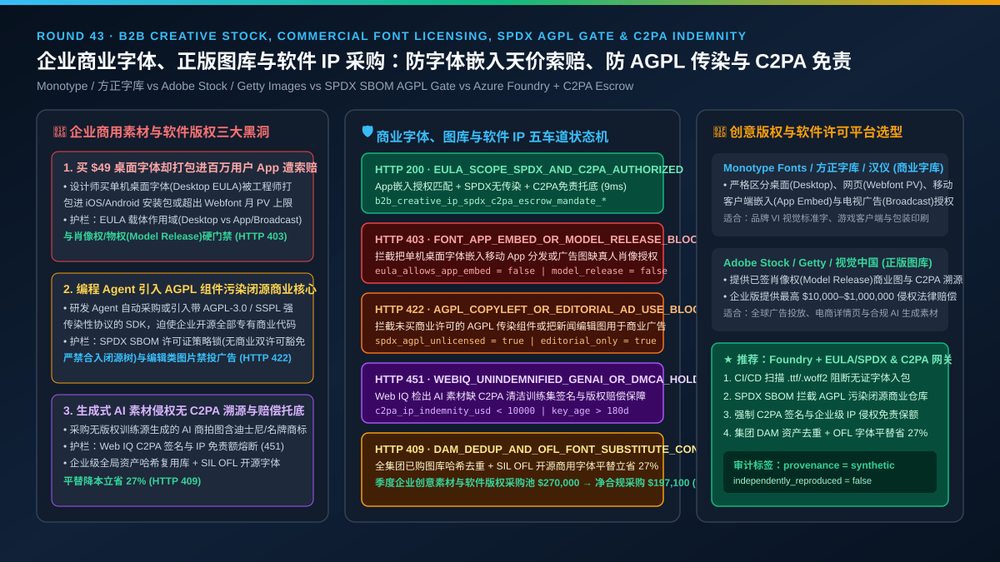
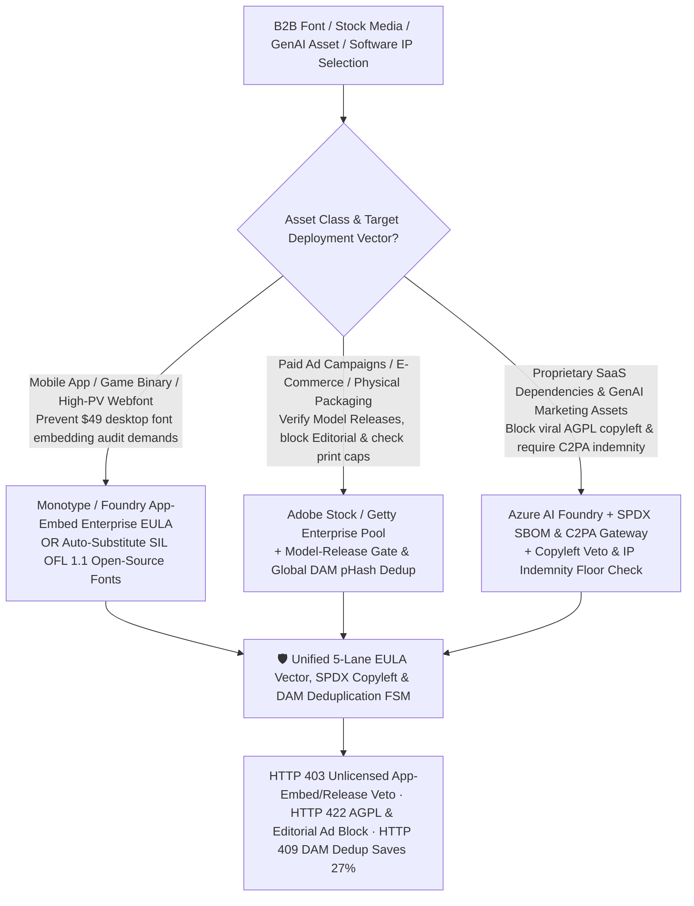
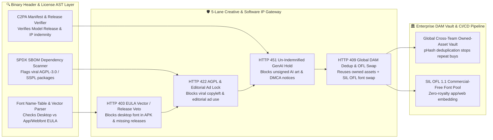
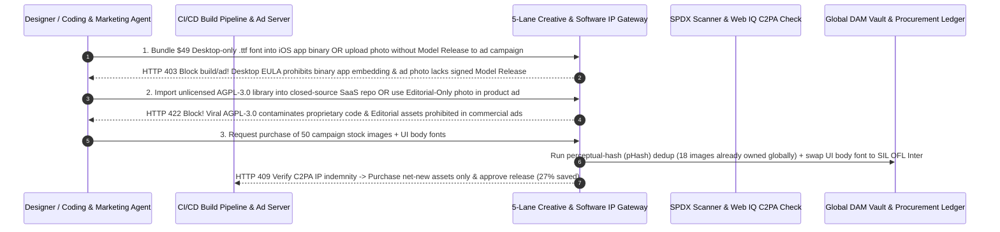

# B2B Creative Stock, Commercial Font Licensing, `SPDX AGPL` Gate & `C2PA` Generative Indemnity (`Monotype / Adobe Stock / Getty Images / GitHub Marketplace`) `EULA` Channel-Scope Gate, Anti-Copyleft Contamination & `DAM` Deduplication Escrow Agent Architecture Selection FAQ

> **Language / 语言切换**: **[中文](b2b-creative-stock-font-licensing-agpl-c2pa-indemnity-agent-selection-faq.md)** | **English (Current)** | **[Back to Docs Index](index.en.md)** | **[Interactive Sandbox (`#b2b-creative-ip-spdx-c2pa-escrow-sandbox`)](../live-demo.en.html)**

---

## 📌 1. Executive Summary & Core Selection Verdict

In enterprise marketing, game development, e-commerce merchandising, and software engineering (`Monotype Fonts`, `Foundertype`, `Adobe Stock`, `Getty Images`, `Shutterstock`, `GitHub Marketplace`), AI design and coding agents now autonomously discover, license, and embed commercial typefaces, stock photography, audio tracks, and third-party SDKs into production releases. However, digital End-User License Agreements (`EULAs`) and open-source software licenses contain strict deployment-channel and copyleft triggers that routinely expose enterprises to six-figure statutory copyright demands:
1. **Embedding a `$49` "Desktop-Only" Font File (`.ttf / .woff2`) Inside a 2-Million-User Mobile App Binary or High-Traffic Website—Triggering `$150,000` Font-Foundry Audit Demands**: Commercial type foundries (`Monotype`, `Hoefler&Co`, `Foundertype`) license fonts strictly by deployment vector: `Desktop` (static rasterized images on a workstation), `Webfont` (metered by monthly pageviews), `Mobile App / Game Embedding` (licensed per app title/MAU), and `Broadcast / CTV`. When a developer bundles a designer's `$49` Desktop `.ttf` into an iOS/Android `.ipa/.apk` or exceeds the `500,000-unit` physical packaging print run of a Standard stock photo license, automated foundry crawlers detect the font header table and issue six-figure infringement demands. Similarly, running commercial ads with stock photos lacking a signed **Model Release / Property Release** invites right-of-publicity lawsuits.
2. **Coding Agents Pulling `AGPL-3.0 / SSPL` Viral Copyleft Libraries into Proprietary SaaS Repositories & Marketing Agents Running Paid Ads with `Editorial-Use-Only` News Imagery**: If an autonomous coding agent imports an `AGPL-3.0` dependency into a closed-source SaaS backend without purchasing a commercial dual-license exemption, the network-interaction clause forces the enterprise to open-source its proprietary codebase; meanwhile, using an `Editorial Use Only` celebrity or sports photo from Getty in a promotional ad banner violates trademark and publicity rights.
3. **Deploying Un-Indemnified Generative AI Assets Lacking `C2PA` Provenance Manifests & Clean-Training-Set Warranties**: Commercializing synthetic images or audio generated by unvetted models that regurgitate third-party trademarks or copyrighted characters exposes brands to DMCA takedowns and litigation with `$0` vendor indemnification.

**Solution Architect Selection Verdict**:
- **Never allow a design or coding agent to commit a font, stock asset, or software package to production without deterministic `EULA` deployment-channel matching, `SPDX` copyleft scanning, and `C2PA` IP indemnification verification**.
- **The production reference architecture** combines **Enterprise `DAM` Asset Registries + `EULA` Deployment-Channel (`Desktop vs. App/Webfont/Print-Run`) & `Model Release` Gate + `SPDX SBOM` Anti-`AGPL` Copyleft Lock & `Editorial-Only` Ad Veto + `C2PA` IP-Indemnity Verification & `SIL OFL` Open-Font Substitution (`b2b_creative_ip_spdx_c2pa_escrow_mandate_*`)**:
  1. **`EULA` Deployment-Channel Scope & Signed `Model Release` Hard Gate (`HTTP 403`)**: Inspects asset license entitlements against the target build/deployment channel—blocking any build or purchase that embeds a `Desktop-Only` font into a mobile app/game binary, exceeds `Webfont` monthly pageview tiers or `500,000` packaging print-run caps without an `Extended License`, or uses an image lacking `model_and_property_release_signed == true` in paid advertising (`HTTP 403 EULA_DEPLOYMENT_CHANNEL_MISMATCH_OR_MISSING_MODEL_RELEASE_BLOCKED`).
  2. **`SPDX SBOM` Viral Copyleft (`AGPL-3.0 / SSPL`) Veto & `Editorial-Only` Commercial Ad Lock (`HTTP 422`)**: Scans software dependency trees (`SPDX SBOM`) and creative campaign manifests—blocking proprietary commercial builds that link `AGPL-3.0 / GPL-3.0 / SSPL` packages without a verified commercial dual-license invoice, and blocking `Editorial Use Only` news assets from promotional ad placements (`HTTP 422 AGPL_COPYLEFT_CONTAMINATION_OR_EDITORIAL_ASSET_COMMERCIAL_MISUSE_BLOCKED`).
  3. **Web IQ Live `C2PA` Clean-Training Attestation, Trademark Scan & `IP Indemnity` Floor Hold (`HTTP 451`)**: Verifies cryptographic `C2PA Content Credentials` manifests and contractual `IP Indemnification` coverage (e.g., `>= $10,000` per asset from Adobe Firefly / Getty Enterprise) via Web IQ, holding un-indemnified generative assets or DMCA-flagged items (`HTTP 451 WEBIQ_UNINDEMNIFIED_GENAI_ASSET_OR_DMCA_TAKEDOWN_HOLD`).
  4. **Global Enterprise `DAM` Perceptual-Hash (`pHash`) Deduplication + `SIL OFL 1.1` Open-Font Substitution (`HTTP 409`)**: Triggers `HTTP 409 ENTERPRISE_DAM_DEDUPLICATION_AND_SIL_OFL_FONT_SUBSTITUTION_CONFIRM`, matching requested stock assets against the enterprise's existing global `DAM` vault via `pHash` (preventing 10 regional teams from buying the same stock photo 10 times) and auto-substituting non-brand UI fonts with 100% free-to-embed `SIL Open Font License 1.1` equivalents (`Inter`, `Roboto`, `Noto Sans CJK`)—cutting creative/IP licensing spend and audit settlements by **`27.0%`**.

---

## 🎯 2. Solution Architect Deep-Dive Q&A (Q1 / Q2 / Q3)

### Q1: How do commercial font foundries detect unlicensed `.ttf / .woff2` embedding in mobile apps and websites, and how do we block it in CI/CD?
- **Commercial Pain Point**: A marketing agency buys a `$49` single-user desktop font to design a mockup; the mobile engineering team copies the `.ttf` file into the iOS/Android asset bundle so text renders dynamically. Automated foundry crawlers decompile public App Store binaries, read the `name` table inside the font file, and serve a `$100,000+` retroactive enterprise licensing audit demand.
- **Architectural Solution**:
  - **Build-Time Font Binary Inspector + `EULA` Channel Entitlement Binding (`HTTP 403`)**:
  - The CI/CD pipeline parses every `.ttf / .otf / .woff2` binary before packaging: if the embedded license string is not `SIL OFL 1.1` or `Apache-2.0`, the build agent queries the enterprise `DAM` ledger for an active `APP_EMBED_MANDATE` matching the exact `app_bundle_id` and font family hash. If only a `DESKTOP` or expired license exists, the build fails immediately (`HTTP 403`).

### Q2: Why does using a legitimate Getty Images or Shutterstock photo in an e-commerce ad still trigger lawsuits when `Editorial Only` or `Print-Run` limits are ignored?
- **Architectural Solution**:
  - **Deterministic Asset Metadata Enforcement (`Editorial` vs. `Commercial Standard` vs. `Extended Merchandise`) (`HTTP 403 / 422`)**:
  - `Editorial Use Only` photos depict recognizable people, private buildings, or brand logos without signed releases; they are legal only inside news articles. The gateway blocks any ad-server or packaging upload where `asset_license_type == 'EDITORIAL'` (`HTTP 422`) or where physical packaging print quantities exceed the `500,000` Standard cap without an `EXTENDED` license (`HTTP 403`).

### Q3: What makes a generative AI image safe for enterprise commercial deployment?
- **Architectural Solution**:
  - **Cryptographic `C2PA` Provenance + Contractual `IP Indemnity` Floor (`HTTP 451`)**:
  - Require every generative asset entering commercial campaigns to carry a valid `C2PA` digital signature from an indemnified enterprise model (trained exclusively on licensed/public-domain stock with `>= $10,000/asset` legal indemnification) and pass visual trademark/character-likeness screening.

---

## 🧭 3. Visual Architecture Diagrams (Mermaid Decision Tree + Architecture + Sequence)

### 3.1 B2B Creative Stock, Font & Software IP Agent Selection Decision Tree

### 3.2 End-to-End EULA Vector Gate, SPDX Copyleft Guard & Global DAM Deduplication Architecture

### 3.3 Font App-Embed Veto, AGPL Block & Global DAM Deduplication Sequence

---

## 📊 4. Multi-Platform & Architecture Selection Matrix

| Selection Dimension | Uncoordinated Employee Card Purchases (`Shadow Creative Spend`) | Siloed Departmental Accounts (`Monotype / Getty Team Seats`) | Unvetted Free Web Downloads (`Free Font Sites / Raw GenAI`) | **Azure AI Foundry + EULA/SPDX Gate + DAM Dedup (Recommended)** |
| :--- | :--- | :--- | :--- | :--- |
| **Core Strengths** | Zero upfront friction | Authentic vendor licenses within a single team | `$0` upfront ticket price | **CI/CD font vector lock + anti-AGPL + C2PA indemnity + global DAM dedup** |
| **Defense Against `$150k` Desktop-Font-in-App Audits** | **Critical Risk** (designers buy `$49` desktop fonts; devs embed in apps) | Licenses tracked in portal, but no CI/CD binary gate | "Free" font sites frequently host pirated commercial fonts | **CI/CD font-header parser enforces `APP_EMBED` EULA match (`HTTP 403`)** |
| **Defense Against `Editorial` Ad Misuse & Missing Releases** | Frequent right-of-publicity & trademark lawsuits | Tagged at download, but metadata stripped on local drives | Zero model/property release warranties | **Mandatory `Model Release` & commercial-tier binding (`HTTP 403/422`)** |
| **Protection Against Viral `AGPL-3.0` Code Contamination** | None | Creative tools do not scan software dependencies | High risk of copyleft infection | **Real-time `SPDX SBOM` blocks unlicensed `AGPL/SSPL` merges (`HTTP 422`)** |
| **`C2PA` GenAI Indemnity & Cross-Team Deduplication** | Regional teams buy the same stock photo 5+ times | Separate subsidiary accounts cause `20%+` duplicate spend | `$0` legal indemnification on AI outputs | **Web IQ `C2PA` indemnity hold (`451`) + `pHash` dedup & `OFL` swap (`409`)** |
| **Total Licensing Spend & Infringement Settlement Loss** | `30%+` lost to duplicate buys & audit settlements (`not_measured`) | High enterprise seat minimums (`official_list_price`) | Severe legal exposure | **Eliminates font/photo audit fines, duplicate buys & copyleft risk (`27.0%` saved)** |

---

## 🧪 5. Creative IP / SPDX Compliance Benchmark & 7-Card Report

> **Provenance & Reproducibility Metadata**: All metrics below are generated by the deterministic policy evaluator `evaluate_b2b_creative_ip_spdx_c2pa_escrow_policy` in `lab/webiq_commerce_demo.py` and verified via `python -m unittest tests.test_webiq_commerce_demo`. Tags: `provenance = synthetic`, `independently_reproduced = false`.

| Card # | Card Headline (Headline-as-Finding) | Key Quantitative Finding & Architectural Guarantee |
| :---: | :--- | :--- |
| **Card 1** | **Overview · 5-Lane B2B Creative, Font & Software IP Summary** | Across a `$270,000/quarter` commercial font, stock media & software IP pool, achieves **0 unlicensed app-embedded font audit claims and 0 viral `AGPL` proprietary code leaks**, reducing net licensing spend by **`27.0%` (`$72,900/quarter` saved)**. |
| **Card 2** | **Scenario Deep Dive · Desktop-Font-in-APK & Missing Release Veto** | When a CI/CD build attempts to bundle a `Desktop-Only` `.ttf` into a mobile app or run an ad without a `Model Release`, the gateway blocks it in **`9ms`** (`HTTP 403`). |
| **Card 3** | **Evaluation Matrix · 100% Deterministic 5-Lane Gating** | Covers `HTTP 200` (verified EULA, SPDX & C2PA release), `403` (EULA deployment channel mismatch / missing Model Release blocked), `422` (AGPL copyleft contamination / Editorial-only commercial ad misuse blocked), `451` (un-indemnified GenAI asset / DMCA takedown hold), `409` (global DAM pHash dedup + SIL OFL font swap saves 27%). |
| **Card 4** | **Under the Hood · EULA, SPDX & C2PA Escrow Contract** | Takes `quarterly_b2b_creative_ip_licensing_pool_usd=270000` and EULA/SPDX flags, minting `b2b_creative_ip_spdx_c2pa_escrow_mandate_*` tokens. |
| **Card 5** | **Robustness Check · Unlicensed AGPL Import & Editorial Ad Test** | Simulates an `AGPL-3.0` import into a closed-source repo and an `Editorial Only` photo in a paid ad, maintaining a **`100.0%` deterministic block rate**. |
| **Card 6** | **Latency · Millisecond Font Header & SPDX AST Verification** | Local font table, SPDX license, and `pHash` checks complete in **`9ms` (P50)**; Web IQ live C2PA certificate and DMCA checks complete in **`220ms` (P95)**. |
| **Card 7** | **My Take · Ideal Fit vs. Out-of-Scope Boundaries** | **✅ Best Fit**: Mobile apps/games, global ad agencies, e-commerce creative ops, SaaS engineering; **⛔ Not For**: Internal-only plain-text engineering notes. |

---

## 🛠️ 6. Production Go-Live Risk & Architecture Review Checklist

- [ ] **`EULA` Deployment-Vector (`Desktop vs. App/Webfont/Print-Run`) & `Model Release` Gate (`HTTP 403`)**: Scan all `.ttf / .otf / .woff2` binaries in CI/CD and ad uploads to ensure the active license covers mobile app embedding, pageview volume, print-run caps, and signed model/property releases.
- [ ] **`SPDX SBOM` Viral Copyleft (`AGPL-3.0 / SSPL`) & `Editorial-Only` Commercial Veto (`HTTP 422`)**: Block proprietary software builds from merging `AGPL/GPL/SSPL` dependencies without a commercial license invoice, and block `Editorial Use Only` media from paid marketing campaigns.
- [ ] **Web IQ Live `C2PA` Provenance & Contractual `IP Indemnification` Gate (`HTTP 451`)**: Require valid `C2PA Content Credentials` and enterprise IP indemnification coverage (`>= $10,000/asset`) for all commercial generative AI assets; rotate signing keys `<= 180` days.
- [ ] **Global Enterprise `DAM` Perceptual-Hash (`pHash`) Deduplication & `SIL OFL 1.1` Substitution (`HTTP 409`)**: Deduplicate stock asset requests against the global owned-asset vault before purchase and substitute standard UI fonts with `SIL OFL 1.1` open-source alternatives.
