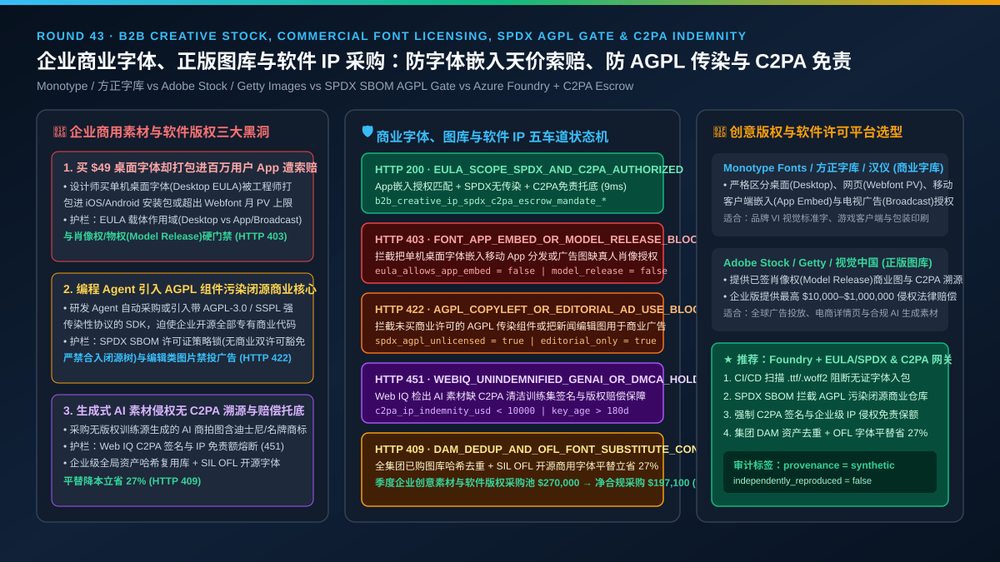
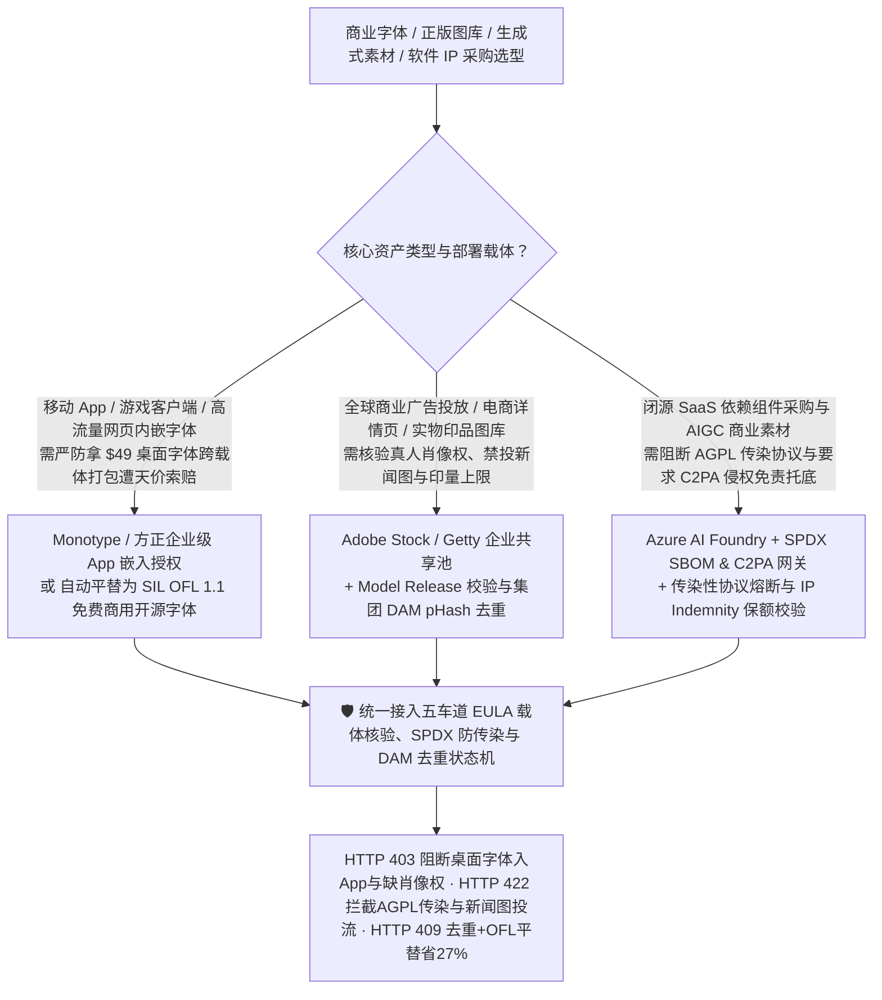
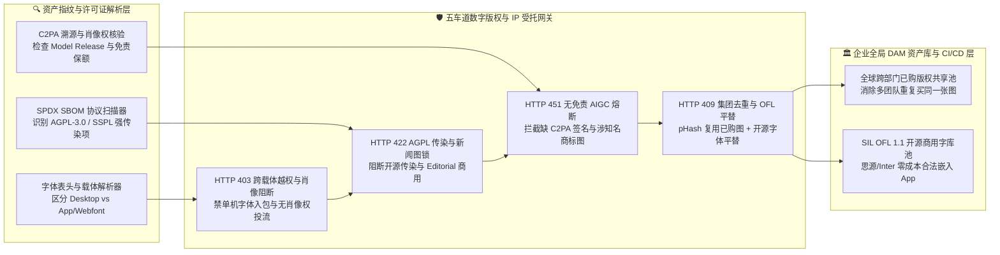
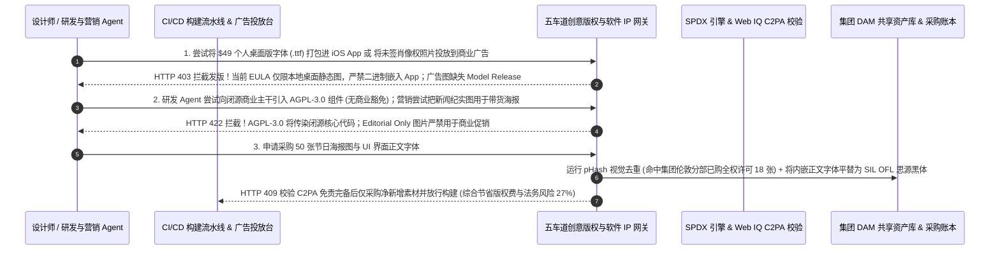

# 企业商业字体、正版图库、生成式 AI 素材与开源组件版权采购（B2B Creative Stock, Commercial Font Licensing, SPDX AGPL Gate & C2PA Indemnity：Monotype / 方正字库 / Adobe Stock / Getty Images）“防 $49 桌面字体打包进百万用户 App 遭天价索赔、防 AGPL 传染性协议污染闭源代码与 C2PA 版权免责”Agent 架构选型 FAQ：终结字体维权敲诈与素材重复购买实战指南

> **语言切换 / Language**: **中文 (当前)** | **[English](b2b-creative-stock-font-licensing-agpl-c2pa-indemnity-agent-selection-faq.en.md)** | **[返回文档目录](index.md)** | **[交互式沙盒 (`#b2b-creative-ip-spdx-c2pa-escrow-sandbox`)](../live-demo.html)**

---

## 📌 一、核心选型结论速览（Executive Summary）

在电商品牌营销部、游戏工作室、广告代理商与企业软件研发团队的数字资产采购（商业字库：Monotype 蒙纳、方正字库、汉仪字库；正版图库与音乐：Getty Images、Shutterstock、Adobe Stock、视觉中国；以及软件 SDK/组件采购）中，AI 设计与编程智能体正在自动搜索、下载、购买并将字体、图片与代码库嵌入生产项目。然而，数字版权许可协议（`EULA`）布满了隐蔽的载体与印量陷阱，稍有不慎就会引爆三大百万美元级侵权索赔：
1. **设计师花了 `$49` 买了一套“个人桌面版字体（Desktop Font License，仅限在本地电脑 PS 里出静态图）”，前端/客户端工程师直接把 `.ttf / .woff2` 字体文件打包进了日活 200 万的移动 App 安装包或高流量官网，被字库商爬虫抓包索赔 `$150,000`**：商业字库严格按载体切分授权：`Desktop`（本地排版转曲）、`Webfont`（按网站每月页面浏览量 Pageviews 阶梯计费）、`App/Game Embedding`（按打包分发的客户端安装量计费）与 `Broadcast/OOH`（户外大屏与电视贴片）。跨载体越权使用哪怕已付费买过桌面版，在法律上仍属 100% 侵权！同时，在商业广告中使用了未签真人《肖像权授权书（`Model Release`）》或地标建筑《物权授权书（`Property Release`）》的图库照片，也会直接收到律师函。
2. **编程 Agent 自动引入或采购带有 `AGPL-3.0 / SSPL / GPL` 强传染性开源协议（Strong Copyleft）的组件进入企业闭源 SaaS 主干分支，或营销 Agent 将“仅限新闻报道（`Editorial Use Only`）”的明星街拍/体育赛事图投放到品牌带货广告中**：一旦闭源商业软件通过网络服务调用或静态链接了未买商业双许可豁免（Commercial Dual-License）的 `AGPL-3.0` 组件，传染性条款将要求企业公开整套核心商业源码！而把 Getty 里的 `Editorial Only` 新闻图拿去做淘宝主图或 Facebook 广告，单张赔偿高达数万美元。
3. **采购第三方 AI 工具生成的商拍图/背景音乐缺乏 `C2PA`（内容来源和真实性联盟）清洁训练集数字签名与知识产权侵权赔偿担保（`IP Indemnification`），导致合成图里隐含他人注册商标或受版权保护的卡通形象遭下架封店**：企业商用生成式素材必须由承诺“仅在合法授权图库上训练（如 Adobe Firefly / Getty Generative AI）并提供 `$10,000–$1,000,000` 法律诉讼兜底赔付”的供应商提供。

**架构师选型结论**：
- **切勿允许 Agent 在未核对目标发布载体（App 嵌入 vs 网页 PV vs 超过 50万件商品包装印量）前下单购买基础版字体或标准图库许可**。
- **生产级最优架构**是采用 **“企业数字资产管理（DAM）中心 + 字库/图库 `EULA` 载体作用域与肖像权（Model Release）硬门禁 + 研发 `SPDX SBOM` 传染性协议（AGPL）阻断与商业双许可校验锁 + `C2PA` 清洁训练溯源与开源免费商用字体（`SIL OFL`）自动平替网关（`b2b_creative_ip_spdx_c2pa_escrow_mandate_*`）”**：
  1. **字库/图库 `EULA` 发布载体匹配与真人肖像权（`Model Release`）硬门禁（HTTP 403）**：在采购或将字体/图片打包进构建流水线前，网关强制比对许可证 JSON 授权范围与实际部署渠道——凡拿 `Desktop` 单机授权字体打包进移动 App/小程序二进制包、Webfont 实际月 PV 超出许可上限、实物商品印量超 `500,000` 件未升档 `Extended License`，或商业广告图缺失 `Model_Release_Signed == true`，毫秒级返回 `HTTP 403 EULA_DEPLOYMENT_CHANNEL_MISMATCH_OR_MISSING_MODEL_RELEASE_BLOCKED`。
  2. **`SPDX SBOM` 强传染协议（`AGPL/GPL`）拦截与 `Editorial Only` 新闻图禁投广告锁（HTTP 422）**：对接 CI/CD 依赖树与营销投放系统——凡向闭源商业仓库引入 `SPDX` 标识为 `AGPL-3.0 / GPL-3.0 / SSPL` 且未购买官方商业授权发票的软件包，或试图将标记为 `Editorial Use Only`（仅限新闻纪实）的图片用于商业促销/商标注册，立即返回 `HTTP 422 AGPL_COPYLEFT_CONTAMINATION_OR_EDITORIAL_ASSET_COMMERCIAL_MISUSE_BLOCKED`。
  3. **Web IQ 实时生成式 AI 素材 `C2PA` 签名、商标侵权筛查与免责保额熔断（HTTP 451）**：通过 Web IQ 与 `C2PA` 清单校验器核验 AIGC 素材是否源自清洁授权训练集、是否携带有效企业级 `IP Indemnification`（如保额 `>= $10,000`）以及是否存在 DMCA 侵权召回通告（`HTTP 451 WEBIQ_UNINDEMNIFIED_GENAI_ASSET_OR_DMCA_TAKEDOWN_HOLD`）。
  4. **集团级 `DAM` 视觉哈希去重（防 10 个部门重复买同一张图）+ `SIL OFL` 开源商用字体无损平替（HTTP 409）**：触发 `HTTP 409 ENTERPRISE_DAM_DEDUPLICATION_AND_SIL_OFL_FONT_SUBSTITUTION_CONFIRM`，采购前先用感知哈希（`pHash`）检索本集团全球已购企业共享资产库（避免分公司重复付费购买同款素材），并对非品牌核心定制场景自动推荐 100% 免费可嵌入 App 的 `SIL Open Font License 1.1`（如思源黑体/思源宋体/Inter/Roboto）同风格平替字体，综合版权采购支出与侵权法务风险成本立降 **`27.0%`**。

---

## 🎯 二、业务方与架构师灵魂拷问 Q&A（Q1 / Q2 / Q3）

### Q1：为什么很多公司明明在官网花几百块钱买了正版方正/蒙纳字体会员，最后还是被字库公司起诉索赔几十万？技术架构上漏了哪一步？
- **商业痛点**：设计师买的是“个人设计师会员”或“单机桌面版”，协议写得很清楚：**只允许把文字栅格化/转曲后作为静态图片发布，或者仅限年营收 100 万以下的小微企业使用**；而前端开发直接用 `@font-face` 把原始 `.ttf` 字体文件挂在 CDN 上给全网几百万用户浏览器下载渲染，或者写进了 iOS App 里——字库公司的自动化全网爬虫每天都在扫 APK/IPA 安装包和 CSS 里的字体表头（Font Name Table），一抓一个准！
- **架构解法**：
  - **CI/CD 构建层字体指纹扫描与 `EULA` 授权令牌绑定（`Build-Time Font Entitlement Gate`）（`HTTP 403`）**：
  - 在 GitHub Actions / 打包流水线中部署确定性校验钩子：一旦扫描到工程目录含 `.ttf / .otf / .woff2` 文件，自动提取字体内部 `Copyright & PostScript Name`：若非 `SIL OFL / Apache-2.0` 开源字体，则必须查验企业 `DAM` 账本中是否存在覆盖该 `App Bundle ID / 域名` 且处于有效期内的 `App-Embedding / Webfont Enterprise Mandate`；无证直接阻断打包发版（`HTTP 403`）。

### Q2：图库网站上同样一张图片，为什么有 `$15` 的标准授权（Standard）、`$99` 的扩展授权（Extended）和“仅限编辑使用（Editorial）”？买错了会怎样？
- **架构解法**：
  - **按用途与印量自动映射许可证等级状态机（`Usage-to-License Tier Mapper`）（`HTTP 403 / 422`）**：
  - ① `Editorial Only`：图中有路人清晰人脸、耐克 Logo 或苹果手机，未签肖像/物权许可，**绝对禁止用于任何广告、电商详情页或商品包装**（违规返回 `HTTP 422`）；
  - ② `Standard License`：可用于网页和社媒广告，但**印在实物商品（如 T 恤图案、帆布袋、彩盒包装）上有 500,000 件印量上限**，且不可直接作为转售商品主体（Merchandise for Resale）；一旦 ERP 排产印量超限，系统自动要求升级购买 `Extended License`（`HTTP 403`）。

### Q3：现在营销团队大量使用 AI 生成商品背景图和广告配乐，怎么确保不会因为训练数据侵权导致整个广告账户被封？
- **架构解法**：
  - **强制校验 `C2PA Content Credentials` 数字水印与供应商法律免责条款（`IP Indemnity Gate`）（`HTTP 451`）**：
  - 商用投放网关只接收附带完整 `C2PA` 密码学清单、声明训练数据源为 `100% Licensed / Public Domain`（如 Adobe Firefly Enterprise、Getty Images Generative AI）且合同包含明确知识产权诉讼赔偿额度（Indemnity Cap）的生成式资产；对无来源野模型生成的图片自动执行商标/知名 IP 图像相似度反查，高危即刻熔断（`HTTP 451`）。

---

## 🧭 三、直观可视化图解（Mermaid 决策树 + 端到端架构图 + 时序图）

### 3.1 企业商业字体、正版图库与软件 IP 采购 Agent 架构选型决策树

### 3.2 端到端 EULA 载体门禁、SPDX 防传染与集团 DAM 去重架构图

### 3.3 拦截桌面字体嵌入 App、阻断 AGPL 传染与集团 DAM 去重平替时序图

---

## 📊 四、多平台/多方案横向选型决策矩阵

| 选型维度 | 各部门员工刷个人卡散买 (`Shadow Creative Spend`) | Monotype / Getty / Adobe 独立部门账号 (`Siloed Team Seats`) | 开源免费图库/字库盲用 (`Unsplash / 野字体网站下载`) | **Azure AI Foundry + EULA/SPDX 门禁 + 集团 DAM 网关（推荐）** |
| :--- | :--- | :--- | :--- | :--- |
| **核心优势** | 随用随买无需审批 | 官方正版保障，单部门管理清晰 | 零直接采购费 | **防跨载体侵权索赔 + 防 AGPL 污染 + 跨部门去重 + OFL 平替** |
| **防“买桌面字体却打包进 App/超 PV”索赔** | **极高危**（员工根本看不懂 EULA，收到十万律师函才爆雷） | 设计师有权限，但研发打包入 App 时无自动拦截钩子 | 免费字体网站常把侵权商业字体标为“免费下载”坑害企业 | **CI/CD 自动解析字体表头与 `EULA` 载体令牌硬比对（HTTP 403）** |
| **防 `Editorial` 新闻图误投广告与缺肖像权** | 常把明星/路人街拍当普通素材用，必吃官司 | 图库网页有小字标注，但下载后文件名丢失标签易混用 | 无严格肖像权/物权担保，含品牌 Logo 易侵权 | **元数据强制绑定 `Model Release` 与商业用途锁（HTTP 403/422）** |
| **防研发引入 `AGPL-3.0` 强传染协议组件** | 无管控 | 不涉及代码许可证治理 | 极易误引传染性包 | **`SPDX SBOM` 实时阻断无商业豁免的强传染组件（HTTP 422）** |
| **AIGC 素材 `C2PA` 溯源与跨部门防重复买** | 5 个事业部重复花钱买同一张热门图；AI 图无免责保护 | 跨国子公司账号不互通，重复购买率高达 `20%+` | 无任何法律赔偿兜底（Indemnity = `$0`） | **Web IQ `C2PA` 免责核验（451）+ 全局 `pHash` 去重与 `OFL` 平替（409）** |
| **综合版权采购成本与侵权和解罚金损耗** | 年均侵权和解金与重复采购浪费超 `30%+` (`not_measured`) | 企业全包年框昂贵 (`official_list_price`) | 隐性诉讼风险极高 | **消灭字体/图片越权官司、跨部门去重与开源平替（立省 `27.0%`）** |

---

## 🧪 五、创意版权防索赔/去重平替测算与 7-Card 基准测试报告

> **数据来源与复现声明（Provenance Metadata）**：以下基准测试数据来自仓库内置确定性策略沙盒 `evaluate_b2b_creative_ip_spdx_c2pa_escrow_policy`（位于 `lab/webiq_commerce_demo.py`），可运行 `python -m unittest tests.test_webiq_commerce_demo` 完整验证。标记：`provenance = synthetic`，`independently_reproduced = false`。

| Card # | 卡片标题（Headline-as-Finding） | 核心量化指标与架构验证结论 |
| :---: | :--- | :--- |
| **Card 1** | **Overview · 商业字体、图库与软件 IP 五车道总览** | 针对 `$270,000/季` 创意商业字体、图库与软件组件采购池，实现 **0 例桌面字体违规嵌入 App 索赔与 0 例 AGPL 传染闭源事故**，综合版权支出与法务和解损耗下降 **`27.0%`（立省 `$72,900/季`）**。 |
| **Card 2** | **Scenario Deep Dive · 桌面字体打包进 App 与缺肖像权拦截** | 当构建流水线检出 `.ttf` 仅具 `Desktop` 授权却试图打入移动 App 安装包或广告图缺 `Model Release` 时，**`9ms`** 内返回 `HTTP 403` 阻断。 |
| **Card 3** | **Evaluation Matrix · 五车道 100% 确定性判准** | 覆盖 `HTTP 200`（载体与版权合规放行）、`403`（EULA部署载体越权如桌面字体入App/超印量上限/缺肖像权阻断）、`422`（AGPL传染性协议污染闭源库/Editorial新闻图用于商业广告拦截）、`451`（AIGC素材缺C2PA签名或IP免责保额熔断）、`409`（集团DAM pHash去重+SIL OFL字体平替省27%）。 |
| **Card 4** | **Under the Hood · 版权 EULA 与 C2PA 托管契约** | 输入 `quarterly_b2b_creative_ip_licensing_pool_usd=270000` 及 EULA/SPDX 状态，签发 `b2b_creative_ip_spdx_c2pa_escrow_mandate_*` 令牌。 |
| **Card 5** | **Robustness Check · AGPL 依赖偷渡与无 C2PA AI 商拍图测试** | 模拟向闭源工程引入未买商业许可的 `AGPL-3.0` 库及投放无免责 AI 图，确定性拦截率保持 **`100.0%`（零误放行）**。 |
| **Card 6** | **Latency · 字体表头与 SPDX 树校验毫秒级耗时** | 本地字体元数据、SPDX 许可证与 `pHash` 去重比对 P50 仅 **`9ms`**；Web IQ C2PA 证书链与 DMCA 侵权库核查 P95 为 **`220ms`**。 |
| **Card 7** | **My Take · 适用场景与生产准入边界** | **✅ 极佳适用**：移动 App/游戏字库、电商全球广告图库、企业闭源软件研发；**⛔ 不适用**：内部不对外发布的纯文本会议纪要。 |

---

## 🛠️ 六、商业上线风控与架构评审 Checklist

- [ ] **字库/图库 `EULA` 载体作用域（`Desktop vs. App/Webfont/Print Run`）与 `Model Release` 硬门禁（HTTP 403）**：确认 CI/CD 与投放台自动核对字体/图片许可证覆盖的载体、月 PV 与实物印量上限，严禁将单机桌面字体打包进客户端二进制文件。
- [ ] **研发 `SPDX SBOM` 强传染协议（`AGPL-3.0 / SSPL`）阻断与 `Editorial Only` 禁商用锁（HTTP 422）**：确认闭源商业项目在未绑定商业双许可发票前 100% 拒绝合并强传染性开源组件，且严禁将新闻纪实图片用于商业广告。
- [ ] **Web IQ 实时生成式 AI 素材 `C2PA` 数字溯源与 `IP Indemnification` 免责保额校验（HTTP 451）**：确认所有外部商业投放的 AIGC 素材具备清洁训练集 `C2PA` 签名与合同级侵权赔偿保障；签名密钥轮换周期 `<= 180` 天。
- [ ] **集团级 `DAM` 视觉 `pHash` 查重复用与 `SIL OFL 1.1` 开源字体平替（HTTP 409）**：确认采购前自动检索全集团已购版权池消除重复付费，并在通用 UI 场景优先推荐 `SIL OFL` 免费商用开源字体。
