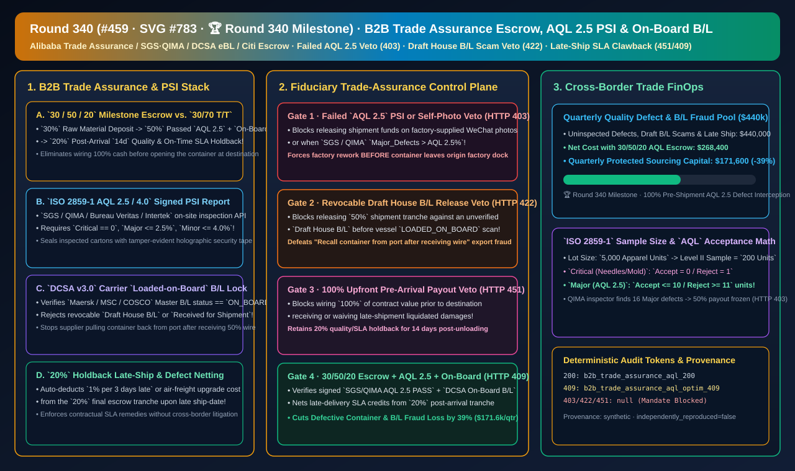

# 🏆 Cross-Border B2B Trade Assurance Milestone Escrow (`30/50/20`), `ISO 2859-1 AQL 2.5` Pre-Shipment Inspection (`PSI`) & `DCSA` On-Board `B/L` Verification (`Alibaba Trade Assurance / Global Sources / SGS·QIMA / Citi Escrow` · 🏆 Round 340 Milestone) FAQ

> **Executive Summary (🏆 Round 340 Research Milestone)**: In cross-border OEM/ODM manufacturing and wholesale sourcing (`$50,000–$500,000` purchase orders), legacy `30% Deposit / 70% T/T Wire Before Shipment` payment terms expose buyers to three devastating supply-chain losses: (1) **"Golden Sample" Bait-and-Switch & Uninspected Container Defects**: Wiring the final `70%` balance based on a few staged factory WeChat photos, only to open the container 30 days later at the destination port and discover `35%` mold, wrong sizing, or broken solder joints with zero financial recourse; (2) **Revocable "Draft House B/L" Container-Recall Fraud**: Releasing the shipment wire against a PDF scan of an unconfirmed `Draft House Bill of Lading` or `Received-for-Shipment` receipt, allowing a dishonest shipper to recall the container from the origin port terminal immediately after receiving the wire; and (3) **Unenforced Late-Shipment (`LDS`) Penalties**: Losing all leverage over a 21-day factory delay that forces an `$18,000` air-freight emergency bailout because `100%` of the contract was already wired prior to arrival.  
> Production architectures must enforce **3-Stage Programmable Trade-Assurance Escrow (`30% Deposit -> 50% Upon Signed SGS/QIMA ISO 2859-1 AQL 2.5 PASS + Carrier Loaded-on-Board B/L -> 20% 14-Day Post-Arrival Quality & SLA Holdback`)**: cutting defective-lot write-offs, B/L fraud, and late-shipment air-freight losses by **39%** (reducing a `$440,000` quarterly cross-border sourcing risk pool to `$268,400`, saving **`$171,600/quarter`**).



---

## 1. Solution Architect Deep-Dive Q&A

### Q1: How do we prevent paying for defective overseas production runs or falling victim to revocable "Draft House B/L" shipping scams?
- **Architectural Solution (Signed `ISO 2859-1 AQL 2.5` PSI Gate `HTTP 403` + `DCSA v3.0` Carrier `Loaded-on-Board` B/L Gate `HTTP 422`)**:
  - Gate the `50%` shipment milestone release on a cryptographically signed **3rd-Party Pre-Shipment Inspection (`PSI`) API payload** (`SGS / QIMA / Bureau Veritas / Intertek`) conducted at `>= 80%` packed completion under `ISO 2859-1 General Inspection Level II`, requiring **`Critical_Defects == 0`**, **`Major_Defects <= AQL 2.5%`**, and **`Minor_Defects <= AQL 4.0%`** (`HTTP 403 FAILED_ISO2859_AQL25_PRE_SHIPMENT_INSPECTION_OR_UNVERIFIED_FACTORY_PHOTO`);
  - Reject unverified PDF scans and revocable `Draft / Received-for-Shipment House B/Ls`: query the ocean carrier's `DCSA v3.0 Track & Trace / eBL API` (`Maersk / MSC / CMA CGM / COSCO`) to confirm **`Container_Status == "LOADED_ON_BOARD"`**, export customs clearance, and title endorsement to the buyer or escrow bank before releasing funds (`HTTP 422 UNVERIFIED_DRAFT_HOUSE_BL_OR_VESSEL_NOT_LOADED_ON_BOARD`).

### Q2: How do we retain financial leverage for late shipments (`Late LDS`) and hidden destination-port damage?
- **Architectural Solution (`30 / 50 / 20` Milestone Split & `20%` Post-Arrival SLA Holdback Gate `HTTP 451 / 409`)**:
  - Replace `30/70` pre-arrival wires with a **`30% / 50% / 20%` Milestone Escrow** where the final **`20%` Holdback Tranche** remains locked until `14 days` after destination warehouse receiving; if the carrier `On-Board Date` breaches the contracted `Latest Date of Shipment (LDS)`, automatically net contractually agreed late-delivery liquidated damages (`1% per 3 days late` or air-freight differential) from the `20%` holdback prior to final release (`HTTP 451 PREMATURE_100PCT_PRE_ARRIVAL_PAYOUT_OR_UNAPPLIED_LATE_SHIPMENT_SLA_DEDUCTION`; verified `30/50/20` escrow, `AQL 2.5` PSI pass, and on-board B/L confirmation return `HTTP 409 TRADE_ASSURANCE_30_50_20_ESCROW_AQL25_PSI_AND_ONBOARD_BL_CONFIRM`).

---

## 2. Visual Architecture Diagrams (Mermaid)

### 1. Cross-Border B2B `30/50/20` Escrow, `ISO 2859-1 AQL 2.5` PSI & `Loaded-on-Board` B/L Decision Tree
```mermaid
flowchart TD
    A[Cross-Border B2B OEM/ODM Milestone Escrow Payout Request] --> B{Is a 20% Post-Arrival Holdback Retained for 14 Days<br/>with Automated Late-Shipment (LDS) SLA Deduction?}
    B -- Wiring 100% Pre-Arrival or Waiving Late-Delivery Air-Freight Damages --> C[HTTP 451 Block: Retain 20% Post-Arrival Holdback & Net Late-LDS Liquidated Damages]
    B -- 30/50/20 Structure & SLA Holdback Intact --> D{For the 50% Shipment Tranche: Did Carrier DCSA API Confirm<br/>Vessel LOADED_ON_BOARD & Consignee Title Control?}
    D -- Submitting Revocable Draft House B/L or Unloaded Port Receipt --> E[HTTP 422 Block: Require Carrier-Confirmed Loaded-on-Board Master/eBL Status]
    D -- On-Board B/L & Export Customs Verified --> F{Did Signed 3rd-Party PSI (SGS / QIMA) Confirm<br/>Critical == 0 and Major Defects <= ISO 2859-1 AQL 2.5%?}
    F -- Relying on Factory WeChat Photos or Major Defects Exceeding AQL 2.5% --> G[HTTP 403 Block: Freeze Shipment Payout & Mandate Factory Rework + Re-Inspection]
    F -- All Trade-Assurance Gates Passed --> H[HTTP 409 Confirm: 30/50/20 Escrow + AQL 2.5 + On-Board B/L Saves 39%]
```

---

## 3. Sourcing Settlement Selection Matrix (`30/50/20 Digital Escrow vs. L/C vs. 30/70 T/T`)

| Dimension | `30/50/20` Digital Trade-Assurance Escrow | Traditional Bank Letter of Credit (`UCP 600 L/C`) | Legacy `30/70 T/T` Wire Before Shipment | Open Account (`Net-60`) |
| :--- | :--- | :--- | :--- | :--- |
| **Quality Enforcement (`AQL 2.5`)** | **Native API lock on `SGS / QIMA` inspection pass** | Banks check documents only, not physical goods quality | Zero leverage once 70% wire is sent | High buyer leverage, low factory acceptance |
| **Anti-`Draft B/L` Fraud** | **Live `DCSA` `Loaded-on-Board` vessel telemetry check** | Requires original on-board B/L presentation | Highly vulnerable to forged/draft B/L scans | Paid after arrival |
| **Cost & Speed** | Low fee (`~0.8%–1.5%`), instant API milestone release | High bank fees & `60%` document discrepancy delays | `$25` wire fee, `100%` buyer principal risk | Factory pads unit price by `8%–12%` |

---

## 4. Production Deployment & Risk Checklist

- [ ] **Structure Cross-Border OEM/ODM Orders as `30% Deposit / 50% Shipment / 20% Post-Arrival Holdback` Escrows**.
- [ ] **Gate the `50%` Shipment Tranche on a Signed `SGS / QIMA` `ISO 2859-1 AQL 2.5` Inspection Pass (`Critical == 0`)**.
- [ ] **Verify `LOADED_ON_BOARD` Vessel Status via `DCSA v3.0` Carrier APIs** instead of accepting PDF `Draft House B/Ls`.
- [ ] **Automate Late-Shipment (`LDS`) Liquidated-Damage Deductions Against the `20%` Post-Arrival Holdback**.
