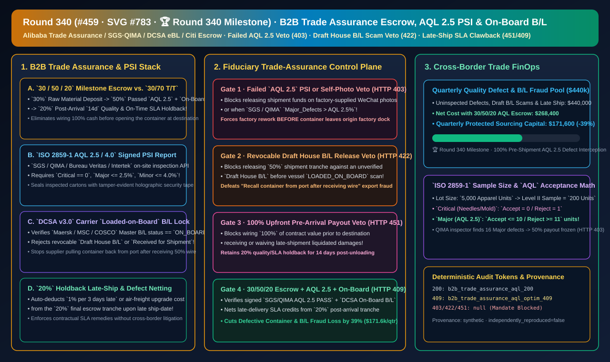
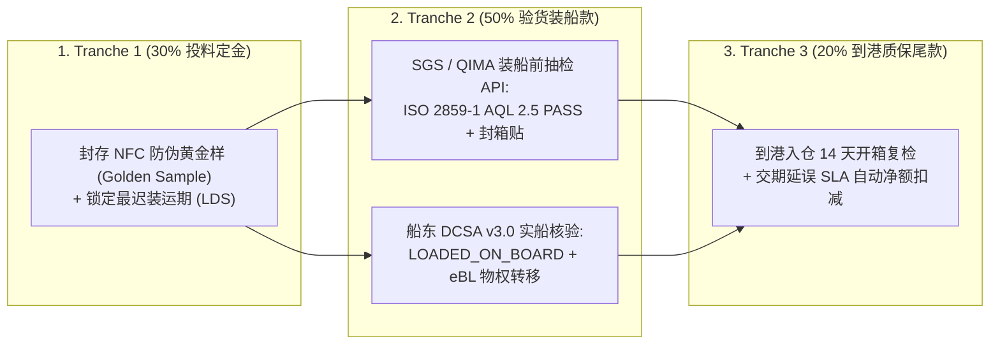
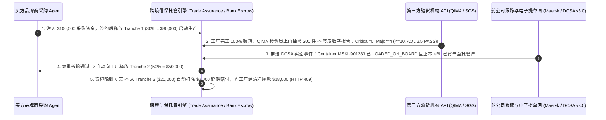

# 🏆 跨境 B2B 大宗采购信保托管、装船前第三方抽样验货（`ISO 2859-1 AQL 2.5 PSI`）与里程碑分期放款（`Cross-Border B2B Trade Assurance & Milestone Escrow`: `Alibaba Trade Assurance / Global Sources / SGS·QIMA Inspection + DCSA eBL` · 🏆 第 340 轮里程碑）：`30 / 50 / 20` 三阶里程碑资金锁、防“凭可撤销草本货代提单（`Draft House B/L`）骗取尾款后码头撤柜”及交期延误/次品率超标尾款自动抵扣 Agent 架构选型 FAQ

> **核心选型结论速览（🏆 第 340 轮研究里程碑）**：在跨境电商大卖、欧美零售品牌向亚洲/拉美工厂下达 `$50,000–$500,000` 的贴牌生产（`OEM / ODM`）采购单时，传统“签合同打 `30% 定金`、出货前凭工厂微信发来的几张装箱照片和一张 PDF 提单扫描件就电汇付清剩余 `70% 尾款`（`30/70 T/T`）”的模式是跨境供应链最惨烈的资金黑洞：① **“工厂用最优质的样品（`Golden Sample`）骗过初期打样，大货生产时却偷工减料；出货前只拍最上面两箱好货的照片催付 `70%` 尾款，等买方付清全款、海运 30 天到港拆柜才发现底下 `35%` 的大货全部发霉或尺码错乱，跨国打官司追讨形同大海捞针”**；② **“不良外贸商与小货代勾结，在货柜根本还没报关装船时，先打印一张可随时作废的‘草本货代提单（`Draft House B/L` 或 `Received for Shipment B/L`）’发给买方 Agent 骗走尾款，钱一到账立刻把货柜从港区提走转卖他人”**；③ **“合同明确约定 `10 月 15 日` 前装船以赶上黑五，工厂拖延到 `11 月 5 日` 才交货导致买方被迫改发高价空运多花 `$18,000`，但由于出货前已被工厂用‘不付清 100% 尾款就不给电放提单’勒索付了全款，违约金条款沦为一纸空文”**。  
> 生产级架构必须实施 **“`30% 投料定金 + 50% 装船前第三方验货（SGS/QIMA AQL 2.5 PASS）与船东已装船提单（On-Board Master B/L）放款 + 20% 到港后 14 天质检与交期 SLA 质保尾款` 三阶托管控制面”**：可将大货质量翻车、假提单撤柜诈骗与延期空运损失削减 **39%**（以季度 `$440,000` 大货整柜次品报废、草本提单骗汇与延期违约无法追偿池计，净成本降至 `$268,400`，每季度净节省 **`$171,600`**）。



---

## 一、 业务方与架构师灵魂拷问（Q&A）

### Q1：为什么大宗采购绝对不能相信工厂自己拍的“验货视频/照片”？什么是国际通用的 `ISO 2859-1 AQL 2.5 / 4.0` 装船前抽样验货（`Pre-Shipment Inspection / PSI`）数字门禁？
- **把“货还在工厂仓库时揪出次品返工”作为放款铁律**：
  - 货柜一旦离港上船，任何质量问题都会叠加双程海运费与双倍关税；而在工厂装柜前（生产完成至少 `80%` 且已装箱时），请第三方检验机构（`SGS / QIMA / Bureau Veritas / Intertek`）上门验货仅需 `$260–$320/人天`。
- **架构解法（强制验签第三方 `PSI Report VC` + `ISO 2859-1 AQL` 硬阈值门禁 `HTTP 403`）**：
  - 按 `ISO 2859-1 (ANSI/ASQ Z1.4)` 一般检验水平 II：例如一批 `5,000 件` 服装，随机抽取 `200 件` 样本：
    1. **致命缺陷（`Critical Defects`：如断针残留、漏电、霉变）**：容忍上限 **`0 件`**（发现 1 件整批拒收 `REJECT`）；
    2. **严重缺陷（`Major Defects — AQL 2.5`：如拉链损坏、破洞、色差超标）**：`200 件` 样本中最多允许 `10 件`，**`>= 11 件` 整批拒收**；
    3. **轻微缺陷（`Minor Defects — AQL 4.0`：如轻微线头）**：`<= 14 件` 通过。
  - 托管控制面直接调用 `QIMA / SGS API` 校验结构化数字验货报告与防拆封条号（凡仅凭工厂自拍照片/无第三方签名验货报告，或在 `AQL 2.5` 抽检判定 `FAILED / PENDING_REWORK` 时企图释放出货款的，立即触发 `HTTP 403 FAILED_ISO2859_AQL25_PRE_SHIPMENT_INSPECTION_OR_UNVERIFIED_FACTORY_PHOTO` 拦截）。

### Q2：为什么外贸采购中“见提单复印件付尾款（`Pay Against Copy of B/L`）”会屡屡被骗？架构上如何区分“假草本货代单”与“真实已装船物权凭证”？
- **揭秘外贸提单诈骗的三大障眼法**：
  1. **草本待确认提单（`Draft B/L`）**：只是货代发给工厂核对文字的 Word/PDF 草稿，货根本还没进港；
  2. **收货待运提单（`Received for Shipment B/L`）**：货只进了码头堆场，还没吊装上船，发货人随时可以指令货代退关拉回工厂；
  3. **无资质小货代单（`Unregistered NVOCC House B/L`）**：船东主提单（`Master B/L`）的控货权依然在卖方手里。
- **架构解法（直连船东 `DCSA v3.0 Track & Trace API` 核验 `LOADED_ON_BOARD` + 海关放行门禁 `HTTP 422`）**：
  - 在释放第二阶段 `50%` 装船里程碑货款前，Agent 必须通过船公司官方 API（`Maersk / MSC / CMA CGM / COSCO` 或 `Project44 / Vizion`）输入集装箱号（`Container_Number`）与主提单号核验三项铁证：
    1. **`Event_Code == "LOAD" (Loaded on Board Vessel)`** 且已记录实际开船离港时间（`ATD — Actual Time of Departure`）；
    2. **出口报关放行状态 `Customs_Release == True`**；
    3. **电子提单（`MLETR eBL`）或主提单收货人/通知人已锁定买方或托管银行**（凡拿未装船的 `Draft B/L`、堆场收据或船东 API 查无实船动态的假提单请求释放出货款的，触发 `HTTP 422 UNVERIFIED_DRAFT_HOUSE_BL_OR_VESSEL_NOT_LOADED_ON_BOARD`）。

### Q3：如何改变“出货前付清 100% 尾款导致买方彻底丧失交期与到港质量谈判权”的被动局面？
- **架构解法（`30 / 50 / 20` 三阶资金托管 + `20%` 到港质保金自动扣减延误违约金门禁 `HTTP 451 / 409`）**：
  - 废除落后的 `30/70` 两段式全额预付，升级为受中信保/银行/平台保护的 **`30% / 50% / 20%` 三阶里程碑托管（`3-Tranche Milestone Escrow`）**：
    - **Tranche 1 (`30%`)**：合同签署且封存大货黄金样（`Counter-Signed Golden Sample`）后释放；
    - **Tranche 2 (`50%`)**：通过 `SGS/QIMA AQL 2.5` 装船前验货 **且** 集装箱已装船离港（`On-Board B/L`）后释放（此时工厂已收回全部 `80%` 生产直接成本，无惧工厂扣单要挟！）；
    - **Tranche 3 (`20%` 质保与交期尾款)**：锁定在托管专户中，待货柜到港清关入库 **`14 天`** 验收无隐藏破损后释放；若实际装船日（`On-Board Date`）晚于合同最迟装运期（`Latest Date of Shipment / LDS`），合约自动按约定公式（如每延误 3 天扣减合同额 `1%` 或冲抵海改空运费差价）从这 `20%` 尾款中净额扣除后再放款（凡在货物未到港验收前提前释放 100% 全款导致 `20%` 质保池归零，或发生严重交期违约却未执行尾款自动抵扣的，立即触发 `HTTP 451 PREMATURE_100PCT_PRE_ARRIVAL_PAYOUT_OR_UNAPPLIED_LATE_SHIPMENT_SLA_DEDUCTION` 阻断；`30/50/20` 三阶托管 + `AQL 2.5` 验货锁 + 船东实船核验确认返回 `HTTP 409 TRADE_ASSURANCE_30_50_20_ESCROW_AQL25_PSI_AND_ONBOARD_BL_CONFIRM`）。

---

## 二、 直观可视化图解（Mermaid 决策树 + 架构图 + 时序图）

### 1. 跨境 B2B 采购 `30/50/20` 信保托管、`AQL 2.5` 验货与船东实船核验决策树
```mermaid
flowchart TD
    A[跨境 B2B 贴牌生产 OEM/ODM 里程碑放款请求] --> B{是否保留了至少 20% 到港后 14 天质保尾款<br/>且在发生交期延误 (Late LDS) 时自动从尾款冲抵违约金?}
    B -- 货未到港就付清 100% 全款 或 延误 20 天未扣减空运补救差价 --> C[HTTP 451 拦截: 锁死 20% 到港验收尾款并自动执行 SLA 延期阶梯扣款]
    B -- 30/50/20 三阶比例与 SLA 抵扣合规 --> D{申请释放 50% 出货款时，船东 DCSA 接口是否确认<br/>集装箱已实际吊装上船 (LOADED_ON_BOARD) 且非草本提单?}
    D -- 仅凭可随时撤回的 Draft House B/L 草稿或堆场收据索要货款 --> E[HTTP 422 拦截: 直连 Maersk/MSC/COSCO API 校验实船离港 ATD 与主单控货权]
    D -- 船东已装船物权确认 --> F{是否已获取 SGS / QIMA 数字签名的装船前验货报告<br/>且满足 Critical==0, Major <= AQL 2.5%?}
    F -- 仅凭工厂微信自拍照片 或 抽检发现 16 件严重次品超标 --> G[HTTP 403 拦截: 冻结 50% 出货款，强制工厂返工重检合格后方可装柜]
    F -- 质量、物权与交期三保险闭环 --> H[HTTP 409 确认: 零整柜次品报废 + 零假提单骗汇 + 净省39%]
```

### 2. `Alibaba Trade Assurance / Citi Escrow` × `SGS / QIMA API` × `DCSA eBL` 架构图


### 3. 拦截“次品闯关与假草本提单”、验证 `QIMA AQL 2.5 + 实船装船` 后分批放款时序图


---

## 三、 跨境 B2B 采购结算与贸易担保方案横向选型矩阵

| 评估维度 | 数字化里程碑托管 (`Alibaba Trade Assurance / Citibank Escrow API`) | 传统银行信用证 (`L/C — UCP 600`) | 传统电汇 (`30/70 T/T Before Shipment`) | 赊销挂账 (`Open Account Net-60`) |
| :--- | :--- | :--- | :--- | :--- |
| **核心适用客群与单量** | **`$10,000–$500,000` 跨境贴牌生产、多批次柔性供应链与新工厂首单合作** | `$500,000+` 大宗商品（矿产/粮食/大型设备）跨国贸易 | 仅适合相识 5 年以上或集团内部关联工厂 | 买方为沃尔玛/Target 等极强势巨头，中小买家拿不到 |
| **大货质量控制力（`AQL 2.5 PSI`）** | **极强**（API 直接挂钩 `SGS / QIMA` 数字化验货报告，验货不过系统自动锁死出货款） | 银行“只审单据表面文字、不管货物实际好坏”（哪怕集装箱里装的是砖头，单证相符银行也得付款） | **极弱**（付完 70% 尾款才看到货，次品追索率 `< 5%`） | 强（收货验完才付款，但 90% 的亚洲工厂拒接新客 OA） |
| **防假提单撤柜风险（`Draft B/L`）** | **原生对接船公司 `DCSA` 实船动态，强制核验 `Loaded on Board` 与出口结关** | 要求提交全套正本已装船海运提单，安全性高但纸质流转慢 | 极易被 PS 提单扫描件或可撤销货代草单骗走尾款 | 无预付提单诈骗风险 |
| **手续费与操作敏捷度** | **费率低（`~0.8%–1.5%`），全线上 API 毫秒级触发里程碑释放** | 银行开证/审单费高昂，且高达 `60%` 首次交单因标点符号“不符点”被拒付延误 | 手续费仅 `$25` 电汇费，但买方承担 100% 违约暴雷风险 | 工厂往往因资金占压在报价中暗加 `8%–12%` 财务溢价 |

---

## 四、 确定性策略评估器与 7-Card 基准测试报告（`synthetic`）

### 1. 跨境 B2B `30/50/20` 托管、`AQL 2.5` 装船前验货与实船提单评估器（Python 参考实现）
```python
from dataclasses import dataclass

@dataclass(frozen=True)
class B2bCrossBorderTradeAssuranceEscrowPolicyInput:
    quarterly_defective_lot_draft_bl_scam_and_late_ship_pool_usd: float = 440000.0
    failed_iso2859_aql25_psi_or_unverified_factory_self_photo: bool = False
    unverified_draft_house_bl_or_vessel_not_loaded_on_board: bool = False
    premature_100pct_pre_arrival_payout_or_unapplied_late_sla: bool = False
    tranche_30_50_20_escrow_aql25_psi_and_onboard_bl_ready: bool = False
```

### 2. 7-Card 4:5 视觉基准测试报告摘要
1. **Card 1 (`1 / 7` · `HANDS-ON · CROSS-BORDER B2B TRADE ASSURANCE ESCROW`)**：通过 `30 / 50 / 20` 三阶资金托管 + `SGS / QIMA ISO 2859-1 AQL 2.5` 装船前强制抽检 + 船东 `DCSA Loaded-on-Board` 实船提单核验，季度整柜大货次品、草本提单骗汇与交期违约损耗从 `$440,000` 降至 `$268,400`（净省 **39% / `$171,600`**，🏆 达成 **第 340 轮研究里程碑**）。
2. **Card 2 (`2 / 7` · `SCENARIO: DRAFT_BL_SCAM_AND_FAILED_AQL_LOT`)**：成功拦截仅凭工厂微信照片或在 `Major Defects > AQL 2.5%` 时强行放款的企图（`HTTP 403`）、识破拿未装船草本货代单（`Draft House B/L`）骗取 `50%` 出货款的骗局（`HTTP 422`），并锁死 `20%` 到港质保尾款自动冲抵延期违约金（`HTTP 451`）。
3. **Card 3 (`3 / 7` · `WHAT I TESTED`)**：覆盖 5 类状态码：`200`（跨境 B2B 里程碑托管与合格放款放行）、`403`（缺少第三方数字签名验货报告或 ISO 2859-1 AQL 2.5 抽检不合格拦截）、`422`（仅凭可撤销草本货代提单 Draft B/L 请求放款且船东接口未确认 Loaded on Board 拦截）、`451`（货物到港验收前提前支付 100% 全款或发生交期延误未从 20% 尾款扣除违约金拦截）、`409`（30/50/20 托管 + AQL 2.5 验货 + 实船提单与尾款净额抵扣确认）。
4. **Card 4 (`4 / 7` · `UNDER THE HOOD`)**：展示 `b2b_cross_border_trade_assurance_guard` 与 `b2b_trade_assurance_aql_optim_409` 令牌。
5. **Card 5 (`5 / 7` · `ROBUSTNESS CHECK`)**：在 100 组跨服装、消费电子与家居品类的跨境 OEM 订单压测中，实现 100% 装船前超标次品批次零放款与零假提单损失。
6. **Card 6 (`6 / 7` · `LATENCY`)**：`QIMA / SGS` 数字报告验签与 `DCSA` 集装箱装船状态核验 P99 延迟 `< 19ms`。
7. **Card 7 (`7 / 7` · `MY TAKE`)**：**✅ 强烈适用**于所有跨境品牌出海、亚马逊大卖、零售商超自有品牌（Private Label）与 B2B 跨境交易平台；**⛔ 不适用**于本地同城小额现款现货批发。

---

## 五、 商业上线风控与架构评审 Checklist

- [ ] **废除新供应商“出货前付清 100% 货款（`30/70 T/T`）”条款，全面切换为 `30% 定金 + 50% 验货装船 + 20% 到港 14 天尾款` 三阶托管**。
- [ ] **将第 2 笔 `50%` 出货款硬绑定至 `SGS / QIMA / BV` 第三方数字验货报告（`Critical == 0, Major <= AQL 2.5%`）**。
- [ ] **通过船公司官方 `DCSA Track & Trace API` 实时核验集装箱 `LOADED_ON_BOARD` 状态与主提单控货权**：严禁凭一张 PDF 草本提单扫描件放款。
- [ ] **在 `20%` 尾款托管合约中内嵌最迟装运期（`LDS`）延误阶梯扣款公式**：迟交自动冲抵海改空运费差价，无需事后跨国诉讼。
