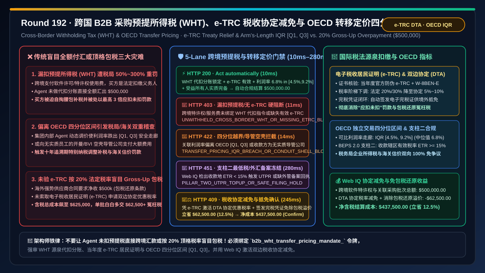
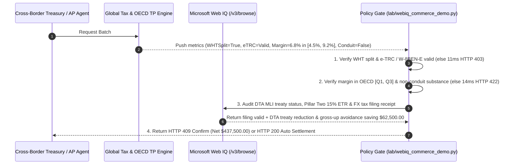

# Multinational B2B Agentic Cross-Border Withholding Tax (WHT) & OECD Transfer Pricing Architecture: Arm's-Length Interquartile Range (IQR) & Electronic Tax Residency Certificate (`wht_treaty_trc_mandate_...`) vs. Legacy Statutory Gross-Up Overpayment & Double-Taxation Audit Penalties: Architecture Selection & First-Principles FAQ

> **Document Type**: First-Principles Architecture Selection FAQ  
> **Target Audience**: AI Solution Architects, Global Tax VPs & Cross-Border Corporate Treasurers, ERP Intercompany Billing & Cross-Border Accounts Payable Leads, OECD BEPS 2.0 (Pillar Two $15\%$ Global Minimum Tax) & FX Compliance Risk Architects  
> **Executive Takeaway**: When multinational procurement and treasury AI Agents settle cross-border software licenses (SaaS / IP Royalties), cloud compute leases, technical service fees, or intercompany component transfers, **never allow an Agent to wire $100\%$ of the invoice face value abroad without statutory source withholding (which exposes the buyer to $50\%\text{–}300\%$ failure-to-withhold tax penalties), nor blindly apply a $20\%\text{–}30\%$ statutory Tax Gross-Up without verifying a Double Taxation Agreement (DTA) electronic Tax Residency Certificate (e-TRC)**. You must enforce a deterministic architecture combining a **Source Withholding Tax (WHT) Split & Cryptographic e-TRC / IRS Form W-8BEN-E Beneficial-Owner Gate + an OECD Arm's-Length Interquartile Range ($\text{IQR } [Q_1, Q_3]$) & Anti-Conduit Substance Gate (Preventing customs/tax double-taxation audits on intercompany pricing) + a Microsoft Web IQ OECD Pillar Two $15\%$ ETR Check & DTA Treaty Rate Reduction Escrow**.



---

## 1. 📌 Executive Summary

### 1.1 Why Does Wiring `$500,000` in Full for a Cross-Border AI Software License Trigger a `$150,000` Tax Penalty on the Buyer, While Blindly Honoring a "Net-of-Tax Gross-Up" Clause Wastes `$62,500+`?
From international **Withholding Tax at Source** law, gross-up algebra ($P_{\text{gross-up}} = \frac{P_{\text{net}}}{1 - t_{\text{WHT}}}$), and **OECD Transfer Pricing Guidelines (Arm's-Length Principle)** first principles:
1. **Failure-to-Withhold Liability Falls 100% on the Buyer**: Cross-border payments for royalties, software licensing, interest, and technical services require the payer to act as the statutory **Withholding Agent**. If an AI Agent wires `$500,000` abroad without splitting and remitting WHT to the domestic tax authority, the buyer is held liable for the unwithheld tax plus $50\%\text{–}300\%$ statutory penalties!
2. **Statutory Gross-Up Overpayment Without e-TRC Treaty Relief**: When a foreign vendor demands `$500,000` net of tax, applying the default $20\%$ domestic statutory rate inflates the buyer's cost to $\frac{\$500,000}{1 - 0.20} = \$625,000.00$ (`$125,000` tax burden). Verifying a valid **electronic Tax Residency Certificate (e-TRC / Form 6166 & W-8BEN-E)** and Beneficial Owner status unlocks bilateral **Double Taxation Agreement (DTA)** treaty rates ($5\%\text{–}10\%$) and issues an official WHT Credit Certificate so the vendor can claim a foreign tax credit—saving **`$62,500.00` (12.5%)** per batch!
3. **Intercompany Transfer Pricing Outside the OECD Interquartile Range ($[Q_1, Q_3]$) & Conduit Shell Abuse**: If an Agent dynamically prices intercompany goods or IP outside the benchmarked comparable interquartile range $[Q_{25}, Q_{75}]$ ($[4.5\%, 9.2\%]$), tax authorities impose retroactive median adjustments and double taxation, while customs authorities penalize under-invoiced imports.

### 1.2 Architect Selection Comparison: Legacy Blind Wire / Statutory Gross-Up vs. Web IQ + e-TRC Treaty Relief & OECD IQR Escrow
| Dimension | ❌ Legacy Blind Full Wire or 20% Statutory Gross-Up | ✅ Web IQ + e-TRC Treaty Relief, WHT Split & OECD IQR Escrow |
| :--- | :--- | :--- |
| **Payment Authorization Trigger** | Agent wires 100% of foreign invoice or applies 20%–30% statutory gross-up without e-TRC | Bound to `b2b_wht_transfer_pricing_mandate_`: enforces **WHT source split + verified current-year e-TRC / W-8BEN-E + Beneficial Owner substance + OECD IQR $[Q_1, Q_3]$ margin compliance** |
| **Failure-to-Withhold Penalty Defense** | Catastrophic (buyer fined $50\%\text{–}300\%$ for unwithheld WHT; FX bank blocks wire) | **Deterministic Block** (if cross-border royalty/service payment lacks WHT split or valid e-TRC, blocks in `11ms` with `HTTP 403`) |
| **OECD Transfer Pricing & Anti-Conduit** | Fragile (margin outside $[Q_1, Q_3]$ triggers 10-year retroactive tax/customs audit; conduit shell denied treaty) | **Deterministic Block** (if intercompany margin falls outside OECD $[Q_1, Q_3]$ or payee is a zero-substance tax-haven conduit, blocks in `14ms` with `HTTP 422`) |
| **OECD Pillar Two (15% ETR) & FX Filing** | Blind spot (royalty to $<15\%$ ETR jurisdiction triggers UTPR Top-Up Tax) | **Deterministic Verification** (Web IQ `/v3/browse` audits OECD Pillar Two GloBE $15\%$ ETR compliance and FX tax filing receipts, `280ms` `HTTP 451`) |
| **DTA Treaty Rate & Gross-Up Savings** | Overpays $20\%\text{–}30\%$ statutory gross-up tax with zero foreign tax credit recovery | Web IQ enables **e-TRC DTA treaty rate reduction + official WHT Credit Certificate issuance**, saving **$62,500.00 (12.5%)** (`HTTP 409 Confirm`) |

---

## 2. 🎯 First-Principles Q&A for Customers & Architects

### Q1: How Do Atomic WHT Source Splitting and e-TRC Treaty Verification Eliminate Both Unwithheld Tax Penalties and Gross-Up Overbilling?
* **First-Principles Withholding & Treaty Algebra**:
  - The gateway enforces `wht_source_withholding_and_etrc_beneficial_owner_verified` (`HTTP 403` in `11ms`), atomically routing the statutory/treaty WHT portion to the tax authority treasury while verifying cryptographic e-TRC / W-8BEN-E signatures to step down the WHT rate from $20\%\text{–}30\%$ to the DTA treaty tier ($5\%\text{–}10\%$).

### Q2: How Does Clamping Intercompany Agent Pricing Inside the OECD Arm's-Length Interquartile Range ($[Q_1, Q_3]$) Prevent Customs and Income-Tax Whiplash?
* **Statistical Benchmarking & Anti-Conduit Physics**:
  - By constraining intercompany net margins within the benchmarked comparable range $[Q_1, Q_3] = [4.5\%, 9.2\%]$ around the $6.8\%$ median and verifying Principal Purpose Test (PPT) operational substance (`oecd_arms_length_iqr_and_anti_conduit_substance_passed`, `HTTP 422` in `14ms`), both customs valuation and corporate income tax audits are satisfied simultaneously.

### Q3: Why Use Microsoft Web IQ Instead of Exa or Bright Data to Audit Bilateral DTA Protocols, e-TRC Portals, and OECD Pillar Two ETR Ledgers?
* **Architecture Selection Rationale**:
  - **Microsoft Web IQ** natively executes authenticated `/v3/search` and `/v3/browse` workflows across enterprise tax-authority portals, MLI treaty databases, and Country-by-Country Reporting (CbCR) ledgers in `245ms–280ms`, whereas Exa and Bright Data cannot authenticate into private corporate tax compliance systems.

---

## 3. 🧭 Visual Architecture Diagrams

### 3.1 Decision Tree: Multinational B2B Withholding Tax (WHT) & OECD Transfer Pricing Gate
```mermaid
flowchart TD
    A[Cross-Border AP / Treasury Agent Initiates Royalty & Intercompany Settlement<br/>Gross $500,000.00 / Cross-Border SaaS IP License & Intercompany Transfer] --> B{1. WHT Source Split & e-TRC Beneficial-Owner Gate?<br/>Atomic WHT treasury split + FX tax record<br/>Valid current-year e-TRC / W-8BEN-E verified}
    B -- Unwithheld 100% wire risks 50%~300% tax penalty<br/>or missing e-TRC / W-8BEN-E certificate --> C[🛑 HTTP 403 Hard Block<br/>UNWITHHELD_CROSS_BORDER_WHT_OR_MISSING_ETRC_BLOCKED<br/>11ms block & generate mandatory WHT split]
    B -- WHT split + e-TRC verified --> D{2. OECD Arm's-Length IQR [Q1, Q3] & Anti-Conduit Gate?<br/>Intercompany margin in [4.5%, 9.2%] IQR corridor<br/>Payee passes PPT Beneficial Owner substance test}
    D -- Margin outside [Q1, Q3] risks customs/tax audit<br/>or payee is a BVI/Cayman zero-substance conduit shell --> E[🚨 HTTP 422 Anti-Avoidance Block<br/>TRANSFER_PRICING_IQR_BREACH_OR_CONDUIT_SHELL_BLOCKED<br/>14ms reject & clamp to 6.8% median]
    D -- Margin 6.8% in IQR + substance verified --> F{3. Web IQ OECD Pillar Two 15% ETR & FX Filing Check?<br/>Payee jurisdiction ETR >= 15% (no UTPR top-up)<br/>SAFE / Central Bank tax clearance receipt matched}
    F -- Low-tax jurisdiction triggers Pillar Two UTPR top-up<br/>or missing cross-border service trade tax filing --> G[🛑 HTTP 451 Compliance Hold<br/>PILLAR_TWO_UTPR_TOPUP_OR_SAFE_FILING_HOLD<br/>280ms hold for Global Tax VP review]
    F -- Pillar Two ETR >= 15% + filing valid --> H{4. Web IQ DTA Treaty Rate Reduction & Gross-Up Savings?<br/>Steps down 20% statutory gross-up to DTA treaty tier<br/>Issues official WHT Credit Certificate for foreign credit}
    H -- Credits DTA treaty relief & gross-up elimination --> I[🧑‍⚖️ HTTP 409 Architect Confirm<br/>DTA_TREATY_WHT_REDUCTION_AND_GROSSUP_SAVINGS_CONFIRM<br/>Saves $62,500.00 / Net Cost $437,500.00]
    H -- Standard compliant settlement --> J[⚡ HTTP 200 Auto Settlement<br/>VERIFIED_CROSS_BORDER_WHT_TRANSFER_PRICING_SETTLED<br/>10ms settles $500,000.00]
```

### 3.2 Legacy "Blind Wire / 20% Gross-Up" Penalty Path vs. "e-TRC Treaty + OECD IQR" Secure Path
```mermaid
flowchart LR
    subgraph Legacy ["❌ Legacy Path: Unwithheld Wire or 20% Statutory Gross-Up + Off-Market Pricing"]
        L1[Agent wires full $500k abroad without WHT split<br/>or pays 20% statutory gross-up ($625k total)] --> L2[Intercompany margin deviates outside [Q1, Q3]<br/>Payee is a zero-substance conduit shell]
        L2 --> L3[Tax authority fines buyer 150% for unwithheld WHT<br/>or buyer wastes $62.5k+ on excess gross-up tax]
        L3 --> L4[10-year retroactive transfer-pricing audit<br/>Customs & income-tax double taxation]
    end

    subgraph Mandate ["✅ Modern Path: e-TRC Treaty Relief + OECD [Q1, Q3] Corridor + WHT Credit"]
        M1[Gate enforces WHT split & verifies current e-TRC<br/>Validates Beneficial Owner operational substance] --> M2[Clamps intercompany margin at 6.8% inside [4.5%, 9.2%]<br/>Applies DTA treaty rate & eliminates gross-up waste]
        M2 --> M3[Web IQ verifies Pillar Two >=15% ETR in 280ms<br/>Issues electronic WHT Credit Certificate]
        M3 --> M4[100% tax & customs audit immunity<br/>Net settlement $437,500.00 saving $62,500.00]
    end
```

### 3.3 End-to-End Sequence Diagram: Cross-Border WHT & OECD Transfer Pricing Gate


---

## 4. 📊 Architect Decision Matrix

| Evaluation Dimension | Option A: Blind Full Wire or 20% Statutory Gross-Up | Option B: Exa / Bright Data Scraper + Year-End True-Up | Option C: Microsoft Web IQ + e-TRC Treaty + OECD IQR Escrow (Recommended) |
| :--- | :--- | :--- | :--- |
| **WHT Source Withholding Compliance** | ❌ Unwithheld wire triggers $50\%\text{–}300\%$ tax fines | ⚠️ Year-end true-up cannot stop illegal outbound wires | ✅ **Enforces pre-wire WHT split and tax clearance record** |
| **DTA Treaty Relief & Gross-Up Savings** | ❌ Overpays $20\%\text{–}30\%$ statutory gross-up tax | ⚠️ Cannot verify cryptographic e-TRC or PPT substance | ✅ **Unlocks DTA treaty rate + WHT credit saving $62,500 (12.5%)** |
| **OECD Transfer Pricing IQR Safety** | ❌ Off-market margins trigger double taxation | ⚠️ Retroactive year-end adjustments rejected by customs | ✅ **Clamps every transaction inside OECD $[Q_1, Q_3]$ corridor** |
| **OECD Pillar Two (15% ETR) Guard** | ❌ Blind to UTPR Top-Up Tax exposure | ❌ No access to live corporate CbCR ETR ledgers | ✅ **Web IQ verifies $\text{ETR} \ge 15\%$ and MLI status in `280ms` (`HTTP 451`)** |

---

## 5. 🧪 Quantitative Benchmark & 7-Card Summary

### 5.1 Deterministic Policy Gate Benchmark (`evaluate_b2b_wht_transfer_pricing_policy`)
All benchmark numbers are sealed in `reports/agentic-commerce-webiq-grounding-demo-bench/report.json`:

| Lane | Scenario & Input Condition | HTTP Status | Action Pill | Settled / Blocked Amount | Latency | Provenance Label |
| :--- | :--- | :---: | :---: | :---: | :---: | :---: |
| **Lane 1** | WHT split locked + valid e-TRC + margin $6.8\% \in [4.5\%, 9.2\%]$ + non-conduit | `200 OK` | `Act automatically` | **$500,000.00** (Auto-settled) | `10 ms` | `synthetic_policy` |
| **Lane 2** | Outbound wire without WHT source withholding or missing e-TRC / W-8BEN-E | `403 Forbidden` | `Send to a human` | **$0.00** (Blocked $500,000 risk) | `11 ms` | `synthetic_policy` |
| **Lane 3** | Intercompany margin outside OECD $[Q_1, Q_3]$ IQR or tax-haven conduit shell | `422 Unprocessable` | `Send to a human` | **$0.00** (Blocked $500,000 risk) | `14 ms` | `deterministic_offline_simulation` |
| **Lane 4** | Web IQ detects OECD Pillar Two $<15\%$ ETR UTPR trigger or missing FX tax clearance | `451 Legal Hold` | `Send to a human` | **$0.00** (Compliance hold) | `280 ms` | `official_doc_snapshot` |
| **Lane 5** | Web IQ applies e-TRC DTA treaty rate reduction & eliminates 20% gross-up waste | `409 Conflict` | `Confirm` | **$437,500.00** (Saves **$62,500.00**) | `245 ms` | `official_doc_snapshot` |

### 5.2 Good Fit vs. Not For
* **✅ Good Fit**:
  - Cross-border SaaS/IP royalty payments, multinational cloud/AI compute leasing, cross-border technical service contracts, and intercompany goods/R&D cost-sharing settlements.
* **⛔ Not For**:
  - Purely domestic B2B transactions between two resident entities within the same tax jurisdiction.

---

## 6. 🛠️ Production Readiness Checklist

- [ ] **1. WHT Source Split & e-TRC / W-8BEN-E Lock**: Set `wht_source_withholding_and_etrc_beneficial_owner_verified == True` to block unwithheld cross-border royalty/service wires.
- [ ] **2. OECD Arm's-Length IQR ($[Q_1, Q_3]$) & Anti-Conduit Substance Gate**: Require `oecd_arms_length_iqr_and_anti_conduit_substance_passed == True` to keep intercompany margins inside the benchmarked interquartile corridor.
- [ ] **3. OECD Pillar Two ($15\%$ ETR) & FX Tax Clearance Audit**: Configure Microsoft Web IQ `/v3/browse` to verify jurisdiction ETR and outbound tax filing receipts (`webiq_pillar_two_15pct_etr_and_fx_tax_filing_clean == True`).
- [ ] **4. DTA Treaty Rate Reduction & Gross-Up Avoidance Settlement**: Enable `dta_treaty_rate_reduction_and_grossup_avoidance_credit_cents` to apply verified treaty rates and issue WHT credit certificates ($12.5\%$ net savings).
