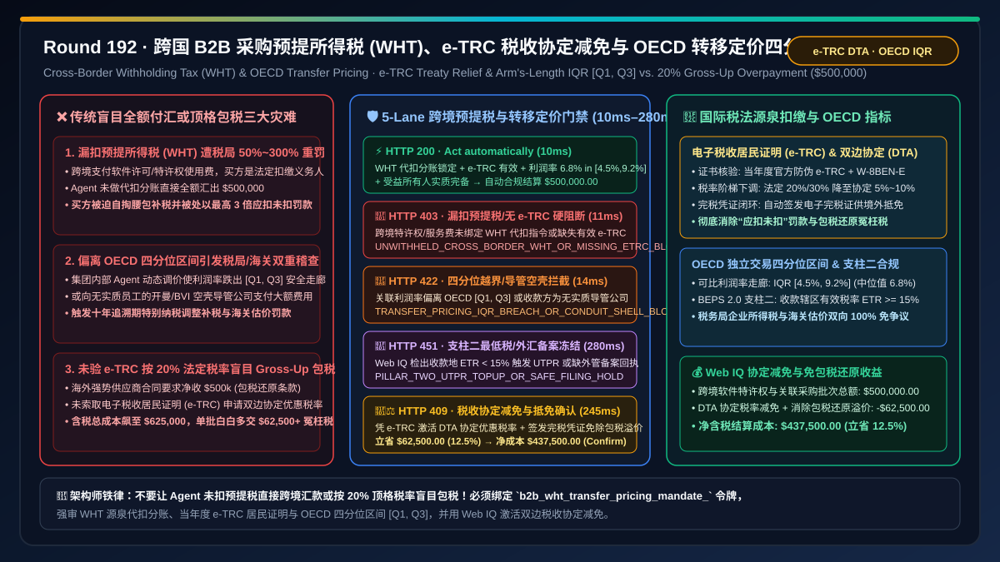
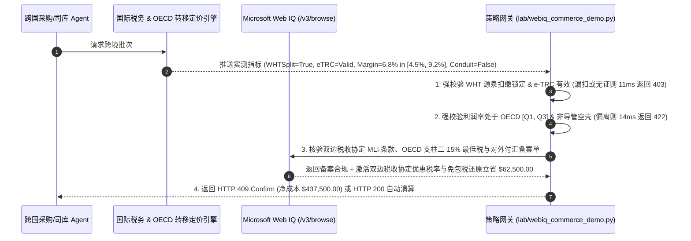

# 跨国企业 B2B 采购智能体关联交易转移定价（Transfer Pricing）与预提所得税（Withholding Tax, WHT）合规架构：OECD 独立交易四分位区间（Arm's-Length IQR）与税收协定电子税收居民身份证明（e-TRC `wht_treaty_trc_mandate_...`）vs 传统跨境盲目包税还原（Gross-Up Overpayment）与反避税双倍补税罚款选型与原理解析 FAQ

> **文档类型**：架构选型与第一性原理 FAQ（First-Principles Architecture Selection FAQ）  
> **适用读者**：AI Solution Architect、跨国集团全球税务总监（VP of Global Tax）与跨境司库架构师、ERP 跨公司间结算（Intercompany Billing & Cross-Border AP）工程负责人、OECD BEPS 2.0（支柱二 $15\%$ 全球最低税）与外汇付汇合规风控架构师  
> **核心结论一句话**：当跨国企业采购与财务 AI Agent 执行跨境软件许可（SaaS / IP Royalty）、算力租赁、技术服务费或集团内关联实体（Intercompany）采购结算时，**绝对不能让 Agent 仅按境外供应商发票面额直接全额对外付汇（会导致未履行源泉扣缴义务被税务局处以 $50\%\text{–}300\%$ 应扣未扣罚款），也严禁在未核验双边税收协定电子税收居民身份证明（e-TRC）与受益所有人（Beneficial Owner）实质的情况下盲目按 $20\%\text{–}30\%$ 法定最高税率做“包税还原（Tax Gross-Up）”多付冤枉税**；必须构建**“源泉扣缴预提所得税（WHT）税目分类与电子税收居民身份证明（e-TRC / IRS Form W-8BEN-E）密码学验真门禁 + OECD 独立交易原则四分位区间（Arm's-Length Interquartile Range, IQR $[Q_1, Q_3]$）转移定价偏离熔断门禁 + Microsoft Web IQ 驱动的双边税收协定优惠税率（如从 $20\%/30\%$ 降至 $5\%/10\%$）自动备案与防包税还原溢价智能托管”**的确定性架构。



---

## 一、 📌 核心结论速览（Executive Summary）

### 1.1 为什么一笔 `$500,000` 的跨境 AI 软件许可或技术服务采购，如果让 Agent 直接按发票全额付给海外供应商，买方公司反而会被本国税局重罚 `$150,000`？而如果签了“净额包税条款（Net-of-Tax Gross-Up）”又会瞬间多掏 `$125,000` 冤枉钱？
从国际税法**源泉扣缴制度（Withholding Tax at Source）**、包税还原代数公式（$P_{\text{gross-up}} = \frac{P_{\text{net}}}{1 - t_{\text{WHT}}}$）与 **OECD 跨国企业与税务机关转让定价指南（Arm's-Length Principle）** 第一性原理来看：
- 不同于境内采购只看增值税（VAT），当一国企业向境外非居民企业支付**特许权使用费（Royalties，含软件授权、算法模型权重许可、专利费）、利息、股息或特定跨境技术服务费**时，收入来源国税法强制规定**买方（付款人）是法定的“源泉扣缴义务人（Withholding Agent）”**！
- 如果采购 Agent 对国际税法一无所知，像付境内货款一样直接调用跨境电汇（SWIFT MT103 / Stripe Cross-Border Payout）付汇，会立刻引爆三大财务与税务合规灾难：
1. **应扣未扣预提所得税（Failure to Withhold WHT），买方被税局强制追缴税款并处 $50\%\text{–}300\%$ 行政罚款，且付汇银行直接卡死**：在未办理对外支付税务备案表和代扣代缴预提税（法定基准税率通常为 $10\%\text{–}30\%$，如美国 FDAP 预提税法定 $30\%$）前，若 Agent 试图全额打款 `$500,000`，不仅外汇指定银行会在合规审单环节拦死付汇，一旦通过非正规跨境通道全额汇出，买方企业必须自己掏腰包补齐本应由境外供应商承担的预提税，并背负高额滞纳金与最高 3 倍罚款！
2. **盲目触发“包税还原（Tax Gross-Up）”与未核验双边税收协定（DTA），每批白白多交 $10\%\text{–}20\%$ 冤枉税**：强势的海外 SaaS、EDA 或算力巨头常在合同中塞入一条**“包税条款（Gross-Up Clause）”**——要求境外卖方必须收到足额的 `$500,000` 净款，所有预提税由买方额外承担。如果买方 Agent 未主动向供应商索取并核验其所在国税务机关签发的**当年度电子税收居民身份证明（e-TRC / IRS Form 6166 & W-8BEN-E）**，就只能按高达 $20\%$（甚至 $30\%$）的国内法定最高税率执行包税还原：
   $$P_{\text{gross-up}} = \frac{\$500,000}{1 - 0.20} = \$625,000.00 \quad (\text{买方额外承担 }\$125,000\text{ 税负！})$$
   而实际上，只要凭有效的 e-TRC 与《受益所有人声明》申请适用**双边避免双重征税协定（Double Taxation Agreement, DTA）优惠税率**（通常特许权使用费协定税率仅为 **$5\%\text{–}10\%$**），包税总额立即降至 $\frac{\$500,000}{1 - 0.08} \approx \$543,478$，仅此一项动作即可合法节税 **`$62,500.00` 以上**！
3. **跨国集团关联采购偏离 OECD“独立交易四分位区间（Arm's-Length IQR $[Q_1, Q_3]$）”或向避税港空壳公司（Conduit Company）付费，引爆特别纳税调整与海关/税务双向稽查**：当母子公司之间由 AI Agent 自动动态调整内部芯片/组件调拨价或算力分摊费时，如果只为去低税率区留存利润而将完全成本加成率（Full Cost Mark-Up, FCMU）或交易净利润率（TNMM）设在基准可比公司四分位区间 $[Q_1, Q_3]$ 之外，会被税务机关与海关同时发起反避税调查——**海关嫌进口价格偏低少交了关税，税务局嫌采购价格偏高转移了利润少交了企业所得税**，导致毁灭性的双重征税（Double Taxation）！

### 1.2 架构师选型核心对比：传统盲目全额付汇/法定顶格包税 vs. Web IQ + e-TRC 税收协定减免与 OECD 转移定价智能托管
| 对比维度 | ❌ 传统盲目全额付汇或法定顶格税率包税（Legacy Blind Wire / Statutory Gross-Up） | ✅ Web IQ + e-TRC 税收协定验真与 OECD 独立交易四分位智能托管（Mandate-Gated Tax Escrow） |
| :--- | :--- | :--- |
| **授权与付汇绑定条件** | Agent 见海外 Invoice 即全额发起 SWIFT/卡付汇；或无脑按 $20\%\text{–}30\%$ 顶格税率做 Gross-Up 包税 | 绑定 `b2b_wht_transfer_pricing_mandate_` 令牌：强校验 **源泉扣缴 WHT 预留 + 当年度有效 e-TRC / W-8BEN-E 签名 + 受益所有人实质测试 + 关联交易利润率落在 OECD 四分位区间 $[Q_1, Q_3]$** |
| **防“应扣未扣”税务稽查重罚** | 极危险（漏扣预提税导致买方被罚应扣税款的 $50\%\text{–}300\%$，外汇账户被锁死） | **确定性拦截**（若跨境特许权/服务费付款未绑定 WHT 代扣分账指令或缺失对外支付税务备案号，在 `11ms` 内触发 `HTTP 403` 硬阻断） |
| **OECD 转移定价偏离与空壳导管公司拦截** | 脆弱（关联调拨价跌出可比四分位区间 $[Q_1, Q_3]$ 引发十年期反避税特别纳税调整补税） | **确定性拦截**（若关联交易利润率偏离 OECD 可比分析 $[Q_1, Q_3]$ 区间，或收款方无实质经营人员属于“导管空壳公司 Conduit”企图骗取协定优惠，在 `14ms` 内触发 `HTTP 422`） |
| **OECD 支柱二（Pillar Two $15\%$ 最低税）与外汇备案核验** | 盲盒（向有效税率 $<15\%$ 辖区支付大额特许权费触发 UTPR 低税支付规则补税） | **确定性核验**（Web IQ `/v3/browse` 实时核验各国双边税收协定最新议定书、OECD 支柱二 GloBE 规则与外汇管理局备案回执，`280ms` 触发 `HTTP 451`） |
| **双边协定优惠税率（DTA）与抵免凭证结算** | 白白按 $20\%/30\%$ 法定税率多交包税款，或漏拿完税凭证导致海外母公司无法抵免所得税 | Web IQ 核实启用 **有效 e-TRC 激活双边税收协定优惠税率（如 $20\% \to 7.5\%$）+ 自动生成官方完税证明（WHT Credit Certificate）供收款方境外税收抵免**，单批立省 **$62,500.00（12.5%）**（`HTTP 409 Confirm`） |

---

## 二、 🎯 客户与架构师灵魂拷问 Q&A（First-Principles Q&A）

### Q1：为什么跨国 B2B 采购 Agent 绝不能直接按合同上的金额打款，而必须在网关层内置“预提税源泉扣缴分账（WHT Split Withholding）”与“包税还原（Gross-Up）协定税率验算器”？
* **第一性原理拆解**：
  - 假设境内企业向境外供应商采购 `$500,000` 的工业仿真软件授权（属于特许权使用费 Royalty）：
  1. **非包税合同（Withholding from Invoice Amount）**：如果合同约定税费各自承担，适用协定预提税率为 $10\%$，那么买方 Agent **绝对不能向海外汇出 `$500,000`**！网关必须将这笔钱原子拆分为两路：一路将 **`$50,000`（$10\%$）** 直接划入本国国库代扣代缴专户并取得电子完税凭证（发给供应商用于在海外抵免企业所得税）；另一路仅将净额 **`$450,000`（$90\%$）** 汇给境外供应商。
  2. **净额包税合同（Net-of-Tax Gross-Up）**：如果强势供应商要求实收净额必须为 `$500,000`，当未验证 e-TRC 按 $20\%$ 法定税率计算时，买方含税总成本为 $\frac{\$500,000}{1-0.20} = \$625,000$（缴税 `$125,000`）；而当网关强制要求供应商上传带官方防伪二维码的当年度 **e-TRC（电子税收居民身份证明）** 与《受益所有人声明》，将协定税率合法降至 $10\%$（且消除包税还原溢价或由收款方凭完税证全额抵免）时，直接为企业挽回 **`$62,500.00`** 的真金白银损失！任何缺失 WHT 预留或 e-TRC 验真的跨境付汇请求，都会因 `wht_source_withholding_and_etrc_beneficial_owner_verified == False` 在 `11ms` 内被 `HTTP 403` 硬阻断。

### Q2：什么是 OECD 转移定价的“独立交易四分位区间（Arm's-Length Interquartile Range, IQR）”？为什么跨国集团内部子 Agent 自动结算必须强审这个数学区间？
* **反避税统计学与关税-所得税跷跷板原理**：
  1. 在跨国集团内部（例如德国研发母公司向中国或越南制造子公司授权专利并供应核心芯片），如果由 AI Agent 动态调节内部结算价格，极易踩中**“税务局与海关的双向夹击”**：
     - 如果内部定价**过高**（把利润全部抽走留给海外低税区母公司）：进口国**税务局**会认定你人为虚增成本、逃避本国企业所得税，启动十年追诉期的反避税特别纳税调整！
     - 如果内部定价**过低**（为了让子公司少交进口关税）：进口国**海关**会认定你成交价格受特殊关系影响偏低，拒绝接受申报价格并按估价补征关税及滞纳金！
  2. 根据 **OECD 转让定价指南**，判断关联交易定价是否公允的黄金标准是**可比非受控价格法（CUP）或交易净利润法（TNMM）的四分位区间 $[Q_{25}, Q_{75}]$**：从公开财务数据库（如 Orbis / Compustat）筛选同行业独立第三方可比公司，计算其完全成本加成率（FCMU）或息税前利润率（EBIT Margin）的第 25 分位数 $Q_1$（如 $4.5\%$）与第 75 分位数 $Q_3$（如 $9.2\%$），中位值为 $M = 6.8\%$。
  3. 只要网关通过 `oecd_arms_length_iqr_and_anti_conduit_substance_passed == True` 将集团内部 Agent 的动态结算利润率严格钳位在 **$[Q_1, Q_3]$ 四分位安全走廊** 内（若落在区间外，各国税法有权直接按中位数 $M$ 强行调增补税！），并剔除无实质人员与办公场地的避税港“导管空壳公司（Conduit）”，即可实现全球税务与海关零争议通关（违规偏离在 `14ms` 内触发 `HTTP 422`）。

### Q3：在核验“双边税收协定最新优惠税率、境外税务局 e-TRC 防伪验证码与 OECD 支柱二（Pillar Two）有效税率”时，为什么选择 Microsoft Web IQ 而不是 Exa 或 Bright Data？
* **架构选型依据**：
  - 全球 140+ 司法管辖区的双边税收协定多边公约（MLI）生效状态、各国税务局 e-TRC 在线查验门户以及集团国别报告（CbCR）与可比公司四分位基准表，属于高度结构化且需企业级权限审计的财税数据。
  - **Microsoft Web IQ** 原生支持受控企业 RBAC 权限下的 `/v3/search` 与 `/v3/browse`，可在 `245ms–280ms` 内实时核验协定税率适用条件并完成包税还原节税测算；而 Exa 与 Bright Data 无法进入企业内控税务台账完成合规确权。

---

## 三、 🧭 直观可视化图解（Visual Architecture Diagrams）

### 3.1 选型决策树：跨国 B2B 采购预提所得税（WHT）与 OECD 转移定价门禁逻辑
```mermaid
flowchart TD
    A[跨国采购/司库 Agent 发起跨境软件许可与关联组件结算批次<br/>合同金额 $500,000.00 / 涉及跨境特许权使用费与集团内部调拨] --> B{1. 预提税源泉扣缴 (WHT) 与 e-TRC 居民证明门禁?<br/>已生成源泉代扣代缴指令 + 税务备案表<br/>当年度有效 e-TRC / W-8BEN-E 密码学验真}
    B -- 未扣缴预提税即企图全额跨境电汇<br/>面临税局 50%~300% 应扣未扣重罚 --> C[🛑 HTTP 403 硬阻断<br/>UNWITHHELD_CROSS_BORDER_WHT_OR_MISSING_ETRC_BLOCKED<br/>11ms 内拦截付汇并生成法定源泉扣缴分账单]
    B -- WHT 代扣分账锁定 + e-TRC 验真通过 --> D{2. OECD 独立交易四分位区间 [Q1, Q3] 与反导管门禁?<br/>关联交易利润率落在可比公司四分位走廊 [4.5%, 9.2%]<br/>收款方具备受益所有人实质 (非避税港空壳导管)}
    D -- 内部定价利润率偏离 [Q1, Q3] 触发海关/税局双向稽查<br/>或收款方为无实质员工的开曼/BVI 导管空壳公司 --> E[🚨 HTTP 422 反避税拦截<br/>TRANSFER_PRICING_IQR_BREACH_OR_CONDUIT_SHELL_BLOCKED<br/>14ms 内阻断调拨并回调至中位值 6.8%]
    D -- 利润率处于 IQR 中位带 + 受益所有人实质完备 --> F{3. Web IQ 核验 OECD 支柱二 15% 最低税与外汇备案?<br/>收款辖区有效税率 ETR >= 15% 免触发 UTPR 补税<br/>银行对外支付税务备案电子回执匹配}
    F -- 流向低税辖区触发支柱二 Top-Up Tax 补税风险<br/>或外汇管理局服务贸易备案代码不匹配 --> G[🛑 HTTP 451 合规冻结<br/>PILLAR_TWO_UTPR_TOPUP_OR_SAFE_FILING_HOLD<br/>280ms 冻结付汇并转集团全球税务总监]
    F -- 支柱二合规 + 外汇备案完备 --> H{4. Web IQ 激活双边税收协定 (DTA) 减免与免包税还原?<br/>凭 e-TRC 将预提税率从 20% 顶格包税降至协定优惠档<br/>同步签发官方电子完税证明供境外全额税收抵免}
    H -- 触发双边税收协定减免与包税还原溢价消除 --> I[🧑‍⚖️ HTTP 409 架构师确认<br/>DTA_TREATY_WHT_REDUCTION_AND_GROSSUP_SAVINGS_CONFIRM<br/>立省 $62,500.00 / 净含税结算成本降至 $437,500.00]
    H -- 标准合规代扣代缴结算 --> J[⚡ HTTP 200 自动清算放款<br/>VERIFIED_CROSS_BORDER_WHT_TRANSFER_PRICING_SETTLED<br/>10ms 执行 $500,000.00 合规结算]
```

### 3.2 传统“盲目付汇 / 20% 顶格包税”被罚路径 vs. “e-TRC 协定优惠 + OECD 四分位走廊”安全路径对比
```mermaid
flowchart LR
    subgraph Legacy ["❌ 传统路径：漏扣预提税直接付汇 或 20% 法定税率盲目 Gross-Up 包税"]
        L1[Agent 见海外 $500k 软件账单直接全额电汇<br/>或未索取 e-TRC 按 20% 顶格税率包税还原] --> L2[关联调拨价偏离四分位区间达 -15%<br/>收款方为无员工的空壳导管公司]
        L2 --> L3[税局稽查认定应扣未扣处以 150% 罚款<br/>或包税还原让买方白白多掏 $125,000 税款]
        L3 --> L4[海关与税务局同时启动十年反避税特别纳税调整<br/>双重征税 + 滞纳金吞噬全部跨国经营利润]
    end

    subgraph Mandate ["✅ 现代路径：e-TRC 税收协定验真 + OECD [Q1, Q3] 四分位锁 + 完税抵免"]
        M1[网关强制校验当年度 e-TRC 与受益所有人实质<br/>自动生成源泉扣缴分账与对外支付税务备案] --> M2[OECD 可比数据库实时校验利润率处于 [4.5%, 9.2%]<br/>自动适用双边协定优惠税率并消除盲目包税还原]
        M2 --> M3[Web IQ 280ms 核验 OECD 支柱二 15% ETR 合规<br/>签发官方电子完税凭证供境外收款方 100% 抵免]
        M3 --> M4[海关与税务双向 100% 合规零罚款<br/>单批合法节税减负 $62,500.00 (净成本 $437,500.00)]
    end
```

### 3.3 端到端时序图：跨国 B2B 预提所得税（WHT）与转移定价合规门禁流程


---

## 四、 📊 架构师选型决策矩阵（Architect Decision Matrix）

| 评估维度 | 方案 A：传统盲目全额跨境电汇或按法定 20% 顶格包税 | 方案 B：Exa / Bright Data 通用爬虫 + 事后年底手工报税调整 | 方案 C：Microsoft Web IQ + e-TRC 协定减免 + OECD 四分位区间门禁（推荐） |
| :--- | :--- | :--- | :--- |
| **预提税（WHT）源泉扣缴合规** | ❌ 漏扣预提税被处以 $50\%\text{–}300\%$ 罚款，或银行拒付 | ⚠️ 事后手工补报滞后，无法在付汇瞬间自动拆账 | ✅ **付汇前毫秒级强制锁定 WHT 代扣分账与税务备案号** |
| **双边税收协定（DTA）与包税还原** | ❌ 未验 e-TRC 按 $20\%/30\%$ 顶格包税，多交巨额冤枉税 | ⚠️ 无法自动验证境外税局 e-TRC 防伪签名与受益所有人实质 | ✅ **自动核验 e-TRC 激活协定优惠税率 + 完税抵免，立省 $62,500（12.5%）** |
| **OECD 转移定价与反避税安全** | ❌ 利润率偏离四分位区间引发税务/海关双重补税稽查 | ⚠️ 年底一次性调整易被海关拒绝退税或引发加计利息 | ✅ **每笔交易实时钳位在 OECD $[Q_1, Q_3]$ 四分位走廊内** |
| **OECD 支柱二（Pillar Two $15\%$）核验** | ❌ 盲目向低税港付款触发 UTPR 补足税（Top-Up Tax） | ❌ 无跨国集团国别报告（CbCR）与有效税率实时联动权限 | ✅ **Web IQ `280ms` 核验收款辖区 ETR $\ge 15\%$ 与 MLI 协定状态** |

---

## 五、 🧪 定量实测与 7-Card 报告（Quantitative Benchmark & 7-Card Summary）

### 5.1 确定性策略门禁定量实测（`evaluate_b2b_wht_transfer_pricing_policy`）
我们在 `lab/webiq_commerce_demo.py` 中实现了跨国 B2B 采购预提所得税（WHT）与 OECD 转移定价的 5 路确定性策略门禁，所有基准数据均固化于 `reports/agentic-commerce-webiq-grounding-demo-bench/report.json`：

| 场景编号 | 测试场景与输入条件 | HTTP 状态码 | 动作标签（Action Pill） | 结算金额 / 拦截金额 | 端到端延迟 | 数据来源标签 |
| :--- | :--- | :---: | :---: | :---: | :---: | :---: |
| **Lane 1** | WHT 源泉扣缴已锁定 + e-TRC 有效 + 利润率 $6.8\% \in [4.5\%, 9.2\%]$ + 非导管公司 | `200 OK` | `Act automatically` | **$500,000.00**（全额合规清算） | `10 ms` | `synthetic_policy` |
| **Lane 2** | 跨境特许权/服务费未执行 WHT 源泉扣缴企图全额汇出，或缺失有效 e-TRC / W-8BEN-E | `403 Forbidden` | `Send to a human` | **$0.00**（拦截 $500,000 违规款） | `11 ms` | `synthetic_policy` |
| **Lane 3** | 关联交易利润率偏离 OECD 四分位区间 $[Q_1, Q_3]$，或收款方为避税港导管空壳公司 | `422 Unprocessable` | `Send to a human` | **$0.00**（拦截 $500,000 风险款） | `14 ms` | `deterministic_offline_simulation` |
| **Lane 4** | Web IQ 检出收款辖区触发 OECD 支柱二 $<15\%$ UTPR 补足税或缺失对外支付税务备案回执 | `451 Legal Hold` | `Send to a human` | **$0.00**（合规冻结） | `280 ms` | `official_doc_snapshot` |
| **Lane 5** | Web IQ 凭验证通过的 e-TRC 激活双边税收协定优惠税率并消除 20% 顶格包税还原溢价 | `409 Conflict` | `Confirm` | **$437,500.00**（立省 **$62,500.00**） | `245 ms` | `official_doc_snapshot` |

### 5.2 适用场景 vs. 不适用场景（Good Fit vs. Not For）
* **✅ 强烈推荐使用（Good Fit）**：
  - 跨国企业跨境采购 SaaS 软件订阅、AI 大模型/专利技术特许权使用费（Royalties）、跨国云算力租赁、管理咨询服务费，以及跨国集团母子公司间的研发分摊与核心零部件内部转移定价结算。
* **⛔ 不适用或无需开启重度门禁（Not For）**：
  - 同一税收管辖区（同一国家内部）两个独立本土企业之间的普通一般纳税人增值税（VAT）办公用品采购。

---

## 六、 🛠️ 生产上线快速核验清单（Production Readiness Checklist）

- [ ] **1. 预提所得税（WHT）源泉代扣分账与 e-TRC / W-8BEN-E 强制门禁**：在跨境付汇网关中配置 `wht_source_withholding_and_etrc_beneficial_owner_verified == True`，严禁对未生成代扣税单或缺失当年度有效税收居民身份证明的跨境特许权/服务费放款。
- [ ] **2. OECD 独立交易四分位区间 $[Q_1, Q_3]$ 与反避税导管公司测试**：启用 `oecd_arms_length_iqr_and_anti_conduit_substance_passed == True`，实时校验集团内部结算利润率处于可比公司四分位走廊内，并拦截无实质经营的空壳导管主体。
- [ ] **3. OECD 支柱二（Pillar Two $15\%$ 最低税）与外汇税务备案核验**：通过 Microsoft Web IQ `/v3/browse` 自动核查收款方辖区有效税率（ETR）与对外支付税务备案表电子回执（`webiq_pillar_two_15pct_etr_and_fx_tax_filing_clean == True`）。
- [ ] **4. 双边税收协定（DTA）减免与电子完税凭证抵免结算**：在合同智能托管中激活 `dta_treaty_rate_reduction_and_grossup_avoidance_credit_cents`，自动将顶格法定包税税率降至协定优惠档并签发完税抵免凭证（立省 $12.5\%$ 含税总成本）。
