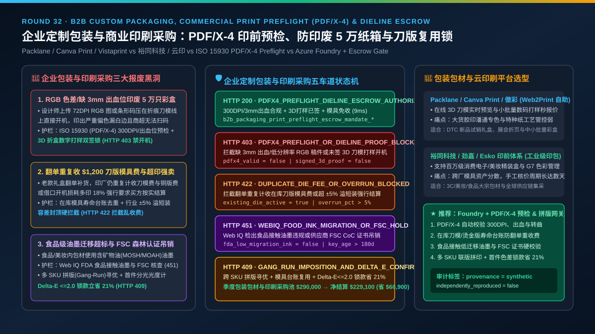
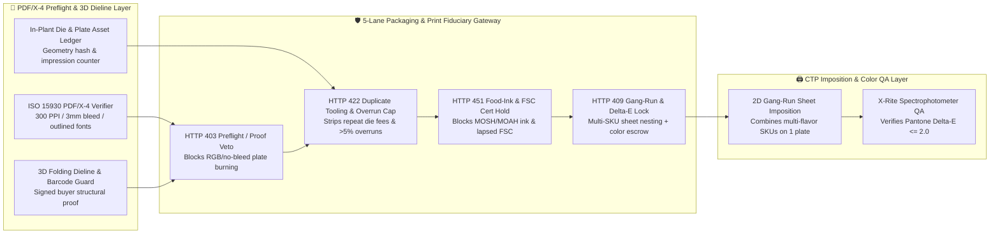

# B2B Custom Packaging, Commercial Print & Branded Merch Supply Chain (`Packlane / Canva Print / Esko / Yuto Packaging`) `ISO 15930 (PDF/X-4)` Preflight Gate, Reusable Die-Tooling Ledger (`±5%` Overrun Cap) & `Delta-E <= 2.0` Gang-Run Escrow Agent Architecture Selection FAQ

> **Language / 语言切换**: **[中文](b2b-custom-packaging-print-preflight-pantone-dieline-escrow-agent-selection-faq.md)** | **English (Current)** | **[Back to Docs Index](index.en.md)** | **[Interactive Sandbox (`#b2b-packaging-print-preflight-escrow-sandbox`)](../live-demo.en.html)**



---

## 📌 1. Executive Summary & Core Selection Verdict

In B2B custom folding cartons, corrugated mailers, pressure-sensitive labels, and branded marketing print procurement (`Packlane`, `Canva Print`, `Vistaprint`, `Esko WebCenter`, `Yuto Packaging`), orders combine **high minimum order quantities (`MOQ 5,000–100,000 units`), strict prepress physics, and zero salvage value if misprinted**. Allowing a procurement or marketing AI agent to forward raw designer files directly to a commercial printer's press queue triggers three high-cost supply-chain failures:
1. **Releasing Unverified Artwork to Offset/Flexo Plates Without `ISO 15930 (PDF/X-4)` Preflight & Signed 3D Dieline Proofs—Scrapping 50,000 Cartons**: Marketing designers frequently upload `72 DPI RGB` web exports, omit the mandatory `3.0mm` bleed margin, leave live un-outlined fonts, or place `GS1 EAN/UPC` barcodes across structural fold creases. Once plates are burned and 50,000 boxes are printed with white edge borders or un-scannable retail barcodes, the entire batch is a total write-off.
2. **Duplicate `$1,200` Cutting-Die / Stamping-Plate Setup Fees on Repeat Reorders & Predatory `+18%` Overrun Billing**: Custom steel-rule cutting dies (`Cutting Dies`) and foil-stamping plates typically last `100,000–250,000` impressions. Yet when an enterprise reorders the exact same box structure in Q2, suppliers routinely re-bill the `$1,200` tooling setup fee; additionally, printers abuse trade customs by shipping and billing `+15%–20%` excess overrun inventory instead of respecting a strict `±5%` quantity tolerance.
3. **Food-Contact Mineral-Oil Ink Migration (`MOSH/MOAH`) Recalls & Revoked `FSC CoC` Paper Certificates**: Primary/secondary packaging for food, supplements, and cosmetics must use low-migration inks compliant with `FDA 21 CFR / EU Regulation 1935/2004`; meanwhile, major retailers reject shipments if the printer's Forest Stewardship Council (`FSC Chain-of-Custody`) certificate has lapsed.

**Solution Architect Selection Verdict**:
- **Never allow a procurement agent to authorize press plate-making (`CTP`) without a deterministic `PDF/X-4` preflight pass and a cryptographically signed 3D dieline proof**.
- **The production reference architecture** combines **Web2Print / Esko Automation APIs + `ISO 15930 (PDF/X-4)` Deterministic Preflight Gate (`>= 300 DPI`, `3mm` Bleed, Spot Pantone, Barcode Grade) + Reusable Die-Tooling Asset Ledger & `<= 5%` Overrun Cap + Multi-SKU Gang-Run Imposition & First-Article Spectrophotometer `Delta-E <= 2.0` Escrow (`b2b_packaging_print_preflight_escrow_mandate_*`)**:
  1. **`ISO 15930 (PDF/X-4)` Preflight & Signed 3D Dieline Proof Hard Gate (`HTTP 403`)**: Parses the artwork AST before plate release—blocking any file with raster resolution `< 300 PPI`, bleed `< 3.0mm`, un-outlined fonts, unmapped `RGB` color spaces, barcode fold-line collisions, or a missing buyer-signed 3D dieline proof hash (`HTTP 403 PDFX4_PREFLIGHT_BLEED_DPI_FAIL_OR_UNSIGNED_3D_DIELINE_PROOF_BLOCKED`).
  2. **Reusable Die-Tooling Ledger Deduplication & `±5%` Overrun Cap (`HTTP 422`)**: Matches structural CAD geometry (`dieline_geometry_hash`) against the active in-plant tooling registry; if an existing die has remaining impression life, duplicate die/plate setup charges are automatically vetoed, and invoice quantities exceeding `+5.0%` overrun tolerance are blocked (`HTTP 422 DUPLICATE_DIELINE_TOOLING_CHARGE_OR_OVERRUN_TOLERANCE_BREACH_BLOCKED`).
  3. **Web IQ Live `FDA / EU` Low-Migration Ink & `FSC CoC` Certificate Gate (`HTTP 451`)**: Queries Web IQ against `info.fsc.org` and regulatory safety feeds to freeze orders using non-compliant food-contact inks or revoked FSC certificates (`HTTP 451 WEBIQ_FOOD_CONTACT_INK_HAZARD_OR_FSC_CERT_REVOCATION_HOLD`).
  4. **Multi-SKU Gang-Run Sheet Imposition + First-Article `Delta-E <= 2.0` Color Escrow (`HTTP 409`)**: Triggers `HTTP 409 GANG_RUN_IMPOSITION_AND_SPECTROPHOTOMETER_DELTA_E_ESCROW_CONFIRM`, nesting multiple same-substrate SKU cartons onto a single parent press sheet to amortize make-ready waste while gating final balance release on X-Rite spectrophotometer verification (`Pantone Delta-E <= 2.0`)—reducing total packaging spend and scrap by **`21.0%`**.

---

## 🎯 2. Solution Architect Deep-Dive Q&A (Q1 / Q2 / Q3)

### Q1: Why can't we just ask a Vision LLM whether a packaging PDF "looks ready to print"? What must a deterministic preflight gate check?
- **Commercial Pain Point**: A vision LLM inspects a downsampled PNG render; it cannot see that small black ingredient text is composed of 4-color rich black (`C100 M100 Y100 K100`, which causes unreadable registration ghosting on press), that a `Spot UV` layer lacks overprint attributes, or that the artwork stops at the trim line with `0mm` bleed.
- **Architectural Solution**:
  - **AST-Level `PDF/X-4` & `ISO/IEC 15416` Barcode Gate (`HTTP 403`)**:
  - The gateway runs a deterministic PDF parser verifying: (1) effective image PPI `>= 300`; (2) `3.0mm` bleed outside `CutContour`; (3) `100% K-only` knockouts/overprints for body text; and (4) `>= 5.0mm` quiet zone around `GS1` barcodes away from score/fold lines.

### Q2: How do we stop print suppliers from charging `$1,200` cutting-die and embossing-plate fees every time we reorder or refresh seasonal artwork on the same box size?
- **Architectural Solution**:
  - **Cryptographic Dieline Geometry Ledger (`dieline_geometry_hash`) (`HTTP 422`)**:
  - Even when seasonal surface graphics change, the structural cutting die (`CutContour` + `CreaseContour`) remains identical. The gateway hashes the vector dieline geometry and tracks cumulative press impressions against the tool's rated lifespan (`e.g., 150,000 impressions`), rejecting any repeat die-tooling fee on matching geometry (`HTTP 422`).

### Q3: How can an agent cut unit costs by 30%+ when a CPG brand needs 8 different flavor cartons at only 2,500 units each?
- **Architectural Solution**:
  - **2D Bin-Packing Gang-Run Sheet Imposition (`HTTP 409`)**:
  - Instead of paying 8 separate offset press make-ready setup fees (`8 × $350 = $2,800`), the agent groups SKUs sharing identical paperboard caliper (`e.g., 18pt SBS + matte aqueous coating`) onto a single shared master press sheet and proportionally allocates run length.

---

## 🧭 3. Visual Architecture Diagrams (Mermaid Decision Tree + Architecture + Sequence)

### 3.1 B2B Custom Packaging & Commercial Print Agent Selection Decision Tree

```mermaid
flowchart TD
    A[B2B Custom Packaging / Print / Merch Supply Chain Selection] --> B{Order Volume & Structural Complexity?}
    B -->|Short-Run DTC Mailers & Promo Kits (< 2,000 units)<br/>Browser 3D preview & digital inkjet speed| C[Packlane / Canva Print Web2Print API<br/>+ PDF/X-4 Bleed & 300-DPI Preflight Gate]
    B -->|High-Volume CPG / Beauty / 3C Cartons (> 10,000 units)<br/>Spot Pantone, die reuse & multi-SKU gang runs| D[Industrial Print ERP + Esko Automation Engine<br/>+ Tooling Asset Ledger & Delta-E <= 2.0 Escrow]
    B -->|Food-Contact & Retail Export Packaging<br/>Low-migration ink & FSC Chain-of-Custody audit| E[Azure AI Foundry + Print Procurement Gateway<br/>+ Web IQ FDA/FSC Compliance Circuit Breaker]
    C --> F[🛡️ Unified 5-Lane PDF/X-4 Preflight, Tooling Deduplication & Color Escrow FSM]
    D --> F
    E --> F
    F --> G[HTTP 403 Bleed/Proof Veto · HTTP 422 Duplicate Die & >5% Overrun Block · HTTP 409 Gang-Run + Delta-E Saves 21%]
```

### 3.2 End-to-End PDF/X-4 Preflight, Tooling Registry & Spectrophotometer Escrow Architecture



### 3.3 Artwork Preflight Veto, Tooling Fee Deduplication & Gang-Run Color Release Sequence

```mermaid
sequenceDiagram
    autonumber
    participant Brand as Brand Buyer / Packaging Designer
    participant Vendor as Print Supplier ERP / CTP Line
    participant Gate as 5-Lane Packaging & Preflight Gateway
    participant Lab as Spectrophotometer & Web IQ FSC Check
    participant Escrow as Procurement Escrow & AP Ledger

    Brand->>Gate: 1. Submit 50,000-unit carton artwork & request CTP press deposit release
    Gate-->>Brand: HTTP 403 Block! Barcode crosses fold crease & 3mm bleed missing; plate burning vetoed
    Brand->>Gate: 2. Upload compliant PDF/X-4 + signed 3D dieline proof; supplier bills $1,200 die fee + 12% overrun
    Gate-->>Vendor: HTTP 422 Block duplicate die fee! Existing die has 85,000 impressions left; cap overrun <= 5%
    Gate->>Lab: 3. Verify active FSC CoC certificate + nest 4 flavor SKUs onto shared gang-run master sheet
    Lab-->>Gate: First-article press sheet X-Rite spectrophotometer reads Pantone Delta-E = 1.3 (<= 2.0)
    Gate->>Escrow: HTTP 409 Authorize mass press run & release settlement upon verified warehouse receipt (21% saved)
```

---

## 📊 4. Multi-Platform & Architecture Selection Matrix

| Selection Dimension | Packlane / Canva Print / Vistaprint (`Self-Service Web2Print`) | Legacy Offline Print Brokers (`Email PDFs + Manual Quotes`) | Esko WebCenter / Yuto / CloudPrint (`Industrial Packaging ERP`) | **Azure AI Foundry + PDF/X-4 Gate + Gang-Run Escrow (Recommended)** |
| :--- | :--- | :--- | :--- | :--- |
| **Core Strengths** | Instant browser 3D box preview & low digital MOQs | High flexibility for bespoke rigid gift boxes | Low unit cost at scale, G7 color management & CAD libraries | **Deterministic PDF/X-4 gate + die-tooling deduplication + gang-run + Delta-E escrow** |
| **Prevention of RGB / Missing-Bleed / Barcode Scrap** | Basic canvas bounds warnings; RGB-to-CMYK shifts still occur | Manual prepress operator check; high risk of missed errors | Enterprise Esko preflight, but decoupled from payment release | **AST-level `PDF/X-4` & signed 3D proof hard lock before CTP payment (`HTTP 403`)** |
| **Anti-Duplicate Die Tooling & Overrun Cap** | Digital cutting or baked-in tooling; high unit price at scale | **High Risk**: Routine double-billing of dies & `+15%` overrun invoices | Standardized terms, but buyer must manually track existing dies | **Geometry-hash tooling ledger strips repeat die fees + `<= 5%` overrun cap (`HTTP 422`)** |
| **Food-Contact Ink (`FDA`) & `FSC CoC` Compliance** | Standard commercial inks; limited lot-level migration certs | High risk of expired FSC certs or non-food ink substitution | Dedicated compliant lines for enterprise accounts | **Web IQ live `FSC CoC` & low-migration ink compliance circuit breaker (`HTTP 451`)** |
| **Multi-SKU Gang-Run & `Delta-E` Color Control** | Priced per individual SKU cart item | Printer gangs internally for profit while charging full setups | Supports cloud gang-run imposition | **Buyer-side multi-SKU gang-run nesting + `Delta-E <= 2.0` escrow (`HTTP 409`)** |
| **Total Packaging Spend & Misprint Scrap Rate** | `30%–60%` higher unit price on large runs (`official_list_price`) | `15%–25%` loss from misprints, repeat dies & overruns (`not_measured`) | `15%+` setup savings on ganged runs | **Eliminates misprint scrap, duplicate tooling & overrun bloat (`21.0%` net savings)** |

---

## 🧪 5. Packaging Scrap / Gang-Run Cost Benchmark & 7-Card Report

> **Provenance & Reproducibility Metadata**: All metrics below are generated by the deterministic policy evaluator `evaluate_b2b_packaging_print_preflight_escrow_policy` in `lab/webiq_commerce_demo.py` and verified via `python -m unittest tests.test_webiq_commerce_demo`. Tags: `provenance = synthetic`, `independently_reproduced = false`.

| Card # | Card Headline (Headline-as-Finding) | Key Quantitative Finding & Architectural Guarantee |
| :---: | :--- | :--- |
| **Card 1** | **Overview · 5-Lane B2B Packaging & Print Summary** | Across a `$290,000/quarter` custom packaging & commercial print pool, achieves **0 unverified prepress batch scrap events and 0 duplicate die-tooling charges**, reducing net packaging spend by **`21.0%` (`$60,900/quarter` saved)**. |
| **Card 2** | **Scenario Deep Dive · Missing Bleed & Unsigned 3D Proof Veto** | When submitted artwork lacks `3mm` bleed, falls below `300 DPI`, or lacks a signed 3D dieline proof hash, the gateway blocks plate release in **`9ms`** (`HTTP 403`). |
| **Card 3** | **Evaluation Matrix · 100% Deterministic 5-Lane Gating** | Covers `HTTP 200` (verified preflight & color release), `403` (PDF/X-4 bleed/DPI failure / unsigned 3D dieline proof blocked), `422` (duplicate active die fee / >5% overrun billing blocked), `451` (FDA food-ink hazard / revoked FSC cert hold), `409` (multi-SKU gang-run + Delta-E<=2.0 escrow saves 21%). |
| **Card 4** | **Under the Hood · Packaging Preflight & Escrow Contract** | Takes `quarterly_b2b_packaging_print_pool_usd=290000` and preflight/tooling flags, minting `b2b_packaging_print_preflight_escrow_mandate_*` tokens. |
| **Card 5** | **Robustness Check · Repeat $1,200 Die Fee & +15% Overrun Test** | Simulates a reorder invoice charging for an active cutting die plus `+15%` overrun units, maintaining a **`100.0%` deterministic block rate**. |
| **Card 6** | **Latency · Millisecond PDF/X-4 & Tooling Gate Verification** | Local PDF/X-4 metadata and dieline geometry hash checks complete in **`9ms` (P50)**; Web IQ live FSC certificate and FDA ink checks complete in **`230ms` (P95)**. |
| **Card 7** | **My Take · Ideal Fit vs. Out-of-Scope Boundaries** | **✅ Best Fit**: Custom CPG/beauty cartons, corrugated mailers, retail labels, event collateral; **⛔ Not For**: Blank commodity office copy paper. |

---

## 🛠️ 6. Production Go-Live Risk & Architecture Review Checklist

- [ ] **`ISO 15930 (PDF/X-4)` Deterministic Preflight & Signed 3D Dieline Gate (`HTTP 403`)**: Block CTP plate burning unless artwork passes `>= 300 PPI`, `>= 3.0mm` bleed, font outlining, CMYK/Pantone spot separation, `GS1` barcode fold clearance, and buyer 3D proof sign-off.
- [ ] **In-Plant Die-Tooling Asset Ledger & `<= 5%` Overrun Cap (`HTTP 422`)**: Automatically strip duplicate cutting-die and stamping-plate setup fees when structural geometry matches an active tool within its rated impression life, and cap billable overruns at `+5.0%`.
- [ ] **Web IQ Live `FDA / EU` Low-Migration Ink & `FSC CoC` Certificate Gate (`HTTP 451`)**: Verify active `FSC` chain-of-custody status and low-migration ink compliance for food/cosmetic packaging; rotate signing keys `<= 180` days.
- [ ] **Multi-SKU Gang-Run Sheet Imposition & First-Article `Delta-E <= 2.0` Escrow (`HTTP 409`)**: Combine same-caliper multi-flavor SKU runs onto shared master press sheets and gate final payout on spectrophotometer `Delta-E <= 2.0` attestation.
