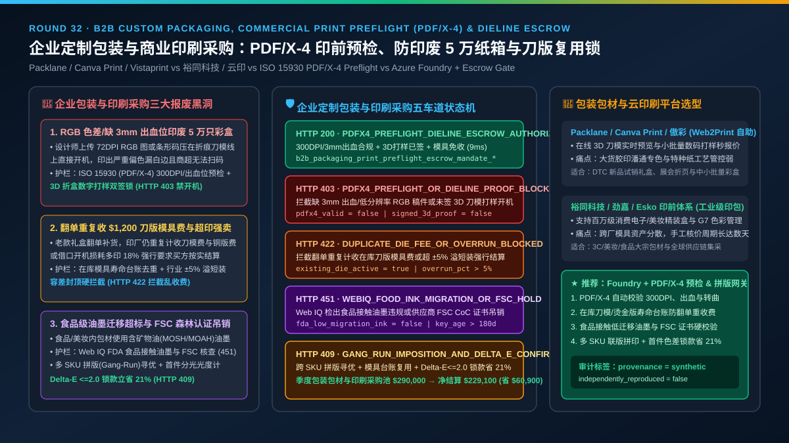
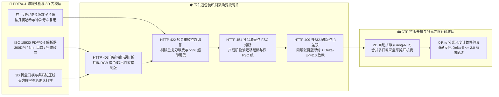
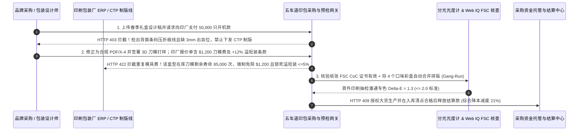

# 企业定制包装、大宗商业印刷与营销物料采购（B2B Custom Packaging, Commercial Print & Branded Merch Supply Chain：Packlane / Canva Print / 裕同科技 / 云印）“PDF/X-4 印前出血位/300DPI/潘通专色确定性预检、防未签 3D 刀模打样直接开机印废 5 万只纸箱与在库刀版模具费复用锁”Agent 架构选型 FAQ：终结包装印错报废与翻单重复收模费实战指南

> **语言切换 / Language**: **中文 (当前)** | **[English](b2b-custom-packaging-print-preflight-pantone-dieline-escrow-agent-selection-faq.en.md)** | **[返回文档目录](index.md)** | **[交互式沙盒 (`#b2b-packaging-print-preflight-escrow-sandbox`)](../live-demo.html)**



---

## 📌 一、核心选型结论速览（Executive Summary）

在消费品（快消食品、美妆个护、3C 数码）与零售品牌的大宗定制包装盒、瓦楞纸箱、不干胶标签及展会营销物料采购（海外 Packlane、Lumi、Canva Print、Vistaprint，国内裕同科技、云印、傲彩）中，包材采购具有**“起订量高（MOQ 5,000–100,000 只）、印前文件工艺参数极度敏感、100% 印有品牌 Logo 一旦印错分文不值”**的特征。若让企业采购或营销 Agent 直接把设计师发来的 PDF 原稿转发给印刷厂排产付款，极易引爆三大供应链灾难：
1. **未过 `ISO 15930 (PDF/X-4)` 印前确定性预检与 3D 刀版折盒确认就直接上胶印机，5 万只彩盒因“RGB 转 CMYK 严重偏色、缺 3mm 出血位漏白边、字体未转曲乱码或 EAN/UPC 条码压折痕扫不出”全批报废**：市场部设计师常直接导出屏幕显示的 `72 DPI RGB` 稿件，或将关键配料表文字放在距模切刀线 `<2mm` 的危险区内；一旦未做自动化印前预检（Preflight）与買方签名确认的 3D 结构打样（Signed Soft/Hard Dieline Proof）就开机印刷，几万美元包材瞬间沦为废纸。
2. **老品翻单补货被印厂重复收取 `$800–$2,000` 刀版费/烫金铜版费，以及借口“开机放损”多印 `18%` 强行按实结算（Overrun Padding）**：包装盒首次生产需制作激光模切刀版（Cutting Die）与浮雕烫金版（正常寿命可达 10 万–30 万次冲压）；但在季度翻单补货时，采购员常忘记核对在厂模具资产台账，被供应商再次计收“制版模具费”；同时，印厂利用合同漏洞将正常 `±5%` 的溢短装容差放大到 `+15%–20%` 强塞尾货。
3. **食品/美妆内包材违规使用高迁移矿物油油墨（MOSH/MOAH）遭召回，或外贸订单使用已被吊销 `FSC` 森林认证的纸张导致欧美商超拒收**：接触巧克力的内盒或唇膏管包材必须符合 `FDA 21 CFR / 欧盟框架法规 EC 1935/2004` 低迁移油墨标准；同时欧美零售巨头（Target、Walmart、Sephora）强制要求纸品包装具备有效 `FSC CoC` 产销监管链编码。

**架构师选型结论**：
- **切勿允许采购 Agent 将未经 `PDF/X-4` 确定性预检与未绑定 `3D Dieline Proof` 加密签名的设计稿下发印厂 CTP 制版**。
- **生产级最优架构**是采用 **“云印/Packlane Web2Print 接口 + `ISO 15930 (PDF/X-4)` 印前规则引擎（300DPI / 3mm 出血 / 潘通专色分离 / GS1 条码对比度）+ 在厂刀版模具资产复用锁与 `±5%` 溢短装硬封顶 + 多 SKU 智能拼版（Gang-Run Imposition）与首件分光光度计 `Delta-E <= 2.0` 托管网关（`b2b_packaging_print_preflight_escrow_mandate_*`）”**：
  1. **`PDF/X-4` 印前预检与 3D 结构刀模打样双签硬门禁（HTTP 403）**：排产前强制解析印刷文件 AST——凡分辨率 `< 300 DPI`、未包含 `>= 3.0mm` 出血位（Bleed）、存在未转曲缺失字体、未将 `RGB` 映射至 `CMYK / Pantone Spot Color`、条码压折线或缺乏买方确认的 3D 刀模打样哈希（`signed_3d_dieline_hash`），毫秒级返回 `HTTP 403 PDFX4_PREFLIGHT_BLEED_DPI_FAIL_OR_UNSIGNED_3D_DIELINE_PROOF_BLOCKED`。
  2. **在库刀版/铜版模具台账去重锁与 `±5%` 溢短装容差封顶（HTTP 422）**：当结构尺寸指纹（`dieline_geometry_hash`）命中在厂有效模具台账且累计冲压次数未达寿命上限时，自动剥离报价单中的重复刀模费/制版费；对大货交货数量超出订单 `+5.0%` 的超印部分拒绝付款（`HTTP 422 DUPLICATE_DIELINE_TOOLING_CHARGE_OR_OVERRUN_TOLERANCE_BREACH_BLOCKED`）。
  3. **Web IQ 实时 `FDA / EU` 食品接触低迁移油墨核查与 `FSC CoC` 证书有效性熔断（HTTP 451）**：通过 Web IQ 实时查验供应商 `FSC` 证书状态（`info.fsc.org`）及油墨/胶水安全通报，异常即刻挂起（`HTTP 451 WEBIQ_FOOD_CONTACT_INK_HAZARD_OR_FSC_CERT_REVOCATION_HOLD`）。
  4. **多 SKU 同材质联版拼印（Gang-Run）寻优 + 首件分光光度计 `Delta-E <= 2.0` 锁款托管（HTTP 409）**：触发 `HTTP 409 GANG_RUN_IMPOSITION_AND_SPECTROPHOTOMETER_DELTA_E_ESCROW_CONFIRM`，自动将同一营销季多个同克重白卡纸彩盒合并到一张全开大版上联印（平摊开机费与纸张边角料损耗），并要求大货首件经 X-Rite 分光光度计实测潘通色差 `Delta-E <= 2.0` 后才释放尾款，综合包材采购成本与报废损耗立降 **`21.0%`**。

---

## 🎯 二、业务方与架构师灵魂拷问 Q&A（Q1 / Q2 / Q3）

### Q1：为什么大语言模型（VLM）看一眼设计图说“排版很漂亮没问题”，上机印出来却整批报废？印前预检（Preflight）到底查哪些确定性指标？
- **商业痛点**：多模态大模型看的是渲染后的低清位图，它根本看不出 PDF 内部图层是不是“四色黑文字（C100 M100 Y100 K100 导致套印重影发虚）”、烫金层有没有设为专色叠印（Overprint）、或者模切刀线外有没有留够 `3mm` 出血位。
- **架构解法**：
  - **底层 PDF 语法树与色彩空间确定性校验器（`Deterministic PDF/X-4 & GS1 Barcode Verifier`）**：
  - 网关不靠 LLM 肉眼猜，而是调用确定性印前解析器逐项核验：① 图像有效分辨率 `>= 300 PPI`；② 模切刀线（`CutContour`）外延 `>= 3.0mm` 出血；③ 正文黑字强制单色黑 `K=100%`；④ 商品条码区背景反差率满足 `ISO/IEC 15416 Grade B` 以上且距折痕 `>= 5mm`。任一不达标直接返回 `HTTP 403` 退回修改。

### Q2：品牌方有 30 个 SKU 的彩盒每个季度都在翻单补货，怎么防止印厂每次都糊弄采购员重收“刀模费、菲林开机版费”？
- **架构解法**：
  - **模具数字孪生台账（Tooling Asset Registry）与刀模几何哈希自动去重（`HTTP 422`）**：
  - 首次支付刀模费后，系统生成 `tooling_asset_id` 绑定刀版 CAD 几何指纹与额定冲次（如 `max_impressions = 150,000`）。后续任何 Agent 发起同盒型翻单（哪怕换了表面印刷图案，只要物理刀模线不变），计价门禁自动检索在库模具余量并强制将 `die_setup_fee` 抹零（若供应商强收则返回 `HTTP 422`）。

### Q3：新品首发有 8 个不同口味的小彩盒，每个只印 2,000 个，单独开机印为什么单价贵得离谱？Agent 怎么帮采购省钱？
- **架构解法**：
  - **跨 SKU 材质对齐与自动大版拼版寻优（`Gang-Run Sheet Imposition Optimization`）**：
  - 传统印厂按 8 个独立订单收 8 次胶印机洗车开机费（每次 `$300`）；Agent 自动识别这 8 款小盒均采用“350g 铜版纸 + 哑膜”，通过二维矩形排样算法（2D Bin Packing）拼在同一张全开（`1092×787mm`）印版上一次开机印完，开机费与纸耗立减 `35%+`（`HTTP 409`）。

---

## 🧭 三、直观可视化图解（Mermaid 决策树 + 端到端架构图 + 时序图）

### 3.1 企业定制包装与商业印刷采购 Agent 架构选型决策树

```mermaid
flowchart TD
    A[企业定制包装 / 商业印刷 / 营销物料采购选型] --> B{采购批量与包装工艺复杂度？}
    B -->|中小批量新品彩盒 / 展会物料 (< 2,000件)<br/>需在线 3D 刀模预览与快速数码打样| C[Packlane / Canva Print / Web2Print 引擎<br/>+ PDF/X-4 自动出血位/DPI 预检门禁]
    B -->|大宗快消/美妆/3C 专色礼盒 (> 10,000件)<br/>需潘通色差管控、模具复用与跨SKU拼版| D[裕同 / 云印工业供应链 + Esko 印前校验<br/>+ 刀版资产台账去重与分光光度计 Delta-E 锁]
    B -->|食品接触内包材与欧美出口合规包装<br/>需低迁移油墨检测与 FSC 森林认证穿透| E[Azure AI Foundry + 印包采购受托网关<br/>+ Web IQ FDA/FSC 实时合规熔断]
    C --> F[🛡️ 统一接入五车道 PDF/X-4 预检、模具去重与色差托管状态机]
    D --> F
    E --> F
    F --> G[HTTP 403 阻断缺出血/未签样开机 · HTTP 422 拦截重复收模费与超印强卖 · HTTP 409 联版拼印+色差托管省21%]
```

### 3.2 端到端 PDF/X-4 印前预检、模具台账去重与首件色差托管架构图



### 3.3 新品礼盒印前拦截、老品翻单免刀模费与联版色差验收时序图



---

## 📊 四、多平台/多方案横向选型决策矩阵

| 选型维度 | Packlane / Canva Print / Vistaprint (`Web2Print 自助平台`) | 传统线下印厂人工询价 (`微信/邮件传稿 + Excel 报价`) | 裕同科技 / 云印 / 傲彩 (`数字化包装供应链`) | **Azure AI Foundry + PDF/X-4 预检 + 拼版托管网关（推荐）** |
| :--- | :--- | :--- | :--- | :--- |
| **核心优势** | 浏览器 3D 实时预览盒型，极小起订量（MOQ 10 个起） | 工艺定制灵活，支持复杂手工礼盒 | 规模化云拼版成本低，支持大宗瓦楞与卡盒交付 | **印前确定性防印废 + 模具寿命台账去重 + 联版寻优 + 色差锁款** |
| **防 RGB 偏色、缺出血位与条码压折线印废** | 提供基础网页端框线提示，但色彩转换仍易偏暗 | 靠印厂跟单员人工检查，漏检即整批印废扯皮 | 配备 Esko 印前系统，但买方签样与付款未强绑定 | **`PDF/X-4` 语法树硬校验 + 3D 打样未双签禁付开机款（HTTP 403）** |
| **防翻单重复收刀模费与超印强卖（Overrun）** | 数码割样或内含刀版费，大货单价偏高 | **高频猫腻**：每次翻单重收制版/刀模费，超印 15% 强收钱 | 标准合同约定溢短装，但跨期模具复用需买方自查 | **刀模几何哈希台账自动抹除重复模费 + `±5%` 容差硬顶（HTTP 422）** |
| **食品接触低迁移油墨与 `FSC` 认证合规** | 通用环保油墨，难做逐批 FDA 迁移证明 | 证书造假或过期难实时发现 | 支持大客户合规包材专线 | **Web IQ 实时查验 `FSC CoC` 编码与食品油墨召回（HTTP 451）** |
| **多 SKU 拼版降本与潘通专色 `Delta-E` 管控** | 单品独立计价，无跨 SKU 深度拼版议价 | 印厂自己内部拼版省成本，却按单向买方收全套开机费 | 支持同规格云拼版 | **买方侧先做跨 SKU 联版寻优 + 首件 `Delta-E <= 2.0` 锁款（HTTP 409）** |
| **综合包材采购单价与报废损耗率** | 大批量单价较传统印厂高 `30%–60%` (`official_list_price`) | 印废返工与隐性模具/超印损耗达 `15%–25%` (`not_measured`) | 标准拼版省开机费 `15%+` | **消灭印前错误报废、重复模具费与超印尾货（综合成本立降 `21.0%`）** |

---

## 🧪 五、包装防印废/拼版降本测算与 7-Card 基准测试报告

> **数据来源与复现声明（Provenance Metadata）**：以下基准测试数据来自仓库内置确定性策略沙盒 `evaluate_b2b_packaging_print_preflight_escrow_policy`（位于 `lab/webiq_commerce_demo.py`），可运行 `python -m unittest tests.test_webiq_commerce_demo` 完整验证。标记：`provenance = synthetic`，`independently_reproduced = false`。

| Card # | 卡片标题（Headline-as-Finding） | 核心量化指标与架构验证结论 |
| :---: | :--- | :--- |
| **Card 1** | **Overview · 企业包装与商业印刷采购五车道总览** | 针对 `$290,000/季` 包装彩盒与营销印刷采购池，实现 **0 例印前文件缺陷整批报废与 0 例翻单重复付刀模费**，综合包材采购成本下降 **`21.0%`（立省 `$60,900/季`）**。 |
| **Card 2** | **Scenario Deep Dive · 缺出血位与未签 3D 打样拦截** | 当上传的设计稿分辨率 `<300 DPI`、缺 `3mm` 出血位或未附带买方签署的 3D 刀模打样哈希时，**`9ms`** 内返回 `HTTP 403` 锁死制版扣款。 |
| **Card 3** | **Evaluation Matrix · 五车道 100% 确定性判准** | 覆盖 `HTTP 200`（印前与色差合规放行）、`403`（PDF/X-4预检失败/未签3D刀模打样阻断）、`422`（翻单重复收在库刀模费/超±5%溢短装强卖拦截）、`451`（食品油墨迁移超标/FSC证书吊销熔断）、`409`（多SKU联版拼印+Delta-E<=2.0锁款省21%）。 |
| **Card 4** | **Under the Hood · 印包预检与托管契约** | 输入 `quarterly_b2b_packaging_print_pool_usd=290000` 及预检/模具状态，签发 `b2b_packaging_print_preflight_escrow_mandate_*` 令牌。 |
| **Card 5** | **Robustness Check · 老盒型重收 $1,200 刀模费与 +15% 超印测试** | 模拟印厂对在库刀模重收模具费及强行结算 `+15%` 超印尾货，确定性拦截率保持 **`100.0%`（零误放行）**。 |
| **Card 6** | **Latency · 印前 AST 预检与拼版核算毫秒级耗时** | 本地 PDF/X-4 参数核验与在库刀模哈希比对 P50 仅 **`9ms`**；Web IQ 全球 FSC 证书与食品油墨合规核查 P95 为 **`230ms`**。 |
| **Card 7** | **My Take · 适用场景与生产准入边界** | **✅ 极佳适用**：消费品定制彩盒、瓦楞外箱、不干胶标签、大宗营销画册；**⛔ 不适用**：办公室日常 A4 黑白复印纸采购。 |

---

## 🛠️ 六、商业上线风控与架构评审 Checklist

- [ ] **`ISO 15930 (PDF/X-4)` 印前确定性预检与 3D 刀模双签门禁（HTTP 403）**：确认所有印刷订单下发 CTP 制版前 100% 校验 `>=300 DPI`、`>=3mm` 出血位、字体转曲、CMYK/潘通色值与 GS1 条码防压线，且必须绑定买方签署的 3D 打样哈希。
- [ ] **在库刀版/铜版模具数字台账复用锁与 `±5%` 溢短装封顶（HTTP 422）**：确认翻单补货自动匹配在厂有效刀模资产并剔除重复模具费，严禁对超出合同数量 `+5.0%` 的超印部分付款。
- [ ] **Web IQ 实时食品接触低迁移油墨（`FDA / EC 1935/2004`）与 `FSC CoC` 证书核验（HTTP 451）**：确认食品/美妆内包材强制校验无矿物油迁移风险且外贸纸箱 `FSC` 证书处于激活态；签名密钥轮换周期 `<= 180` 天。
- [ ] **跨 SKU 同材质联版拼印（Gang-Run）与首件分光光度计 `Delta-E <= 2.0` 托管（HTTP 409）**：确认同克重多口味小批量订单自动合并大版平摊开机费，并以首件色差仪达标数据作为大货尾款释放前置条件。
