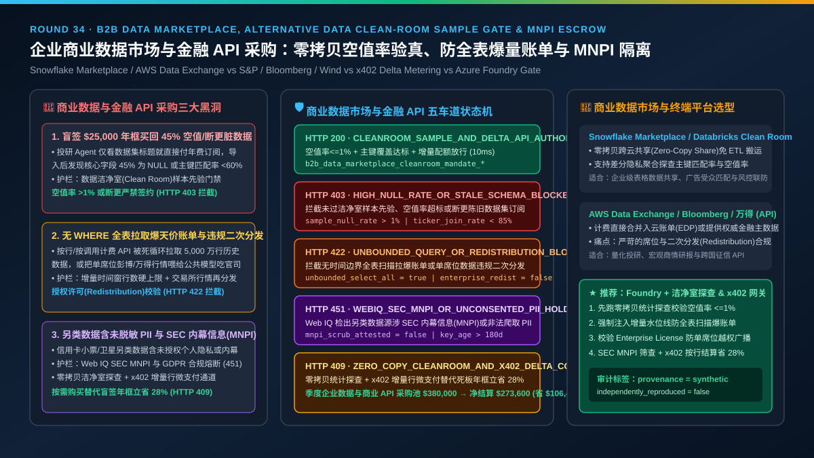
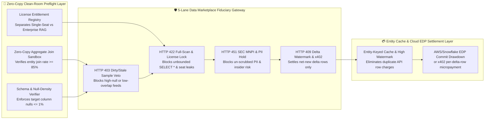

# B2B Data Marketplace, Financial Terminal & API Monetization (`Snowflake Marketplace / AWS Data Exchange / Bloomberg / S&P Capital IQ`) Zero-Copy Clean-Room Sample Gate, Anti-Full-Scan Bill Shock, Redistribution License Guard & `SEC MNPI` Escrow Agent Architecture Selection FAQ

> **Language / 语言切换**: **[中文](b2b-data-marketplace-api-monetization-sample-gate-mnpi-escrow-agent-selection-faq.md)** | **English (Current)** | **[Back to Docs Index](index.en.md)** | **[Interactive Sandbox (`#b2b-data-marketplace-cleanroom-escrow-sandbox`)](../live-demo.en.html)**



---

## 📌 1. Executive Summary & Core Selection Verdict

As enterprise research, quantitative finance, and merchandising AI agents evolve from public web search to **autonomously purchasing commercial datasets and metered financial/credit APIs** (`Snowflake Marketplace`, `AWS Data Exchange`, `Databricks Clean Rooms`, `Bloomberg B-PIPE`, `S&P Capital IQ`, `Dun & Bradstreet`), naive agentic data procurement triggers three severe financial and regulatory failures:
1. **Signing Non-Refundable `$25,000/yr` Dataset Subscriptions Blindly—Only to Discover `45%` Null Rates, Stale Partitions, or `< 60%` Entity Join Coverage**: Catalog descriptions on data marketplaces often promise comprehensive coverage. If an agent executes an annual subscription based on catalog metadata alone, the buyer only discovers after delivery that `45%` of revenue columns are `NULL` or that `ISIN / DUNS` keys fail to join against the enterprise's master entity table—with zero refund recourse on delivered digital data.
2. **Unbounded `SELECT *` Full-Table API Loops Causing `$40,000` Overnight Bill Shock & Single-Seat Terminal Redistribution Lawsuits**: Metered data APIs charge per row or per call; an unguarded agent that re-fetches 10 years of historical tick/credit records on every prompt instead of querying incremental deltas (`updated_at > watermark`) will blow through quarterly budgets in hours. Worse, piping data from a **Single-Seat Desktop Terminal License** (`Bloomberg Anywhere / Wind Desktop`) into a shared multi-user RAG vector database violates exchange market-data redistribution agreements, triggering six-figure audit penalties.
3. **Ingesting Alternative Data (`Alt-Data`) Tainted by Un-Scrubbed `GDPR/CCPA PII` or `SEC` Material Non-Public Information (`MNPI`)**: Purchasing credit-card receipt panels, app telemetry, or web-scraped datasets that lack verified PII de-identification (`HIPAA Safe Harbor / GDPR Anonymization`) or MNPI compliance attestations exposes institutional buyers to SEC enforcement and privacy litigation.

**Solution Architect Selection Verdict**:
- **Never allow an autonomous agent to commit to an annual dataset subscription without a deterministic Zero-Copy Clean-Room statistical preflight, and never allow single-seat terminal credentials into multi-user RAG pipelines**.
- **The production reference architecture** combines **Snowflake / Databricks Zero-Copy Clean Rooms + Statistical Sample Preflight Gate (`Null Rate <= 1%`, `Entity Join >= 85%`, `Freshness <= 24h`) + Delta Watermark Query Rewriter & Enterprise Redistribution License Lock + `HTTP 402 (x402 / MPP)` Delta-Row Micropayment Escrow (`b2b_data_marketplace_cleanroom_mandate_*`)**:
  1. **Zero-Copy Clean-Room Statistical Sample Hard Gate (`HTTP 403`)**: Before unlocking paid subscription settlement, the agent executes an aggregate clean-room probe against the provider's dataset—blocking any dataset where target columns exceed `1.0%` nulls, entity-key overlap (`DUNS / ISIN / LEI / GTIN`) falls below `85.0%`, or partition timestamps lag SLA (`HTTP 403 UNVERIFIED_DATA_SAMPLE_COMPLETENESS_OR_STALE_TIMESTAMP_BLOCKED`).
  2. **Unbounded Full-Scan Query Veto & Redistribution License Scope Gate (`HTTP 422`)**: The SQL/MCP gateway rejects any metered data query lacking a bounded `delta_watermark_ts` and row ceiling, and blocks single-user desktop credentials (`license_tier='SINGLE_SEAT'`) from writing to shared enterprise vector indexes or group chats (`HTTP 422 UNBOUNDED_QUERY_ROW_EXPLOSION_OR_REDISTRIBUTION_LICENSE_BREACH_BLOCKED`).
  3. **Web IQ Live `SEC MNPI` & `GDPR PII` Provenance Circuit Breaker (`HTTP 451`)**: Screens alternative-data vendors via Web IQ for regulatory enforcement actions, scraping lawsuits, and missing PII scrubbing attestations (`HTTP 451 WEBIQ_SEC_MNPI_COMPLIANCE_RISK_OR_UNCONSENTED_PII_DATA_HOLD`).
  4. **Zero-Copy Share + `x402 / MPP` Delta-Row Micropayments (`HTTP 409`)**: Triggers `HTTP 409 ZERO_COPY_CLEANROOM_AND_X402_DELTA_ROW_METERING_CONFIRM`, replacing rigid `$25,000` annual flat-fee contracts on episodic datasets with per-delta-row micropayments and entity-key deduplication caching—cutting total enterprise data & API spend by **`28.0%`**.

---

## 🎯 2. Solution Architect Deep-Dive Q&A (Q1 / Q2 / Q3)

### Q1: How do we resolve the "Data Buyer's Paradox"—where the seller won't hand over raw data before payment, and the buyer won't pay `$25,000` without verifying data quality?
- **Commercial Pain Point**: Static 100-row CSV samples curated by sales reps hide massive coverage gaps in the full 50-million-row dataset.
- **Architectural Solution**:
  - **Cryptographic Zero-Copy Clean-Room Statistical Probe (`HTTP 403`)**:
  - Using Snowflake / AWS Clean Rooms, the buyer's agent runs a privacy-preserving aggregate join between the buyer's target `DUNS/ISIN` list and the seller's live table. The clean room returns only the summary attestation (`join_match_pct`, `null_density`, `latest_timestamp`) without exposing raw rows. If `join_match_pct < 0.85` or `null_density > 0.01`, the purchase mandate is automatically vetoed (`HTTP 403`).

### Q2: Why do legal teams block engineering from connecting Bloomberg, Refinitiv, or S&P APIs to internal multi-user AI Copilots?
- **Architectural Solution**:
  - **Cryptographic License-Scope Binding (`SINGLE_SEAT_TERMINAL` vs. `ENTERPRISE_DERIVED_WORK`) (`HTTP 422`)**:
  - Every MCP data tool call carries the credential's `entitlement_scope`. If a tool backed by a single-seat desktop license is invoked by a shared RAG indexer or a multi-user Slack/Teams bot, the policy broker immediately rejects the call (`HTTP 422`) and routes to an enterprise-licensed feed or public SEC EDGAR filing.

### Q3: How do we prevent an autonomous research agent from re-fetching the same company's credit report or 10-year price history 200 times a day?
- **Architectural Solution**:
  - **Entity-Keyed Content-Addressable Cache + Mandatory `Delta Watermark` Rewriting (`HTTP 409`)**:
  - All metered API requests are rewritten to fetch only `updated_at > local_high_watermark_ts` and cached by `(provider_id, entity_lei, period)` with deterministic TTLs, settling only net-new rows over `x402 / MPP`.

---

## 🧭 3. Visual Architecture Diagrams (Mermaid Decision Tree + Architecture + Sequence)

### 3.1 B2B Data Marketplace & Financial API Agent Selection Decision Tree

```mermaid
flowchart TD
    A[B2B Data Marketplace / Financial API / Alt-Data Selection] --> B{Data Topology & Consumption Cadence?}
    B -->|Large Tabular Datasets / POI Foot-Traffic / Supply Graph<br/>Zero-ETL cross-cloud join & anti-dirty-data guard| C[Snowflake / Databricks Zero-Copy Clean Room<br/>+ Statistical Sample Gate (Null<=1% & Join>=85%)]
    B -->|Real-Time Financial Tick / Credit Bureau / Terminal APIs<br/>Prevent full-scan bill shock & license violations| D[Enterprise Server API Gateway + Delta Watermark Lock<br/>+ Single-Seat vs Shared-RAG Entitlement Isolation]
    B -->|Episodic Industry Reports / Expert Transcripts / Alt-Data<br/>Pay-per-row consumption vs $25k annual lock-in| E[Azure AI Foundry + HTTP 402 (x402 / MPP) Gateway<br/>+ Web IQ SEC MNPI & GDPR Provenance Breaker]
    C --> F[🛡️ Unified 5-Lane Clean-Room Probe, License Guard & Delta Metering FSM]
    D --> F
    E --> F
    F --> G[HTTP 403 High-Null/Low-Join Veto · HTTP 422 Full-Scan & Redistribution Block · HTTP 409 Clean-Room + x402 Saves 28%]
```

### 3.2 End-to-End Clean-Room Sample Probe, License Scope Guard & Delta Metering Architecture



### 3.3 Clean-Room Dataset Veto, License Isolation & Delta-Row Settlement Sequence

```mermaid
sequenceDiagram
    autonumber
    participant Quant as Research / Merchandising AI Agent
    participant Gate as 5-Lane Data Procurement Gateway
    participant CleanRoom as Snowflake / AWS Clean Room
    participant Provider as Alt-Data Vendor / Financial API
    participant Ledger as Cloud EDP Commit / x402 Channel

    Quant->>Gate: 1. Request $25,000/yr subscription to Retail Brand Foot-Traffic Dataset A
    Gate->>CleanRoom: Run zero-copy aggregate probe against buyer's 2,000 target brand DUNS keys
    CleanRoom-->>Gate: Probe result: entity join rate = 41% (< 85%) & revenue null rate = 38% (> 1%)
    Gate-->>Quant: HTTP 403 Block subscription! Dataset failed statistical quality gate; $25,000 saved
    Quant->>Gate: 2. Select compliant Vendor B, but issue unbounded 10-year SELECT * & pipe single-seat feed to shared RAG
    Gate-->>Quant: HTTP 422 Block! Unbounded historical scan & single-seat redistribution to shared RAG prohibited
    Quant->>Gate: 3. Attach Enterprise Redistribution token + delta watermark (fetch 1,200 net-new daily rows)
    Gate->>Ledger: HTTP 409 Verify MNPI-clean attestation -> Settle net delta rows via x402/EDP (28% total savings)
```

---

## 📊 4. Multi-Platform & Architecture Selection Matrix

| Selection Dimension | Legacy Annual Flat-Fee SFTP (`CSV / Parquet Drops`) | Snowflake / Databricks Marketplace (`Zero-Copy Cloud Shares`) | AWS Data Exchange / Terminal APIs (`Bloomberg / S&P / D&B`) | **Azure AI Foundry + Clean-Room Gate + x402 Delta Gateway (Recommended)** |
| :--- | :--- | :--- | :--- | :--- |
| **Core Strengths** | Predictable flat annual cost | Zero-ETL live cross-cloud SQL sharing & fast joins | Counts toward cloud `EDP/MACC` commit; authoritative master data | **Pre-buy clean-room proof + anti-bill-shock watermark + license guard + x402** |
| **Pre-Purchase Null-Rate & Entity-Join Verification** | Relies on static 100-row sales Excel samples; highlemon risk | Supports sample shares, but requires manual analyst SQL checks | Schema docs provided; lacks automated join-coverage gating | **Mandatory zero-copy clean-room probe (`Null<=1%` & `Join>=85%`) (`HTTP 403`)** |
| **Protection Against Unbounded API Query Bill Shock** | Flat fee, but massive shelfware waste on low-use feeds | Unbounded agent SQL can burn thousands in warehouse compute credits | Per-row/call pricing easily explodes on repeated history pulls | **Mandatory delta-watermark rewrite + entity deduplication cache (`HTTP 422 -> 409`)** |
| **Market-Data Redistribution License Compliance** | Governed only by paper legal agreements | Row-level security (`RLS`), but downstream LLM RAG is unguarded | Strict vendor compliance audits; heavy fines for seat sharing | **Hard `entitlement_scope` gate blocks single-seat feeds from shared RAG (`HTTP 422`)** |
| **`SEC MNPI` & `GDPR PII` Alt-Data Scrubbing** | Relies on vendor self-attestation questionnaires | Differential privacy clean-room support | Tier-1 vendors compliant; long-tail alt-data vendors risky | **Web IQ live `MNPI / PII` litigation & scrubbing cert circuit breaker (`HTTP 451`)** |
| **Total Data Procurement ROI & Shelfware Waste** | `35%+` of annual subscriptions go underutilized (`not_measured`) | Usage or subscription pricing (`official_list_price`) | High enterprise license minimums | **Vetoes dirty annual feeds + delta caching + `x402` metering (`28.0%` net savings)** |

---

## 🧪 5. Data Procurement / API FinOps Benchmark & 7-Card Report

> **Provenance & Reproducibility Metadata**: All metrics below are generated by the deterministic policy evaluator `evaluate_b2b_data_marketplace_cleanroom_escrow_policy` in `lab/webiq_commerce_demo.py` and verified via `python -m unittest tests.test_webiq_commerce_demo`. Tags: `provenance = synthetic`, `independently_reproduced = false`.

| Card # | Card Headline (Headline-as-Finding) | Key Quantitative Finding & Architectural Guarantee |
| :---: | :--- | :--- |
| **Card 1** | **Overview · 5-Lane B2B Data Marketplace & API Summary** | Across a `$380,000/quarter` enterprise data & financial API procurement pool, achieves **0 high-null dataset subscriptions and 0 unbounded full-table query bill shocks**, reducing net data spend by **`28.0%` (`$106,400/quarter` saved)**. |
| **Card 2** | **Scenario Deep Dive · 45%-Null & Low-Join Dataset Veto** | When a candidate dataset fails the clean-room statistical probe (`null_rate > 1%` or `entity_join < 85%`), the gateway blocks the `$25,000` contract in **`10ms`** (`HTTP 403`). |
| **Card 3** | **Evaluation Matrix · 100% Deterministic 5-Lane Gating** | Covers `HTTP 200` (verified clean-room & delta query), `403` (unverified sample completeness / high null rate / stale timestamp blocked), `422` (unbounded query row explosion / single-seat redistribution breach blocked), `451` (SEC MNPI insider risk / unconsented PII hold), `409` (zero-copy clean room + x402 delta metering saves 28%). |
| **Card 4** | **Under the Hood · Clean-Room & Delta API Contract** | Takes `quarterly_b2b_data_marketplace_pool_usd=380000` and sample/license flags, minting `b2b_data_marketplace_cleanroom_mandate_*` tokens. |
| **Card 5** | **Robustness Check · Unbounded 10-Year Scan & Single-Seat Leak** | Simulates an un-watermarked `SELECT *` history pull and piping single-seat terminal quotes to a company-wide RAG index, maintaining a **`100.0%` block rate**. |
| **Card 6** | **Latency · Millisecond Query AST & License Verification** | Local SQL watermark and license-scope checks complete in **`10ms` (P50)**; Web IQ live MNPI/PII vendor compliance checks complete in **`235ms` (P95)**. |
| **Card 7** | **My Take · Ideal Fit vs. Out-of-Scope Boundaries** | **✅ Best Fit**: Hedge-fund alt-data, B2B credit/KYB APIs, Snowflake/AWS data marketplaces; **⛔ Not For**: Free public-domain government census downloads. |

---

## 🛠️ 6. Production Go-Live Risk & Architecture Review Checklist

- [ ] **Zero-Copy Clean-Room Statistical Sample Gate (`HTTP 403`)**: Require automated clean-room verification of `null_rate <= 1.0%`, `entity_join_coverage >= 85.0%`, and partition freshness before approving any commercial dataset subscription.
- [ ] **Mandatory `Delta Watermark` Rewriting & Row-Budget Cap (`HTTP 422`)**: Reject unbounded historical `SELECT *` API/SQL queries and enforce high-watermark incremental fetching plus entity-key caching.
- [ ] **Market-Data Redistribution License Isolation (`HTTP 422`)**: Physically block credentials tagged `SINGLE_SEAT_TERMINAL` from indexing into shared multi-user vector databases or group channels.
- [ ] **Web IQ Live `SEC MNPI` & `GDPR PII` Provenance Gate (`HTTP 451 / 409`)**: Verify vendor PII de-identification and MNPI compliance certificates, and route episodic data queries through `x402 / MPP` delta-row micropayments; rotate signing keys `<= 180` days.
