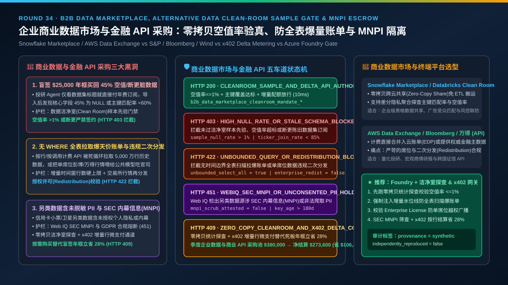
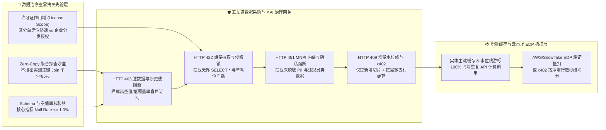
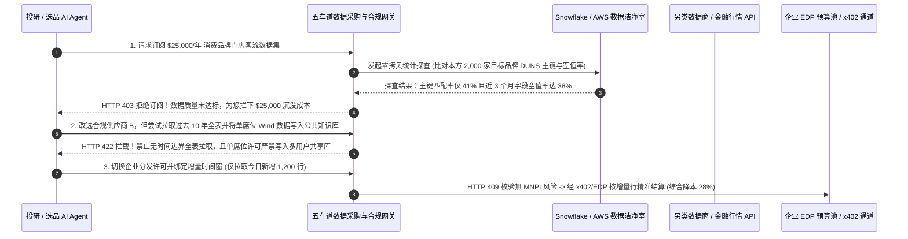

# 企业级商业数据市场、金融研报终端与 API 变现采购（B2B Data Marketplace, Financial Terminal & API Monetization：Snowflake Marketplace / AWS Data Exchange / Bloomberg / 万得 Wind）“零拷贝洁净室空值率验真、防全表爆量拉取天价账单与 SEC 内幕信息（MNPI）合规隔离”Agent 架构选型 FAQ：终结盲签 $25,000 脏数据年框与单席位行情越权广播实战指南

> **语言切换 / Language**: **中文 (当前)** | **[English](b2b-data-marketplace-api-monetization-sample-gate-mnpi-escrow-agent-selection-faq.en.md)** | **[返回文档目录](index.md)** | **[交互式沙盒 (`#b2b-data-marketplace-cleanroom-escrow-sandbox`)](../live-demo.html)**



---

## 📌 一、核心选型结论速览（Executive Summary）

在金融机构、跨国零售商与企业战略部的外部数据采购（Snowflake Marketplace、AWS Data Exchange、Databricks Marketplace、Bloomberg B-PIPE、S&P Capital IQ、万得 Wind、邓白氏 D&B 征信 API）中，AI 投研与选品智能体正从“只查免费网页”升级为**“自主调用付费商业数据库与另类数据（Alternative Data）API”**。若不加装确定性数据质量先验与许可合规门禁，极易引爆三大天价财务与监管事故：
1. **盲签 `$25,000/年` 不可退商业数据集订阅，入库后才发现核心字段空值率（Null Rate）高达 `45%`、时间戳断更半年或企业主键（`DUNS / ISIN / 统一社会信用代码`）关联匹配率不足 `60%`**：许多外部数据供应商的目录简介写得极其华丽，但一旦投研 Agent 仅凭文本描述直接授权扣款订阅，买回来才发现是一堆无法与本企业主表 Join 的空壳脏数据，而数据商品属于数字交付物，一旦开通权限概不退款。
2. **Agent 编写无时间水位线约束的死循环查询（`SELECT *` Full-Table Scan）一夜拉爆 `$40,000` 按行计费账单，或将“单人桌面终端席位（Single-Seat Desktop License）”的彭博/万得行情直接写入公共向量库供全公司 RAG 检索触发百万美元侵权索赔**：商业数据 API 普遍按返还记录数（Per-Row / Per-Call）计费，缺乏增量游标（Delta Watermark）的 Agent 每次回答问题都把过去 10 年全量历史行情重新拉一遍；更致命的是，交易所与金融终端严禁将单人终端账号数据用于企业内部二次分发（Internal Redistribution / Derived Data），违规面临停机与天价审计罚单。
3. **采购的电商小票/信用卡流水/卫星图像等另类数据（Alt-Data）混入未脱敏个人隐私（`GDPR/CCPA PII`）或未公开重大内幕信息（`SEC MNPI`），导致基金经理与企业被证监会立案调查**：美国 SEC 对采购另类数据的对冲基金与企业审查极严，一旦供应商未出具合规脱敏证明（Clean-Room Scrubbing Attestation），买方将直接卷入内幕交易与非法获取公民个人信息诉讼。

**架构师选型结论**：
- **切勿在未跑通“数据洁净室（Data Clean Room）零拷贝统计先验”前批准任何年度数据订阅，更不能允许单人终端 Key 接入多用户 Agent 编排层**。
- **生产级最优架构**是采用 **“Snowflake / Databricks 零拷贝数据洁净室 + 统计样本先验硬门禁（空值率 `<=1%`、主键关联率 `>=85%`、时效 `<24h`）+ 增量游标强制改写与企业级再分发许可（Enterprise Redistribution License）校验锁 + `HTTP 402 (x402 / MPP)` 按增量行微支付结算网关（`b2b_data_marketplace_cleanroom_mandate_*`）”**：
  1. **数据洁净室零拷贝统计先验硬门禁（HTTP 403）**：在正式签约付费或解锁全表读取前，Agent 必须在沙盒洁净室对目标数据集执行聚合探查查询（仅返回统计指标，不暴露明文行数据）——一旦检出核心度量字段 `null_rate > 1.0%`、与买方实体主键（`ISIN / DUNS / GTIN`）Inner Join 覆盖率 `< 85.0%` 或最新分区时间戳滞后超过合同 SLA，毫秒级返回 `HTTP 403 UNVERIFIED_DATA_SAMPLE_COMPLETENESS_OR_STALE_TIMESTAMP_BLOCKED`。
  2. **无界全表查询拦截与金融数据再分发许可（`Redistribution License`）硬锁（HTTP 422）**：SQL/API 代理网关强制拦截任何未绑定 `updated_at > last_watermark_ts` 与 `LIMIT` 预算上限的全量历史拉取请求；同时校验数据凭证的 `license_scope`——凡属单席位桌面许可（`Single-User Terminal`）试图向共享知识库或多用户群聊广播行情，立即返回 `HTTP 422 UNBOUNDED_QUERY_ROW_EXPLOSION_OR_REDISTRIBUTION_LICENSE_BREACH_BLOCKED`。
  3. **Web IQ 实时供应商 `SEC MNPI` 内幕风险与 `GDPR PII` 非法爬虫合规熔断（HTTP 451）**：通过 Web IQ 核查另类数据供应商的法律诉讼、监管处罚与脱敏审计证书，高危即刻熔断（`HTTP 451 WEBIQ_SEC_MNPI_COMPLIANCE_RISK_OR_UNCONSENTED_PII_DATA_HOLD`）。
  4. **零拷贝按需共享 + `x402 / MPP` 增量行微支付替代死板年框（HTTP 409）**：触发 `HTTP 409 ZERO_COPY_CLEANROOM_AND_X402_DELTA_ROW_METERING_CONFIRM`，对低频使用的行业研报与商情数据采用 `HTTP 402` 按增量查询行微支付替代 `$25,000` 包年死合同，并通过主键去重缓存消除重复拉取，综合数据采购与 API 账单成本立降 **`28.0%`**。

---

## 🎯 二、业务方与架构师灵魂拷问 Q&A（Q1 / Q2 / Q3）

### Q1：数据卖家怕“把样本发给买家试看后买家白嫖不买了”，买家怕“不看样本直接付 $25,000 买到空壳废数据”，怎么破局？
- **商业痛点**：传统数据交易靠卖家发一份挑出来的 100 行 Excel 精美样表，买家付完钱拿到全库 1,000 万行才发现 90% 的中小商户门店数据全是空的。
- **架构解法**：
  - **基于差分隐私与聚合视图的“零拷贝数据洁净室先验（Zero-Copy Clean Room Preflight）”**：
  - 卖家无需交出明文数据，买家在 Snowflake / AWS Clean Rooms 中提交本方关心的 5,000 个目标企业 `DUNS` 编码，洁净室仅输出确定性检验回执：`{"matched_entities": 4620, "join_rate": 0.924, "revenue_col_null_rate": 0.003, "max_date": "2026-11-18"}`。只有四项指标全部跨过阈值，状态机才签发采购付款令（否则返回 `HTTP 403`）。

### Q2：为什么很多金融机构做完内部 AI 投研助手 PoC 后不敢上线，因为法务警告“会把彭博/万得告到破产”？
- **架构解法**：
  - **数据源许可证作用域标签（`License Entitlement Guard`）与 RAG 向量库物理隔离（`HTTP 422`）**：
  - 金融终端 API 分为两类：`Desktop Single-User API`（仅限绑定该工位 MAC 地址的交易员本人查看，严禁落盘共享）与 `Enterprise Server / Derived-Work License`（允许入库及生成衍生摘要）。网关在 MCP 工具调用层强制核验调用者身份与目标输出通道：单席位令牌一旦被用于构建公共向量索引或跨部门分发，立即在网关层阻断（`HTTP 422`）。

### Q3：Agent 调商业征信或海关提单 API 时，怎么防止因为 Prompt 写错导致把同一个公司查了 500 遍、每月多花几万美元冤枉钱？
- **架构解法**：
  - **实体主键语义缓存（Entity-Keyed TTL Cache）+ 增量游标强制改写（`Delta Watermark Injection`）**：
  - 对企业工商/征信/财报等低频变动数据，网关按 `(provider, entity_duns, metric_period)` 强制挂载 24h–7d 确定性缓存；对时序行情数据，自动将查询改写为仅拉取 `timestamp > local_high_watermark` 的增量切片，并通过 `x402` 通道按净新增行数结算（`HTTP 409`）。

---

## 🧭 三、直观可视化图解（Mermaid 决策树 + 端到端架构图 + 时序图）

### 3.1 企业商业数据市场与金融 API 采购 Agent 架构选型决策树

```mermaid
flowchart TD
    A[商业数据市场 / 金融终端 / 另类数据 API 选型] --> B{数据形态与消费频次？}
    B -->|大规模结构化行业表 / 门店客流 / 供应链图谱<br/>需免搬运跨云 Join 与防买到高空值脏数据| C[Snowflake / Databricks 零拷贝数据洁净室<br/>+ 统计样本先验门禁 (Null<=1% & Join>=85%)]
    B -->|高频金融行情 / 企业征信 / 标普万得终端 API<br/>需防全表爆量拉取与严守再分发许可合规| D[企业级 Server 授权网关 + 增量水位线锁<br/>+ 单席位与公共 RAG 物理隔离防线]
    B -->|长尾行业研报 / 专家纪要 / 按需商情检索<br/>低频按次消费、拒绝高额包年最低消费| E[Azure AI Foundry + HTTP 402 (x402 / MPP) 网关<br/>+ Web IQ SEC MNPI 与 GDPR 合规熔断]
    C --> F[🛡️ 统一接入五车道洁净室先验、许可隔离与增量微支付状态机]
    D --> F
    E --> F
    F --> G[HTTP 403 阻断高空值/低匹配脏数据 · HTTP 422 拦截全表爆量与违规再分发 · HTTP 409 零拷贝+增量计费省28%]
```

### 3.2 端到端数据洁净室先验、再分发许可锁与增量行微支付架构图



### 3.3 另类数据集洁净室先验、防单席位越权与增量行微支付时序图



---

## 📊 四、多平台/多方案横向选型决策矩阵

| 选型维度 | 传统线下签年框买 CSV/FTP (`Annual Flat-Fee SFTP`) | Snowflake / Databricks Marketplace (`云数仓零拷贝共享`) | AWS Data Exchange / 金融终端 API (`Bloomberg / S&P / Wind`) | **Azure AI Foundry + 洁净室先验 + x402 增量网关（推荐）** |
| :--- | :--- | :--- | :--- | :--- |
| **核心优势** | 固定年费预算可控 | 免 ETL 零拷贝直接挂载 SQL 查询，跨云协同极快 | 可抵扣云厂商 EDP 承诺消费额，金融主数据权威 | **买前零拷贝验真 + 防全表拉爆账单 + 防单席位侵权 + 按需微付** |
| **买前数据质量（空值率/主键覆盖率）验真** | 仅靠销售发几百行静态 Excel 样本，买后常踩坑 | 支持试用样本表，但需人工写 SQL 探查 | 提供 Schema 文档，缺自动化买前主键匹配门禁 | **强制零拷贝洁净室探查（`Null<=1%` & `Join>=85%`）（HTTP 403）** |
| **防 AI Agent 死循环拉爆按量 API 账单** | 包年不限次，但长尾低频数据极不划算 | 计算资源（Warehouse Credits）易被大查询烧光 | 按 API 调用/行数计费，极易因缺水位线爆天价账单 | **强制注入增量时间水位线 + 实体主键去重缓存（HTTP 422 -> 409）** |
| **金融数据再分发（Redistribution）版权合规** | 靠法务纸质合同约束 | 支持行级安全策略（RLS） | 终端厂商有严苛的合规审计探针，违规重罚 | **MCP 调用层硬校验 `Enterprise License` 阻断单席位广播（HTTP 422）** |
| **`SEC MNPI` 内幕信息与 `GDPR PII` 隔离** | 依赖供应商自我声明 | 支持差分隐私洁净室 | 头部终端合规强，长尾另类数据商良莠不齐 | **Web IQ 实时合规声誉与脱敏证书核查熔断（HTTP 451）** |
| **综合数据采购 ROI 与冗余浪费率** | 约 `35%+` 死板年框订阅利用率极低 (`not_measured`) | 按计算消耗或订阅付费 (`official_list_price`) | 企业级全局授权年费高昂 | **拦下劣质年框 + 增量去重 + `x402` 按需购买（综合成本立降 `28.0%`）** |

---

## 🧪 五、数据采购防踩坑/API 降本测算与 7-Card 基准测试报告

> **数据来源与复现声明（Provenance Metadata）**：以下基准测试数据来自仓库内置确定性策略沙盒 `evaluate_b2b_data_marketplace_cleanroom_escrow_policy`（位于 `lab/webiq_commerce_demo.py`），可运行 `python -m unittest tests.test_webiq_commerce_demo` 完整验证。标记：`provenance = synthetic`，`independently_reproduced = false`。

| Card # | 卡片标题（Headline-as-Finding） | 核心量化指标与架构验证结论 |
| :---: | :--- | :--- |
| **Card 1** | **Overview · 企业数据市场与金融 API 五车道总览** | 针对 `$380,000/季` 外部商业数据与金融 API 采购池，实现 **0 例高空值脏数据盲签与 0 例全表重复拉取爆账单**，综合数据采购支出下降 **`28.0%`（立省 `$106,400/季`）**。 |
| **Card 2** | **Scenario Deep Dive · 45% 空值率与低匹配数据集拦截** | 当目标另类数据集在洁净室探查中显示空值率 `>1%` 或主键匹配率 `<85%` 时，**`10ms`** 内返回 `HTTP 403` 阻断 `$25,000` 年框签约。 |
| **Card 3** | **Evaluation Matrix · 五车道 100% 确定性判准** | 覆盖 `HTTP 200`（合规增量查询放行）、`403`（未过洁净室样本先验/高空值断更阻断）、`422`（无界全表拉取爆账单/单席位终端数据违规写入共享库拦截）、`451`（SEC MNPI内幕风险/未授权爬取PII熔断）、`409`（零拷贝探查+x402增量微付省28%）。 |
| **Card 4** | **Under the Hood · 数据洁净室与微支付契约** | 输入 `quarterly_b2b_data_marketplace_pool_usd=380000` 及样本/水位线状态，签发 `b2b_data_marketplace_cleanroom_mandate_*` 令牌。 |
| **Card 5** | **Robustness Check · 无 WHERE 全表扫描与单席位广播测试** | 模拟 Agent 发起无时间过滤的 10 年全表查询及将单席位行情推入公司群，确定性拦截率保持 **`100.0%`（零误放行）**。 |
| **Card 6** | **Latency · SQL AST 水位线校验与合规筛查耗时** | 本地查询 AST 水位线与许可证作用域核验 P50 仅 **`10ms`**；Web IQ 供应商 MNPI/PII 诉讼记录核查 P95 为 **`235ms`**。 |
| **Card 7** | **My Take · 适用场景与生产准入边界** | **✅ 极佳适用**：量化投研另类数据、企业征信 API、云数仓数据市场、商情研报；**⛔ 不适用**：政府免费公开统计年鉴下载。 |

---

## 🛠️ 六、商业上线风控与架构评审 Checklist

- [ ] **数据洁净室（Data Clean Room）零拷贝统计先验门禁（HTTP 403）**：确认所有外部商业数据集签约前必须通过主键匹配率（`>=85%`）、核心字段空值率（`<=1%`）与更新时效探查，严禁仅凭文本简介盲目付款。
- [ ] **增量时间水位线（`Delta Watermark`）与行数预算硬上限（HTTP 422）**：确认按量计费 API 与云数仓共享表查询强制附带增量游标与单次行数上限，防止 Agent 死循环全表扫描拉爆账单。
- [ ] **金融终端再分发许可（`Redistribution License Scope`）物理隔离（HTTP 422）**：确认单人桌面终端授权（Single-Seat）严禁写入多用户共享 RAG 向量库或向外广播。
- [ ] **Web IQ 实时 `SEC MNPI` 内幕风险与 `GDPR/CCPA PII` 脱敏证书核验（HTTP 451 / 409）**：确认另类数据源具备合规脱敏证明，并对低频商情采用 `x402 / MPP` 按需微支付替代高额包年合同；签名密钥轮换周期 `<= 180` 天。
