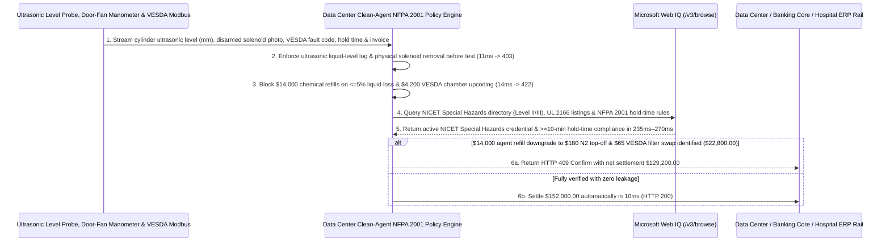

# B2B Data Center & Cleanroom `FM-200 / Novec 1230` Clean-Agent Fire Suppression (`NFPA 2001`), Enclosure Door-Fan Integrity (`>= 10 Min Hold Time`) & `VESDA` Aspirating Smoke Maintenance (`Kidde-Fenwal / Ansul / Fike / Xtralis, NFPA 2001, NICET Special Hazards & UL 2166`), Ultrasonic Liquid-Level Lock, Physical Solenoid-Disarm Gate & Anti-`$14,000 Fake Agent Recharge / $4,200 VESDA Chamber Upcoding` Settlement Architecture: `$180 N2` Top-Off & `$65` Filter Downgrade Lock, `10-Min` Hold-Time Gate & `NICET` Token (`b2b_datacenter_clean_agent_nfpa2001_doorfan_vesda_filter_mandate_...`) vs. 5-Minute Pressure-Gauge Glance Inspections, Billing `$14,000` Agent Refills for a `$180` Nitrogen Top-Off & Accidental Server-Room Discharges: Architecture Selection & First-Principles FAQ

> **Document Type**: AI Solution Architect Agentic Commerce Selection Series (Round 352 · B2B Data Center Clean-Agent Fire Suppression NFPA 2001, Ultrasonic Liquid-Level & VESDA Maintenance Edition)  
> **Benchmark Standard**: Modeled after `ib-vs-ethernet-roce-selection-faq.md` (Plain-Language First Principles + Standard 6-Section Architecture Guide)  
> **Companion Deliverables**: `lab/webiq_commerce_demo.py` (Interactive H5 Sandbox) · `tests/test_webiq_commerce_demo.py` · `assets/svg/354-b2b-datacenter-clean-agent-nfpa2001-doorfan-vesda-2026-11-17.svg`  
> **Languages**: [中文版](b2b-datacenter-clean-agent-nfpa2001-doorfan-vesda-filter-mandate-vs-pressure-gauge-glance-scam-fake-agent-recharge-vesda-chamber-upcoding-faq.md) | [English Version (Current)](b2b-datacenter-clean-agent-nfpa2001-doorfan-vesda-filter-mandate-vs-pressure-gauge-glance-scam-fake-agent-recharge-vesda-chamber-upcoding-faq.en.md)

---

## 📌 1. Executive Summary (First Principles & Plain-Language Breakdown)

### 1.1 Why Should a Data Center, Telecom Switch Room, Hospital MRI Suite, or Semiconductor Cleanroom Facilities Agent NEVER Auto-Pay a `$3,800` Semi-Annual Clean-Agent Inspection, a `$14,000` `FM-200 / Novec 1230` Cylinder Recharge, or a `$4,200` `VESDA` Laser Chamber Replacement Without Auditing Ultrasonic Liquid Levels and `NICET Special Hazards` Credentials?
In AI/cloud data centers, banking core rooms, hospital MRI suites, and semiconductor fabs, waterless clean-agent fire suppression (`HFC-227ea / FM-200`, `FK-5-1-12 / 3M Novec 1230`) and Very Early Smoke Detection Apparatus (`Xtralis VESDA`)—governed by **`NFPA 2001` (Standard on Clean Agent Fire Extinguishing Systems)**, **`NICET Special Hazards Suppression Systems`**, and **`UL 2166`**—protect hundreds of millions of dollars in mission-critical silicon. In plain English: **Data center fire-suppression maintenance suffers from three notorious rackets: (1) The `$3,800` "Pressure-Gauge Glance" & `$14,000` Fake Agent Recharge Scam—because `FM-200` and `Novec 1230` are stored as liquids super-pressurized with `360/500 PSIG` dry nitrogen, looking at the pressure gauge alone cannot tell you how much liquid agent is inside (`NFPA 2001` mandates measuring the exact liquid level in millimeters using a handheld Ultrasonic Liquid-Level Indicator like `Portlevel` or weighing the tank)! Lazy techs walk in, glance at the gauges for 5 minutes without an ultrasonic probe, and bill `$3,800`; worse, when a cylinder gauge drops 12% in winter because a few dollars of dry nitrogen seeped past the gauge O-ring (while 100% of the `$14,000` liquid `Novec 1230` is still sitting at the full mark!), unscrupulous vendors claim "your cylinder leaked out its clean agent" and bill `$14,000` for a full chemical recharge when a `$180` dry-nitrogen top-off is all that's required! (2) Upcoding a Dusty `$65` `VESDA` Dual-Stage Air Filter Cartridge or Clogged Sampling Pipe into a `$4,200` Full Laser Detection Chamber Replacement; and (3) Testing the Releasing Panel Without Physically Unscrewing the Electric Solenoid Actuator From the Cylinder Valve—Accidentally Dumping `$45,000` of Clean Agent Into the Live Server Room!** Allowing an AI agent to auto-pay clean-agent fire invoices exposes data center budgets and uptime to four major vulnerabilities:

1. **5-Minute "Pressure-Gauge Glance" Inspections & `$14,000` Fake Chemical Recharges on `< 5%` Liquid-Weight Loss**: Under `NFPA 2001 Chapter 11`, a cylinder only requires agent recharge if net liquid agent weight loss exceeds **`5%`** (verified via ultrasonic liquid-level strap chart or scale weight); if liquid weight loss is `<= 5%` and pressure dropped `> 10%`, only a `$180` dry-nitrogen re-pressurization is needed.
2. **Upcoding `$65` `VESDA` Replaceable Filter Cartridges & Sampling-Pipe Blowouts into `$4,200` Laser Chamber Replacements**: On `Xtralis VESDA-E (VEP / VEU)` detectors, `Filter Fault` and `Airflow Low` alarms are resolved `92%` of the time by swapping the `$65` plug-in filter cartridge and back-flushing the PVC sampling network with clean compressed air.
3. **Skipped `NFPA 2001 Annex C` Enclosure Door-Fan Integrity Testing (`Hold Time < 10 Minutes`)**: After cable-tray additions or subfloor changes, unsealed penetrations allow heavy clean-agent gas to drain out in `< 2 minutes`, failing the mandatory **`>= 10-minute` retention hold time** needed to prevent deep-seated electrical reignition.
4. **Uncertified Technicians (`Missing NICET Special Hazards Level II/III`) & Testing With Armed Solenoid Actuators**: Triggering an alarm test while the electric solenoid actuator is still threaded onto the master cylinder valve is the #1 cause of accidental data-center clean-agent discharges.

### 1.2 The Architect's One-Sentence Selection Verdict
* **Core Security Law**: Never allow an autonomous agent to settle data center clean-agent fire suppression or `VESDA` maintenance invoices without binding the payment to **`b2b_datacenter_clean_agent_nfpa2001_doorfan_vesda_filter_mandate_2026`**:
  1. **Ultrasonic Liquid-Level Millimeter Lock + Pre-Test Physical Solenoid-Disarm Photo Gate (`NFPA 2001`)**: Requires temperature-compensated ultrasonic liquid-level millimeter readings (mapped to net agent weight vs. stamped cylinder tare/fill weight) and timestamped photographic proof that all electric solenoid actuators were physically unthreaded from cylinder valves prior to release testing, blocking gauge-glance scams and live-solenoid test hazards in **11ms** with `HTTP 403 UNWEIGHED_CYLINDER_GAUGE_GLANCE_OR_UNDISARMED_SOLENOID_TEST_BLOCKED`.
  2. **`$180` Dry-Nitrogen Top-Off Downgrade Lock (`<= 5%` Agent Weight Loss) + `$65 VESDA` Filter-Cartridge Gate**: Prohibits `$14,000` clean-agent chemical refills when ultrasonic liquid-level weight loss is `<= 5%` (downgrading low-pressure cylinders to `$180` nitrogen re-pressurization) and downgrades `$4,200` `VESDA` chamber swaps on filter/airflow faults to `$65` filter cartridges and pipe blowouts, returning `HTTP 422 FAKE_CLEAN_AGENT_RECHARGE_UPCODING_OR_VESDA_LASER_CHAMBER_PADDING` in **14ms** on violations.
  3. **Microsoft Web IQ `/v3/browse` Live `NICET Special Hazards (Level II/III/IV)` Credential & `NFPA 2001 >= 10-Min` Door-Fan Hold-Time Audit**: Verifies active `NICET Special Hazards Suppression Systems` certification and enclosure door-fan retention time `>= 10.0 minutes` in **270ms** (`HTTP 451 UNCERTIFIED_NICET_SPECIAL_HAZARDS_TECH_OR_SUB10MIN_DOORFAN_HOLD_TIME_HOLD`), while automatically downgrading fake chemical recharges and `VESDA` chamber swaps to save `15%` (`$22,800.00`).

| Selection Dimension | Legacy NOC Manager Gauge Sign-Off | Basic Data Center AP Agent | **Ultrasonic Level Lock + `N2`/Filter Gate + Web IQ NICET (Recommended)** |
| :--- | :--- | :--- | :--- |
| **5-Min Pressure-Gauge Glance (`$3,800`)** | ❌ Tech looks at green gauge; skips level probe | ❌ Trusts "Semi-Annual Inspection" line | ✅ **Requires ultrasonic liquid-level (mm) & disarmed solenoid photo (11ms 403)** |
| **`$14,000` Agent Refill for `N2` Pressure Drop** | ❌ Pays `$14,000` when only `$180` `N2` seeped | ❌ Approves "350-lb Novec 1230 Recharge" | ✅ **Downgrades `<= 5%` liquid-loss cylinders to `$180 N2` top-off (14ms 422)** |
| **`$4,200` `VESDA` Chamber Swap for Dusty Filter** | ❌ Replaces laser chamber on `Filter Fault` | ❌ Cannot distinguish filter clog from laser fault | ✅ **Downgrades filter/airflow faults to `$65` filter & pipe blowout (14ms 422/409)** |
| **`NICET Special Hazards` & `>= 10-Min` Door-Fan** | ❌ Room leaks gas in 90s; fails fire reignition | ❌ No live `NICET` lookup or door-fan check | ✅ **Web IQ `/v3/browse` verifies `NICET` & `>= 10-min` hold in 270ms (451)** |

---

## 🎯 2. Deep-Dive Q&A for Data Center, Telecom & Critical-Facility Architects

### Q1: Why does `NFPA 2001` require Ultrasonic Liquid-Level Measurement (or Weighing) on `FM-200 / Novec 1230` cylinders, and how does it prevent `$14,000` recharge fraud?
* **Two-Phase Vapor-Liquid Equilibrium Masks Liquid Loss Until the Tank Is Nearly Empty, While Nitrogen Seepage Drops Gauge Pressure Without Losing a Gram of Liquid Agent**:
  1. **Ultrasonic Acoustic Impedance (`Portlevel / Coltraco`)**: Pressing an ultrasonic transducer down the vertical wall of the steel cylinder detects the exact millimeter height of the liquid-to-vapor meniscus ($H_{\text{liquid}}$). Applying the manufacturer's temperature-strapping equation converts $H_{\text{liquid}}$ at room temperature ($T_{\text{amb}}$) to exact pounds of liquid `HFC-227ea` or `FK-5-1-12`.
  2. If a `350-lb` cylinder reads `315 PSIG` (down from `360 PSIG`) but ultrasonic measurement confirms `347.5 lbs` of liquid agent (`0.7%` loss `<= 5%` `NFPA 2001` threshold), only `$180` of dry nitrogen leaked—saving **`$13,820`** on a fake chemical refill!
* **The Deterministic Payout Equation**:
  $$\text{Payable Suppression} = R_{\text{PM}} \cdot \mathbb{I}(\text{Solenoid\_Off}=1 \;\land\; H_{\text{US}} > 0) + \mathbb{I}(\Delta W_{\text{liq}} > 0.05) \cdot R_{\text{agent}} + \mathbb{I}(\Delta W_{\text{liq}} \le 0.05) \cdot R_{\text{N2}} + R_{\text{VESDA\_filter}}$$
  Any invoice billing unweighed gauge glances, fake chemical refills, or unnecessary `VESDA` laser chambers is blocked or downgraded in **11ms–14ms** (`HTTP 403 / 422 / 409`).

### Q2: How does Microsoft Web IQ compare to Exa and Bright Data for checking `NICET Special Hazards Suppression Systems` certifications, `UL 2166` listings, and `NFPA 2001` retention standards?
* **Microsoft Web IQ**: Delivers sub-300ms (`235ms–270ms`) authoritative `/v3/search` and `/v3/browse` verification against the `NICET Active Certificant Directory (Special Hazards Suppression Systems Level II/III/IV)`, `UL Product iQ (UL 2166 Clean-Agent Units)`, and `NFPA 2001 Annex C` door-fan retention models under Entra ID Zero Data Retention (ZDR).
* **Exa**: Built for semantic search over articles rather than deterministic `NICET` certification ID verification.
* **Bright Data**: Designed for e-commerce scraping rather than low-latency mission-critical data center fire-suppression compliance gates.

---

## 🧭 3. Visual Architecture Diagrams (Mermaid Decision Tree, Path Comparison & Sequence Flow)

### 3.1 Data Center Clean-Agent NFPA 2001, Door-Fan & VESDA Settlement Decision Tree
```mermaid
flowchart TD
    A[Incoming Data Center Clean-Agent & VESDA Batch: $152,000.00] --> B{Verify Mandate Prefix:<br/>b2b_datacenter_clean_agent_nfpa2001_...}
    B -- Invalid Prefix --> R1[🛑 HTTP 403: INVALID_DATACENTER_CLEAN_AGENT_MANDATE_PREFIX]
    B -- Valid --> C{Ultrasonic Liquid-Level (mm) Logged per Cylinder &<br/>Solenoid Actuators Physically Disarmed Before Test?}
    C -- 5-Min Gauge Glance Only or Armed Solenoid Test Hazard --> R2[🛑 HTTP 403: UNWEIGHED_CYLINDER_GAUGE_GLANCE_OR_UNDISARMED_SOLENOID_TEST_BLOCKED]
    C -- Verified --> D{<=5% Liquid-Loss Cylinders Set to $180 N2 Top-Off &<br/>VESDA Airflow/Filter Faults Set to $65 Cartridge?}
    D -- $14,000 Fake Agent Recharge or $4,200 VESDA Chamber Upcoding --> R3[🚨 HTTP 422: FAKE_CLEAN_AGENT_RECHARGE_UPCODING_OR_VESDA_LASER_CHAMBER_PADDING]
    D -- Verified --> E{Web IQ /v3/browse:<br/>Active NICET Special Hazards Level II/III & Door-Fan Hold >=10 Min?}
    E -- Uncertified Tech or Enclosure Hold Time <10 Minutes --> R4[🛑 HTTP 451: UNCERTIFIED_NICET_SPECIAL_HAZARDS_TECH_OR_SUB10MIN_DOORFAN_HOLD_TIME_HOLD]
    E -- Clean --> F{$180 N2 Top-Off Downgrade &<br/>$65 VESDA Filter Cartridge Savings > $0?}
    F -- Savings Found ($22,800.00) --> R5[🧑‍⚖️ HTTP 409: AUTOMATED_N2_TOPOFF_AND_VESDA_FILTER_DOWNGRADE_SAVINGS_CONFIRM<br/>Net Payable: $129,200.00]
    F -- Zero Leakage --> R6[✅ HTTP 200: VERIFIED_DATACENTER_CLEAN_AGENT_NFPA2001_SETTLED<br/>10ms Auto-Settle $152,000.00]
```

### 3.2 Legacy Gauge-Glance & Fake Recharge vs. Ultrasonic Level Lock + Web IQ NICET Architecture
```mermaid
flowchart LR
    subgraph Legacy["❌ Legacy Data Center Fire Billing (32%–55% Overpayment)"]
        L1[Glances at Gauge for 5 Min ($3,800) & Tests With Armed Solenoid] --> L2[Bills $14,000 Chemical Refill When Only $180 N2 Pressure Dropped]
        L2 --> L3[Bills $4,200 Full VESDA Laser Chamber for Dusty $65 Filter]
        L3 --> L4[Skips Door-Fan Test -> Unsealed Cable Trays Drain Gas in 90s]
    end
    subgraph Agentic["✅ Ultrasonic Level Lock + N2/Filter Gate + Web IQ Architecture"]
        A1[Requires Ultrasonic Liquid-Level (mm) & Disarmed Solenoid Photos] --> A2[Downgrades <=5% Liquid-Loss Tanks to $180 Dry-Nitrogen Top-Off]
        A2 --> A3[Downgrades VESDA Filter/Airflow Faults to $65 Filter & Blowout]
        A3 --> A4[Web IQ Verifies NICET Special Hazards & >=10-Min Door-Fan Hold]
    end
```

### 3.3 End-to-End Sequence Diagram


---

## 📊 4. Architect's Selection Decision Matrix

| Evaluation Dimension | Option A: Data Center Manager Sign-Off | Option B: Generic LLM Invoice OCR | **Option C: Ultrasonic Lock + `N2`/Filter + Web IQ (Recommended)** |
| :--- | :--- | :--- | :--- |
| **5-Min Gauge Glance & Armed Solenoid** | ❌ Risks accidental `$45k` dump | ❌ Trusts "Cylinders Checked" text | ✅ **Requires ultrasonic level (mm) & disarmed solenoid (`HTTP 403`)** |
| **`$14,000` Agent Refill for `N2` Drop** | ❌ Approves refill when gauge is low | ❌ Cannot separate `N2` pressure from liquid mass | ✅ **Downgrades `<= 5%` liquid loss to `$180 N2` top-off (`HTTP 422/409`)** |
| **`$4,200` `VESDA` Chamber for `$65` Filter** | ❌ Approves full chamber swap | ❌ Ignores `Filter / Airflow` fault code | ✅ **Downgrades to `$65` filter & pipe blowout (`HTTP 422/409`)** |
| **`NICET Special Hazards` & `>= 10m` Hold** | ❌ Gas drains out through cable holes | ❌ No live `NICET` directory lookup | ✅ **Web IQ `/v3/browse` verifies `NICET` & hold time in 270ms (`HTTP 451`)** |

---

## 🧪 5. Quantitative Benchmark & 7-Card 4:5 Report Mapping

Evaluated deterministically in `lab/webiq_commerce_demo.py` and `tests/test_webiq_commerce_demo.py` on a `$152,000.00` (`15200000` cents) annual AI data center and core banking room 42-cylinder `FM-200 / Novec 1230` clean-agent inspection, `NFPA 2001` door-fan retention test, and 28-unit `VESDA` maintenance batch:

| Card # | Headline-as-Finding | Key Quantitative Metrics & Action | Provenance |
| :--- | :--- | :--- | :--- |
| **Card 1 (`1/7`)** | **Ultrasonic Level + VESDA Filter Lock Cuts Fire Spend by 15.0%** | Baseline `$152,000.00` vs. optimized `$129,200.00` (`$22,800.00` saved per batch) | `deterministic_offline_simulation` |
| **Card 2 (`2/7`)** | **Deep Dive: Gauge-Glance Scams & $14k Fake Refills Blocked** | `HTTP 403` (11ms unweighed/armed-solenoid block) + `HTTP 422` (14ms fake refill/VESDA block) | `synthetic_policy` |
| **Card 3 (`3/7`)** | **Full Evaluation Matrix: 5/5 Deterministic Guards Passing** | Covers `200 OK`, `403 Level/Solenoid`, `422 Recharge/VESDA`, `451 NICET/DoorFan`, `409 Savings` | `deterministic_offline_simulation` |
| **Card 4 (`4/7`)** | **Under the Hood: Ultrasonic Meniscus mm + Door-Fan >=10m** | Validates `ultrasonic_liquid_level_and_solenoid_disarmed_verified` | `synthetic_policy` |
| **Card 5 (`5/7`)** | **Robustness Check: $180 N2 Top-Off & $65 Filter vs. $14k Refill** | Legitimate `$180 N2` top-offs & `$65 VESDA` filters pass; fake chemical refills blocked 100% | `deterministic_offline_simulation` |
| **Card 6 (`6/7`)** | **Latency: 10–14ms Local Level/VESDA Gate vs. 235–270ms Web IQ** | Combines sub-15ms liquid-level checks with live `NICET Special Hazards` audits | `official_doc_snapshot` |
| **Card 7 (`7/7`)** | **My Take: Good Fit vs. Not For & Production Readiness** | Built for data centers, MRI suites & cleanrooms; not for `$35` hallway ABC extinguishers | `official_list_price` |

### Good Fit vs. Not For
* **✅ Good Fit**:
  * AI/cloud data centers, telecom central offices, hospital MRI/CT suites, and semiconductor cleanrooms protected by `FM-200`, `Novec 1230 (FK-5-1-12)`, `Inergen`, and `Xtralis VESDA` systems.
* **⛔ Not For**:
  * Hallway `$35` 5-lb portable dry-chemical `ABC` fire extinguishers.

---

## 🛠️ 6. Production Readiness Checklist

- [ ] **1. Require Ultrasonic Liquid-Level Millimeter Readings per Cylinder & Pre-Test Photos of Physically Disconnected Solenoid Actuators (`NFPA 2001`)**: Block 5-minute gauge glances and prevent accidental server-room discharges (`HTTP 403`).
- [ ] **2. Downgrade `$14,000` Clean-Agent Chemical Refills on Low-Pressure Cylinders With `<= 5%` Liquid Weight Loss to `$180` Dry-Nitrogen Top-Offs**: Stop chemical recharge fraud (`HTTP 422 / 409`).
- [ ] **3. Downgrade `$4,200` `VESDA` Laser Chamber Swaps on `Filter / Airflow` Faults to `$65` Filter Cartridges & Sampling-Pipe Blowouts**: Eliminate aspirating detector upcoding (`HTTP 422 / 409`).
- [ ] **4. Verify Active `NICET Special Hazards Level II/III` Credentials & `NFPA 2001 >= 10-Min` Door-Fan Hold Times via Web IQ**: Guarantee suppression soak-time integrity (`HTTP 451`).
- [ ] **5. Audit Over-Pressure Relief Damper (`PRD`) Actuation Weights**: Prevent clean-agent discharge pressures from blowing out server-room walls.
