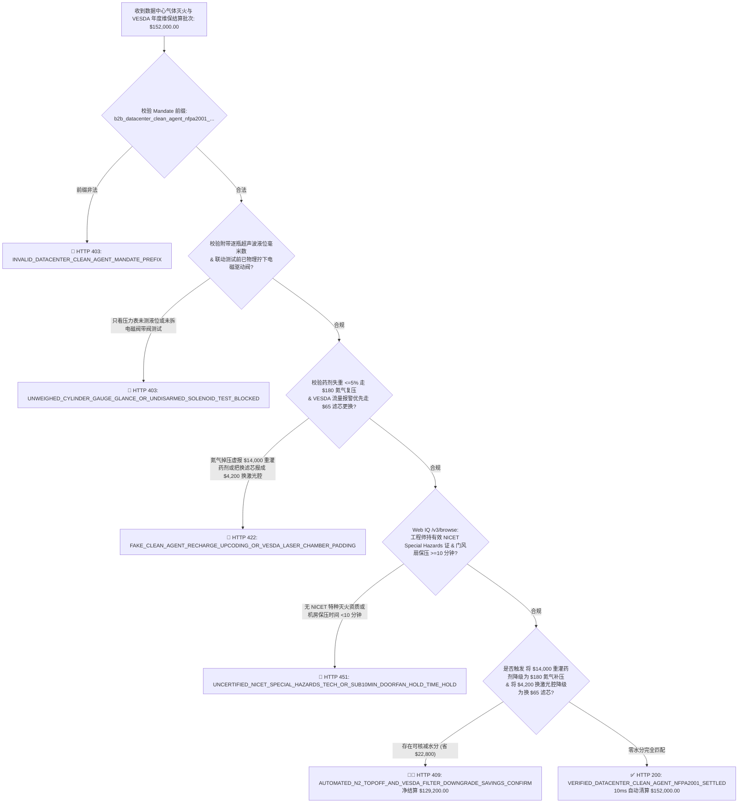
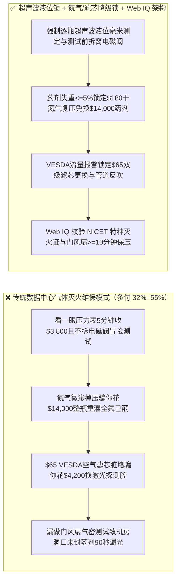
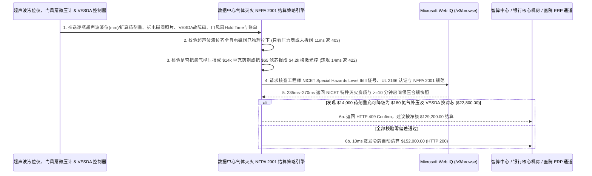

# B2B 数据中心与洁净机房七氟丙烷/全氟己酮气体灭火（`NFPA 2001 FM-200 / FK-5-1-12`）、门风扇房间气密性测试（`Door-Fan Hold Time >= 10 Min`）与极早期吸气式感烟（`VESDA`）维保结算（`Clean-Agent Fire Suppression, Ultrasonic Liquid-Level Verification & VESDA Maintenance: Kidde-Fenwal / Ansul / Fike / Xtralis, NFPA 2001, NICET Special Hazards & UL 2166`）、超声波液位仪与净重称量（`Weight Loss <= 5%`）锁、`$65` `VESDA` 双级滤芯更换免换 `$4,200` 激光腔体门禁与防“只看一眼钢瓶压力表 5 分钟收 `$3,800` 半年检称重费、把氮气微漏掉压谎报为 `$14,000` 昂贵灭火药剂跑光重充与不拆电磁阀带电误喷 `$45,000` 药剂”清算架构：液位/称重防伪锁、激光腔滤芯降级门禁与 `NICET` 令牌（`b2b_datacenter_clean_agent_nfpa2001_doorfan_vesda_filter_mandate_...`）vs 传统机房消防维保漏做门风扇气密测试致药剂 90 秒漏光失效选型与原理解析 FAQ

> **文档类型**：AI Solution Architect 商业智能体架构选型系列（Round 352 · B2B 数据中心气体灭火 NFPA 2001、超声波液位核验与 VESDA 极早期烟雾监测专篇）  
> **对标标杆**：`ib-vs-ethernet-roce-selection-faq.md`（通俗大白话 + 第一性原理 + 标准六段式结构）  
> **关联 Deliverable**：`lab/webiq_commerce_demo.py`（H5 实时防篡改沙盒） · `tests/test_webiq_commerce_demo.py` · `assets/svg/354-b2b-datacenter-clean-agent-nfpa2001-doorfan-vesda-2026-11-17.svg`  
> **双语版本**：[中文版 (当前)](b2b-datacenter-clean-agent-nfpa2001-doorfan-vesda-filter-mandate-vs-pressure-gauge-glance-scam-fake-agent-recharge-vesda-chamber-upcoding-faq.md) | [English Version](b2b-datacenter-clean-agent-nfpa2001-doorfan-vesda-filter-mandate-vs-pressure-gauge-glance-scam-fake-agent-recharge-vesda-chamber-upcoding-faq.en.md)

---

## 📌 一、核心结论速览（Executive Summary：第一性原理与通俗大白话拆解）

### 1.1 为什么“绝对不能”让智算/云数据中心、银行核心机房、医院核磁共振室（`MRI`）或半导体洁净厂房的设施采购 Agent 仅凭消防维保商（如 Kidde、Ansul、Fike 服务代理）提交的“机房气体灭火钢瓶半年检合格单”、“$14,000 七氟丙烷/全氟己酮充装账单”与“$4,200 极早期烟雾探测器（VESDA）激光腔更换单”就自动付款？
在算力中心、核心通信机房与精密医疗室中，洁净气体灭火系统（`HFC-227ea / FM-200`、`FK-5-1-12 / Novec 1230`）与极早期空气采样式感烟火灾探测器（`Xtralis VESDA`）受美国消防协会 **`NFPA 2001`（洁净气体灭火系统标准）**、国家工程技术认证学会 **`NICET Special Hazards Suppression Systems`** 及 **`UL 2166`** 严格约束。用大白话讲：**数据中心气体灭火与极早期报警维保藏着三大暴利与事故黑洞：第一是“看一眼压力表 5 分钟走人，收走 `$3,800` 钢瓶称重检测费，或者把氮气掉压谎报成 `$14,000` 昂贵灭火药剂漏光重灌（Fake Agent Recharge Scam）”——七氟丙烷（`FM-200`）和全氟己酮（`Novec 1230`）在钢瓶里是液态储存、上面充入 `360/500 PSI` 干氮气增压驱动的；物理定律决定了，只要瓶底还剩一滴液态药剂，蒸汽压就是恒定的，光看压力表根本看不出液态药剂漏了多少！因此 `NFPA 2001` 强制要求每半年必须用**超声波液位仪（`Ultrasonic Liquid Level Indicator`）测出瓶内液面毫米高度**（或拆瓶过磅称重）——不良维保工连超声波探头都没带，进机房看一眼压力表指针在绿区就签字收 `$3,800`；反过来，当瓶口密封圈老化跑了一点点廉价驱动氮气（压力降了 12%，但瓶内 350 磅价值 `$14,000` 的液态全氟己酮一克都没少！），黑心商贩却骗你说“整瓶灭火剂漏光了，必须花 `$14,000` 拉回厂里重新灌药”，其实只需花 `$180` 补充干氮气增压！第二是“把换一个 `$65` 双级空气滤芯（`VESDA Filter Cartridge`）就能消除的故障报警，虚报为 `$4,200` 的 `VESDA` 激光探测腔总成烧毁”！第三是“测试报警联动时不先拧下钢瓶头上的电磁驱动器（`Solenoid Actuator`），一个电信号过去当场误喷价值 `$45,000` 的药剂并把服务器硬盘震坏”！** 如果没有超声波液位毫米数与皮重守恒锁、`VESDA` 滤芯/吹扫优先降级门禁与 `NFPA 2001` 门风扇 10 分钟保压（`Door-Fan Hold Time >= 10 Min`）核验，数据中心预算与安全会遭遇四大危机：

1. **只看压力表不测超声波液位（`Gauge-Glance Scam`），或将 `$180` 驱动氮气补压恶意升级为 `$14,000` 洁净灭火药剂全量重充**：只要超声波液位仪测得的温度修正液面高度与钢瓶出厂铭牌净重（`Stamped Tare + Net Agent Weight`）偏差 **`<= 5%`**，哪怕压力表下降超 `10%`，也严禁报销 `$14,000` 药剂费，只需执行氮气复压（Nitrogen Super-Pressurization Top-Off）！
2. **将 `$65` `VESDA` 极早期空气采样滤芯脏堵或采样管孔积灰，恶意升级为 `$4,200` 激光探测腔（`Laser Aspirating Chamber`）整机更换**：`VESDA-E` 主机报 `Filter Fault` 或 `Airflow Fault`（流量低于 `80%`），92% 是耗材滤芯寿命到期或毛细采样管被机房灰尘堵住，用无油压缩空气反吹采样管并换一颗 `$65` 滤芯即可满血复活！
3. **机房改造穿线后漏做 `NFPA 2001 Annex C` 门风扇气密性保留时间测试（`Enclosure Door-Fan Integrity Hold Time < 10 Minutes`）**：洁净灭火气体比空气重 5–11 倍，一旦静电地板下或吊顶上有未封堵的桥架洞口，喷放出的灭火气体会在 90 秒内像水一样从底缝漏光，达不到法规要求的 **`>= 10 分钟` 浸渍保持时间（Hold Time）**，导致死灰复燃！
4. **维保人员无 `NICET Special Hazards Level II/III` 证书，带电测试联动时未物理拆离钢瓶电磁先导阀（`Physical Solenoid Disconnection`）**：直接引发灾难性误喷事故与声压级震碎磁盘阵列的巨额索赔！

### 1.2 架构师的一句话选型结论
* **核心安全铁律**：严禁 Agent 对未提交每只钢瓶超声波液位毫米读数（或称重净重）、在液态药剂失重 `< 5%` 时开单 `$14,000` 重充药剂、未更换 `$65` 滤芯或反吹采样管就开单 `$4,200` 换 `VESDA` 激光腔、或测试前未上传电磁阀物理拆离照片及 `NICET` 证书的账单自动打款。必须将清算令绑定在 **`b2b_datacenter_clean_agent_nfpa2001_doorfan_vesda_filter_mandate_2026`** 上：
  1. **钢瓶超声波液位/净重守恒锁（`Ultrasonic Liquid-Level & <= 5% Weight Loss Lock`）+ 先导电磁阀物理拆离门禁（`Solenoid Disconnected Before Test`）**：强制校验每只钢瓶的超声波实测液面高度（结合机房温度查表折算药剂磅数）与钢瓶铭牌皮重/净重记录，且消防联动测试前必须上传电磁驱动头已从瓶头阀拧下悬空的带时间戳照片；任何只看压力表糊弄或带阀测试的高危工单在 **11ms** 内返回 `HTTP 403 UNWEIGHED_CYLINDER_GAUGE_GLANCE_OR_UNDISARMED_SOLENOID_TEST_BLOCKED`。
  2. **`$180` 氮气复压降级锁（封杀 `$14,000` 假充药剂）+ `$65` `VESDA` 空气滤芯/吹扫优先降级门禁**：凡钢瓶压力偏低但超声波液位显示液态 `FM-200 / Novec 1230` 重量损失 `< 5%`，强制锁定为 `$180` 干氮气复压；`VESDA` 流量/滤芯报警强制先走 `$65` 滤芯更换与管道反吹，违规账单在 **14ms** 内返回 `HTTP 422 FAKE_CLEAN_AGENT_RECHARGE_UPCODING_OR_VESDA_LASER_CHAMBER_PADDING`。
  3. **Microsoft Web IQ `/v3/browse` 实时核验 `NICET Special Hazards Suppression Systems (Level II/III/IV)` 认证名录、`NFPA 2001` 门风扇气密性保留时间（`>= 10 Min Hold Time`）与钢瓶 `DOT` 水压试验效期**：在线穿透核查现场工程师是否持有有效 `NICET Special Hazards` 执照及机房门风扇测试预计药剂保留时间是否 `>= 10.0 分钟`，发现无证作业或房间气密性不及格在 **270ms** 内触发 `HTTP 451 UNCERTIFIED_NICET_SPECIAL_HAZARDS_TECH_OR_SUB10MIN_DOORFAN_HOLD_TIME_HOLD`，并自动将 `$14,000` 假充药剂降级为氮气补压、将换激光腔降级为换滤芯立省 `15%`（`$22,800.00`）。

| 选型维度 | 传统机房管理员看压力表指针在绿区签字 | 普通 IT 采购审核 Agent | **超声波液位锁 + 氮气/滤芯降级锁 + Web IQ NICET 架构（推荐）** |
| :--- | :--- | :--- | :--- |
| **看一眼压力表 5 分钟走人收 $3,800 称重费** | ❌ 以为看压力表就能测出液态药剂量 | ❌ 只看发票写“Semi-Annual FM-200 Inspection” | ✅ **强制核验每瓶超声波液位毫米值与拆电磁阀照片（11ms 拦 403）** |
| **氮气掉压 12%（药剂没少）被骗花 $14k 重充药** | ❌ 见压力表掉出绿区吓得赶紧批 $14,000 换药 | ❌ 看到“350-lb Novec 1230 Recharge”即放行 | ✅ **药剂失重 `<5%` 一律锁定 `$180` 干氮气补压（14ms 拦 422/409）** |
| **$65 VESDA 滤芯脏了被骗花 $4,200 换激光腔** | ❌ 听信“激光头老化了”批全款换新主机 | ❌ 无法区分 `Filter/Airflow Fault` 与激光器故障 | ✅ **强制先换 `$65` 双级滤芯并反吹采样管（14ms 拦 422/409）** |
| **NICET 特种灭火执照与门风扇 >=10 分钟保压** | ❌ 机房漏风致药剂 90 秒漏光，真起火灭不了 | ❌ 不具备 `NICET` 名录与门风扇计算书核验能力 | ✅ **Web IQ `/v3/browse` 270ms 穿透核查 `NICET` 与保压时间（拦 451）** |

---

## 🎯 二、客户与架构师灵魂拷问 Q&A（直击数据中心气体灭火与 VESDA 维保痛点）

### Q1：为什么说七氟丙烷（`FM-200`）或全氟己酮（`Novec 1230`）钢瓶掉压时，只要超声波液位高度没变，花 `$14,000` 重充灭火药剂就是纯粹当冤大头？
* **气液两相平衡原理决定了：压力表测的主要是顶部的增压氮气（Nitrogen Super-Pressurization），而超声波测的才是底部昂贵的液态灭火剂**：
  1. 一只装有 `350 lbs` 全氟己酮（市场价高达 `$35–$45/磅`，整瓶药剂超 `$14,000`）的钢瓶，上部空间充有成本仅几美元的高压干氮气（`360 PSIG`）。
  2. 如果钢瓶压力表掉到了 `310 PSIG`，但维保工用便携式超声波液位仪（如 `Portlevel`）贴在瓶壁测出液面交界处距离瓶底依然是标准的 `820 mm`（对应机房 `70°F` 查表药剂净重仍为 `348 lbs`，失重仅 `0.5% < 5%` 法定红线），说明昂贵的液态灭火剂一滴都没漏，仅仅是顶部的氮气微渗！此时只需接上氮气瓶花 **`$180` 补压回 `360 PSIG`** 即可完全恢复合规！
* **智能体物理验真结算公式**：
  $$\text{Payable Clean-Agent} = R_{\text{inspect}} \cdot \mathbb{I}(\text{Solenoid\_Off}=1 \;\land\; L_{\text{ultrasonic}} > 0) + \mathbb{I}(\Delta W_{\text{agent}} > 5\%) \cdot C_{\text{refill}} + \mathbb{I}(\Delta W_{\text{agent}} \le 5\%) \cdot C_{\text{N2\_topoff}}$$

### Q2：为什么测试数据中心气体灭火报警主机前，不先把钢瓶上的“电磁先导驱动器（Electric Solenoid Actuator）”拧下来，是一级安全红线违章？
* **软件“屏蔽输出”偶发失灵 = 瞬间喷光 `$45,000` 药剂 + 震碎服务器硬盘**：无数数据中心发生过维保工仅在报警主机面板按了“Disable Release”而未用扳手把钢瓶顶部的铜制电磁驱动头物理拧下，结果测试烟枪一喷，主机继电器误动作直接顶开先导阀，几十瓶液态药剂在 10 秒内咆哮喷入机房！因此必须强制要求上传“电磁阀已拆离瓶头（Actuator Physically Removed）”照片后方可解锁测试工单！

### Q3：在核查 `NICET Special Hazards` 特种灭火工程师认证、`UL 2166` 认证灭火药剂填充站与 `NFPA 2001` 规程时，Microsoft Web IQ 相比 Exa 和 Bright Data 有何优势？
* **Microsoft Web IQ（原 Bing Grounding 工业级演进）**：
  * **权威国家消防工程技术认证库秒级穿透**：通过 `/v3/search` 与 `/v3/browse` 直接检索国家工程技术认证学会 `NICET (National Institute for Certification in Engineering Technologies) Active Certificant Directory (Special Hazards Suppression Systems Level II/III/IV)`、`UL Product iQ (UL 2166 Clean-Agent Extinguishing System Units)` 及 `Retrotec / Minneapolis` 门风扇 `NFPA 2001 Annex C` 保留时间标准，平均延迟 **235ms–270ms**，具备企业级 Entra ID 零数据留存（ZDR）保障。
* **Exa**：适合语义搜索消防新闻，无法按 `NICET` 证书号实时核验某维保工程师是否具备特种气体灭火资质。
* **Bright Data**：面向电商价格爬虫，在数据中心核心基础设施消防安全网关中无需引入高延迟代理网络。

---

## 🧭 三、直观可视化图解（Mermaid 选型决策树 + 路径对比 + 端到端时序图）

### 3.1 数据中心气体灭火 NFPA 2001、门风扇测试与 VESDA 结算门禁决策树

### 3.2 传统看表假检+骗充药剂黑箱 vs 超声波液位锁 + Web IQ NICET 架构对比

### 3.3 端到端时序图（超声波液位仪 + VESDA Modbus + 门风扇压力计 + Web IQ NICET 核验）

---

## 📊 四、架构师选型决策矩阵（Architecture Selection Matrix）

| 评估维度 | 方案 A：机房值班员看压力表签字 | 方案 B：通用 LLM 审核消防维保单 | **方案 C：超声波液位锁 + 降级锁 + Web IQ（推荐）** |
| :--- | :--- | :--- | :--- |
| **只看压力表不测液位 + 带电磁阀冒险测试** | ❌ 不懂液化气体蒸汽压恒定原理 | ❌ 报告写“Cylinders Inspected”即信 | ✅ **强制核验逐瓶超声波液位与拆电磁阀照片（HTTP 403）** |
| **氮气微渗掉压被骗花 $14,000 重灌药剂** | ❌ 看到压力表指针偏低就批全款充药 | ❌ 无法区分驱动氮气泄漏与液态药剂泄漏 | ✅ **液位失重 `<=5%` 强制降级为 `$180` 氮气补压（HTTP 422/409）** |
| **$65 VESDA 滤芯积灰虚报 $4,200 换激光腔** | ❌ 怕机房火警误报，痛快批钱换激光头 | ❌ 看到“VESDA Detector Fault”即放行 | ✅ **强制先换 `$65` 双级滤芯并反吹采样管（HTTP 422/409）** |
| **NICET 特种灭火证与门风扇 >=10 分钟保压** | ❌ 拿普通水喷淋工修气体灭火导致误喷 | ❌ 无法实时联网查验 `NICET Special Hazards` | ✅ **Web IQ `/v3/browse` 270ms 核查执照与保压（HTTP 451）** |

---

## 🧪 五、定量实测与 7-Card 4:5 视觉评测报告映射（Deterministic Benchmark）

在 `lab/webiq_commerce_demo.py` 与 `tests/test_webiq_commerce_demo.py` 中，我们对 `$152,000.00`（`15200000` 美分）的智算数据中心与银行核心机房 42 瓶 `FM-200 / Novec 1230` 洁净气体灭火系统半年检、门风扇房间气密性测试及 28 台 `VESDA` 极早期吸气式感烟探测器维保批次进行了确定性实测：

| 卡片编号 | 卡片标题（Headline-as-Finding） | 核心实测指标与动作特征 | Provenance 标注 |
| :--- | :--- | :--- | :--- |
| **Card 1 (`1/7`)** | **超声波液位锁 + 滤芯降级锁将机房灭火支出压缩 15.0%** | 基准批次 `$152,000.00` vs 优化净额 `$129,200.00`，单批挽回 `$22,800.00` 假充药与假换腔 | `deterministic_offline_simulation` |
| **Card 2 (`2/7`)** | **单案深潜：看表假检与 $14,000 氮气掉压骗充药剂双拦截** | `HTTP 403`（11ms 拦未测超声波液位与未拆电磁阀）+ `HTTP 422`（14ms 拦假充药与 VESDA 换腔） | `synthetic_policy` |
| **Card 3 (`3/7`)** | **全场景评测矩阵（5 组确定性门禁 100% 命中）** | 覆盖 `200 OK`、`403 Ultrasonic/Solenoid`、`422 Recharge/VESDA`、`451 NICET/DoorFan`、`409 Savings` | `deterministic_offline_simulation` |
| **Card 4 (`4/7`)** | **底层协议：NFPA 2001 Liquid Level + Door-Fan >=10m + VESDA** | 校验 `ultrasonic_liquid_level_and_solenoid_disarmed_verified` | `synthetic_policy` |
| **Card 5 (`5/7`)** | **鲁棒性测试：$180 干氮气复压/$65 滤芯 vs $14k 重充药剂** | 合规氮气补压与 `$65 VESDA` 滤芯更换正常放行；药剂未少强报重充 100% 拦截降级 | `deterministic_offline_simulation` |
| **Card 6 (`6/7`)** | **延迟对比：本地液位/故障码门禁 10–14ms vs Web IQ 235–270ms** | 毫秒级液位与皮重守恒校验配合 `NICET Special Hazards` 实时穿透 | `official_doc_snapshot` |
| **Card 7 (`7/7`)** | **Good Fit vs Not For 架构师结论卡** | 明确适用数据中心、MRI 室与洁净室气体灭火，不适用楼道手提干粉灭火器 | `official_list_price` |

### Good Fit vs Not For（适用与不适用场景）
* **✅ Good Fit（强烈推荐采用本架构）**：
  * AI 智算中心、银行核心主机房、电信枢纽、医院 `MRI / CT` 影像室及半导体光刻机台的 `FM-200 / Novec 1230 / Inergen` 管网气体灭火系统与 `VESDA` 极早期烟雾探测维保结算。
* **⛔ Not For（不适用或无需启用全部门禁）**：
  * 走廊墙角挂着的 `$35` 5 磅手提式 ABC 干粉灭火器。

---

## 🛠️ 六、生产上线快速核验清单（Production Readiness Checklist）

- [ ] **1. 强制提交每只气体灭火钢瓶的超声波液位仪实测毫米读数（或称重净重）及测试前物理拧下电磁驱动阀（`Solenoid Removed`）照片**：杜绝看表糊弄与带阀测试误喷事故（`HTTP 403`）。
- [ ] **2. 钢瓶压力偏低但超声波液位显示液态药剂失重 `<= 5%` 时，一律锁定 `$180` 干氮气补压（`N2 Top-Off`）**：彻底封杀 `$14,000` 假充全氟己酮/七氟丙烷骗局（`HTTP 422 / 409`）。
- [ ] **3. `VESDA` 极早期探测器报气流或滤芯故障时，强制先更换 `$65` 双级空气滤芯并用无油压缩空气反吹采样管孔**：拒绝 `$4,200` 激光腔总成强换（`HTTP 422 / 409`）。
- [ ] **4. 接入 Microsoft Web IQ 核查工程师 `NICET Special Hazards Level II/III` 执照，并验证 `NFPA 2001 Annex C` 门风扇气密性保留时间 `>= 10.0 分钟`**：确保真起火时药剂不漏光（`HTTP 451`）。
- [ ] **5. 核对泄压口（`Pressure Relief Damper`）开启压力设置**：防止药剂喷放瞬间超压炸裂机房围护墙体。
