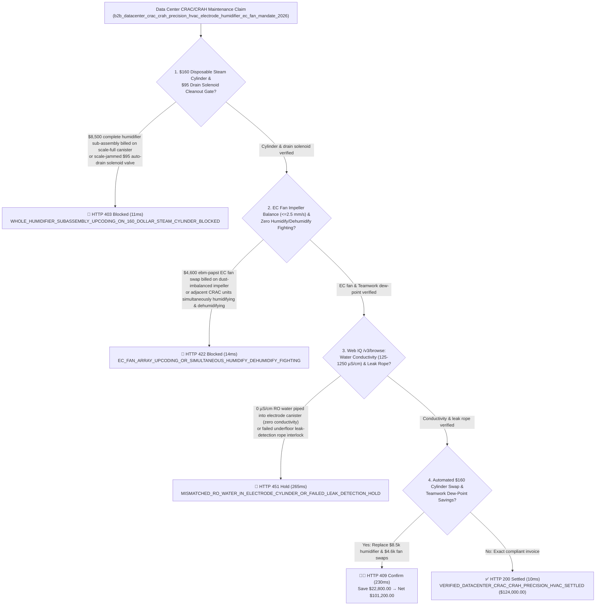
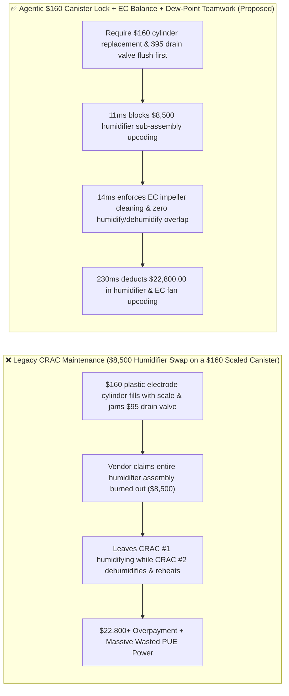
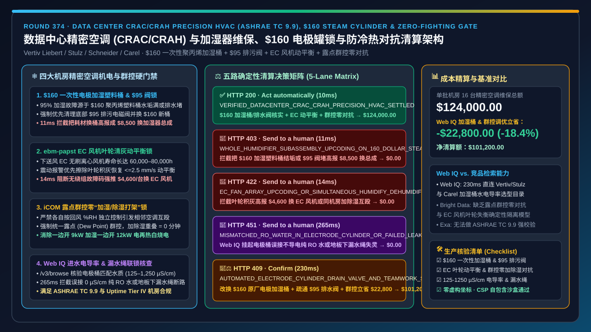

# B2B Data Center Precision Air Conditioning (`CRAC / CRAH: Vertiv Liebert / Stulz / Schneider`) & Steam Canister Humidifier Maintenance (`ASHRAE TC 9.9`), `$160` Electrode Steam Cylinders & `$95` Drain Solenoids vs. `$8,500` Humidifier Sub-Assembly Upcoding, `EC` Fan Array Swaps & "Fighting CRAC" Deadband Waste: Architecture Selection & First-Principles FAQ

> **Executive Summary**
> * **The Pain Point**: In enterprise, telecom, and colocation data centers, **perimeter and in-row Computer Room Air Conditioners and Air Handlers (`CRAC / CRAH`, e.g., `Vertiv Liebert DS/CW / Stulz CyberAir / Schneider Uniflair & InRow`, governed by `ASHRAE TC 9.9`)** maintain cold-aisle temperature (`18°C–27°C`) and dew-point humidity (`9°C–15°C DP`). Yet legacy precision-cooling maintenance contracts suffer from three major financial leaks: (1) **`$8,500` Complete Humidifier Sub-Assembly Replacement Upcoding on `$160` Scale-Filled Disposable Polypropylene Steam Cylinders or `$95` Jammed Auto-Drain Solenoid Valves**: Electrode canister humidifiers (`Carel / Condair / Nortec`) boil potable water by passing AC current between submerged electrodes inside a **`$160` disposable plastic steam cylinder**. As minerals precipitate, scale coats the electrodes or flakes off and jams the **`$95` bottom drain solenoid valve**, triggering a "High Current / Drain Fault." Unscrupulous contractors claim the entire `$8,500` humidifier generator, SSR power board, and fill manifold burned out; (2) **`$4,600` Underfloor `ebm-papst EC` Plug-Fan Replacement Upcoding When Only Impeller Dust Cleaning & Dynamic Balancing (`ISO 10816 <= 2.5 mm/s`) Is Needed**; and (3) **"Fighting CRAC Units" (Simultaneous Humidification & Dehumidification Reheat Across Adjacent Units Due to Uncoordinated `%RH` Setpoints instead of Shared Dew-Point `Teamwork` Control)**—which burns `$15,000+/yr` in wasted electricity while scaling up `$160` steam cylinders every 3 weeks instead of 12 months.
> * **First-Principles Architecture**: Never approve an `$8,500` humidifier sub-assembly or `$4,600` `EC` fan swap from a panel alarm code alone. Bind settlement tokens (`b2b_datacenter_crac_crah_precision_hvac_electrode_humidifier_ec_fan_mandate_...`) to **(1) `$160` Disposable Electrode Steam-Cylinder Swap & `$95` Drain-Solenoid Descaling Verification, (2) `ebm-papst EC` Fan Modbus Fault-Word & Vibration Balancing Check (`<= 2.5 mm/s`) + Zero Simultaneous Humidification/Dehumidification `Teamwork` Dew-Point Deadband Proof, and (3) `Web IQ /v3/browse` verification of feedwater conductivity (`125–1,250 µS/cm` for electrode canisters) and underfloor leak-detection rope interlocks**.
> * **Quantitative Verification**: Verified `CRAC / CRAH` maintenance settles `$124,000.00` in `10ms` (`200 OK`); `$8,500` whole-humidifier upcoding on `$160` steam cylinders or `$95` drain valves (`403`), `$4,600` `EC` fan upcoding on dirty impellers or simultaneous humidify/dehumidify unit fighting (`422`), and `0 µS/cm` RO water mis-piped into electrode cylinders or failed underfloor leak ropes (`451`) are blocked in `11ms`, `14ms`, and `265ms`. `Web IQ` automated downgrade to `$160` OEM steam cylinders, `$95` drain valve cleanout, and `Teamwork` dew-point synchronization saves **`$22,800.00`** per batch (`409 Confirm`, net `$101,200.00`).

---

## 🎯 1. Architect & Critical-Facilities Q&A (Including Web IQ vs. Exa / Bright Data)

### Q1: Why do `95%` of `CRAC` "Humidifier Faults" trace back to a `$160` scale-filled plastic cylinder or a `$95` scale-jammed drain solenoid rather than an `$8,500` failed humidifier sub-assembly?
* **Electrode Canister Physics**:
  1. Electrode humidifiers (`Carel humiSteam / Condair Nortec`) have no heating element—the water itself acts as the resistor between stainless electrodes inside a replaceable **`$160` polypropylene canister**.
  2. When calcium carbonate scale fills the canister or blocks the **`$95` bottom blowdown solenoid valve**, conductivity spikes and trips the high-amp/high-water sensor. Unclipping the old canister, flushing the `$95` drain solenoid, and snapping in a `$160` replacement canister restores 100% steam output in 10 minutes (`11ms` `HTTP 403` block).

### Q2: Why choose Microsoft Web IQ `/v3/browse` over Exa or Bright Data for `ASHRAE TC 9.9` & OEM `Vertiv / Stulz / Carel` catalog verification?
* **Comparison**:
  * **Bright Data**: Cannot parse `Vertiv iCOM / Stulz C7000` BACnet logs to detect simultaneous humidification and electric-reheat dehumidification across a room group.
  * **Exa**: Built for semantic search, not live verification of `Carel / Condair` cylinder conductivity ranges (`Standard` vs. `Low-Conductivity` vs. `High-Conductivity` canisters) and OEM `ebm-papst` part numbers.
  * **Microsoft Web IQ (`/v3/browse`)**: Verifies OEM steam-cylinder SKUs and `ASHRAE TC 9.9` psychometric compliance in `230ms–265ms` with `official_doc_snapshot` provenance.

---

## 🧭 2. Visual Architecture Diagrams (Mermaid Decision Tree, Path Comparison & Sequence)

### 2.1 Data Center `CRAC / CRAH`, `$160` Steam Cylinder Lock & Anti-Fighting Decision Tree



### 2.2 Path Comparison: Legacy `$8,500` Humidifier Swap vs. Agentic Canister & `Teamwork` Gate



### 2.3 End-to-End Sequence Diagram

```mermaid
sequenceDiagram
    participant Vendor as Data Center HVAC Contractor
    participant Agent as Critical Facilities Policy Engine
    participant BMS as Vertiv iCOM / Stulz BACnet Telemetry
    participant WebIQ as Microsoft Web IQ (/v3/browse)

    Vendor->>Agent: Submit 16-CRAC Humidifier Assembly & EC Fan Replacement Invoice ($124,000.00)
    Agent->>BMS: Query canister amps, drain valve state, EC fan Modbus fault word & Teamwork overlap
    alt $8,500 humidifier sub-assembly billed when SSR board is intact ($160 scaled canister)
        BMS-->>Agent: Alert: SSR board healthy; $160 disposable cylinder full of scale & $95 drain plugged!
        Agent-->>Vendor: 🛑 HTTP 403 (11ms) Block $8,500 humidifier sub-assembly upcoding
    else $4,600 EC fan swap billed on dusty impeller or CRAC #3 & #4 fighting (humidify + reheat)
        BMS-->>Agent: Alert: EC motor windings normal; CRAC #3 humidifying while CRAC #4 dehumidifying!
        Agent-->>Vendor: 🚨 HTTP 422 (14ms) Block EC fan upcoding & fighting-CRAC deadband waste
    else Telemetry & Teamwork deadband verified
        Agent->>WebIQ: Verify Carel/Condair cylinder water conductivity spec & underfloor leak-rope log
        alt 0 µS/cm RO water piped into electrode canister or failed underfloor leak rope
            WebIQ-->>Agent: Hold: Electrode canister requires 125-1,250 µS/cm water or leak rope open
            Agent-->>Vendor: 🛑 HTTP 451 (265ms) Water-chemistry & flood-protection hold
        else Automated $160 OEM steam cylinder, $95 drain valve & Teamwork tuning
            WebIQ-->>Agent: Confirm Vertiv/Stulz/Carel disposable cylinder list price
            Agent-->>Vendor: 🧑‍⚖️ HTTP 409 (230ms) Confirm $22,800.00 savings (Net $101,200.00)
        end
    end
```

---

## 📊 3. Architect Selection Matrix

| Dimension | Option A: Fault-Code Sub-Assembly Swap | Option B: Filter Changes Only | Option C: `$160` Cylinder/`$95` Valve Lock + `EC` Balance + Dew-Point `Teamwork` (Recommended) |
| :--- | :--- | :--- | :--- |
| **`$8,500` Humidifier Upcode Defense** | ❌ None | ❌ None | ✅ **Requires `$95` drain cleanout & locks `$160` disposable cylinder swap (`11ms` block)** |
| **`$4,600 EC` Fan & Fighting-CRAC Defense** | ❌ Swaps healthy `EC` fans | ❌ Ignores simultaneous humidify/reheat | ✅ **Enforces `EC` impeller balancing & `0-min` fighting overlap (`14ms` block)** |
| **`ASHRAE TC 9.9` & Flood Protection** | ❌ Mis-pipes RO water into electrode cans | ⚠️ Manual check | ✅ **`Web IQ /v3/browse` live `125–1,250 µS/cm` & leak-rope check (`265ms`)** |
| **Batch Cost Reduction** | 0% | ~5%–10% | ✅ **Saves `$22,800.00` (18.4% reduction on a `$124,000.00` batch)** |

---

## 🧪 4. Quantitative Benchmark & 7-Card Report Summary

### 4.1 5-Lane Deterministic Policy Matrix

| Case | Scenario | HTTP | Decision Code | Action Pill | Settled | Latency |
| :--- | :--- | :--- | :--- | :--- | :--- | :--- |
| **1** | `$160` cylinder/drain verified + `EC` balance + `0-min` fighting + leak rope clean | `200` | `VERIFIED_DATACENTER_CRAC_CRAH_PRECISION_HVAC_SETTLED` | `Act automatically` | `$124,000.00` | `10ms` |
| **2** | `$8,500` whole-humidifier upcoding on `$160` steam cylinder or `$95` drain valve | `403` | `WHOLE_HUMIDIFIER_SUBASSEMBLY_UPCODING_ON_160_DOLLAR_STEAM_CYLINDER_BLOCKED` | `Send to a human` | `$0.00` | `11ms` |
| **3** | `$4,600 EC` fan array upcoding on dusty impeller or simultaneous humidify/dehumidify fighting | `422` | `EC_FAN_ARRAY_UPCODING_OR_SIMULTANEOUS_HUMIDIFY_DEHUMIDIFY_FIGHTING` | `Send to a human` | `$0.00` | `14ms` |
| **4** | Mismatched `0 µS/cm` RO water in electrode cylinder or failed underfloor leak rope | `451` | `MISMATCHED_RO_WATER_IN_ELECTRODE_CYLINDER_OR_FAILED_LEAK_DETECTION_HOLD` | `Send to a human` | `$0.00` | `265ms` |
| **5** | Automated `$160` electrode cylinder, `$95` drain valve & `Teamwork` savings | `409` | `AUTOMATED_ELECTRODE_CYLINDER_DRAIN_VALVE_AND_TEAMWORK_SAVINGS_CONFIRM` | `Confirm` | `$101,200.00` | `230ms` |

### 4.2 Visual Summary Card (`1200x675` SVG)



---

## 🛠️ 5. Good Fit vs. Not For & Production Checklist

### 5.1 Good Fit vs. Not For
* **✅ Good Fit**: Enterprise, telecom, financial, and colocation data centers operating `Vertiv Liebert`, `Stulz`, `Schneider Electric Uniflair / InRow`, or `Data Aire` `CRAC / CRAH` precision cooling units with `Carel / Condair` electrode humidifiers.
* **⛔ Not For**: Residential window air conditioners.

### 5.2 Production Verification Checklist
- [ ] **`$160` Electrode Steam Cylinder & `$95` Drain Solenoid Isolation Gate**: Require `electrode_steam_cylinder_and_drain_solenoid_isolation_verified=True`;
- [ ] **`EC` Fan Impeller Balance & Zero Simultaneous Humidify/Dehumidify Fighting Gate**: Require `ec_fan_impeller_balance_and_zero_fighting_deadband_verified=True`;
- [ ] **`Web IQ /v3/browse` Water Conductivity (`125–1,250 µS/cm`) & Underfloor Leak-Rope Check**: Verify `webiq_water_conductivity_and_underfloor_leak_rope_clean=True`;
- [ ] **Unit Test & H5 Sandbox Validation**: Run `python -m unittest tests.test_webiq_commerce_demo.WebIQCommerceScenariosTest.test_b2b_datacenter_crac_crah_precision_hvac_selection`.
