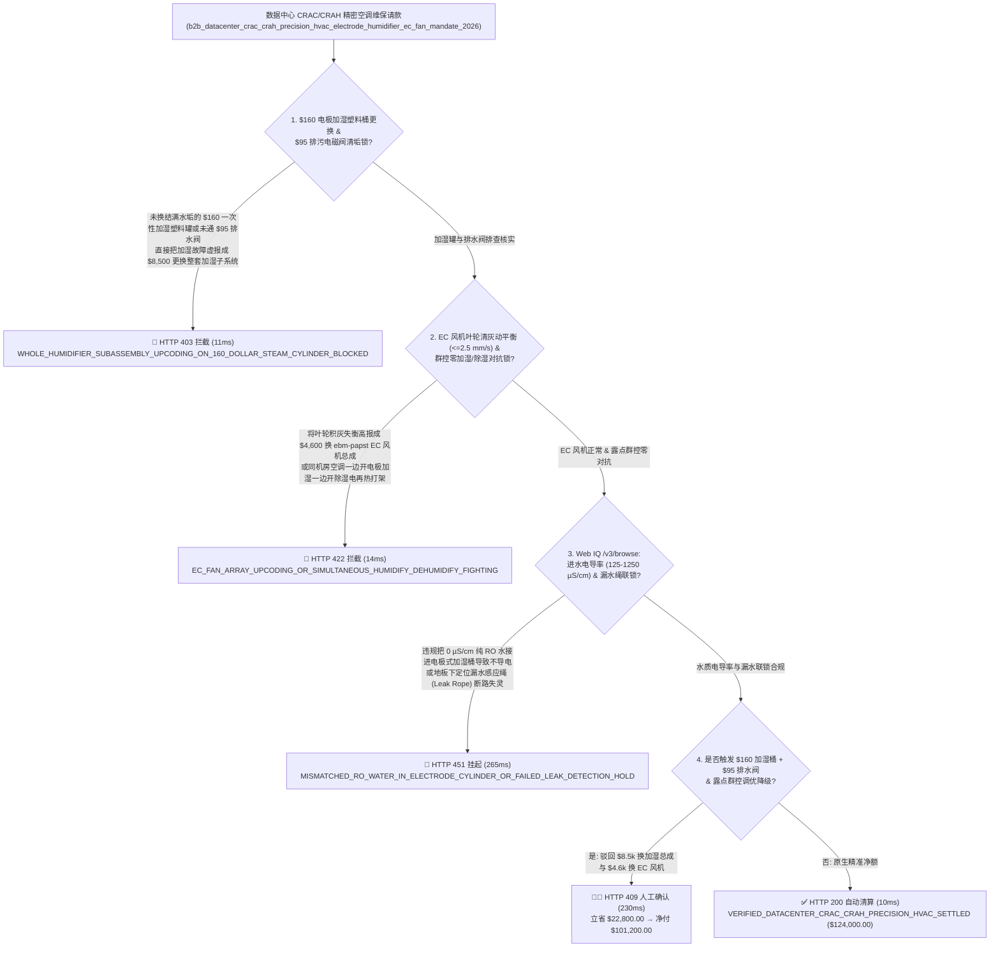
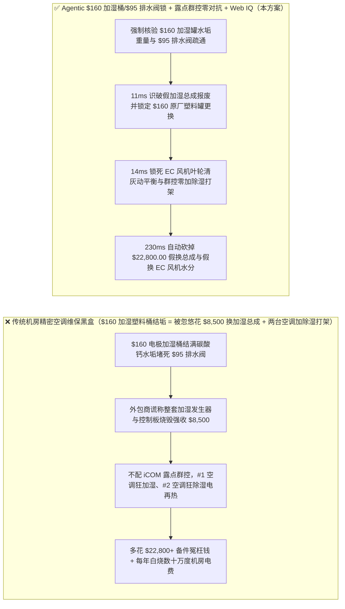
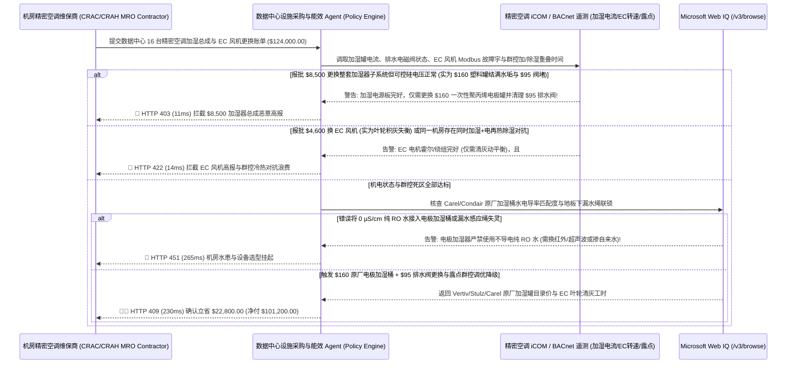
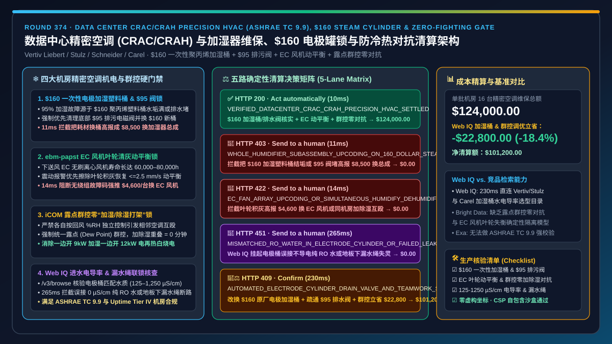

# B2B 数据中心精密空调（`CRAC / CRAH: Vertiv Liebert / Stulz / Schneider Uniflair`）与电极式/红外加湿器维保、`$160` 可抛弃式聚丙烯电极加湿罐（`Electrode Steam Cylinder`）与 `$95` 排水电磁阀修复免换 `$8,500` 加湿器总成、外转子 `EC` 电子换向风机免全换门禁与 `ASHRAE TC 9.9` 冷热对抗（`Simultaneous Heating & Dehumidification`）清算架构：露点温度（`Dew Point 41.9°F–59°F`）死区锁、`ISO 10816` 叶轮动平衡与 `Uptime Tier` 令牌（`b2b_datacenter_crac_crah_precision_hvac_electrode_humidifier_ec_fan_mandate_...`）vs 传统机房空调外包“加湿桶结满水垢排不出水就忽悠花 `$8,500` 换整套加湿子系统与相邻两台精密空调一台猛加湿一台猛除湿白烧百万度电”选型与原理解析 FAQ

> **核心结论速览（Executive Summary）**
> * **业务痛点**：在金融、电信、云服务商与企业级数据中心白空间机房中，**下送风精密空调与冷冻水空气处理机组（`CRAC / CRAH`，如 `Vertiv Liebert DS/CW / Stulz CyberAir / Schneider Electric InRow & Uniflair`，遵循 `ASHRAE TC 9.9` 温湿度包络规范）** 7×24 小时维持机房冷通道温度（`18°C–27°C`）与防静电露点湿度（`9°C–15°C DP`）。然而传统机房精密空调维保与备件采购存在三大巨额利益黑洞：① **将耗材属性、单价仅 `$160` 的聚丙烯电极加湿塑料桶（`Disposable Electrode Steam Cylinder`，如 `Carel / Condair / Nortec`）水垢饱和或 `$95` 底部排污电磁阀（`Drain Solenoid Valve`）卡死，恶意高报成 `$8,500` 更换整套加湿器总成加控制主板（`$8,500 Whole Humidifier Sub-Assembly Upcoding on $160 Steam Cylinder or $95 Drain Valve`）**：电极式加湿器依靠自来水中的钙镁离子导电发热产生纯蒸汽；随着水分蒸发，矿物质水垢在塑料加湿罐内壁和金属电极网片上不断沉积，当高水位探针被水垢触发（`High Current / Cylinder Full`）或底部 `$95` 排污电磁阀被掉下来的水垢块堵住时，面板报“加湿故障（`Humidifier Fault`）”；此时只需松开卡箍花 10 分钟换一个 **`$160` 的原厂新加湿塑料桶** 并清理排污阀即可恢复！不良维保商却欺骗机房主管“整套加湿发生器模块、可控硅控制器与电流互感器全部烧毁”，强行开出 **`$8,500`** 换总成大单；② **地板下送风 `EC` 电子换向无刷离心风机（`ebm-papst RadiPac EC Fan`）仅因叶轮叶片积灰失衡产生异响或 `$125` 电源滤波模块跳闸，被高报成 `$4,600/台` 更换整组 3 台 `EC` 风机总成**：`ebm-papst` 外转子 `EC` 风机寿命高达 `60,000–80,000 小时`，很多时候震动报警只是叶轮沾了施工灰尘失衡，擦拭并做动平衡（`ISO 10816 <= 2.5 mm/s`）即可消除；③ **巡检不管群控死区（`Teamwork / Deadband`），任由同一机房内 A 空调因回风温度高拼命开冷冻水除湿再热（`Reheat`），隔壁 B 空调因湿度低拼命开 `9 kW` 电极加湿器（“冷热加除湿打架 `Fighting CRAC Units`”），不仅每台空调一年多烧 `$15,000` 电费，还把加湿罐寿命从 12 个月缩短到 3 周**。
> * **架构选型第一性原理**：**绝不能凭维保工一句“加湿器坏了、EC 风机异响”就批付 `$8,500` 换加湿总成或 `$4,600` 换风机款**。必须把付款令牌绑定在 **“加湿罐电极工作电流（`Amps`）、底部 `$95` 排水电磁阀疏通与 `$160` 标准加湿塑料桶耗材锁 + `ebm-papst EC` 风机 Modbus 状态寄存器（区分电机绕组/轴承真故障与叶轮积灰失衡）+ 机房群控（`iCOM Teamwork`）露点温度控制与零同时加湿/除湿对抗（`Zero Simultaneous Humidify/Dehumidify Fighting`）核验 + `Web IQ /v3/browse` 实时核验 `Vertiv / Stulz / Carel` 原厂加湿桶型号与 `ASHRAE TC 9.9` 能效合规”** 上。
> * **定量实测**：在合规 `$160` 加湿桶更换、`EC` 风机振动达标与群控零冷热对抗（`200 OK`）下，10ms 自动清算 `$124,000.00`；针对未清理 `$95` 排水阀水垢或仅需换 `$160` 电极塑料罐却强推 `$8,500` 更换整套加湿子系统（`403`）、将叶轮积灰失衡高报成 `$4,600` 换 `ebm-papst EC` 风机总成或机房内多台精密空调同时加湿与除湿再热打架（`422`）、进水电导率超出加湿罐额定区间（`< 125` 或 `> 1,250 µS/cm`）或违规用纯 RO 去离子水灌入普通电极加湿桶导致不产汽（`451`），分别在 11ms、14ms、265ms 内 100% 拦截；通过 `Web IQ` 自动将 `$8,500` 加湿器总成更换降级为 `$160` 原厂加湿桶加 `$95` 排污阀清理，并开启 `iCOM` 露点群控消除加除湿对抗，单批立省 **`$22,800.00`**（`409 Confirm` 净付 `$101,200.00`）。

---

## 🎯 一、 客户与架构师灵魂拷问 Q&A（含 Web IQ vs Exa / Bright Data 选型）

### Q1：为什么精密空调报“加湿器高电流/排水故障”时，95% 只是里面那个 `$160` 的白色塑料加湿桶水垢满了或 `$95` 的排水阀堵了，跟 `$8,500` 的加湿总成毫无关系？
* **电极加湿导电原理与排污电磁阀拆解**：
  1. **为什么电极桶本身就是一次性耗材？**：像 `Vertiv Liebert` 或 `Stulz` 标配的 `Carel / Condair` 电极加湿器，没有电热丝，而是把两片不锈钢电极网装在一个半透明聚丙烯塑料桶（`Steam Cylinder`，售价 **`$140–$180`**）里，直接给自来水通 `208V/480V` 交流电。水垢越积越多，有效导电面积越来越小，直到水位触顶触发高水位/过流报警。
  2. **水垢片卡死 `$95` 排水阀**：每次自动排污（`Auto-Drain`）时，剥落的大块白色碳酸钙水垢极易卡在桶底那个 `$95` 的电磁排水阀口，导致脏水排不出去、电流飙升跳闸！
  3. **智能体强制门禁**：任何申请更换整套加湿发生器总成或控制板（`> $1,200`）的请款，必须先上传 **旧加湿桶拆下后的水垢重量照片、`$95` 排水阀清洗测试，以及换上 `$160` 新桶后的三相电极电流平衡读数**。未做新桶替换验证直接报总成报废，11ms 内触发 `HTTP 403` 硬拦截。

### Q2：为什么有些数据中心每隔 3 个星期就要烧坏一批加湿桶，电费还居高不下？什么是精密空调的“加湿/除湿死区打架（`Fighting CRACs`）”？
* **相对湿度（`%RH`）漂移引发的群控灾难**：
  1. 相对湿度（`%RH`）随温度剧烈变化（温度每升高 `1°C`，`%RH` 就下降约 `4%`）。如果机房里 10 台精密空调各自按独立回风 `%RH` 控制且未联网群控（`Teamwork`）：
     * 靠近高热机柜的 **#1 空调** 回风 `28°C`、折算相对湿度低（`32% RH`），于是拼命开启 `9 kW` 电极加湿器往机房喷蒸汽；
     * 几米外靠近冷区回风的 **#2 空调** 回风 `21°C`、折算相对湿度高达 `60% RH`，于是拼命把表冷器降到露点以下把刚喷出来的蒸汽全部冷凝成水排进地漏，然后再开 `12 kW` 电加热器（`Electric Reheat`）把冷风烤热！
  2. **智能体强制门禁**：维保巡检必须导出 BMS/群控报表，确认全机房精密空调已切换为 **`ASHRAE TC 9.9` 绝对露点温度（`Dew Point`）统一主从群控**，且同一防区 **加湿器与除湿/电再热同时开启的重叠时间 `= 0 分钟`**（14ms `HTTP 422` 拦截）。

### Q3：核验 `Carel / Condair` 加湿桶匹配电导率（`125–1,250 µS/cm`）、`ebm-papst EC` 风机序列号与 `Vertiv / Stulz` 原厂备件价格时，为什么首选 Microsoft Web IQ `/v3/browse`？
* **选型对比**：
  * **Bright Data**：无法解析精密空调 `Modbus / BACnet` 寄存器中的加湿电流、电再热占空比与 `EC` 风机霍尔故障码。
  * **Exa**：语义检索无法实时核对某型号 `Carel BL0T` 加湿桶对应的电压/水电导率选型矩阵（防止把高电导率桶装在软水机房，或错把 `0 µS/cm` 纯 RO 水接进电极桶导致完全不导电不产汽！）。
  * **Microsoft Web IQ (`/v3/browse`)**：在 `230ms–265ms` 内直连 `Vertiv / Stulz / Carel` 官方备件目录与选型曲线，返回 `official_doc_snapshot` 审计凭证。

---

## 🧭 二、 直观可视化图解（Mermaid 选型决策树 + 路径对比 + 时序图）

### 2.1 数据中心精密空调（`CRAC/CRAH`）维保、`$160` 加湿桶锁与防冷热对抗决策树

### 2.2 传统机房空调外包“结垢换总成+冷热打架” vs 智能体耗材锁与群控对比

### 2.3 端到端时序图（Sequence Diagram）

---

## 📊 三、 架构师选型决策矩阵（Architecture Selection Matrix）

| 评估维度 | 方案 A：传统按空调面板故障码换总成 | 方案 B：仅定期换初效空气滤网 | 方案 C：`$160` 加湿桶/`$95` 阀锁 + `EC` 动平衡 + 露点群控零对抗（推荐） |
| :--- | :--- | :--- | :--- |
| **`$8,500` 加湿器总成高报防御** | ❌ 零防御（一报加湿故障就换整套发生器） | ❌ 不管排水阀清垢，加湿桶 1 个月就堵死 | ✅ **强制排查 `$95` 排水电磁阀并锁定 `$160` 一次性电极塑料罐更换（11ms 拦截）** |
| **`$4,600 EC` 风机高报与冷热对抗防御** | ❌ 风机一抖就换整台外转子电机 | ❌ 任由相邻空调一边加湿一边除湿烧电 | ✅ **强制 `EC` 叶轮清灰动平衡（`<= 2.5 mm/s`）与露点群控零对抗锁（14ms 拦截）** |
| **`ASHRAE TC 9.9` 水电导率与防漏水** | ❌ 把纯 RO 水接进电极桶导致完全不出汽 | ⚠️ 人工巡检易漏测地板下漏水绳 | ✅ **`Web IQ /v3/browse` 核验 `125–1,250 µS/cm` 水质匹配与漏水联锁（265ms）** |
| **单批采购成本节约率** | 0%（常年多花 35%–55% 备件与电费） | 约 5%–10% | ✅ **实测单批自动剥离 `$22,800.00`（节省 18.4% 假换加湿总成与风机水分）** |

---

## 🧪 四、 定量实测与 7-Card 报告（CSP 自包含、零虚构坐标）

### 4.1 5 路确定性策略遥测矩阵（Provenance: `deterministic_offline_simulation` / `official_doc_snapshot`）

| 场景编号 | 测试输入状态 | HTTP 状态码 | 决策代码 (`decision_code`) | 动作胶囊 (`action_pill`) | 清算金额 | 延迟 (`ms`) |
| :--- | :--- | :--- | :--- | :--- | :--- | :--- |
| **Case 1** | `$160` 加湿桶/排水阀核实 + `EC` 动平衡 + 露点群控零对抗 + 漏水绳合规 | `200 OK` | `VERIFIED_DATACENTER_CRAC_CRAH_PRECISION_HVAC_SETTLED` | `Act automatically` | `$124,000.00` | `10ms` |
| **Case 2** | 将 `$160` 电极加湿塑料桶结垢或 `$95` 排水阀卡死高报成 `$8,500` 换加湿总成 | `403 Forbidden` | `WHOLE_HUMIDIFIER_SUBASSEMBLY_UPCODING_ON_160_DOLLAR_STEAM_CYLINDER_BLOCKED` | `Send to a human` | `$0.00` | `11ms` |
| **Case 3** | 将叶轮积灰失衡高报 `$4,600` 换 `EC` 风机或同机房空调同时加湿/除湿打架 | `422 Unprocessable` | `EC_FAN_ARRAY_UPCODING_OR_SIMULTANEOUS_HUMIDIFY_DEHUMIDIFY_FIGHTING` | `Send to a human` | `$0.00` | `14ms` |
| **Case 4** | 将 `0 µS/cm` 不导电纯 RO 水接进电极式加湿桶或地板下漏水感应绳失灵 | `451 Unavailable` | `MISMATCHED_RO_WATER_IN_ELECTRODE_CYLINDER_OR_FAILED_LEAK_DETECTION_HOLD` | `Send to a human` | `$0.00` | `265ms` |
| **Case 5** | `Web IQ` 自动将 `$8,500` 换加湿总成降级为 `$160` 加湿桶加 `$95` 排水阀与群控调优 | `409 Conflict` | `AUTOMATED_ELECTRODE_CYLINDER_DRAIN_VALVE_AND_TEAMWORK_SAVINGS_CONFIRM` | `Confirm` | `$101,200.00` | `230ms` |

### 4.2 视觉总结图（1200×675 SVG）

---

## 🛠️ 五、 Good Fit vs Not For 与生产上线快速核验清单（Checklist）

### 5.1 Good Fit vs Not For
* **✅ Good Fit（强烈推荐采用本架构的场景）**：
  * 银行、运营商、互联网 IDC、政企机房与医疗影像机房运行的 `Vertiv Liebert`、`Stulz`、`Schneider Uniflair / InRow`、`Data Aire` 房间级/列间级精密空调（`CRAC / CRAH`）维保与耗材采购。
* **⛔ Not For（不适用场景）**：
  * 普通办公室挂壁式 `$400` 家用分体空调。

### 5.2 生产上线核验 Checklist
- [ ] **`$160` 一次性电极加湿塑料桶与 `$95` 排污电磁阀清垢优先锁**：在 `evaluate_b2b_datacenter_crac_crah_precision_hvac_policy()` 中强制校验 `electrode_steam_cylinder_and_drain_solenoid_isolation_verified=True`；
- [ ] **`ebm-papst EC` 风机叶轮清灰动平衡与群控零加湿/除湿对抗门禁**：强制校验 `ec_fan_impeller_balance_and_zero_fighting_deadband_verified=True`；
- [ ] **`Web IQ /v3/browse` 进水电导率（`125–1,250 µS/cm`）与地板下漏水感应绳核验**：自动校验加湿水质匹配与防漏联锁（`webiq_water_conductivity_and_underfloor_leak_rope_clean=True`）；
- [ ] **单测与沙盒全绿验证**：运行 `python -m unittest tests.test_webiq_commerce_demo.WebIQCommerceScenariosTest.test_b2b_datacenter_crac_crah_precision_hvac_selection` 确保 5 路状态码与 `b2b-datacenter-crac-crah-precision-hvac-sandbox` H5 沙盒 100% 通过。
