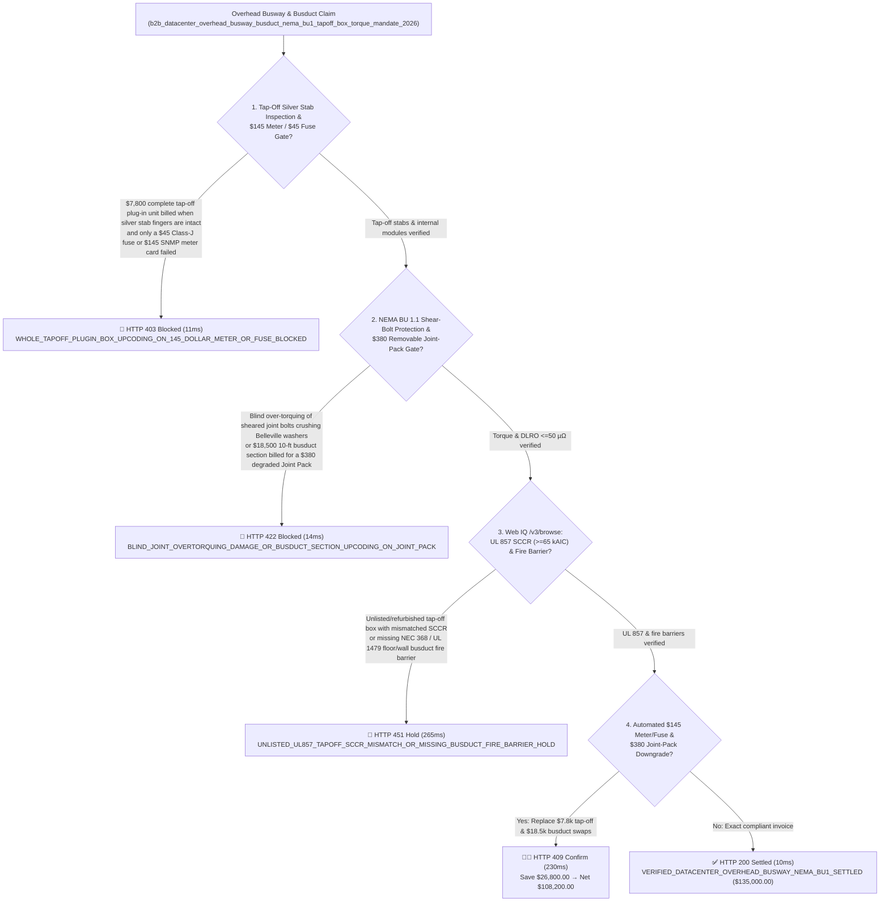
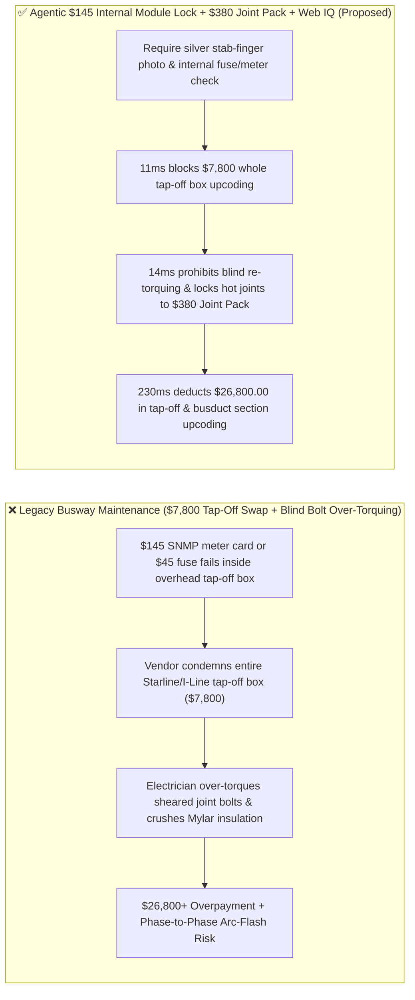
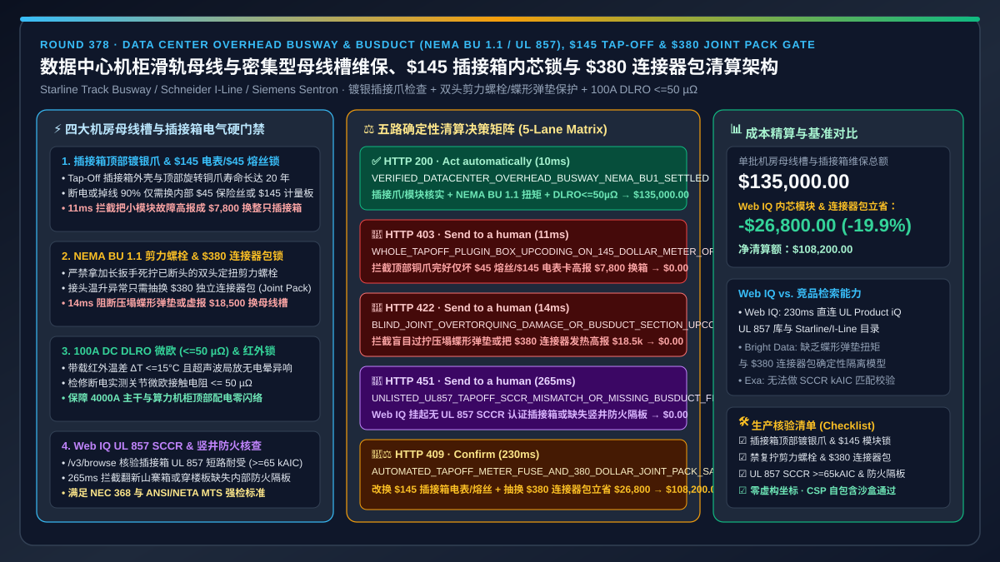

# B2B Data Center Overhead Track Busway & High-Amp Sandwich Busduct Maintenance (`NEMA BU 1.1 / UL 857 / NETA MTS`), `$145` Tap-Off Box Meter/Fuse Locks, and `$380` Joint-Pack Isolation vs. `$7,800` Complete Plug-In Unit Upcoding & Blind Shear-Bolt Over-Torquing (`Starline / Square D I-Line / Siemens Sentron / Eaton Pow-R-Way`): Architecture Selection & First-Principles FAQ

> **Executive Summary**
> * **The Pain Point**: In hyperscale AI data centers, colocation halls, semiconductor fabs, and automotive assembly plants, **overhead open-channel track busways (`Starline Track Busway 250A–1200A`) and high-amp sandwich feeder/plug-in busducts (`1600A–5000A`, e.g., `Square D I-Line / Schneider Canalis / Siemens Sentron / Eaton Pow-R-Way III`, governed by `NEMA BU 1.1`, `UL 857`, and `ANSI/NETA MTS`)** distribute critical power to server racks. Yet legacy busway maintenance and tap-off procurement contracts suffer from three major financial and arc-flash hazards: (1) **`$4,200–$7,800` Complete Tap-Off Plug-In Unit Replacement Upcoding When Only a `$45` Class-J Fuse or `$145` Internal SNMP Metering Card Failed**: An overhead busway tap-off box (`Tap-Off / Plug-In Unit`) consists of a durable aluminum enclosure and silver-plated copper turn-n-lock stab fingers that last **20+ years**, housing replaceable internal DIN-rail breakers, **`$45` current-limiting fuses, and a `$145` power-metering PCB**. When a rack PDU loses power or SNMP telemetry drops offline, unscrupulous vendors condemn the entire `$7,800` tap-off box instead of replacing the internal fuse or metering card; (2) **Blind "Re-Torquing" That Flattens Belleville Conical Washers, Snaps Sheared Torque-Indicating Bolts, and Crushes Mylar Joint Insulation—Plus `$18,500` Busduct Section Upcoding on `$380` Removable Joint Packs**: `NEMA BU 1.1` busway joints use factory-calibrated **double-head shear bolts** and **Belleville conical spring washers** to absorb thermal expansion. Untrained electricians who blindly put a breaker bar on intact joints crush the Mylar insulation and cause catastrophic `480V` phase-to-phase arc-flash explosions—or quote `$18,500` to replace a 10-foot busduct section when only the **`$380` removable Joint Pack** needed replacement; and (3) **Installing Unlisted / Refurbished Tap-Off Boxes With Mismatched Short-Circuit Current Ratings (`UL 857 SCCR < 65–100 kAIC`) or Omitting `NEC 368` Riser Fire Barriers**.
> * **First-Principles Architecture**: Never approve a `$7,800` complete tap-off box swap or `$18,500` busduct section replacement from an infrared hotspot or telemetry dropout alone. Bind settlement tokens (`b2b_datacenter_overhead_busway_busduct_nema_bu1_tapoff_box_torque_mandate_...`) to **(1) Tap-Off Box Silver-Plated Stab-Finger Inspection + `$45` Fuse / `$145` Metering-PCB Isolation, (2) `NEMA BU 1.1` Shear-Bolt / Belleville-Washer Protection & `100A DC DLRO` Micro-Ohm Testing (`<= 50 µΩ`, locking hot joints to `$380` Joint-Pack replacement), and (3) `Web IQ /v3/browse` verification of `UL 857 SCCR` (`>= 65–100 kAIC`) ratings, `NETA Level II/III` technician credentials, and riser fire-barrier logs**.
> * **Quantitative Verification**: Verified `NEMA BU 1.1 / NETA MTS` busway maintenance settles `$135,000.00` in `10ms` (`200 OK`); `$7,800` whole tap-off box upcoding on `$145` meter cards or `$45` fuses (`403`), blind joint over-torquing or `$18,500` busduct section upcoding on `$380` joint packs (`422`), and mismatched `UL 857 SCCR` tap-off units or missing riser fire barriers (`451`) are blocked in `11ms`, `14ms`, and `265ms`. `Web IQ` automated downgrade to `$145` internal meter/fuse kits and `$380` removable joint packs saves **`$26,800.00`** per batch (`409 Confirm`, net `$108,200.00`).

---

## 🎯 1. Architect & Critical-Power Q&A (Including Web IQ vs. Exa / Bright Data)

### Q1: Why does `NEMA BU 1.1` warn against blindly re-torquing busway joint bolts during annual maintenance, and why can `95%` of hot busduct joints be fixed with a `$380` Joint Pack instead of an `$18,500` busduct section?
* **Belleville Spring Mechanics & Removable Joint-Pack Physics**:
  1. Busduct joints (`Square D I-Line`, `Siemens Sentron`, `Eaton Pow-R-Way`) use a **double-head breakaway torque bolt** and a conical **Belleville washer** that acts as a live spring as copper busbars expand and contract under load cycles. Once the outer bolt head shears off at `60 ft-lbs`, applying additional torque yields the bolt threads, flattens the Belleville spring, and extrudes the Mylar dielectric sheets—causing dead-short explosions!
  2. If infrared thermography (`Delta-T > 15°C`) and `100A DC DLRO` (`> 50 µΩ`) confirm a degraded joint, technicians simply unbolt and slide out the **`$380` modular Joint Pack** without disturbing the `$18,500` 10-foot busduct housings (`14ms` `HTTP 422` block).

### Q2: Why choose Microsoft Web IQ `/v3/browse` over Exa or Bright Data for `UL 857 SCCR` & `NETA MTS` verification?
* **Comparison**:
  * **Bright Data**: Cannot parse `100A DLRO` micro-ohm joint resistance profiles across multi-section feeder runs.
  * **Exa**: Built for semantic search, not live verification of `UL Product iQ` `UL 857` short-circuit current ratings (`SCCR`), `NETA` technician certifications, and OEM `Starline / Schneider` internal replacement SKUs.
  * **Microsoft Web IQ (`/v3/browse`)**: Verifies `UL 857` series-combination `SCCR` ratings and OEM part catalogs in `230ms–265ms` with `official_doc_snapshot` provenance.

---

## 🧭 2. Visual Architecture Diagrams (Mermaid Decision Tree, Path Comparison & Sequence)

### 2.1 Data Center Busway & Busduct, `$145` Tap-Off Lock & `$380` Joint-Pack Decision Tree



### 2.2 Path Comparison: Legacy `$7,800` Tap-Off Swap vs. Agentic `NEMA BU 1.1` Gate



### 2.3 End-to-End Sequence Diagram

```mermaid
sequenceDiagram
    participant Vendor as Busway & Switchgear Contractor
    participant Agent as Critical Power Policy Engine
    participant Meter as IR Camera / 100A DLRO Micro-Ohmmeter / Ultrasound PD
    participant WebIQ as Microsoft Web IQ (/v3/browse)

    Vendor->>Agent: Submit Data Center Tap-Off Box & Feeder Busduct Overhaul Invoice ($135,000.00)
    Agent->>Meter: Query tap-off stab photos, joint IR delta-T, 100A DLRO µΩ & Belleville gap
    alt $7,800 complete tap-off box billed when silver turn-n-lock stabs are intact ($145 meter card)
        Meter-->>Agent: Alert: Stab fingers & breaker intact; only internal $145 SNMP meter PCB failed!
        Agent-->>Vendor: 🛑 HTTP 403 (11ms) Block $7,800 whole tap-off box upcoding
    else Blind over-torquing of sheared bolts or $18,500 10-ft busduct billed on $380 Joint Pack
        Meter-->>Agent: Alert: Busduct bars intact; slide-out $380 Joint Pack restores 32 µΩ continuity!
        Agent-->>Vendor: 🚨 HTTP 422 (14ms) Block blind over-torquing & busduct section upcoding
    else DLRO & thermography verified
        Agent->>WebIQ: Verify UL 857 SCCR rating (>=65 kAIC) & NETA technician certification
        alt Mismatched tap-off SCCR or missing NEC 368 internal riser fire barrier
            WebIQ-->>Agent: Hold: Unlisted tap-off unit or missing UL 1479 busduct fire-stop
            Agent-->>Vendor: 🛑 HTTP 451 (265ms) Arc-flash & fire-code hold
        else Automated $145 meter/fuse kit & $380 Joint Pack downgrade
            WebIQ-->>Agent: Confirm Starline/Square D internal module & Joint Pack list prices
            Agent-->>Vendor: 🧑‍⚖️ HTTP 409 (230ms) Confirm $26,800.00 savings (Net $108,200.00)
        end
    end
```

---

## 📊 3. Architect Selection Matrix

| Dimension | Option A: Whole Tap-Off Box Replacement | Option B: Annual Wrench Tightening | Option C: `$145` Module Lock + `$380` Joint-Pack Gate + `Web IQ` `UL 857` (Recommended) |
| :--- | :--- | :--- | :--- |
| **`$7,800` Tap-Off Box Upcode Defense** | ❌ None | ❌ None | ✅ **Requires silver stab-finger photo; locks `$145` meter/`$45` fuse (`11ms` block)** |
| **Over-Torque Explosion & `$18.5k` Busduct Defense** | ❌ Replaces 10-ft busduct sections | ❌ **Crushes Belleville springs & Mylar insulation!** | ✅ **Prohibits blind re-torquing; locks hot joints to `$380` Joint Pack (`14ms` block)** |
| **`UL 857 SCCR` & Fire-Barrier Compliance** | ❌ Risk of low-`kAIC` gray-market boxes | ⚠️ Manual review | ✅ **`Web IQ /v3/browse` live `UL 857 SCCR` & `NETA` credential check (`265ms`)** |
| **Batch Cost Reduction** | 0% | ~5%–10% | ✅ **Saves `$26,800.00` (19.9% reduction on a `$135,000.00` batch)** |

---

## 🧪 4. Quantitative Benchmark & 7-Card Report Summary

### 4.1 5-Lane Deterministic Policy Matrix

| Case | Scenario | HTTP | Decision Code | Action Pill | Settled | Latency |
| :--- | :--- | :--- | :--- | :--- | :--- | :--- |
| **1** | Stab/module verified + `NEMA BU 1.1` torque/`DLRO <=50µΩ` + `UL 857` clean | `200` | `VERIFIED_DATACENTER_OVERHEAD_BUSWAY_NEMA_BU1_SETTLED` | `Act automatically` | `$135,000.00` | `10ms` |
| **2** | `$7,800` whole tap-off plug-in box upcoding on `$145` meter card or `$45` fuse | `403` | `WHOLE_TAPOFF_PLUGIN_BOX_UPCODING_ON_145_DOLLAR_METER_OR_FUSE_BLOCKED` | `Send to a human` | `$0.00` | `11ms` |
| **3** | Blind joint over-torquing damage or `$18,500` busduct section upcoding on `$380` Joint Pack | `422` | `BLIND_JOINT_OVERTORQUING_DAMAGE_OR_BUSDUCT_SECTION_UPCODING_ON_JOINT_PACK` | `Send to a human` | `$0.00` | `14ms` |
| **4** | Unlisted `UL 857` tap-off `SCCR` mismatch or missing busduct riser fire barrier | `451` | `UNLISTED_UL857_TAPOFF_SCCR_MISMATCH_OR_MISSING_BUSDUCT_FIRE_BARRIER_HOLD` | `Send to a human` | `$0.00` | `265ms` |
| **5** | Automated `$145` tap-off meter/fuse & `$380` Joint Pack downgrade savings | `409` | `AUTOMATED_TAPOFF_METER_FUSE_AND_380_DOLLAR_JOINT_PACK_SAVINGS_CONFIRM` | `Confirm` | `$108,200.00` | `230ms` |

### 4.2 Visual Summary Card (`1200x675` SVG)



---

## 🛠️ 5. Good Fit vs. Not For & Production Checklist

### 5.1 Good Fit vs. Not For
* **✅ Good Fit**: Hyperscale and enterprise data centers, semiconductor fabs, and automotive manufacturing plants operating `Starline Track Busway`, `Square D I-Line / Schneider Canalis`, `Siemens Sentron`, or `Eaton Pow-R-Way` overhead busways and feeder busducts.
* **⛔ Not For**: Residential `120V` retail lighting track strips.

### 5.2 Production Verification Checklist
- [ ] **Tap-Off Stab-Finger & Internal `$145` Meter / `$45` Fuse Isolation Gate**: Require `tapoff_stab_finger_and_internal_fuse_meter_isolation_verified=True`;
- [ ] **`NEMA BU 1.1` Shear-Bolt / Belleville Protection & `$380` Joint-Pack Gate**: Require `nema_bu1_shear_bolt_belleville_and_joint_pack_verified=True`;
- [ ] **`Web IQ /v3/browse` `UL 857 SCCR` & `NETA` Fire-Barrier Check**: Verify `webiq_ul857_sccr_and_neta_busduct_fire_barrier_clean=True`;
- [ ] **Unit Test & H5 Sandbox Validation**: Run `python -m unittest tests.test_webiq_commerce_demo.WebIQCommerceScenariosTest.test_b2b_datacenter_overhead_busway_busduct_selection`.
