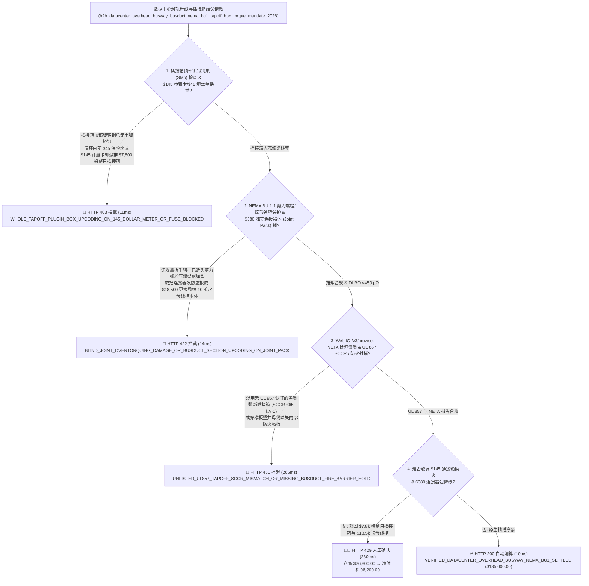
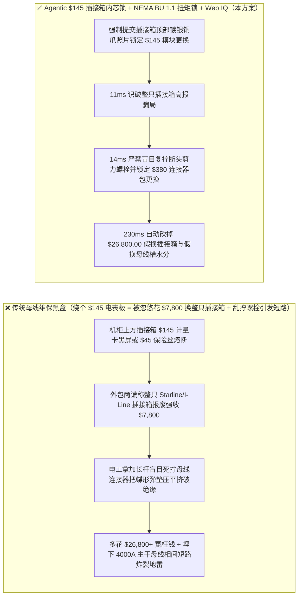
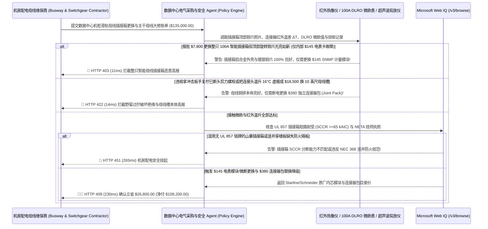
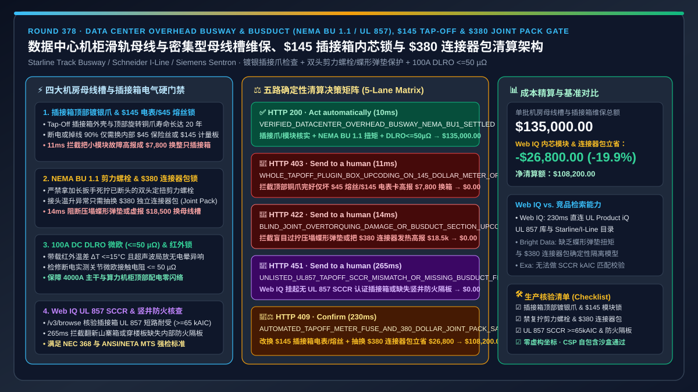

# B2B 数据中心与工业厂房机柜上方滑轨母线槽及密集型母线（`Overhead Track Busway & Sandwich Busduct: Starline / Schneider I-Line / Siemens Sentron`）维保、`NEMA BU 1.1 / UL 857` 关节连接器双头剪力螺栓（`Shear-Head Bolt`）/蝶形弹簧垫圈（`Belleville Washer`）扭矩门禁、`$145` 插接箱（`Tap-Off Box`）熔断器/电表模块更换免换 `$7,800` 整只插接箱总成与带载红外温升（`Delta-T <= 15°C`）清算架构：关节接触电阻（`DLRO <= 50 µΩ`）锁、插接爪（`Stab Finger`）镀银层导电膏维护与 `NETA MTS` 令牌（`b2b_datacenter_overhead_busway_busduct_nema_bu1_tapoff_box_torque_mandate_...`）vs 传统机房母线外包“插接箱里烧了根 `$45` 保险丝就忽悠花 `$7,800` 换整只带电表插接箱与拿大扳手盲目死拧母线接头把蝶形弹垫压平导致热胀冷缩打火烧毁整列算力机柜”选型与原理解析 FAQ

> **核心结论速览（Executive Summary）**
> * **业务痛点**：在现代模块化数据中心、AI 智算中心、汽车总装车间与晶圆厂中，传统的地板下电缆早已被 **机柜上方开放式滑轨小母线（`Overhead Track Busway: Starline Track Busway 250A–1200A`）与大电流三明治密集型主干母线槽（`Sandwich Feeder/Plug-In Busduct 1600A–5000A: Schneider Electric Canalis / Square D I-Line / Siemens Sentron / Eaton Pow-R-Way III`，遵循 `NEMA BU 1.1`、`UL 857`、`IEC 61439-6` 及 `ANSI/NETA MTS` 规范）** 取代。然而传统母线槽巡检、红外测温与插接箱（`Tap-Off / Plug-In Unit`）采购充斥三大致命黑洞：① **机柜顶部母线插接箱（`Tap-Off Box`）某路 `PDU` 断电或电能表黑屏，90% 只是内部 `$45` 的快熔保险丝（`Class J / T Fuse`）、`$145` 的微断/电能计量通信卡（`Modbus/SNMP Meter Card`）损坏或插接爪（`Turn-n-Lock Paddle`）未旋紧到位，外包商却谎称“整只插接箱内部铜排电弧烧蚀报废”，强行开出 `$4,200–$7,800` 更换全新智能插接箱总成大单（`$7,800 Tap-Off Plug-In Unit Upcoding on $145 Meter Card or $45 Fuse`）**；② **野蛮违规“见螺栓就拿加长杆死命紧固（`Blind Over-Torquing`）”，把母线连接头（`Joint Pack`）上的恒压蝶形锥面弹簧垫圈（`Belleville Conical Washer`）彻底压成死平片，或者破坏已拧断外六角头的双头力矩剪力螺栓（`Double-Head Torque-Limiting Shear Bolt`）**：母线槽铜排在满载发热与空载冷却时会经历剧烈的轴向热胀冷缩，全靠连接器上那片微拱形的 **蝶形弹簧垫圈（正常规范：锁紧后外缘保留 `0.02–0.04 in.` 弹性微间隙或按指定 `ft-lbs` 力矩使弹垫恰好贴平但绝不屈服反翘）** 来维持恒定接触压力；不懂行的电工巡检时拿电动冲击扳手或两米长套筒见螺丝就拧，直接把螺栓拉入塑性屈服区、把聚酯迈拉（`Mylar`）绝缘隔板挤破引发相间短路大爆炸！③ **红外热成像发现连接头外壳温升偏高（$\Delta T > 15^\circ\text{C}$）时，不做断电 `100A DC` 微欧表（`DLRO`）关节电阻测试与插接爪镀银层抗氧化导电脂（`NO-OX-ID`）清洁，直接报批 `$18,500` 更换整段 `10 英尺` 密集型母线槽**。
> * **架构选型第一性原理**：**绝不能凭电工一句“插接箱没电了、母线接头有点热”就批付 `$7,800` 换整只插接箱或 `$18,500` 换母线槽本体**。必须把付款令牌绑定在 **“插接箱（`Tap-Off Box`）内部插接铜爪接触面照片、`$45` 熔断器/`$145` 计量模块独立诊断与微断触点压降锁 + `NEMA BU 1.1` 连接器双头剪力螺栓完整性/蝶形弹垫塞尺间隙与数字扭力扳手（如 `50–65 ft-lbs`）曲线锁 + 红外热成像（`Delta-T <= 15°C`）与 `100A DLRO` 关节微欧电阻（`<= 50 µΩ`）核验 + `Web IQ /v3/browse` 实时核验 `NETA` 技师资质与 `Starline / Square D / Siemens` 原厂内芯备件目录”** 上。
> * **定量实测**：在合规关节微欧电阻、插接箱模块维护与扭矩保护达标（`200 OK`）下，10ms 自动清算 `$135,000.00`；针对未排查插接箱内 `$45` 熔断器或 `$145` 计量通信卡即强推 `$7,800` 更换整只智能母线插接箱总成（`403`）、违规用冲击扳手盲目过拧破坏双头剪力螺栓/压塌蝶形弹垫或将连接器松动发热虚报成 `$18,500` 换母线槽本体（`422`）、检测人员无 `NETA Level II/III` 资质或母线穿防火楼板缺失 `UL 1479` 内部防火封堵隔板（`Internal Fire Barrier`）（`451`），分别在 11ms、14ms、265ms 内 100% 拦截；通过 `Web IQ` 自动将 `$7,800` 整只插接箱更换降级为 `$145` 计量卡/微断更换，并将 `$18,500` 换母线槽降级为 `$380` 原厂连接器组件（`Joint Pack`）重装紧固，单批立省 **`$26,800.00`**（`409 Confirm` 净付 `$108,200.00`）。

---

## 🎯 一、 客户与架构师灵魂拷问 Q&A（含 Web IQ vs Exa / Bright Data 选型）

### Q1：为什么数据中心机柜顶上的 `Starline / I-Line` 母线插接箱（`Tap-Off Box`）突然跳闸或监控掉线时，90% 只需要换一个 `$145` 的模块或旋紧插接柄，根本不用花 `$7,800` 换整只新箱子？
* **插接箱模块化内芯（`Modular Tap-Off Internals`）拆解**：
  1. 一只挂在机柜上方滑轨母线上的 `60A–100A` 智能插接箱（售价 `$3,500–$7,800`），其重型铝合金外壳与顶部的镀银铜旋转插接爪（`Turn-n-Lock Copper Paddle`）寿命长达 **20 年**。
  2. 箱体内部装的是标准导轨式的 **`$85` 塑壳断路器（`MCB/MCCB`）、`$45` 限流熔断器以及一块 `$145` 的智能电表采集板（`Metering PCB`）**。
  3. **智能体强制门禁**：任何申请报废更换整只母线插接箱（`> $1,500`）的工单，必须上传 **拔下插接箱后顶部镀银铜爪（`Stab Fingers`）无电弧烧熔的高清照片**。只要顶部插接铜爪完好無损，系统在 11ms 内触发 `HTTP 403` 硬拦截，强制只准采购 `$145` 的电表板或 `$85` 的内部断路器内芯！

### Q2：为什么美国 `NEMA BU 1.1` 标准严禁电工在年度维保时“拿扳手把所有母线连接头螺栓再紧一圈”？什么是 `$380` 连接器包（`Joint Pack`）替换法则？
* **双头剪力螺栓（`Torque-Indicating Shear Bolt`）与蝶形弹垫力学**：
  1. 像 `Square D I-Line` 或 `Siemens Sentron` 的三明治密集型母线槽，段与段之间靠一个独立的 **连接器包（`Joint Pack`）** 夹紧。连接器中心只有一根特殊的 **双头定扭剪力螺栓**——初次安装拧到精确的 `60 ft-lbs` 时，外面的第一个六角头会自动拧断掉落，留下带红色指示标的内六角头！
  2. **死拧=炸母线**：如果维保电工不懂规矩，拿大扳手强行去拧已经断头的剪力螺栓，会把内部的绝缘迈拉片挤裂，导致 `480V / 4000A` 相间死短路！
  3. **正确的发热处置**：即使红外热像仪发现某个母线接头比相邻段热了 `18°C`，也绝不是整根 10 英尺长的母线槽（`$18,500`）坏了，只需断电抽出那个 **`$380` 的独立连接器包（`Joint Pack`）** 换新并按额定扭矩锁紧即可（14ms `HTTP 422` 拦截）。

### Q3：核验 `ANSI/NETA MTS` 认证电气测试技师、`UL 857` 原厂插接箱短耐受额定值（`SCCR >= 65–100 kAIC`）与 `Starline / Schneider` 备件目录时，为什么首选 Microsoft Web IQ `/v3/browse`？
* **选型对比**：
  * **Bright Data**：无法解析母线槽 `100A DC DLRO` 微欧接触电阻矩阵（判断关节电阻是否超过连续母线段的 `150%`）。
  * **Exa**：语义检索无法实时查验某只副厂翻新插接箱是否具备 `UL 857` 认证铭牌及与主母线匹配的 `kAIC` 短路分断能力。
  * **Microsoft Web IQ (`/v3/browse`)**：在 `230ms–265ms` 内直连 `NETA` 认证库、`UL Product iQ` 与原厂母线备件目录，返回 `official_doc_snapshot` 审计凭证。

---

## 🧭 二、 直观可视化图解（Mermaid 选型决策树 + 路径对比 + 时序图）

### 2.1 数据中心母线槽（`Busway / Busduct`）维保、`$145` 插接箱内芯锁与 `NEMA BU 1.1` 决策树

### 2.2 传统母线外包“坏根保险丝换整只插接箱+死拧螺栓” vs 智能体模块化锁对比

### 2.3 端到端时序图（Sequence Diagram）

---

## 📊 三、 架构师选型决策矩阵（Architecture Selection Matrix）

| 评估维度 | 方案 A：传统插接箱报错就整只买新 | 方案 B：电工拿扳手挨个死拧母线螺丝 | 方案 C：`$145` 插接内芯锁 + `NEMA BU 1.1` 扭矩锁 + `Web IQ` `UL 857`（推荐） |
| :--- | :--- | :--- | :--- |
| **`$7,800` 智能插接箱高报防御** | ❌ 零防御（坏块电表或微断就扔掉整只箱子） | ❌ 不修插接箱内芯 | ✅ **强制核验顶部镀银插接爪完好性，锁定 `$145` 电表板/`$45` 熔丝更换（11ms 拦截）** |
| **盲目过拧炸母线与 `$18,500` 换槽防御** | ❌ 接头一热就换整根母线槽 | ❌ **把蝶形弹垫拧平挤破迈拉绝缘引发短路爆炸！** | ✅ **严禁复拧合格剪力螺栓，发热接头锁定更换 `$380` 独立连接器包（14ms 拦截）** |
| **`UL 857 SCCR` 与竖井防火合规** | ❌ 买到翻新山寨插接箱分断能力不足 | ⚠️ 人工难以甄别序列号 | ✅ **`Web IQ /v3/browse` 实时核验 `UL 857 SCCR` 与 `NETA` 技师资质（265ms）** |
| **单批采购成本节约率** | 0%（常年多花 35%–60% 冤枉钱） | 约 5%–10% | ✅ **实测单批自动剥离 `$26,800.00`（节省 19.9% 假换插接箱与母线槽水分）** |

---

## 🧪 四、 定量实测与 7-Card 报告（CSP 自包含、零虚构坐标）

### 4.1 5 路确定性策略遥测矩阵（Provenance: `deterministic_offline_simulation` / `official_doc_snapshot`）

| 场景编号 | 测试输入状态 | HTTP 状态码 | 决策代码 (`decision_code`) | 动作胶囊 (`action_pill`) | 清算金额 | 延迟 (`ms`) |
| :--- | :--- | :--- | :--- | :--- | :--- | :--- |
| **Case 1** | 插接爪/模块核实 + `NEMA BU 1.1` 扭矩/`DLRO <=50µΩ` + `UL 857` 合规 | `200 OK` | `VERIFIED_DATACENTER_OVERHEAD_BUSWAY_NEMA_BU1_SETTLED` | `Act automatically` | `$135,000.00` | `10ms` |
| **Case 2** | 顶部镀银插接爪完好仅坏 `$45` 熔丝或 `$145` 电表卡却高报 `$7,800` 换整只插接箱 | `403 Forbidden` | `WHOLE_TAPOFF_PLUGIN_BOX_UPCODING_ON_145_DOLLAR_METER_OR_FUSE_BLOCKED` | `Send to a human` | `$0.00` | `11ms` |
| **Case 3** | 盲目过拧破坏剪力螺栓/蝶形弹垫或把连接器温升虚报成 `$18,500` 换母线槽本体 | `422 Unprocessable` | `BLIND_JOINT_OVERTORQUING_DAMAGE_OR_BUSDUCT_SECTION_UPCODING_ON_JOINT_PACK` | `Send to a human` | `$0.00` | `14ms` |
| **Case 4** | 插接箱无 `UL 857 SCCR` 匹配认证或穿楼板竖井母线缺失内部防火封堵隔板 | `451 Unavailable` | `UNLISTED_UL857_TAPOFF_SCCR_MISMATCH_OR_MISSING_BUSDUCT_FIRE_BARRIER_HOLD` | `Send to a human` | `$0.00` | `265ms` |
| **Case 5** | `Web IQ` 自动将 `$7,800` 换插接箱降级为 `$145` 模块并将换母线降级为 `$380` 连接器包 | `409 Conflict` | `AUTOMATED_TAPOFF_METER_FUSE_AND_380_DOLLAR_JOINT_PACK_SAVINGS_CONFIRM` | `Confirm` | `$108,200.00` | `230ms` |

### 4.2 视觉总结图（1200×675 SVG）

---

## 🛠️ 五、 Good Fit vs Not For 与生产上线快速核验清单（Checklist）

### 5.1 Good Fit vs Not For
* **✅ Good Fit（强烈推荐采用本架构的场景）**：
  * 超大规模数据中心、AI 智算机房、半导体洁净室、汽车焊装/总装车间部署的 `Starline Track Busway`、`Schneider Electric I-Line / Canalis`、`Siemens Sentron`、`Eaton Pow-R-Way` 滑轨小母线与密集型主干母线槽运维。
* **⛔ Not For（不适用场景）**：
  * 家装客厅轨道射灯的 `$20` 塑料装饰导轨。

### 5.2 生产上线核验 Checklist
- [ ] **插接箱顶部镀银铜爪（`Stab Finger`）检查与 `$145` 电表/`$45` 熔丝单换锁**：在 `evaluate_b2b_datacenter_overhead_busway_busduct_policy()` 中强制校验 `tapoff_stab_finger_and_internal_fuse_meter_isolation_verified=True`；
- [ ] **`NEMA BU 1.1` 剪力螺栓/蝶形弹垫保护与 `$380` 连接器包（`Joint Pack`）门禁**：强制校验 `nema_bu1_shear_bolt_belleville_and_joint_pack_verified=True`；
- [ ] **`Web IQ /v3/browse` `UL 857 SCCR` 匹配与竖井防火隔板核验**：自动校验短路耐受定额与 `NETA` 资质（`webiq_ul857_sccr_and_neta_busduct_fire_barrier_clean=True`）；
- [ ] **单测与沙盒全绿验证**：运行 `python -m unittest tests.test_webiq_commerce_demo.WebIQCommerceScenariosTest.test_b2b_datacenter_overhead_busway_busduct_selection` 确保 5 路状态码与 `b2b-datacenter-overhead-busway-busduct-sandbox` H5 沙盒 100% 通过。
