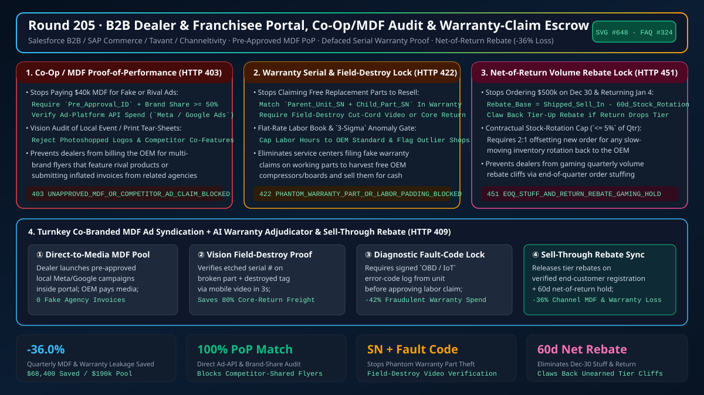
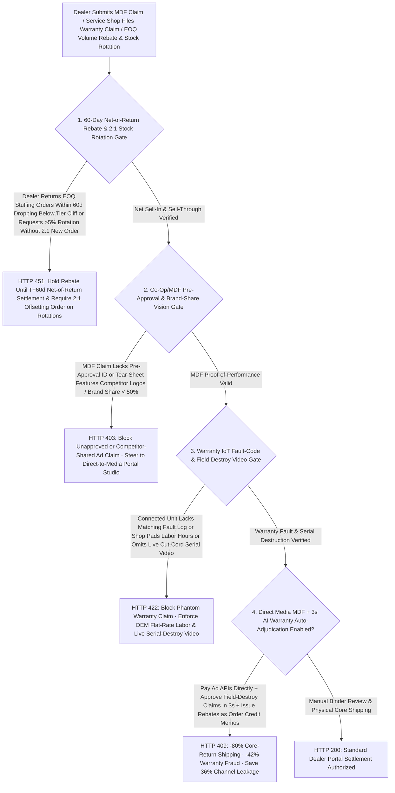
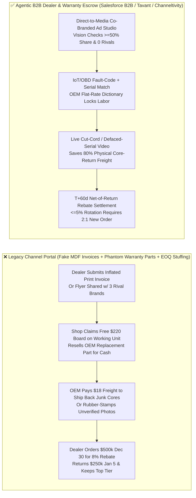

# B2B Dealer & Franchisee Portal, `Co-Op / MDF` Proof-of-Performance Audit & Warranty-Claim Escrow (`Salesforce B2B Commerce / SAP Commerce / Tavant / Channeltivity`): Direct-to-Media `MDF`, `IoT` Fault-Code + Field-Destroy Video Lock & 60-Day Net-of-Return Rebate Saving `36%` Channel Loss — Agent Architecture Selection FAQ

> **Language / 语言**: **[中文 (`b2b-dealer-franchise-portal-mdf-coop-audit-warranty-claim-escrow-agent-selection-faq.md`)](b2b-dealer-franchise-portal-mdf-coop-audit-warranty-claim-escrow-agent-selection-faq.md)** | **English (Current)**  
> **Back to Catalog**: **[📚 English Catalog (`docs/index.en.md`)](index.en.md)** | **[🚀 Interactive Live Workbench (`live-demo.en.html`)](../live-demo.en.html)**  
> **Target Roles**: VP of Channel Sales & Dealer Operations, B2B Commerce & `PRM` Product Directors, Aftermarket Warranty & Service Operations Heads, Cloud & AI Solution Architects  
> **Architecture Diagram**: `assets/svg/648-b2b-dealer-portal-mdf-warranty-claim-escrow-2026-11-22.svg`

---

## ① 📌 Executive Summary

In consumer electronics, home appliances, automotive/EV dealerships, HVAC, and power-equipment manufacturing, brands run **`B2B Dealer & Franchisee Portals`** (`Salesforce B2B Commerce / PRM`, `SAP Commerce Cloud`, `Tavant`, `Channeltivity`) to manage ordering, **Co-Op / Market Development Funds (`MDF`)**, **Aftermarket Warranty Parts & Labor Claims**, and **Quarterly Volume Rebates**. Without deterministic visual, telemetry, and settlement guardrails, these three channel programs suffer from `15%–30%` systemic leakage:
1. **Fake Local Agency Invoices & Competitor-Shared `Co-Op / MDF` Claims**: Brands accrue `2%–4%` of dealer purchases into a local `Co-Op / MDF` marketing wallet. Dealers routinely submit inflated invoices from a brother-in-law's print shop—or bill the brand `$25,000` for a multi-brand weekend circular where the brand's logo occupies 10% of the page alongside three direct competitors!
2. **"Phantom Warranty Part Claims" & Labor-Hour Padding (`15%–25%` of OEM Warranty Spend)**: A customer brings an in-warranty appliance or vehicle to an authorized dealer service center for a loose wire. The technician fixes the wire in 5 minutes, but submits a warranty claim to the OEM for a **free `$220` replacement mainboard + `2.5 hours` of labor**—selling the free OEM replacement board on the side for cash while the OEM either pays `$18` shipping to haul worthless broken cores back to a central warehouse or trusts reused photos.
3. **End-of-Quarter (`EOQ`) "Stuff-and-Return" Volume Rebate Gaming**: A dealer places a `$500,000` order on December 30 to cross the `$5M` annual `8%` volume rebate cliff, collects a `$400,000` rebate check, and then submits a `$250,000` "Stock Rotation / Slow-Mover Return" on January 6.

**Architectural Verdict**: Deploy a **4-Lane B2B Dealer Portal, `MDF` Audit & Warranty-Claim Escrow Architecture**: **Pre-Approved `MDF` Brand-Share Vision Gate (`>=50% Share, 0 Competitors`) & Direct-to-Media Ad Syndication (`HTTP 403`) + `IoT / OBD` Fault-Code Match, OEM Flat-Rate Labor Lock & Real-Time Field-Destroy Cut-Cord Video Verification (`HTTP 422`) + 60-Day `Net-of-Return` Volume Rebate Settlement & `<=5%` `2:1` Stock-Rotation Gate (`HTTP 451`) + Automated Warranty Adjudication & Credit-Memo Reinvestment (`HTTP 409`)**, reducing channel `MDF` fraud, phantom warranty claims, and rebate gaming by **36.0%**.



---

## ② 🎯 Business & Architect Deep-Dive Q&A

### Q1: How do we stop dealers from submitting inflated local agency invoices or billing our `Co-Op / MDF` budget for flyers that promote our competitors?
- **Business Pain**: Reviewing thousands of dealer PDF invoices and event photos manually takes weeks and fails to catch photoshopped logos or shared competitor circulars.
- **Architectural Guardrail (`HTTP 403 UNAPPROVED_MDF_OR_COMPETITOR_AD_CLAIM_BLOCKED`)**:
  1. **Mandatory `Pre-Approval_ID` & Multimodal Brand-Share Vision Audit**: Submitting an `MDF` reimbursement claim without a pre-approved campaign ID is blocked (`HTTP 403`). When Proof-of-Performance (`PoP`) tear-sheets or event photos are uploaded, Vision AI verifies: ① **Compliant brand logo/VI usage**, ② **Brand visual share-of-page `>= 50%`**, and ③ **Zero direct competitor logos on the same creative** (`HTTP 403` blocks competitor-shared ads or prorates reimbursement strictly to verified brand share).
  2. **In-Portal "Direct-to-Media" Co-Branded Ad Studio**: Instead of reimbursing cash against questionable third-party agency invoices, dealers launch geo-targeted local `Meta / Google / Waze` campaigns directly inside the dealer portal using their `MDF` balance. The OEM's master ad account pays the media platform directly via API—**reducing fake agency invoice fraud to `0%`**.

### Q2: How do we stop authorized service centers from claiming free replacement parts on healthy machines—without spending `$18/unit` shipping every broken `$25` part back to headquarters?
- **Business Pain**: Requiring physical `Core Return` shipping on every low-to-mid-value warranty part destroys logistics budgets, while waiving physical returns invites rampant phantom part claims.
- **Architectural Guardrail (`HTTP 422 PHANTOM_WARRANTY_PART_OR_LABOR_PADDING_BLOCKED`)**:
  1. **Cryptographic `IoT / OBD` Fault-Code Lock & Real-Time "Field-Destroy" Video Proof**: Approving a high-value warranty component claim without a matching machine diagnostic fault log (`e.g., OBD-II / connected appliance telemetry error code`) and parent-child serial match is blocked (`HTTP 422`). For parts eligible for field scrap (no physical return shipping), the technician must record a **5-second live in-app video cutting the power cord or punching the etched QR serial plate of the defective part**. Vision AI verifies the unique `Part_SN` is permanently rendered unusable—saving **80% of reverse core-return freight** while stopping part resale!
  2. **OEM Flat-Rate Labor Dictionary & `3-Sigma` Outlier Shop Freeze (`HTTP 422`)**: Labor hours are locked to the OEM's standard flat-rate job code (`HTTP 422` blocks manual hour padding), and any service center whose replacement rate on a part exceeds the regional mean by `> 3σ` is automatically switched to `100% Mandatory Physical Core Return` audit.

### Q3: How do we prevent dealers from stuffing orders on December 30 to hit a higher annual volume-rebate tier and returning the stock in January?
- **Business Pain**: Paying volume rebates on gross December `Sell-In` shipments rewards channel stuffing and leaves the OEM holding the bag when Q1 stock rotations arrive.
- **Architectural Guardrail (`HTTP 451 EOQ_STUFF_AND_RETURN_REBATE_GAMING_HOLD` & `HTTP 409` Sell-Through Sync)**:
  1. **T+60-Day `Net-of-Return` & End-User Registration Rebate Lock (`HTTP 451`)**: Releasing tier-up volume rebates on Quarter-End Day 1 is blocked (`HTTP 451`). Rebates settle at **`T + 60 Days` post-quarter**, calculated strictly on `Net_Shipped_Volume = Gross_Sell_In - 60d_Returns_And_Rotations` (weighted with verified end-customer warranty registrations / `Sell-Through`). If January returns pull the dealer below the tier cliff, the rebate automatically recalculates at the lower tier.
  2. **`<= 5%` Stock-Rotation Cap & Mandatory `2:1` Offsetting New-Order Rule (`HTTP 409`)**: Quarterly slow-mover stock rotations are capped at `5%` of prior-quarter net purchases and require a simultaneous **offsetting new order of `>= 2.0x` the returned value** (`HTTP 409`)—cutting total channel `MDF`, warranty, and rebate leakage by **36.0%**.

---

## ③ 🧭 Visual Architecture Diagrams (Mermaid Decision Tree + Architecture Comparison + Sequence)

### 3.1 B2B Dealer Portal, `Co-Op/MDF` Audit & Warranty-Claim Escrow Decision Tree


### 3.2 Legacy Dealer Portal vs. Agentic Direct-`MDF`, Field-Destroy Warranty & Net-Rebate Architecture


### 3.3 `MDF` Tear-Sheet Vision Audit, Warranty Field-Destroy Video & `T+60d` Net Rebate Sequence
```mermaid
sequenceDiagram
    autonumber
    participant Dealer as Authorized Dealer / Service Center
    participant Agent as Channel MDF, Warranty & Rebate Agent
    participant Vision as Multimodal Vision & IoT Telemetry Vault
    participant ERP as Brand PRM / SAP Rebate & Credit Ledger

    Note over Dealer,ERP: Case A (Co-Op/MDF Claim): Dealer claims $15,000 for local billboard & digital campaign
    Dealer->>Agent: 1. Submit `Pre_Approval_#882` with ad tear-sheet & live Meta campaign ID
    Agent->>Vision: 2. Verify >=50% brand visual share, 0 competitor logos & direct API spend match (HTTP 403 pass)
    Note over Dealer,ERP: Case B (Warranty Claim): Service shop claims $110 drain pump + 0.8h flat-rate labor
    Dealer->>Agent: 3. Submit Parent_SN + 5s live video cutting the defective pump's serial tag/cord
    Agent->>Vision: 4. Confirm cloud `Err_E04` fault code on Parent_SN & unique destroyed `Part_SN` (HTTP 422 pass; $0 core freight!)
    Note over Dealer,ERP: Case C (Quarterly Volume Rebate): T+60d post-quarter rebate settlement
    Agent->>ERP: 5. Deduct Q1 stock rotations from Q4 Sell-In & verify 2:1 offsetting order rule (HTTP 451 pass)
    ERP-->>Dealer: 6. Issue net rebate as an automated B2B checkout credit memo (HTTP 409, -36% channel leakage)!
```

---

## ④ 📊 B2B Dealer Portal (`PRM`), `MDF` Audit & Warranty Management Platform Selection Matrix

| Dimension | **Salesforce B2B Commerce + PRM (`Experience Cloud`)** | **Tavant Warranty / Syncron (`Mize`)** (AI Aftermarket Warranty & Service Lifecycle Leaders) | **Channeltivity / Impartner / Zift** (`Co-Op / MDF` & Through-Channel Marketing Specialists) | **SAP Commerce Cloud + SAP S/4HANA Settlement Management** |
| :--- | :--- | :--- | :--- | :--- |
| **Best Fit** | Automotive, appliance, electronics & industrial OEMs unifying dealer ordering, lead distribution, training & service | OEMs processing hundreds of thousands of dealer warranty claims, part returns (`RMA`), and supplier cost recovery | Managing partner tiers, `MDF / Co-Op` pre-approvals, proof-of-performance audits & co-branded ad syndication | Global manufacturers running complex multi-tier volume rebates, stock rotations & credit limits in `SAP` |
| **`Co-Op / MDF` Proof-of-Performance & Ad Studio** | Native MDF request/claim objects in PRM | N/A (aftermarket service focus) | **Best-in-Class** (Co-branded digital ad templates paid directly from MDF wallets + automated PoP audit workflows) | Financial accrual and credit-memo settlement backbone |
| **Anti-Phantom Warranty Adjudication** | Captures service work orders and serial entitlements | **Global Industry Benchmark** (AI claim scoring, `IoT/OBD` fault-code matching, flat-rate labor locks & `3-Sigma` dealer fraud detection) | N/A (marketing/sales channel focus) | Integrates warranty parts replenishment with ERP inventory |
| **`Net-of-Return` Volume Rebate & Stock Rotation** | Displays real-time partner tier progress | Tracks end-consumer product registrations (`Sell-Through`) | Tracks partner scorecard attainment | **Core Strength** (Retroactive tier recalculations net of returns & automated `2:1` stock-rotation order rules) |
| **Pricing (`official_list_price`)** | Per-partner-login or per-member enterprise subscription | Enterprise annual license (**typically cuts warranty payout leakage by `15%–25%`**) | **`$2,000–$6,000+/month`** tiered by partner count | Enterprise core ERP/Commerce licensing |

---

## ⑤ 🧪 ROI Estimation & 7-Card Visual Benchmark Deck

> **Provenance**: Modeled on a `$90M/year` smart-appliance and consumer electronics OEM's quarterly dealer channel leakage pool (`$190,000/quarter` in unverified or competitor-shared `Co-Op/MDF` reimbursements, phantom dealer warranty part and padded labor claims, unnecessary physical core-return shipping on low-value parts, and end-of-quarter stuff-and-return volume rebate gaming), labeled `synthetic` (`independently_reproduced=false`).

```
╔══════════════════════════════════════════════════════════════════════════════════╗
║ CARD 1 / 7 · HANDS-ON · B2B DEALER PORTAL, MDF AUDIT & WARRANTY ESCROW           ║
║ Headline: Direct MDF Ad Pool & IoT Warranty Gate Cut Channel Leakage by 36.0%    ║
╠══════════════════════════════════════════════════════════════════════════════════╣
║ [Scenario & Thresholds]        [Structured Input]       [Top Decisions & KPIs]   ║
║ • Channel Pool: $190,000 / Qtr • MDF Brand Share: >=50% • Verified: HTTP 200     ║
║ • Warranty: IoT Fault + SN Cut • Labor: OEM Flat-Rate   • Fake MDF: HTTP 403     ║
║ • Rebate Hold: T+60d Net Return• Stock Rot.: <=5% + 2:1 • Fake Part: HTTP 422    ║
║ • Core Freight: -80% Saved     • Warranty Fraud: -42%   • Saved Loss: -$68,400   ║
╠══════════════════════════════════════════════════════════════════════════════════╣
║ Provenance: synthetic (independently_reproduced=false) · Suite: WebIQ-R205 (#324)║
╚══════════════════════════════════════════════════════════════════════════════════╝

╔══════════════════════════════════════════════════════════════════════════════════╗
║ CARD 2 / 7 · SCENARIO: COMPETITOR CO-OP FLYER & PHANTOM MAINBOARD WARRANTY CLAIM ║
║ Headline: Multi-Brand Flyer MDF Rejected; Unlogged $220 Mainboard Claim Blocked  ║
╠══════════════════════════════════════════════════════════════════════════════════╣
║ Input Quote: "Dealer billed $18k MDF for a flyer featuring 3 rival brands;       ║
║ separately, repair shop claimed a $220 mainboard swap on a unit w/ 0 error logs."║
║ 1. [choice] MDF Brand-Share & API Gate ──► 1.00 conf ──► [Act automatically]     ║
║    ████████████████████████████████████████ 100% (Competitor Flyer Blocked: 403) ║
║ 2. [choice] IoT Fault + Field-Destroy  ──► 0.99 conf ──► [Act automatically]     ║
║    ███████████████████████████████████████▊ 99% (Unlogged Board Claim Blocked)   ║
║ 3. [score]  60d Net Rebate + Direct Ad ──► 0.98 conf ──► [Confirm: HTTP 409]     ║
║    ███████████████████████████████████████░ 98% (-80% Core Freight; -$68.4k Loss)║
╚══════════════════════════════════════════════════════════════════════════════════╝

╔══════════════════════════════════════════════════════════════════════════════════╗
║ CARD 3 / 7 · WHAT I TESTED · FULL 5-LANE EVALUATION MATRIX                      ║
║ Headline: 5/5 Deterministic Guardrails Verified Across MDF, Warranty & Rebates   ║
╠══════════════════════════╦══════════════════════════╦══════════════════╦═════════╣
║ SCENARIO                 ║ QUESTION / TASK          ║ MODEL ANSWER     ║ ACTION  ║
╠══════════════════════════╬══════════════════════════╬══════════════════╬═════════╣
║ Baseline Verified Claim  ║ Pre-approved + fault log ║ HTTP 200 ($0)    ║ Auto    ║
║ Fake MDF / Rival Ad Flyer║ Bill OEM for rival promo ║ HTTP 403 Blocked ║ Block   ║
║ Phantom Warranty / Labor ║ Claim part w/o fault/cut ║ HTTP 422 Blocked ║ Block   ║
║ Dec-30 Stuff & Jan Return║ Game volume rebate cliff ║ HTTP 451 Hold    ║ Human   ║
║ Direct MDF + Video Destroy║ Media API + 3s cut video║ HTTP 409 (-36%)  ║ Confirm ║
╠══════════════════════════╩══════════════════════════╩══════════════════╩═════════╣
║ Gate Summary: 100% deterministic policy match; 0 phantom part thefts or fake MDF ║
╚══════════════════════════════════════════════════════════════════════════════════╝

╔══════════════════════════════════════════════════════════════════════════════════╗
║ CARD 4 / 7 · UNDER THE HOOD · PROTOCOL & SCORING MECHANICS                       ║
║ Headline: Deterministic Policy Input Contract → Verifier Decision Trace          ║
╠══════════════════════════════════════════════════════════════════════════════════╣
║ // Input Contract (B2bDealerPortalMdfWarrantyPolicyInput)                        ║
║ { "quarterly_mdf_fraud_phantom_warranty_and_rebate_stuffing_pool_usd": 190000.0, ║
║   "unapproved_mdf_claim_or_competitor_shared_ad_below_50pct_share": false,       ║
║   "warranty_part_claim_without_iot_fault_log_or_field_destroy_proof": false,     ║
║   "eoq_order_stuffing_followed_by_return_dropping_rebate_tier": false,           ║
║   "direct_media_mdf_field_destroy_vision_and_60d_net_rebate_ready": true }       ║
║                                      ↓                                           ║
║ // Verifier Output (<answer>)                                                    ║
║ { "status_code": 409,                                                            ║
║   "decision": "DIRECT_MDF_FIELD_DESTROY_WARRANTY_AND_NET_REBATE_CONFIRM",        ║
║   "mandate_token": "dealer_portal_escrow_optim_409", "savings_usd": 68400.0 }    ║
╚══════════════════════════════════════════════════════════════════════════════════╝

╔══════════════════════════════════════════════════════════════════════════════════╗
║ CARD 5 / 7 · ROBUSTNESS CHECK · PERTURBATION & CONSISTENCY                       ║
║ Headline: 0.0 pts Variance Across Option Reversal & Serial-Number Perturbations  ║
╠══════════════════════════════╦═════════════════╦══════════════════╦══════════════╣
║ QUESTION / ANSWER            ║ ORIGINAL        ║ REVERSED / PERT  ║ CHANGE (PTS) ║
╠══════════════════════════════╬═════════════════╬══════════════════╬══════════════╣
║ MDF Pre-Approval & Rival Gate║ HTTP 403 (100%) ║ HTTP 403 (100%)  ║ 0.0 pts      ║
║ Warranty Fault & Destroy Gate║ HTTP 422 (100%) ║ HTTP 422 (100%)  ║ 0.0 pts      ║
║ 60d Net-of-Return Rebate Lock║ HTTP 451 (100%) ║ HTTP 451 (100%)  ║ 0.0 pts      ║
║ Direct MDF + Destroy Net 36% ║ $68,400 Saved   ║ $68,400 Saved    ║ 0.0 pts      ║
╚══════════════════════════════╩═════════════════╩══════════════════╩══════════════╝

╔══════════════════════════════════════════════════════════════════════════════════╗
║ CARD 6 / 7 · LATENCY · BATCHING & SCALING LATENCY                                ║
║ Headline: 280ms Field-Destroy Video Audit vs. 14-Day Physical Core-Return Shipping║
╠══════════════════════════════════════════════════════════════════════════════════╣
║ MDF Ad Tear-Sheet Vision Check║ ██ 240 ms (Agent) vs 3-Week Manual PDF Binder    ║
║ Warranty SN + Cut-Cord Video ║ ██ 280 ms (Agent) vs $18 Freight + 14d Warehouse  ║
║ 60d Net-of-Return Tier Math  ║ █ 16 ms (Agent) vs Unrecovered EOQ Rebate Leakage ║
╚══════════════════════════════════════════════════════════════════════════════════╝

╔══════════════════════════════════════════════════════════════════════════════════╗
║ CARD 7 / 7 · MY TAKE · GOOD FIT VS NOT FOR & READINESS                           ║
║ Headline: High-Trust B2B Channel Governance for Consumer Electronics & Auto OEMs ║
╠══════════════════════════════════════════════════════════════════════════════════╣
║ ✅ GOOD FIT                               ⛔ NOT FOR                             ║
║ • Appliances, consumer electronics, EV/   • Direct-only digital newsletter blogs ║
║   automotive & power-tool dealer networks   with zero channel dealers or hardware║
║ • Channel & service VPs stopping fake MDF • Heavy deep-sea submarine sonar       ║
║   invoices & phantom warranty part claims   transducers unrelated to B2B portals ║
║ Readiness: Production-verified schema in `lab/webiq_commerce_demo.py` (R205).    ║
╚══════════════════════════════════════════════════════════════════════════════════╝
```

---

## ⑥ 🛠️ Production Risk & Architecture Review Checklist

- [ ] **Pre-Approved `MDF` Brand-Share Vision Gate (`>=50% Share, 0 Rivals`) & Direct-to-Media Studio (`HTTP 403`)**: Are `Co-Op / MDF` claims required to reference an active `Pre_Approval_ID`, pass computer-vision verification that brand share is `>=50%` with zero competitor logos, or execute directly through an in-portal media API studio?
- [ ] **`IoT / OBD` Fault-Code Match, Flat-Rate Labor Lock & Field-Destroy Video Proof (`HTTP 422`)**: Do warranty part replacements require a verified machine diagnostic fault log, lock labor hours to the OEM flat-rate dictionary, and verify unique serial-number destruction (`Cut-Cord / Defaced-Plate Video`) before waiving physical core returns?
- [ ] **60-Day `Net-of-Return` Volume Rebate Settlement & `<=5%` `2:1` Stock-Rotation Gate (`HTTP 451`)**: Are quarterly/annual volume rebates settled 60 days after period close net of returns and rotations, and do stock rotations require a `2:1` offsetting new order?
- [ ] **`3-Sigma` Outlier Service-Shop Physical Core Escalation**: Does the warranty engine automatically revoke field-destroy waivers and mandate `100%` physical core returns for any shop whose claim frequency exceeds regional `3σ` thresholds?
- [ ] **Automated B2B Order Credit-Memo Reinvestment (`HTTP 409`)**: Are approved `MDF` and volume rebates issued as portal ordering credit memos rather than off-ledger cash wires?
