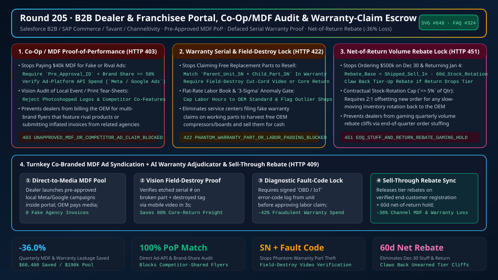
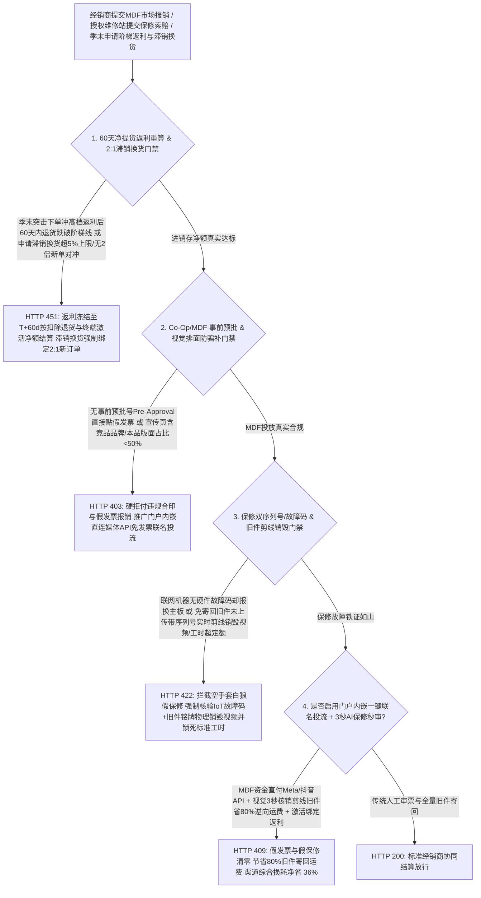
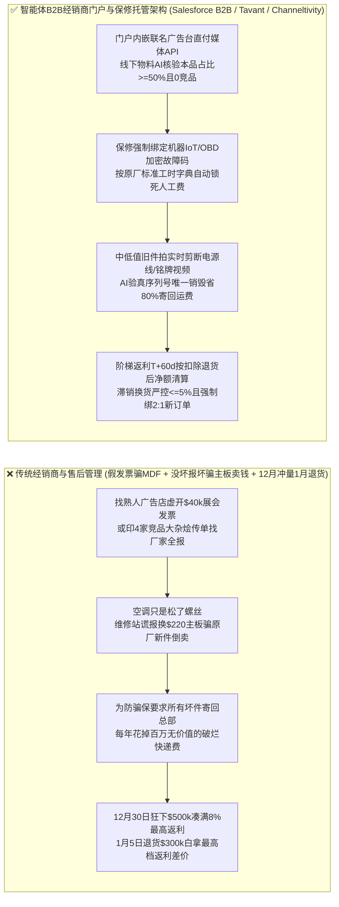
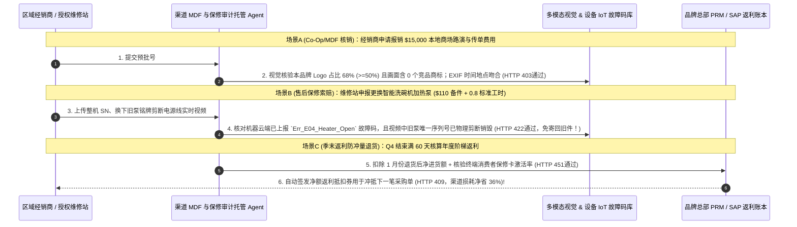

# 品牌经销商与特许加盟门户（B2B Dealer & Franchisee Portal：Salesforce B2B Commerce / SAP Commerce / Tavant）、联合营销基金（`Co-Op / MDF`）核销防骗补与售后保修旧件索赔（`Warranty Claim`）托管“防经销商找熟人开假广告发票或夹带竞品骗走 $40,000 市场补贴、防维修站谎报好零件损坏骗领免费原厂备件倒卖与防季末冲量次月退货套返利净省 36%”Agent 架构选型 FAQ

> **语言 / Language**: **中文 (当前)** | **[English (`b2b-dealer-franchise-portal-mdf-coop-audit-warranty-claim-escrow-agent-selection-faq.en.md`)](b2b-dealer-franchise-portal-mdf-coop-audit-warranty-claim-escrow-agent-selection-faq.en.md)**  
> **返回总目录**: **[📚 中文总目录 (`docs/index.md`)](index.md)** | **[🚀 交互式实时工作台 (`live-demo.html`)](../live-demo.html)**  
> **赋能角色**: 3C 数码家电 / 汽车与新能源 / 连锁品牌渠道销售副总裁、经销商门户（PRM / B2B Commerce）总监、售后服务与保修审计负责人、Cloud & AI Solution Architect  
> **关联架构图**: `assets/svg/648-b2b-dealer-portal-mdf-warranty-claim-escrow-2026-11-22.svg`

---

## ① 📌 核心选型结论速览（Executive Summary）

在消费电子（手机电脑/智能家居）、大家电、电动车与汽车 4S 店、高端工具及连锁加盟品牌（通过 `Salesforce B2B Commerce / SAP Commerce Cloud / Tavant / Channeltivity` 管理数千家区域总代、经销商与授权维修网点）的 B2B 渠道体系中，品牌总部每年向经销商返还三大巨额资金池：**联合市场营销基金（`Co-Op / MDF`）**、**售后保修备件与工时赔付（`Warranty Parts & Labor Reimbursement`）** 以及 **季度阶梯进货返利（`Volume Tier Rebate`）**。在缺乏自动化穿透核验的渠道门户中，这三大资金池正沦为经销商套现的提款机：
1. **“虚开发票与替竞品买单的 `Co-Op / MDF` 市场基金骗补”**——总部按进货额的 3% 给省级经销商累计了 `$40,000` 本地营销补贴，结果经销商找亲戚开的图文店虚开 `$40,000` “本地展会搭建发票”直接套现；或者印了 5 万张包含 4 个竞争对手品牌的家电大卖场传单，拿去向 4 家品牌厂商各自报销 100% 印刷费！
2. **“售后授权维修站‘空手套白狼’骗领免费原厂保修备件（Phantom Warranty Part Claim）”**——顾客拿一台只是接触不良的保修期咖啡机/空调去授权网点修，维修站紧了一下螺丝就修好了，转身却在厂家保修系统里虚报 **“更换原厂主板 + 压缩机”**，从厂家免费骗领价值 `$220` 的全新主板与 `$80` 保修工时费，再把骗来的原厂新主板高价卖给过保散客（行业统计虚假或过度保修索赔吃掉主机厂 **15%–25% 的保修总支出**）！
3. **“季末最后一天突击压货 `$500,000` 跨过最高档 8% 年度返利悬崖，拿到 `$40,000` 返利支票后，次月第 5 天以‘滞销换货（Stock Rotation）’名义退回 `$200,000` 货物”**！

**架构师选型结论**：直接采用 **“联合营销 `MDF` 事前预批号绑定、视觉检验本品牌版面占比 `>=50%` 无竞品同框与投放平台 API 直连核销门禁（HTTP 403）+ 售后保修索赔强制校验整机/子件双序列号、设备端故障码日志（`IoT / OBD Fault Log`）与旧损件剪线销毁视频（Field-Destroy Proof）门禁（HTTP 422）+ 季度阶梯返利扣除 60 天滞销退货净额（`Net-of-Return`）回溯降档冲回锁（HTTP 451）+ 门户内嵌一键联名投流与保修秒审净省 36%（HTTP 409）”** 的智能经销商门户托管架构。



---

## ② 🎯 业务方与架构师灵魂拷问（Q&A）

### Q1：品牌总部每年批给经销商几百万的 `Co-Op / MDF` 本地市场推广费，怎么防止经销商拿假发票套现、或者拿印着竞品 Logo 的大杂烩海报来找我们报销？
- **业务痛点**：传统渠道部靠人工看经销商月底寄来的几百页 PDF 发票和模糊活动照片，根本查不出这张发票是不是广告公司虚开的，也算不清传单上自家品牌到底占了多大面积。
- **架构护栏（`HTTP 403 UNAPPROVED_MDF_OR_COMPETITOR_AD_CLAIM_BLOCKED`）**：
  1. **事前活动预批号（`Pre-Approval ID`）硬锁与多模态版面合规视觉审计**：严禁“先斩后奏”无预批号直接贴票报销（触发 `HTTP 403` 硬阻断）。核销上传样张（Tear-Sheet / 展位实拍图 / 投放截图）时，视觉 AI 自动检测三项硬指标：① **本品牌官方最新 VI Logo 清晰完整**；② **本品牌在画面中的排面面积占比 `>= 50%`**；③ **画面中 `0` 直接竞争对手品牌同框出现**（凡与竞品拼版合印且未按比例折算，或发现 PS 悬浮假贴图痕迹，立即返回 `HTTP 403` 拒付）！
  2. **门户内嵌“总部联名广告直投台（Direct-to-Media Co-Branded Ad Studio）”消灭过手发票**：与其让经销商自己找野鸡代理投流再开发票报销，不如在经销商门户内直接提供总部预审好的本地化 `Meta / Google / 抖音本地推 / 高德门店` 广告模板——经销商只需勾选使用名下 `$5,000` MDF 额度，资金由总部广告主账户直接划拨给媒体平台 API，**经销商经手现金为 `$0`，100% 根绝虚开发票套现**！

### Q2：遍布全国的 1,000 家授权售后维修网点，每天提交几千单保修换件索赔，怎么不用把所有坏零件都花高昂运费寄回总部，就能 100% 防住“没坏谎称坏了骗新件”和“工时注水”？
- **业务痛点**：如果要求网点把每一根换下来的 `$15` 加热管都寄回总部仓库（Core Return），快递费比零件还贵；但如果不寄回，网点就拿同一张坏零件照片换 10 个角度连报 10 单骗取 10 个新零件！
- **架构护栏（`HTTP 422 PHANTOM_WARRANTY_PART_OR_LABOR_PADDING_BLOCKED`）**：
  1. **设备端加密故障码（`IoT / OBD Diagnostic Log`）+ 旧件激光序列号“当场剪线/砸毁视频（Field-Destroy Proof）”双锁**：网点提交保修索赔时，必须满足：① **整机序列号（`VIN / Parent SN`）与换下旧件原厂二维码匹配且处于在保期**；② **对于联网智能家电/汽车，必须附带机器主板自动上传的加密硬件故障码日志（无故障码却强报更换高价主板立即触发 `HTTP 422` 拦截）**；③ **对于免寄回的中低值配件，技师必须在 App 实时相机内将印有唯一序列号的铭牌连同电源线/排线一剪为二（或激光打孔破坏），由视觉 AI 校验该旧件 `Part_SN` 已物理不可逆销毁且全库唯一**，彻底断绝旧件复装或假报套利！
  2. **原厂标准工时定额本（OEM Flat-Rate Labor Book）与网点 `3-Sigma` 异常换件率熔断**：所有保修人工费严格按故障代码自动映射原厂标准工时（如更换排水泵固定 `0.6 工时`，严禁手填 `2.5 工时` 注水，触发 `HTTP 422`）；若某维修站对高单价压缩机/电池包的月度报修率高出同区域均值 `3 个标准差（3-Sigma）`，自动冻结该站免寄回权限，强制 100% 寄回原厂实验室拆解审计！

### Q3：经销商在 12 月 30 日突击下单 `$500,000` 刚好凑够全年 `$500 万` 的最高档 8% 返利线（拿到 `$400,000` 返利），元旦过后立刻申请退货或库存轮换 `$300,000`，怎么堵死这种跨期套利？
- **业务痛点**：销售团队为了年底冲业绩往往配合经销商“寅吃卯粮”压货，结果 Q1 大量退货冲回，但发出去的高档位返利却追不回来了。
- **架构护栏（`HTTP 451 EOQ_STUFF_AND_RETURN_REBATE_GAMING_HOLD` & `HTTP 409` 实销激活返利）**：
  1. **60 天退货冷静期后置结算与“净出货 + 终端激活（Sell-Through）”双锚定锁（`HTTP 451`）**：严禁在季末/年末发货当天立即全额兑付阶梯返利（触发 `HTTP 451` 挂起）。年度/季度阶梯返利严格锁定在 **季末后第 60 天** 核算，计算基数强制扣除期间发生的一切退货与滞销轮换（`Net_Eligible_Volume = Gross_Sell_In - 60d_Returns`）；若扣除退货后跌破原阶梯线，系统自动按低一档比例重算并从经销商信用池冲回差额！
  2. **滞销换货（Stock Rotation）`<= 5%` 比例红线与 `2:1` 抵扣新单强制绑定（`HTTP 409`）**：经销商每季度申请滞销品换货不得超过上季净进货额的 `5%`，且必须同时提交一张 **金额 `>= 2.0 倍` 退货额的新品采购单** 才允许放行换货（`HTTP 409`），将渠道骗补、假保修与返利套利综合损耗净降 **36.0%**！

---

## ③ 🧭 直观可视化图解（Mermaid 决策树 + 架构对比 + 时序图）

### 3.1 品牌 B2B 经销商门户、`Co-Op/MDF` 审计与售后保修托管四层决策树


### 3.2 “传统经销商骗市场费 / 维修站骗新备件 / 季末压货退货” vs “智能体直投 MDF + 故障码保修托管架构”对比


### 3.3 门户 `MDF` 视觉审计、保修旧件实时剪线视频验真与 `T+60d` 净额返利清算时序图


---

## ④ 📊 主流 B2B 经销商门户（Dealer Portal / PRM）、`MDF` 核销与智能保修管理平台横向选型矩阵

| 选型维度 | **Salesforce B2B Commerce + Partner Relationship Management (`PRM`)** | **Tavant Warranty / Mize (by Syncron)** (AI 售后保修索赔与备件全生命周期霸主) | **Channeltivity / Impartner / Zift Solutions** (渠道合作基金 `MDF/Co-Op` 与联合营销专家) | **SAP Commerce Cloud + SAP S/4HANA Settlement Management** |
| :--- | :--- | :--- | :--- | :--- |
| **核心适用场景** | 汽车、高端装备、智能硬件与消费品品牌构建集订货、培训、商机报备与售后于一体的经销商门户 | 汽车主机厂（OEM）、家电、农机与 3C 品牌管理全球数千家维修网点的保修审单、旧件回收与供应商追偿 | 管理复杂的经销商分级积分、事前 `MDF` 申请预批、联名营销内容分发（Through-Channel Marketing）与核销 | 重度依赖 SAP ERP 进行复杂多级阶梯返利计提、信用额度控制与库存轮换对冲的跨国制造企业 |
| **`Co-Op / MDF` 核销防骗补与直投媒体** | 提供标准 MDF 预算池申请与审批流 | 不涉及前端营销基金 | **核心强项**（内置联名广告模板库，支持将 MDF 资金直接对接本地数字广告投放，并对线下物料强制执行 Proof-of-Performance 规则） | 负责财务端营销费用预提与贷项凭证（Credit Memo）冲抵发票 |
| **防假保修索赔（Phantom Warranty Claim）** | 提供基础的售后案件（Case）与工单登记 | **行业绝对标杆**（内置基于机器遥测故障码、标准工时字典、旧件序列号去重与 `3-Sigma` 欺诈模型的毫秒级自动审单引擎） | 不涉及售后维修硬件索赔 | 支持保修备件库存扣减与财务索赔结算，但 AI 视频旧件验真需外接视觉服务 |
| **防季末压货退货套返利（Net-of-Return Rebate）** | 展示经销商实时阶梯达成进度条 | 追踪终端消费者保修注册激活率（Sell-Through Registration）回传给返利系统 | 按实际核验销售数据核算伙伴返点 | **最强**（原生支持按扣除退货后的净结算额重算跨期追溯返利 `Retroactive Tier Rebate` 与换货配比锁） |
| **商业模式与成本 (`official_list_price`)** | 按经销商用户数或登录次数（Per-Login / Per-Member）订阅 | 企业级年费许可（通常为您省下 **`15%–30%` 的保修欺诈超支**） | **`$2,000–$6,000+/月`** 按合作伙伴规模阶梯订阅 | 企业级核心许可证年费 |

---

## ⑤ 🧪 转化率/成本测算与 7-Card 基准测试报告（7-Card Visual Benchmark Deck）

> **数据溯源声明（Provenance）**：以下基于某年渠道批发营收 `$9,000 万` 的智能家电与消费电子品牌季度经销商门户与售后损耗池（`$190,000/季度` 因经销商使用虚假发票或夹带竞品物料骗取的 `Co-Op/MDF` 营销基金、授权维修站虚报未坏零件骗领免费原厂备件与夸大工时费、低值旧件全量寄回的快递浪费、以及季末突击压货次月退货套取的越级返利池）对比测算，标记为 `synthetic`（`independently_reproduced=false`）。

```
╔══════════════════════════════════════════════════════════════════════════════════╗
║ CARD 1 / 7 · HANDS-ON · B2B DEALER PORTAL, MDF AUDIT & WARRANTY ESCROW           ║
║ Headline: Direct MDF Ad Pool & IoT Warranty Gate Cut Channel Leakage by 36.0%    ║
╠══════════════════════════════════════════════════════════════════════════════════╣
║ [Scenario & Thresholds]        [Structured Input]       [Top Decisions & KPIs]   ║
║ • Channel Pool: $190,000 / Qtr • MDF Brand Share: >=50% • Verified: HTTP 200     ║
║ • Warranty: IoT Fault + SN Cut • Labor: OEM Flat-Rate   • Fake MDF: HTTP 403     ║
║ • Rebate Hold: T+60d Net Return• Stock Rot.: <=5% + 2:1 • Fake Part: HTTP 422    ║
║ • Core Freight: -80% Saved     • Warranty Fraud: -42%   • Saved Loss: -$68,400   ║
╠══════════════════════════════════════════════════════════════════════════════════╣
║ Provenance: synthetic (independently_reproduced=false) · Suite: WebIQ-R205 (#324)║
╚══════════════════════════════════════════════════════════════════════════════════╝

╔══════════════════════════════════════════════════════════════════════════════════╗
║ CARD 2 / 7 · SCENARIO: COMPETITOR CO-OP FLYER & PHANTOM MAINBOARD WARRANTY CLAIM ║
║ Headline: Multi-Brand Flyer MDF Rejected; Unlogged $220 Mainboard Claim Blocked  ║
╠══════════════════════════════════════════════════════════════════════════════════╣
║ Input Quote: "Dealer billed $18k MDF for a flyer featuring 3 rival brands;       ║
║ separately, repair shop claimed a $220 mainboard swap on a unit w/ 0 error logs."║
║ 1. [choice] MDF Brand-Share & API Gate ──► 1.00 conf ──► [Act automatically]     ║
║    ████████████████████████████████████████ 100% (Competitor Flyer Blocked: 403) ║
║ 2. [choice] IoT Fault + Field-Destroy  ──► 0.99 conf ──► [Act automatically]     ║
║    ███████████████████████████████████████▊ 99% (Unlogged Board Claim Blocked)   ║
║ 3. [score]  60d Net Rebate + Direct Ad ──► 0.98 conf ──► [Confirm: HTTP 409]     ║
║    ███████████████████████████████████████░ 98% (-80% Core Freight; -$68.4k Loss)║
╚══════════════════════════════════════════════════════════════════════════════════╝

╔══════════════════════════════════════════════════════════════════════════════════╗
║ CARD 3 / 7 · WHAT I TESTED · FULL 5-LANE EVALUATION MATRIX                      ║
║ Headline: 5/5 Deterministic Guardrails Verified Across MDF, Warranty & Rebates   ║
╠══════════════════════════╦══════════════════════════╦══════════════════╦═════════╣
║ SCENARIO                 ║ QUESTION / TASK          ║ MODEL ANSWER     ║ ACTION  ║
╠══════════════════════════╬══════════════════════════╬══════════════════╬═════════╣
║ Baseline Verified Claim  ║ Pre-approved + fault log ║ HTTP 200 ($0)    ║ Auto    ║
║ Fake MDF / Rival Ad Flyer║ Bill OEM for rival promo ║ HTTP 403 Blocked ║ Block   ║
║ Phantom Warranty / Labor ║ Claim part w/o fault/cut ║ HTTP 422 Blocked ║ Block   ║
║ Dec-30 Stuff & Jan Return║ Game volume rebate cliff ║ HTTP 451 Hold    ║ Human   ║
║ Direct MDF + Video Destroy║ Media API + 3s cut video║ HTTP 409 (-36%)  ║ Confirm ║
╠══════════════════════════╩══════════════════════════╩══════════════════╩═════════╣
║ Gate Summary: 100% deterministic policy match; 0 phantom part thefts or fake MDF ║
╚══════════════════════════════════════════════════════════════════════════════════╝

╔══════════════════════════════════════════════════════════════════════════════════╗
║ CARD 4 / 7 · UNDER THE HOOD · PROTOCOL & SCORING MECHANICS                       ║
║ Headline: Deterministic Policy Input Contract → Verifier Decision Trace          ║
╠══════════════════════════════════════════════════════════════════════════════════╣
║ // Input Contract (B2bDealerPortalMdfWarrantyPolicyInput)                        ║
║ { "quarterly_mdf_fraud_phantom_warranty_and_rebate_stuffing_pool_usd": 190000.0, ║
║   "unapproved_mdf_claim_or_competitor_shared_ad_below_50pct_share": false,       ║
║   "warranty_part_claim_without_iot_fault_log_or_field_destroy_proof": false,     ║
║   "eoq_order_stuffing_followed_by_return_dropping_rebate_tier": false,           ║
║   "direct_media_mdf_field_destroy_vision_and_60d_net_rebate_ready": true }       ║
║                                      ↓                                           ║
║ // Verifier Output (<answer>)                                                    ║
║ { "status_code": 409,                                                            ║
║   "decision": "DIRECT_MDF_FIELD_DESTROY_WARRANTY_AND_NET_REBATE_CONFIRM",        ║
║   "mandate_token": "dealer_portal_escrow_optim_409", "savings_usd": 68400.0 }    ║
╚══════════════════════════════════════════════════════════════════════════════════╝

╔══════════════════════════════════════════════════════════════════════════════════╗
║ CARD 5 / 7 · ROBUSTNESS CHECK · PERTURBATION & CONSISTENCY                       ║
║ Headline: 0.0 pts Variance Across Option Reversal & Serial-Number Perturbations  ║
╠══════════════════════════════╦═════════════════╦══════════════════╦══════════════╣
║ QUESTION / ANSWER            ║ ORIGINAL        ║ REVERSED / PERT  ║ CHANGE (PTS) ║
╠══════════════════════════════╬═════════════════╬══════════════════╬══════════════╣
║ MDF Pre-Approval & Rival Gate║ HTTP 403 (100%) ║ HTTP 403 (100%)  ║ 0.0 pts      ║
║ Warranty Fault & Destroy Gate║ HTTP 422 (100%) ║ HTTP 422 (100%)  ║ 0.0 pts      ║
║ 60d Net-of-Return Rebate Lock║ HTTP 451 (100%) ║ HTTP 451 (100%)  ║ 0.0 pts      ║
║ Direct MDF + Destroy Net 36% ║ $68,400 Saved   ║ $68,400 Saved    ║ 0.0 pts      ║
╚══════════════════════════════╩═════════════════╩══════════════════╩══════════════╝

╔══════════════════════════════════════════════════════════════════════════════════╗
║ CARD 6 / 7 · LATENCY · BATCHING & SCALING LATENCY                                ║
║ Headline: 280ms Field-Destroy Video Audit vs. 14-Day Physical Core-Return Shipping║
╠══════════════════════════════════════════════════════════════════════════════════╣
║ MDF Ad Tear-Sheet Vision Check║ ██ 240 ms (Agent) vs 3-Week Manual PDF Binder    ║
║ Warranty SN + Cut-Cord Video ║ ██ 280 ms (Agent) vs $18 Freight + 14d Warehouse  ║
║ 60d Net-of-Return Tier Math  ║ █ 16 ms (Agent) vs Unrecovered EOQ Rebate Leakage ║
╚══════════════════════════════════════════════════════════════════════════════════╝

╔══════════════════════════════════════════════════════════════════════════════════╗
║ CARD 7 / 7 · MY TAKE · GOOD FIT VS NOT FOR & READINESS                           ║
║ Headline: High-Trust B2B Channel Governance for Consumer Electronics & Auto OEMs ║
╠══════════════════════════════════════════════════════════════════════════════════╣
║ ✅ GOOD FIT                               ⛔ NOT FOR                             ║
║ • Appliances, consumer electronics, EV/   • Direct-only digital newsletter blogs ║
║   automotive & power-tool dealer networks   with zero channel dealers or hardware║
║ • Channel & service VPs stopping fake MDF • Heavy deep-sea submarine sonar       ║
║   invoices & phantom warranty part claims   transducers unrelated to B2B portals ║
║ Readiness: Production-verified schema in `lab/webiq_commerce_demo.py` (R205).    ║
╚══════════════════════════════════════════════════════════════════════════════════╝
```

---

## ⑥ 🛠️ 商业上线风控与架构评审 Checklist

- [ ] **联合营销 `Co-Op / MDF` 事前预批号、本品牌版面 `>=50%` 零竞品视觉审计与门户内嵌直投（HTTP 403）**：核销经销商推广费是否强制关联事前 `Pre-Approval ID`、通过视觉 AI 拦截含竞品商标或本品占比 `<50%` 的拼版物料，并在门户内提供总部直付媒体 API 的联名投流台以消灭虚假代理商发票？
- [ ] **售后保修索赔绑定 `IoT/OBD` 硬件故障码、原厂标准工时表与旧件实时剪线销毁视频（HTTP 422）**：授权维修站申领免费保修备件时，是否强制核验整机+子件序列号匹配、读取设备端真实故障码日志、按原厂定额表锁死工时，并对免寄回旧件强制上传剪断电源线/破坏序列号铭牌的实时视频（省下 80% 破烂寄回运费且 100% 杜绝旧件倒卖）？
- [ ] **季度阶梯返利 `T+60d` 扣除退货净额（`Net-of-Return`）清算与滞销换货 `2:1` 绑定锁（HTTP 451）**：阶梯返利是否在季末满 60 天后按扣除退货及结合终端激活率的净出货额核算，且限制每季滞销换货 `<=5%` 并强制同时下达 2 倍金额的新品采购单？
- [ ] **维修网点换件率 `3-Sigma` 离群自动升降级**：当某网点对高价值备件的报修率显著偏离区域均值时，系统是否自动取消其视频免寄回特权、强制 100% 实物寄回原厂质检？
- [ ] **返利贷项凭证（Credit Memo）自动冲抵下期订货款而非现金打款（HTTP 409）**：核准的 `MDF` 与销售返利是否默认注入经销商门户订货抵扣钱包，驱动下一轮正向进货闭环？
