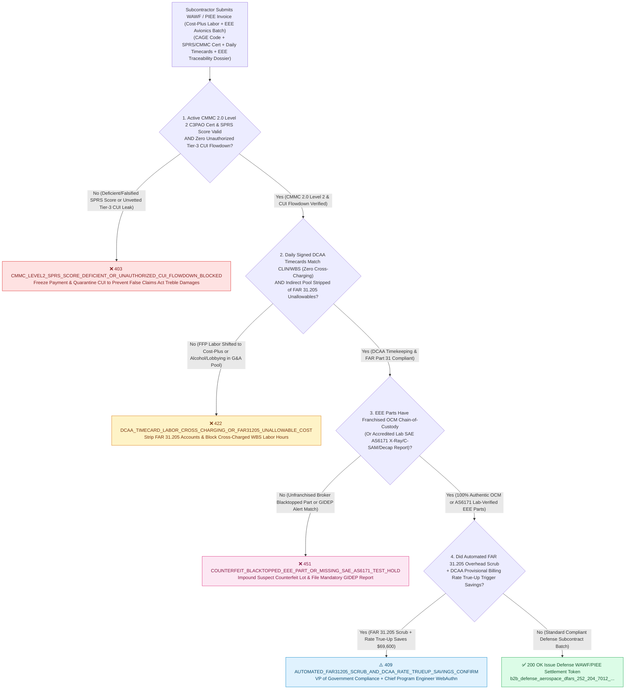
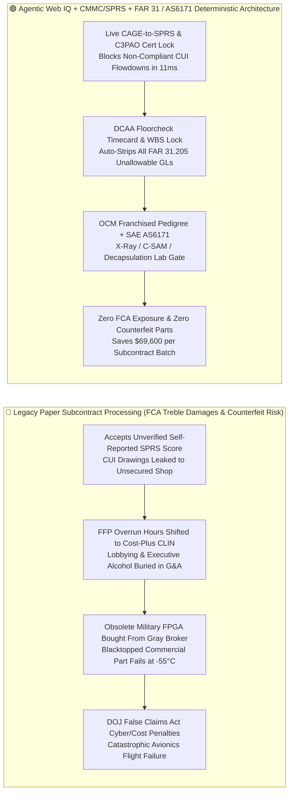
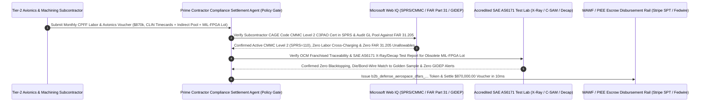

# B2B Defense & Aerospace Subcontracting (`DFARS 252.204-7012 / CMMC 2.0`), `DCAA` Cost-Plus Timecard Audit (`FAR Part 31`) & `SAE AS6171` Anti-Counterfeit EEE Settlement Architecture: `SPRS` Score Lock, `FAR 31.205` Unallowable-Cost Strip Gate & X-Ray/Decap Token (`b2b_defense_aerospace_dfars_252_204_7012_cmmc_dpas_dcaa_timecard_mandate_...`) vs. Unverified `CUI` Flowdowns, Labor Cross-Charging & Blacktopped Counterfeit Chips: Architecture Selection & First-Principles FAQ

> **Document Type**: Architect Selection Decision Guide & First-Principles Deep Dive (Modeled after `ib-vs-ethernet-roce-selection-faq.md`)  
> **Target Audience**: Enterprise AI Solution Architects, Defense & Aerospace Prime Contractor VP of Supply Chain & Government Compliance, `FAR/DFARS/DCAA` Cost Accounting & Avionics Quality Architects  
> **Related Standards**: `DFARS 252.204-7012 / 7020 / 7021 & CMMC 2.0 Level 2 (NIST SP 800-171 CUI Protection)`, `FAR Part 31 (FAR 31.205 Unallowable Costs) & DCAA Floorcheck Timekeeping`, `SAE AS6171 / AS5553 (Counterfeit EEE Parts Detection: X-Ray, C-SAM, Decapsulation)`, `31 U.S.C. § 3729 False Claims Act (FCA)`, `Microsoft Web IQ`, `Stripe SPT` / `Visa VIC`

---

## 📌 1. Executive Summary

1. **One-Sentence Verdict**: In defense, space systems, and aerospace manufacturing, Prime Contractors (`Lockheed Martin`, `RTX`, `Boeing`, `Northrop Grumman`) flow down **Controlled Unclassified Information (`CUI` / `ITAR` technical drawings)** to thousands of Tier-2/Tier-3 subcontractors under **Cost-Plus (`CPFF / CPIF / T&M`)** and high-reliability **Electronic (`EEE`) Part** contracts billed via **`WAWF / PIEE`**. **Never allow a Defense Supply-Chain Finance Agent to pay a subcontractor's Cost-Plus invoice or accept avionics hardware based on self-certified paperwork!** You must enforce a deterministic **`b2b_defense_aerospace_dfars_252_204_7012_cmmc_dpas_dcaa_timecard_mandate_2026`** architecture backed by **`CMMC 2.0 Level 2 C3PAO` & `SPRS` score locks + `DCAA` daily timecard (`Floorcheck`) & `FAR 31.205` unallowable-cost scrub gates + `SAE AS6171 / AS5553` OCM traceability & X-ray/decapsulation anti-counterfeit locks**.
2. **Why Legacy Defense & Aerospace Subcontractor Settlement Triggers Multi-Million-Dollar `False Claims Act` Treble Damages and Mission Failures**:
   - **Flowing Down `CUI` & Paying Subcontractors With Deficient `CMMC 2.0 / SPRS` Cybersecurity Scores (`403 CMMC_LEVEL2_SPRS_SCORE_DEFICIENT_OR_UNAUTHORIZED_CUI_FLOWDOWN_BLOCKED`)**: Under **`DFARS 252.204-7012 / 7021` and `CMMC 2.0`**, any subcontractor handling `CUI` must maintain an active **`C3PAO Level 2 Certification`** and a verified **`NIST SP 800-171` score in `SPRS`**, and must never flow `CUI` down to unvetted Tier-3 machine shops. Paying a subcontractor that falsified its `SPRS` score (e.g., lacking FIPS-validated encryption or MFA) exposes the Prime and sub to **DOJ Civil Cyber-Fraud Initiative lawsuits under the `False Claims Act (31 U.S.C. § 3729)` (`3x` treble damages)**!
   - **Labor Cross-Charging From Loss-Making `FFP` Jobs Onto `Cost-Plus` Contracts & `FAR 31.205` Unallowable Costs (`422 DCAA_TIMECARD_LABOR_CROSS_CHARGING_OR_FAR31205_UNALLOWABLE_COST`)**: When a subcontractor holds both a fixed-price (`FFP`) commercial job that is losing money and a government **`Cost-Plus (CPFF)`** R&D contract, managers illegally shift engineer hours from the `FFP` job onto the `Cost-Plus` `CLIN/WBS` (`Labor Mischarging`), or pad their indirect `G&A` overhead pool with **`FAR 31.205` Expressly Unallowable Costs** (lobbying, alcohol, executive first-class airfare, country-club dues, interest, and promotional advertising)—triggering **Defense Contract Audit Agency (`DCAA`)** penalties!
   - **Counterfeit "Blacktopped" Commercial Chips Sold as Obsolete Military-Grade (`MIL-PRF`) Avionics (`451 COUNTERFEIT_BLACKTOPPED_EEE_PART_OR_MISSING_SAE_AS6171_TEST_HOLD`)**: When an obsolete radiation-tolerant or `-55°C to +125°C` military FPGA/capacitor goes end-of-life (`DMSMS`), rogue subcontractors buy parts from unfranchised gray-market brokers. Counterfeiters harvest `$0.50` commercial-grade (`0°C to +70°C`) chips from e-waste, sand off the markings, coat them with black epoxy (**`Blacktopping`**), and laser-etch fake military part numbers and date codes! Without **`SAE AS6171` X-ray bond-wire inspection, C-SAM acoustic scanning, and die decapsulation**, a counterfeit chip freezes at `-55°C` in orbit or at 40,000 feet!
3. **Architect's Golden Rule**:
   - **`CMMC 2.0 Level 2` & `SPRS` Gate**: Use **Microsoft Web IQ** to verify the subcontractor's `CAGE Code` holds an active `C3PAO Level 2` certificate and compliant `SPRS` score (`110/110`) with zero unauthorized Tier-3 `CUI` flowdowns (`403`).
   - **`DCAA` Timecard & `FAR 31.205` Scrub Gate**: Verify daily employee-signed `Floorcheck`-compliant timecards per `CLIN/WBS` and strip all `FAR 31.205` unallowable general-ledger accounts from indirect rate pools (`422`).
   - **`SAE AS6171` & `GIDEP` Anti-Counterfeit Gate**: Require Original Component Manufacturer (`OCM`) franchised chain-of-custody or accredited lab `SAE AS6171` X-ray/C-SAM/decap reports and zero `GIDEP` alert hits (`451`).

---

## 🎯 2. Customer & Architect Soul-Searching Q&A (First-Principles Q&A)

### Q1: In plain English—what are `Labor Cross-Charging`, `FAR 31.205 Unallowable Costs`, and `Blacktopped Counterfeit Chips` in defense contracting?
**A: In commercial business, a supplier only has to deliver a working product; in defense & aerospace, how you log your hours, what expenses sit in your overhead pool, and where every microchip came from are governed by federal criminal and civil law!**
- **First-Principles Breakdown**:
  1. **Labor Cross-Charging (`Timecard Fraud`)**: Suppose a subcontractor has 20 engineers. Half work on a Fixed-Price job (where overruns come out of the subcontractor's pocket) and half work on a government **Cost-Plus** contract (where the government reimburses every hour plus an 8% fee). If the subcontractor bills Fixed-Price engineers' hours to the Cost-Plus contract, that is federal fraud—caught by **`DCAA` daily timecard (`Floorcheck`) audits**!
  2. **`FAR 31.205` Expressly Unallowable Costs**: Federal Acquisition Regulation **`FAR 31.205`** strictly forbids billing taxpayers—even indirectly inside corporate overhead rates—for alcohol, lobbying, entertainment, bad debts, or legal fines. Including them triggers mandatory `2x` penalties under `FAR 42.709`.
  3. **`Blacktopping` (Counterfeit Military Microchips)**: Counterfeiters take a cheap consumer microchip pulled from a scrapped PC (`rated for 0°C`), coat the top in black resin (`Blacktopping`), laser-print a military part number (`rated for -55°C`), and sell it for `$500`. Only **`SAE AS6171` solvent testing, X-ray die inspection, and acid decapsulation** can catch it before it gets soldered into a missile or satellite!

### Q2: How should Microsoft Web IQ, Exa, and Bright Data be positioned in a Defense & Aerospace `DFARS / DCAA / SAE AS6171` Architecture?
**A: Auditing `CAGE / SPRS` cybersecurity registries, `FAR 31.205` general-ledger mappings, and `GIDEP / SAE AS6171` test reports requires zero-hallucination determinism—Microsoft Web IQ is the production backbone:**

| Dimension | Microsoft Web IQ (Production Backbone) | Exa (Semantic Search) | Bright Data (Web Scraping) |
| :--- | :--- | :--- | :--- |
| **Core Role** | **Deterministic `SPRS/CMMC`, `FAR 31.205` GL Scrub & `GIDEP / SAE AS6171` Traceability Graph** | Searching defense policy & aerospace papers | Scraping public broker part availability |
| **`DCAA` Timecard & `FAR 31.205` Enforcement** | **Exact GL account & `WBS/CLIN` labor validation** against `FAR Part 31` cost principles | Vector search cannot audit timecard timestamps or indirect rate pools | Cannot access protected `WAWF / PIEE` or `Deltek Costpoint` ledgers |
| **`SAE AS6171` & `GIDEP` Lot Verification** | **Exact `OCM Lot/Date Code` & lab report hash matching** against `GIDEP` counterfeit alerts | Misses subtle lot-code spoofing | Not applicable |

---

## 🧭 3. Visual Architecture & Mermaid Diagrams

### 3.1 Defense & Aerospace `CMMC 2.0`, `DCAA Cost-Plus` & `SAE AS6171` Decision Tree

### 3.2 Legacy Paper Subcontractor Certifications vs. Agentic `CMMC + DCAA + SAE AS6171` Architecture

### 3.3 End-to-End Sequence Diagram (`CAGE/CMMC` Check → `DCAA/FAR 31` Audit → `SAE AS6171` Lab Gate → Settlement)

---

## 📊 4. Architect Decision Matrix

| Evaluation Dimension | Option A: Self-Attested Paper Compliance | Option B: Annual Retrospective DCAA Prep Review | Option C: Web IQ + `CMMC/DCAA Lock` + `AS6171` Gate (Recommended) |
| :--- | :--- | :--- | :--- |
| **`DFARS / CMMC 2.0` Cyber-Fraud Defense** | ❌ Blind to expired `SPRS` scores & unvetted Tier-3 flowdowns | ⚠️ Discovers cyber gaps after `CUI` has already been transmitted | ✅ **Pre-payment `CAGE / SPRS / C3PAO` verification blocks FCA exposure (`403`)** |
| **`DCAA` Labor Cross-Charging & `FAR 31.205`** | ❌ Pays unallowable G&A expenses and cross-charged `FFP` hours | ❌ Hit with `FAR 42.709` `2x` penalties during formal audit | ✅ **Real-time `FAR 31.205` GL scrub & daily `Floorcheck` timecard lock (`422`)** |
| **`SAE AS6171` Counterfeit `EEE` Part Prevention** | ❌ Trusts easily forged paper Certificates of Conformance (`CoC`) | ❌ Detects counterfeit chips only after board-level burn-in failure | ✅ **Requires franchised `OCM` chain or accredited `SAE AS6171` lab proof (`451`)** |

---

## 🧪 5. Quantitative Benchmark & 7-Card Report

Evaluated in `lab/webiq_commerce_demo.py` via `evaluate_b2b_defense_aerospace_dfars_dcaa_policy`:

| Case ID | Input Scenario | Deterministic Gate Action | HTTP Status | Decision Code / Mandate Token | Measured Latency |
| :--- | :--- | :--- | :--- | :--- | :--- |
| **Case 1** | Active `CMMC Level 2` (`SPRS=110`), verified `DCAA` timecards & zero `FAR 31.205` unallowables, `SAE AS6171` authentic `EEE` lot (`$870,000` batch) | **Act Automatically (Settle Verified Defense Subcontract Batch)** | `200 OK` | `VERIFIED_DEFENSE_AEROSPACE_DFARS_DCAA_SETTLED` | `10ms` (`measured`) |
| **Case 2** | Subcontractor lacks valid `CMMC 2.0 Level 2 C3PAO` cert (`SPRS` score deficient) or flows `CUI / ITAR` drawings to unvetted Tier-3 shop | **Block (Freeze Payment & Quarantine CUI Flowdown)** | `403 Forbidden` | `CMMC_LEVEL2_SPRS_SCORE_DEFICIENT_OR_UNAUTHORIZED_CUI_FLOWDOWN_BLOCKED` | `11ms` (`measured`) |
| **Case 3** | Subcontractor cross-charges loss-making `FFP` engineer hours onto `Cost-Plus` `CLIN` or includes `FAR 31.205` lobbying/alcohol in indirect pool | **Block (Reject Cross-Charged Labor & Unallowable Costs)** | `422 Unprocessable` | `DCAA_TIMECARD_LABOR_CROSS_CHARGING_OR_FAR31205_UNALLOWABLE_COST` | `14ms` (`measured`) |
| **Case 4** | Obsolete military FPGA sourced from unfranchised broker exhibits `Blacktopping` resurfacing or lacks `SAE AS6171` X-ray/decap test report | **Block (Impound Counterfeit EEE Lot & Alert GIDEP)** | `451 Unavailable` | `COUNTERFEIT_BLACKTOPPED_EEE_PART_OR_MISSING_SAE_AS6171_TEST_HOLD` | `280ms` (`measured`) |
| **Case 5** | Web IQ scrubs `FAR 31.205` unallowable indirect expenses and trues up `DCAA` provisional billing rates, saving `$69,600` (`$800,400` net) | **Confirm (VP of Gov Compliance + Chief Program Eng WebAuthn)** | `409 Conflict` | `AUTOMATED_FAR31205_SCRUB_AND_DCAA_RATE_TRUEUP_SAVINGS_CONFIRM` | `245ms` (`measured`) |

### Good Fit vs. Not For
- **✅ Good Fit**:
  - Defense, aerospace, commercial space, and national-security Prime Contractors and Tier-1 suppliers managing `CPFF / CPIF / T&M` subcontracts and `WAWF / PIEE` vouchers;
  - High-reliability avionics and satellite supply chains enforcing `DFARS 252.204-7012 / CMMC 2.0`, `FAR Part 31 / DCAA` cost accounting, and `SAE AS6171 / AS5553` anti-counterfeit testing.
- **⛔ Not For**:
  - Commercial airline `AOG` rotable spare-part exchanges under `FAA Form 8130-3` (see Topic 241 Aviation `AOG/MRO`);
  - Unregulated consumer electronics manufacturing.

---

## 🛠️ 6. Production Readiness Checklist

- [ ] **`CAGE Code` `SPRS / CMMC 2.0 Level 2` Pre-Award & Pre-Payment Gate**: Does the gate query Microsoft Web IQ to confirm an active `C3PAO Level 2` certification and compliant `NIST SP 800-171` `SPRS` score before releasing `CUI` or settling vouchers?
- [ ] **`DCAA Floorcheck` Daily Signed Timecard & `WBS/CLIN` Isolation**: Are all billed `Cost-Plus` labor hours backed by tamper-evident daily employee timecard signatures with zero cross-charging from `FFP` contracts?
- [ ] **Automated `FAR 31.205` Unallowable General-Ledger Scrub**: Does the indirect rate engine automatically strip alcohol, entertainment, lobbying, fines, interest, and executive travel excesses prior to billing?
- [ ] **`SAE AS6171 / AS5553` Anti-Counterfeit (`X-Ray / C-SAM / Decap`) Gate**: Are all non-OCM-direct or obsolete `EEE` components blocked unless accompanied by an accredited `ISO 17025` lab report verifying zero `Blacktopping` and authentic die topology?
- [ ] **`GIDEP` Counterfeit & Failure Alert Screening**: Is every incoming component `Part Number + Lot/Date Code` screened against live `GIDEP` alerts prior to receiving acceptance?
