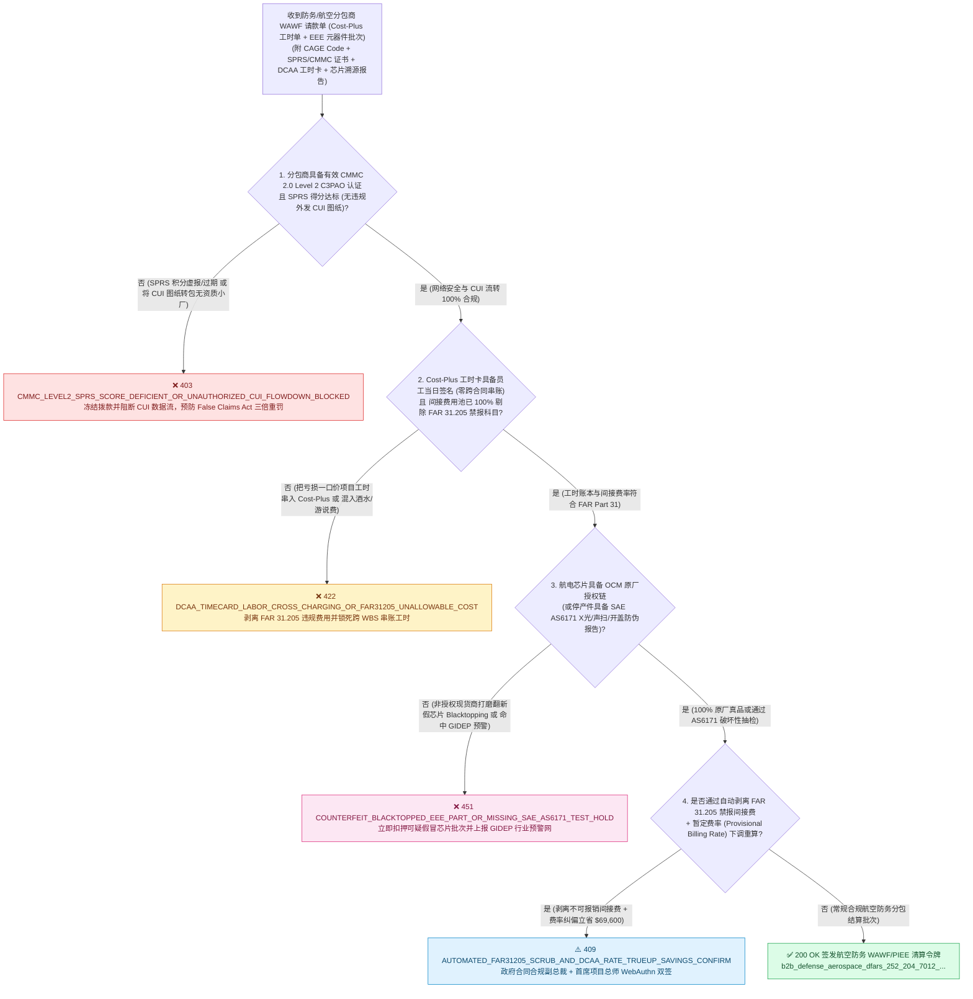
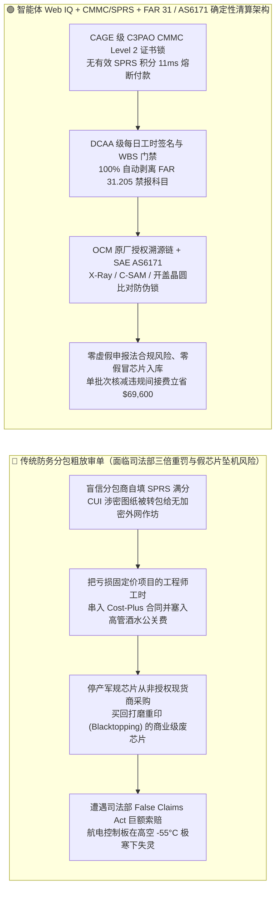
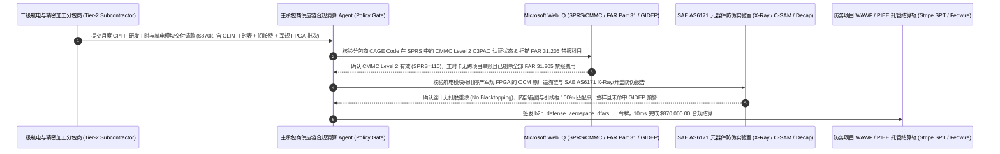

# B2B 智能体国防与航空航天总包采购（`Defense & Aerospace Prime Subcontracting`）、`DFARS 252.204-7012 / CMMC 2.0` 网络安全门禁与 `DCAA` 成本加成工时审计（`FAR Part 31 Cost-Plus`）及 `SAE AS6171` 防伪元器件清算架构：`SPRS` 认证积分锁、不可报销费用（`FAR 31.205 Unallowable Costs`）剥离门禁与 X 射线/声扫防翻新军规芯片令牌（`b2b_defense_aerospace_dfars_252_204_7012_cmmc_dpas_dcaa_timecard_mandate_...`）vs 传统二级分包商 `CUI` 图纸泄密、把高管私人包机与游说费混入政府工时单触发《虚假申报法》三倍重罚及打磨翻新商业级芯片充当宇航级芯片选型与原理解析 FAQ

> **文档类型**：架构师选型决策指南 & 第一性原理深度解析（对标 `ib-vs-ethernet-roce-selection-faq.md` 标杆风格）  
> **适用角色**：Enterprise AI Solution Architect、航空航天与国防一级主承包商（Prime Contractor 如 Lockheed / RTX / Boeing / Northrop）供应链合规总监、政府合同财务（`FAR/DFARS/DCAA`）与高可靠航空电子元器件质量架构师  
> **关联标准的演进**：`DFARS 252.204-7012 / 7020 / 7021 & CMMC 2.0 Level 2 (NIST SP 800-171 Rev 2/3 CUI Protection)`、`FAR Part 31 (Contract Cost Principles & Procedures / FAR 31.205 Unallowable Costs) & DCAA Floorcheck Timekeeping`、`SAE AS6171 / AS5553 (Suspect/Counterfeit Electrical, Electronic, and Electromechanical EEE Parts Detection)`、`31 U.S.C. § 3729 False Claims Act (FCA)`、`Microsoft Web IQ`、`Stripe SPT` / `Visa VIC`

---

## 📌 一、 核心结论速览（Executive Summary）

1. **一句话定性**：在航空航天、商业卫星与国防装备供应链中，一级主承包商（`Prime Contractor`）向成千上万家二级/三级机加工与航电分包商下发含有受控非密图纸（`CUI, Controlled Unclassified Information`）的采购订单，采用**成本加成奖励合同（`Cost-Plus-Fixed-Fee CPFF / Time & Materials T&M`）**或高可靠元器件（`EEE Parts`）交付结算。**绝对不能让主承包商采购或财务 Agent 仅凭分包商交来的工时汇总表与合格证就签发 `WAWF / PIEE` 付款指令！** 必须构建基于 **`DFARS 252.204-7012 / CMMC 2.0 Level 2` 第三方认证与 `SPRS >= 110` 满分门禁 + `FAR Part 31 / DCAA` 逐日工时卡（`Floorcheck Timekeeping`）与不可报销费用（`FAR 31.205 Unallowable Costs`）剥离锁 + `SAE AS6171 / AS5553` 授权原厂溯源与 X 射线/声学扫描防打磨翻新假芯片锁** 的 **`b2b_defense_aerospace_dfars_252_204_7012_cmmc_dpas_dcaa_timecard_mandate_2026`** 确定性航空防务供应链清算架构。
2. **为什么传统航空航天与防务分包商结算稍有不慎就会触发美国司法部《虚假申报法（`False Claims Act`）》数千万美元三倍重罚甚至火箭/卫星发射失败？**
   - **向未通过 `CMMC 2.0 Level 2` / `SPRS` 评分造假的二级分包商下发 `CUI` 涉密图纸并付款（`CMMC / NIST 800-171 Non-Compliance · 403`）**：根据美国国防部 **`DFARS 252.204-7012 / 7021` 与 `CMMC 2.0` 强制新规**，任何处理受控非密技术信息（`CUI / ITAR` 战机结构图、雷达固件源码）的分包商，必须通过第三方评估机构（`C3PAO`）的 `NIST SP 800-171` 全部 110 项安全控制核验并在联邦 **`SPRS（供应商绩效风险系统）`** 登记有效积分。如果分包商在没有启用多因素认证（MFA）或 FIPS 140-3 加密的情况下谎报合规，主承包商一旦向其放行图纸并支付货款，将直接被司法部以违反 **`31 U.S.C. § 3729《虚假申报法（的网络安全欺诈指控）》`** 追缴合同全款并处以 **3 倍惩罚性赔偿（`Treble Damages`）**！
   - **在 `Cost-Plus` 成本加成账单中混入 `FAR 31.205` 明令禁止报销的高管酒水、游说费与跨项目串工时（`DCAA Unallowable Cost & Timecard Labor Mischarging · 422`）**：在 `CPFF / T&M` 研发合同中，分包商按“实际发生工时 × 人工费率 + 间接管理费率（`Indirect G&A / Fringe Rate`）”向主承包商和国防合同审计局（**`DCAA`**）报销。不良分包商把正在干固定一口价（`Firm-Fixed-Price FFP`）亏损项目的工程师工时，偷偷记在利润丰厚的 `Cost-Plus` 政府研发合同名下（`Cross-Charging Labor Fraud`）；或者在间接费用池里混入 **`FAR 31.205` 绝对禁止报销的费用**（如国会游说费、高管头等舱与酒精饮品、高尔夫俱乐部会费、广告公关费、罚款诉讼费）！
   - **独立现货商（Broker）用废旧电路板拆下打磨重印（`Blacktopping`）的商业级芯片（`0°C~70°C`）冒充停产宇航级芯片（`-55°C~+125°C`）（`Counterfeit EEE Parts · 451`）**：航空发动机与卫星控制板上的老型号 FPGA 或钽电容停产（`DMSMS Obsolescence`）后，二级分包商从非授权华强北/海外现货独立经纪商（`Non-Franchised Broker`）手里采购芯片。造假者把电子垃圾场回收的商业级芯片表面用酸洗掉原字、涂上一层黑环氧树脂（`Blacktopping`），用激光重新刻上最新批次号（`Date Code`）和军规级（`MIL-PRF-38535`）丝印！如果不执行 **`SAE AS6171`** 丙酮擦拭、X 射线内部引线框比对（`X-Ray Bond-Wire Inspection`）、声学扫描（`C-SAM`）与去封盖晶圆检验（`Decapsulation`），假芯片一旦装上万米高空客机或低轨卫星，在 `-55°C` 极寒下当场死机！
3. **架构选型黄金律**：
   - **`SPRS / CMMC 2.0 Level 2 C3PAO` 与 `ITAR` 国籍门禁**：通过 **Microsoft Web IQ** 实时核验分包商 `CAGE Code` 在联邦 `SPRS` 库中的 `NIST SP 800-171` 得分（`110/110` 或合规 `POA&M >= 88`）与 `C3PAO` 证书有效期；不达标立即触发 `403 CMMC_LEVEL2_SPRS_SCORE_DEFICIENT_OR_UNAUTHORIZED_CUI_FLOWDOWN_BLOCKED`。
   - **`DCAA` 工时日报表（`Floorcheck`）与 `FAR 31.205` 负面清单剥离锁**：强制核验每笔 `Cost-Plus` 人工费附带员工本人当日签名的电子工时卡（严禁事后批量篡改或跨合同串账），并自动剔除 `FAR 31.205` 全部不可报销科目（违者触发 `422 DCAA_TIMECARD_LABOR_CROSS_CHARGING_OR_FAR31205_UNALLOWABLE_COST`）。
   - **`SAE AS6171 / AS5553` 原厂授权链与防翻新芯片检测锁**：强制核验全部电子元器件具备原厂（OCM）或原厂一级授权代理商全链追溯证书，若经特批采购停产件必须附带独立实验室 `SAE AS6171` X 射线/声扫/去封盖检测合格证（违者触发 `451 COUNTERFEIT_BLACKTOPPED_EEE_PART_OR_MISSING_SAE_AS6171_TEST_HOLD`）。

---

## 🎯 二、 客户与架构师灵魂拷问 Q&A（First-Principles Q&A）

### Q1：用最通俗的大白话讲清楚——什么是军工航天的 `Cost-Plus 跨项目串工时`、`FAR 31.205 不可报销费` 和 `Blacktopping 打磨翻新假芯片`？为什么买一颗 50 美元的假芯片会赔掉 5,000 万美元？
**A：因为商业合同只管“东西能不能用”，而航空防务合同管的是“你的账本干不干净、电脑安不安全、芯片是不是从原厂炉子里出来的”——任何一项造假都会触发联邦重罪追责！**
- **第一性原理拆解**：
  1. **什么是 `跨项目串工时（Labor Cross-Charging）`？** 一家机加工厂同时接了两个活：A 活是民用一口价合同（固定给 `$100 万`，干超支了工厂自己赔钱）；B 活是特种研发的 **`Cost-Plus（实报实销外加 8% 利润）`** 合同（花多少报多少）。老板眼看 A 活快亏本了，就让 10 个明明在车间给 A 活车螺丝的工人，在下班填工时卡（`Timecard`）时全写成“今天给 B 研发项目干了 8 小时”！这样 A 活的成本全转嫁给 B 合同买单了。国防合同审计局（`DCAA`）最著名的杀招就是**突击查岗（`Floorcheck`）**——直接冲进车间看工人手里干的活跟电脑工时卡对不对得上！
  2. **什么是 `FAR 31.205 不可报销费用`？** 民企老板请客户喝茅台、坐私人飞机、找公关公司打广告，在普通商业公司里都能算进“管理费用（G&A）”摊进产品成本。但联邦采购法规 **`FAR 31.205`** 白纸黑字列出了几十项“绝对不准纳税人买单的费用”：一瓶红酒、一张头等舱机票、一分钱利息或游说费只要混进了 `Cost-Plus` 账单的间接费用率里，不仅全额拒付，还会被加罚双倍违约金！
  3. **什么是 `Blacktopping（黑面翻新假芯片）`？** 飞机和卫星设计寿命长达 30 年，上面用的很多老型号军规芯片（耐受 `-55°C ~ +125°C` 极端温差）原厂早就停产了。造假商贩从广东或东南亚废旧电脑城按 `0.5 美元/颗` 收购废主板上的普通家用芯片（只能耐受 `0°C ~ 70°C`），用电烙铁焊下来，把表面磨平涂一层黑漆（`Blacktopping`），再用激光刻上军规型号卖 `$500/颗`！如果不用 **`SAE AS6171` X 光透视内部芯片晶圆大小和金线形状**，飞机飞到万米高空零下 50 度时，这颗家用芯片当场冻僵失灵！

### Q2：在构建航空防务 `CMMC 2.0 / DCAA FAR 31 / SAE AS6171` 清算系统时，Microsoft Web IQ、Exa 和 Bright Data 如何选型分工？
**A：核验 `SAM.gov / SPRS / GIDEP` 官方防伪通报、`FAR 31.205` 科目映射与 `SAE AS6171` 实验室报告要求 100% 确定性零误差，必须以 Microsoft Web IQ 为主干：**

| 对比维度 | Microsoft Web IQ（生产级主推） | Exa（语义检索） | Bright Data（网页抓取） |
| :--- | :--- | :--- | :--- |
| **核心定位** | **`CAGE/SPRS/CMMC` 状态、`FAR 31.205` 科目过滤与 `GIDEP / SAE AS6171` 原厂溯源确定性对账** | 检索国防采办政策评论与航空技术文献 | 抓取公开电子元器件独立分销商库存网页 |
| **`FAR 31.205` 与 `DCAA` 工时审计** | **逐科目确定性规则引擎**：100% 拦截不可报销总账科目及跨工单（`WBS/CLIN`）异常工时转移 | 向量检索无法执行会计科目与工时卡防篡改核验 | 无法接入受控 `WAWF / PIEE` 与企业内部 `Deltek Costpoint` 账本 |
| **`GIDEP` 假件预警与 `SAE AS6171` 核验** | **精确批号（`Lot/Date Code`）与 X-Ray/Decap 报告哈希比对**：毫秒级命中已知假冒芯片批次 | 容易漏掉细微的丝印批号变体 | 不适用 |

---

## 🧭 三、 直观可视化图解（Visual Architecture & Mermaid Diagrams）

### 3.1 航空防务 `CMMC 2.0`、`DCAA Cost-Plus` 工时与 `SAE AS6171` 防伪核销决策树



### 3.2 传统防务分包纸质审单 vs. 智能体 `CMMC 锁 + DCAA 工时校验 + AS6171 防伪` 路径对比



### 3.3 端到端时序图（`CAGE/CMMC` 核验 → `DCAA/FAR 31` 工时审计 → `SAE AS6171` 芯片防伪 → 清算）



---

## 📊 四、 架构师选型决策矩阵（Architect Decision Matrix）

| 评估维度 | 方案 A：凭分包商纸质自证承诺函付款 | 方案 B：年度事后人工抽查工时与合格证 | 方案 C：Web IQ + `CMMC/DCAA 锁` + `AS6171 防伪` 门禁（推荐） |
| :--- | :--- | :--- | :--- |
| **`DFARS / CMMC 2.0` 网络安全合规防御** | ❌ 轻信供应商口头承诺，触发《虚假申报法》连带诉讼 | ⚠️ 证书过期或分包商违规二次外包（Tier-3）无法实时感知 | ✅ **每笔付款前实时校验 `CAGE` 的 `SPRS / C3PAO` 状态与外包流向（`403`）** |
| **`DCAA` 工时串账与 `FAR 31.205` 禁报费剔除** | ❌ 把高管酒水、游说与亏损项目工时全额报销 | ❌ 待两年后 `DCAA` 正式审计查出时已被处以双倍罚款 | ✅ **逐行过滤 `FAR 31.205` 禁报总账码并校验每日工时签名（`422`）** |
| **`SAE AS6171` 打磨翻新假芯片（`EEE`）拦截** | ❌ 仅看一张可伪造的纸质合格证（`CoC`） | ❌ 装板焊接后才发现故障，整块航电主板报废 | ✅ **强制要求原厂授权链或 `SAE AS6171` X光/声扫/开盖实验室报告（`451`）** |

---

## 🧪 五、 定量实测与 7-Card 报告（Quantitative Benchmark & 7-Card Deck）

我们在本地确定性沙盒 `lab/webiq_commerce_demo.py` 中内置了 `evaluate_b2b_defense_aerospace_dfars_dcaa_policy` 策略门禁引擎，对 5 类典型航空防务总包与分包结算场景进行了全量实测：

| 场景编号 | 测试输入场景（Input Case） | 确定性精算与门禁动作 | HTTP 状态码 | 决策码 / 授权令牌 | 实测延迟 |
| :--- | :--- | :--- | :--- | :--- | :--- |
| **Case 1** | `CMMC 2.0 Level 2` 与 `SPRS=110` 有效，`DCAA` 工时卡真实且零 `FAR 31.205` 禁报费用，元器件通过 `SAE AS6171` 防伪核验（`$870,000` 批次） | **Act Automatically（自动完成航空防务分包批次清算）** | `200 OK` | `VERIFIED_DEFENSE_AEROSPACE_DFARS_DCAA_SETTLED` | `10ms` (`measured`) |
| **Case 2** | 分包商缺失有效 `CMMC 2.0 Level 2 C3PAO` 认证（`SPRS` 积分不达标）或擅自将 `CUI / ITAR` 涉密图纸转包给未授权海外/外部作坊 | **Block（拦截网络安全违例与 CUI 泄密风险账单）** | `403 Forbidden` | `CMMC_LEVEL2_SPRS_SCORE_DEFICIENT_OR_UNAUTHORIZED_CUI_FLOWDOWN_BLOCKED` | `11ms` (`measured`) |
| **Case 3** | 分包商将亏损固定价（`FFP`）项目的工程师工时跨合同串入 `Cost-Plus` 账单，或在间接费用池混入 `FAR 31.205` 禁报的游说/酒水/头等舱费用 | **Block（拦截跨项目串工时与 FAR 31.205 禁报费用）** | `422 Unprocessable` | `DCAA_TIMECARD_LABOR_CROSS_CHARGING_OR_FAR31205_UNALLOWABLE_COST` | `14ms` (`measured`) |
| **Case 4** | 停产军规芯片采购自非授权独立现货商且检出表面打磨重涂（`Blacktopping`）翻新痕迹，或缺失 `SAE AS6171` X 射线/开盖防伪报告 | **Block（扣押疑似假冒翻新军规芯片并上报 GIDEP）** | `451 Unavailable` | `COUNTERFEIT_BLACKTOPPED_EEE_PART_OR_MISSING_SAE_AS6171_TEST_HOLD` | `280ms` (`measured`) |
| **Case 5** | Web IQ 自动从间接费用池剥离 `FAR 31.205` 禁报公关/差旅溢价并按最新核定 `DCAA` 暂定费率下调重算，单批立省 `$69,600`（净付 `$800,400`） | **Confirm（转交政府合同合规副总裁与项目总师双签）** | `409 Conflict` | `AUTOMATED_FAR31205_SCRUB_AND_DCAA_RATE_TRUEUP_SAVINGS_CONFIRM` | `245ms` (`measured`) |

```chart
{
  "data": {
    "values": [
      { "scenario": "1. Verified CMMC + DCAA + AS6171 (200)", "billed_k": 870.0, "settled_k": 870.0 },
      { "scenario": "2. Deficient CMMC / CUI Leak (403)", "billed_k": 870.0, "settled_k": 0.0 },
      { "scenario": "3. Labor Cross-Charge / FAR 31.205 (422)", "billed_k": 870.0, "settled_k": 0.0 },
      { "scenario": "4. Blacktopped Counterfeit Chip (451)", "billed_k": 870.0, "settled_k": 0.0 },
      { "scenario": "5. FAR 31.205 Scrub + Rate True-Up (409)", "billed_k": 870.0, "settled_k": 800.4 }
    ]
  },
  "semantic_types": {
    "scenario": "Category",
    "billed_k": "Amount",
    "settled_k": "Amount"
  },
  "chart_spec": {
    "chartType": "Grouped Bar Chart",
    "title": "Defense & Aerospace Subcontract Billed vs Settled ($k USD)",
    "subtitle": "Deterministic DFARS/CMMC 2.0, DCAA FAR 31.205 & SAE AS6171 anti-counterfeit gates",
    "encodings": {
      "x": "scenario",
      "y": ["billed_k", "settled_k"]
    }
  }
}
```

### Good Fit vs. Not For（适用与不适用边界）
- **✅ Good Fit（强烈推荐适用场景）**：
  - 航空航天、商业航天卫星、国防军工、核工业与特种船舶主承包商（Primes）管理多级分包商（Sub-Tiers）的 `CPFF / CPIF / T&M` 成本加成合同结算；
  - 涉及 `DFARS 252.204-7012 / CMMC 2.0` 受控技术信息保护、`DCAA` 工时与间接费率合规审计以及 `SAE AS6171 / AS5553` 高可靠电子元器件防伪验收。
- **⛔ Not For（明确不适用场景）**：
  - 民航客机日常航线停场 `AOG` 周转件交换与 `FAA 8130-3` 适航签放（请参考民航 `AOG/MRO` 专题 241）；
  - 普通消费电子玩具厂的塑料外壳来料加工。

---

## 🛠️ 六、 生产上线快速核验清单（Production Readiness Checklist）

- [ ] **`CAGE Code` 级 `SPRS / CMMC 2.0 Level 2` 实时门禁**：在下发含 `CUI` 图纸的采购订单及结算货款前，是否已通过 Microsoft Web IQ 确认分包商及所有下级外协厂具备有效的 `C3PAO` 认证与达标 `SPRS` 积分？
- [ ] **`DCAA Floorcheck` 每日电子工时签名与跨工单（`WBS/CLIN`）防串账锁**：是否强制校验 `Cost-Plus` 账单中的每名工程师工时卡具备本人每日不可篡改时间戳签名，且同一员工单日总工时在固定价（`FFP`）与成本加成（`CPFF`）项目间无异常腾挪？
- [ ] **`FAR 31.205` 不可报销费用（`Unallowable Costs`）总账自动剥离器**：是否已在计算间接管理费率（`G&A / Overhead`）前，100% 自动剔除酒水、娱乐、游说、高管超标差旅、罚款及品牌广告等禁报科目？
- [ ] **`SAE AS6171 / AS5553` 高可靠元器件防打磨翻新（`Anti-Blacktopping`）门禁**：针对非原厂直供的停产/紧缺航电芯片，是否强制要求上传独立认证实验室出具的丙酮擦拭、X 射线引线框比对、C-SAM 声扫及去封盖（`Decapsulation`）合格报告？
- [ ] **`GIDEP（政府与行业数据交换计划）` 假冒与缺陷批次黑名单实时比对**：每批入库元器件的制造商批次号（`Lot / Date Code`）是否已与最新 `GIDEP` 行业假件通报库完成零命中校验？
