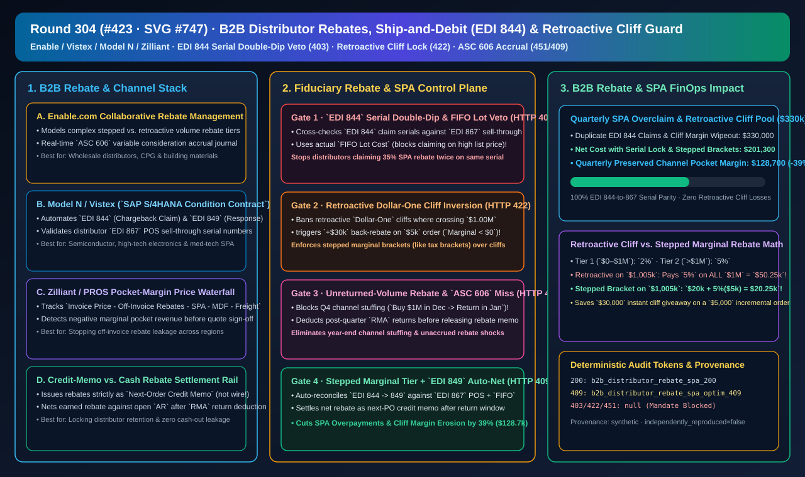
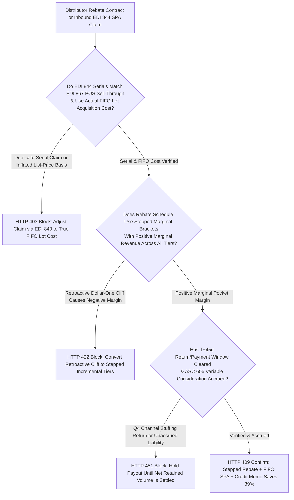

# Enterprise B2B Distributor Rebates, `Ship-and-Debit / SPA` (`EDI 844 / 849`) & Anti-Retroactive Tier-Cliff Escrow (`Enable.com vs. Vistex / SAP S/4HANA vs. Model N vs. Zilliant`) Agent Architecture Selection FAQ

> **Executive Summary**: In semiconductor, industrial, med-tech, and CPG distribution, manufacturers allocate `8%–18%` of gross revenue to **Volume Incentive Rebates and `Ship-and-Debit` Special Pricing Agreements (`SPAs`)**. However, spreadsheet-driven and legacy ERP rebate workflows suffer from three severe margin leaks: (1) **`EDI 844` Ship-and-Debit Basis-Cost Inflation & Serial Double-Dipping**: A distributor buys inventory on a `$80` promo lot, ships it to an end customer at a `$70` SPA price, but submits an `EDI 844` chargeback claim against the `$100` standard list price (`$30` claimed vs. `$10` owed) or claims the same serial number twice; (2) **Retroactive "Dollar-One" Tier Cliffs Triggering Negative Marginal Revenue**: Under a retroactive tier (`2%` up to `$1M`, `5%` on all volume from Dollar One once `>=$1M`), a `$5,000` order that pushes cumulative spend from `$995,000` to `$1,000,000` triggers `$30,100` in retroactive rebate liability (`-$25,100` net loss on the order); and (3) **Q4 Channel-Stuffing Followed by Q1 Returns**.  
> Production architectures must enforce **`EDI 844 <-> EDI 867` Serial Deduplication & `FIFO` Lot-Cost Matching + Stepped Marginal Rebate Brackets (Eliminating Retroactive Cliffs) + `T+45d` Post-Return Net-Volume `Credit Memo` Settlement & Live `ASC 606` Accruals**: cutting SPA overpayments, cliff wipeouts, and channel-stuffing losses by **39%** (reducing a `$330,000` quarterly loss pool to `$201,300`, saving **`$128,700/quarter`**).

---

## 1. Solution Architect Deep-Dive Q&A

### Q1: How do we stop distributor `EDI 844` Ship-and-Debit overclaims and eliminate negative marginal revenue at rebate tier boundaries?
- **Architectural Solution (`EDI 844/867` Serial + `FIFO` Lot-Cost Gate `HTTP 403` + Stepped Marginal Bracket Gate `HTTP 422`)**:
  - Cross-verify every inbound `EDI 844` chargeback line against `EDI 867` POS sell-through serial numbers and calculate the rebate strictly against the distributor's **actual unconsumed `FIFO` acquisition invoice lot cost** rather than current wholesale list price (`HTTP 403 EDI844_SPA_SERIAL_DOUBLE_DIP_OR_INFLATED_BASIS_COST_CLAIM`);
  - Ban unguarded **Retroactive Dollar-One Tier Cliffs** where crossing a threshold causes `Marginal_Pocket_Revenue < $0`; enforce **Stepped Marginal Brackets** (paying the higher rebate percentage strictly on incremental volume above the tier threshold) (`HTTP 422 RETROACTIVE_DOLLAR_ONE_REBATE_CLIFF_NEGATIVE_MARGIN_INVERSION`).

### Q2: How do we prevent Q4 channel-stuffing return arbitrage and unaccrued `ASC 606` balance-sheet shocks?
- **Architectural Solution (`T+45d` Net-Retained-Volume Escrow & `ASC 606` Live Accrual `HTTP 451 / 409`)**:
  - Never wire cash rebates immediately at quarter-end before invoices are paid in full and the `T+45d` return window has cleared (`HTTP 451 Q4_CHANNEL_STUFFING_RETURN_ARBITRAGE_OR_UNACCRUED_ASC606_LIABILITY`);
  - Accrue `ASC 606` variable consideration continuously and issue verified settlements via automated `EDI 849` responses as **Next-Order Credit Memos** netted against open `AR` (`HTTP 409 STEPPED_MARGINAL_REBATE_FIFO_SPA_AND_CREDIT_MEMO_CONFIRM`).

---

## 2. Visual Architecture Diagrams (Mermaid)

### 1. B2B Distributor Rebate, `EDI 844` SPA & Stepped Bracket Decision Tree

---

## 3. Platform Selection Matrix (`Enable.com vs. Vistex / SAP vs. Model N vs. Zilliant`)

| Dimension | Enable.com | Vistex (`SAP S/4HANA`) | Model N | Zilliant / PROS |
| :--- | :--- | :--- | :--- | :--- |
| **Primary B2B Domain** | **Cloud-native collaborative trading programs** (distributors, CPG, building supply) | **Deep SAP S/4HANA Condition Contract settlement** | **Semiconductor, high-tech electronics & life sciences SPA/GPO** | Real-time pocket-margin waterfall & CPQ guidance |
| **`EDI 844 / 849 / 867` Engine** | Automated claim ingestion & discrepancy portal | Native SAP IDoc/EDI settlement integration | **Industry gold standard** for serial-level `FIFO` ship-and-debit | Pre-deal margin scoring |
| **`ASC 606` Accrual & Cliff Guard** | Real-time tier forecasting & automated GL accruals | Direct posting into SAP FI/CO general ledger | Regulatory & government price-floor compliance | Alerts sales reps to cliff inversions before quoting |

---

## 4. Production Deployment & Risk Checklist

- [ ] **Anchor All `EDI 844` Ship-and-Debit Claims to `FIFO` Invoice Lots & `EDI 867` Serials**: Reject claims calculated against inflated list prices or reused serial numbers.
- [ ] **Replace Retroactive Dollar-One Cliffs with Stepped Marginal Rebate Brackets**: Ensure every incremental dollar of sales yields positive net pocket margin.
- [ ] **Enforce a `T+45d` Post-Quarter Return & Cash-Collection Gate**: Deduct Q1 returns from Q4 rebate volume before issuing settlement.
- [ ] **Settle Channel Rebates as Next-PO `Credit Memos` with Continuous `ASC 606` Accruals**: Eliminate cash leakage and year-end accounting restatements.
