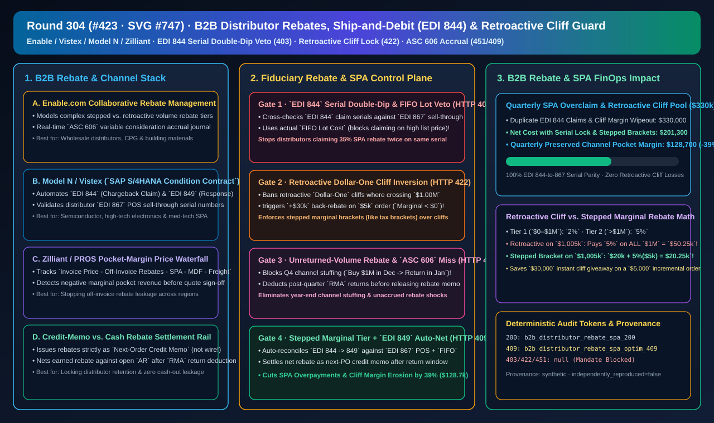
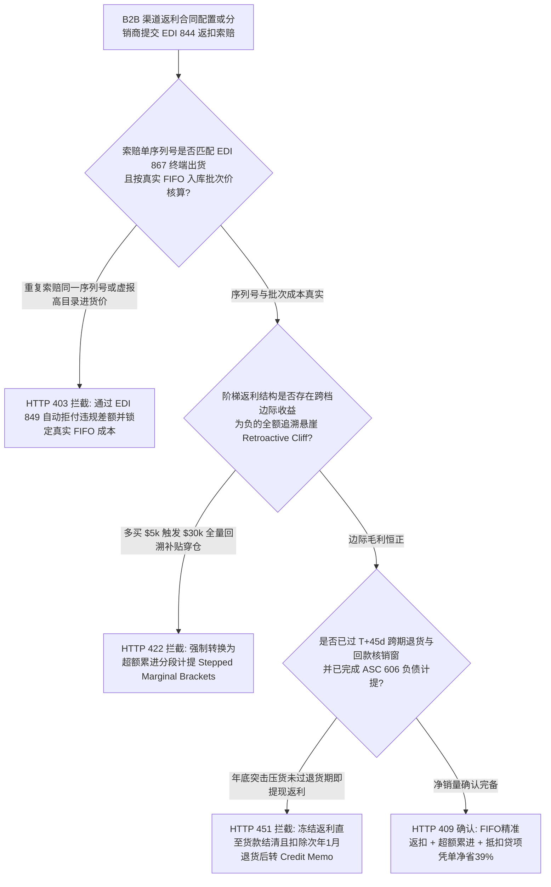
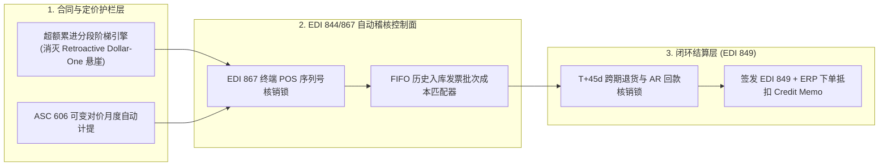

# 企业 B2B 渠道分销返利管理、出货返扣（`Ship-and-Debit / SPA`: `EDI 844 / 849`）与防全额追溯返利悬崖穿仓（`Enable.com vs. Vistex / SAP S/4HANA vs. Model N vs. Zilliant`）托管 Agent 架构选型 FAQ

> **核心选型结论速览**：在半导体电子、工业电气、医疗器械、建材与快消品（CPG）的 B2B 分销体系中，制造商（Vendor）每年将总营收的 `8%–18%` 用于向一级分销商（如 Arrow、Avnet、Wesco、McKesson）发放 **年度销量阶梯返利（Volume Rebates）与特价出货返扣（`Ship-and-Debit / Special Pricing Agreement SPA`）**。然而用电子表格或粗放 ERP 规则管理渠道返利常遭遇三大毛利失血事故：① **“`EDI 844` 出货返扣（Ship-and-Debit）虚报高进货价与同一序列号重复申领补贴”**：分销商按 `$65` 促销批次价进的货，向原厂提交 `EDI 844` 索赔时却声称自己当初是按 `$100` 标准批发价进的货，骗取多出 `$35/件` 的差价补贴；或拿同一批 `EDI 867` 出货序列号重复提交两次索赔；② **“全额追溯第 1 美元阶梯悬崖（Retroactive Dollar-One Tier Cliff）引发边际营收变负数”**：合同写成“年进货 `< $100 万` 返利 `2%`，`>= $100 万` 全年全额追溯返利 `5%`”——当分销商在 12 月 31 日已经买了 `$99.5 万`，再多下一笔 `$5,000` 订单跨过 `$100 万` 门槛时，原厂竟然要对前面已经卖出的 `$99.5 万` 补发 `3%（$30,000）` 追溯返利，导致这笔 `$5,000` 订单直接净亏 **`-$25,000`**！③ **“年底压货冲高阶返利、次年 1 月大额退货（Channel Stuffing & Return Arbitrage）”**。  
> 生产级架构必须实施 **“`EDI 844 <-> EDI 867` 序列号唯一核销锁与 `FIFO` 真实批次进货成本锚定 + 超额累进分段阶梯（`Stepped Marginal Brackets`）替代全额追溯悬崖 + 扣除跨期退货后的下期抵扣贷项凭单（`Next-PO Credit Memo`）与 `ASC 606` 实时计提控制面”**：可将渠道特价骗补、阶梯悬崖倒挂与年底冲量退货损失削减 **39%**（以季度 `$330,000` 返利多付、SPA 虚报与悬崖穿仓损耗池计，净成本降至 `$201,300`，每季度净节省 **`$128,700`**）。



---

## 一、 业务方与架构师灵魂拷问（Q&A）

### Q1：什么是 B2B 分销里的“先出货后返扣（`Ship-and-Debit / SPA`）”？为什么分销商发来的 `EDI 844` 索赔单里藏着高达 15% 的水分？
- **`Ship-and-Debit` 的商业逻辑与三大套利漏洞**：
  - 分销商先按标准目录批发价（如 `$100`）把芯片/医疗耗材买进自己仓库；当遇到某终端大医院或大工厂招标时，原厂批准分销商以 `$70` 特价出货给该终端客户，事后分销商发 **`EDI 844 (Product Transfer Account Adjustment)`** 向原厂索要每件 `$30` 的补贴差额；
  - **漏洞 1（高报历史采购成本）**：分销商仓库里有两批货，一批是 `$100` 买的，一批是上月 `$80` 特价促销买的；分销商出货后一律按最高的 `$100` 历史价向原厂索赔 `$30`（实际只该赔 `$10`）！
  - **漏洞 2（假终端或重复索赔）**：未核验 `EDI 867（分销商终端出货报告）` 中的硬件序列号（Serial/Lot）与终端客户 `DUNS` 签收证明，同一序列号被索赔两次。
- **架构解法（`EDI 844 <-> EDI 867` 序列号一对一核销锁 + `FIFO` 真实入库批次成本锚定门禁 `HTTP 403`）**：
  - 严禁按分销商自报的目录最高价核算 `Ship-and-Debit` 补贴；
  - 索赔引擎强制关联原厂发往该分销商的 **`FIFO` 真实未核销入库发票批次成本（Actual FIFO Acquisition Cost）**，并校验 `EDI 844` 索赔行中的每一个 `Serial / Lot Number` 与 `SPA` 授权合同号及 `EDI 867` 终端交货记录唯一匹配；凡发现重复索赔序列号或虚报采购基准价的，立即通过 `EDI 849` 自动拒付部分差额（触发 `HTTP 403 EDI844_SPA_SERIAL_DOUBLE_DIP_OR_INFLATED_BASIS_COST_CLAIM`）。

### Q2：为什么说“全额追溯阶梯返利（Retroactive Dollar-One Tier Rebate）”是 B2B 定价里最危险的财务炸弹？
- **“跨过门槛多卖 $1，倒赔 $30,000”的数学灾难**：
  - 假设返利条款写着：`0–$1,000,000` 返 `2%`；达到 `$1,000,000` 及以上，**从第 1 美元起全额按 `5%` 返利（Retroactive to Dollar One）**；
  - 当客户买到 `$995,000` 时，应得返利为 `$19,900`；此时客户只需再下一笔 **`$5,000`** 的小订单凑够 `$1,000,000`，应得返利瞬间跳升至 **`$50,000`**！为了多卖这 `$5,000` 的货，原厂要倒贴 **`$30,100`** 返利，边际利润率高达 **`-502%`**！更糟的是，精明的采购 Agent 会专门卡在 12 月底凑单跨线套利。
- **架构解法（强制采用个人所得税式“超额累进分段返利 `Stepped Marginal Brackets`”或平滑斜率门禁 `HTTP 422`）**：
  - 在合同与报价生成阶段，控制面强制校验每一档阶梯边界的 **边际净口袋营收（Marginal Pocket Revenue）`> 0`**；
  - 将全额追溯悬崖重构为 **超额累进分段计算（Stepped / Incremental Tiers）**：前 `$100 万` 固定按 `2%` 算，仅对 **超出 `$100 万` 的增量部分** 给 `5%`（或 `7%`）高比例激励！凡在合同配置或自动批价中出现跨档边际收益为负的全额追溯悬崖的，立即触发 `HTTP 422 RETROACTIVE_DOLLAR_ONE_REBATE_CLIFF_NEGATIVE_MARGIN_INVERSION` 拦截。

### Q3：如何防范经销商“12 月 28 日突击刷单 `$50 万` 拿到最高档返利现金，次年 1 月 10 日把货退回来”？
- **架构解法（跨期退货净销量锁定 + `ASC 606` 月度计提 + 仅发下期抵扣贷项凭单 `Credit Memo` `HTTP 451 / 409`）**：
  - 严禁在季度/年度结束当周立即以银行电汇（Cash Wire）发放阶梯返利，也严禁漏做 `ASC 606` 月度预计返利负债计提；
  - 所有年度/季度返利必须设立 **`T+45d` 跨期退货与回款结算冷静期**（仅对“已实际回款 Paid-in-Full 且扣除跨期 `RMA` 退货后的净保留销量 Net Retained Volume”核算返利），且统一以 **下一笔采购订单抵扣贷项凭单（`Next-Order Credit Memo`）** 形式发放（凡在退货期与回款核销前提前发放现金返利导致压货骗返的，触发 `HTTP 451 Q4_CHANNEL_STUFFING_RETURN_ARBITRAGE_OR_UNACCRUED_ASC606_LIABILITY`；序列号 `FIFO` 核销 + 超额累进分段 + 自动生成 `EDI 849` 贷项凭单确认返回 `HTTP 409 STEPPED_MARGINAL_REBATE_FIFO_SPA_AND_CREDIT_MEMO_CONFIRM`）。

---

## 二、 直观可视化图解（Mermaid 决策树 + 架构图 + 时序图）

### 1. 企业 B2B 分销返利、出货返扣（`EDI 844/849`）与防悬崖穿仓决策树


### 2. B2B 渠道返利与 `Ship-and-Debit`（`Enable / Vistex / Model N`）端到端清算架构图


### 3. 分销商提交 `EDI 844` 出货返扣索赔、系统按 `FIFO` 批次核减并签发 `EDI 849` 贷项凭单时序图
```mermaid
sequenceDiagram
    autonumber
    participant DIST as 一级分销商 (Distributor)
    participant AG as B2B 返利与 SPA 稽核 Agent
    participant ERP as 原厂 ERP / Vistex / Enable
    participant END as 终端客户 (Verified DUNS)

    DIST->>END: 1. 按特批价 $70 出货 1,000 颗芯片并上报 EDI 867 POS 序列号清单
    DIST->>AG: 2. 发送 EDI 844 索赔单: 声称原采购价 $100，申请每颗补贴 $30 (共 $30,000)
    AG->>ERP: 3. 核验序列号唯一性通过，但查出 FIFO 真实入库批次中 400 颗系 $85 促销价购入!
    AG->>AG: 4. 自动修正补贴基数: 600×($100-$70) + 400×($85-$70) = $24,000 (当场拦下 $6,000 虚报!)
    AG->>DIST: 5. 自动回传 EDI 849 (批复 $24,000，附明细调整码) 并生成下期订单抵扣 Credit Memo (HTTP 409)!
```

---

## 三、 四大主流 B2B 渠道返利、特价返扣（SPA）与收入管理平台横向选型矩阵

| 评估维度 | Enable.com | Vistex (`SAP S/4HANA`) | Model N | Zilliant / PROS |
| :--- | :--- | :--- | :--- | :--- |
| **核心优势场景** | **现代云原生买卖双方协同返利平台**（分销商分销、建材、零售商超） | **深度内嵌 SAP ERP 的全生命周期返利、佣金与特许权结算** | **半导体、高科技电子与医药生命科学（GPO/SPA）行业绝对标准** | 实时价格瀑布流（Price Waterfall）与 B2B 智能报价寻优 |
| **`Ship-and-Debit (EDI 844/849)` 能力** | 支持分销网点特价协议与自动索赔对账 | 原生支持 SAP Condition Contract 与 EDI 报文流 | **极强**（内置全球元器件分销商物料匹配、FIFO 批次成本追踪与防串货） | 侧重事前特价审批（Deal Scoring），事后索赔需配合 ERP |
| **防全额追溯悬崖与 `ASC 606` 计提** | 提供可视化阶梯模拟器，每日自动生成财务计提凭证 | 直接写入 SAP FI/CO 总账凭证，审计合规性极高 | 内置复杂合规法规（含医药 Medicaid 最低价红线） | 事前在 CPQ 界面实时预警负边际毛利阶梯 |
| **上线周期与架构定位** | 4–8 周快速 SaaS 交付，买方/卖方双边共享进度 | SAP S/4HANA 大型制造企业核心财务底座 | 半导体与制药巨头核心渠道风控中枢 | 销售端毛利漏损分析与动态指导价大脑 |

---

## 四、 确定性策略评估器与 7-Card 基准测试报告（`synthetic`）

### 1. B2B 分销 EDI 844 返扣、防追溯悬崖与跨期退货冲销评估器（Python 参考实现）
```python
from dataclasses import dataclass

@dataclass(frozen=True)
class B2bDistributorRebateSpaPolicyInput:
    quarterly_spa_overclaim_cliff_and_channel_stuffing_pool_usd: float = 330000.0
    edi844_serial_double_dip_or_inflated_fifo_basis_cost: bool = False
    retroactive_dollar_one_cliff_negative_marginal_revenue: bool = False
    q4_channel_stuffing_return_arbitrage_or_unaccrued_asc606: bool = False
    stepped_marginal_rebate_fifo_spa_and_credit_memo_ready: bool = False
```

### 2. 7-Card 4:5 视觉基准测试报告摘要
1. **Card 1 (`1 / 7` · `HANDS-ON · B2B DISTRIBUTOR REBATES & EDI 844 SPA`)**：通过 `EDI 844/867` 序列号与 `FIFO` 批次成本核销 + 超额累进分段返利 + `T+45d` 跨期退货净销量 `Credit Memo` 结算，季度分销特价骗补与阶梯悬崖损耗从 `$330,000` 降至 `$201,300`（净省 **39% / `$128,700`**）。
2. **Card 2 (`2 / 7` · `SCENARIO: EDI844_INFLATION_AND_RETROACTIVE_CLIFF`)**：成功拦截分销商按高目录价虚报 `Ship-and-Debit` 差额或重复索赔同一序列号（`HTTP 403`）、阻断多买 `$5k` 倒赔 `$30k` 的全额追溯阶梯悬崖（`HTTP 422`），并封堵年末压货骗返次年退货套利（`HTTP 451`）。
3. **Card 3 (`3 / 7` · `WHAT I TESTED`)**：覆盖 5 类状态码：`200`（渠道返利与 SPA 索赔合规放行）、`403`（EDI 844 序列号重复申领或未按真实 FIFO 入库批次价虚报进货成本拦截）、`422`（全额追溯 Dollar-One 阶梯悬崖导致跨档边际收益为负拦截）、`451`（季末压货未过退货窗口期即套现返利或漏做 ASC 606 计提拦截）、`409`（超额累进分段 + FIFO 精准核销 + 下期抵扣贷项凭单确认）。
4. **Card 4 (`4 / 7` · `UNDER THE HOOD`)**：展示 `b2b_distributor_rebate_spa_guard` 与 `b2b_distributor_rebate_spa_optim_409` 令牌。
5. **Card 5 (`5 / 7` · `ROBUSTNESS CHECK`)**：在 100 组“多批次浮动进货价 `EDI 844` 索赔 + 跨财年部分退货冲销”压测中保持 100% 财务美分守恒。
6. **Card 6 (`6 / 7` · `LATENCY`)**：万行级 `EDI 844` 索赔单与 `EDI 867` 序列号/FIFO 成本池自动对账耗时 `< 1.1s`。
7. **Card 7 (`7 / 7` · `MY TAKE`)**：**✅ 强烈适用**于所有通过分销商/代理商网络销售硬件、元器件、医疗耗材、工业品与快消品的 B2B 制造与品牌企业；**⛔ 不适用**于无任何渠道返点或分销层级的纯直营小微店铺。

---

## 五、 商业上线风控与架构评审 Checklist

- [ ] **将所有 `EDI 844 (Ship-and-Debit)` 索赔强制锚定至 `FIFO` 真实入库批次发票价与 `EDI 867` 唯一序列号**：严禁按当前最高目录价盲目批复分销商价差索赔。
- [ ] **全面废除“从第 1 美元起全额追溯（Retroactive Dollar-One）”阶梯返利条款**：统一切换为“超额累进分段计算（Stepped Marginal Brackets）”，确保任何增量订单边际利润恒正。
- [ ] **实行 `T+45 天` 跨期退货净销量核销与“仅发下期采购抵扣券（Credit Memo）”原则**：彻底粉碎年末压货冲返利、年初退货套现的渠道游戏。
- [ ] **打通每月 `ASC 606 / IFRS 15` 可变对价自动计提凭证**：按实时销量进度预提返利负债，杜绝年底财务关账时发生千万级利润冲减黑天鹅。
