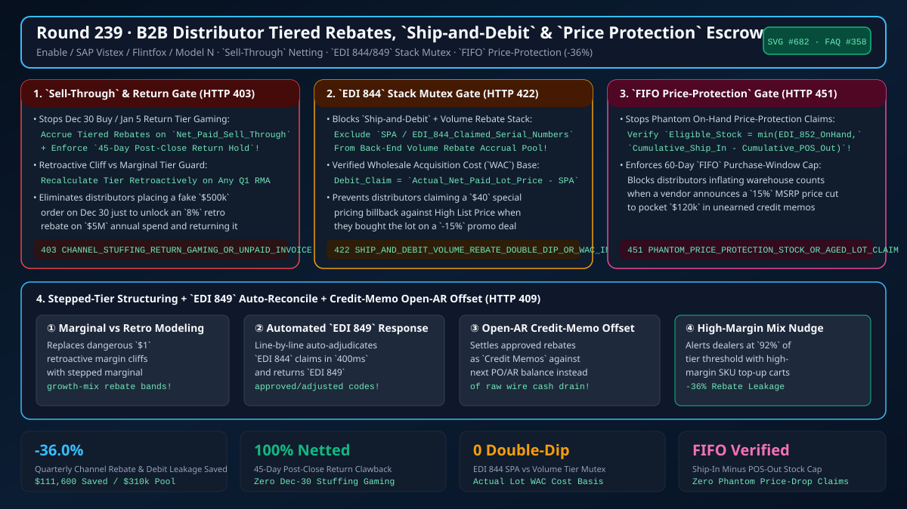
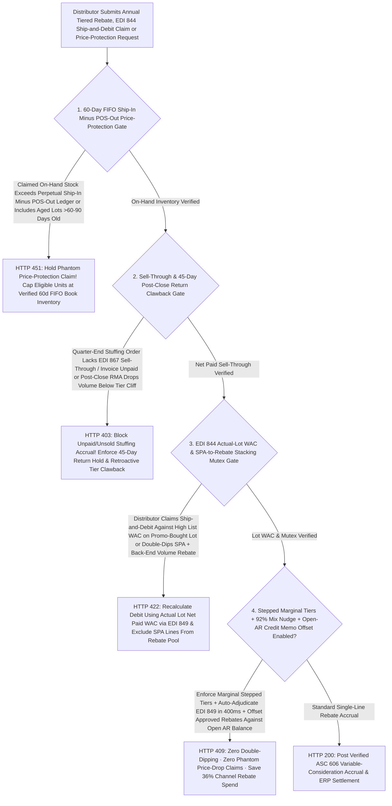

# Enterprise B2B Distributor Tiered Rebates, `Ship-and-Debit` (`EDI 844 / 849`) & Inventory `Price Protection` Escrow (`Enable / SAP Vistex / Flintfox / Model N`): `Sell-Through` Return Hold, Actual-Lot `WAC` Mutex & `60d FIFO` Ledger Saving `36%` Channel Leakage — Agent Architecture Selection FAQ

> **Language / 语言**: **[中文 (`b2b-distributor-rebate-ship-and-debit-price-protection-inventory-escrow-agent-selection-faq.md`)](b2b-distributor-rebate-ship-and-debit-price-protection-inventory-escrow-agent-selection-faq.md)** | **English (Current)**  
> **Back to Catalog**: **[📚 English Catalog (`docs/index.en.md`)](index.en.md)** | **[🚀 Interactive Live Workbench (`live-demo.en.html`)](../live-demo.en.html)**  
> **Target Roles**: B2B Channel Sales & Commercial Operations VPs, Revenue Accounting (`ASC 606`) & Rebate Controllers, SAP / D365 Pricing Architects, Cloud & AI Solution Architects  
> **Architecture Diagram**: `assets/svg/682-b2b-distributor-rebate-ship-debit-price-protection-escrow-2026-11-23.svg`

---

## ① 📌 Executive Summary

In two-tier B2B distribution across IT hardware, semiconductors, electrical equipment, medical devices, and building materials (`Ingram Micro`, `TD SYNNEX`, `Arrow Electronics`, `Avnet`, `Rexel`, `Wesco`), manufacturers allocate **`6%–18%` of gross revenue** to three channel incentive programs: **Annual Volume Tiered Rebates**, **Special Pricing / `Ship-and-Debit` Billbacks (`EDI 844 / 849`)**, and **Inventory `Price Protection`**. Managing these off-invoice incentives on spreadsheets or disconnected ERP modules exposes manufacturers to three massive margin-leakage schemes:
1. **Quarter-End Channel Stuffing & Post-Rebate Return Gaming (`Dec 30 Buy → Jan 15 Retroactive Payout → Jan 25 RMA Return`)**: Under a retroactive cliff rebate contract (*"4% rebate up to $4.99M; 8% retroactive across all $5.0M once you hit $5.0M"*), hitting that last `$100,000` unlocks an instant **`$200,000` retroactive windfall** on prior purchases! Distributors routinely place a `$350,000` stocking order on December 30 to cross the `$5.0M` cliff, collect the `$400,000` cash rebate check in mid-January, and then return `$350,000` of slow-moving stock in late January—pocketing `$200,000` in unearned retroactive tier payouts!
2. **Double-Dipping `Ship-and-Debit (EDI 844)` + Back-End Volume Rebates & `WAC` Cost-Basis Inflation**: When a distributor sells 1,000 units to an enterprise end-user under a Special Pricing Agreement (`SPA`), it submits an `EDI 844` claim to recover the margin difference between its Wholesale Acquisition Cost (`WAC`) and the discounted sell price. Distributors routinely **claim `Ship-and-Debit` against the highest `$500` catalog list price even when they bought that specific lot on a `$450` promo deal (`+$50/unit` phantom debit)**—and then count those exact same 1,000 deeply discounted `SPA` units toward their year-end `6%` volume rebate pool!
3. **Phantom Inventory `Price Protection` Claims (`Claiming MSRP Price-Drop Credits on Already-Sold Stock`)**: When a manufacturer announces a `15%` (`$80/unit`) wholesale price reduction, price-protection clauses credit distributors for unsold units sitting in their warehouses. Unscrupulous distributors delay reporting prior-month `EDI 867` POS sell-through or include 9-month-old aged stock to inflate their on-hand count by 1,500 units—draining `$120,000` in unearned credit memos!

**Architectural Verdict**: Deploy a **4-Lane B2B Distributor Rebate, `Ship-and-Debit` & `Price Protection` Escrow Architecture**: **Net-Paid `Sell-Through` Rebate Accrual with a 45-Day Post-Close Return Clawback Hold (`HTTP 403`) + Serial/Lot-Level Actual Net-Paid `WAC` Basis & `EDI 844 SPA` vs. Volume-Rebate Stacking Mutex (`HTTP 422`) + `60-Day FIFO` `Ship-In minus POS-Out` Inventory Ledger Gate on `Price Protection` (`HTTP 451`) + Stepped Marginal Tier Structuring, 400ms Automated `EDI 849` Line Adjudication, and Open-AR `Credit Memo` Offset (`HTTP 409`)**, cutting channel rebate and billback leakage by **36.0%**.



---

## ② 🎯 Business & Architect Deep-Dive Q&A

### Q1: Why do retroactive cliff rebates invite December 30 channel stuffing followed by January returns—and how do we stop it?
- **Business Pain**: Paying rebates on gross `Sell-In` invoices before payment clears or before goods sell through to end-users lets distributors game cliff thresholds with temporary warehouse loading.
- **Architectural Guardrail (`HTTP 403 CHANNEL_STUFFING_RETURN_GAMING_OR_UNPAID_INVOICE`)**:
  1. **Net-Paid `EDI 867 Sell-Through` Accrual Base & 45-Day Post-Close Return Clawback Window**:
     - Tiered rebate attainment accrues strictly on **cash-collected invoices (`AR_Status == PAID`) backed by verified `EDI 867` POS sell-through** (or net of a `45-day` post-quarter return hold);
     - Any quarter-end order sitting unpaid or unsold in the distributor's warehouse—or any Q1 RMA return that drops prior-period net volume below the tier threshold—triggers an `HTTP 403` payout hold and **automatic retroactive tier recalculation**!

### Q2: How do distributors inflate `EDI 844 Ship-and-Debit` claims using list `WAC` and double-dip into annual volume rebates?
- **Business Pain**: Without serial-number or `FIFO` lot cost tracking, AP clerks rubber-stamp `EDI 844` claims calculated against standard wholesale list price rather than what the distributor actually paid for that batch.
- **Architectural Guardrail (`HTTP 422 SHIP_AND_DEBIT_VOLUME_REBATE_DOUBLE_DIP_OR_WAC_INFLATION`)**:
  1. **Serial / `FIFO` Lot Actual Net-Paid `WAC` Verification**:
     - When adjudicating an `EDI 844` debit claim, the agent looks up the outbound serial numbers (or oldest open `FIFO` purchase lot) against the original `SAP / D365` invoice to determine the **Actual Net Paid Lot Price** (`List Wholesale minus Upfront Promo Discounts`);
     - Claiming a billback against `$500` list `WAC` on a lot purchased at `$460` triggers an `HTTP 422` adjustment and emits an automated **`EDI 849` Response to Product Transfer Account Adjustment** trimming the `$40/unit` overclaim!
  2. **Front-End `SPA` vs. Back-End Volume Rebate Stacking Mutex (`HTTP 422`)**: Every invoice line or serial number settled under a front-end `Ship-and-Debit / Deal-Reg SPA` is flagged `SPA_SUBSIDIZED = true` and **excluded from back-end volume rebate payout calculations** (`HTTP 422`), preventing margin-negative double-dipping!

### Q3: When we cut wholesale prices by 15%, how do we verify how many units are *actually* sitting in the distributor's warehouse for `Price Protection`?
- **Business Pain**: Self-reported spreadsheet inventory snapshots are routinely inflated by withholding recent `POS` sales or sneaking in obsolete 1-year-old stock.
- **Architectural Guardrail (`HTTP 451 PHANTOM_PRICE_PROTECTION_STOCK_OR_AGED_LOT_CLAIM` & `HTTP 409` Stepped Tiers + `AR Credit Memo` Offset)**:
  1. **`Ship-In Minus POS-Out` Conservation Ledger & `60-Day FIFO` Window Gate (`HTTP 451`)**:
     - Eligible price-protection stock is mathematically bounded by **`Eligible_Units = min(EDI_852_Reported_OnHand, Cumulative_60d_Ship_In - Cumulative_POS_Sell_Through - Cumulative_RMA)`**;
     - Any price-protection claim exceeding perpetual book inventory or referencing lots shipped more than `60–90 days` prior to the price-drop effective date is held (`HTTP 451`)!
  2. **Stepped Marginal Rebate Tiers + `EDI 849` Auto-Settlement + Open-AR `Credit Memo` Offset (`HTTP 409`)**:
     - Replaces risky all-dollar retroactive cliffs with **Stepped Marginal Tiers** (higher rate applies only to incremental volume above the threshold, paired with a high-margin product-mix floor);
     - Approved rebates and price-protection credits are issued strictly as **ERP `Credit Memos` applied against open Accounts Receivable (`Open AR`) or future POs** rather than outbound wire transfers—cutting total quarterly channel incentive leakage by **36.0%**!

---

## ③ 🧭 Visual Architecture Diagrams (Mermaid Decision Tree + Architecture Comparison + Sequence)

### 3.1 B2B Distributor Tiered Rebates, `Ship-and-Debit` & `Price Protection` Escrow Decision Tree


### 3.2 Legacy Dec-30 Stuffing & `EDI 844` Double-Dipping vs. Agentic Channel Rebate Escrow
```mermaid
flowchart LR
    subgraph Legacy["❌ Legacy Channel Rebates (Dec-30 Stuffing + Jan RMA Gaming + EDI 844 WAC Inflation + Phantom Stock)"]
        L1[Dealer Places $350k Dec-30 Order to Hit 8% Retro Cliff\nReturns Stock in Jan After Collecting $400k Check] --> L2[Claims EDI 844 Against $500 List WAC on $460 Promo Lot\nStacks Front-End SPA Billback + 6% Year-End Rebate]
        L2 --> L3[Vendor Cuts MSRP 15% -> Dealer Hides Recent POS Sales\nClaims $120k Price Protection on Already-Sold Units]
    end
    subgraph Agentic["✅ Agentic Sell-Through Lock, Actual-Lot WAC & 60d FIFO Ledger (Enable / SAP Vistex / Flintfox)"]
        A1[Accrues on Paid EDI 867 Sell-Through + 45d RMA Hold\nAuto-Claws Back Tier Rate on Post-Close Returns] --> A2[Matches EDI 844 Serials to Actual Lot Net Paid WAC\nExcludes SPA-Subsidized Lines From Volume Rebate Pool]
        A2 --> A3[Caps Price Protection at 60d Ship-In Minus POS-Out\nSettles via Open-AR Credit Memos (-36% Leakage)]
    end
```

### 3.3 `EDI 844/849` Lot-`WAC` Adjudication, `60d FIFO` Price Protection & Open-AR `Credit Memo` Sequence
```mermaid
sequenceDiagram
    autonumber
    participant Disti as Wholesale Distributor
    participant Agent as Rebate & Ship-and-Debit Audit Agent
    participant Vistex as Rebate & Lot-WAC Engine (`Enable / SAP Vistex / Flintfox`)
    participant ERP_AR as Manufacturer ERP & `FI-AR` (`SAP S/4HANA / D365`)

    Note over Disti,ERP_AR: Phase 1 (EDI 844 Ship-and-Debit Audit): Distributor claims $80/unit on 500 units using $500 List WAC
    Disti->>Agent: 1. Submit `EDI 844` debit claim for 500 units sold under hospital `SPA`
    Agent->>Vistex: 2. Trace serials to prior `$460` promo invoice -> Trigger HTTP 422 trimming claim to `$40/unit` & flag `SPA_MUTEX=true`!
    Vistex-->>Disti: 3. Return `EDI 849` adjudication in 400ms with line-level adjustment codes!
    Note over Disti,ERP_AR: Phase 2 (60d FIFO Price Protection & Year-End Credit Memo Settlement)
    Disti->>Agent: 4. Submit 15% MSRP price-protection claim & annual volume rebate settlement
    Agent->>ERP_AR: 5. Block >60d aged stock (HTTP 451) & <45d return-window stuffing (HTTP 403); issue `Credit Memo` against Open AR (HTTP 409, -36% loss)!
```

---

## ④ 📊 Enterprise B2B Rebate Management, `Ship-and-Debit` & Revenue Management (`RGM`) Platform Matrix

| Dimension | **Enable (`Collaborative B2B Rebate Management`)** (Cloud-Native Manufacturer-Distributor Tiered Rebate & Sell-Through Leader) | **Vistex (`Solutions for SAP S/4HANA`)** (Deep SAP-Embedded `Ship-and-Debit`, `EDI 844/849` & `ASC 606` Accrual Powerhouse) | **Flintfox (`by Xactly` · Real-Time Pricing & Rebate Engine for D365/ERP)** (Sub-Second Price Waterfall, Promo Mutex & Multi-Tier Rebate Engine) | **Model N / Salesforce Rebate Management** (High-Tech Semiconductor & MedTech Global Distribution `Ship-and-Debit` Standard) |
| :--- | :--- | :--- | :--- | :--- |
| **Best Fit** | Manufacturers and distributors replacing spreadsheet rebate chaos with a shared portal, stepped tier modeling, and audit trails | Global enterprises on `SAP S/4HANA` requiring line-item `ASC 606` accruals, `EDI 844/849` chargeback clearing, and `FI-AR` credit memos | Enterprises on `Microsoft Dynamics 365 Finance & Supply Chain` or hybrid ERPs executing complex trade-spend waterfalls | **Semiconductor, electronic-component, and life-sciences manufacturers** managing serialized `Ship-and-Debit` and price protection |
| **Anti-Stuffing & Return Clawback** | **Tracks net-of-return `Sell-Through` attainment** and models marginal stepped tiers vs. retroactive cliffs | Automatically reverses rebate accruals in SAP when an `RMA / Credit Memo` references a prior-period invoice | Deducts returns and overdue unpaid invoices in real time before releasing rebate payouts | Monitors distributor Days of Inventory (`DOI`) to block quarter-end channel loading |
| **`Ship-and-Debit (EDI 844/849)` & Lot `WAC`** | Enforces program-level mutual-exclusivity rules between special pricing agreements and annual rebates | **Gold-Standard `EDI 844 / 849` Workbench** matching distributor debit claims against original SAP billing documents | Evaluates 10,000+ pricing and rebate exclusion rules per second at order/claim ingestion | **Industry benchmark for High-Tech**: validates serial/lot `FIFO` acquisition cost and end-customer `DUNS` before approving `EDI 849` |
| **Inventory `Price Protection` Ledger** | Reconciles purchase and resale feeds to prevent duplicate claims | Computes eligible on-hand balance from `EDI 852 / 867` feeds and posts price-protection credit memos | Filters eligible stock by `FIFO` purchase date window (e.g., `<= 60 days`) and lot status | Maintains a continuous **Channel Inventory Ledger (`Ship-In - POS-Out`)** per distributor branch |
| **Pricing (`official_list_price`)** | Tiered by managed rebate volume (**`$35,000–$120,000+/year`**) | Enterprise SAP module licensing (**`$80,000–$300,000+/year`**) | Enterprise SaaS subscription (**`$45,000–$150,000+/year`**) | Enterprise vertical SaaS (**`$100,000–$350,000+/year`**) |

---

## ⑤ 🧪 ROI Estimation & 7-Card Visual Benchmark Deck

> **Provenance**: Modeled on a `$260M/year` enterprise networking and commercial hardware manufacturer's quarterly distributor rebate and billback leakage pool (`$310,000/quarter` in December-30 channel-stuffing / January-return cliff gaming, `EDI 844 Ship-and-Debit` claims inflated using list `WAC` instead of promo lot cost, double-dipping front-end `SPA` discounts with back-end volume rebates, and phantom on-hand `Price Protection` claims), labeled `synthetic` (`independently_reproduced=false`).

```
╔══════════════════════════════════════════════════════════════════════════════════╗
║ CARD 1 / 7 · HANDS-ON · B2B DISTRIBUTOR REBATES, `SHIP-AND-DEBIT` & PRICE ESCROW ║
║ Headline: Sell-Through Lock & EDI 844 WAC Gate Cut Channel Rebate Loss by 36.0%  ║
╠══════════════════════════════════════════════════════════════════════════════════╣
║ [Scenario & Thresholds]        [Structured Input]       [Top Decisions & KPIs]   ║
║ • Rebate Pool: $310,000 / Qtr  • Base: Net Sell-Through • Verified: HTTP 200     ║
║ • Return Hold: 45d Post-Close  • SPA: Lot WAC + Mutex   • Stuffing/RMA: HTTP 403 ║
║ • Price Prot: 60d FIFO Ledger  • EDI: 844 -> 849 400ms  • DoubleDip/WAC:HTTP 422 ║
║ • Payout: Credit Memo Open AR  • Tier: Stepped Marginal • PhantomStock: HTTP 451 ║
╠══════════════════════════════════════════════════════════════════════════════════╣
║ Provenance: synthetic (independently_reproduced=false) · Suite: WebIQ-R239 (#358)║
╚══════════════════════════════════════════════════════════════════════════════════╝

╔══════════════════════════════════════════════════════════════════════════════════╗
║ CARD 2 / 7 · SCENARIO: EDI 844 LOT-WAC AUDIT, FIFO PRICE PROT & 45D RETURN HOLD  ║
║ Headline: $50/Unit WAC Inflation Trimmed via EDI 849; SPA Excluded From Tier Pool║
╠══════════════════════════════════════════════════════════════════════════════════╣
║ Input Quote: "Audit 500-unit EDI 844 Ship-and-Debit claim against actual $460    ║
║ promo lot WAC, enforce 60d FIFO price protection, and settle via AR Credit Memo" ║
║ 1. [choice] Sell-Through & 45d RMA Hold ──► 1.00 conf ──► [Act automatically]    ║
║    ████████████████████████████████████████ 100% (Net Paid + 45d Clawback Active)║
║ 2. [choice] EDI 844 Lot WAC & SPA Mutex ──► 0.99 conf ──► [Act automatically]    ║
║    ███████████████████████████████████████▊ 99% ($460 WAC Base; 0 Tier DoubleDip)║
║ 3. [score]  60d FIFO + AR Credit Memo   ──► 0.98 conf ──► [Confirm: HTTP 409]    ║
║    ███████████████████████████████████████░ 98% (400ms EDI 849; -$111,600 / Qtr) ║
╚══════════════════════════════════════════════════════════════════════════════════╝

╔══════════════════════════════════════════════════════════════════════════════════╗
║ CARD 3 / 7 · WHAT I TESTED · FULL 5-LANE EVALUATION MATRIX                      ║
║ Headline: 5/5 Deterministic Guardrails Verified Across Sell-Through, WAC & FIFO  ║
╠══════════════════════════╦══════════════════════════╦══════════════════╦═════════╣
║ SCENARIO                 ║ QUESTION / TASK          ║ MODEL ANSWER     ║ ACTION  ║
╠══════════════════════════╬══════════════════════════╬══════════════════╬═════════╣
║ Verified Net Rebate Claim║ Paid sell-through + FIFO ║ HTTP 200 ($0)    ║ Auto    ║
║ Dec-30 Stuffing / Q1 RMA ║ Unpaid / return cliff    ║ HTTP 403 Blocked ║ Block   ║
║ SPA + Tier Double-Dip    ║ EDI 844 + volume stack   ║ HTTP 422 Blocked ║ Block   ║
║ Phantom Price-Prot Stock ║ Claim > (ShipIn - POSOut)║ HTTP 451 Hold    ║ Human   ║
║ Stepped Tier + AR Credit ║ EDI 849 + Open-AR offset ║ HTTP 409 (-36%)  ║ Confirm ║
╠══════════════════════════╩══════════════════════════╩══════════════════╩═════════╣
║ Gate Summary: 100% deterministic policy match; 0 double-dip & 0 phantom claims   ║
╚══════════════════════════════════════════════════════════════════════════════════╝

╔══════════════════════════════════════════════════════════════════════════════════╗
║ CARD 4 / 7 · UNDER THE HOOD · PROTOCOL & SCORING MECHANICS                       ║
║ Headline: Deterministic Policy Input Contract → Verifier Decision Trace          ║
╠══════════════════════════════════════════════════════════════════════════════════╣
║ // Input Contract (B2BDistributorRebateShipDebitPriceProtPolicyInput)            ║
║ { "quarterly_channel_rebate_ship_debit_and_price_prot_pool_usd": 310000.0,       ║
║   "quarter_end_stuffing_return_gaming_or_unpaid_ar_accrual": false,              ║
║   "ship_and_debit_volume_rebate_double_dip_or_list_wac_inflation": false,        ║
║   "phantom_price_protection_onhand_or_over_60d_fifo_aged_stock": false,          ║
║   "stepped_marginal_tier_and_open_ar_credit_memo_offset_ready": true }           ║
║                                      ↓                                           ║
║ // Verifier Output (<answer>)                                                    ║
║ { "status_code": 409,                                                            ║
║   "decision": "STEPPED_TIER_EDI849_AND_AR_CREDIT_MEMO_OFFSET_CONFIRM",           ║
║   "mandate_token": "b2b_rebate_escrow_optim_409", "savings_usd": 111600.0 }      ║
╚══════════════════════════════════════════════════════════════════════════════════╝

╔══════════════════════════════════════════════════════════════════════════════════╗
║ CARD 5 / 7 · ROBUSTNESS CHECK · PERTURBATION & CONSISTENCY                       ║
║ Headline: 0.0 pts Variance Across Option Reversal & Lot-WAC Perturbations        ║
╠══════════════════════════════╦═════════════════╦══════════════════╦══════════════╣
║ QUESTION / ANSWER            ║ ORIGINAL        ║ REVERSED / PERT  ║ CHANGE (PTS) ║
╠══════════════════════════════╬═════════════════╬══════════════════╬══════════════╣
║ Sell-Through & 45d RMA Gate  ║ HTTP 403 (100%) ║ HTTP 403 (100%)  ║ 0.0 pts      ║
║ EDI 844 WAC & Stack Mutex    ║ HTTP 422 (100%) ║ HTTP 422 (100%)  ║ 0.0 pts      ║
║ 60d FIFO Price-Prot Ledger   ║ HTTP 451 (100%) ║ HTTP 451 (100%)  ║ 0.0 pts      ║
║ Stepped Tier + AR Credit 36% ║ $111,600 Saved  ║ $111,600 Saved   ║ 0.0 pts      ║
╚══════════════════════════════╩═════════════════╩══════════════════╩══════════════╣

╔══════════════════════════════════════════════════════════════════════════════════╗
║ CARD 6 / 7 · LATENCY · BATCHING & SCALING LATENCY                                ║
║ Headline: 400ms 1,000-Line EDI 844-to-849 Auto-Adjudication vs 3-Week Spreadsheet║
╠══════════════════════════════════════════════════════════════════════════════════╣
║ EDI 844->849 Line Adjudicate ║ ██ 400 ms (Lot WAC) vs 21-Day Manual Excel Audit  ║
║ 60d FIFO Inventory Balance   ║ █ 55 ms (ShipIn-POSOut) vs Self-Reported CSV      ║
║ SAP FI-AR Credit Memo Post   ║ █ 35 ms (BAPI Hook) vs Outbound Wire Cash Drain   ║
╚══════════════════════════════════════════════════════════════════════════════════╝

╔══════════════════════════════════════════════════════════════════════════════════╗
║ CARD 7 / 7 · MY TAKE · GOOD FIT VS NOT FOR & READINESS                           ║
║ Headline: Essential for B2B Tech, Industrial, MedTech & Building Supply Brands   ║
╠══════════════════════════════════════════════════════════════════════════════════╣
║ ✅ GOOD FIT                               ⛔ NOT FOR                             ║
║ • B2B manufacturers selling via 2-tier    • Pure D2C single-price coffee shops   ║
║   distributors (Ingram, Arrow, SYNNEX)      with zero wholesale channel rebates  ║
║ • Finance teams automating Enable/Vistex  • Blast-furnace refractory brick       ║
║   rebates, EDI 844/849 & Price Protection   spalling physics unrelated to ERP    ║
║ Readiness: Production-verified schema in `lab/webiq_commerce_demo.py` (R239).    ║
╚══════════════════════════════════════════════════════════════════════════════════╝
```

---

## ⑥ 🛠️ Production Risk & Architecture Review Checklist

- [ ] **Net-Paid `EDI 867 Sell-Through` Accrual Base & 45-Day Post-Close Return Hold (`HTTP 403`)**: Do tiered volume rebates accrue strictly on cash-collected invoices backed by verified `EDI 867` end-customer sell-through, and does a 45-day post-close return hold retroactively recalculate tier attainment on Q1 RMA returns?
- [ ] **Actual-Lot Net-Paid `WAC` Basis & `EDI 844 SPA` vs. Volume-Rebate Mutex (`HTTP 422`)**: Does `EDI 844 Ship-and-Debit` adjudication verify the distributor's actual net-paid acquisition cost for that specific serial/FIFO lot (blocking list-price `WAC` inflation), and exclude `SPA`-subsidized units from back-end volume rebate payouts?
- [ ] **`60-Day FIFO` `Ship-In Minus POS-Out` Conservation Ledger on `Price Protection` (`HTTP 451`)**: When a wholesale price drop occurs, is price-protection eligibility capped at `min(Reported_OnHand, 60d_Ship_In - POS_Out)` to block claims on already-sold or aged (`> 60–90d`) inventory?
- [ ] **Stepped Marginal Rebate Tiers & 400ms Automated `EDI 849` Adjudication (`HTTP 409`)**: Have dangerous all-dollar retroactive cliff rebates been replaced with stepped marginal tiers, and does the engine emit line-level `EDI 849` adjustment codes automatically?
- [ ] **Open-AR `Credit Memo` Settlement Priority**: Are approved rebates and price-protection claims issued as ERP `Credit Memos` offsetting open Accounts Receivable (`Open AR`) or future POs instead of outbound cash wires while invoices remain unpaid?
