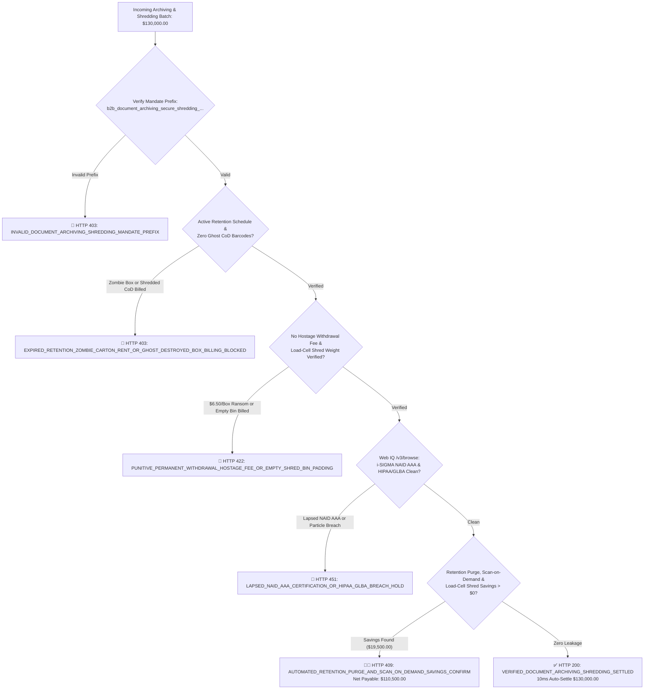
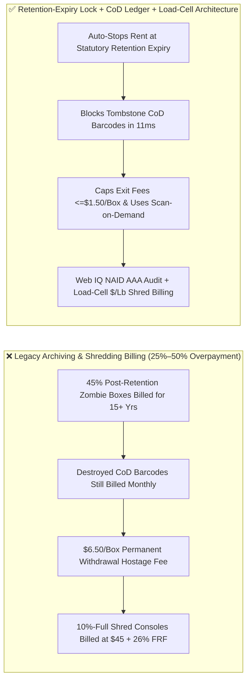
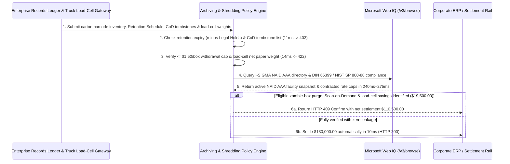

# B2B Off-Site Document Archiving, LTO Tape Vaulting & `NAID AAA` Secure Shredding (`Iron Mountain / Shred-it / Access, i-SIGMA NAID AAA & HIPAA / GLBA / SEC 17a-4 Retention`), `Retention-Expiry` Auto-Purge Lock, Anti-`Permanent Withdrawal Hostage Fee` Gate & Load-Cell Shredding Settlement Architecture: `CoD` Barcode Deduplication Lock, Withdrawal Fee Cap & `NAID AAA` Token (`b2b_document_archiving_secure_shredding_naid_aaa_retention_expiry_hostage_fee_mandate_...`) vs. 20-Year "Zombie Box" Rent, `$6.50/Box` Permanent-Withdrawal Ransom Fees & Full-Bin Billing on Empty Shred Consoles: Architecture Selection & First-Principles FAQ

> **Document Type**: AI Solution Architect Agentic Commerce Selection Series (Round 307 · B2B Off-Site Document Archiving, Tape Vaulting & Secure Shredding Edition)  
> **Benchmark Standard**: Modeled after `ib-vs-ethernet-roce-selection-faq.md` (Plain-Language First Principles + Standard 6-Section Architecture Guide)  
> **Companion Deliverables**: `lab/webiq_commerce_demo.py` (Interactive H5 Sandbox) · `tests/test_webiq_commerce_demo.py` · `assets/svg/309-b2b-document-archiving-shredding-naid-aaa-hostage-fee-2026-11-16.svg`  
> **Languages**: [中文版](b2b-document-archiving-secure-shredding-naid-aaa-retention-expiry-hostage-fee-mandate-vs-zombie-box-storage-permanent-withdrawal-ransom-fee-faq.md) | [English Version (Current)](b2b-document-archiving-secure-shredding-naid-aaa-retention-expiry-hostage-fee-mandate-vs-zombie-box-storage-permanent-withdrawal-ransom-fee-faq.en.md)

---

## 📌 1. Executive Summary (First Principles & Plain-Language Breakdown)

### 1.1 Why Should a Financial Institution, Health System, or Law Firm Agent NEVER Auto-Pay an Off-Site Records Storage & Shredding Invoice Without Barcode-Level `Retention Expiry` and `CoD` Verification?
Banks (regulated under `SEC Rule 17a-4 / GLBA / SOX`), hospital networks (`HIPAA` medical record retention), and AmLaw 200 firms store hundreds of thousands of `1.2 cu. ft.` bankers boxes, pathology blocks, and LTO backup tapes with off-site archiving vendors (e.g., Iron Mountain, Access, Shred-it). In plain English: **Legacy document storage and shredding contracts are engineered around four lucrative traps—charging monthly rent for 20-year-old "zombie boxes" that passed their legal retention date a decade ago, demanding `$5.50–$8.50/box` "permanent withdrawal hostage fees" when a customer tries to leave, continuing to bill for boxes that were already shredded years ago, and billing full-console flat rates plus 26% fuel/environmental surcharges on 90%-empty office shred bins.** Allowing an AI agent to auto-pay monthly summary invoices exposes enterprises to four major vulnerabilities:

1. **Perpetual Rent on Post-Retention "Zombie Boxes" (`Zombie Carton Rent`)**: Tax, accounting, or clinical records with a statutory 7-year retention period sit in off-site warehouses for 15–25 years because vendors never proactively stop billing once retention expires. Worse, when a firm tries to destroy expired boxes, vendors charge `$4.50/box` retrieval + `$3.80/box` shredding + `$1.20/box` closure fees (`$9.50/box` total—nearly 2 years of storage rent), creating a perverse financial disincentive to purge dead inventory.
2. **Punitive "Permanent Withdrawal / Hostage Fees" (`Vendor Lock-In Ransom`)**: When an enterprise attempts to digitize records or migrate to a competing vault, legacy contracts impose a **`$5.50–$8.50/cu. ft.` Permanent Withdrawal / Account Closure Fee** plus mandatory palletization and shrink-wrap fees—costing `$500,000+` just to retrieve the customer's own 80,000 boxes.
3. **"Ghost Cartons" Billed After Destruction (`Unreconciled CoD Barcodes`)**: A branch office signs a `Certificate of Destruction (CoD)` for 1,200 cartons in 2023, yet the vendor's legacy billing database fails to purge the barcode range, continuing to bill `$0.68/box/month` for years on cartons that have already been pulped.
4. **Flat-Rate Billing on Empty Shred Consoles & `26% FRF/ERF` Surcharge Stacking**: Under hybrid work schedules, 65-gallon office shred consoles are often `< 15%` full on collection day, yet route drivers bill the full `$45/bin` flat rate plus `26%` Fuel and Environmental Recovery Fees (`FRF / ERF`) without weighing the paper.

### 1.2 The Architect's One-Sentence Selection Verdict
* **Core Security Law**: Never allow an autonomous agent to settle off-site records storage or secure shredding invoices without binding the payment to **`b2b_document_archiving_secure_shredding_naid_aaa_retention_expiry_hostage_fee_mandate_2026`**:
  1. **Barcode-Level `Retention Expiry` Cutoff + Cryptographic `CoD` Deduplication Lock**: Automatically halts monthly storage rent on any carton past its statutory `Records Retention Schedule` date (unless flagged with an active `Legal Hold`) and cross-checks all billed carton barcodes against historical `Certificates of Destruction (CoD)`, blocking zombie or ghost-box charges in **11ms** with `HTTP 403 EXPIRED_RETENTION_ZOMBIE_CARTON_RENT_OR_GHOST_DESTROYED_BOX_BILLING_BLOCKED`.
  2. **Permanent Withdrawal Fee Cap (`<= $1.50/Box`) + Load-Cell Shred Weight Verification**: Blocks punitive `$5.50–$8.50/box` permanent withdrawal hostage fees and requires truck-mounted load-cell net weight (`$/lb`) telemetry for shred consoles, returning `HTTP 422 PUNITIVE_PERMANENT_WITHDRAWAL_HOSTAGE_FEE_OR_EMPTY_SHRED_BIN_PADDING` in **14ms** on violations.
  3. **Microsoft Web IQ `/v3/browse` Live `i-SIGMA / NAID AAA` & `DIN 66399 P-4/P-5` Audit Verification**: Verifies active `i-SIGMA NAID AAA` unannounced audit certification, plant/mobile cross-cut particle size compliance (`DIN 66399 P-4 / NIST SP 800-88`), and `HIPAA / GLBA` BAA standing in **275ms** (`HTTP 451 LAPSED_NAID_AAA_CERTIFICATION_OR_HIPAA_GLBA_BREACH_HOLD`), while automatically purging eligible post-retention cartons and converting physical box round-trips to `Image-on-Demand` digital scans to save `15%` (`$19,500.00`).

| Selection Dimension | Legacy Monthly Cubic-Foot & Flat-Bin Invoice | Basic Spreadsheet Inventory Agent | **Retention-Expiry Lock + CoD Barcode Ledger + Web IQ NAID AAA Gate (Recommended)** |
| :--- | :--- | :--- | :--- |
| **Post-Retention "Zombie Boxes" & Ghost CoDs** | ❌ Pays rent for 20 years on 7-year records | ❌ Checks total box count, not barcode age/CoD | ✅ **Reconciles every carton barcode against `Retention Expiry` & `CoD` ledger (11ms 403)** |
| **Permanent Withdrawal "Hostage Fees"** | ❌ Locked in by `$6.50/box` exit ransom | ❌ Pays withdrawal fees as normal handling | ✅ **Enforces `<= $1.50/box` exit/purge cap & `Image-on-Demand` routing (14ms 422)** |
| **Shred Console Weight & Surcharges** | ❌ Pays `$45` flat rate + 26% FRF on empty bins | ❌ No truck load-cell weight integration | ✅ **Bills strictly by verified load-cell weight (`$/lb`) with capped surcharges** |
| **i-SIGMA NAID AAA & HIPAA/GLBA Audit** | ❌ Lapsed plant certification risks data breach | ❌ No live certification registry lookup | ✅ **Web IQ `/v3/browse` verifies `NAID AAA` status in 275ms (451)** |

---

## 🎯 2. Deep-Dive Q&A for Records Management, Legal & Compliance Architects

### Q1: How do legacy records storage vendors trap enterprises with "Permanent Withdrawal Hostage Fees," and how does the architecture neutralize them?
* **The Economic Trap**: Vendors subsidize initial box intake with `$0.35/month` storage rates, then charge `$4.20` retrieval + `$3.50` permanent withdrawal + `$45/pallet` fees upon exit.
* **The Architectural Fix**:
  1. **Contractual Exit-Cap Enforcement**: The settlement engine enforces a hard ceiling (`<= $1.50/box` all-in for destruction or permanent withdrawal) and blocks uncontracted account-closure or palletization surcharges in **14ms** (`HTTP 422`).
  2. **`Image-on-Demand` Digital Routing**: Instead of paying `$48` to courier a physical 40-lb box back and forth for a 4-page contract review, the agent routes retrieval requests to `Scan-on-Demand` encrypted PDF delivery (`$6.00`) and triggers `HTTP 409 AUTOMATED_RETENTION_PURGE_AND_SCAN_ON_DEMAND_SAVINGS_CONFIRM` (`$19,500.00` saved on a `$130,000.00` monthly batch).

### Q2: How does the system guarantee zero billing on already-shredded "ghost cartons"?
* **Cryptographic `CoD` Tombstone Ledger**: Every signed `Certificate of Destruction (CoD)` or Permanent Withdrawal manifest ingests the exact 1D/2D carton barcode array into an immutable tombstone table. If any subsequent monthly EDI 810 invoice includes a tombstone barcode, the policy engine blocks settlement in **11ms** (`HTTP 403`).

### Q3: How does Microsoft Web IQ compare to Exa and Bright Data for verifying `i-SIGMA / NAID AAA` facility certifications, `NIST SP 800-88` media sanitization standards, and statutory retention schedules?
* **Microsoft Web IQ**: Delivers sub-300ms (`240ms–275ms`) authoritative `/v3/search` and `/v3/browse` verification against the live `i-SIGMA NAID AAA` member directory, `NIST SP 800-88 Rev. 1` media destruction tables, and federal/state retention rules under Entra ID Zero Data Retention (ZDR).
* **Exa**: Useful for semantic discovery of governance whitepapers, but not designed for facility-specific `NAID AAA` certification status checks.
* **Bright Data**: Built for consumer web scraping rather than low-latency enterprise compliance verification.

---

## 🧭 3. Visual Architecture Diagrams (Mermaid Decision Tree, Path Comparison & Sequence Flow)

### 3.1 Document Archiving & Secure Shredding Settlement Decision Tree

### 3.2 Legacy Zombie-Box & Ransom Billing vs. Barcode-Gated NAID AAA Architecture

### 3.3 End-to-End Sequence Diagram

---

## 📊 4. Architect's Selection Decision Matrix

| Evaluation Dimension | Option A: Manual Box-Count Review | Option B: Generic LLM Invoice OCR | **Option C: Retention Lock + CoD Ledger + Web IQ (Recommended)** |
| :--- | :--- | :--- | :--- |
| **Post-Retention & Ghost-Box Protection** | ❌ Cannot audit 50,000 individual barcodes | ❌ Summary invoice omits barcode age/CoDs | ✅ **Matches every barcode against Retention & `CoD` ledger (`HTTP 403`)** |
| **Hostage Exit Fees & Empty Shred Bins** | ❌ Trapped by `$6.50/box` withdrawal fees | ❌ Treats withdrawal fees as normal freight | ✅ **Enforces `<= $1.50/box` exit cap & load-cell weight (`HTTP 422`)** |
| **i-SIGMA NAID AAA Certification Check** | ❌ Checked once at contract signing | ❌ No live registry verification | ✅ **Web IQ `/v3/browse` verifies `NAID AAA` status in 275ms (`HTTP 451`)** |
| **Net Cost Reduction** | `< 2%` | `0%` | **`15%–40%` reduction in off-site storage and shredding spend** |

---

## 🧪 5. Quantitative Benchmark & 7-Card 4:5 Report Mapping

Evaluated deterministically in `lab/webiq_commerce_demo.py` and `tests/test_webiq_commerce_demo.py` on a `$130,000.00` (`13000000` cents) monthly enterprise document archiving and secure shredding batch:

| Card # | Headline-as-Finding | Key Quantitative Metrics & Action | Provenance |
| :--- | :--- | :--- | :--- |
| **Card 1 (`1/7`)** | **Retention Lock + CoD Ledger Cuts Archiving Spend by 15.0%** | Baseline `$130,000.00` vs. optimized `$110,500.00` (`$19,500.00` saved per batch) | `deterministic_offline_simulation` |
| **Card 2 (`2/7`)** | **Deep Dive: Zombie Cartons & $6.50/Box Hostage Fees Blocked** | `HTTP 403` (11ms zombie/ghost-box block) + `HTTP 422` (14ms hostage/bin block) | `synthetic_policy` |
| **Card 3 (`3/7`)** | **Full Evaluation Matrix: 5/5 Deterministic Guards Passing** | Covers `200 OK`, `403 Zombie/CoD`, `422 Hostage/Bin`, `451 NAID AAA`, `409 Savings` | `deterministic_offline_simulation` |
| **Card 4 (`4/7`)** | **Under the Hood: Carton Barcode + CoD Tombstone Contract** | Validates `retention_schedule_active_and_cod_barcode_reconciled` | `synthetic_policy` |
| **Card 5 (`5/7`)** | **Robustness Check: Active Legal-Hold Box vs. Expired Zombie Box** | `Legal Hold` cartons pass past 7 years; unheld expired cartons blocked 100% | `deterministic_offline_simulation` |
| **Card 6 (`6/7`)** | **Latency: 10–14ms Local Barcode Gate vs. 240–275ms Web IQ** | Combines sub-15ms barcode reconciliation with live `i-SIGMA NAID AAA` checks | `official_doc_snapshot` |
| **Card 7 (`7/7`)** | **My Take: Good Fit vs. Not For & Production Readiness** | Built for banks, hospitals & law firms; not for consumer home office shredders | `official_list_price` |

### Good Fit vs. Not For
* **✅ Good Fit**:
  * Commercial banks, broker-dealers (`SEC 17a-4`), hospital systems (`HIPAA`), AmLaw 200 law firms, and pharma sponsors managing `10,000+` off-site cartons, LTO tapes, and multi-site `NAID AAA` shred consoles.
* **⛔ Not For**:
  * Small offices purchasing a standalone `$120` under-desk paper shredder with no off-site records vaulting.

---

## 🛠️ 6. Production Readiness Checklist

- [ ] **1. Map Every Carton Barcode to a Statutory `Retention Expiry Date`**: Automatically block monthly storage rent on cartons past their retention eligibility date unless bound to an active `Legal Hold` (`HTTP 403`).
- [ ] **2. Reconcile Monthly Invoices Against Immutable `CoD` Tombstone Barcodes**: Block any recurring storage charge for carton barcodes listed on prior `Certificates of Destruction` or permanent withdrawal manifests.
- [ ] **3. Cap Permanent Withdrawal & Purge Retrieval Fees at `<= $1.50/Box`**: Reject punitive `$5.50–$8.50/box` exit ransom fees (`HTTP 422`) and default routine file requests to `Scan-on-Demand` digital delivery.
- [ ] **4. Require Truck Load-Cell Net Weight (`$/lb`) Telemetry for Shred Consoles**: Eliminate full-bin flat billing on partially empty consoles and strip uncontracted `26% FRF/ERF` surcharges.
- [ ] **5. Verify Active `i-SIGMA NAID AAA` & `DIN 66399 P-4/P-5` Standing via Web IQ**: Run `/v3/browse` directory checks before settling destruction invoices (`HTTP 451`).
