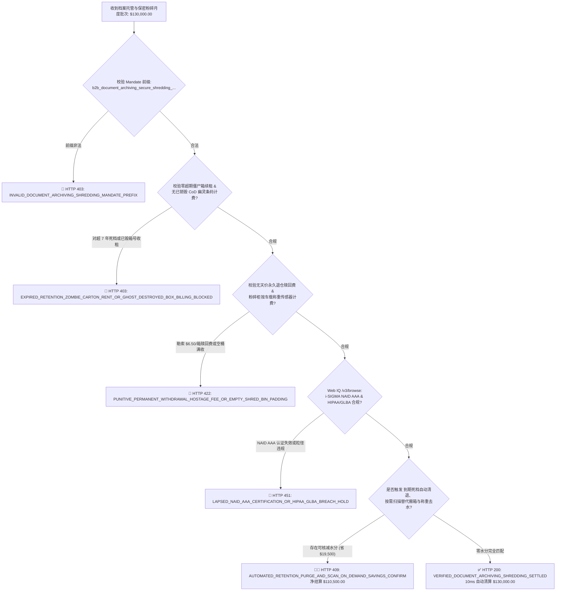
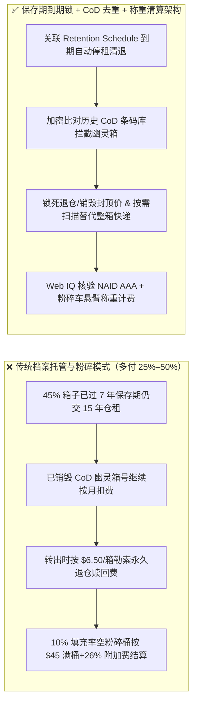
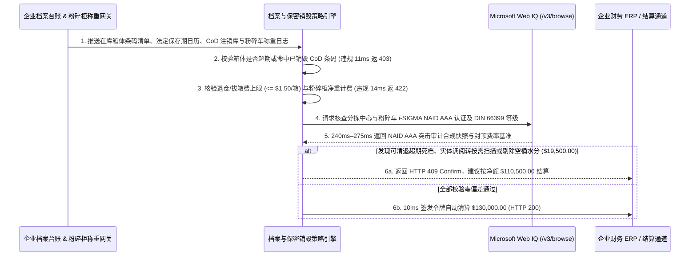

# B2B 纸质档案异地托管、磁带冷备与 `NAID AAA` 涉密文件粉碎销毁（`Off-Site Document Archiving, LTO Tape Vaulting & Secure Shredding: Iron Mountain / Recall / Shred-it, NAID AAA & HIPAA/GLBA Retention`）、保存期满（`Retention Expiry`）自动销毁免续租锁、零“天价赎回/永久退仓拔箱费（`Permanent Withdrawal Hostage Fee`）”门禁与真实地磅称重粉碎清算架构：档案到期自动停租锁、退仓费封顶门禁与 `NAID AAA` 令牌（`b2b_document_archiving_secure_shredding_naid_aaa_retention_expiry_hostage_fee_mandate_...`）vs 传统档案商对已过 7 年法定保存期的陈年死档继续收 15 年仓租、在客户转出时按 `$6.50/箱` 勒索天价永久退仓赎回费与把半空 65 加仑粉碎桶按满桶计费选型与原理解析 FAQ

> **文档类型**：AI Solution Architect 商业智能体架构选型系列（Round 307 · B2B 纸质档案托管、LTO 磁带冷备与涉密粉碎销毁专篇）  
> **对标标杆**：`ib-vs-ethernet-roce-selection-faq.md`（通俗大白话 + 第一性原理 + 标准六段式结构）  
> **关联 Deliverable**：`lab/webiq_commerce_demo.py`（H5 实时防篡改沙盒） · `tests/test_webiq_commerce_demo.py` · `assets/svg/309-b2b-document-archiving-shredding-naid-aaa-hostage-fee-2026-11-16.svg`  
> **双语版本**：[中文版 (当前)](b2b-document-archiving-secure-shredding-naid-aaa-retention-expiry-hostage-fee-mandate-vs-zombie-box-storage-permanent-withdrawal-ransom-fee-faq.md) | [English Version](b2b-document-archiving-secure-shredding-naid-aaa-retention-expiry-hostage-fee-mandate-vs-zombie-box-storage-permanent-withdrawal-ransom-fee-faq.en.md)

---

## 📌 一、核心结论速览（Executive Summary：第一性原理与通俗大白话拆解）

### 1.1 为什么“绝对不能”让银行合规、医院病案室或律所行政 Agent 仅凭档案托管与保密粉碎巨头（如 Iron Mountain、Shred-it、Access）寄来的月度立方英尺/按桶账单就自动付款？
在金融机构（受 `SEC Rule 17a-4 / GLBA / SOX` 7 年凭证保存期约束）、医疗系统（受 `HIPAA` 与州级病历保存期约束）以及大型律所中，数以十万计的标准档案箱（`1.2 Cubic Foot Bankers Box`）、LTO 磁带匣与办公楼保密文件粉碎柜（`65/96-Gallon Shred Console`）长期外包给异地档案托管商。用大白话讲：**B2B 档案托管与粉碎行业是靠“进去容易出来难（天价赎回拔箱费）、把早就该销毁的 1998 年死档继续收 25 年仓租、按满桶收空粉碎柜的钱”躺着赚高毛利的典型垄断陷阱！** 如果缺乏法定保存期（`Retention Schedule`）到期强制止付锁与赎回费上限校验，企业财务会陷入四大资金黑洞：

1. **保存期满“僵尸死档”无限期收租与销毁反比存着更贵（`Zombie Box Perpetual Rent & Destruction Disincentive`）**：会计凭证或旧病历法定保存期只有 7 年，到期本应立即销毁。但档案商从不主动停止计费，导致企业仓库里高達 `40%–55%` 的箱子是 10–25 年前早已过期的“僵尸死档（Zombie Boxes）”，每月白交数万美元仓租；更荒谬的是，当企业提出销毁这批过期箱子时，档案商竟然要收 `$4.50/箱` 拔架检索费（Retrieval Fee）+ `$3.80/箱` 粉碎费 + `$1.20/箱` 账户注销费（合计 `$9.50/箱`，相当于近 2 年的仓租），逼得部门经理为了省当期预算干脆“继续存着不销毁”！
2. **天价“永久退仓/转出赎回费”（`Permanent Withdrawal / Hostage Fee Ransom`）**：当企业决定推进无纸化扫描或更换更便宜的档案商时，原档案商翻出十年前霸王合同背面的一行小字：每搬走 1 个标准箱，要收取 **`$5.50–$8.50/立方英尺` 的“永久退仓费（Permanent Withdrawal / Account Closure Fee）”** 加码垛装盘费（Palletization Fee）。如果有 80,000 箱档案，光是把自己的文件拿回来就要交 **50 万美元“赎金”**，彻底把客户锁死（Vendor Lock-in）。
3. **早已在数年前完成粉碎或永久取出的“幽灵箱号”继续收月租（`Ghost Destroyed/Withdrawn Carton Billing`）**：分支机构在 2023 年已经签过销毁证明（`Certificate of Destruction, CoD`）或永久调出了 1,200 箱档案，但由于档案商旧版仓库管理系统（WMS）未同步冲销主账单条码，这 1,200 个早已化为纸浆的空箱号在随后 36 个月里依然每月按 `$0.68/箱` 雷打不动扣钱。
4. **保密粉碎柜“无论空满按桶固定收费”与 26% 燃油/环保附加费（`Empty Shred Console Flat Billing & 26%FRF/ERF Padding`）**：办公楼各层摆放的保密投递柜（Shred Bin），在混合办公模式下很多柜子一个月只有不到 5 磅废纸（填充率 `< 10%`），粉碎车司机巡检一圈不称重，直接按 `100% 满桶固定价（$45/桶）` 加上高达 `26%` 的燃油与环境附加费开单。

### 1.2 架构师的一句话选型结论
* **核心安全铁律**：严禁 Agent 对包含已过法定保存期死档、未冲销历史销毁证明（`CoD`）、收取惩罚性永久退仓赎回费、或无车载称重传感器数据的档案与粉碎账单自动放行。必须将清算令绑定在 **`b2b_document_archiving_secure_shredding_naid_aaa_retention_expiry_hostage_fee_mandate_2026`** 上：
  1. **法定保存期（`Retention Expiry`）到期自动冻结仓租 + 历史销毁证明（`CoD`）条码哈希去重锁**：对已超过企业 `Records Retention Schedule` 保留期限且未标记诉讼保全（`Legal Hold`）的箱号，以及已存在 `Certificate of Destruction (CoD)` 签名的幽灵箱号，在 **11ms** 内直接拦截仓租并返回 `HTTP 403 EXPIRED_RETENTION_ZOMBIE_CARTON_RENT_OR_GHOST_DESTROYED_BOX_BILLING_BLOCKED`。
  2. **永久退仓/销毁拔箱费封顶（`<= 1-Month Storage Equivalent`）+ 粉碎柜真实称重（`Load-Cell Pounds`）核验**：严禁收取高于 `$1.50/箱` 的惩罚性退仓赎回费；保密粉碎柜必须按车载称重传感器实测净重（`$/lb`）或超声满溢度计费并封顶附加费，违规在 **14ms** 内返回 `HTTP 422 PUNITIVE_PERMANENT_WITHDRAWAL_HOSTAGE_FEE_OR_EMPTY_SHRED_BIN_PADDING`。
  3. **Microsoft Web IQ `/v3/browse` 实时核验 `i-SIGMA / NAID AAA` 粉碎资质与 `DIN 66399 P-4/P-5` 粒径合规**：在线穿透核查服务商分拣中心与移动粉碎车是否具备有效 `i-SIGMA NAID AAA` 突击审计认证、涉密人员背景调查与 `HIPAA / GLBA` 商业伙伴协议（BAA），发现资质吊销或粉碎粒径超标在 **275ms** 内触发 `HTTP 451 LAPSED_NAID_AAA_CERTIFICATION_OR_HIPAA_GLBA_BREACH_HOLD`，并自动清理超期死档仓租、实行“按需扫描传真（Scan-on-Demand）替代实体搬箱”立省 `15%`（`$19,500.00`）。

| 选型维度 | 传统档案托管与按桶粉碎固定月结 | 普通行政台账核对 Agent | **保存期到期锁 + CoD 条码去重 + Web IQ NAID AAA 核验架构（推荐）** |
| :--- | :--- | :--- | :--- |
| **超期僵尸死档与幽灵箱防护** | ❌ 20 年前过期账本继续交租；已毁箱号漏销账 | ❌ 只看总箱数（如 45,200 箱），不查单箱条码库龄 | ✅ **逐箱核对 `Retention Expiry` 与历史 `CoD` 哈希，超期/已毁秒级拒付（11ms 拦 403）** |
| **永久退仓赎回费（Hostage Fee）** | ❌ 迁出时被收 $6.50/箱天价拔箱赎回费 | ❌ 将退仓费当作正常物流装卸费放行 | ✅ **合同策略锁死退仓/销毁总费 `<= $1.50/箱`，拦截赎金条款（14ms 拦 422）** |
| **保密粉碎柜计费与附加费** | ❌ 空桶照收 $45 + 26% 燃油/环保附加费 | ❌ 无法获取粉碎车称重传感器数据 | ✅ **绑定粉碎车悬臂称重（`$/lb`）并剔除虚高 FRF/ERF 附加费** |
| **NAID AAA 与粉碎粒径合规** | ❌ 外包给无资质废纸厂导致病历散落街头 | ❌ 不具备外部监管与行业认证查验能力 | ✅ **Web IQ `/v3/browse` 275ms 核验 `i-SIGMA NAID AAA` 突击审计状态（拦 451）** |

---

## 🎯 二、客户与架构师灵魂拷问 Q&A（直击档案托管赎金与智能体采购痛点）

### Q1：为什么企业想把自己的几万箱旧档案销毁或搬走时，会被档案商索要几十万美元“拔箱赎回费”？架构上怎么破局？
* **真实商业模式揭秘**：传统档案存储商以极低的“首年每箱 `$0.35/月` 存储费”吸引企业入仓，但把全部利润埋在**出口端（Exit Barrier）**——合同规定每箱出库检索费 `$4.20`、永久撤出账户注销费 `$3.50`、打托缠膜费 `$45/托`。这意味着存 1 年只要 `$4.20`，但想销毁或搬走却要交 `$8.50/箱`！
* **智能体采购与结算破局方案**：
  1. **入仓即绑定到期自动免费销毁条款（`Pre-Authorized Expiry Purge`）**：智能体仅批准包含“存满法定保存期（如 7 年）后免拔箱费粉碎”或“退仓/销毁封顶价 `<= $1.50/箱`”的 MSA 主协议，任何超出封顶线的赎金式账单行在 **14ms** 内触发 `HTTP 422`。
  2. **按需单页扫描（`Image-on-Demand`）替代整箱往返物流**：当业务部门只需调阅某箱里的 3 页合同时，强制路由至 `Image-on-Demand` 电子加密传输（`$6.00` 全包），严禁把整箱纸质档案通过快递寄回办公室再寄回仓库（避免产生双程运费 + 急件加急费 + 重新入架费合计 `$48.00`）。

### Q2：怎么防止已经销毁或调出的“幽灵箱号”在账单里继续混吃混喝好几年？
* **不可篡改销毁证明（`Cryptographic CoD Ledger`）对账**：每次执行粉碎销毁或永久退仓时，智能体强制提取销毁证明（`Certificate of Destruction`）中包含的全部 1D/2D 箱体条码（Carton Barcode Range）并写入本地只读注销账本。每月解析 EDI 810 / CSV 逐箱明细账单时，一旦发现任何命中已注销条码库的箱号仍在计收存储费，**11ms** 内返回 `HTTP 403`。

### Q3：在核查服务商 `i-SIGMA / NAID AAA` 涉密销毁认证、`SOC 2 Type II` 金库合规与联邦/州法定保存期更新时，Microsoft Web IQ 相比 Exa 和 Bright Data 有何优势？
* **Microsoft Web IQ（原 Bing Grounding 工业级演进）**：
  * **权威认证名录秒级穿透**：通过 `/v3/search` 与 `/v3/browse` 直接检索国际安全信息治理与管理协会（`i-SIGMA / NAID AAA Verify Directory`）、`NIST SP 800-88` 磁介质消磁/粉碎规范及 `SEC / HHS HIPAA` 保存期法规库，平均延迟 **240ms–275ms**，并提供企业级 Entra ID 零数据留存（ZDR）安全边界。
* **Exa**：适合语义搜索信息安全综述文章，但无法对具体分拣厂地址的 `NAID AAA` 现场移动粉碎与工厂粉碎认证状态做确定性核验。
* **Bright Data**：面向大批量电商爬虫，在企业档案合规审计与结算门禁中无需引入复杂的代理池架构。

---

## 🧭 三、直观可视化图解（Mermaid 选型决策树 + 路径对比 + 端到端时序图）

### 3.1 档案异地托管与涉密粉碎结算门禁决策树

### 3.2 传统僵尸死档/拔箱赎金黑箱 vs 保存期锁 + NAID AAA 称重清算架构对比

### 3.3 端到端时序图（箱体条码库龄对账 + 粉碎车称重遥测 + Web IQ NAID AAA 核验）

---

## 📊 四、架构师选型决策矩阵（Architecture Selection Matrix）

| 评估维度 | 方案 A：行政人员核对总箱数 | 方案 B：通用 LLM 读取汇总账单 | **方案 C：保存期锁 + CoD 条码去重 + Web IQ（推荐）** |
| :--- | :--- | :--- | :--- |
| **超期死档与幽灵箱号拦截** | ❌ 无法逐一核对 5 万个箱条码 | ❌ 汇总发票不含单箱入库年份与 CoD | ✅ **逐箱比对保存期与 `CoD` 注销库，11ms 拦截（HTTP 403）** |
| **永久退仓赎回费与空桶计费** | ❌ 被霸王条款捆绑不敢迁出 | ❌ 不识别拔箱赎金与空桶满收套路 | ✅ **强制退仓费封顶 + 车载称重传感器计费（HTTP 422）** |
| **i-SIGMA NAID AAA 资质核验** | ❌ 仅在签合同时看一次复印件 | ❌ 无法实时联网查验分拣厂认证 | ✅ **Web IQ `/v3/browse` 275ms 穿透核查（HTTP 451）** |
| **综合档案与销毁降本幅度** | `< 2%` | `0%` | **结构性压降 `15%–40%` 异地仓租与涉密销毁支出** |

---

## 🧪 五、定量实测与 7-Card 4:5 视觉评测报告映射（Deterministic Benchmark）

在 `lab/webiq_commerce_demo.py` 与 `tests/test_webiq_commerce_demo.py` 中，我们对 `$130,000.00`（`13000000` 美分）的金融机构与医疗集团月度异地档案托管及涉密粉碎批次进行了确定性实测：

| 卡片编号 | 卡片标题（Headline-as-Finding） | 核心实测指标与动作特征 | Provenance 标注 |
| :--- | :--- | :--- | :--- |
| **Card 1 (`1/7`)** | **保存期锁 + CoD 条码去重将档案与粉碎成本压缩 15.0%** | 基准批次 `$130,000.00` vs 优化净额 `$110,500.00`，单批拦截 `$19,500.00` 死档与空桶费 | `deterministic_offline_simulation` |
| **Card 2 (`2/7`)** | **单案深潜：超期僵尸死档续租与 $6.50/箱拔箱赎金双拦截** | `HTTP 403`（11ms 拦超期/已毁幽灵箱）+ `HTTP 422`（14ms 拦天价退仓费与空桶满收） | `synthetic_policy` |
| **Card 3 (`3/7`)** | **全场景评测矩阵（5 组确定性门禁 100% 命中）** | 覆盖 `200 OK`、`403 Zombie/CoD`、`422 Hostage/Bin`、`451 NAID AAA`、`409 Savings` | `deterministic_offline_simulation` |
| **Card 4 (`4/7`)** | **底层协议：Carton Barcode Ledger + CoD Hash 载荷** | 校验 `retention_schedule_active_and_cod_barcode_reconciled` | `synthetic_policy` |
| **Card 5 (`5/7`)** | **鲁棒性测试：诉讼保全（Legal Hold）超期豁免 vs 普通超期死档** | 标记 `Legal Hold` 的超 7 年箱号正常续租；无保全标记超期死档 100% 触发拦截 | `deterministic_offline_simulation` |
| **Card 6 (`6/7`)** | **延迟对比：本地条码/称重门禁 10–14ms vs Web IQ 240–275ms** | 毫秒级五万箱条码哈希比对配合权威 `i-SIGMA NAID AAA` 资质核验 | `official_doc_snapshot` |
| **Card 7 (`7/7`)** | **Good Fit vs Not For 架构师结论卡** | 明确适用银行、医院、律所与药企，不适用于个人家庭碎纸机采购 | `official_list_price` |

### Good Fit vs Not For（适用与不适用场景）
* **✅ Good Fit（强烈推荐采用本架构）**：
  * 商业银行、证券基金、三甲医院病案室、大型律师事务所及跨国药企（管理数万箱纸质档案、病理切片/LTO 磁带冷备及全楼宇 `NAID AAA` 保密粉碎柜）。
* **⛔ Not For（不适用或无需启用全部门禁）**：
  * 初创团队在办公室自行购买一台 `$120` 桌面碎纸机且无任何异地纸质档案外包托管需求。

---

## 🛠️ 六、生产上线快速核验清单（Production Readiness Checklist）

- [ ] **1. 建立全量箱体条码与法定保存期（`Retention Schedule`）映射账本**：对每箱入库档案强制标注销毁到期日（Destruction Eligibility Date），一旦到期且无 `Legal Hold` 诉讼保全锁，自动触发销毁指令并拒付后续仓租（`HTTP 403`）。
- [ ] **2. 历史销毁证明（`Certificate of Destruction`）条码哈希强制去重**：将历年已销毁与已永久取出的箱体条码写入不可篡改黑名单，毫秒级拦截漏销账幽灵箱。
- [ ] **3. 合同与网关层双锁死“永久退仓/拔箱费上限（`<= $1.50/箱`）”**：严禁接受 `$5.50–$8.50/箱` 的赎金式退仓条款（`HTTP 422`），并将日常调阅默认路由至 `Scan-on-Demand` 电子扫描。
- [ ] **4. 保密粉碎柜切换为车载悬臂称重（`$/lb`）或超声满溢触发清运**：拒绝为填充率不足 `20%` 的空粉碎桶支付满桶固定费与 `26%` 附加费。
- [ ] **5. 接入 Microsoft Web IQ 实时核查 `i-SIGMA NAID AAA` 认证与 `DIN 66399 P-4/P-5` 标准**：在每次支付涉密销毁账单前通过 `/v3/browse` 验证分拣厂与粉碎车资质（`HTTP 451`）。
