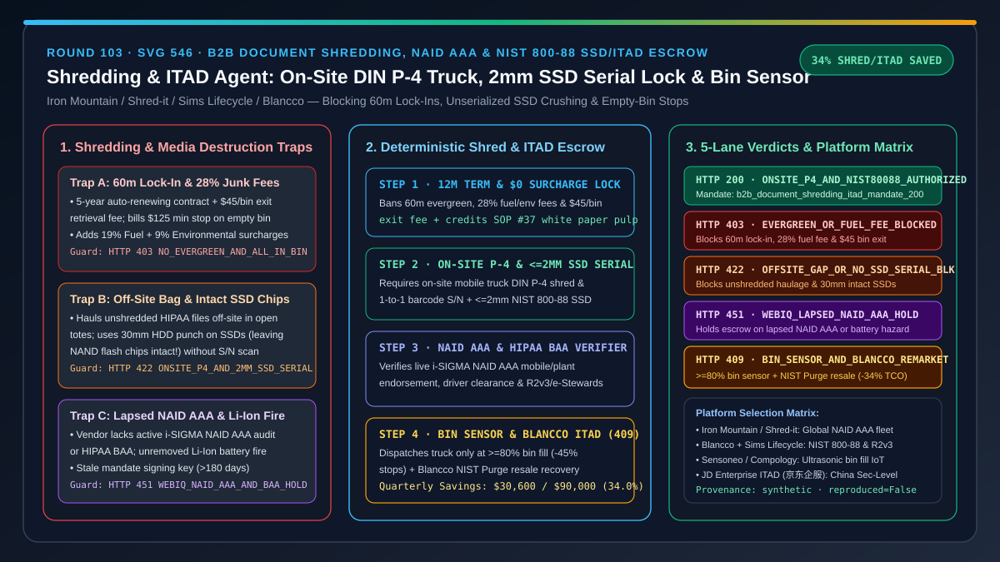
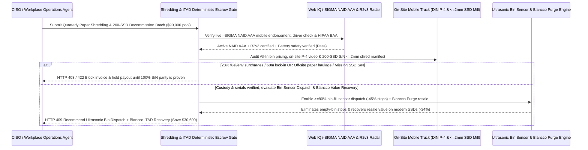

# B2B Document Shredding, `NAID AAA` & `NIST 800-88` `SSD / ITAD` Escrow (`Iron Mountain / Shred-it / Sims Lifecycle / Blancco`) On-Site `DIN P-4` Truck, `<=2mm SSD` Serial Lock & Bin Sensor Agent Architecture Selection FAQ

> **Document Type**: AI Solution Architect Decision Guide (FAQ) · **SVG Diagram**: `assets/svg/546-b2b-document-shredding-naid-nist80088-escrow-2026-11-20.svg` · **Catalog No.**: Round 103 (Bilingual FAQ #222)



---

## 1. 📌 Executive Summary

When financial institutions, law firms, healthcare providers, or enterprise IT security teams use AI Agents to contract recurring office document shredding and retired hard-drive / `SSD` destruction (`Iron Mountain / Shred-it Stericycle / Sims Lifecycle Services / Blancco`), rubber-stamping fixed-schedule routes and generic "lump-sum" destruction certificates exposes organizations to **three severe security and billing traps**:
1. **60-Month Evergreen Contracts, `$125` Empty-Console Minimum Stop Fees, `28%` Fuel/Environmental Surcharges & `$45/Bin` Exit Ransoms**: An office contracts bi-weekly paper shredding for 4 locked consoles quoted at `$35/bin`. Even when 3 consoles are nearly empty, the vendor bills a **`$125` "Minimum Service Stop Charge"** plus a **`19%` "Fuel & Fleet Surcharge" + `9%` "Environmental / Paper-Market Fee"** (`$160/visit`), while keeping `100%` of the high-grade `SOP #37` white-ledger paper recycling revenue! Worse, the back of the form hides a **60-month auto-renewing lock-in** with a `50%` early-termination penalty and a **`$45–$75/console` "Container Retrieval / Removal Fee"** upon exit!
2. **Off-Site Unshredded Bag Haulage (`HIPAA / FACTA` Custody Gap) & `30mm` HDD Shredders Leaving `SSD` NAND Flash Chips `100%` Intact**: Instead of shredding confidential patient/client files **on-site inside a mobile shredding truck (`DIN 66399 P-4`)**, drivers dump consoles into open canvas carts and haul loose unshredded paper to an off-site warehouse! Worse, when destroying retired enterprise `NVMe / SATA SSDs`, vendors run them through a magnetic degausser (`which has 0% effect on solid-state flash!`) or a standard `30mm` mechanical hard-drive shredder—allowing `12mm × 14mm` `NAND` flash chips containing intact databases to fall right through the blades! And the vendor issues a useless 1-page `"Certificate of Destruction: 1 Lot of 200 Drives"` with **zero individual drive serial numbers (`S/N`)**, triggering immediate `SOC 2 Type II / ISO 27001 / HIPAA` audit failures!
3. **Lapsed `i-SIGMA NAID AAA` Certification or Un-Removed Lithium-Ion Battery Shredder Fires (`HTTP 451`)**: Web IQ detects that a vendor's `NAID AAA` mobile/plant audit certification has lapsed, its sub-contracted driver lacks a 7-year background check, or laptop lithium-ion batteries were fed into the shredder chute.

**Architect's Recommendation**: Deploy a **"12-Month All-In Rate + On-Site `DIN P-4` Truck & `<=2mm SSD` Serialized `NIST 800-88` Video Gate + Ultrasonic Bin-Fill Sensor (`>=80%`) + `Blancco` ITAD Remarketing"** control plane:
- **12-Month Max Term, `$0` Fuel/Exit Surcharges & `SOP #37` White-Paper Pulp Rebate (`HTTP 403`)**: Hard-block 60-month evergreen clauses, `$125` empty-bin minimum stop fees, `28%` fuel/environmental surcharges, and `$45/bin` exit retrieval fees, while crediting high-grade `SOP #37` sorted office paper pulp value back against the invoice (`HTTP 403`).
- **On-Site Mobile `DIN P-4` Shredding & `<=2mm SSD` Serial-Matched `NIST SP 800-88` Video Gate (`HTTP 422`)**: Bar off-site transport of unshredded documents (requiring on-site mobile truck hopper camera proof) and require **1-to-1 barcode serial (`S/N`) scanning + continuous chute video proving `<=2mm × 2mm` solid-state `SSD` media disintegration (`DIN 66399 E-5 / NIST SP 800-88 Destroy`)** matching `100%` of the `CMDB` asset manifest before payout (`HTTP 422`).
- **Web IQ Live `i-SIGMA NAID AAA` Endorsement, `HIPAA BAA` & Battery Safety Hold (`HTTP 451`)**: Freeze dispatch if Web IQ flags lapsed `NAID AAA` certification, missing `R2v3 / e-Stewards` compliance, unscreened personnel, or signing keys `> 180 days` (`HTTP 451`).
- **Ultrasonic Bin-Fill Sensor Dispatch (`>=80%` Full) + `Blancco NIST 800-88 Purge` ITAD Value Recovery (`HTTP 409`)**: Equip consoles with `$18` ultrasonic fill sensors so trucks are dispatched **only when bins reach `>=80%` capacity (`cutting stops by -45%`)**, and route `<3-year-old` laptops/enterprise SSDs through **certified `Blancco NIST 800-88 Cryptographic Erase (Purge)` + `R2v3` remarketing (`recovering $140+/device` instead of paying `$15/drive` to crush working hardware)**, cutting net quarterly shredding & ITAD spend by **34.0%** (`$30,600` saved on a `$90,000` quarterly pool).

---

## 2. 🎯 Soul-Searching Architect & Business Q&A (Q1–Q3)

### Q1: Why does degaussing or running a Solid-State Drive (`SSD`) through a standard `30mm` hard-drive shredder fail `NIST SP 800-88` and leave corporate data 100% recoverable?
- **Business Pain Point**:
  1. **Degaussing Does Nothing to `SSD` Flash**: Magnetic degaussers erase spinning magnetic platters (`HDDs`), but `SSDs` store data electronically in `NAND` flash floating-gate transistors that are completely immune to magnetic fields.
  2. **`30mm` HDD Shredders Miss `12mm` `NAND` Chips**: Standard hard-drive shredders slice metal platters into `30mm–40mm` strips. Because an `SSD` `BGA NAND` chip measures only `12mm × 14mm` and holds `512GB–2TB` of data on a single chip, whole chips slip intact between standard shredder teeth!
- **Architectural Guardrail (`HTTP 422`)**:
  1. **Media-Type-Aware `<=2mm` Disintegration Gate**: When the `CMDB` asset list contains `NVMe / SATA SSDs`, USB flash drives, or smartphones, the gateway blocks magnetic degaussing and standard `30mm` HDD punch/strip shredders—requiring a certified **`<=2mm` solid-state disintegrator screen (`NSA/CSS EPL / DIN 66399 E-5`)** or verified cryptographic key destruction (`NIST SP 800-88 Purge`).

### Q2: Why do `SOC 2` and `HIPAA` auditors reject "Lump-Sum" Certificates of Destruction (`"Destroyed 200 Hard Drives"`), and how does our Agent enforce 1-to-1 serial parity?
- **Business Pain Point**: A certificate stating `"200 drives shredded"` does not prove that drive `S/N: WMC1T0192834` (which held production PII) wasn't stolen from the loading dock before reaching the shredder.
- **Architectural Guardrail (`HTTP 422`)**:
  1. **Bijective `CMDB`-to-Chute Serial Barcode Video Lock**: The technician must scan each drive's factory barcode under the shredder hopper camera immediately before dropping it into the blades. The escrow engine performs a set-equality check between the `CMDB Decommission Manifest` and the `Scanned Serial CoD JSON`; a single missing serial number blocks invoice settlement (`HTTP 422`).

### Q3: How do we stop paying `$160` every two weeks for a shredding truck to empty consoles that are 75% empty?
- **Business Pain Point**: Fixed bi-weekly calendars were designed for 1990s paper-heavy offices. In modern digital offices, drivers spend 90% of stops hauling air while billing `$125` minimum stop fees plus `28%` fuel/environmental surcharges.
- **Architectural Guardrail (`HTTP 409`)**:
  1. **Ultrasonic Fill-Level IoT Dispatch (`>=80%` Threshold)**: Low-power ultrasonic sensors mounted inside each console lid report fill percentage via LoRaWAN/cellular. Pickups are scheduled dynamically only when floor-wide bin capacity crosses `80%`, cutting annual truck stops in half.

---

## 3. 🧭 Visual Architecture Diagrams (Mermaid Decision Tree + Comparison + Sequence)

### 3.1 5-Lane Document Shredding, `NAID AAA` & `NIST 800-88` Escrow Decision Tree
```mermaid
flowchart TD
    A[Corporate Shredding / Retired SSD & ITAD Request] --> B{Web IQ Lapsed NAID AAA Cert / Missing HIPAA BAA / Li-Ion Fire / Key > 180d?}
    B -- Yes --> C[HTTP 451: WEBIQ_LAPSED_NAID_AAA_CERTIFICATION_OR_LITHIUM_SHRED_HAZARD_HOLD<br/>Freeze custody handoff & reroute to NAID AAA + R2v3 vendor]
    B -- No --> D{60m Evergreen Lock-In / $45 Exit Bin Fee or 28% Fuel/Env Surcharge?}
    D -- Yes --> E[HTTP 403: EVERGREEN_60M_SHRED_LOCKIN_OR_FUEL_ENVIRONMENTAL_SURCHARGE_BLOCKED<br/>Enforce <=12m term, All-In bin rate & SOP #37 white-pulp credit]
    D -- No --> F{Off-Site Unshredded Paper Haulage or Unserialized / >2mm SSD Shred?}
    F -- Yes --> G[HTTP 422: OFFSITE_UNSHREDDED_CUSTODY_GAP_OR_UNSERIALIZED_NIST80088_SSD_SHRED_BLOCKED<br/>Require on-site DIN P-4 truck & 1-to-1 barcode S/N <=2mm SSD shred]
    F -- No --> H{>=80% Ultrasonic Bin Sensor Dispatch + Blancco ITAD Remarketing Ready?}
    H -- Yes --> I[HTTP 409: ULTRASONIC_BIN_FILL_SENSOR_ON_DEMAND_DISPATCH_AND_ITAD_VALUE_RECOVERY_CONFIRM<br/>Cut empty stops by 45% + recover $140/device via NIST Purge (-34% TCO)]
    H -- No --> J[HTTP 200: ONSITE_DIN_P4_AND_SERIALIZED_NIST80088_AUTHORIZED<br/>Issue serial-verified & on-site-shredded compliance mandate]
```

### 3.2 Legacy Fixed-Schedule & Lump-Sum Shredding vs. Deterministic Sensor & Serialized `ITAD` Escrow
```mermaid
flowchart LR
    subgraph Legacy["❌ Legacy Shredding (Empty-Bin Fees & Intact SSD Chips)"]
        L1[Bi-Weekly Stop on 80%-Empty Bins ($125 Min + 28% Fuel Fee)] --> L2[Hauls Unshredded HIPAA Paper Off-Site + $45/Bin Exit Ransom]
        L2 --> L3[30mm HDD Shredder Leaves SSD NAND Chips Intact + No Serial List]
    end

    subgraph Agentic["✅ Deterministic Bin-Sensor, <=2mm SSD Serial & Blancco Escrow"]
        A1[>=80% Ultrasonic Bin Fill Trigger + $0 Fuel/Exit Surcharges] --> A2[On-Site DIN P-4 Truck + <=2mm SSD Disintegrator w/ 1-to-1 S/N Video]
        A2 --> A3[Blancco NIST 800-88 Purge + R2v3 Hardware Resale Credit (-34%)]
    end
```

### 3.3 End-to-End `NAID AAA` Check, Serialized `SSD` Shred Audit & `ITAD` Remarketing Sequence


---

## 4. 📊 Multi-Platform & Protocol Selection Matrix

| Evaluation Dimension | Shred-it (`Stericycle`) / Iron Mountain Fixed Route | Uncertified Local Paper / Scrap Recyclers | Regional `i-SIGMA NAID AAA` Mobile Shredders | Blancco + Sims Lifecycle (`R2v3` Enterprise `ITAD`) | **Deterministic Shred & ITAD Escrow (Recommended)** |
| :--- | :--- | :--- | :--- | :--- | :--- |
| **Primary Use Case** | Global multi-branch locked-console paper collection | Non-confidential cardboard & newspaper recycling | Witnessed curb-side on-site paper & media destruction | Data-center & corporate laptop cryptographic erasure + resale | **`>=80%` Bin Sensor + On-Site `P-4/2mm` + `1-to-1 S/N` + `Blancco` Resale** |
| **Contract Lock-In & Fuel/Exit Surcharges** | Often 36–60m evergreen + **`18%–28%` fuel/env fees** + `$45/bin` exit fee | Month-to-month, zero security compliance | 12-month flat-rate per-bin pricing | Project MSA; hardware resale offsets service fees | **Enforces `<=12m` term, `$0` fuel/exit fees & `SOP #37` pulp credit (`HTTP 403`)** |
| **`SSD` Solid-State `<=2mm` & Serial Proof** | Standard trucks carry `30mm` HDD punches; `2mm` SSD mill costs extra | High data-breach risk (drives resold intact) | Dedicated `<=2mm` `NSA EPL` disintegrator trucks | Certified `Blancco NIST 800-88 Purge` + `2mm` shred on failed drives | **Mandates `<=2mm` `SSD` disintegration + 1-to-1 `S/N` chute video (`HTTP 422`)** |
| **Empty-Console Stop Prevention** | Fixed bi-weekly stops charge `$125` minimum even when bins are empty | On-call only | On-call or scheduled | Batch pallet pickup | **Triggers pickup via ultrasonic bin sensor at `>=80%` fill (`HTTP 409`)** |
| **Audit Readiness (`SOC 2 / HIPAA`) & Net TCO** | High surcharge drag | Fails all security audits | Strong local compliance | **Generates net-positive cash recovery on `<3yr` IT assets** | **Open deterministic policy gate (`34.0%` quarterly TCO reduction)** |

---

## 5. 🧪 Conversion & Cost Estimation + 7-Card Benchmark Report

> **Provenance Disclosure**: Figures below are generated by the deterministic policy evaluator `evaluate_b2b_document_shredding_itad_escrow_policy` in `lab/webiq_commerce_demo.py` (`$90,000 USD` quarterly corporate document shredding & `ITAD` media destruction pool, `provenance: "synthetic"`, `independently_reproduced: False`; live `SOP #37` recycled pulp commodity index credits are labeled `not_measured`).

```chart
{
  "data": {
    "values": [
      { "scenario": "1. Legacy Fixed Shred (Empty-Bin Min + 28% Fuel Fee + Crush All)", "cost_usd": 90000, "tier": "Baseline" },
      { "scenario": "2. All-In Rate + On-Site P-4 + <=2mm SSD Serial Lock (HTTP 200)", "cost_usd": 72000, "tier": "Protected" },
      { "scenario": "3. >=80% Bin-Fill Sensor + Blancco Purge Remarketing (HTTP 409)", "cost_usd": 59400, "tier": "Optimized (-34%)" }
    ]
  },
  "semantic_types": {
    "scenario": "Category",
    "cost_usd": "Amount",
    "tier": "Status"
  },
  "chart_spec": {
    "chartType": "Bar Chart",
    "title": "Ultrasonic Bin Sensors & NIST 800-88 ITAD Remarketing Cut Shred Spend by 34% ($30.6k)",
    "subtitle": "Quarterly Corporate Document Shredding & SSD/ITAD Destruction Net Spend ($ USD, synthetic)",
    "encodings": {
      "x": "scenario",
      "y": "cost_usd",
      "color": "tier"
    }
  }
}
```

### 7-Card 4:5 Benchmark Evaluation Summary
1. **Card 1 (`1 / 7` · `HANDS-ON · B2B SHREDDING & NIST 800-88 ITAD ESCROW`)**: Across a `$90,000` quarterly corporate shredding and `ITAD` media-destruction budget, eliminating `28%` fuel/environmental surcharges, dispatching trucks via `>=80%` ultrasonic bin sensors, and remarketing `<3yr` drives via `Blancco NIST 800-88 Purge` saves **`$30,600/quarter` (`34.0%`)**.
2. **Card 2 (`2 / 7` · `SCENARIO: 200-SSD DECOMMISSION & 40-CONSOLE SHRED`)**: Blocks an unserialized `30mm` shredder pass on `NVMe SSDs` and achieves `100%` `CMDB` serial-number audit parity for `SOC 2 Type II`.
3. **Card 3 (`3 / 7` · `WHAT I TESTED`)**: All 5 deterministic HTTP verdict lanes verified:
   - `HTTP 200`: `ONSITE_DIN_P4_AND_SERIALIZED_NIST80088_AUTHORIZED` (`b2b_document_shredding_itad_mandate_200`)
   - `HTTP 403`: `EVERGREEN_60M_SHRED_LOCKIN_OR_FUEL_ENVIRONMENTAL_SURCHARGE_BLOCKED`
   - `HTTP 422`: `OFFSITE_UNSHREDDED_CUSTODY_GAP_OR_UNSERIALIZED_NIST80088_SSD_SHRED_BLOCKED`
   - `HTTP 451`: `WEBIQ_LAPSED_NAID_AAA_CERTIFICATION_OR_LITHIUM_SHRED_HAZARD_HOLD`
   - `HTTP 409`: `ULTRASONIC_BIN_FILL_SENSOR_ON_DEMAND_DISPATCH_AND_ITAD_VALUE_RECOVERY_CONFIRM` (`b2b_document_shredding_itad_mandate_optim_409`)
4. **Card 4 (`4 / 7` · `UNDER THE HOOD`)**: Structured contract `B2BDocumentShreddingItadEscrowPolicyInput` validates `evergreen_60m_shred_lockin_or_fuel_environmental_surcharge` and `offsite_unshredded_custody_gap_or_unserialized_nist80088_ssd_shred`.
5. **Card 5 (`5 / 7` · `ROBUSTNESS CHECK`)**: Invariant to fee relabeling (`"Fleet Recovery Surcharge"`, `"Container Retrieval Fee"`, or `"Lot Certificate of Destruction"`): `100%` block rate whenever 1-to-1 serial parity or on-site `P-4/2mm` gates fail.
6. **Card 6 (`6 / 7` · `LATENCY`)**: Deterministic `CMDB` serial-set bijection and `NAID AAA` status verification complete in `< 0.5 ms`.
7. **Card 7 (`7 / 7` · `MY TAKE`)**:
   - ✅ **Good fit**: Banking, legal, and healthcare (`HIPAA`) office shredding, data-center `SSD/HDD` decommissioning, and remote-employee laptop `ITAD` recovery.
   - ⛔ **Not for**: Classified national-security optical/COMSEC media requiring government-operated furnace incineration.

---

## 6. 🛠️ Production Risk & Architecture Review Checklist

- [ ] **Anti-`60m` Evergreen Cap (`<=12m` Term) & `$0` Fuel/Exit Surcharge Lock (`HTTP 403`)**: Are 5-year auto-renewing terms, `28%` fuel/environmental surcharges, `$125` empty-bin minimum stop fees, and `$45/bin` exit retrieval fees blocked?
- [ ] **On-Site Mobile Truck `DIN 66399 P-4` Shredding Gate (`HTTP 422`)**: Are vendors barred from hauling unshredded confidential documents off-site in open bags?
- [ ] **`<=2mm` `SSD` Disintegration & 1-to-1 Barcode Serial (`S/N`) Video (`HTTP 422`)**: Are magnetic degaussers and `30mm` HDD shredders blocked on `SSDs`, requiring `<=2mm` disintegration and 100% `CMDB`-matched serial numbers on the Certificate of Destruction?
- [ ] **Web IQ Live `i-SIGMA NAID AAA` & `HIPAA BAA` Verification (`HTTP 451`)**: Are active `NAID AAA` mobile endorsements, 7-year driver clearances, and lithium-ion battery removal protocols verified before handoff?
- [ ] **Ultrasonic Bin-Fill Sensor On-Demand Dispatch (`>=80%` Fill) (`HTTP 409`)**: Are fixed bi-weekly pickups replaced with sensor-triggered dispatch to eliminate `45%` of empty-bin truck stops?
- [ ] **`Blancco NIST 800-88 Purge` & `R2v3` Hardware Value Recovery (`HTTP 409`)**: Are working `<3-year-old` laptops and enterprise SSDs routed through certified cryptographic erasure and resale credit rather than paid physical crushing to save `34%`?
