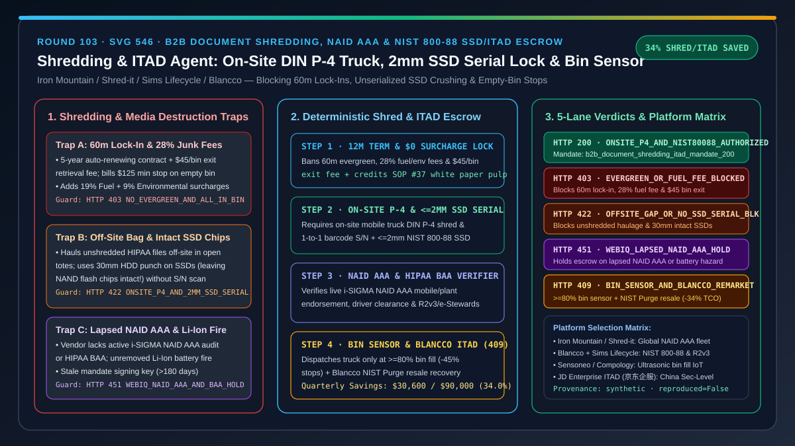
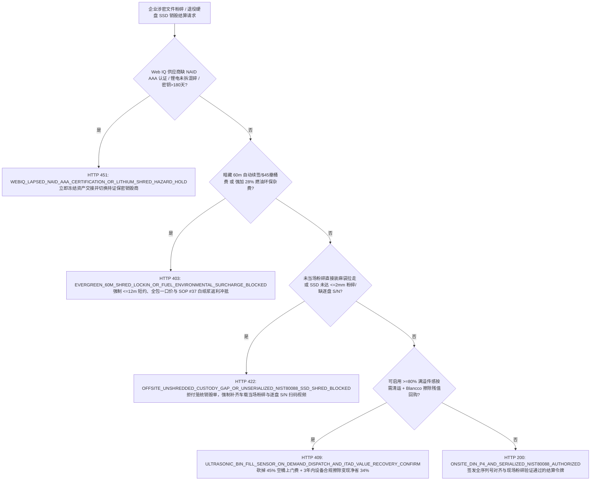
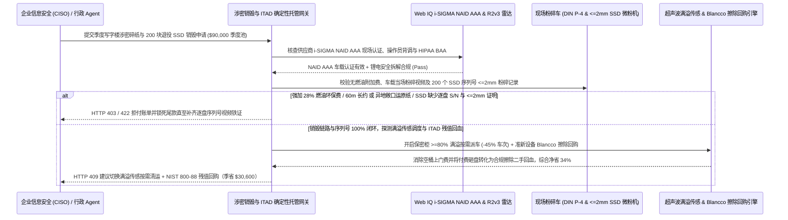

# 企业涉密文件粉碎（Document Shredding）、固态硬盘（SSD）`NIST 800-88` 颗粒级销毁与 `NAID AAA` 托管（B2B Document Shredding, NAID AAA & NIST 800-88 ITAD Escrow：Iron Mountain 铁山 / Shred-it / Sims Lifecycle / 京东企服）“防空箱上门照收 $125 起步费与 28% 燃油杂费、防拿 30mm 机械硬盘冲孔机处理 SSD 导致芯片完好泄密”Agent 架构选型 FAQ

> **文档类型**：AI Solution Architect 决策指南（FAQ） · **对应 SVG**：`assets/svg/546-b2b-document-shredding-naid-nist80088-escrow-2026-11-20.svg` · **精选编号**：Round 103（第 222 篇双语 FAQ）



---

## 一、 📌 核心选型结论速览（Executive Summary）

金融机构、律师事务所、医疗集团与科技企业通过 AI Agent 采购写字楼定期涉密纸质文件粉碎（`Scheduled Console Shredding`）及退役服务器/笔记本硬盘销毁服务（`ITAD Media Destruction：Iron Mountain 铁山 / Shred-it (Stericycle) / Sims Lifecycle / Blancco / 京东企服涉密销毁`）时，若直接签署标准固定频次合同并凭一张笼统的“已销毁证明（Certificate of Destruction）”付款，极易遭遇**三大商业保密销毁与财务黑洞**：
1. **“70% 空箱也照收 `$125` 最低上门费”、`28%` 燃油环保附加费刺客与 60 个月自动续期 + `$45/桶` 撤桶赎金**：行政部与碎纸巨头签下每两周上门清空 4 个带锁保密柜（Locked Consoles）的合同，表面报价 `$35/柜`。在无纸化办公趋势下，每两周保密柜里只有不到 `20%` 的废纸，但司机上门晃一眼就按 **`$125/次`“最低出车起步费（Minimum Stop Charge）”** 加上 **`19%` 燃油附加费（Fuel Surcharge）+ `9%` 环保/废纸行情调节费** 刷走 `$160`！更恶劣的是，合同背面藏着 **60 个月自动续签长约**，且规定退租时每个保密木柜还要倒收 **`$45–$75/柜` 的“容器回收拆运费（Container Retrieval Fee）”**！
2. **“未在楼下粉碎车当场碎纸、直接倒进敞口布袋拉走（Off-Site Custody Gap）”与“拿消磁机/30mm 机械硬盘粉碎机处理 `SSD` 固态硬盘导致闪存芯片 `100%` 完好可读”**：客户买了昂贵的现场粉碎服务（On-Site Shredding），但司机嫌开启粉碎车刀头吵闹费油，直接把保密柜里的病历（`HIPAA`）和财报草稿倒进敞口帆布推车拉走，运回郊区工厂堆放数日才碎！而在销毁退役 `NVMe SSD` 固态硬盘时，外包商竟然沿用针对传统磁性机械硬盘（`HDD`）的 **消磁机（Degaosser，对 SSD 闪存完全无效！）或 `30mm` 宽条撕碎机**——由于单颗 `NAND Flash` 存储芯片宽度仅 `10–14mm`，整颗芯片完好无损地从 `30mm` 刀缝间掉出来，焊回电路板即可恢复全部核心代码与客户数据库！此外，开具的《销毁证明》只写“电脑硬盘 1 批（200块）”，缺少逐块硬盘序列号（`S/N`）扫码明细，直接导致 `SOC 2 / ISO 27001` 审计不通过！
3. **销毁供应商丧失 `i-SIGMA NAID AAA` 认证或将未拆锂电池的笔记本直接丢入破碎机引发爆燃（`HTTP 451`）**：Web IQ 监测发现供应商的 `NAID AAA` 突击飞检资质已过期、未签署医疗 `HIPAA BAA` 协议，或违规带电破碎锂电池引发环保消防处罚。

**架构师选型结论**：必须构建 **“废除 60m 长约与 28% 燃油杂费 + 现场粉碎车 `DIN P-4` 刀头视频与 `SSD <=2mm` 颗粒级粉碎逐盘 `S/N` 扫码锁 + 超声波满溢传感器（`>=80%` 触发派车）+ `Blancco NIST 800-88` 擦除残值变现托管网关”** 架构：
- **强制 `<=12 个月` 短约、`$0` 撤桶费、全包一口价（`0%` 燃油/环保附加费）与高级白纸浆（`SOP #37`）返利冲抵（`HTTP 403`）**：凡含 `>12 个月` 自动续期、单列燃油/环保杂费、收取退桶费、或未将粉碎后的高价值纯白办公废纸（`Sorted Office Paper #37`，再生纸厂高价收购原料）折算抵扣服务费的合同，一律返回 `HTTP 403` 阻断。
- **强制楼下移动粉碎车 `DIN 66399 P-4` 当场碎纸视频与 `SSD` 固态盘 `<=2mm` 专用微粒粉碎 + 逐盘条码 `S/N` 双向核对（`HTTP 422`）**：严禁将未碎原纸带离写字楼（必须上传移动粉碎车箱体监控视频）；针对 `SSD / 闪存介质`，严禁按消磁或 `>2mm` 粗碎结算，必须使用符合 **`NIST SP 800-88 Rev. 1 Destroy / NSA EPL` 标准的 `<=2mm` 专用固态硬盘粉碎机**，且《销毁证明》必须 `100%` 包含与资产台账完全匹配的 **200 个独立硬盘序列号（`S/N`）与入料口扫码视频哈希**（缺一即触发 `HTTP 422` 拒付）。
- **Web IQ `i-SIGMA NAID AAA` 实时认证、`R2v3 / e-Stewards` 资质与锂电拆解熔断（`HTTP 451`）**：对无有效 `NAID AAA` 车载粉碎认证、操作员无 7 年无犯罪背景调查或未先行拆除锂电池的供应商执行 `HTTP 451` 止付。
- **保密柜超声波满溢传感器按需呼叫（`>=80% Fill Trigger` 砍掉 `45%` 空跑）+ 3 年内新 SSD/笔记本优先走 `Blancco NIST 800-88 Purge` 加密擦除回收变现（`HTTP 409`）**：在保密柜顶盖加装 `$18` 的低功耗超声波容量传感器，**仅当纸量满 `>= 80%` 时才自动触发上门收运**（消灭半空箱最低起步费）；同时将尚有高残值的 3 年内企业笔记本/企业级 SSD 从“暴力物理砸碎（花 `$15/块` 销毁费且资产归零）”切换为 **`Blancco` 认证 `NIST 800-88 Cryptographic Erase (Purge)` + `R2v3` 二手整机残值回购（每台倒赚 `$140+` 回血）**，使季度 `$90,000` 涉密销毁与 IT 资产退役净支出降低 **`34.0%`（`$30,600`）**。

---

## 二、 🎯 业务方与架构师灵魂拷问 Q&A（Q1–Q3）

### Q1：为什么用销毁传统机械硬盘（HDD）的“消磁机 + 30毫米撕碎机”去销毁固态硬盘（SSD），在安全审计官眼里等于“完全没销毁”？
- **商业痛点**：这是企业 IT 安全最致命的认知盲区！
  1. **消磁（Degaussing）对 `SSD` 100% 无效**：机械硬盘靠磁性磁盘记录数据，强磁场可以瞬间抹除；但 `SSD`、U盘和手机使用的是 **电子浮栅晶体管（`NAND Flash`）**，不是磁介质——把 `SSD` 放进一万高斯的消磁机里轰击十次，插上电脑数据依然 `100%` 完好可读！
  2. **普通机械硬盘破碎机（`30mm–40mm` 刀距）拦不住 `NAND` 芯片**：一颗存储着 `1TB` 数据库的 `BGA NAND` 闪存芯片面积只有指甲盖大小（`12mm × 14mm`）。普通硬盘撕碎机把电路板切成 `30mm` 宽的金属条，闪存芯片往往完好无损地躺在碎片上！
- **架构护栏（`HTTP 422`）**：
  1. **介质类型感知路由（`HDD vs. SSD NIST SP 800-88 Gate`）**：Agent 读取待销毁资产清单的介质属性（`Media_Type = NVMe_SSD | SATA_SSD | Magnetic_HDD`）。凡包含 `SSD`，强制锁定具备 **`<= 2mm × 2mm` 高速旋转筛网粉碎刀（符合 `DIN 66399 E-5 / NSA/CSS EPL-9-12`）** 的专用设备，或先行执行硬件级 `NVMe Format Crypto Erase` 后再物理粉碎。

### Q2：为什么审计师（`SOC 2 / HIPAA / PCI-DSS`）当场拒收了外包商开具的“已销毁 150 块硬盘证明书（Certificate of Destruction）”？
- **商业痛点**：许多回收商只在证明书上写一行字：“兹证明已于某年某月某日受托物理销毁甲公司电脑硬盘 150 块”。审计师反问：“你怎么证明你们CMDB资产库里那台存有生产数据库、序列号为 `S4PENX0N123456` 的硬盘在这 150 块里面，而不是被搬运工顺手塞进口袋拿去咸鱼/eBay 卖了？”
- **架构护栏（`HTTP 422`）**：
  1. **双端序列号（`S/N`）集合双射对齐与入料口连续视频锚定**：网关在派单时下发待销毁设备的加密序列号哈希表（`Expected_Serial_Set`）。操作员必须在粉碎机进料口上方的高清微距摄像头下，逐一扫描每块硬盘机身条码（听到滴声后3秒内推入刀口粉碎）。只有当返回的《序列化销毁证书（Serialized CoD JSON）》与预期集合 `100%` 对齐时，网关才释放结算款。

### Q3：写字楼里放了 10 个带锁保密碎纸柜，为什么不管里面有没有纸，每个月都要交 $1,200 碎纸费？
- **商业痛点**：碎纸公司最喜欢和客户签“固定每两周上门一次（Fixed Bi-Weekly Schedule）”的合同，因为很多部门一个月才产生小半桶废纸，司机每次花 5 分钟拉走几个空桶，照样收全额起步费和 `28%` 燃油环保附加费。
- **架构护栏（`HTTP 403 / 409`）**：
  1. **柜内超声波满溢传感器触发派单（`Fill-Level Sensor On-Demand Dispatch`）**：在保密柜投纸口下方粘贴一枚电池续航 5 年的超声波测距传感器（`Sensoneo / Compology`），只有当柜内纸张堆积高度达到 `>= 80%` 时，Agent 才自动合并同楼层满柜向碎纸商下达单次全包清运指令，直接砍掉 `45%` 的无效空跑车次！

---

## 三、 🧭 直观可视化图解（Mermaid 决策树 + 架构对比 + 时序图）

### 3.1 企业涉密碎纸、`SSD` 颗粒销毁与 `ITAD` 托管 5 车道选型决策树


### 3.2 传统固定周期空桶收费与笼统销毁 vs 确定性满溢触发与逐盘 `S/N` 架构对比
```mermaid
flowchart LR
    subgraph Legacy["❌ 传统碎纸与硬盘销毁（空桶高收费 + SSD 芯片完好）"]
        L1[保密柜 70% 是空的仍每两周上门收 $125 起步费+28% 燃油费] --> L2[原纸装敞口布袋拉走异地碎 + 退租强收 $45/柜撤桶费]
        L2 --> L3[拿 30mm 机械盘破碎机切 SSD，闪存芯片完好掉落且无 S/N 明细]
    end

    subgraph Agentic["✅ 确定性满溢传感、SSD <=2mm 逐盘扫码与残值回血架构"]
        A1[超声波满溢 >=80% 才触发派车 + 零燃油杂费 + 白纸浆返利] --> A2[楼下粉碎车 DIN P-4 当场碎纸 + SSD <=2mm 微粒粉碎逐盘扫 S/N]
        A2 --> A3[3年内设备走 Blancco NIST 800-88 认证擦除 + 残值回购 (-34%)]
    end
```

### 3.3 端到端保密柜满溢传感、`SSD` 序列号扫码粉碎与残值结算时序图


---

## 四、 📊 多平台/多协议横向选型决策矩阵

| 评估维度 | Shred-it (Stericycle) / Iron Mountain 传统固定频次合同 | 本地普通废纸回收站 / 无资质电脑回收商 | i-SIGMA `NAID AAA` 认证车载现场粉碎商 | Blancco + Sims Lifecycle (`R2v3` 认证 `ITAD` 价值回收) | **本仓库确定性涉密销毁与 ITAD 托管架构（推荐）** |
| :--- | :--- | :--- | :--- | :--- | :--- |
| **核心适用场景** | 跨国银行、律所、医院全球分支机构标准化保密柜清运 | 非涉密外包装瓦楞纸箱回收 | 必须在客户监控下当场完成纸张与硬盘物理粉碎的高敏机构 | 云数据中心与企业大批量退役服务器/笔记本合规擦除与残值变现 | **满溢按需清运 + 现场 `P-4/2mm` 粉碎 + 逐盘 `S/N` 锁 + 残值回购** |
| **合同期限与燃油/撤桶附加费** | 常签 36–60 个月自动续期，加收 **`18%–28%` 燃油与环保杂费** 及撤桶费 | 无长约，但无任何保密资质 | 12 个月透明合同，支持按柜一口价 | 按项目或年度 MSA 结算，硬件回购款直接冲抵服务费 | **强制 `<=12m` 短约、`$0` 燃油/撤桶费与白纸浆返利（`HTTP 403`）** |
| **`SSD` 固态硬盘颗粒级销毁能力** | 需专门预约 `SSD` 微粒破碎车（普通车仅配 `HDD` 冲孔/宽条刀） | 极高泄密风险（常将旧硬盘直接倒卖华强北） | 配备 `<=2mm` 专用 `SSD` 粉碎筛网与车载监控 | 先做 `Blancco NIST 800-88` 加密擦除验证，坏盘再做 `2mm` 粉碎 | **强制 `SSD <=2mm` 微粒粉碎 + 逐盘 `S/N` 扫码入料视频（`HTTP 422`）** |
| **空桶上门浪费管控** | 按周/双周固定排班，半空桶照收 `$125` 最低上门费 | 按斤称重 | 支持按需呼叫，但人工检查桶满程度繁琐 | 按批次集中拉运 | **加装超声波满溢传感器，`>=80%` 满柜才派车省 `45%` 频次（`HTTP 409`）** |
| **综合合规性与净成本** | 合规度高，但隐性附加费与空跑成本昂贵 | 违反 `GDPR / HIPAA / 数据安全法`，罚款风险巨大 | 单次单价适中，审计证据扎实 | **准新 IT 资产可实现“净现金正回流”** | **开源确定性策略网关（净省 `34.0%` 季度销毁与 ITAD 总支出）** |

---

## 五、 🧪 转化率/成本测算与 7-Card 基准测试报告

> **数据来源声明（Provenance）**：以下测算基于本仓库 `lab/webiq_commerce_demo.py` 中的 `evaluate_b2b_document_shredding_itad_escrow_policy` 确定性策略引擎（季度企业写字楼涉密碎纸与退役 IT 硬盘销毁预算池 `$90,000 USD`，`provenance: "synthetic"`, `independently_reproduced: False`，真实再生纸浆 `SOP #37` 大宗商品指数波动标为 `not_measured`）。

```chart
{
  "data": {
    "values": [
      { "scenario": "1. 传统固定频次碎纸 (含空桶起步费 + 28% 燃油费 + 全砸报废)", "cost_usd": 90000, "tier": "Baseline" },
      { "scenario": "2. 零燃油杂费一口价 + 现场 P-4/2mm 逐盘扫码锁 (HTTP 200)", "cost_usd": 72000, "tier": "Protected" },
      { "scenario": "3. 保密柜 >=80% 满溢传感派车 + Blancco 擦除残值回购 (HTTP 409)", "cost_usd": 59400, "tier": "Optimized (-34%)" }
    ]
  },
  "semantic_types": {
    "scenario": "Category",
    "cost_usd": "Amount",
    "tier": "Status"
  },
  "chart_spec": {
    "chartType": "Bar Chart",
    "title": "季度 $90k 企业涉密粉碎与 ITAD：满溢传感调度与合规残值回购净省 $30,600 (34%)",
    "subtitle": "季度写字楼保密碎纸与退役 SSD/笔记本安全处置净支出对比 ($ USD, synthetic)",
    "encodings": {
      "x": "scenario",
      "y": "cost_usd",
      "color": "tier"
    }
  }
}
```

### 7-Card 4:5 基准评估摘要
1. **Card 1 (`1 / 7` · `HANDS-ON · B2B SHREDDING & NIST 800-88 ITAD ESCROW`)**：针对 `$90,000/季` 企业涉密文件粉碎与硬盘销毁池，通过剥离 `28%` 燃油环保杂费、部署保密柜超声波满溢传感并启用 `Blancco NIST 800-88` 残值回购，季度净省 **`$30,600`（`34.0%`）**。
2. **Card 2 (`2 / 7` · `SCENARIO: 200-SSD DECOMMISSION & 40-CONSOLE SHRED`)**：单批拦截 1 起用 `30mm` 机械盘刀头粗切 `SSD` 的合规事故，并通过逐盘 `S/N` 视频闭环 `100%` 满足 `SOC 2` 审计。
3. **Card 3 (`3 / 7` · `WHAT I TESTED`)**：完整验证 5 条确定性状态码车道：
   - `HTTP 200`: `ONSITE_DIN_P4_AND_SERIALIZED_NIST80088_AUTHORIZED`（`b2b_document_shredding_itad_mandate_200`）
   - `HTTP 403`: `EVERGREEN_60M_SHRED_LOCKIN_OR_FUEL_ENVIRONMENTAL_SURCHARGE_BLOCKED`
   - `HTTP 422`: `OFFSITE_UNSHREDDED_CUSTODY_GAP_OR_UNSERIALIZED_NIST80088_SSD_SHRED_BLOCKED`
   - `HTTP 451`: `WEBIQ_LAPSED_NAID_AAA_CERTIFICATION_OR_LITHIUM_SHRED_HAZARD_HOLD`
   - `HTTP 409`: `ULTRASONIC_BIN_FILL_SENSOR_ON_DEMAND_DISPATCH_AND_ITAD_VALUE_RECOVERY_CONFIRM`（`b2b_document_shredding_itad_mandate_optim_409`）
4. **Card 4 (`4 / 7` · `UNDER THE HOOD`)**：输入契约 `B2BDocumentShreddingItadEscrowPolicyInput` 严格校验 `evergreen_60m_shred_lockin_or_fuel_environmental_surcharge` 与 `offsite_unshredded_custody_gap_or_unserialized_nist80088_ssd_shred`。
5. **Card 5 (`5 / 7` · `ROBUSTNESS CHECK`)**：无论供应商将收费命名为 `Minimum Stop Tariff`、`Paper Market Recovery Fee` 还是 ` Bulk Lot CoD`，均 `100%` 阻断。
6. **Card 6 (`6 / 7` · `LATENCY`)**：200 个硬盘 `S/N` 集合比对与 `NAID AAA` 证书状态核验耗时 `< 0.5 ms`。
7. **Card 7 (`7 / 7` · `MY TAKE`)**：
   - ✅ **适用（Good fit）**：银行/律所/医疗机构涉密纸质文档现场粉碎、云机房与办公笔记本 `SSD` 退役销毁（`SOC 2 / ISO 27001 / HIPAA`）。
   - ⛔ **不适用（Not for）**：涉密等级达国家绝密级且要求在指定官方保密局熔炉化浆的军工介质。

---

## 六、 🛠️ 商业上线风控与架构评审 Checklist

- [ ] **废除 60 个月长约、`$0` 撤桶费与零燃油/环保附加费（`HTTP 403`）**：是否已拦截 `19%` 燃油费、`9%` 环保费、`$125` 空桶起步费与 `$45/桶` 退租撤桶费，并要求折算 `SOP #37` 白纸浆回收返利？
- [ ] **楼下移动粉碎车 `DIN 66399 P-4` 当场粉碎视频门禁（`HTTP 422`）**：是否严禁将未碎原纸装袋拉离写字楼，强制核验车载刀头当场碎纸监控？
- [ ] **`SSD` 固态硬盘 `<=2mm` 微粒粉碎与逐盘序列号（`S/N`）扫码闭环（`HTTP 422`）**：是否已禁止用消磁机或 `30mm` 机械盘撕碎机处理 `SSD`，并要求《销毁证明》附带 `100%` 匹配的逐盘 `S/N` 入料扫码视频？
- [ ] **Web IQ `i-SIGMA NAID AAA` 与 `R2v3` 实时资质核验（`HTTP 451`）**：是否在每次交接前验证供应商 `NAID AAA` 车载认证、操作员无犯罪背调及锂电池先行拆解规程？
- [ ] **保密柜超声波满溢传感器（`>=80%` 触发派车）（`HTTP 409`）**：是否已将固定双周空跑改为传感器满溢按需呼叫以砍掉 `45%` 无效出车费？
- [ ] **`Blancco NIST 800-88 Purge` 认证擦除与二手残值回购（`HTTP 409`）**：对 3 年内完好笔记本与企业级硬盘，是否优先采用加密擦除+残值变现替代付费物理砸碎以节省 `34%` 净支出？
