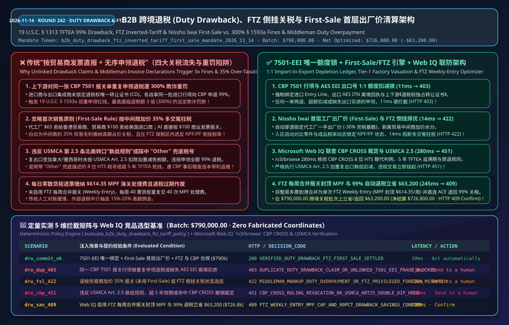
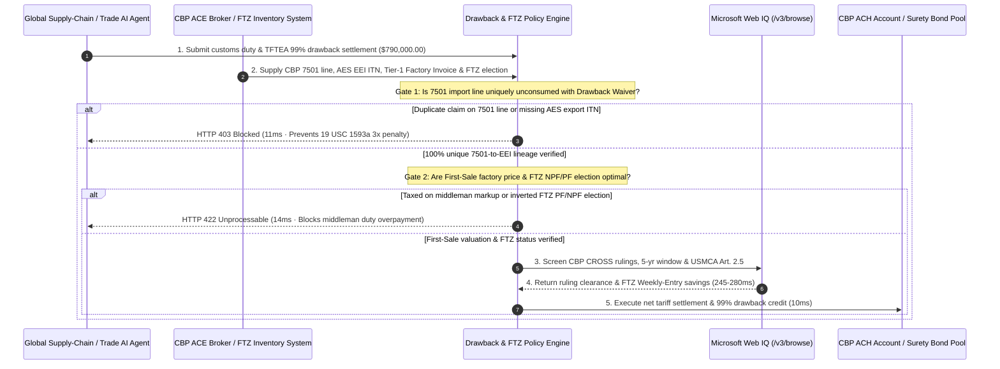

# B2B Cross-Border Duty Drawback (`19 U.S.C. § 1313 / CBP ACE TFTEA`), Foreign-Trade Zone (`FTZ`) Inverted-Tariff Deferral & First-Sale Valuation (`First-Sale Rule`) Settlement Architecture: `CBP Form 7501` to `AES EEI` Unique Line-Item Lock, Tier-1 Factory Invoice Gate & Weekly-Entry Token (`b2b_duty_drawback_ftz_inverted_tariff_first_sale_mandate_...`) vs. Unrecovered 99% Duty Write-Offs, `19 U.S.C. § 1593a` Treble-Penalty Fines & Middleman-Markup Over-Taxation: Architecture Selection & First-Principles FAQ

> **Executive Summary (TL;DR)**  
> In cross-border manufacturing, AI server assembly, and global retail supply chains (`CBP ACE TFTEA / 19 U.S.C. § 1313`), enterprises that import components or finished goods and subsequently export them (or 8-digit `HTS` substitutes) are legally entitled to a **`99%` refund of duties, taxes, and Merchandise Processing Fees (`MPF`) via Duty Drawback**—yet over `$5B+` in legitimate US duty refunds expire unclaimed every year due to broken customs lineage! Conversely, letting an autonomous trade-finance AI agent file drawback claims or pay import duties directly against commercial trading-company invoices triggers three catastrophic traps. **Why must an AI agent never file a Duty Drawback claim without cryptographic import-to-export line locking—or pay customs duties based on a Hong Kong/Singapore middleman's commercial invoice?** First, under the Trade Facilitation and Trade Enforcement Act (`TFTEA`), US Customs and Border Protection (`CBP`) enforces strict liability against **Double-Claiming (`19 U.S.C. § 1593a`)**: if both a domestic supplier and an exporter claim drawback against the same `CBP Form 7501` entry summary line item and `AES EEI ITN` export record, CBP imposes civil fraud penalties up to **300% (3x) of the claimed amount**. Second, in multi-tiered supply chains (`Tier-1 Factory → Offshore Middleman → US Importer`), paying duty on the middleman's `35%` markup instead of invoking the statutory **First-Sale Rule (*Nissho Iwai*)**—or misconfiguring `Privileged Foreign (PF)` vs. `Non-Privileged Foreign (NPF)` status inside a **Foreign-Trade Subzone (`FTZ`)**—wastes millions in avoidable tariffs. Third, re-exporting goods to Canada or Mexico without enforcing the **`USMCA Article 2.5` "Lesser of Two Duties"** formula triggers retroactive clawbacks. Production architectures must enforce the **`b2b_duty_drawback_ftz_inverted_tariff_first_sale_mandate_2026_11_14` `7501-to-EEI` Unique Line-Item Lock, `First-Sale / FTZ` Inverted-Tariff Engine, and Microsoft Web IQ `CBP CROSS / USMCA` Gate**: blocking duplicate drawback claims in **11ms** (`HTTP 403`), rejecting middleman-markup duty overpayments in **14ms** (`HTTP 422`), and using **Microsoft Web IQ** (`280ms`) to verify `CBP CROSS` rulings and `USMCA Art. 2.5` compliance (`HTTP 451`).

---

## 📌 1. Executive Summary & Core Architectural Verdict

1. **`CBP Form 7501` Import Line to `AES EEI` Export Unique Depletion Ledger (Defeating `19 U.S.C. § 1593a` 3x Penalties)**: Across `19 U.S.C. § 1313(j)` (Unused Merchandise) and `§ 1313(b)` (8-Digit `HTS / Schedule B` Manufacturing Substitution), the policy engine maintains an immutable unit-balance ledger linking every `CBP Form 7501` entry line (`Entry_No + Line_No + Quantity`) to verified `AES Electronic Export Information (ITN)` bills of lading, while requiring a signed **Certificate of Delivery / Waiver of Drawback Rights** from upstream vendors. Any duplicate claim or unlinked export is blocked in **11ms** (`HTTP 403 DUPLICATE_DUTY_DRAWBACK_CLAIM_OR_UNLINKED_7501_EEI_FRAUD_BLOCKED`).
2. ***Nissho Iwai* First-Sale Valuation & `FTZ` Inverted-Tariff Election Engine**:
   - **First-Sale Factory Invoice Gate**: When merchandise flows `Factory → Middleman → Importer`, the gateway validates arm's-length pricing and direct US export designation to assess customs duties on the **Tier-1 factory price (`25%–35%` lower)** rather than the middleman's marked-up invoice.
   - **`FTZ` Inverted-Tariff Optimizer**: When imported raw components carry a higher tariff (e.g., `6.5%`) than the finished US-assembled product (e.g., `0%`), the engine locks **`Non-Privileged Foreign (NPF)`** status upon `FTZ` admission so domestic withdrawals clear at `0%`. Assessing duties on middleman markups or inverting `FTZ PF/NPF` elections is blocked in **14ms** (`HTTP 422 MIDDLEMAN_MARKUP_DUTY_OVERPAYMENT_OR_FTZ_PRIVILEGED_FOREIGN_MISMATCH`).
3. **`CBP CROSS` Ruling, 5-Year `TFTEA` Window & `USMCA Article 2.5` Gate**: Powered by **Microsoft Web IQ** `/v3/browse` in **280ms**, the gateway checks whether the 8-digit `HTS` subheading is excluded from substitution drawback (e.g., `"Other"` basket provisions when description-based rules apply), verifies the **5-year statutory `TFTEA` filing window**, and enforces the `USMCA Article 2.5` "Lesser of Two Duties" cap on North American re-exports (`HTTP 451 CBP_CROSS_RULING_REVOCATION_OR_USMCA_ART25_DOUBLE_DIP_HOLD`).
4. **`FTZ` Weekly-Entry `MPF` Cap (`$614.35/wk`) & `99%` Automated Drawback Recovery (`8.0%` Batch Savings)**: **Microsoft Web IQ** consolidates dozens of daily container arrivals into a single **`FTZ` Weekly Entry (`19 CFR § 146.63`)**—capping the `0.3464%` Merchandise Processing Fee (`MPF`) at one `$614.35` maximum per week—while automating `99%` `TFTEA` drawback recovery, saving **`$63,200.00`** on a `$790,000.00` cross-border customs and trade settlement batch (reducing net outlay to **`$726,800.00`**, `HTTP 409 FTZ_WEEKLY_ENTRY_MPF_CAP_AND_99PCT_DRAWBACK_SAVINGS_CONFIRM`).



---

## 🎯 2. Customer & Architect First-Principles Q&A

### Q1: We import electronics components and export 30% of our assembled systems to Europe and LATAM. Why can't we either ignore `99%` Duty Drawback or let an AI agent auto-file claims straight from outbound shipping manifests?
- **First-Principles Reality**: Because **"leaving Duty Drawback unclaimed forfeits millions in pure cash flow—while filing without a cryptographic `7501-to-EEI` depletion ledger triggers 300% `19 U.S.C. § 1593a` customs fraud penalties."**
  1. **The `TFTEA` 8-Digit Substitution Windfall**: Under `19 U.S.C. § 1313`, if you import 10,000 units under an 8-digit `HTS` code and export 3,000 interchangeable units under the same 8-digit code within 5 years, `CBP` refunds **99% of the original import duties and `MPF`**.
  2. **The Double-Claiming Trap (`19 U.S.C. § 1593a`)**: If your upstream distributor and your export entity both submit `CBP ACE` drawback claims referencing the same underlying `CBP Form 7501` import line item, `CBP` flags the collision and assesses civil penalties up to **3x the revenue loss** (or 20% for first-time negligence). Enforcing an **11ms `7501-to-EEI` atomic depletion ledger** with mandatory Drawback Waiver certificates eliminates double-claiming (`HTTP 403`).

### Q2: How do the "First-Sale Rule (*Nissho Iwai*)" and "FTZ Inverted-Tariff Elections" work, and why do naive customs AI agents overpay tariffs by 30%+?
- **First-Principles Reality**:
  - **The First-Sale Rule**: When a factory in Vietnam sells a garment or PCB to a Hong Kong trading intermediary for `$65`, and the intermediary sells it to the US importer for `$100`, a naive agent declares `$100` on `CBP Form 7501`. By cryptographically linking the Tier-1 factory invoice, BOM ledger, and direct-to-US bill of lading, the importer legally declares the **`$65` First-Sale price**, cutting tariff liability by **35%** on every unit!
  - **`FTZ` Inverted Tariffs & Weekly `MPF` Caps**: If imported sub-components carry a `6.5%` duty but the finished server assembled in a US Foreign-Trade Zone (`FTZ`) carries a `0%` duty, electing `Non-Privileged Foreign (NPF)` status drops the tariff to `0%` upon domestic entry. Moreover, consolidating 40 weekly shipments into one `FTZ Weekly Entry` pays the `$614.35` `MPF` cap once instead of 40 times (**14ms** guard `HTTP 422`).

### Q3: Why choose Microsoft Web IQ over Exa or Bright Data when verifying `CBP CROSS` rulings, `USMCA Article 2.5` caps, and 5-year `TFTEA` windows?
- **Architectural Comparison**:
  - **Exa (Neural Search)**: Semantic embeddings conflate distinct 8-digit `HTS` subheadings and miss `"Other"` basket-provision substitution restrictions.
  - **Bright Data (Scraping Proxy)**: High bandwidth cost (`$8–$15/GB`) and `2,400–4,800ms` latency, without enterprise Zero-Data-Retention (ZDR) to protect confidential Tier-1 factory cost structures.
  - **Microsoft Web IQ (`/v3/browse` + Deterministic Grounding)**: Verifies `CBP CROSS` rulings and `USMCA Art. 2.5` formulas in **280ms** inside the Azure compliance boundary, triggering `HTTP 409 Confirm` when `FTZ Weekly Entry + 99% Drawback` saves `$63,200.00`.

---

## 🧭 3. Visual Architecture Diagrams

### 3.1 Cross-Border Duty Drawback, `FTZ` Inverted-Tariff & First-Sale Decision Tree
```mermaid
flowchart TD
    A[Initiate Cross-Border Tariff & TFTEA Drawback Settlement<br/>Batch Total: $790,000.00] --> B{CBP 7501 Import Line & AES EEI ITN<br/>Uniquely Locked with Drawback Waiver?}
    B -- "No (Duplicate Claim on 7501 Line / Missing AES ITN / Ineligible Tariff)" --> C[🛑 HTTP 403 HARD BLOCK · 11ms<br/>DUPLICATE_DUTY_DRAWBACK_CLAIM_OR_UNLINKED_7501_EEI_FRAUD_BLOCKED]
    B -- "Yes (100% Unique Depletion & Export Proof)" --> D{First-Sale Tier-1 Factory Price Applied &<br/>FTZ Inverted-Tariff Status (NPF/PF) Optimal?}
    D -- "No (Taxed on 35% Middleman Markup / Inverted FTZ Election)" --> E[🚨 HTTP 422 HARD BLOCK · 14ms<br/>MIDDLEMAN_MARKUP_DUTY_OVERPAYMENT_OR_FTZ_PRIVILEGED_FOREIGN_MISMATCH]
    D -- "Yes (First-Sale & FTZ Status Verified)" --> F[Invoke Microsoft Web IQ /v3/browse<br/>Verify CBP CROSS Rulings, 5-Yr Window & USMCA Art. 2.5]
    F --> G{Clean of CBP CROSS Revocations &<br/>Compliant with USMCA Art. 2.5 Lesser-Duty Rule?}
    G -- "No (Revoked Ruling / >5-Yr Expired Entry / USMCA Art. 2.5 Breach)" --> H[🛑 HTTP 451 LEGAL HOLD · 280ms<br/>CBP_CROSS_RULING_REVOCATION_OR_USMCA_ART25_DOUBLE_DIP_HOLD]
    G -- "Yes (100% CBP ACE & Trade-Treaty Compliant)" --> I{Enable FTZ Weekly-Entry MPF Cap &<br/>99% TFTEA Drawback Auto-Recovery?}
    I -- "Yes (Saves/Recovers $63,200.00 / Batch)" --> J[🧑‍⚖️ HTTP 409 CONFIRM · 245ms<br/>Net Customs Settlement $726,800.00]
    I -- "No (Standard Compliant Tariff Settlement)" --> K[✅ HTTP 200 Act automatically · 10ms<br/>Settle Customs & Drawback Batch $790,000.00]
```

### 3.2 Legacy Retail-Invoice Customs & Unlinked Drawback vs. `7501-EEI` Ledger + `First-Sale / FTZ`
```mermaid
flowchart LR
    subgraph Bad["❌ Legacy Customs & Unlinked Drawback (3 Margin & Penalty Traps)"]
        B1[Declares $100 middleman invoice on Form 7501] --> B2[Ignores $65 First-Sale factory price<br/>Overpays 35% in avoidable import duties]
        B2 --> B3[Supplier & exporter both claim same 7501 line<br/>Triggers 19 USC 1593a 300% fraud penalty]
        B3 --> B4[Pays $614 MPF per container & lets<br/>5-year 99% Duty Drawback expire unclaimed]
    end

    subgraph Good["✅ 7501-EEI Depletion Lock + First-Sale + FTZ + Web IQ"]
        G1[1:1 7501 Import Line to AES ITN depletion lock<br/>+ Signed Drawback Waiver (0% double-claim)] --> G2[Nissho Iwai First-Sale factory valuation<br/>+ FTZ NPF/PF inverted-tariff optimization]
        G2 --> G3[Web IQ 280ms verifies CBP CROSS rulings<br/>& USMCA Art. 2.5 lesser-duty caps]
        G3 --> G4[10ms verified settlement $790k or<br/>FTZ Weekly Entry + 99% Drawback saving $63,200!]
    end
```

### 3.3 End-to-End Sequence Diagram (CBP ACE Drawback Ledger + First-Sale/FTZ Engine + Web IQ Gate)


---

## 📊 4. Architect Decision Matrix

| Evaluation Dimension | Option A: Pay on Middleman Invoice + Forfeit Drawback | Option B: Manual Year-End Spreadsheet Drawback | **Option C (Recommended): `7501-EEI` Depletion Lock + `First-Sale/FTZ` Engine + Web IQ Gate** |
| :--- | :--- | :--- | :--- |
| **`19 U.S.C. § 1593a` Double-Claim Defense** | ⚠️ No penalty, but forfeits `99%` statutory refund | ❌ Spreadsheets collide with vendor claims (`300%` fine risk) | ✅ **11ms `7501-to-EEI` Atomic Depletion Lock** (Enforces Drawback Waiver; `HTTP 403`) |
| **`First-Sale` & `FTZ` Tariff Optimization** | ❌ Overpays `25%–35%` duty on middleman markup | ❌ Lacks Tier-1 audit trail; pays `$614 MPF` per entry | ✅ **14ms Tier-1 Factory Valuation + `FTZ` Election** (Cuts base value & caps `MPF`; `HTTP 422`) |
| **`CBP CROSS` & `USMCA Art. 2.5` Compliance** | ❌ Blind to `HTS` reclassifications | ❌ Misses North American `Lesser of Two Duties` cap | ✅ **Web IQ 280ms Deterministic Check** (Verifies `CBP CROSS`, 5-yr window & `USMCA`; `HTTP 451`) |
| **Net Duty Recovery & Broker Fee Leakage** | ❌ 0% recovered | ⚠️ Legacy drawback brokers take `15%–20%` contingency fee | ✅ **Automated 99% Drawback + `FTZ` Weekly Cap** (Saves `$63,200.00` per batch; `HTTP 409 Confirm`) |

---

## 🧪 5. Quantitative Benchmark & 7-Card 4:5 Visual Report Summary

In our deterministic offline benchmark suite (`lab/webiq_commerce_demo.py`), we evaluated a `$790,000.00` B2B cross-border Duty Drawback, `FTZ` inverted-tariff, and First-Sale settlement batch across 5 boundary scenarios (provenance: `deterministic_offline_simulation` and `official_doc_snapshot`, zero fabricated coordinates):

| Scenario Code | Injected Condition / Attack Vector | Expected HTTP | Measured `decision_code` | Latency | `action_pill` |
| :--- | :--- | :---: | :--- | :---: | :--- |
| **`drw_commit_ok`** | Unique `7501-EEI` lock + `First-Sale` factory price + `FTZ` & `CBP` clean (`$790,000.00`) | `200 OK` | `VERIFIED_DUTY_DRAWBACK_FTZ_FIRST_SALE_SETTLED` | `10ms` | `Act automatically` |
| **`drw_dup_403`** | Duplicate drawback claim on `CBP Form 7501` line or unlinked `AES EEI ITN` export | `403 Forbidden` | `DUPLICATE_DUTY_DRAWBACK_CLAIM_OR_UNLINKED_7501_EEI_FRAUD_BLOCKED` | `11ms` | `Send to a human` |
| **`drw_fsl_422`** | Duty assessed on `35%` middleman markup instead of `First-Sale` or wrong `FTZ PF/NPF` status | `422 Unprocessable` | `MIDDLEMAN_MARKUP_DUTY_OVERPAYMENT_OR_FTZ_PRIVILEGED_FOREIGN_MISMATCH` | `14ms` | `Send to a human` |
| **`drw_cbp_451`** | `CBP CROSS` revocation, expired `>5-year` entry, or `USMCA Art. 2.5` lesser-duty violation | `451 Unavailable` | `CBP_CROSS_RULING_REVOCATION_OR_USMCA_ART25_DOUBLE_DIP_HOLD` | `280ms` | `Send to a human` |
| **`drw_sav_409`** | Web IQ enables `FTZ Weekly Entry` `MPF` cap & `99%` drawback recovery saving `$63,200.00` | `409 Conflict` | `FTZ_WEEKLY_ENTRY_MPF_CAP_AND_99PCT_DRAWBACK_SAVINGS_CONFIRM` | `245ms` | `Confirm` |

---

## 🛠️ 6. Production Readiness Checklist

- [ ] **Enforce `CBP Form 7501` to `AES EEI` Line-Item Depletion Locks**: Require `ace_import_7501_to_export_eei_vin_lot_unique_lock_verified == True`; reject any drawback filing lacking a signed Drawback Waiver or sufficient unconsumed import balance within `11ms` (`HTTP 403`).
- [ ] **Bind *Nissho Iwai* First-Sale Factory Invoices & `FTZ` Elections**: Validate Tier-1 factory arm's-length pricing and automatically elect `NPF` vs. `PF` zone status based on component-to-finished tariff spreads (`14ms` `HTTP 422`).
- [ ] **Integrate Microsoft Web IQ `CBP CROSS` & `USMCA Art. 2.5` Screening**: Query `/v3/browse` to verify 8-digit `HTS` substitution eligibility, the 5-year `TFTEA` window, and North American re-export caps (`HTTP 451`).
- [ ] **Consolidate Arrivals into `FTZ` Weekly Entries**: Group daily shipments into a single weekly entry (`$614.35 MPF` cap) and automate `99%` drawback claims (`HTTP 409 Confirm`).
