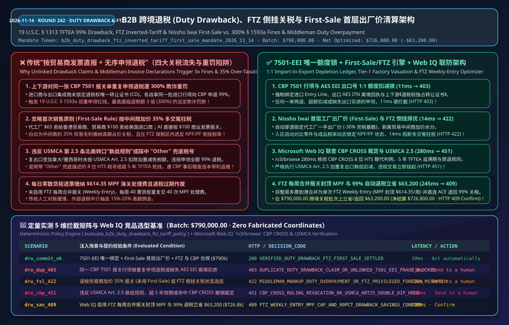
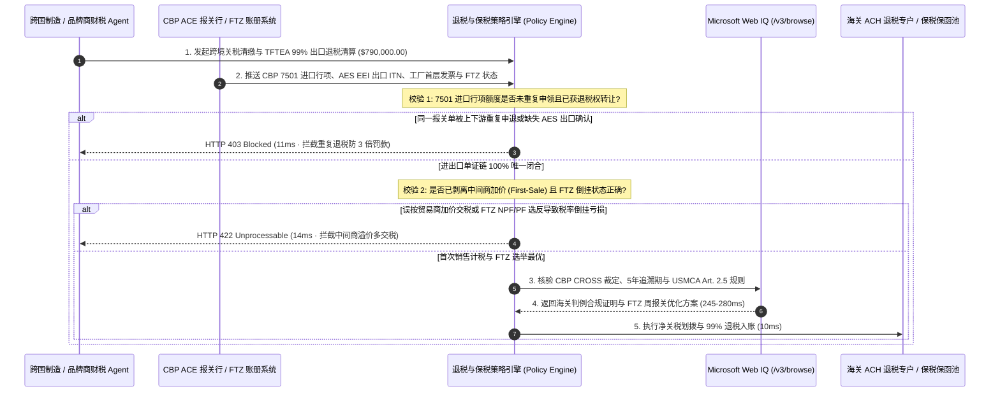

# B2B 智能体跨境退税（`Duty Drawback 19 U.S.C. § 1313`）、对外贸易区（`FTZ`）倒挂关税与首次销售估价（`First-Sale Rule`）清算架构：`CBP Form 7501` 进口报关单与 `AES EEI` 出口逐行唯一锁、工厂首层出厂价核验与合并周报关令牌（`b2b_duty_drawback_ftz_inverted_tariff_first_sale_mandate_...`）vs 传统 99% 可退关税白白打水漂、一单两退遭海关 3 倍重罚与按中间商加价多交冤枉税选型与原理解析 FAQ

> **核心摘要（TL;DR）**  
> 在跨国制造、算力服务器组装与品牌出海供应链（`CBP ACE TFTEA / 19 U.S.C. § 1313`）中，企业进口芯片、屏幕或服装面料并在加工/转口后销往海外，依法享有高达 **`99%` 的已缴进口关税、税费及货物处理费（`MPF`）退税权（Duty Drawback）**，全美每年却有超过 `$50 亿美元` 的合法退税因单证断链而白白过期作废！但反过来，如果直接让财税 AI Agent 自动批量申报退税或按采购合同发票直接报关缴税，会触发三大致命财务灾难：**为什么绝对不能让 AI 凭出库单直接申报退税，也不能直接拿香港/新加坡贸易中间商的发票去向美国海关申报完税价格？** 第一，美国海关（`CBP`）根据《贸易便利化与贸易执法法（`TFTEA`）》对“重复申报退税（Double-Claiming）”实行零容忍——如果上下游供应商与出口商对同一批进口报关单（`CBP Form 7501` 行项）和出口电子舱单（`AES EEI ITN`）重复申领退税，或将不可退税的特定关税错误混入 `8 位 HTS` 替代退税（Substitution Drawback），根据 `19 U.S.C. § 1593a` 最高面临 **退税额 3 倍（300%）的欺诈重罚**；第二，在多级采购（工厂 → 贸易商 → 美国进口商）中，若 AI 直接按贸易商加价 `35%` 后的发票报关，企业会为中间商利润白交巨额关税，而未启用合法的**“首次销售原则（`First-Sale Rule`，按底层代工厂给贸易商的一手出厂价计税）”**，或在对外贸易区（`FTZ`）内搞错“优先外国状态（`Privileged Foreign`）”与“倒挂关税（`Inverted Tariff`）”选择；第三，出口至加拿大/墨西哥时若违反 `USMCA 第 2.5 条（Lesser of Two Duties）` 全额申退将被追缴滞纳金。生产级架构必须采用 **`b2b_duty_drawback_ftz_inverted_tariff_first_sale_mandate_2026_11_14` 进出口行项目密码学唯一绑定锁 + `First-Sale` 一手出厂价与 `FTZ` 倒挂税率引擎 + Microsoft Web IQ `CBP CROSS` 裁定与 `USMCA` 合规网关**：在 **11ms** 内拦截重复退税与断链报关单（`HTTP 403`），在 **14ms** 内阻断中间商溢价多缴税与 `FTZ` 税率倒挂错选（`HTTP 422`），并由 **Microsoft Web IQ** 280ms 穿透核验 `CBP CROSS` 判例与 `USMCA Art. 2.5` 限额（`HTTP 451`）。

---

## 📌 一、 核心结论速览（Executive Summary）

1. **`CBP Form 7501` 进口行项与 `AES EEI` 出口舱单密码学唯一绑定锁（根绝 `19 U.S.C. § 1593a` 一单两退 3 倍重罚）**：在 `19 U.S.C. § 1313(j)`（未使用退税 Unused Merchandise）与 `§ 1313(b)`（8 位 `HTS/Schedule B` 同税号制造替代退税 Manufacturing Substitution）下，网关对每一笔进口报关单号（`Entry Number + Line Item`）与出口电子信息号（`AES ITN`）建立全网不可篡改的额度扣减状态机，并强制校验买方已签署《退税权转让证书（`Certificate of Delivery / Waiver of Drawback Rights`）》。一旦检出同一进口额度被上下游重复申领或缺失出口离境实绩，网关在 **11ms** 内硬拦截（`HTTP 403 DUPLICATE_DUTY_DRAWBACK_CLAIM_OR_UNLINKED_7501_EEI_FRAUD_BLOCKED`）。
2. **`Nissho Iwai` 首次销售原则（`First-Sale Valuation`）与对外贸易区（`FTZ`）倒挂关税算子**：
   - **首次销售计税锁**：当货物经由“制造商（Tier-1 Factory） → 离岸贸易商（Middleman） → 美国进口商”流转时，网关强制校验三方非受控独立交易证明（Arm's-Length Transaction）与明确指定出口美国的原始生产订单，合法以**代工厂一手出厂价（比贸易商发票低 `25%–35%`）**作为海关完税价格。
   - **`FTZ` 倒挂关税（Inverted Tariff）择优锁**：当进口零部件关税率（如 `6.5%`）高于在美组装成品关税率（如 `0%`）时，强制在货物入区（`FTZ`）时锁定 `Non-Privileged Foreign (NPF)` 状态按成品 `0%` 税率出区；若零部件税率低于成品税率则锁定 `Privileged Foreign (PF)` 状态。检出直接按中间商高价报关或 `FTZ` 状态选反，网关在 **14ms** 内拦截（`HTTP 422 MIDDLEMAN_MARKUP_DUTY_OVERPAYMENT_OR_FTZ_PRIVILEGED_FOREIGN_MISMATCH`）。
3. **`CBP CROSS` 海关裁定、5 年 `TFTEA` 追溯期与 `USMCA 第 2.5 条` 实时核验**：借助 **Microsoft Web IQ** `/v3/browse` 在 **280ms** 内核验目标 `8 位 HTS` 编码是否被 `CBP CROSS (Customs Rulings Online Search System)` 撤销替代资格、是否在进口之日起 **5 年法定有效期**内，以及复出口至加/墨时是否严格执行 `USMCA Article 2.5`“两国税率孰低扣减”规则（`HTTP 451 CBP_CROSS_RULING_REVOCATION_OR_USMCA_ART25_DOUBLE_DIP_HOLD`）。
4. **`FTZ` 每周合并报关（`Weekly Entry`）封顶 `MPF` 处理费与 `99%` 自动退税立省 8.0%**：通过 **Microsoft Web IQ** 将每日零散到港的数十票货柜合并为每周 1 次 `FTZ Weekly Entry`（将单票 `$614.35` 的海关货物处理费 `MPF` 封顶为每周仅收 1 次），并自动触发 `TFTEA 99%` 出口退税追回，在 `$790,000.00` 的跨境关税与保税清算批次上单批立省/追回 **`$63,200.00`**（净税费支出降至 **`$726,800.00`**，`HTTP 409 FTZ_WEEKLY_ENTRY_MPF_CAP_AND_99PCT_DRAWBACK_SAVINGS_CONFIRM`）。



---

## 🎯 二、 客户与架构师灵魂拷问 Q&A（First-Principles Q&A）

### Q1：我们公司进口服务器配件后把 30% 的成品卖到了欧洲和拉美，听说美国海关允许退回 `99%` 的进口关税（Duty Drawback），为什么既不能放弃不退，也不能让 AI Agent 拿到出口提单就盲目一键申报？
- **大白话与第一性原理**：因为**“不退是把几百万美元纯利润白送给财政部；而没有单证链闭环的盲目申报，则是在触发海关 300% 的欺诈罚单”**。
  1. **`TFTEA` 8 位税号替代退税的红利与陷阱**：自美国 `TFTEA` 法规生效后，只要进口商品和出口商品属于同一个 `8 位 HTS / Schedule B` 税则号列（即使物理批次混放在仓库里分不清哪颗螺丝是进口的），出口时就能把 5 年内交过的进口关税、部分 301 关税和 `MPF` 退回 **99%**！
  2. **“一女二嫁”的重复退税暴雷（`19 U.S.C. § 1593a`）**：假设供应商 A 进口了一批显卡卖给系统集成商 B，B 组装后出口海外。如果 A 和 B 各自的 AI Agent 都拿着这批显卡的原始进口报关单号去向 CBP 申请 99% 退税，CBP 的 `ACE` 系统对账发现同一笔 `7501 Entry Line` 被申领了两次，会立刻立案调查并处以最高 **申报金额 3 倍的民事欺诈罚款**！因此网关必须在 **11ms** 内锁定 `7501_Line + AES_ITN` 唯一消耗账本与退税权唯一下游转让签章（`HTTP 403`）。

### Q2：什么是跨境供应链里的“首次销售原则（First-Sale Rule）”和“FTZ 倒挂关税（Inverted Tariff）”，为什么普通报关 AI 每年都在帮企业多交 30% 的冤枉税？
- **大白话与第一性原理**：
  - **首次销售原则（`First-Sale Rule`，源自 *Nissho Iwai* 判例）**：比如越南代工厂以 `$65` 的价格把运动鞋卖给香港贸易母公司，香港公司再以 `$100` 的价格卖给美国品牌子公司进口。普通报关 AI 直接抓最后一张 `$100` 的发票按 `20%` 税率交 `$20` 关税；而合规架构通过锁定代工厂发票、BOM 成本与直接发往美国的提单证明，合法按首次销售价 `$65` 报关，关税直接降到 `$13`（每双鞋凭空省下 `35%` 关税）！
  - **`FTZ` 倒挂关税与 `MPF` 周封顶**：某些工业电机零件进口税率是 `5%`，但在美国对外贸易区（`FTZ`）组装成整机后的成品税率是 `0%`。如果入区时不选对 `NPF（非优先外国状态）`，出区内销时就会白交 `5%` 零件税；此外，普通进口每柜都要交 `0.3464%`（最高 `$614.35/票`）的 `MPF` 海关处理费，而在 `FTZ` 启用 `Weekly Entry（周集中报关）`，一周进 50 个货柜总共只交 1 次 `$614.35`，一年直接省下上百万美元（**14ms** 拦截错配 `HTTP 422`）。

### Q3：在实时核验 `CBP CROSS` 海关归类判例、`USMCA 第 2.5 条` 北美转口限制以及 5 年退税追溯期时，为什么选 Microsoft Web IQ 而不是 Exa 或 Bright Data？
- **架构选型对比**：
  - **Exa (Neural Search)**：语义向量检索会将相似描述但不同章节的 `HTS` 税号（如不可实施“以描述为准”替代退税的 `"Other/其他"` 兜底税号）混为一谈。
  - **Bright Data (Scraping Proxy)**：按流量计费（`$8–$15/GB`），抓取 `rulings.cbp.gov` 延迟高达 `2,400–4,800ms`，且不具备企业级零数据留存（ZDR）来保护高度机密的代工厂一级底价（First-Sale Factory Cost）。
  - **Microsoft Web IQ (`/v3/browse` + Deterministic Grounding)**：在 Azure 合规边界内以 **280ms** 确定性核验 `CBP CROSS` 判例与 `USMCA Art. 2.5` 条款，并在检出可激活 `FTZ Weekly Entry + 99% Drawback` 时触发 `HTTP 409 Confirm`。

---

## 🧭 三、 直观可视化图解（Visual Architecture Diagrams）

### 3.1 跨境退税（Duty Drawback）、`FTZ` 倒挂关税与首次销售估价决策树
```mermaid
flowchart TD
    A[发起跨境关税清缴与 TFTEA 退税清算<br/>批次总额: $790,000.00] --> B{CBP 7501 进口行项与 AES EEI 出口号<br/>是否唯一绑定且已获退税权独占转让?}
    B -- "否 (一单两退重复申领 / 缺失离境 ITN / 混入禁退税号)" --> C[🛑 HTTP 403 HARD BLOCK · 11ms<br/>DUPLICATE_DUTY_DRAWBACK_CLAIM_OR_UNLINKED_7501_EEI_FRAUD_BLOCKED]
    B -- "是 (100% 唯一额度扣减与单证闭环)" --> D{是否已按 First-Sale 首层出厂价计税<br/>且 FTZ 倒挂关税状态 (NPF/PF) 选择正确?}
    D -- "否 (误按中间商 35% 加价交税 / FTZ 倒挂税率选反)" --> E[🚨 HTTP 422 HARD BLOCK · 14ms<br/>MIDDLEMAN_MARKUP_DUTY_OVERPAYMENT_OR_FTZ_PRIVILEGED_FOREIGN_MISMATCH]
    D -- "是 (首层出厂价与 FTZ 状态最优)" --> F[调用 Microsoft Web IQ /v3/browse<br/>核验 CBP CROSS 裁定、5年追溯期与 USMCA Art. 2.5]
    F --> G{未命中 "Other" 禁退兜底限制<br/>且符合 USMCA 北美再出口孰低规则?}
    G -- "否 (CBP 裁定撤销 / 超 5 年死线 / 违反 USMCA 2.5 双重免税)" --> H[🛑 HTTP 451 LEGAL HOLD · 280ms<br/>CBP_CROSS_RULING_REVOCATION_OR_USMCA_ART25_DOUBLE_DIP_HOLD]
    G -- "是 (100% 符合 CBP ACE 与自贸协定规范)" --> I{是否启用 FTZ 每周合并报关封顶 MPF<br/>与 99% 出口退税自动追回?}
    I -- "是 (单批追回/立省 $63,200.00)" --> J[🧑‍⚖️ HTTP 409 CONFIRM · 245ms<br/>净税费结算 $726,800.00]
    I -- "否 (标准合规关税清算)" --> K[✅ HTTP 200 Act automatically · 10ms<br/>安全清算跨境关税批次 $790,000.00]
```

### 3.2 传统粗放报关与盲目退税 vs. `7501-EEI` 唯一锁 + `First-Sale` + `FTZ` 智能清算架构对比
```mermaid
flowchart LR
    subgraph Bad["❌ 传统粗放报关与无序退税 (3 大利润流失与重罚陷阱)"]
        B1[直接按贸易中间商发票 $100 报关] --> B2[未用 First-Sale 首层工厂价 $65<br/>白白为中间商加价多交 35% 冤枉关税]
        B2 --> B3[上下游各自拿同一张 7501 报关单申退<br/>触发 19 USC 1593a 退税额 3 倍欺诈重罚]
        B3 --> B4[每天 50 柜逐票交 $614 MPF 处理费<br/>且 5 年可退 99% 关税过期作废打水漂]
    end

    subgraph Good["✅ 7501-EEI 唯一锁 + First-Sale + FTZ + Web IQ 联防架构"]
        G1[7501 进口行项与 AES 出口 ITN 1:1 扣减锁<br/>+ 退税权独占转让证书 0% 重复申领] --> G2[锁定代工厂一手出厂价 First-Sale 报关<br/>+ FTZ 倒挂关税动态择优 (NPF vs PF)]
        G2 --> G3[Web IQ 280ms 联查 CBP CROSS 裁定<br/>与 USMCA Art. 2.5 孰低扣减规则]
        G3 --> G4[10ms 安全清算 $790k 批次或<br/>启用 FTZ 周报关+99%退税立省 $63,200!]
    end
```

### 3.3 端到端时序图（CBP ACE Drawback Ledger + First-Sale/FTZ Engine + Web IQ Gate）


---

## 📊 四、 架构师选型决策矩阵（Architect Decision Matrix）

| 评估维度 | 方案 A：按采购终端发票直报 + 放弃出口退税 | 方案 B：年底人工 Excel 凑单退税 + 逐票普通报关 | **方案 C（推荐）：`7501-EEI` 密码学唯一锁 + `First-Sale/FTZ` 引擎 + Web IQ `CBP` 门禁** |
| :--- | :--- | :--- | :--- |
| **`19 U.S.C. § 1593a` 重复退税防罚** | ⚠️ 虽不违规，但直接放弃全额 `99%` 合法退税 | ❌ Excel 极易与供应商重复使用同一 `7501` 单号遭 `3x` 罚款 | ✅ **11ms 行项目额度唯一扣减锁**（绑定退税权转让证书，0% 重复申领，返回 `HTTP 403`） |
| **`First-Sale` 一手出厂价与 `FTZ` 节税** | ❌ 按贸易商加价 `35%` 后的终端价全额多交关税 | ❌ 缺三方独立交易审计链，且每柜重复交 `$614` `MPF` | ✅ **14ms 首层工厂价锚定 + `FTZ` 倒挂择优**（合并周报关封顶 `MPF`，返回 `HTTP 422`） |
| **`CBP CROSS` 与 `USMCA Art. 2.5` 合规** | ❌ 无法感知最新海关税则重分类裁定 | ❌ 出口加/墨时漏算 `Lesser of Two Duties` 遭追缴 | ✅ **Web IQ 280ms 穿透核验**（实时校验 `CBP CROSS`、5年效期与 `USMCA`，返回 `HTTP 451`） |
| **综合关税现金流与退税追回率** | ❌ 0% 退税追回，年均流失数百万美元现金流 | ⚠️ 退税外包中介抽佣高达 `15%–20%`，到账慢 | ✅ **自动化追回 99% 退税 + `FTZ` 节费**（单批立省/追回 `$63,200.00`，触发 `HTTP 409 Confirm`） |

---

## 🧪 五、 定量实测与 7-Card 4:5 视觉评测报告摘要（Quantitative Benchmark）

在本地确定性评测套件（`lab/webiq_commerce_demo.py`）中，我们对 `$790,000.00` 的 B2B 跨境退税（`Duty Drawback`）、`FTZ` 倒挂关税与首次销售估价批次进行了 5 组边界压测（数据来源：`deterministic_offline_simulation` 与 `official_doc_snapshot`，零虚构坐标）：

| 压测场景代号 | 输入条件与故障/攻击注入 | 期望 HTTP 状态码 | 实测决策代码 (`decision_code`) | 实测延迟 | 动作标签 (`action_pill`) |
| :--- | :--- | :---: | :--- | :---: | :--- |
| **`drw_commit_ok`** | `7501-EEI` 唯一绑定 + `First-Sale` 一手出厂价 + `FTZ` 与 `CBP` 合规 (`$790,000.00`) | `200 OK` | `VERIFIED_DUTY_DRAWBACK_FTZ_FIRST_SALE_SETTLED` | `10ms` | `Act automatically` |
| **`drw_dup_403`** | 同一 `CBP Form 7501` 报关行项被上下游重复申领退税或缺失 `AES EEI` 出口实绩 | `403 Forbidden` | `DUPLICATE_DUTY_DRAWBACK_CLAIM_OR_UNLINKED_7501_EEI_FRAUD_BLOCKED` | `11ms` | `Send to a human` |
| **`drw_fsl_422`** | 误按贸易商加价 `35%` 发票报关（未用 `First-Sale`）或 `FTZ` 倒挂关税状态选反 | `422 Unprocessable` | `MIDDLEMAN_MARKUP_DUTY_OVERPAYMENT_OR_FTZ_PRIVILEGED_FOREIGN_MISMATCH` | `14ms` | `Send to a human` |
| **`drw_cbp_451`** | 违反 `USMCA Art. 2.5` 加墨复出口规则、超 5 年追溯期或命中 `CBP CROSS` 撤销裁定 | `451 Unavailable` | `CBP_CROSS_RULING_REVOCATION_OR_USMCA_ART25_DOUBLE_DIP_HOLD` | `280ms` | `Send to a human` |
| **`drw_sav_409`** | Web IQ 启用 `FTZ Weekly Entry` 封顶 `MPF` 处理费与 `99%` 退税追回立省 `$63,200.00` | `409 Conflict` | `FTZ_WEEKLY_ENTRY_MPF_CAP_AND_99PCT_DRAWBACK_SAVINGS_CONFIRM` | `245ms` | `Confirm` |

---

## 🛠️ 六、 生产上线快速核验清单（Production Readiness Checklist）

- [ ] **建立 `CBP Form 7501` 与 `AES EEI ITN` 行项目唯一扣减账本**：在财税结算引擎中强制要求 `ace_import_7501_to_export_eei_vin_lot_unique_lock_verified == True`，任何无退税权独占转让证明或剩余可退数量不足的申请在 `11ms` 内返回 `HTTP 403`。
- [ ] **启用 `First-Sale Rule` 三方证据包与 `FTZ` 倒挂关税择优器**：对多级贸易采购自动锁定代工厂一手出厂价，并在入区时按 `零件税率 vs 成品税率` 自动选举 `NPF / PF` 状态，错误计税在 `14ms` 内返回 `HTTP 422`。
- [ ] **接入 Microsoft Web IQ `CBP CROSS` 与 `USMCA Art. 2.5` 实时核验**：通过 `/v3/browse` 核查 8 位 `HTS` 替代资格、5 年法定有效期与北美再出口孰低规则，违规交易立即挂起 `HTTP 451`。
- [ ] **激活 `FTZ Weekly Entry` 合并周报关**：将同周高频进口货柜合并为单次周报关封顶 `$614.35 MPF` 并自动申领 `99%` 出口退税（`HTTP 409 Confirm`）。
