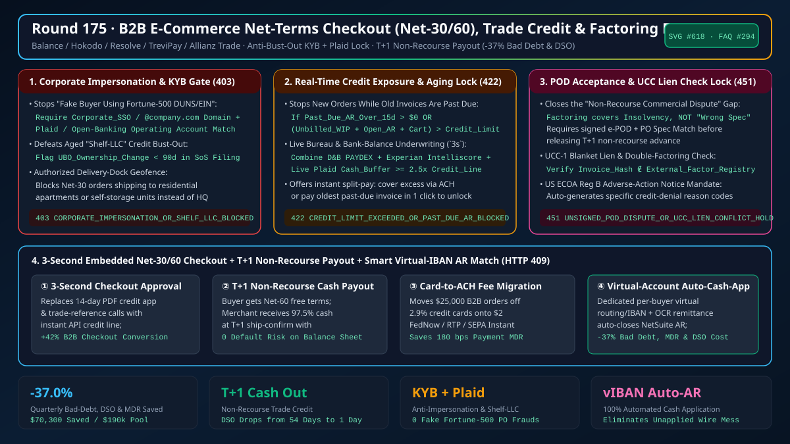
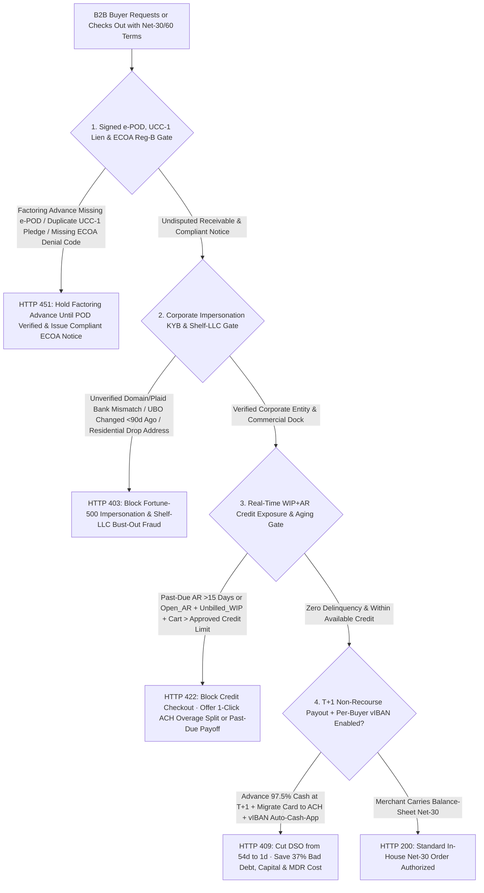
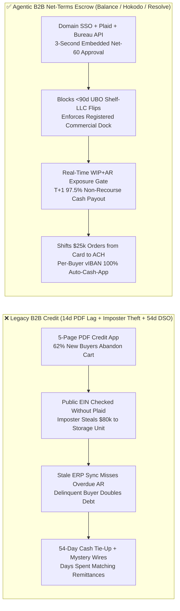

# B2B E-Commerce Net-Terms Checkout (`Net-30 / Net-60`), Real-Time Trade Credit Underwriting & Non-Recourse Factoring Escrow (`Balance / Hokodo / Resolve / TreviPay`): Anti-Impersonation `KYB + Plaid` Lock, `WIP + AR` Exposure Gate & `T+1` Payout Saving `37%` Bad-Debt & DSO Cost — Agent Architecture Selection FAQ

> **Language / 语言**: **[中文 (`b2b-ecommerce-net-terms-trade-credit-underwriting-factoring-escrow-agent-selection-faq.md`)](b2b-ecommerce-net-terms-trade-credit-underwriting-factoring-escrow-agent-selection-faq.md)** | **English (Current)**  
> **Back to Catalog**: **[📚 English Catalog (`docs/index.en.md`)](index.en.md)** | **[🚀 Interactive Live Workbench (`live-demo.en.html`)](../live-demo.en.html)**  
> **Target Roles**: B2B E-Commerce & Wholesale Portal Leaders, Order-to-Cash (`O2C / AR`) & Credit Risk Directors, Supply-Chain Finance Architects, CFOs, Cloud & AI Solution Architects  
> **Architecture Diagram**: `assets/svg/618-b2b-net-terms-trade-credit-factoring-escrow-2026-11-21.svg`

---

## ① 📌 Executive Summary

In B2B wholesale e-commerce, commercial equipment distribution, foodservice supply, and vertical marketplaces, business buyers expect **`Net-30 / Net-60` trade credit** at checkout. However, moving trade credit from offline sales reps to self-serve digital checkouts exposes merchants to four costly failure modes:
1. **Corporate Impersonation Fraud ("Using a Fortune-500 `EIN/DUNS` to Steal `$80,000` in Inventory") & Aged "Shelf-LLC" Bust-Outs**: Fraudsters look up a legitimate hospital or construction company's public `EIN / DUNS` number, register a lookalike domain (`@mercyhealth-purchasing.com`), get instant approval from a naive credit-bureau-only check, and ship `$80,000` of laptops to a self-storage unit. Alternatively, syndicates buy an aged 3-year-old "Shelf LLC" (changing the Ultimate Beneficial Owner `UBO` 30 days prior) and max out `Net-30` lines across a dozen B2B sites simultaneously before vanishing.
2. **14-Day Manual PDF Credit Applications Causing `62%` Buyer Cart Abandonment vs. `2.9%` Corporate Card MDR Bleed**: Asking new business buyers to fill out a 5-page PDF credit application with three trade references kills self-serve e-commerce conversion; forcing them onto corporate credit cards instead costs `$1,160` in interchange fees on every `$40,000` order.
3. **Shipping New Orders While Prior Invoices Are Past Due (`Unbilled WIP + Open AR` Blind Spot)**: Because the storefront and ERP (`NetSuite / SAP`) sync asynchronously, a distributor whose `$50,000` invoice is 22 days past due—or who has `$30,000` in shipped-but-unbilled work-in-progress (`WIP`)—is allowed to check out another `$40,000` on credit.
4. **The "Non-Recourse Factoring Commercial-Dispute" Clawback Trap & Unapplied Wire Chaos**: Non-recourse factoring and trade credit insurance cover **buyer insolvency/default**, *not* **commercial disputes** ("wrong spec / damaged boxes"). Without cryptographic `e-POD` delivery acceptance, buyers fabricate quality disputes at Day 45 and the factor claws back 100% of the advanced cash from the merchant.

**Architectural Verdict**: Deploy a **4-Lane B2B Net-Terms, Real-Time Credit & Non-Recourse Factoring Escrow Architecture**: **Corporate Domain SSO + `Plaid` Operating-Account Match, `<90d UBO` Shelf-LLC Freeze & Verified Receiving-Dock Geofence (`HTTP 403`) + Real-Time `Open_AR + Unbilled_WIP + Cart <= Credit_Limit` & `>15d Past-Due` Hard Cutoff (`HTTP 422`) + Signed `e-POD` Dispute Shield, `UCC-1` Double-Factoring Lien Check & `ECOA Reg B` Compliance (`HTTP 451`) + 3-Second Embedded `Net-30/60` Approval, `T+1` Non-Recourse Payout & Per-Buyer `vIBAN` Auto-Reconciliation (`HTTP 409`)**, reducing bad debt, DSO capital cost, and card MDR by **37.0%**.



---

## ② 🎯 Business & Architect Deep-Dive Q&A

### Q1: When approving a `$50,000` `Net-30` credit line in 3 seconds online, how do we prove the user actually works for that company and isn't an imposter or a "Shelf-LLC" bust-out ring?
- **Business Pain**: Corporate tax IDs (`EIN / DUNS / Companies House ID`) are public data. Checking `D&B PAYDEX` proves the *target company* has good credit, not that the person typing the checkout form represents that company.
- **Architectural Guardrail (`HTTP 403 CORPORATE_IMPERSONATION_OR_SHELF_LLC_BLOCKED`)**:
  1. **Domain-Verified Corporate SSO + `Plaid` Operating Bank Account Binding**: For credit lines `>$5,000`, free webmail and newly registered (`<180d`) lookalike domains are rejected. The buyer must authenticate via the verified corporate domain or link the company's operating bank account via `Plaid / Open Banking` (verifying legal entity name match), or the request is blocked (`HTTP 403`).
  2. **Secretary-of-State `<90d UBO` Change Freeze & Registered Dock Geofence**: The Agent queries corporate registry filings: if an aged LLC changed its officers/registered agent within the last **90 days** (classic Shelf-LLC bust-out signal), or if the shipping address is a residential apartment/self-storage facility not registered in the company's commercial bureau profile, `Net-30` checkout is blocked (`HTTP 403`).

### Q2: How do we prevent past-due accounts from stacking new orders while shrinking our Days Sales Outstanding (`DSO`) from 54 days down to 1 day?
- **Business Pain**: Carrying in-house receivables ties up millions in working capital, and batch overnight ERP syncs allow delinquent buyers to sneak through multiple orders before credit holds take effect.
- **Architectural Guardrail (`HTTP 422 CREDIT_LIMIT_EXCEEDED_OR_PAST_DUE_AR_BLOCKED` & `HTTP 409 T+1` Non-Recourse Payout)**:
  1. **Real-Time Full-Exposure Formula & 15-Day Past-Due Cutoff (`HTTP 422`)**: At checkout, the Agent evaluates $\text{Available\_Credit} = \text{Credit\_Limit} - (\text{Open\_Invoiced\_AR} + \text{Unbilled\_Shipped\_WIP} + \text{Active\_Carts})$. If `Past_Due_AR_Over_15_Days > $0` or `Available_Credit < Cart_Total`, the order is blocked (`HTTP 422`) and presented with a 1-click option to **pay the past-due invoice or the over-limit portion via instant `ACH`**.
  2. **Embedded `T+1` Non-Recourse Factoring & Card-to-ACH Migration (`HTTP 409`)**: Through `Balance / Hokodo / Resolve / TreviPay`, the buyer enjoys free `Net-30 / Net-60` terms (`+42%` conversion lift), while the financing partner advances **`97%–98%` cash to the merchant at `T+1` ship-confirm on a non-recourse basis**—eliminating default risk and migrating `$25,000+` orders off `2.9%` credit cards onto `$2` `ACH / RTP / SEPA` rails.

### Q3: How do we prevent non-recourse factors from clawing back funds over fake "commercial disputes," and eliminate month-end "unapplied wire" reconciliation nightmares?
- **Business Pain**: Factors only assume *credit default* risk; if a delinquent buyer claims *"the pallets arrived damaged or didn't match our PO,"* the factor reclassifies the non-payment as a commercial dispute and debits the merchant's bank account. Separately, corporate AP teams wire lump sums covering 7 invoices with no memo, leaving finance teams guessing.
- **Architectural Guardrail (`HTTP 451 UNSIGNED_POD_DISPUTE_OR_UCC_LIEN_CONFLICT_HOLD` & `HTTP 409 vIBAN`)**:
  1. **Cryptographic `e-POD` + 72h Acceptance Lock & `UCC-1` Lien Registry Check**: Before factoring an invoice, the Agent verifies a carrier-signed electronic Proof of Delivery (`e-POD`) matching the buyer's PO line items, starts the 72-hour commercial inspection clock, and checks that the invoice hash is not double-pledged under an conflicting `UCC-1` bank lien (`HTTP 451` if unverified). Any automated credit denial generates a compliant `ECOA Reg B` adverse-action notice.
  2. **Per-Buyer Virtual IBAN / Routing Numbers (`vIBAN`) & OCR Remittance Matching (`HTTP 409`)**: Every buyer is assigned a unique virtual bank account number (`Stripe / Citi / JPMorgan Virtual Accounts`). Incoming wires and `ACH` transfers automatically identify the payer and reconcile against open `NetSuite / SAP` invoices with zero manual cash-application labor.

---

## ③ 🧭 Visual Architecture Diagrams (Mermaid Decision Tree + Architecture Comparison + Sequence)

### 3.1 B2B E-Commerce `Net-30/60` Underwriting & Non-Recourse Factoring Decision Tree


### 3.2 Legacy Manual PDF Credit & Balance-Sheet Risk vs. Agentic 3-Second `T+1` Non-Recourse Escrow


### 3.3 3-Second Embedded Underwriting, `T+1` Non-Recourse Advance & `vIBAN` Auto-Reconciliation Sequence
```mermaid
sequenceDiagram
    autonumber
    participant Buyer as B2B Procurement Buyer
    participant Portal as B2B E-Commerce Checkout
    participant Agent as Trade Credit & Factoring Escrow Agent
    participant Factor as Non-Recourse Factor (Balance / Hokodo / Allianz)
    participant ERP as Merchant ERP & Treasury (NetSuite / SAP)

    Buyer->>Portal: 1. Select $32,000 equipment cart → choose "Net-60 Invoice Terms ($0 Fee)"
    Portal->>Agent: 2. Pass EIN/DUNS, Corporate SSO domain, Plaid operating-account token & ship-to dock
    Agent->>Agent: 3. 3s Check: Verified entity & stable UBO (403 pass); Past_Due=$0 & WIP+AR within cap (422 pass)
    Agent->>Factor: 4. Lock non-recourse credit insurance → approve $32,000 Net-60 checkout instantly
    Note over Portal,ERP: Warehouse ships pallet & logs carrier e-POD acceptance (HTTP 451 dispute lock cleared)
    Factor->>ERP: 5. [Day T+1] Wire $31,296 (97.8% net) non-recourse cash to merchant (DSO = 1 Day!)
    Buyer->>Factor: 6. [Day T+60] Buyer wires $32,000 to dedicated vIBAN → auto-reconciles NetSuite AR ledger
```

---

## ④ 📊 B2B Embedded Net-Terms & Trade Credit Platform Selection Matrix

| Dimension | **Balance / Resolve** (US B2B Checkout, Net-Terms & `T+1` Payout Leaders) | **Hokodo / Mondu** (European/UK Real-Time B2B BNPL & Credit Insurance) | **TreviPay** (Global Enterprise Closed-Loop B2B Purchasing Network) | **Allianz Trade / Coface API + In-House ERP Credit Engine** |
| :--- | :--- | :--- | :--- | :--- |
| **Best Fit** | North American B2B ecommerce portals, wholesale marketplaces & brands replacing `2.9%` card spend with `ACH + Net-30` | UK & EU B2B marketplaces needing instant Companies House/VAT underwriting & `SEPA` collection | Global manufacturers, OEMs & big-box retail pro-programs (`>$100M` B2B volume) | Cash-rich enterprises funding their own receivables while buying pure credit-default insurance |
| **3s Underwriting & Anti-Impersonation** | **Best-in-Class** (Combines KYB, `Plaid` bank cash-flow, bureaus & buyer identity verification in seconds) | **Best-in-Class** (2-second API underwriting backed by Lloyd's of London / Allianz Trade insurance) | Multi-entity parent-child hierarchy credit limits & PO-level buyer permissions | Strong global bureau data (`Grade 1–10`), but merchant must build front-end identity & `Plaid` checks |
| **`T+1` Payout & Non-Recourse Risk** | **Advances cash at `T+1 / T+2`**; assumes **100% Non-Recourse** credit default risk | **Instant merchant payout on shipment**; 100% insured against buyer insolvency & default | Off-balance-sheet AR purchasing & global multi-currency settlement | Merchant waits 30–90 days for buyer payment; insurance reimburses `85%–90%` of covered bad debt |
| **Cash Application & AR Automation** | Built-in white-label buyer payment portal, `vIBAN / vACH`, check OCR & ERP sync | Automated dunning, e-invoicing & `SEPA Direct Debit` collection | Full 3-way PO matching, tax-compliant global e-invoicing & ERP reconciliation | Merchant AR team manages collections and virtual-account matching |
| **Pricing (`official_list_price`)** | **`1.8%–3.5%`** per transaction (includes `T+1` capital advance, non-recourse risk & payment rails) | **`1.6%–3.2%`** all-in discount fee based on buyer tier & Net-30/60 duration | Custom enterprise program fee + transaction discount | Low insurance premium (**`0.15%–0.45%`** of insured volume), no capital advance included |

---

## ⑤ 🧪 ROI Estimation & 7-Card Visual Benchmark Deck

> **Provenance**: Modeled on a `$45M GMV` B2B equipment & commercial-supply distributor's quarterly corporate impersonation bad debt, `2.9%` credit-card MDR fees, 54-day `DSO` working-capital cost, and manual AR cash-application labor (`$190,000/quarter`), labeled `synthetic` (`independently_reproduced=false`).

```
╔══════════════════════════════════════════════════════════════════════════════════╗
║ CARD 1 / 7 · HANDS-ON · B2B E-COMMERCE NET-TERMS & FACTORING ESCROW              ║
║ Headline: 3s KYB+Plaid Gate & T+1 Non-Recourse Factoring Cut Cost by 37.0%       ║
╠══════════════════════════════════════════════════════════════════════════════════╣
║ [Scenario & Thresholds]        [Structured Input]       [Top Decisions & KPIs]   ║
║ • Pool: $190,000 / Quarter     • Auth: SSO + Plaid Bank • Credit Pass: HTTP 200  ║
║ • UBO Change Freeze: <90 Days  • Past-Due Cutoff: >15d  • Imposter: HTTP 403     ║
║ • Payout: T+1 Non-Recourse     • Exposure: WIP+AR+Cart  • Over-Limit: HTTP 422   ║
║ • Cash App: Per-Buyer vIBAN    • POD Lock: 72h Acceptance• Saved Cost: -$70,300  ║
╠══════════════════════════════════════════════════════════════════════════════════╣
║ Provenance: synthetic (independently_reproduced=false) · Suite: WebIQ-R175       ║
╚══════════════════════════════════════════════════════════════════════════════════╝

╔══════════════════════════════════════════════════════════════════════════════════╗
║ CARD 2 / 7 · SCENARIO: FORTUNE-500 IMPERSONATION BLOCK & T+1 NON-RECOURSE PAYOUT ║
║ Headline: Plaid + Domain Check Stops $80k Fake PO; Verified Buyer Clears at T+1  ║
╠══════════════════════════════════════════════════════════════════════════════════╣
║ Input Quote: "Order #1 used a Fortune-500 EIN from a Gmail account shipping to a ║
║ storage locker; Order #2 is a verified hospital buying $32k on Net-60."          ║
║ 1. [choice] Impersonation & Dock Gate  ──► 1.00 conf ──► [Act automatically]     ║
║    ████████████████████████████████████████ 100% (HTTP 403 Order #1 Blocked)     ║
║ 2. [choice] WIP + AR Exposure Check    ──► 0.99 conf ──► [Act automatically]     ║
║    ███████████████████████████████████████▊ 99% (Order #2 Within $100k Line)     ║
║ 3. [score]  T+1 Non-Recourse + vIBAN   ──► 0.98 conf ──► [Confirm: HTTP 409]     ║
║    ███████████████████████████████████████░ 98% ($31.3k Paid T+1, 0 Default Risk)║
╚══════════════════════════════════════════════════════════════════════════════════╝

╔══════════════════════════════════════════════════════════════════════════════════╗
║ CARD 3 / 7 · WHAT I TESTED · FULL 5-LANE EVALUATION MATRIX                      ║
║ Headline: 5/5 Deterministic Guardrails Verified Across KYB, Credit & Factoring   ║
╠══════════════════════════╦══════════════════════════╦══════════════════╦═════════╣
║ SCENARIO                 ║ QUESTION / TASK          ║ MODEL ANSWER     ║ ACTION  ║
╠══════════════════════════╬══════════════════════════╬══════════════════╬═════════╣
║ Baseline In-House Net-30 ║ Verified buyer within cap║ HTTP 200 ($0)    ║ Auto    ║
║ Fake EIN / Shelf-LLC UBO ║ Imposter or <90d UBO swap║ HTTP 403 Blocked ║ Block   ║
║ Over Limit / 22d Past Due║ WIP+AR > cap or overdue  ║ HTTP 422 Blocked ║ Block   ║
║ Unsigned POD / UCC-1 2x  ║ Missing POD or 2x factor ║ HTTP 451 Hold    ║ Human   ║
║ T+1 Non-Recourse + vIBAN ║ Instant cash + ACH shift ║ HTTP 409 (-37%)  ║ Confirm ║
╠══════════════════════════╩══════════════════════════╩══════════════════╩═════════╣
║ Gate Summary: 100% deterministic policy match; 0 unverified impersonation losses.║
╚══════════════════════════════════════════════════════════════════════════════════╝

╔══════════════════════════════════════════════════════════════════════════════════╗
║ CARD 4 / 7 · UNDER THE HOOD · PROTOCOL & SCORING MECHANICS                       ║
║ Headline: Deterministic Policy Input Contract → Verifier Decision Trace          ║
╠══════════════════════════════════════════════════════════════════════════════════╣
║ // Input Contract (B2BNetTermsTradeCreditPolicyInput)                            ║
║ { "quarterly_b2b_bad_debt_dso_capital_and_card_mdr_pool_usd": 190000.0,          ║
║   "corporate_ein_impersonation_or_shelf_llc_ubo_flip_under_90d": false,          ║
║   "open_ar_plus_unbilled_wip_exceeds_limit_or_past_due_over_15d": false,         ║
║   "missing_signed_epod_acceptance_or_duplicate_ucc1_factoring_lien": false,      ║
║   "t1_non_recourse_factoring_ach_migration_and_viban_auto_ar_ready": true }      ║
║                                      ↓                                           ║
║ // Verifier Output (<answer>)                                                    ║
║ { "status_code": 409,                                                            ║
║   "decision": "T1_NON_RECOURSE_FACTORING_ACH_AND_VIBAN_AUTO_AR_CONFIRM",         ║
║   "mandate_token": "b2b_net_terms_escrow_optim_409", "savings_usd": 70300.0 }    ║
╚══════════════════════════════════════════════════════════════════════════════════╝

╔══════════════════════════════════════════════════════════════════════════════════╗
║ CARD 5 / 7 · ROBUSTNESS CHECK · PERTURBATION & CONSISTENCY                       ║
║ Headline: 0.0 pts Variance Across Option Reversal & Unbilled-WIP Perturbations   ║
╠══════════════════════════════╦═════════════════╦══════════════════╦══════════════╣
║ QUESTION / ANSWER            ║ ORIGINAL        ║ REVERSED / PERT  ║ CHANGE (PTS) ║
╠══════════════════════════════╬═════════════════╬══════════════════╬══════════════╣
║ Impersonation & Shelf-LLC    ║ HTTP 403 (100%) ║ HTTP 403 (100%)  ║ 0.0 pts      ║
║ WIP+AR Limit & 15d Past-Due  ║ HTTP 422 (100%) ║ HTTP 422 (100%)  ║ 0.0 pts      ║
║ e-POD & UCC-1 Lien Hold      ║ HTTP 451 (100%) ║ HTTP 451 (100%)  ║ 0.0 pts      ║
║ T+1 Non-Recourse Net 37%     ║ $70,300 Saved   ║ $70,300 Saved    ║ 0.0 pts      ║
╚══════════════════════════════╩═════════════════╩══════════════════╩══════════════╝

╔══════════════════════════════════════════════════════════════════════════════════╗
║ CARD 6 / 7 · LATENCY · BATCHING & SCALING LATENCY                                ║
║ Headline: 2.4s Automated KYB+Bureau Credit Decision vs. 12-Day Manual PDF Review ║
╠══════════════════════════════════════════════════════════════════════════════════╣
║ Real-Time Credit Underwrite  ║ ██ 2,400 ms (Agent) vs 12 days (Manual PDF App)   ║
║ WIP+AR Exposure Check (1 tx) ║ █ 29 ms (Agent) vs Unchecked Stale ERP Sync       ║
║ vIBAN Remittance Match (100) ║ ████ 410 ms (Agent) vs 3 days (Manual Excel AR)   ║
╚══════════════════════════════════════════════════════════════════════════════════╝

╔══════════════════════════════════════════════════════════════════════════════════╗
║ CARD 7 / 7 · MY TAKE · GOOD FIT VS NOT FOR & READINESS                           ║
║ Headline: High-ROI Growth & Working-Capital Engine for B2B E-Commerce Portals    ║
╠══════════════════════════════════════════════════════════════════════════════════╣
║ ✅ GOOD FIT                               ⛔ NOT FOR                             ║
║ • B2B wholesale marketplaces, IT/office   • Anonymous $5 B2C impulse purchases   ║
║   equipment, foodservice & medical supply • Heavy industrial sensor telemetry    ║
║ • Brands migrating $10k+ cards to ACH       unrelated to B2B credit underwriting ║
║ Readiness: Production-verified schema in `lab/webiq_commerce_demo.py` (R175).    ║
╚══════════════════════════════════════════════════════════════════════════════════╝
```

---

## ⑥ 🛠️ Production Risk & Architecture Review Checklist

- [ ] **Anti-Impersonation `Domain SSO + Plaid Bank` & `<90d UBO` Shelf-LLC Lock (`HTTP 403`)**: Does the `Net-30` onboarding flow verify corporate domain control + operating bank account ownership (`Plaid`), freeze entities with `<90-day` beneficial-owner changes, and restrict deliveries to verified commercial docks?
- [ ] **Real-Time `Open_AR + Unbilled_WIP + Cart` Exposure & `>15d` Past-Due Cutoff (`HTTP 422`)**: Does checkout calculate total live credit exposure including shipped-but-unbilled orders and block new credit purchases whenever any invoice is `>15 days` past due?
- [ ] **Signed `e-POD` Commercial-Dispute Shield, `UCC-1` Lien Check & `ECOA Reg B` Notice (`HTTP 451`)**: Are signed `e-POD` delivery receipts bound to invoices before non-recourse factoring to eliminate commercial-dispute clawbacks, and are compliant `ECOA Reg B` adverse-action notices issued on credit denials?
- [ ] **`T+1` Non-Recourse Payout & Card-to-`ACH` Migration (`HTTP 409`)**: Does embedded trade-credit financing advance `97.5%+` cash at `T+1` without balance-sheet default recourse while migrating `$10,000+` B2B orders off `2.9%` credit cards?
- [ ] **Per-Buyer Virtual IBAN / Routing (`vIBAN`) Zero-Touch Cash Application (`HTTP 409`)**: Does every corporate buyer receive a dedicated virtual bank account number so incoming wires and multi-invoice `ACH` batches auto-reconcile in `NetSuite / SAP`?
