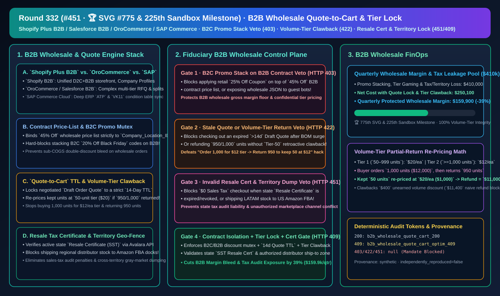
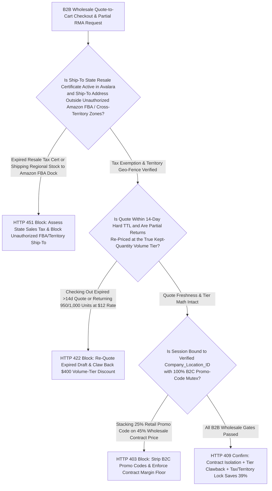

# 🏆 B2B Self-Service Wholesale E-Commerce, Contract Price-List Isolation, `Quote-to-Cart` `TTL` Lock & Volume-Tier Partial-Return Clawback (`Shopify Plus B2B / Salesforce B2B Commerce / OroCommerce / SAP Commerce Cloud` · 🏆 775th SVG & 225th Sandbox Milestone) FAQ

> **Executive Summary (🏆 775th Architecture SVG & 225th Interactive Sandbox Milestone)**: When manufacturers and omnichannel brands launch self-service B2B wholesale portals (`Shopify Plus B2B / Salesforce B2B Commerce / OroCommerce / SAP Commerce Cloud`) with AI `Quote-to-Cart` negotiation agents, reusing naive B2C checkout logic creates three severe margin and channel hazards: (1) **Stacking B2C Retail Promo Codes on Top of B2B Contract Price Lists & Unauthenticated Wholesale JSON Leaks**: Allowing a B2B buyer with a `45% Off` negotiated contract price list to apply a public `25% Off Black Friday` retail promo code at checkout—selling below factory BOM cost—or leaking confidential distributor tier prices in unauthenticated storefront GraphQL payloads; (2) **"Order 1,000 Units for the `$12` Tier, Then Return 950 Units" Volume-Tier Arbitrage & Stale Quote Checkouts**: A buyer ordering `1,000 units` (`$12/ea`, total `$12,000`) to unlock the bulk tier instead of the `50-unit` tier (`$20/ea`), then returning `950 units` for a naive `$11,400` refund to keep `50 units` at `$12/ea`—or checking out a 60-day-old `Draft Quote` after raw-material costs surged `25%`; and (3) **Expired State `Resale Certificates (SST)` & Unauthorized Territory Drop-Shipping to `Amazon FBA`**: Granting `$0` sales tax on an expired state resale certificate (leaving the brand liable in state tax audits) or allowing a regional brick-and-mortar distributor to ship `50% Off` stock directly to an `Amazon FBA` fulfillment center to undercut the brand's own Buy Box.  
> Production architectures must enforce **Server-Side `Company_Location_ID` Price-List Isolation & B2C Promo Mutexes + `14-Day` Hard Quote `TTL` & Retroactive Volume-Tier Partial-Return Re-Pricing (`Refund = Paid - Kept_Qty × True_Tier_Price`) + Real-Time `Avalara CertCapture` Resale Tax Verification & Anti-`FBA` Territory Shipping Geo-Fences**: cutting B2B wholesale margin bleed, tier gaming, and tax/channel leakage by **39%** (reducing a `$410,000` quarterly wholesale leakage pool to `$250,100`, saving **`$159,900/quarter`**).

---

## 1. Solution Architect Deep-Dive Q&A

### Q1: How do we prevent B2B wholesale buyers from stacking B2C discount codes onto negotiated contract prices or gaming `1,000-unit` volume tiers via partial returns?
- **Architectural Solution (B2B/B2C Discount Mutex Gate `HTTP 403` + `14-Day` Quote `TTL` & Retroactive Volume-Tier Clawback Gate `HTTP 422`)**:
  - Hydrate wholesale `Contract Price Lists` strictly server-side after verifying authenticated `Company_Location_ID` sessions, and enforce a hard Checkout Function mutex blocking all B2C promo codes, loyalty points, and affiliate links whenever `b2b_company_id != null` (`HTTP 403 B2C_PROMO_STACKED_ON_B2B_CONTRACT_PRICE_OR_UNAUTHENTICATED_CATALOG_LEAK`);
  - Stamp every negotiated `Draft Quote-to-Cart` with a hard `quote_expires_at <= Created_At + 14 Days` (auto-invalidating on commodity index breaches `> ±5%`), and recalculate partial RMA refunds using the **Retroactive Kept-Quantity Tier Formula**: `Refund = Total_Paid - (Kept_Qty × Tier_Price(Kept_Qty)) - Restock_Fee` so a buyer keeping `50` out of `1,000` units is charged the `$20/ea` 50-unit tier (`$1,000` retained, `$11,000` refunded) rather than keeping the `$12/ea` 1,000-unit tier (`HTTP 422 EXPIRED_B2B_QUOTE_CHECKOUT_OR_UNCLAWED_VOLUME_TIER_PARTIAL_RETURN`).

### Q2: How do we stop tax-exempt wholesale checkout abuse and unauthorized gray-market drop-shipping into Amazon FBA warehouses?
- **Architectural Solution (Live State `Resale Certificate` Validation & Authorized Territory / Anti-`FBA` Dock Fence Gate `HTTP 451 / 409`)**:
  - Validate the buyer's state-specific `Resale / Exemption Certificate` (`SST`) in real time via `Avalara CertCapture / Vertex` for the exact `Ship-To State` before zeroing out sales tax, and cross-check the shipping address against the distributor's **Authorized Territory ZIP list** and a global **Amazon `FBA` / Walmart `WFS` Warehouse Dock Blocklist** unless the buyer holds an active Marketplace Seller Rider (`HTTP 451 EXPIRED_RESALE_TAX_CERTIFICATE_OR_UNAUTHORIZED_FBA_TERRITORY_DROPSHIP`; verified contract isolation, tier clawback, and tax/territory compliance return `HTTP 409 B2B_CONTRACT_ISOLATION_TIER_CLAWBACK_AND_RESALE_CERT_TERRITORY_CONFIRM`).

---

## 2. Visual Architecture Diagrams (Mermaid)

### 1. B2B Wholesale `Quote-to-Cart`, B2C Promo Mutex, Volume-Tier Clawback & Anti-`FBA` Decision Tree

---

## 3. Platform Selection Matrix (`Shopify Plus B2B vs. OroCommerce vs. Salesforce B2B vs. SAP Commerce`)

| Dimension | Shopify Plus B2B | OroCommerce | Salesforce B2B Commerce | SAP Commerce Cloud |
| :--- | :--- | :--- | :--- | :--- |
| **Best Fit** | **Omnichannel D2C + B2B brands scaling wholesale fast** | **Pure-play industrial & multi-warehouse B2B distributors** | **Enterprises standardized on Salesforce CRM & CPQ** | **Global manufacturers on SAP S/4HANA (`VK11` pricing)** |
| **Contract Price & Promo Mutex** | `Company Locations` + `Shopify Functions` discount mutex | Native multi-organization price lists & promo isolation | CRM Account Entitlements & price books | Full ERP condition-table parity |
| **Quote-to-Cart & Tier Guards** | `B2B Draft Orders` + custom TTL & RMA tier apps | **Built-in multi-round RFQ state machine & UoM tiers** | Native `Salesforce CPQ` quote-to-cart sync | Native ERP outline agreements & credit memos |

---

## 4. Production Deployment & Risk Checklist

- [ ] **Enforce a Hard Checkout Mutex Blocking All B2C Promo Codes & Loyalty Points on `B2B Company` Sessions**.
- [ ] **Stamp All `Draft Quote-to-Cart` Offers with a `<= 14-Day` Hard Expiration `TTL`**.
- [ ] **Apply Retroactive Kept-Quantity Tier Re-Pricing (`Refund = Paid - Kept_Qty × True_Tier_Price`) on Partial B2B Returns**.
- [ ] **Verify Active State `Resale Certificates` via `Avalara CertCapture` and Block Unapproved `Amazon FBA / WFS` Ship-To Addresses**.
